# AWS Certified AI Business Strategist (AIB-C01) 完全対策＆実践学習ガイド

- **対象資格**: AWS Certified AI Business Strategist
- **試験コード**: AIB-C01
- **公式試験ガイド**: [AWS Certified AI Business Strategist (AIB-C01) 試験ガイド](https://docs.aws.amazon.com/ja_jp/aws-certification/latest/ai-business-strategist-01/ai-business-strategist-01.html)
- **最終更新日**: 2026-10-11

---

## はじめに

企業のデジタルトランスフォーメーションにおいて、人工知能（AI）、とりわけ基盤モデル（Foundation Models: FM）を中心とする生成 AI（Generative AI: GenAI）や自律型 AI エージェントの台頭は、これまでの業務効率化の枠を超え、ビジネスモデル自体の抜本的な再定義を迫っています。
しかし、AI を単なる実験的 PoC（概念実証）にとどめず、実際の事業価値創出へとスケールさせる過程では、多くの組織が「ROI（投資対効果）の不透明性」「データ基盤の未整備」「シャドー AI や法的・倫理的リスク（バイアス、知的財産侵害、EU AI Act 等）」「組織文化の抵抗と人材育成の遅れ」という深刻な障壁に直面しています。

本試験 **AWS Certified AI Business Strategist (AIB-C01)** は、このような技術的実装者とビジネス経営陣の間に存在するギャップを埋め、AI の潜在力を確実なビジネス成果へと変換できる戦略的リーダーを評価・認定するために創設された試験です。
本ガイドは、単なる用語やツールの暗記にとどまらず、バーバラ・ミントのピラミッド原則に基づく明快な論理構造と、実務の意思決定プロセスを疑似体験できる「構造化実践シナリオ（状況 / 対応 / 結果 / 解説）」を通じて、試験合格および実務での最高水準の戦略的意思決定能力の習得を目的としています。

### AIB-C01 試験とは

本試験は、組織やクライアント企業における AI イニシアチブの評価、推進、全社展開をリードするビジネスプロフェッショナルを対象としています。
技術的なコーディング、モデルトレーニングの数式、データパイプラインの実装、AWS インフラストラクチャの構築・運用（EC2、VPC、IAM ポリシーの記述等）は **出題範囲外（Out of Scope）** であり、**戦略的意思決定、ガバナンス構築、組織変革、ビジネス価値測定** が最優先で評価されます。

- **試験時間**: 130 分
- **出題問題数**: 65 問
- **出題形式**: 択一選択問題（4 択）、複数選択問題（5 肢以上から 2 肢以上選択）
- **合格基準点**: 100〜1,000 点中 700 点以上（Compensatory Scoring: セクションごとの足切りはなく総合得点で判定）
- **前提知識**: AWS の AI/ML サービス群（Amazon Bedrock、Amazon SageMaker AI、Amazon Quick 等）の戦略的特徴と適用限界、AWS Cloud Adoption Framework (AWS CAF)、AWS 責任共有モデル、コストモデル、および責任ある AI 原則を理解し、ビジネス意思決定に適用できる能力。

### 難易度と求められる思考力

本試験で問われるのは、「AI サービスの API 仕様」ではなく、**「ビジネス課題に対して、どの手段が最も投資対効果と実現性が高く、かつ持続可能で安全か」というトレードオフの洞察力** です。
例えば以下のような戦略的トレードオフの判断が問われます。
1. **手段の選定**: 単純な決定論的ルールベースで解くべきか、予測機械学習か、生成 AI か、自律型 AI エージェントか。
2. **調達方式の判断 (Build vs Buy vs Partner)**: 既製品 SaaS を導入すべきか、マネージド基盤（Amazon Bedrock）でカスタマイズすべきか、AWS Marketplace を通じた協業を行うべきか。
3. **投資とリスクの均衡**: 早期の市場投入（スピード）と、責任ある AI 原則（公平性・説明可能性・知的財産保護・規制遵守）の遵守のバランスをいかに取るか。
4. **組織変革の推進**: 技術インフラだけでなく、従業員の文化的抵抗やリテラシー格差をどのように克服し、段階的（Envision → Experiment → Launch → Scale）に全社展開へ導くか。

### 推奨の勉強法

1. **公式一次ドキュメントおよびフレームワークの精読**:
   AWS Cloud Adoption Framework (AWS CAF)、AWS Well-Architected Framework (Responsible AI Lens)、AWS 責任共有モデル（AI ワークロード版）、および ISO/IEC 42001 などの国際標準を深く理解します。
2. **各 AWS AI サービスの戦略的ポジショニングの整理**:
   Amazon Bedrock（マネージド生成 AI プラットフォーム）、Amazon SageMaker AI（カスタム ML ライフサイクル管理）、Amazon Quick（AI 搭載ビジネスインテリジェンス）の差異と、コスト構造（従量課金 vs インスタンス課金 vs 席数課金）を把握します。
3. **構造化実践シナリオによる意思決定の追体験**:
   本ガイドに収録された全タスク網羅のシナリオ（状況・対応・結果・解説）を読み込み、特に「なぜ他の選択肢では要件を満たせないのか（棄却理由）」の論理を確実に血肉化します。

---

## 目次

1. [はじめに](#はじめに)
2. [学習カリキュラム・出題範囲ロードマップ](#学習カリキュラム出題範囲ロードマップ)
3. [Domain 1: AI の基礎とリテラシー (24%)](#domain-1-ai-の基礎とリテラシー-24)
4. [Domain 2: AI 戦略とビジネス価値の創出 (28%)](#domain-2-ai-戦略とビジネス価値の創出-28)
5. [Domain 3: AI ガバナンスと責任ある AI のリーダーシップ (24%)](#domain-3-ai-ガバナンスと責任ある-ai-のリーダーシップ-24)
6. [Domain 4: ビジネスの対応体制、リーダーシップ、AI による組織変革 (24%)](#domain-4-ビジネスの対応体制リーダーシップai-による組織変革-24)
7. [まとめと推奨学習ステップ](#まとめと推奨学習ステップ)

---

## 学習カリキュラム・出題範囲ロードマップ

### セクション一覧と出題比率

本試験は全 4 つのドメインで構成されており、Domain 2（AI 戦略とビジネス価値の創出）が 28% と最大比率を占めるものの、残る 3 つのドメインもそれぞれ 24% と均等に配分されています。技術リテラシー、戦略策定、ガバナンス統制、組織変革の 4 つの柱が完全にバランスした試験設計となっています。

| ドメイン番号 | 出題分野（Domain） | 出題比率 | 主要対象サービス・技術要素・フレームワーク |
| :--- | :--- | :--- | :--- |
| **Domain 1** | AI の基礎とリテラシー | 24% | AI/ML/GenAI 概念境界, 構造化/非構造化データ, データ品質, ISO/IEC 23053/42001, ルールベース vs AI, AI エージェント, モデルドリフト, シャドー AI 統制, プロンプトエンジニアリング, コンテキストウィンドウ, RAG, ファインチューニング |
| **Domain 2** | AI 戦略とビジネス価値の創出 | 28% | 業務機能別ユースケース, Build vs Buy vs Partner, イニシアチブ優先順位付け, AI 不適格判断, 有形/無形 KPI, ベースラインメトリクス, ROI 算出フレームワーク, 先行指標, AWS コスト構造 (従量/インスタンス/席数/Savings Plans/Cost Explorer), 競争優位性 |
| **Domain 3** | AI ガバナンスと責任ある AI のリーダーシップ | 24% | 責任ある AI 6 原則, トレードオフ管理, Governance by Design, HITL, Amazon Bedrock Guardrails, クロスファンクショナルガバナンス, 規制遵守 (EU AI Act 等), リスク分類, バイアスドリフト, 知的財産保護 |
| **Domain 4** | ビジネスの対応体制、リーダーシップ、AI による組織変革 | 24% | AI 準備状況評価, AI 成熟度モデル, ケイパビリティギャップ分析, データ準備状況, AWS CAF, スポンサーシップ, AI チャンピオン, 組織文化変革, AI リテラシー育成, 段階的変革 (Envision/Experiment/Launch/Scale), AI COE, スケーリング要件 |

---

### ドメイン別出題詳細

#### Domain 1: AI の基礎とリテラシー (24%)
- **出題の狙い**: ビジネスリーダーが技術チームやベンダーと対等に対話し、正しい技術選択を下すための AI/ML/GenAI の基礎語彙、データ要件、エージェント技術、生成 AI の基本メカニズムを理解しているかを検証します。
- **主要タスク**:
  - Task 1.1: 主要な AI の概念と用語を説明する（ビジネス文脈での概念、AI/ML/GenAI の差異、データ型とデータ品質、履歴学習、ISO/IEC 23053/42001）
  - Task 1.2: 適切な AI ソリューションタイプを特定・選択する（ルールベース自動化 vs AI、AI エージェントのコア機能、モデルドリフトと継続監視、シャドー AI 対策と承認分類）
  - Task 1.3: 生成 AI の概念と手法を適用する（プロンプトエンジニアリング原則、トークン上限とコンテキストウィンドウ、RAG vs ファインチューニングのビジネス適合）
- **重要キーワード**: AI / ML / Deep Learning / Generative AI, Structured / Unstructured Data, Data Quality, ISO/IEC 42001, Rule-based Automation, AI Agents, Model Drift, Shadow AI, Prompt Engineering, Context Window, Tokens, RAG, Fine-tuning

#### Domain 2: AI 戦略とビジネス価値の創出 (28%)
- **出題の狙い**: 組織目標に合致した AI 戦略を策定し、高インパクトなユースケースの優先順位付け、Build-Buy-Partner の判断、および有形・無形のビジネス価値を定量的に測定・実証する能力を検証します。
- **主要タスク**:
  - Task 2.1: ビジネス目標に沿った AI 戦略を策定する（機能別ユースケースと成果マッピング、Build vs Buy vs Partner 評価、優先順位付けと終了判断、AI 不適格ユースケース、移行時の考慮事項）
  - Task 2.2: AI のビジネス価値を測定・実証する（有形/無形 KPI、ベースラインメトリクス、総合的 ROI 算出、先行指標、コスト構造管理と最適化）
  - Task 2.3: 競争優位に向けた AI の位置づけを確立する（競争環境評価、ビジネスモデル変革、持続的優位性、投資水準決定）
- **重要キーワード**: Build vs Buy vs Partner, High-Impact Use Cases, Tangible / Intangible KPIs, Baseline Metrics, ROI Framework, Leading Indicators, Consumption / Instance / Seat-based Pricing, AWS Cost Explorer, AWS Pricing Calculator, AWS Marketplace, Competitive Advantage

#### Domain 3: AI ガバナンスと責任ある AI のリーダーシップ (24%)
- **出題の狙い**: 倫理原則、法的規制、組織リスクを包括的に管理し、ビジネス目標と安全性のトレードオフを適切に判断しながら、組織的なガバナンス体制を指揮する能力を検証します。
- **主要タスク**:
  - Task 3.1: 責任ある AI の原則をビジネス上の意思決定に適用する（責任ある AI 6 原則、ビジネス目標とのトレードオフ、Governance by Design、HITL とセーフガード設計）
  - Task 3.2: AI ガバナンス体制を確立し規制コンプライアンスを担保する（クロスファンクショナル体制、規制遵守リスク、アクセス制御とデータセキュリティ、リスク分類フレームワーク）
  - Task 3.3: エンタープライズ AI リスクを特定し軽減策を指揮する（本番監視、バイアスドリフト、有害コンテンツと知的財産管理、信頼性リスク軽減）
- **重要キーワード**: Responsible AI Principles (Fairness, Explainability, Privacy, Safety, Transparency, Robustness), Governance by Design, Human-in-the-Loop (HITL), Amazon Bedrock Guardrails, Cross-functional Governance, Regulatory Compliance, AI Risk Classification, Bias Drift, Intellectual Property (IP) Protection

#### Domain 4: ビジネスの対応体制、リーダーシップ、AI による組織変革 (24%)
- **出題の狙い**: 組織の成熟度を評価し、強固なデータ基盤とインフラを確立した上で、チェンジマネジメントと人材育成を通じて AI をパイロットから全社規模へとスケールさせるリーダーシップを検証します。
- **主要タスク**:
  - Task 4.1: AI ビジネス対応体制と成熟度を評価する（準備状況の多面評価、AI 成熟度モデル、ケイパビリティギャップ分析、投資優先順位策定）
  - Task 4.2: AI のためのデータとインフラの基盤を確立する（データ準備状況、データサイロ解消、データ戦略とオーナーシップ、AWS CAF 基盤評価）
  - Task 4.3: 全社的な変革を主導し AI に対応した人材ケイパビリティを育成する（エグゼクティブスポンサーシップ、AI チャンピオン、チーム組成、文化障壁克服、全社 AI リテラシー、人間の役割の高度化）
  - Task 4.4: AI をパイロットから全社展開へとスケールさせる（段階的変革手法、短期クイックウィンからスケール、AI COE 設立、継続的フィードバック、本番運用基準への移行）
- **重要キーワード**: AI Readiness & Maturity Models, Capability Gaps, Data Silos, Data Governance & Ownership, AWS Cloud Adoption Framework (AWS CAF), Executive Sponsorship, AI Champions, Change Management, AI Center of Excellence (COE), Iterative Scaling (Envision, Experiment, Launch, Scale)

---

## Domain 1: AI の基礎とリテラシー (24%)

Domain 1 では、AI ストラテジストとして必要な技術的語彙の正確な把握、ソリューションタイプの適切な識別、生成 AI の基本特性と適応技術の理解が問われます。数式やコーディングの知識ではなく、「どのようなデータと技術特性がビジネスの実現可能性を左右するのか」を判断するリテラシーが主眼となります。

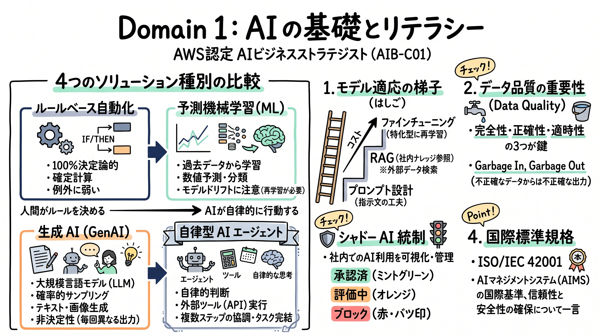

---

### 1. セクション概要

AI ストラテジストは、技術的なブラックボックスを解体し、ビジネス上の意思決定に直結する概念構造として整理する必要があります。本セクションの核心は以下の 3 点に集約されます。
1. **技術の階層と境界の識別**: 人工知能（広義）、機械学習（統計的パターン認識）、深層学習（表現学習）、生成 AI（新規コンテンツ生成）、自律型 AI エージェント（環境認識・ツール実行・自律的意思決定）の違いを峻別し、課題に応じた最適な技術を選択する。
2. **データの性質と品質の決定性**: 機械学習や生成 AI の出力精度は投入されるデータの品質に直結する（Garbage In, Garbage Out）。構造化データと非構造化データの特性を理解し、モデルのドリフト（性能劣化）に対処する。
3. **生成 AI のメカニズムと適合手法**: コンテキストウィンドウとトークンの制約を把握し、ビジネス固有の要件を満たすために「プロンプトエンジニアリング」「RAG（検索拡張生成）」「ファインチューニング」のいずれを適用すべきかを判断する。

#### 重要キーワード

- **アルゴリズム (Algorithm) とモデル (Model)**: アルゴリズムはデータからパターンを学ぶ計算手順であり、モデルはその学習結果として生成された推論プログラム（知識の成果物）。
- **トレーニング (Training) と推論 (Inference)**: トレーニングは履歴データからモデルを構築する高負荷な学習フェーズ、推論は完成したモデルに未知のデータを入力して予測や生成を行う運用フェーズ。
- **構造化データ (Structured Data) vs 非構造化データ (Unstructured Data)**: 表形式やデータベースの行・列で定義されたデータ（構造化）と、文書、音声、画像、動画などの定型化されていないデータ（非構造化）。現代のエンタープライズデータの 80% 以上は非構造化データとされる。
- **データ品質 (Data Quality)**: 完全性、正確性、一貫性、適時性。不正確なデータやバイアスを含むデータで学習・グラウンディングを行うと、AI のビジネス価値が著しく毀損される。
- **ISO/IEC 42001 / ISO/IEC 23053**: AI マネジメントシステム（AIMS）に関する国際規格（42001）および AI と機械学習の概念・用語を定義した国際規格（23053）。組織が世界共通の語彙と管理基準で AI を統制するための指標。
- **ルールベース自動化 (Rule-based Automation)**: 人間が明示的に定義した決定論的ロジック（`if-then`）に従う処理。例外が少なく再現性が 100% 求められる定型業務に最適。
- **AI エージェント (AI Agents)**: 自律性（Autonomy）、外部ツール利用（Tool Use）、環境との対話、および他エージェントとの協調・オーケストレーションを通じて、複雑な複数ステップのゴールを達成する AI システム。
- **モデルドリフト (Model Drift) / データドリフト (Data Drift)**: 実世界の環境変化や顧客行動の変容に伴い、運用中のモデルの予測精度が時間の経過とともに劣化する現象。
- **シャドー AI (Shadow AI)**: 組織の IT 部門やセキュリティ部門の承認を得ずに、従業員が個人的に利用する未認可の AI ツール（情報漏洩やコンプライアンス違反のリスク要因）。
- **コンテキストウィンドウ (Context Window) とトークン (Token)**: モデルが一度に処理できる情報量の物理的上限。トークンはテキストを分割した最小処理単位。
- **RAG (Retrieval Augmented Generation)**: 外部の社内ナレッジベースから関連情報を検索し、プロンプトのコンテキストとして渡すことで、モデルの最新情報対応とハルシネーション抑制を実現する手法。
- **ファインチューニング (Fine-tuning)**: 既存の基盤モデルに対し、特定ドメインのタスクに特化したデータセットを用いてモデルの重みパラメータを追加学習・微調整する手法。

---

### 2. 重要トピック

#### 1. AI 概念の階層構造と適用境界

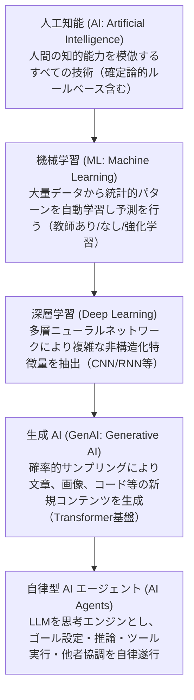

- **確定論的処理 vs 確率的処理の境界**:
  従来の業務システム（ERP、会計システム等）は「入力 ＋ 確定論的ロジック ＝ 100% 一貫した出力」を前提とします。一方、ML および生成 AI は「入力 ＋ 確率統計モデル ＝ 最も確からしい予測・生成結果」を出力します。したがって、税計算や法定義務の計算のように 1 円の狂いも許されない処理に生成 AI を適用することは根本的な設計ミスとなります。

#### 2. ソリューションタイプの選定比較マトリクス

ビジネス課題に対してどの技術アプローチを採用すべきか、以下の比較軸に基づいて評価します。

| 比較項目 / 方式 | ルールベース自動化 (RPA 等) | 予測機械学習 (Predictive ML) | 生成 AI (Amazon Bedrock 等) | 自律型 AI エージェント |
| :--- | :--- | :--- | :--- | :--- |
| **主要用途** | 定型業務の自動化、確定計算 | 数値予測、分類、異常検知 | 要約、文書作成、自然言語対話 | 複数ツール連携、自律的業務遂行 |
| **入力データの性質** | 明確に定義された構造化データ | 構造化データ、加工済特徴量 | テキスト、音声、画像（非構造化） | 複合環境データ、ユーザー指示 |
| **動作の確定性** | 100% 決定論的（再現性完全） | 統計的確率（一定の誤差を許容） | 確率的サンプリング（非決定性） | 状況適応的（動的実行パス） |
| **適応・保守性** | ルール変更時に手動修正必須 | データ変化時に再学習が必要 | プロンプト/RAG で迅速に適応 | 自律学習・オーケストレーション |
| **導入・運用コスト** | 低〜中（初期開発中心） | 中〜高（データ整備・MLOps） | 中（従量課金、迅速な PoC 可能） | 高（エージェント設計、監視体制） |
| **主なビジネスリスク** | 例外処理で停止する脆弱性 | 概念ドリフトによる精度低下 | ハルシネーション、情報漏洩 | 制御不能なツール実行、ループ |

- **ストラテジストの選定基準**:
  - **ルールベースを選ぶべき場合**: 処理手順が完全に標準化されており、例外が存在せず、監査証跡や 100% の正確性が法令上義務付けられている場合。
  - **予測 ML を選ぶべき場合**: 過去の大量履歴データが存在し、需要予測、退会予測、不正検知など「数的な予測値やカテゴリ分類」を導く場合。
  - **生成 AI を選ぶべき場合**: 社内マニュアルの要約、顧客からの自由文問い合わせへのドラフト回答作成など、非構造化テキストの理解と流暢なコンテンツ生成が求められる場合。
  - **AI エージェントを選ぶべき場合**: 「在庫を確認し、不足していればサプライヤーに発注書を作成・送付し、ERP に記録する」のように、複数システムにまたがる一連の意思決定とツール実行を自動化する場合。

#### 3. モデル適応の梯子（Model Adaptation Ladder）

業務要件に対して基盤モデルをどのように適合させるべきか、コスト・工数・データ要件の低い順から段階的に検討します。

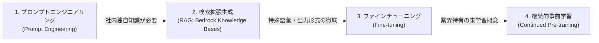

| 手法 | 概要 | 主な適用要件 | コスト / 運用負荷 |
| :--- | :--- | :--- | :--- |
| **プロンプトエンジニアリング** | モデルパラメータを変更せず、入力指示文（Few-shot、役割指定等）を工夫 | 一般的な知識で対応可能な要約、分類、文章推敲 | 極小（即日検証可能） |
| **RAG (検索拡張生成)** | 社内ドキュメントをベクトル検索し、関連箇所をプロンプトに注入して回答 | 頻繁に更新される社内規程、製品マニュアル、FAQ 検索 | 低〜中（ベクトル DB 構築と運用） |
| **ファインチューニング** | 特定タスクの入出力ペア（数百〜数千件）でモデルの重みを微調整 | 法律・医療などの専門的トーン＆マナー、特定 JSON 出力の固定 | 中〜高（高品質データセット作成と学習費用） |
| **継続的事前学習** | 大量の未ラベル専門文書を用いて事前学習を追加実施 | 業界特有の極めて特殊な概念・言語の埋め込み | 極めて高い（膨大な計算資源とデータ量） |

- **ストラテジストの鉄則**:
  「社内知識を回答させたい」という要件に対し、いきなりファインチューニングを選択してはなりません。モデルの重みに知識を焼き付けるファインチューニングは、情報の即時更新が困難であり、ハルシネーションの根本解決にはならないためです。最新ナレッジの参照には **RAG（Amazon Bedrock Knowledge Bases 等）** を第一選択とし、出力スタイルやフォーマットの厳格な固定が必要な場合にのみファインチューニングを検討します。

---

### 3. 実践シナリオ

#### シナリオ 1-1: 法定開示報告書における数値照合と自動化手法の選定

- **状況**: 上場企業の財務部門において、数千行に及ぶ四半期財務諸表の勘定科目残高が法定会計規則に完全に合致しているかを検証し、差異があればアラートを発報するシステムを企画している場合
- **対応**: 生成 AI の自然言語推論の導入提案を棄却し、確定的なルールベースのビジネスロジックエンジンおよび ERP のストアドプロシージャによる照合自動化を採用する。
- **結果**: 100% 確定的な計算再現性と完全な監査証跡が担保され、推論の揺らぎや確率的誤差による虚偽開示リスクが完全に排除される。
- **解説**: 法定開示資料の照合は法令および会計基準によって 100% 厳密にルールが定められており、わずかな数値誤差も許されない決定論的業務であるためです。代替案として生成 AI や確率的 ML を採用した場合、非決定性による推論のブレやハルシネーションが発生し、誤った財務数値の開示につながる致命的なコンプライアンスリスクを招くため不適格です。
- **参考ドキュメント**:
  - [AWS Well-Architected Framework - Responsible AI Lens](https://docs.aws.amazon.com/wellarchitected/latest/responsible-ai-lens/): 決定論的要件における AI 適用限界とルールベース手法の選択基準

#### シナリオ 1-2: 自律型 AI エージェントの導入判断と制御メカニズム

- **状況**: グローバル EC 企業において、顧客からの返品リクエストに対し、返品ポリシーの確認、配送業者への集荷手配 API の実行、および在庫管理システムへの返金登録を一気通貫で自動処理させたい場合
- **対応**: 単一のチャットボットではなく、自律性、ツール利用（Tool Use）、および複数ステップのオーケストレーション能力を備えた AI エージェント（Amazon Bedrock Agents）を採用し、各外部 API 呼び出しに事後検証とエスカレーションルールを設ける。
- **結果**: 顧客との自然言語対話から意図を抽出し、人間を介さずに配送システムや在庫システムと連携したエンドツーエンドの業務遂行が実現し、平均処理時間が 95% 短縮される。
- **解説**: 単一の LLM や従来のチャットボットは静的なテキスト応答しか生成できず、外部システムの状態を変更する複数ステップのトランザクションを実行できないためです。API を自律的に選択・実行できる AI エージェントのアーキテクチャが不可欠となります。代替案として静的な RPA を採用した場合、顧客の多様で非定型な自然言語表現に対応できず、例外停止が頻発するため要件を満たせません。
- **参考ドキュメント**:
  - [Amazon Bedrock ユーザーガイド - エージェント機能](https://docs.aws.amazon.com/bedrock/latest/userguide/agents.html): ビジネス業務を自動化する AI エージェントのアーキテクチャとツール連携

#### シナリオ 1-3: 金融市場急変に伴うクレジットスコアリングモデルの性能劣化への対処

- **状況**: フィンテック企業において、個人向け融資の審査を行う機械学習モデル（予測 ML）を 2 年間運用していたが、急激な金利上昇と景気後退により、過去数か月で貸し倒れ予測の誤検知が急増している場合
- **対応**: モデル自体の一時的な不具合と断定せず、市場環境の変化によるデータドリフト（Data Drift）および概念ドリフト（Concept Drift）が発生していると判断し、継続的モニタリング体制を起動して直近の市場データを用いたモデルの再学習と特徴量再評価を実施する。
- **結果**: 直近の経済環境を反映した新たな推論境界が獲得され、貸し倒れ予測の精度が回復するとともに、定期的な性能監視パイプラインが確立される。
- **解説**: 機械学習モデルは「学習データに存在した過去の統計的パターン」に基づいて予測を行うため、マクロ経済の構造変化によって顧客の行動パターンそのものが変化した場合、過去のモデルは自動的に精度が劣化（ドリフト）するためです。代替案としてモデルの監視を行わず初期モデルを恒久的に使い続けた場合、貸し倒れ損失の拡大を招くため不適格です。
- **参考ドキュメント**:
  - [Amazon SageMaker AI ドキュメント - モデルモニター](https://docs.aws.amazon.com/sagemaker/latest/dg/model-monitor.html): 本番稼働環境におけるデータドリフトおよび概念ドリフトの検知メカニズム

#### シナリオ 1-4: 全社的なシャドー AI リスクの統制と利用区分基準の確立

- **状況**: 製造業の全社調査において、多数の従業員が業務効率化のために無認可の個人用パブリック生成 AI サービスを利用し、設計図面や顧客情報の断片を入力している「シャドー AI」が発覚した場合
- **対応**: 全面的な利用禁止という形骸化しやすい対症療法を排し、AI ツールの透明な 3 段階分類（「承認済」「ブロック」「評価中」）を策定するとともに、Amazon Bedrock 等を用いたエンタープライズセキュアな社内共通生成 AI 環境を迅速に提供する。
- **結果**: 従業員の業務効率化ニーズを満たしつつ、機密データが外部パブリックモデルの学習に流用されるリスクが遮断され、IT 部門による一元的な利用状況の可視化が達成される。
- **解説**: 単に全面禁止を通達するだけでは従業員の地下利用（シャドー AI）が潜在化し、かえってセキュリティリスクが増大するためです。明確な分類基準を示し、入力データがモデル学習に利用されないセキュアな企業向け代替手段を迅速に提供することが唯一の実効的解決策であるためです。代替案として未認可ツールの無条件放置を選択した場合、深刻な情報漏洩事故や知的財産侵害を招くため不適格です。
- **参考ドキュメント**:
  - [ISO/IEC 42001:2023 - AI マネジメントシステム](https://aws.amazon.com/compliance/programs/): 組織における AI 資産のインベントリ管理と利用統制基準

#### シナリオ 1-5: 社内規程照会チャットボットにおける RAG とファインチューニングの適正選定

- **状況**: 人事・総務部門において、毎年改定される就業規則や福利厚生規程に関する従業員からの問い合わせに自動回答する AI システムを構築したいが、誤情報（ハルシネーション）を極小化し、規程改定にも即座に対応したい場合
- **対応**: モデル自体のファインチューニングを退け、社内ドキュメントをベクトルストアに格納して検索・引用する RAG（Amazon Bedrock Knowledge Bases）アーキテクチャを採用する。
- **結果**: 回答には必ず参照元の就業規則の章・条文が明記（グラウンディング）され、規程が改定された際もドキュメントファイルを差し替えてインデックスを再同期するだけで即日反映が完了する。
- **解説**: ファインチューニングはモデルの重みを更新する手法であり、知識の保持ではなく「出力形式や専門的な口調の学習」に適しているため、頻繁に変更される規程情報の更新には莫大な再学習コストと時間がかかるためです。さらに RAG であれば回答の根拠文献を提示できるため、人事労務における信頼性が担保されます。代替案としてファインチューニングを採用した場合、最新規程の反映が遅れ、かつ根拠条文のないハルシネーションが発生するため要件を満たせません。
- **参考ドキュメント**:
  - [Amazon Bedrock ユーザーガイド - ナレッジベース (RAG)](https://docs.aws.amazon.com/bedrock/latest/userguide/knowledge-base.html): 検索拡張生成による企業ナレッジのグラウンディング設計

---

### 4. 参考ドキュメント & 推奨ハンズオン

#### 公式一次ドキュメント
- [AWS AI サービス概要](https://aws.amazon.com/ai/services/): 事前トレーニング済み AI サービスとカスタム ML のポジショニング
- [Amazon Bedrock 公式ドキュメント](https://docs.aws.amazon.com/bedrock/): 基盤モデルの選択、ナレッジベース、エージェント機能の全体概要
- [ISO/IEC 42001 (AI Management System)](https://aws.amazon.com/compliance/programs/): AI マネジメントシステムに関する国際標準の要求事項

#### 推奨ハンズオン・ラボ（実機検証）
- [AWS Skill Builder: Amazon Bedrock - Getting Started](https://skillbuilder.aws/search?searchText=Amazon+Bedrock+-+Getting+Started):
  - **学習目標**: マネジメントコンソール上で基盤モデル（Anthropic Claude 等）を選択し、プロンプト入力時のパラメータ（Temperature、Top-P）の挙動差を体感する。
- [AWS Skill Builder: Building Generative AI Applications using Amazon Bedrock Knowledge Bases](https://skillbuilder.aws/search?searchText=Building+Generative+AI+Applications+using+Amazon+Bedrock+Knowledge+Bases):
  - **学習目標**: S3 上のサンプルドキュメントをナレッジベースに同期させ、ベクトル検索とグラウンディングによる正確な回答生成の流れを確認する。

---

## Domain 2: AI 戦略とビジネス価値の創出 (28%)

Domain 2 は本試験で最大の出題比率（28%）を占める中核分野です。AI 技術を事業戦略と結びつけ、投資対効果（ROI）を定量化し、Build vs Buy vs Partner の最適な調達方針を判断して、持続的な競争優位性を確立する戦略的リーダーシップが問われます。

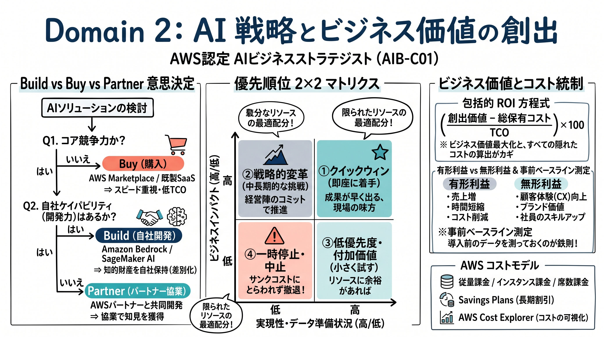

---

### 1. セクション概要

多くの企業が AI の PoC で失敗する最大の原因は、「技術の目新しさ」に飛びつき、ビジネス課題との整合性や明確な価値評価指標を欠いたままプロジェクトを開始することにあります。本セクションの核心は以下の 3 点です。
1. **ビジネス目標との整合とポートフォリオ管理**: 自社の各機能部門（顧客対応、マーケティング、研究開発、開発等）における課題を棚卸しし、「ビジネスインパクト」と「技術的実現性」の 2 軸でイニシアチブを優先順位付けする。また、進捗に応じて「拡大（Scale）」「一時停止（Pause）」「終了（Terminate）」を冷徹に決断する。
2. **Build vs Buy vs Partner の客観的評価**: 自社開発、商用製品購入（AWS Marketplace 等）、パートナー協業のトレードオフを、コスト、納期、独自性、コンプライアンスの観点から多面的に評価する。
3. **有形・無形価値の測定と ROI 統制**: AI 導入前のベースラインを確立し、直接的なコスト削減だけでなく、時間短縮、売上向上、従業員体験向上などの総合的な ROI を算出する。また、AWS の各種課金体系（従量課金、インスタンス、席数）に応じたコスト管理を行う。

#### 重要キーワード

- **Build vs Buy vs Partner**: ソリューション調達の基本方針。自社開発（Build）、既製品調達（Buy: SaaS / AWS Marketplace）、専門ベンダーとの協業（Partner）のトレードオフ評価。
- **有形利益 (Tangible Benefits) vs 無形利益 (Intangible Benefits)**: 数値として直接貸借対照表や損益計算書に現れる利益（残業代削減、サーバーコスト削減、売上増）と、即座には貨幣換算しにくい利益（従業員エンゲージメント、ブランド認知、顧客体験の向上）。
- **ベースラインメトリクス (Baseline Metrics)**: AI 導入前の業務時間、エラー率、処理件数などの基準値。ベースラインが存在しなければ、AI 導入による真の改善効果を客観的に証明できない。
- **先行指標 (Leading Indicators) vs 遅行指標 (Lagging Indicators)**: 最終的な財務成果（遅行指標）が現れる前に、プロジェクトの成功や定着を予測できる指標（例: 日次アクティブユーザー率、プロンプト実行数、ユーザー満足度スコア）。
- **AI ROI 算出フレームワーク**: `ROI (%) = ((創出価値 [コスト削減 + 売上増 + 時間節約価値] - AI 総保有コスト [TCO]) / AI 総保有コスト [TCO]) * 100`。
- **AWS AI 課金構造**:
  - **従量課金 (Consumption-based)**: 入出力トークン数や処理文字数・画像数に応じた課金（Amazon Bedrock、Amazon Textract 等）。需要変動に強く初期投資が極小。
  - **インスタンス課金 (Instance-based)**: 稼働時間に応じたコンピュート課金（Amazon SageMaker トレーニング・ホスティング等）。継続的かつ高負荷なワークロードに適する。
  - **席数課金 (Seat-based)**: ユーザー数ごとの月額固定課金（Amazon Quick 等）。利用頻度の高い業務アシスタントに適する。
- **AWS Cost Explorer / AWS Pricing Calculator**: AI プロジェクトの事前コスト試算（Calculator）および本番稼働後のコスト推移分析・予測（Cost Explorer）。
- **AWS Marketplace**: 何千ものサードパーティソフトウェアや基盤モデルを検索、テスト、調達、デプロイできる統合デジタルカタログ。調達サイクルの劇的短縮と AWS 請求への一元化が可能。

---

### 2. 重要トピック

#### 1. 業務機能別 AI 高インパクトユースケースと成果マッピング

| 業務機能部門 | 代表的 AI ユースケース | 適用技術タイプ | 期待されるビジネス成果 |
| :--- | :--- | :--- | :--- |
| **カスタマーオペレーション** | 24/365 自動一次応答、通話要約、感情分析 | 生成 AI / RAG / Transcribe | 顧客待ち時間短縮、通話後処理時間 (AHT) 50% 削減、CSAT 向上 |
| **営業 & マーケティング** | リードスコアリング、パーソナライズメール生成 | 予測 ML ＋ 生成 AI | 商談成約率の向上、コンテンツ制作期間の 80% 短縮 |
| **研究開発 & エンジニアリング** | 類似特許検索、設計ドキュメント要約、コード生成 | ベクトル検索 ＋ LLM | 開発サイクルタイム短縮、新製品市場投入 (Time-to-Market) の加速 |
| **人事 & コーポレート** | 社内規程ボット、採用レジュメのスクリーニング支援 | RAG ＋ Bedrock Guardrails | 総務部門への定型照会工数 70% 削減、従業員オンボーディング迅速化 |
| **製造 & サプライチェーン** | 需要予測、設備異常検知、部品調達の最適化 | 予測 ML / 時系列解析 | 在庫回転率の改善、予期せぬライン停止のゼロ化 |

#### 2. Build vs Buy vs Partner 意思決定フレームワーク

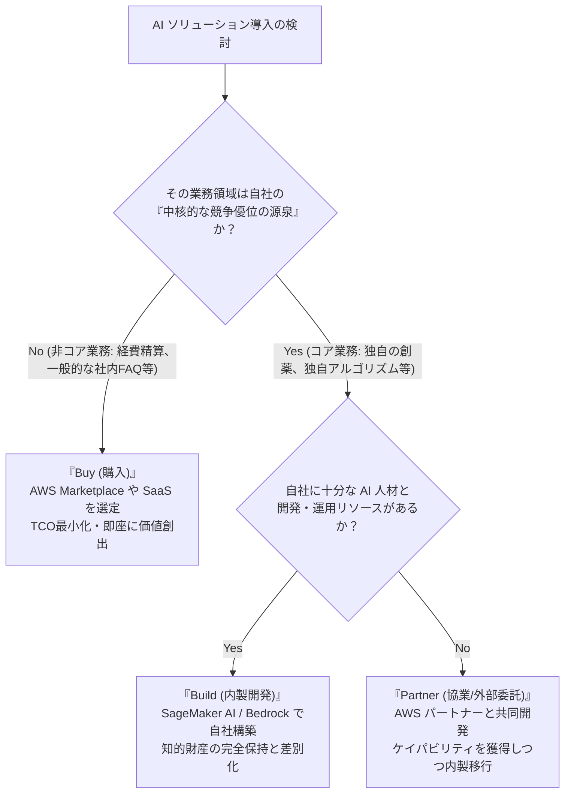

| 評価基準 | Build (自社構築) | Buy (既製品購入 / SaaS) | Partner (パートナー協業) |
| :--- | :--- | :--- | :--- |
| **戦略的位置づけ** | コア事業、独自の差別化要因 | 非コア業務、業界共通の定型業務 | コア業務だが自社ケイパビリティ不足 |
| **市場投入速度** | 遅い（数か月〜1 年以上） | 極めて速い（数日〜数週間） | 中程度（数か月） |
| **初期投資と TCO** | 高（人材確保、インフラ、保守） | 低〜中（サブスクリプション課金） | 中〜高（初期コンサルティング費用） |
| **知的財産 (IP) 保有** | 完全に自社保有 | ベンダーが保有 | 契約により共同保有または自社譲渡 |
| **カスタマイズ性** | 完全な柔軟性 | 限定的（API 連携レベル） | 高（要件に応じたカスタム開発） |

#### 3. AI イニシアチブ優先順位付けマトリクス

AI 投資のポートフォリオを管理するため、プロジェクトを「ビジネスインパクト」と「実現容易性（データ準備状況、技術難易度、組織受容性）」で分類します。

```text
高 ▲
  │  【クイックウィン (Quick Wins)】    │  【戦略的変革イニシアチブ】
ビ│  ・即座に着手すべき案件             │  ・長期的な競争優位の核
ジ│  ・例: 社内文書の RAG 検索          │  ・例: AI による新サービス開発
ネ│  ・早期の成功体験でモメンタム創出   │  ・経営陣の強力なコミットメントが必要
ス├──────────────────────────────────────┼──────────────────────────────────────
イ│  【低優先度 (Low Priority)】        │  【高リスク・不適格案件 (Money Pits)】
ン│  ・余力があれば検討                 │  ・即座に一時停止または中止 (Terminate)
パ│  ・インパクトが限定的               │  ・データ未整備、ルールベースで代替可能
ク│  ・例: 社内報の自動下書き作成       │  ・例: 整備されていないデータでの難治病予測
ト▼──────────────────────────────────────┴──────────────────────────────────────
  └─────────────────────────────────────────────────────────────►
  低                     実現容易性 (Feasibility)               高
```

- **イニシアチブの終退判断ルール**:
  PoC 期間中に設定した先行指標（ユーザー利用頻度、精度改善度等）を所定期間内に達成できず、データ整備の追加コストが期待利益を上回ることが判明したプロジェクトは、サンクコストにとらわれず直ちに「終了（Terminate）」または「一時停止（Pause）」を宣告するガバナンス基準を事前に設けておく必要があります。

#### 4. 包括的 ROI 算出とコスト要因管理

- **AI ROI の計算式**:
  $$\text{AI ROI} = \frac{(\text{年間コスト削減額} + \text{年間売上増加額} + \text{工数削減の貨幣換算価値}) - \text{AI ソリューションの年間 TCO}}{\text{AI ソリューションの年間 TCO}} \times 100$$
- **TCO に含めるべき隠れコスト (Hidden Costs)**:
  単なる AWS のモデル推論費用だけでなく、以下の要素を必ず算入します。
  1. データの収集・クレンジング・ラベリング費用
  2. プロンプトエンジニアリングおよび評価のための人的工数
  3. ガバナンス監査、法務レビュー、コンプライアンス対応費用
  4. 従業員向けトレーニングおよびチェンジマネジメント費用

---

### 3. 実践シナリオ

#### シナリオ 2-1: 顧客サポート部門における Build vs Buy vs Partner の意思決定

- **状況**: 中堅オンライン小売企業において、顧客からの注文状況や返品に関する定型的な問い合わせがサポート窓口の 70% を占めており、3 か月以内に 24 時間対応ボットを立ち上げたいが、社内に機械学習エンジニアが存在しない場合
- **対応**: ゼロからの自社モデル開発（Build）を退け、AWS Marketplace で提供されている事前構築済みのコマース向け AI チャットボット SaaS、または Amazon Bedrock をバックエンドに持つ認証済みパートナーソリューションの購入（Buy / Partner）を採用する。
- **結果**: わずか 4 週間で本番導入が完了し、社内エンジニアの新規採用コストを発生させることなく、目標期日内に一次対応工数を 60% 削減する。
- **解説**: 定型的な EC サポートは業界共通の非差別化業務であり、3 か月という短納期と自社技術リソースの欠如を考慮すると、事前構築済みソリューションの調達が最も TCO を抑えつつ迅速に価値を創出できるためです。代替案として自社開発（Build）を選択した場合、モデルの選定やインフラ構築に半年以上を要し、エンジニア採用コストも莫大となるため要件を満たせません。
- **参考ドキュメント**:
  - [AWS Marketplace 公式サイト](https://aws.amazon.com/marketplace/): エンタープライズ向け事前構築済み AI ソリューションの調達と即時デプロイ

#### シナリオ 2-2: AI 導入効果を証明するためのベースラインメトリクスの確立

- **状況**: 保険会社において、保険金請求書類の審査業務に生成 AI アシスタントを導入する計画があるが、経営会議で導入効果を客観的に証明するための評価計画が求められている場合
- **対応**: AI アシスタントの試験導入前に、現行の人間による審査プロセスにおける「書類 1 件あたりの平均処理時間（分）」「不備見落とし率（%）」「月間審査件数」「残業時間」を 2 か月間にわたり測定し、公式なベースラインメトリクスとして固定する。
- **結果**: AI 導入後に同一指標を比較測定することで、「処理時間 42% 短縮」「見落とし率 15% 低減」という具体的な成果を経営陣に提示でき、全社展開に向けた追加投資予算が承認される。
- **解説**: AI 導入前に厳密なベースライン（事前基準値）を測定・確定しておかなければ、導入後の改善が AI によるものなのか、単なる季節変動や業務量の変化によるものなのかを客観的に切り分けられず、投資対効果の証明が不可能となるためです。代替案としてベースラインを測定せずにプロジェクトを進めた場合、経営陣への説明責任を果たせず、後続フェーズの予算打ち切りを招くため不適格です。
- **参考ドキュメント**:
  - [AWS Cloud Adoption Framework - ビジネスパースペクティブ](https://docs.aws.amazon.com/whitepapers/latest/overview-aws-cloud-adoption-framework/business-perspective.html): クラウドおよび AI 投資における定量的ビジネス価値の測定枠組み

#### シナリオ 2-3: 先行指標を用いた PoC イニシアチブの早期見直しと中止判断

- **状況**: 大手消費財メーカーにおいて、マーケティング用広告コピーを自動生成する AI ツールの PoC を 6 か月間実施しているが、最終的な「売上増加額（遅行指標）」がまだ測定できない段階で、ツールの継続可否を評価したい場合
- **対応**: 売上などの遅行指標を待つのではなく、先行指標（Leading Indicators）として「マーケターの週次アクティブ利用率」「生成されたコピーの採用率」「作成時間の削減割合」を評価し、採用率が 5% 未満と低迷している原因がモデルのトーン不一致にあると判明したため、当該イニシアチブの一時停止（Pause）と要件再定義を決定する。
- **結果**: 誰も使わないツールへの無駄な追加インフラ投資とライセンス費用が即座に凍結され、リソースが高インパクトな別の顧客分析プロジェクトへと迅速に再配分される。
- **解説**: 売上向上や利益増などの財務指標（遅行指標）が現れるまでには長いタイムラグがあり、それのみを待っていると失敗した PoC に過剰な資金と工数を浪費し続けるリスク（サンクコストの罠）があるためです。先行指標（利用率、採択率等）をモニタリングすることで、プロジェクトの成否を早期に予見し、迅速な軌道修正や中止の判断が可能となるためです。
- **参考ドキュメント**:
  - [AWS Well-Architected Framework - Operational Excellence Pillar](https://docs.aws.amazon.com/wellarchitected/latest/operational-excellence-pillar/): 継続的改善のための先行メトリクスとフィードバックループの設計

#### シナリオ 2-4: 急増する推論コストに対する課金モデルの最適化

- **状況**: SaaS 企業において、自社サービスに組み込んだ Amazon Bedrock のテキスト要約機能が急成長し、毎月の従量課金（トークン課金）費用が当初予算の 3 倍に膨らんでおり、今後 1 年間も高い利用量が継続して見込まれる場合
- **対応**: 単純なトークン制限でユーザー体験を損なうのではなく、利用パターンを AWS Cost Explorer で分析した上で、安定したベースライン需要に対して Amazon Bedrock の Provisioned Throughput（プロビジョンドスループット）契約や、関連コンピュートへの Savings Plans の適用、およびプロンプトのコンテキスト圧縮によるトークン消費最適化を実施する。
- **結果**: ピーク時の処理性能（スループット）を保証しつつ、時間あたりの実質的な推論コストが 40% 以上削減され、予算範囲内での安定運用が確立される。
- **解説**: 初期検証段階では従量課金（On-Demand）が最も経済的ですが、利用量が大規模かつ安定的になった段階では、プロビジョンドスループットや長期コミットメント割引を活用することで、大幅な単価削減とレイテンシの安定化が実現できるためです。代替案として高額な従量課金のまま放置した場合、サービスの粗利益率が圧迫され、事業継続性に深刻な悪影響を及ぼすため不適格です。
- **参考ドキュメント**:
  - [Amazon Bedrock の料金体系](https://aws.amazon.com/bedrock/pricing/): オンデマンド課金とプロビジョンドスループットのコスト比較と適用指針
  - [AWS Cost Explorer ユーザーガイド](https://docs.aws.amazon.com/cost-management/latest/userguide/ce-what-is.html): クラウドコストの可視化と予測

#### シナリオ 2-5: AI を活用した製品のサービス化 (Servitization) によるビジネスモデル変革

- **状況**: 産業用機械メーカーにおいて、従来の「機械の売り切りモデル」から脱却し、継続的な収益（リカーリングレベニュー）を生み出す新たなビジネスモデルへと転換したい場合
- **対応**: 機械に搭載したセンサーデータと AWS の予測 ML を統合し、故障の兆候を事前に予知してメンテナンスを自動提案する「稼働率保証型サブスクリプションサービス（Predictive Maintenance as a Service）」を開発・提供する。
- **結果**: 顧客は突発的な生産ライン停止を回避できるようになり、自社は安定した経常収益と高い顧客ロイヤルティを獲得して競合他社に対する持続的な参入障壁を築く。
- **解説**: AI は単なる社内コスト削減のツールにとどまらず、自社製品の付加価値を飛躍的に高め、売り切り型から高収益なサービス型ビジネス（Servitization）へとビジネスモデルそのものを変革する強力な源泉となるためです。代替案として社内の事務作業効率化だけに AI 適用を限定した場合、業界の競合が先んじてデータ駆動型サービスを打ち出した際に市場シェアを喪失するリスクがあるためです。
- **参考ドキュメント**:
  - [AWS Executive Insights - Business Model Innovation with AI](https://aws.amazon.com/executive-insights/): AI を梃子にしたビジネスモデル変革と競争優位の確立

---

### 4. 参考ドキュメント & 推奨ハンズオン

#### 公式一次ドキュメント
- [AWS Cloud Adoption Framework (AWS CAF)](https://aws.amazon.com/cloud-adoption-framework/): ビジネス成果の創出に向けたクラウドおよび AI 導入の包括的ガイダンス
- [AWS Pricing Calculator](https://calculator.aws/): AWS サービスおよび AI ワークロードの事前見積もりツール
- [AWS Cost Management ドキュメント](https://docs.aws.amazon.com/cost-management/latest/userguide/what-is-costmanagement.html): コスト配分タグ、予算管理、Cost Explorer によるコスト最適化手法

#### 推奨ハンズオン・ラボ（実機検証）
- [AWS Skill Builder: Introduction to AWS Pricing Calculator](https://skillbuilder.aws/search?searchText=Introduction+to+AWS+Pricing+Calculator):
  - **学習目標**: Amazon Bedrock の入力・出力トークン数やコール数を入力し、月間の想定運用コストをシミュレーションする。
- [AWS Skill Builder: AWS Cloud Financial Management for Business Decision Makers](https://skillbuilder.aws/search?searchText=AWS+Cloud+Financial+Management+for+Business+Decision+Makers):
  - **学習目標**: コスト配分タグ（Cost Allocation Tags）を用いた部門別 AI 費用のトラッキングと、Cost Explorer での異常支出アラートの設定手法を理解する。

---

## Domain 3: AI ガバナンスと責任ある AI のリーダーシップ (24%)

Domain 3 では、AI システムの倫理的運用、法令遵守、リスクマネジメントを統制するリーダーシップが問われます。イノベーションの推進とリスク統制のバランスを保ち、組織全体として信頼性の高い AI 活用を実現するためのガバナンス体制構築が主眼となります。

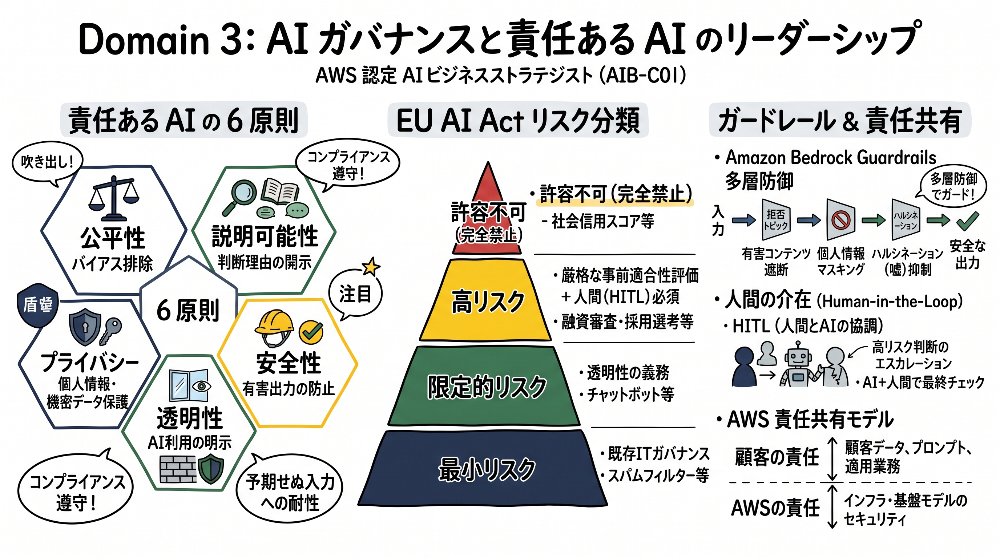

---

### 1. セクション概要

AI、とりわけ生成 AI の急速な普及に伴い、意図せぬ差別的バイアス、ハルシネーション（虚偽情報の生成）、機密データの漏洩、知的財産（著作権）の侵害、および各国の法規制（EU AI Act 等）への抵触が、企業のブランド価値を一夜にして失墜させる重大な経営リスクとなっています。本セクションの核心は以下の 3 点です。
1. **責任ある AI の 6 原則の実践**: 公平性、説明可能性、プライバシー、安全性、透明性、堅牢性の各次元を、抽象的なスローガンではなく具体的な設計基準として業務プロセスに落とし込む。
2. **Governance by Design と人間の関与 (HITL)**: プロジェクトの初期構想段階からガバナンス要件を組み込み、高リスクな判定には必ず人間が介在する（Human-in-the-Loop）エスカレーション体制を構築する。
3. **部門横断体制とリスク分類フレームワーク**: 法務、コンプライアンス、セキュリティ、ビジネス、技術の各代表者からなる AI 倫理委員会・ガバナンス会議を組織し、ユースケースのリスクレベル（許容不可、高リスク、限定リスク、最小リスク）に応じた統制を敷く。

#### 重要キーワード

- **責任ある AI (Responsible AI) の 6 原則**:
  - **公平性 (Fairness)**: 特定の属性（人種、性別、年齢等）に対する不当なバイアスや差別を排除する。
  - **説明可能性 (Explainability)**: なぜその推論・判定結果に至ったのかの根拠を提示できること。
  - **プライバシーとセキュリティ (Privacy & Security)**: 個人情報（PII）や機密データを保護し、モデルの学習や不正利用から防御する。
  - **安全性 (Safety)**: 有害コンテンツ、憎悪表現、暴力的な出力を防止し、ユーザーに危害を加えないこと。
  - **透明性 (Transparency)**: AI を利用している事実を明示し、システムの機能と限界を開示すること。
  - **堅牢性 (Robustness)**: 想定外の入力や敵対的プロンプトに対しても安定して信頼性のある挙動を維持すること。
- **Governance by Design**: 開発が完了した後の事後チェックではなく、プロジェクトの企画・要件定義段階からガバナンスおよび倫理レビューを組み込む設計思想。
- **Human-in-the-Loop (HITL)**: 人間の監視。高リスクな意思決定（融資否決、医療診断、採用合否等）において、AI の出力を最終決定とせず、人間の専門家がレビュー・承認するプロセス。
- **Amazon Bedrock Guardrails**: 生成 AI アプリケーションに対して、カスタマイズ可能な安全ポリシー（不適切トピックの遮断、有害コンテンツフィルター、機密情報 [PII] のマスキング、ハルシネーション抑制のグラウンディング検証）を適用するマネージド機能。
- **EU AI Act (欧州 AI 規制)**: AI システムをリスクに応じて「許容できないリスク（禁止）」「高リスク（厳格な事前適合性評価・HITL 義務）」「限定的リスク（透明性義務）」「最小リスク」の 4 段階に分類する世界初の包括的 AI 法規制。
- **AWS 責任共有モデル (AI ワークロード版)**: インフラやマネージド基盤モデル自体のセキュリティと基本安全性は AWS が担保するが、プロンプトへの入力データ、自社データのセキュリティ、アクセス権限、出力のビジネス検証、および法的コンプライアンスは顧客が責任を負うモデル。
- **バイアスドリフト (Bias Drift)**: 運用開始当初は公平だったモデルが、実世界の環境変化や顧客属性の変化、フィードバックループによって、時間の経過とともに偏った推論を行うようになる現象。
- **知的財産 (IP) リスク**: 生成 AI の出力が第三者の著作権や特許を侵害するリスク、および自社が入力した独自データやプロンプトが外部モデルの学習に流用されて流出するリスク。

---

### 2. 重要トピック

#### 1. 責任ある AI の 6 原則とビジネス意思決定のトレードオフ

ビジネス現場では、「予測精度の最大化」と「説明可能性」、「開発スピード」と「安全性検証」がしばしば衝突します。ストラテジストは以下のトレードオフを論理的に調整しなければなりません。

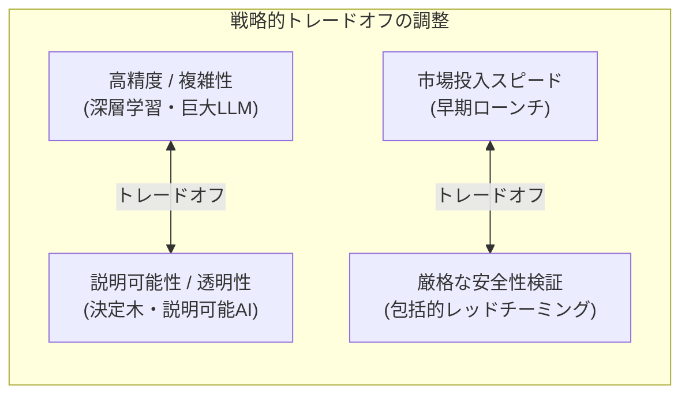

- **精度 vs 説明可能性**:
  医療診断や住宅ローン審査において、深層学習ブラックボックスモデルは高い正解率を示す一方、「なぜその判断に至ったのか」を顧客や規制当局に説明できません。このような法的説明義務のある領域では、わずかに予測精度を犠牲にしてでも、決定木や線形モデルなどの解釈可能なモデル、あるいは明確な根拠文献を引用できる RAG を採用することがビジネス上の合理的判断となります。

#### 2. リスクレベルに応じた AI ガバナンス分類フレームワーク (EU AI Act 準拠)

| リスク分類 | 対象ユースケースの例 | 求められるガバナンス要件・対策 | 承認プロセス |
| :--- | :--- | :--- | :--- |
| **許容できないリスク (Unacceptable Risk)** | ソーシャルスコアリング、サブリミナルな行動操作、生体認証による感情監視 | **完全禁止**（開発および利用を行わない） | 企画段階で却下 |
| **高リスク (High Risk)** | 採用選考 AI、大学入学選考、信用スコアリング、医療機器、重要インフラ制御 | **厳格な事前適合性評価**、高品質な学習データ、完全なログ記録、HITL（人間の介在）、堅牢性試験 | AI 倫理委員会および法務・役員会の承認必須 |
| **限定的リスク (Specific Transparency Risk)** | 顧客対応チャットボット、ディープフェイク・合成音声、感情分析 | **透明性の確保**（ユーザーに AI であることを明示、AI 生成物であることを明記） | 部門長および AI ガバナンス事務局の承認 |
| **最小リスク (Minimal Risk)** | スパムメールフィルター、社内文書の要約ドラフト作成、ゲーム AI | 既存の IT ガバナンスおよび一般的なセキュリティ基準の適用 | 現場部門長の裁量で利用可能 |

#### 3. Amazon Bedrock Guardrails による多層防御アーキテクチャ

ビジネスリーダーは、技術的な安全策がどのように実装されるかを概念レベルで理解しておく必要があります。Amazon Bedrock Guardrails は以下の 5 つのレイヤーでモデルの入出力を保護します。

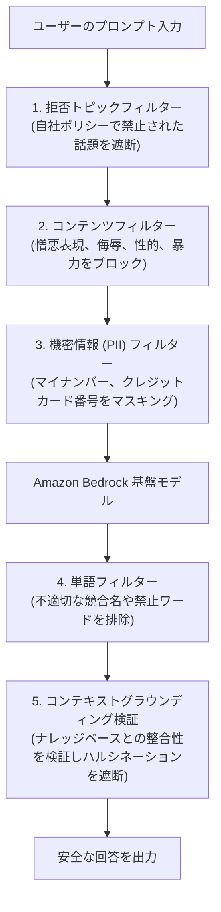

#### 4. AWS 責任共有モデル（AI ワークロードにおける責任境界）

| 領域 | AWS の責任 (Security OF the Cloud / Model) | 顧客の責任 (Security IN the Cloud / Application) |
| :--- | :--- | :--- | :--- |
| **基盤モデル (Amazon Bedrock 等)** | 基盤モデル自体のホスティングインフラ、物理セキュリティ、事前トレーニング時の悪意あるコード排除 | プロンプトの設計、入力データの機密性管理、ガードレールの設定、回答のビジネス検証 |
| **データプライバシー** | 顧客の入力プロンプトやモデル出力を他の顧客のモデル学習に使用しない保証 | 入力データ内の個人情報（PII）の適切な取り扱い、暗号化設定、データアクセスの認可 |
| **カスタムモデル (SageMaker 等)** | ハードウェアの保守、OS パッチ、コンテナ基盤の分離 | モデルアルゴリズムの選定、トレーニングデータの品質・バイアス検証、ハイパーパラメータ、推論エンドポイントの保護 |
| **法令コンプライアンス** | ISO、SOC、PCI-DSS、HIPAA 等の各種コンプライアンス認証の取得と監査レポート提供 | 自社の業界規制（EU AI Act、金融監督指針等）への最終的な適合責任 |

---

### 3. 実践シナリオ

#### シナリオ 3-1: 採用書類スクリーニングにおけるバイアスと公平性のトレードオフ

- **状況**: 人事部門において、年間数万件に達する新卒採用のエントリーシートをスクリーニングするため、過去の優秀社員の学歴や職歴を学習させた AI 判定モデルの導入を計画している場合
- **対応**: 過去の採用データに男性比率の偏り（歴史的バイアス）が含まれていることを指摘し、AI による自動合否判定を禁止するとともに、性別・年齢・出身地などの属性を匿名化した上で、AI はスキルの抽出と要約の補助のみを行い、合否判断は必ず人間が行う HITL（Human-in-the-Loop）プロセスを義務付ける。
- **結果**: 特定の属性に対する不当な足切りや差別的選考の発生が未然に防止され、多様性（ダイバーシティ）を確保しつつ選考工数が 40% 削減される。
- **解説**: AI は過去のデータに潜む偏見や差別的傾向をそのまま増幅して学習してしまうため、人事採用のような「高リスク」領域で自動判定を行わせることは深刻な法的・倫理的リスク（EU AI Act 違反や社会的信用の失墜）を招くためです。人間が介在する HITL と属性の匿名化が不可欠となります。代替案として過去データでの完全自動合否判定を採用した場合、違法な差別選考が発生し、巨額の賠償責任やレピュテーション失墜につながるため不適格です。
- **参考ドキュメント**:
  - [AWS Well-Architected Framework - Responsible AI Lens: 公平性とバイアス](https://docs.aws.amazon.com/wellarchitected/latest/responsible-ai-lens/responsible-ai-lens.html): AI ライフサイクルにおけるバイアス検出と軽減指針

#### シナリオ 3-2: 顧客向け医療アドバイスチャットボットにおける安全セーフガードの構築

- **状況**: ヘルスケア企業において、ユーザーからの健康相談に対して生成 AI を用いて初期アドバイスを提供するモバイルアプリを開発しているが、誤診や危険な民間療法の推奨による法的責任を回避したい場合
- **対応**: Amazon Bedrock Guardrails を導入して「特定の重篤な疾患名や処方箋薬の具体的な指示」を拒否トピックとして定義し、症状の重篤度が疑われる場合は直ちに提携医療機関への受診を促す定型メッセージとコールセンターへのエスカレーション基準を設定する。
- **結果**: モデルが危険な診断アドバイスを出力することが確実に遮断され、医療行為に該当しない安全な情報提供ツールとして規制当局のガイドラインに適合する。
- **解説**: 生命や健康に直接影響を与える領域では、ハルシネーションや不適切な推論が人命被害に直結するため、モデルの自然な出力に依存せず、プラットフォームレベルでの厳格なガードレールと明確なエスカレーション基準による多層防御が必須であるためです。代替案としてプロンプト内での「医療行為は行いません」という指示のみに頼った場合、プロンプトインジェクションや複雑な対話の文脈で制限を突破される危険性があるため不適格です。
- **参考ドキュメント**:
  - [Amazon Bedrock ユーザーガイド - Guardrails の設定](https://docs.aws.amazon.com/bedrock/latest/userguide/guardrails.html): 機密トピックおよび有害コンテンツのフィルタリング

#### シナリオ 3-3: 金融融資審査における説明責任とモデル選択の判断

- **状況**: 銀行の個人向けローン審査において、審査精度（ROC-AUC）を最大化できる複雑なディープラーニングモデルと、審査結果の否決理由（年収、勤続年数、負債比率等の寄与度）を顧客に開示できる解釈可能なモデル（Explainable AI: 決定木やスコアリングルール）が競合している場合
- **対応**: 純粋な予測精度がわずかに劣るとしても、金融消費者保護法および融資審査に関する説明義務基準を遵守するため、解釈可能なモデル、あるいは明確な説明性手法（Shapley 値等）が確立されたアーキテクチャを選定する。
- **結果**: ローン否決時に顧客に対して正当な理由を開示できる体制が整い、金融当局からの是正勧告や訴訟リスクを回避してコンプライアンスが達成される。
- **解説**: 金融取引において融資を断る際、その理由を顧客に通知することは法令上の義務であり、判定プロセスがブラックボックスである深層学習モデルは法的要件を満たせないためです。ビジネスにおけるモデル選定は単なるアルゴリズムの性能勝負ではなく、法的・倫理的要件とのトレードオフで決まるためです。代替案として説明不可能な完全ブラックボックスモデルを採用した場合、消費者保護規制に抵触し、営業停止処分等の制裁を受けるリスクがあるため不適格です。
- **参考ドキュメント**:
  - [Amazon SageMaker Clarify ドキュメント](https://docs.aws.amazon.com/sagemaker/latest/dg/clarify-configure-processing-jobs.html): 機械学習モデルのバイアス検出と説明可能性 (Explainability)

#### シナリオ 3-4: 生成 AI 出力における第三者著作権侵害リスクへの対策

- **状況**: デジタルメディア企業において、マーケティング記事やイラストを生成 AI で大量作成して商用公開する計画があるが、生成物が第三者の著作権を侵害して訴訟に発展することを懸念している場合
- **対応**: 生成 AI の利用ガイドラインを策定し、既存の著名な特定作家名や著作権で保護されたキャラクター名をプロンプトに含めることを社内規程で禁止するとともに、知的財産補償（IP Indemnity）条項を提供する商用基盤モデル（Amazon Bedrock で提供される大手プロバイダーのモデル等）を採用し、公開前の人間による類似性チェックを義務付ける。
- **結果**: 著作権侵害のリスクが最小化され、万が一の権利主張に対してもベンダーの知的財産補償による法的保護枠組みが確保される。
- **解説**: 生成 AI が特定著作物と酷似したコンテンツを出力した場合、著作権侵害の法的責任は利用企業自身に及ぶため、入力プロンプトの統制、ベンダーの補償契約の確認、および公開前の人間によるレビューが三位一体で必要となるためです。代替案として未認可のオープンソースモデルを無制限に利用し事後チェックも行わなかった場合、巨額の損害賠償訴訟に巻き込まれる重大な法的リスクを負うためです。
- **参考ドキュメント**:
  - [AWS サービス規約 - 生成 AI 補償条項](https://aws.amazon.com/service-terms/): Amazon Bedrock における知的財産侵害に対する顧客補償の枠組み

#### シナリオ 3-5: 部門横断 AI ガバナンス委員会（AI Review Board）の設置と権限設計

- **状況**: 大手製造業において、各事業部が個別にベンダーと契約して AI ツールを乱立導入しており、社内規程違反やセキュリティ基準の不整合が多発している場合
- **対応**: IT 部門単独のチェックを排し、最高情報責任者（CIO）、最高法務責任者（CLO）、事業部門長、セキュリティ責任者、およびデータ保護責任者（DPO）で構成される「部門横断 AI ガバナンス委員会」を設置し、全社共通の「AI リスク評価チェックリスト」を通過しないプロジェクトへの予算執行を禁止する統制ゲートウェイを構築する。
- **結果**: 事業部門のイノベーションのスピードを完全に殺すことなく、全社的なリスク（データ漏洩、法令違反、ブランド棄損）が導入前に網羅的にスクリーニングされ、一貫したガバナンスが確立される。
- **解説**: AI ガバナンスは技術的問題にとどまらず、法務、事業戦略、倫理、ブランドイメージが複雑に絡み合う課題であり、IT 部門や開発チームだけで判断することは不可能なためです。明確なアカウンタビリティを持つ部門横断組織の組成が不可欠です。代替案として各事業部の裁量に任せる分散型ガバナンスのまま放置した場合、全社的な規制違反事故が発生した際に誰も責任を取れないガバナンス崩壊を招くため不適格です。
- **参考ドキュメント**:
  - [AWS Cloud Adoption Framework - ガバナンスパースペクティブ](https://docs.aws.amazon.com/whitepapers/latest/overview-aws-cloud-adoption-framework/governance-perspective.html): クラウドおよび AI における全社統制体制の確立

---

### 4. 参考ドキュメント & 推奨ハンズオン

#### 公式一次ドキュメント
- [AWS Well-Architected Framework - Responsible AI Lens](https://docs.aws.amazon.com/wellarchitected/latest/responsible-ai-lens/): AWS が提唱する責任ある AI 設計の 6 つの柱とチェックリスト
- [Amazon Bedrock ガードレール開発者ガイド](https://docs.aws.amazon.com/bedrock/latest/userguide/guardrails.html): 安全な生成 AI アプリケーションのためのコンテンツフィルタリング設計
- [EU AI Act 公式ポータル](https://artificialintelligenceact.eu/): 欧州人工知能法のリスクベース分類と遵守要件

#### 推奨ハンズオン・ラボ（実機検証）
- [AWS Skill Builder: Implementing Responsible AI on AWS](https://skillbuilder.aws/search?searchText=Implementing+Responsible+AI+on+AWS):
  - **学習目標**: Amazon Bedrock Guardrails を作成し、PII（メールアドレス、クレジットカード番号）のマスキングおよび特定禁止トピックのブロック動作をコンソール上でテストする。
- [AWS Skill Builder: Model Explainability and Fairness with SageMaker Clarify](https://skillbuilder.aws/search?searchText=Model+Explainability+and+Fairness+with+SageMaker+Clarify):
  - **学習目標**: サンプルデータセットを用いて、学習前データの偏り（事前バイアス）と推論結果の寄与度（SHAP 値）を可視化するレポートを確認する。

---

## Domain 4: ビジネスの対応体制、リーダーシップ、AI による組織変革 (24%)

Domain 4 では、AI を単発の実験的 PoC から全社的なエンタープライズ規模へとスケールさせるための組織能力、チェンジマネジメント、データ基盤の整備、および AI Center of Excellence (COE) の立ち上げを主導するトランスフォーメーションリーダーシップが問われます。

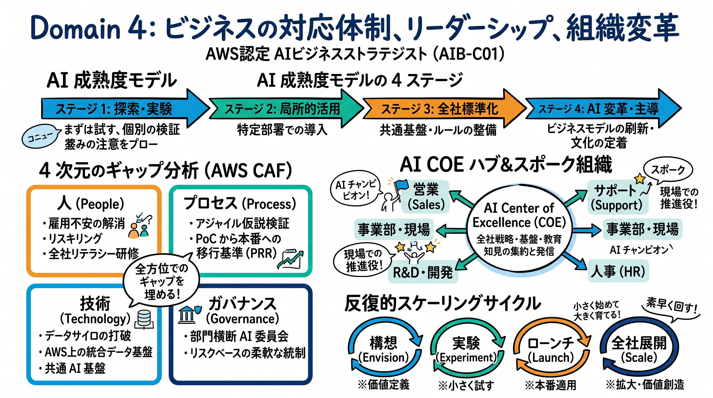

---

### 1. セクション概要

どれほど優れた AI 技術であっても、組織のデータ基盤がサイロ化していたり、現場の従業員が「仕事を奪われる」という恐怖から利用を拒絶したり、全社的な推進体制が存在しなければ、ビジネス変革は決して成功しません。本セクションの核心は以下の 3 点です。
1. **多面的準備状況の評価と成熟度モデル**: 組織の現在地を「人（People）」「プロセス（Process）」「技術（Technology）」「ガバナンス（Governance）」の 4 領域で客観的に診断し、成熟度（実験段階 → 運用段階 → 全社展開段階 → 組織変革段階）に応じた現実的な発展ロードマップを描く。
2. **データ基盤とデータ戦略の確立**: AI の燃料であるデータの品質、アクセシビリティ、オーナーシップを整備し、部門間のデータサイロを打破する。
3. **チェンジマネジメントと AI COE によるスケーリング**: エグゼクティブスポンサーシップを確保し、現場の AI チャンピオンを育成する。また、全社的な AI リテラシー教育を展開しつつ、段階的変革（Envision → Experiment → Launch → Scale）のフレームワークでパイロットを成功から全社展開へと導く。

#### 重要キーワード

- **AI 成熟度モデル (AI Maturity Model)**: 組織が AI を活用するレベルを段階的に示した枠組み（例: 探索・実験段階 → 局所的活用段階 → 全社標準化段階 → データ・AI 駆動型企業）。
- **データサイロ (Data Silos)**: 各部門が独自にデータを囲い込み、他部門からアクセスできない孤立状態。AI の全社横断的な価値創出を阻害する最大の要因。
- **データオーナーシップ (Data Ownership)**: データの正確性、更新、アクセス権限、セキュリティに対して誰が最終的な責任を持つかを明確に定義すること。
- **AWS Cloud Adoption Framework (AWS CAF)**: クラウド移行とビジネス変革を加速するための AWS の実践的フレームワーク（ビジネス、ピープル、ガバナンス、プラットフォーム、セキュリティ、オペレーションの 6 つの視点）。
- **エグゼクティブスポンサーシップ (Executive Sponsorship)**: 経営陣による明確な支持、予算の配分、および組織横断的な抵抗を排除するための最高レベルのコミットメント。
- **AI チャンピオン (AI Champions)**: 各業務部門において AI の利点を理解し、同僚の活用を支援し、現場の課題を AI チームへと橋渡しする推進リーダー。
- **AI Center of Excellence (AI COE)**: 全社の AI 戦略、ベストプラクティス、技術標準、ガバナンス指針を集約・策定し、各事業部の AI 推進を横断的に支援する専門組織。
- **反復的変革アプローチ (Iterative Transformation Approach)**:
  - **Envision (構想)**: 全社ビジョンの策定とビジネス課題の特定
  - **Experiment (実験)**: 短期的な PoC による技術と価値の検証
  - **Launch (本番化)**: 本番環境への安全なデプロイと初期運用の開始
  - **Scale (全社展開)**: 組織横断的な横展開、自動化、継続的改善

---

### 2. 重要トピック

#### 1. AI 組織成熟度モデル（4 つの発展ステージ）

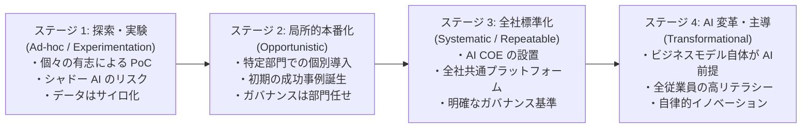

- **ストラテジストの診断視点**:
  自社がステージ 1（実験段階）にあるにもかかわらず、いきなり全社的なビジネスモデル変革（ステージ 4）を目指して巨大なシステム開発を発注するのは典型的な失敗パターンです。まずはクイックウィンを積み重ねてステージ 2、ステージ 3（COE 設立と基盤共通化）へと段階的に成熟度を高めていく現実的なロードマップ設計が求められます。

#### 2. 人・プロセス・技術・ガバナンスの 4 領域ギャップ分析マトリクス

| 評価領域 | 現状の典型的な課題・障壁 | 目指すべき AI 対応状態 | 必要なリーダーシップ介入 |
| :--- | :--- | :--- | :--- |
| **人 (People)** | 雇用不安、変化への抵抗、AI リテラシーの不足 | AI を協調ツールとして活用、プロンプト活用スキルの全社定着 | 全社研修、ハッカソン、役割の再定義、不安解消の透明な対話 |
| **プロセス (Process)** | 既存の硬直した承認プロセス、PoC から本番への移行基準欠如 | アジャイルな仮説検証、明確な PoC 終了基準と本番移行ゲート | 迅速な承認フローの整備、反復的変革サイクルの導入 |
| **技術 (Technology)** | 部門ごとのデータサイロ、不統一な AI ツール、インフラの乱立 | AWS を基盤とした一元的なデータレイクとセキュアな共通 AI 基盤 | データサイロの撤廃、Amazon Bedrock による全社基盤の提供 |
| **ガバナンス (Governance)** | ルールが存在しないか、過度に厳格でイノベーションを窒息させている | リスクベースの柔軟な統制、Governance by Design の定着 | 部門横断 AI 委員会の設置、リスク分類ガイドラインの制定 |

#### 3. AI Center of Excellence (COE) の組織形態と役割

AI COE は、中央集権的に全プロジェクトを開発するのではなく、「ハブ＆スポーク型」で各事業部（スポーク）の自律的な AI 推進を支援するモデルが最も推奨されます。

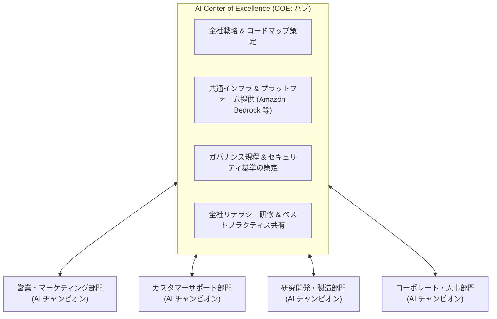

#### 4. 人間の役割の高度化（Human-AI Collaboration）

AI の導入は人間の代替ではなく、「手作業のオペレーションから、高付加価値な判断・監督業務へのシフト」として位置づけなければなりません。

| 業務の種別 | AI が得意とする領域 (AI Strength) | 人間が強みを持つ領域 (Human Strength) | 協調モデル (Collaboration) |
| :--- | :--- | :--- | :--- |
| **データ処理 & 調査** | 数万件の文書の瞬時要約、パターン検知 | 文脈の深層理解、直感、倫理的違和感の察知 | AI が要約と論点を提示し、人間が最終洞察を深める |
| **コンテンツ作成** | 初稿・ドラフトの高速生成、多言語翻訳 | トーン＆マナーの微調整、共感、ブランドの文脈づけ | AI が 10 パターンの案を出し、人間が最適な 1 案を選び推敲 |
| **顧客対応** | 24 時間 365 日の定型照会への即時回答 | 激昂した顧客への真摯な傾聴、例外的な柔軟対応 | AI が一次対応し、感情が荒れた顧客は即座に熟練担当者へ引き継ぐ |

---

### 3. 実践シナリオ

#### シナリオ 4-1: データサイロの解消と全社データ戦略の確立

- **状況**: 大手小売企業において、店舗販売データは POS システム、EC 販売データは外部クラウド、顧客の問い合わせ履歴はオンプレミス CRM に完全に分断（データサイロ化）されており、全社的なオムニチャネル AI 推薦エンジンの構築が頓挫している場合
- **対応**: 個別のシステム連携をパッチ当てで行うのを止め、経営陣の承認のもとで全社データガバナンス戦略を策定し、データオーナーシップを各部門長に義務付けるとともに、AWS 上に一元的なデータレイクを構築して部門横断のデータ共有フレームワークを確立する。
- **結果**: 顧客データと購買データが一元的に統合され、顧客一人ひとりの購買履歴に基づいた高精度な AI レコメンデーションと需要予測が実現する。
- **解説**: AI は高品質かつ統合されたデータを前提として動作するため、部門間の政治的・技術的なデータサイロを放置したままでは、全社的なビジネス価値を生み出す AI の構築は不可能なためです。経営レベルのデータ戦略とデータオーナーシップの定義が不可欠となります。代替案としてデータサイロを放置したまま各部門で個別に AI を導入した場合、顧客体験の不整合と重複投資を招くため不適格です。
- **参考ドキュメント**:
  - [AWS Cloud Adoption Framework - プラットフォームパースペクティブ](https://docs.aws.amazon.com/whitepapers/latest/overview-aws-cloud-adoption-framework/platform-perspective.html): 統合データ基盤とクラウドアーキテクチャの確立

#### シナリオ 4-2: 現場従業員の雇用不安と文化的抵抗の克服

- **状況**: 金融機関の事務センターにおいて、バックオフィス業務の AI 自動化プロジェクトを発表したところ、「自分たちの仕事が奪われる」という恐怖から現場スタッフが業務マニュアルの提供や検証作業への協力を拒絶している場合
- **対応**: 密室でのトップダウン通達を改め、経営幹部による説明会を開催して「人員削減が目的ではなく、単純作業を AI に委託することで、顧客への資産運用提案などの高付加価値業務へシフトするためのリスキリングプログラムを提供する」という透明な方針を明示し、現場の優秀な事務員を「AI 推進プロジェクトの設計リーダー」として任命する。
- **結果**: 現場の心理的安全性が回復し、業務の最も細かい例外ケースを知り尽くしたベテランスタッフが自律的にプロンプト検証や業務フロー改善に参加するようになる。
- **解説**: AI 導入における最大の失敗要因は技術ではなく「人間の恐怖と変化への抵抗」であり、透明性のあるコミュニケーションと明確な役割の再定義（リスキリングの提供）なしには現場の協力を得られないためです。代替案として現場の不安を無視して強権的にシステムを導入した場合、サボタージュや離職が多発し、例外処理に対応できず業務が崩壊するため不適格です。
- **参考ドキュメント**:
  - [AWS Cloud Adoption Framework - ピープルパースペクティブ](https://docs.aws.amazon.com/whitepapers/latest/overview-aws-cloud-adoption-framework/people-perspective.html): クラウドおよび AI 推進における組織文化の醸成と人材リスキリング

#### シナリオ 4-3: AI Center of Excellence (COE) の設立と全社スケール

- **状況**: 製造業において、複数の事業部がそれぞれ別々のベンダーに依頼して類似の文書要約ツールや外観検査 AI をバラバラに開発しており、莫大なコストの重複とセキュリティ水準のばらつきが発生している場合
- **対応**: 経営企画部と IT 部門の主導で「AI Center of Excellence (COE)」を設立し、共通のプラットフォーム（Amazon Bedrock 等の共通基盤）、標準アーキテクチャ、セキュリティ審査プロセス、および再利用可能なプロンプト資産カタログを一元管理・提供するハブ＆スポーク体制へ移行する。
- **結果**: 各事業部の開発期間が平均 60% 短縮され、インフラやライセンスの重複費用が年間数千万円規模で削減されるとともに、全社的なガバナンス水準が統一される。
- **解説**: 各部門が個別に AI を導入する「分散型」では車輪の再発明とコスト重複が発生し、一方で完全に中央集権化すると現場のスピード感が失われるため、COE が共通基盤・指針・ベストプラクティスを提供し、各部門が自律的に開発する「ハブ＆スポーク型」が最もスケールに適しているためです。代替案として放置した場合、シャドー AI とコスト増大の温床となるため不適格です。
- **参考ドキュメント**:
  - [AWS Prescriptive Guidance - AI/ML Center of Excellence の構築](https://aws.amazon.com/prescriptive-guidance/): 組織横断的な AI 推進体制のベストプラクティス

#### シナリオ 4-4: 単発 PoC から本番エンタープライズ展開への移行基準 (Exit Criteria)

- **状況**: 物流企業において、配車ルート最適化の AI PoC が成功して良好なシミュレーション結果が得られたが、現場の配車オペレーションに本番組み込みを行うにあたり、どのような条件でローンチすべきか判断基準が定まっていない場合
- **対応**: モデルの精度メトリクスだけでなく、事業継続性（モデル停止時の手動フォールバック手順）、レイテンシ SLA、データパイプラインの監視体制、法務・セキュリティ承認、および現場オペレーターの研修完了を網羅した「本番移行基準（Production Readiness Review: PRR）」を策定し、全項目の合格をもって本番ローンチを判定する。
- **結果**: 実運用初日に予期せぬネットワーク遅延が発生した際も、即座に手動フォールバックが稼働して配送遅延ゼロを維持し、極めて安全に本番稼働へと移行する。
- **解説**: PoC の「シミュレーション成功」と「本番業務への耐用」の間には巨大な運用上の溝（キャズム）が存在し、耐障害性、SLA、運用保守手順、セキュリティ基準が満たされていなければ、本番稼働後に大事故を引き起こすためです。厳格な PRR の策定が不可欠です。代替案としてモデル精度のみを理由に十分な運用検証なしで本番投入した場合、突発障害時に配送業務全体が麻痺する壊滅的リスクを招くため不適格です。
- **参考ドキュメント**:
  - [AWS Well-Architected Framework - Operational Excellence Pillar](https://docs.aws.amazon.com/wellarchitected/latest/operational-excellence-pillar/): 本番稼働準備レビュー (Production Readiness Review) の原則

#### シナリオ 4-5: 全社的 AI リテラシー向上のための段階的教育プログラム

- **状況**: 金融グループにおいて、全社員 1 万人に対して AI 活用を促したいが、社員の IT スキルに大きなばらつきがあり、画一的な集合研修を実施しても業務への定着率が極めて低い場合
- **対応**: 一律の研修を廃止し、職種と役割に応じた 3 階層の教育パス（「全社員向け: AI 倫理と基礎プロンプト」「ビジネスリーダー向け: AI 戦略立案と ROI 評価」「業務推進者向け: RAG 活用と社内ハッカソン」）を設計し、実際に社内のセキュアな生成 AI 環境を用いたハンズオンとアイデアソンを組み合わせて実施する。
- **結果**: 研修受講者の 80% 以上が日常業務でプロンプトを活用し始め、各部門から 50 件以上の具体的な業務改善アイデアが起案され、全社的なイノベーション文化が醸成される。
- **解説**: AI リテラシーの要求水準は一般従業員、ビジネスリーダー、実務担当者で全く異なり、座学のみの一方通行な講義では実践的な応用力が身につかないためです。役割別の段階的教育と、実際に手を動かすハッカソン等の実践機会の提供が最も定着効果が高いためです。代替案として難解な数式を含む画一的な技術研修を全社員に強制した場合、受講者の学習意欲が減退し、かえって AI 離れを加速させるため不適格です。
- **参考ドキュメント**:
  - [AWS Skill Builder - AI / ML 学習パス](https://skillbuilder.aws/search?searchText=Generative+AI): 組織の職種・役割に応じたクラウド・AI スキル育成カリキュラム

---

### 4. 参考ドキュメント & 推奨ハンズオン

#### 公式一次ドキュメント
- [AWS Cloud Adoption Framework (AWS CAF) 2.0](https://aws.amazon.com/cloud-adoption-framework/): 組織変革のための包括的ガイダンス
- [AWS Prescriptive Guidance: クラウドと AI の組織変革](https://aws.amazon.com/prescriptive-guidance/): 移行計画、成熟度評価、運用モデルの設計
- [AWS Executive Insights](https://aws.amazon.com/executive-insights/): C レベルリーダー向け AI 戦略・リーダーシップ知見

#### 推奨ハンズオン・ラボ（実機検証）
- [AWS Skill Builder: AWS Cloud Adoption Framework (AWS CAF)](https://skillbuilder.aws/search?searchText=AWS+Cloud+Adoption+Framework+%28AWS+CAF%29):
  - **学習目標**: 6 つのパースペクティブ（ビジネス、ピープル、ガバナンス、プラットフォーム、セキュリティ、オペレーション）における自社アセスメントの進め方を学ぶ。
- [AWS Skill Builder: Leading Transformation with Generative AI](https://skillbuilder.aws/search?searchText=Leading+Transformation+with+Generative+AI):
  - **学習目標**: エグゼクティブ向けケーススタディを通じて、組織の文化的障壁の克服手法とチェンジマネジメントの実践フローを追体験する。

---

## まとめと推奨学習ステップ

### 本認定試験対策の全体要約

AWS Certified AI Business Strategist (AIB-C01) は、AI という強力な武器を「何のために、どのように使い、どう統制し、どう組織に根づかせるか」という **ビジネスアーキテクチャの意思決定能力** を問う最高峰のビジネス資格です。
合格のための最重要ポイントは以下の 4 点に集約されます。

1. **技術の適切な割り当て (Domain 1)**:
   決定論的ルールベース、予測 ML、生成 AI、自律型 AI エージェントの特性を見極め、課題に最も適合する手法を論理的に選定する。社内知識の活用にはファインチューニングではなく RAG を第一選択とする。
2. **定量的かつ戦略的な価値創出 (Domain 2)**:
   Build vs Buy vs Partner を冷徹に評価し、AI 導入前のベースラインを測定した上で、有形・無形の包括的 ROI を算出する。先行指標を用いて失敗プロジェクトの早期撤退を恐れない。
3. **安全とコンプライアンスの多層防御 (Domain 3)**:
   責任ある AI 6 原則を掲げ、高リスクな判定には必ず人間が介在する（HITL）仕組みを作る。Amazon Bedrock Guardrails を活用し、EU AI Act などの法規制に合致した部門横断ガバナンスを確立する。
4. **組織・人とデータの土台づくり (Domain 4)**:
   データサイロを打破し、経営陣の強力なスポンサーシップのもとで AI COE を設立する。現場の雇用不安をリスキリングで解消し、反復的アプローチ（Envision → Experiment → Launch → Scale）で全社展開を完遂する。

### 推奨学習ステップ

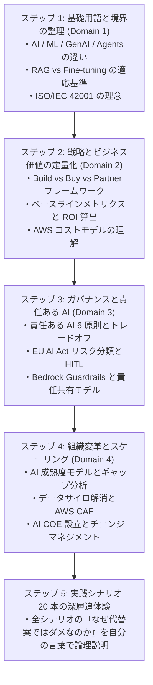

本ガイドに網羅された実践シナリオの論理展開を完全にマスターし、各選択肢のトレードオフを論理的に説明できるようになれば、AIB-C01 試験の高得点合格はもちろん、実務において真に成果を出す AI ビジネスストラテジストとして活躍できる確固たる基盤が完成します。
