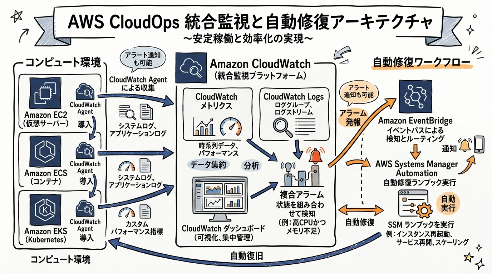
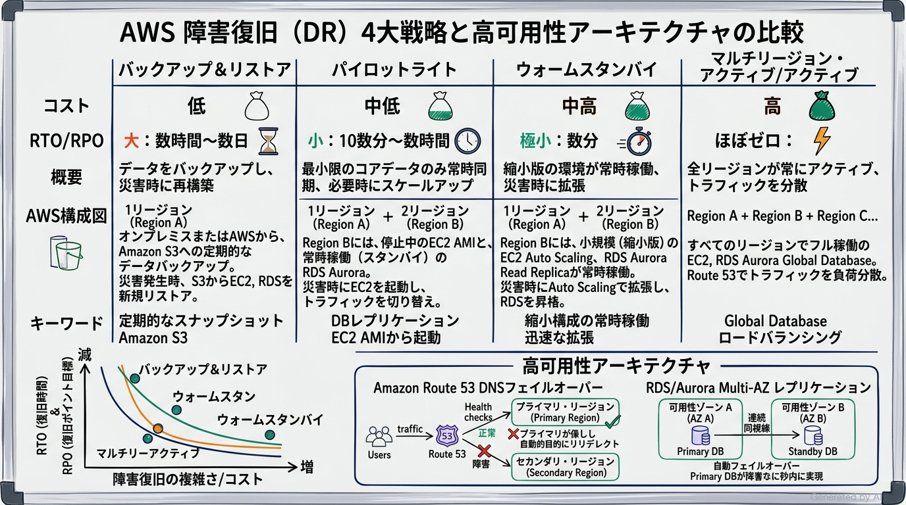
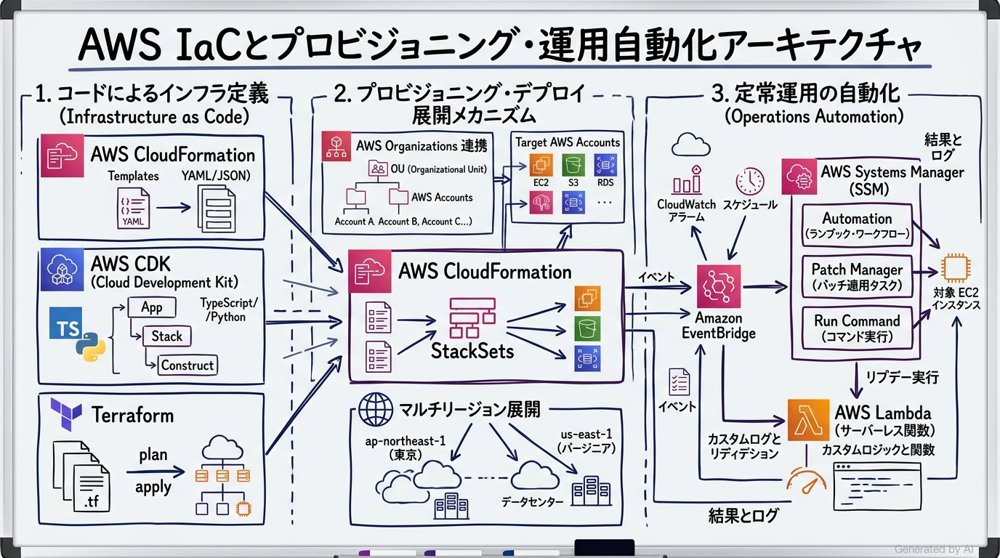
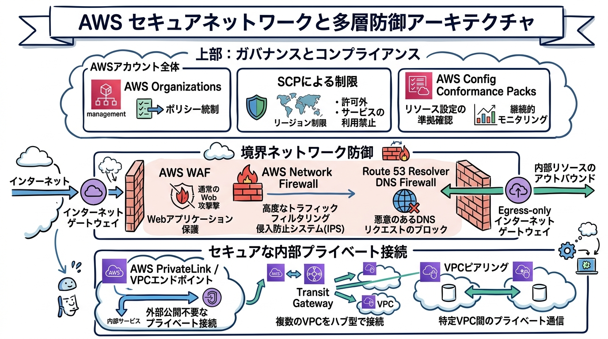

# AWS Certified CloudOps Engineer - Associate (SOA-C03) 完全対策＆実践学習ガイド

- **対象資格**: AWS Certified CloudOps Engineer - Associate（旧 AWS Certified SysOps Administrator - Associate）
- **試験コード**: SOA-C03
- **公式試験ガイド**: [AWS Certified CloudOps Engineer - Associate (SOA-C03) Exam Guide](https://docs.aws.amazon.com/aws-certification/latest/sysops-administrator-associate-03/sysops-administrator-associate-03.md)
- **最終更新日**: 2026-10-04

---

## はじめに

クラウド運用のパラダイムは、単なるサーバー監視や手動の障害対応から、インフラのコード化（IaC）、イベント駆動型の自己修復（Self-Healing）、コンテナ・マルチアカウントの統合統制、そして生成AIエージェントを活用した自律的運用へと急速に進化しています。これに伴い、AWS では従来の「SysOps Administrator - Associate」を「AWS Certified CloudOps Engineer - Associate (SOA-C03)」へと刷新しました。

本ガイドは、最新の SOA-C03 試験範囲に含まれる全5ドメインの重要トピック、サービス選定のトレードオフ、各タスク・ユースケースを網羅した 実践シナリオ、および公式一次ドキュメント・推奨ハンズオンを網羅した完全対策ノートです。

### AWS Certified CloudOps Engineer - Associate 試験とは

AWS Certified CloudOps Engineer - Associate は、AWS 上でワークロードを安全かつ効率的にデプロイ、管理、運用し、AWS Well-Architected Framework に準拠した高可用・耐障害性環境を維持する能力を認定するプロフェッショナル認定資格です。

- **試験時間**: 130 分
- **出題問題数**: 65 問（採点対象: 50 問 / 未採点テスト設問: 15 問）
- **出題形式**: 択一選択問題（Multiple Choice: 4肢中1つ選択）、複数選択問題（Multiple Response: 5肢以上中2つ以上選択）。※旧形式で一時期導入されていた「実技試験（Exam Labs）」は含まれません。
- **合格基準点**: 100〜1,000 点のスケールドスコアで 720 点以上
- **前提知識**: AWS 上でのデプロイ、運用、ネットワーキング、セキュリティに関する 1 年程度の実務経験、またはシステム管理者等の運用ロールでの 1 年以上の経験が推奨されます。

### 難易度と求められる思考力

当試験の難易度は **アソシエイト最上位（実務的トラブルシューティング・意思決定判断力重視）** に位置づけられます。

単なる製品の名称や個別機能の暗記ではなく、「メモリ使用率高騰時にどの収集ツールと復旧ワークフローを組み合わせるべきか」「RTO 15分・RPO 5分の要件に対してなぜパイロットライトではなくウォームスタンバイを選ぶのか」「マルチアカウント環境で特定リージョンの利用を全社的に物理阻止する最適なガードレールは何か」といった、**具体的なビジネス制約・非機能要件に応じたアーキテクチャのトレードオフ判断とトラブルシューティング手順** が一貫して問われます。

特に、以下の CloudOps 設計思想を深く理解しておくことが正答を導く鍵となります：
1. **可観測性の確保**: ハイパーバイザー外部指標と OS / コンテナ内部指標（CloudWatch Agent）の境界分離
2. **自己修復の自動化**: EventBridge と Systems Manager Automation Runbook による人的介入の最小化
3. **予防的統制と発見的統制の多層化**: Organizations / SCP による絶対的ガードレールと、AWS Config による継続的監査・自動修復の連携

### 推奨の勉強法

1. **公式一次ドキュメントと Well-Architected Framework の精読**
   各分野の末尾に掲載している AWS 公式ドキュメントの「ユーザーガイド」「ベストプラクティス」に必ず目を通します。特に「運用上の優秀性の柱」および「信頼性の柱」の設計原則は必須知識です。
2. **実際に手を動かす実機ハンズオン検証**
   CloudWatch Agent のインストール、複合アラームと EventBridge ルール作成、Systems Manager Automation ランブックの実行、Route 53 DNS フェイルオーバー切り替えなどを実際に構築し、イベントの流れを体感します。
3. **実践シナリオ（状況・対応・結果・解説）による思考プロセスの追体験**
   各セクションに収録した全タスク網羅の実践シナリオにおいて、特に **Because（なぜ他の代替案では不適格なのか）** を熟読し、不当な選択肢を即座に棄却できる消去法・論理判断力を養います。

---

## 目次

1. [はじめに](#はじめに)
2. [学習カリキュラム・出題範囲ロードマップ](#学習カリキュラム出題範囲ロードマップ)
3. [Domain 1: 監視、ロギング、分析、修復、およびパフォーマンス最適化 (22%)](#domain-1-監視ロギング分析修復およびパフォーマンス最適化-22)
4. [Domain 2: 信頼性とビジネス継続性 (22%)](#domain-2-信頼性とビジネス継続性-22)
5. [Domain 3: デプロイ、プロビジョニング、およびオートメーション (22%)](#domain-3-デプロイプロビジョニングおよびオートメーション-22)
6. [Domain 4: セキュリティとコンプライアンス (16%)](#domain-4-セキュリティとコンプライアンス-16)
7. [Domain 5: ネットワーキングとコンテンツ配信 (18%)](#domain-5-ネットワーキングとコンテンツ配信-18)
8. [まとめと推奨学習ステップ](#まとめと推奨学習ステップ)

---

## 学習カリキュラム・出題範囲ロードマップ

### セクション一覧と出題比率

本試験は全5ドメインで構成されており、監視・修復（Domain 1）、信頼性・DR（Domain 2）、デプロイ・自動化（Domain 3）がそれぞれ 22% ずつ配分され、全体の 3 分の 2（66%）を占める中核領域となっています。

| ドメイン番号 | ドメイン名 / 出題分野 | 出題比率 | 主要対象サービス・ツール |
| :--- | :--- | :--- | :--- |
| **Domain 1** | 監視、ロギング、分析、修復、およびパフォーマンス最適化 | 22% | Amazon CloudWatch, CloudWatch Agent, CloudTrail, EventBridge, Systems Manager Automation, EBS, S3, RDS |
| **Domain 2** | 信頼性とビジネス継続性 | 22% | AWS Auto Scaling, Elastic Load Balancing, Route 53, Multi-AZ, AWS Backup, DR 4大戦略 |
| **Domain 3** | デプロイ、プロビジョニング、およびオートメーション | 22% | AWS CloudFormation, AWS CDK, StackSets, EC2 Image Builder, Systems Manager (Patch / Run Command) |
| **Domain 4** | セキュリティとコンプライアンス | 16% | AWS Organizations, SCP, AWS Config, IAM Identity Center, AWS KMS, Secrets Manager, GuardDuty, Security Hub |
| **Domain 5** | ネットワーキングとコンテンツ配信 | 18% | Amazon VPC, VPC エンドポイント, AWS PrivateLink, Route 53 Resolver DNS Firewall, AWS Network Firewall, CloudFront |

---

### ドメイン別出題詳細

#### Domain 1: 監視、ロギング、分析、修復、およびパフォーマンス最適化 (22%)
- **出題の狙い**: システム全体の可観測性を確立し、アラートの誤検知を抑えつつ EventBridge や Systems Manager による自動修復パイプラインを構築する能力、ならびにコンピュート・ストレージ・DBのパフォーマンスとコストを最適化する能力を検証します。
- **主要タスク**:
  - Task 1.1: AWS 監視・ロギングサービスを使用したメトリクス、アラーム、フィルターの実装（CloudWatch Agent、複合アラーム、クロスアカウントダッシュボード、SNS）
  - Task 1.2: 監視および可用性メトリクスを使用した問題の特定と修復（パフォーマンス分析、EventBridge ルーティング、SSM Automation ランブック）
  - Task 1.3: コンピュート、ストレージ、データベースリソースのパフォーマンス最適化戦略の実装（EBS 最適化、S3 パフォーマンス、EFS/FSx/S3 Files、RDS Performance Insights、EC2 配置グループ）
- **重要キーワード**: CloudWatch Agent, Composite Alarms, Cross-Account Observability, EventBridge Rules, SSM Automation, gp3/io2, S3 Multipart/Transfer Acceleration, Performance Insights, Placement Groups

#### Domain 2: 信頼性とビジネス継続性 (22%)
- **出題の狙い**: 単一障害点を排除した高可用性（HA）環境の維持と、ビジネス目標（RTO / RPO）に応じたディザスタリカバリ（DR）戦略の選定・フェイルオーバー運用の自動化能力を検証します。
- **主要タスク**:
  - Task 2.1: スケーラビリティと伸縮性の実装（コンピュートスケーリング、CloudFront/ElastiCache キャッシング、RDS/DynamoDB スケーリング）
  - Task 2.2: 高可用性と耐障害性環境の実装（ELB ヘルスチェック、Route 53 ヘルスチェック、Multi-AZ 構成）
  - Task 2.3: バックアップと復元戦略の実装（AWS Backup による一元管理、PITR、ストレージバージョニング、DR 4大戦略の運用）
- **重要キーワード**: Auto Scaling Groups, Elastic Load Balancing, Route 53 Health Checks, RDS Multi-AZ, AWS Backup Vault, Point-in-time Recovery (PITR), Backup & Restore, Pilot Light, Warm Standby, Multi-Region Active/Active

#### Domain 3: デプロイ、プロビジョニング、およびオートメーション (22%)
- **出題の狙い**: クラウドインフラをコード（IaC）として宣言的・プログラム的に管理し、マルチアカウントへの一括展開、デプロイ障害の安全なロールバック、および OS パッチ適用の自動化を統制する能力を検証します。
- **主要タスク**:
  - Task 3.1: クラウドリソースのプロビジョニングと保守（EC2 Image Builder、CloudFormation、AWS CDK、デプロイ障害修復、StackSets、Terraform）
  - Task 3.2: 既存リソースの管理の自動化（Systems Manager Patch Manager / Run Command / State Manager、イベント駆動自動化、AWS DevOps Agent）
- **重要キーワード**: AWS CloudFormation, AWS CDK, StackSets, EC2 Image Builder, Drift Detection, Rollback Configuration, SSM Patch Manager, Maintenance Windows, Event-Driven Automation

#### Domain 4: セキュリティとコンプライアンス (16%)
- **出題の狙い**: 組織全体へのセキュリティポリシーの強制、継続的なコンプライアンス監査、暗号化キーおよび機密情報の安全なライフサイクル管理を設計・運用する能力を検証します。
- **主要タスク**:
  - Task 4.1: セキュリティおよびコンプライアンスツールとポリシーの実装と管理（IAM 機能、アクセス監査・シミュレーター、AWS Organizations / SCP、AWS Config Conformance Packs）
  - Task 4.2: データおよびインフラストラクチャを保護するための戦略の実装（データ分類、KMS 保存時暗号化、ACM 転送時暗号化、Secrets Manager、GuardDuty / Security Hub）
- **重要キーワード**: Service Control Policies (SCPs), AWS Config Conformance Packs, IAM Identity Center, AWS KMS Key Policies, AWS Secrets Manager Rotation, Amazon GuardDuty, AWS Security Hub

#### Domain 5: ネットワーキングとコンテンツ配信 (18%)
- **出題の狙い**: 安全なハイブリッド・プライベートネットワークの構成、多層ネットワーク防御（WAF、Network Firewall、DNS Firewall）、およびネットワーク障害時のログ分析・トラブルシューティング能力を検証します。
- **主要タスク**:
  - Task 5.1: ネットワーキング機能と接続性の実装と最適化（VPC 構成要素、Egress-only IGW、PrivateLink / VPC エンドポイント、ネットワーク保護サービス監査）
  - Task 5.2: ドメイン、DNS サービス、コンテンツ配信の構成（Route 53 Resolver、ルーティングポリシー、クエリログ、CloudFront、Global Accelerator）
  - Task 5.3: ネットワーク接続の問題のトラブルシューティング（VPC 設定障害、VPC フローログ / 各種アクセスログ分析、CloudFront キャッシュ修復、CloudWatch Network Monitor）
- **重要キーワード**: VPC Endpoints (Gateway vs Interface), AWS PrivateLink, Route 53 Resolver DNS Firewall, AWS Network Firewall, Egress-Only Internet Gateway, VPC Flow Logs, CloudWatch Network Monitor

---

## Domain 1: 監視、ロギング、分析、修復、およびパフォーマンス最適化 (22%)

本ドメインでは、システム内部の可観測性を確立し、障害予兆の検知から自動修復までのワークフローを構築する運用基盤を解説します。また、コンピュート・ストレージ・データベースのパフォーマンス分析と最適なサイジング手法を網羅します。



---

### 1. セクション概要

現代の CloudOps では、障害発生後に人間がアラートを確認してログインする「事後対応」から、きめ細かなメトリクスとログに基づく「事前検知と自己修復（Self-Healing）」への転換が必須です。
CloudWatch Agent を用いて OS 内部（メモリ・ディスク使用率）やコンテナ指標を収集し、複合アラームでノイズを排除した上で、EventBridge から Systems Manager Automation Runbook を起動して定型修復を完全自動化します。また、EBS ボリュームタイプ（gp3 vs io2）や S3 ストレージクラスの適正化により、高スループットとコスト削減を両立します。

#### 重要キーワード

- **Amazon CloudWatch Agent**: EC2 インスタンス、ECS、EKS クラスターの OS 内部メトリクス（メモリ空き容量、ディスク使用率、スワップ、プロセス数）およびログファイルを収集する統合エージェントです。
- **CloudWatch 複合アラーム (Composite Alarms)**: 複数の単一メトリクスアラームの状態を論理演算子（AND, OR, NOT）で結合し、真の異常発生時のみに発報してアラート疲弊を防止する仕組みです。
- **CloudWatch Cross-Account Observability**: AWS Organizations 連携等により、集中運用アカウントから複数メンバーアカウントのメトリクス、ログ、トレースを横断検索・ダッシュボード表示する機能です。
- **AWS Systems Manager Automation**: 事前定義済み（AWS-RestartEC2Instance 等）またはカスタムの YAML/JSON ランブックを実行し、承認フローや条件分岐を含むインフラ修復手順を自動化するサービスです。
- **Amazon EBS gp3**: 容量に関わらずベースライン 3,000 IOPS / 125 MB/s を提供し、追加費用で個別にスループットと IOPS を拡張可能な最新の汎用 SSD ボリュームです。
- **RDS Performance Insights**: データベースの負荷を「待機（Wait events）」単位で視覚化し、クエリボトルネックやリソース競合を特定してプロアクティブな推奨事項を提示する分析ツールです。

---

### 2. 重要トピック

#### 1. 可観測性アーキテクチャとエージェント選定基準
標準の CloudWatch メトリクスは仮想化ハイパーバイザー外部から収集されるため、インスタンス内部のメモリ使用率やディスク空き容量は把握できません。OS 内でのリソース枯渇やコンテナ障害を捉えるためには、適切なエージェント配置が不可欠です。

```text
監視対象リソースと収集方式の決定
├── EC2 / オンプレミス仮想サーバー
│   ├── 基本監視（追加エージェントなし） ──> CPU使用率、ネットワークI/O、ディスクIOPS (外部視点)
│   └── CloudWatch Agent 導入 ──────────> メモリ使用率、ディスク空き容量、OSログ (/var/log)
└── コンテナ環境 (Amazon ECS / Amazon EKS)
    ├── ECS Fargate / EC2 ──────────────> CloudWatch Container Insights + Fluent Bit
    └── EKS クラスター ──────────────────> CloudWatch Observability EKS アドオン (DaemonSet)
```

#### 2. ストレージおよびデータベースのパフォーマンス最適化マトリクス
| サービス・機能 | パフォーマンス最適化の要点 | コスト最適化の視点 | トレードオフ・留意点 |
| :--- | :--- | :--- | :--- |
| **EBS gp3** | 容量を増やさずに必要な IOPS（最大 16,000）とスループット（最大 1,000 MB/s）を個別にプロビジョニング | gp2 に比べ最大 20% 安価 | 極限のミリ秒未満レイテンシや 64,000 超の IOPS には io2 が必要 |
| **Amazon S3** | マルチパートアップロード（100MB超推奨）、S3 Transfer Acceleration、プレフィックスの分散 | S3 ライフサイクルポリシーによる Glacier / Deep Archive への自動階層化 | 高速化オプションや階層移行リクエストに伴う追加課金 |
| **Amazon RDS** | Performance Insights による負荷待機イベント分析、RDS Proxy による接続プール | 不要なプロビジョンド IOPS の削減、適切なインスタンスタイプ（Graviton 系）の選定 | RDS Proxy の実行オーバーヘッドと追加料金 |
| **EC2 配置グループ** | Cluster（単一 AZ 内で 10Gbps 超の低遅延通信）、Spread（障害ドメイン分散）、Partition（大規模分散処理） | 配置グループ自体の追加費用は無料 | Cluster は単一 AZ に縛られるため、リージョン内冗長性（Multi-AZ）とトレードオフ |

---

### 3. 実践シナリオ

#### シナリオ 1-1: CloudWatch Agent による OS 内部メトリクス収集と複合アラームの設計
- **状況**: 大規模 E コマースシステムの EC2 インスタンス群において、CPU 使用率の一時的なスパイクでは不要なアラートを発報させず、メモリ使用率の高騰（90% 超）と CPU 高負荷（85% 超）が 10 分間継続して同時に発生した場合にのみ緊急通知を行いたい場合
- **対応**: Systems Manager Run Command を用いてフリート全体に CloudWatch Agent を一括配布し、メモリ使用率（`mem_used_percent`）の収集設定を適用した上で、2つのアラームを AND 条件で評価する CloudWatch 複合アラームを構成する。
- **結果**: 一時的なバッチ処理による CPU 単独の上昇による誤検知を完全に抑止し、メモリリークと CPU 飽和が同時に発生した真の障害事象のみを運用担当者へ SNS 通知する。
- **解説**: 標準の EC2 メトリクスではハイパーバイザー視点のリソースしか把握できずメモリ使用率を取得できないため CloudWatch Agent が必須であり、かつ単一メトリクスアラームでは過検知を招くのに対し、複合アラームを用いることで障害判定の確度を極限まで高められるためです。
- **参考ドキュメント**:
  - [Amazon CloudWatch ユーザーガイド: CloudWatch エージェントのインストールと設定](https://docs.aws.amazon.com/AmazonCloudWatch/latest/monitoring/Install-CloudWatch-Agent.html)
  - [Amazon CloudWatch ユーザーガイド: 複合アラームの作成](https://docs.aws.amazon.com/AmazonCloudWatch/latest/monitoring/Create_Composite_Alarm.html)

#### シナリオ 1-2: EventBridge と SSM Automation による障害インスタンスの自動修復
- **状況**: 本番環境の Web アプリケーションにおいて、プロセスのハングアップによりヘルスチェックが連続失敗した際、オペレーターの手動ログインを待たずに 3 分以内に安全なインスタンス再起動とログ退避を自動実行したい場合
- **対応**: CloudWatch アラームの状態変化（`ALARM`）をトリガーとする Amazon EventBridge ルールを作成し、ターゲットとして事前定義された AWS Systems Manager Automation ランブック（`AWS-RestartEC2Instance`）を呼び出すよう設定する。
- **結果**: 深夜帯のインシデントであっても人間の介在なしにインスタンスが自動的に再起動され、サービス断時間を最小限に抑制して正常稼働状態へ自律復帰する。
- **解説**: Lambda でカスタムスクリプトを自作する方式に比べて、検証済みの SSM Automation ランブックを利用することで認証情報管理やコードの保守負担をゼロにし、IAM ロールによる最小権限で安全かつ冪等に修復手順を完結できるためです。
- **参考ドキュメント**:
  - [AWS Systems Manager ユーザーガイド: Automation ランブックリファレンス](https://docs.aws.amazon.com/systems-manager/latest/userguide/automation-action-restart-ec2.html)
  - [Amazon EventBridge ユーザーガイド: CloudWatch アラームイベントのルーティング](https://docs.aws.amazon.com/eventbridge/latest/userguide/eb-run-automations.html)

#### シナリオ 1-3: EBS gp3 移行と S3 ライフサイクルによるパフォーマンス・コスト最適化
- **状況**: 分析ワークロードを実行する既存システムにおいて、大量のデータ書き込みに伴う I/O 待機レイテンシを解消しつつ、過去 90 日を経過した大容量ログファイルのストレージ保管コストを 70% 以上削減したい場合
- **対応**: 既存の EBS gp2 ボリュームを Elastic Volumes 機能により無停止で gp3 へ変更してベースライン IOPS を確保し、さらに S3 バケットにライフサイクルルールを設定して作成後 90 日経過したオブジェクトを S3 Glacier Flexible Deep Archive へ自動移行させる。
- **結果**: サーバーを停止させることなくディスク I/O 性能が向上してクエリ処理時間が短縮され、参照頻度の低い過去ログのストレージ単価が劇的に削減される。
- **解説**: gp2 では容量（GB）を増やさなければ IOPS が向上しなかったのに対し、gp3 では容量とは独立して必要なスループットと IOPS を安価に拡張可能であり、かつ S3 ライフサイクルルールによりアクセスのない過去データを最も安価なアーカイブ層へ自動退避できるためです。
- **参考ドキュメント**:
  - [Amazon EC2 ユーザーガイド: Amazon EBS ボリュームタイプの変更](https://docs.aws.amazon.com/AWSEC2/latest/UserGuide/requesting-ebs-volume-modifications.html)
  - [Amazon S3 ユーザーガイド: オブジェクトのライフサイクルの管理](https://docs.aws.amazon.com/AmazonS3/latest/userguide/object-lifecycle-mgmt.html)

---

## Domain 2: 信頼性とビジネス継続性 (22%)

本ドメインでは、単一 AZ や単一コンポーネントの障害を吸収する高可用性アーキテクチャと、広域災害・リージョン障害に対応するディザスタリカバリ（DR）計画の実装手順を解説します。



---

### 1. セクション概要

システムの「信頼性（Reliability）」は、同一リージョン内の障害を自律吸収する「高可用性（HA: High Availability）」と、リージョン規模の壊滅的被災から事業を継続させる「ディザスタリカバリ（DR: Disaster Recovery）」の二段構えで設計されます。
HA は Multi-AZ 配置と ELB / Route 53 ヘルスチェックにより秒単位の自動フェイルオーバーを実現します。一方、DR ではビジネスが要求する許容停止時間（RTO）とデータ損失許容量（RPO）を基準に、4つの戦略（Backup & Restore / Pilot Light / Warm Standby / Active-Active）から最適なコストバランスの方式を選定します。

#### 重要キーワード

- **目標復旧時間 (RTO: Recovery Time Objective)**: 障害発生からシステムが復旧して利用可能になるまでに許容される最大時間（停止時間の許容量）です。
- **目標復旧時点 (RPO: Recovery Point Objective)**: 障害発生時に失われても事業継続上許容できるデータ更新の最大過去時間（データ欠損の許容量）です。
- **パイロットライト (Pilot Light)**: データベース等のコアデータのみを常時スタンバイリージョンへレプリケーション同期し、コンピュートは停止/コード状態で待機させ、被災時にインフラを起動・拡張する DR 戦略です。
- **ウォームスタンバイ (Warm Standby)**: スタンバイリージョンに本番システムの「縮小版（最小インスタンス数）」を常時稼働させておき、被災時に即座にフルスケールアウトさせてトラフィックを引き受ける DR 戦略です。
- **Amazon Route 53 フェイルオーバーポリシー**: ヘルスチェック機能と連動し、プライマリレコードの異常を検知した際にセカンダリ（スタンバイ）レコードの IP / エンドポイントへ DNS 解決を自動的に切り替えるルーティング方式です。
- **AWS Backup**: EBS、RDS、DynamoDB、EFS、S3 などのバックアップポリシー（スケジュール、保持期間、クロスリージョン・クロスアカウントコピー）を一元管理する完全マネージドサービスです。

---

### 2. 重要トピック

#### 1. 高可用性（HA）とディザスタリカバリ（DR）の設計分離
| 概念 | 防御対象の障害スコープ | 主な実装技術 | 復旧目標（目安） |
| :--- | :--- | :--- | :--- |
| **高可用性 (HA)** | サーバー単体、ラック障害、単一 AZ の電源・ネットワーク断 | Multi-AZ RDS、ELB 負荷分散、Auto Scaling グループ | RTO: ほぼゼロ〜数分<br>RPO: ゼロ（同期レプリケーション） |
| **ディザスタリカバリ (DR)** | 地震・津波・広域停電等によるリージョン全体の完全停止 | クロスリージョンリードレプリカ、Route 53 DNS 切り替え、AWS Backup | 戦略（4パターン）に応じて RTO/RPO と平常時コストが変動 |

#### 2. ディザスタリカバリ 4大戦略の詳細比較
```text
コストと運用の複雑さ (右に行くほど高コスト・複雑)
─────────────────────────────────────────────────────────────────────────────>
① バックアップ＆リストア   ② パイロットライト      ③ ウォームスタンバイ      ④ マルチサイト Active/Active
・RTO: 数時間〜数日        ・RTO: 10数分〜数時間    ・RTO: 数分              ・RTO: ほぼゼロ
・RPO: 数時間〜24時間      ・RPO: 数分〜数十分      ・RPO: 数秒〜数分        ・RPO: ほぼゼロ
・インフラ常時費用: なし   ・DBのみ常時同期稼働     ・最小構成が常時稼働     ・全リージョンでフル稼働
```

---

### 3. 実践シナリオ

#### シナリオ 2-1: Auto Scaling グループとターゲット追跡ポリシーによる動的伸縮
- **状況**: 急激なアクセススパイクが発生するチケット予約システムにおいて、サーバーの応答遅延を防ぎつつ、深夜のアイドル時には最小限のインスタンス数まで自動縮退させてコストを削減したい場合
- **対応**: 複数 AZ のプライベートサブネットにまたがる Auto Scaling グループを作成し、平均 CPU 使用率 60% を維持する「ターゲット追跡スケーリングポリシー (Target Tracking Scaling Policy)」を設定する。
- **結果**: トラフィック急増時には追加インスタンスが即座にプロビジョニングされて負荷が分散され、アクセス減少時には自動的に安全に終了処理（Cooldwon 期間を考慮）が実行される。
- **解説**: 単純なしきい値アラームによるステップスケーリングでは急激な負荷変動に追従できず容量過不足が生じやすいのに対し、ターゲット追跡ポリシーはメトリクス変動比率に応じて最適なインスタンス増減数を自律計算できるためです。
- **参考ドキュメント**:
  - [Amazon EC2 Auto Scaling ユーザーガイド: ターゲット追跡スケーリングポリシー](https://docs.aws.amazon.com/autoscaling/ec2/userguide/as-scaling-target-tracking.html)

#### シナリオ 2-2: ALB ヘルスチェックと RDS Multi-AZ による AZ 障害の自動吸収
- **状況**: 会計トランザクションを処理する Web/DB システムにおいて、データセンター（AZ）の物理的な電源喪失が発生した場合でも、データ損失ゼロで 2 分以内に自動復旧させたい場合
- **対応**: ALB の背後に複数 AZ にまたがる EC2 インスタンスを配置し、データベースには同期レプリケーションを行う「Amazon RDS Multi-AZ 配置」を有効化する。
- **結果**: 稼働中の AZ がダウンした際、ALB が異常インスタンスへのルーティングを即座に停止し、RDS はスタンバイインスタンスへ DNS エンドポイントを自動切り替えてフェイルオーバーを完了する。
- **解説**: リードレプリカは非同期通信のためデータ欠損（RPO > 0）と手動昇格手順が必要となるのに対し、Multi-AZ 配置は同一リージョン内の別 AZ と完全同期書き込みを行っているため、データ損失ゼロかつ完全自動で切り替えが成立するためです。
- **参考ドキュメント**:
  - [Amazon RDS ユーザーガイド: 高可用性 (マルチ AZ)](https://docs.aws.amazon.com/AmazonRDS/latest/UserGuide/Concepts.MultiAZ.html)
  - [Elastic Load Balancing ユーザーガイド: ターゲットグループのヘルスチェック](https://docs.aws.amazon.com/elasticloadbalancing/latest/application/target-group-health-checks.html)

#### シナリオ 2-3: ウォームスタンバイ構成による RTO 15分・RPO 5分の DR 実現
- **状況**: 東京リージョンをプライマリとする基幹システムにおいて、広域災害時にセカンダリリージョン（大阪）へ 15 分以内の RTO、5 分以内の RPO で業務を切り替える要件があり、かつ平時のコスト制約から大阪側でのフルスペック常時稼働は認められない場合
- **対応**: 大阪リージョンにクロスリージョン RDS リードレプリカを常時稼働させて非同期同期を行い、最小インスタンス数（1台）で Auto Scaling グループを待機させ、Route 53 フェイルオーバーレコードを構成する。
- **結果**: 東京リージョン障害時に Route 53 が大阪へのトラフィック切り替えを検知し、リードレプリカを昇格させた上で Auto Scaling グループの希望容量を引き上げることで、15 分以内に業務提供が再開される。
- **解説**: パイロットライトでは停止状態のインスタンス群の初期化に 15 分以上を要するリスクがあり、バックアップ＆リストアでは RPO/RTO を満たせないのに対し、ウォームスタンバイは縮小版がすでに起動しているため迅速なスケールアウトで制約を完全に満たせるためです。
- **参考ドキュメント**:
  - [AWS ホワイトペーパー: AWS でのディザスタリカバリ (DR) アーキテクチャ](https://docs.aws.amazon.com/whitepapers/latest/disaster-recovery-workloads-on-aws/disaster-recovery-options-in-the-cloud.html)
  - [Amazon Route 53 デベロッパーガイド: DNS フェイルオーバーの設定](https://docs.aws.amazon.com/Route53/latest/DeveloperGuide/dns-failover.html)

---

## Domain 3: デプロイ、プロビジョニング、およびオートメーション (22%)

本ドメインでは、インフラ環境をコードとして再現性高く構築する IaC（CloudFormation / AWS CDK）のマルチアカウント展開と、OS 管理・パッチ適用を自律化する運用自動化手法を解説します。



---

### 1. セクション概要

手動によるリソース作成や個別サーバーへの SSH ログインは、構成の不整合（ドリフト）や人的ミスを引き起こします。CloudOps エンジニアには、インフラを「AWS CloudFormation」または「AWS CDK」で定義し、CloudFormation StackSets を通じて数百の AWS アカウント・リージョンへ統制されたベースラインを一括プロビジョニングする能力が求められます。
さらに、定常運用においては「AWS Systems Manager (SSM)」を活用し、インバウンドポートを開放しない Session Manager によるセキュアアクセス、Patch Manager による定期パッチ適用、Run Command による一斉コマンド実行を確立します。

#### 重要キーワード

- **AWS CloudFormation StackSets**: 単一の CloudFormation テンプレートから、複数の AWS アカウントおよび複数のリージョンにまたがってスタックを一括作成・更新・削除できる機能です。
- **AWS Cloud Development Kit (AWS CDK)**: TypeScript、Python、Java などの一般的なプログラミング言語を用いてクラウドインフラをモデル化し、CloudFormation テンプレートを合成・デプロイするフレームワークです。
- **ドリフト検出 (Drift Detection)**: CloudFormation テンプレートで定義された期待されるリソース設定と、実際の AWS 環境における現在の設定値との差分を自動スキャンして可視化する機能です。
- **EC2 Image Builder**: セキュリティパッチや監視エージェントが事前導入された、標準化されたゴールデン AMI（Amazon Machine Image）およびコンテナイメージのビルド・テスト・配布を自動化するサービスです。
- **AWS Systems Manager Patch Manager**: 定義されたパッチベースライン（承認ルール、適用までの日数）に基づき、EC2 フリートに対するセキュリティパッチの監査および自動インストールを実行する機能です。
- **AWS Systems Manager Run Command**: 対象インスタンスにログインすることなく、SSM Agent 経由で複数の EC2 インスタンスに対してシェルスクリプトやコマンドを一括・非同期に安全実行する機能です。

---

### 2. 重要トピック

#### 1. マルチアカウント展開アーキテクチャ（StackSets vs 個別デプロイ）
企業内の複数アカウント（開発、ステージング、本番、監査）に対して、セキュリティロールや VPC 構成を展開する場合、AWS Organizations と StackSets の統合が最も推奨されます。

```text
AWS Organizations 管理アカウント
  └── CloudFormation StackSets の定義
        │
        ├── サービスマネージドアクセス許可（Organizations 連携）
        │     └── OU（組織単位）指定による自動デプロイ
        │           ├── 既存アカウントへの並列展開
        │           └── 将来追加される新規アカウントへの「自動適用（Auto-deployment）」
        └── デプロイ安全制御
              ├── 最大同時アカウント数 (Max concurrent accounts)
              └── 障害耐性 (Fault tolerance: エラー許容数を超えると自動ロールバック)
```

#### 2. Systems Manager によるセキュア運用の全体像
| SSM 機能名 | 解決する運用課題 | セキュリティ上の優位点 | 実装要件 |
| :--- | :--- | :--- | :--- |
| **Session Manager** | 踏み台サーバー（Bastion Host）の保守コスト、SSH 鍵の管理漏洩リスク | インバウンド 22/3389 ポート開放不要、全操作ログの S3/CloudWatch 保管 | インスタンスへの SSM Agent 導入と IAM ロール付与 |
| **Patch Manager** | 脆弱性パッチ適用の遅れ、手動更新によるサービス停止リスク | 承認猶予日数ルール、メンテナンスウィンドウによる稼働外自動適用 | パッチベースライン定義、インスタンスへのタグ付け |
| **State Manager** | サーバー設定の意図しない変更、構成ドリフト | 定期的な設定適用（Ansible/スクリプト）による所定状態の強制維持 | 設定アソシエーションの作成 |

---

### 3. 実践シナリオ

#### シナリオ 3-1: CloudFormation StackSets によるマルチアカウントへのベースライン一括展開
- **状況**: AWS Organizations 配下の 30 アカウントに対し、全社統一のセキュリティ監査用 IAM ロールと VPC フローログ設定を一斉プロビジョニングし、将来新設されるアカウントにも自動適用させたい場合
- **対応**: 管理アカウントから CloudFormation StackSets を作成し、サービスマネージドアクセス権限で対象 OU を指定した上で、自動デプロイ（Auto-deployment）を有効化してスタックセットを実行する。
- **結果**: 既存の全アカウントに対象リソースが並列作成され、かつ今後新規アカウントが組織に追加された際にも人的介入なしに同一リソースが即座に自動作成される。
- **解説**: 個別アカウントでの手動実行やスクリプト実行ではアカウント追加時のプロビジョニング漏れが発生するのに対し、Organizations 統合 StackSets は組織イベントと連動してライフサイクル全体をマネージドに一元管理できるためです。
- **参考ドキュメント**:
  - [AWS CloudFormation ユーザーガイド: AWS CloudFormation StackSets の概念](https://docs.aws.amazon.com/AWSCloudFormation/latest/UserGuide/what-is-cfnstacksets.html)

#### シナリオ 3-2: Patch Manager とメンテナンスウィンドウによるゼロタッチ OS パッチ運用
- **状況**: 本番環境の 100 台以上の Linux EC2 インスタンス群において、重要なセキュリティパッチ（Severity: Critical）がリリースされてから 7 日後に、業務影響のない毎週日曜深夜に自動テスト・インストールさせたい場合
- **対応**: 「リリースから 7 日経過した Critical パッチを自動承認する」パッチベースラインを作成し、日曜深夜を指定した SSM メンテナンスウィンドウのタスクとして対象インスタンス群へ関連付ける。
- **結果**: オペレーターが手動ログインすることなく、指定日時にパッチのスキャンおよび適用が自動実行され、結果がコンプライアンスレポートとして Systems Manager に集約される。
- **解説**: 各ホストに手動ログインして `yum update` を実行する運用は膨大な工数と人的ミスを招くのに対し、Patch Manager を用いることで承認ルールに基づいた安全なステージング適用と監査証跡の自動生成が完全に両立できるためです。
- **参考ドキュメント**:
  - [AWS Systems Manager ユーザーガイド: AWS Systems Manager Patch Manager](https://docs.aws.amazon.com/systems-manager/latest/userguide/systems-manager-patch.html)

---

## Domain 4: セキュリティとコンプライアンス (16%)

本ドメインでは、マルチアカウント環境における厳格なポリシー統制、リソース設定の継続的監査、暗号化キーのライフサイクル管理、およびセキュリティインシデントの自動修復を解説します。

---

### 1. セクション概要

エンタープライズのセキュリティ運用では、IAM ポリシーによる個別制御だけでは不十分です。「AWS Organizations のサービスコントロールポリシー (SCP)」によってアカウント全体の利用可能サービスやリージョンを物理的に制限する**予防的統制（Preventive Control）**と、「AWS Config」によって設定変更を検知し非準拠を自動修復する**発見的統制（Detective Control）**を組み合わせた多層防御が不可欠です。
さらに、AWS KMS による暗号化キー管理、Secrets Manager による DB 認証情報の定期ローテーション、GuardDuty による脅威検知を連携させ、セキュアな自律運用環境を構築します。

#### 重要キーワード

- **サービスコントロールポリシー (SCP: Service Control Policies)**: AWS Organizations において、組織単位（OU）またはメンバーアカウントの IAM ユーザー・ロール（ルートユーザーを含む）が実行可能な最大権限を境界制御する組織ポリシーです。
- **AWS Config 組織コンフォーマンスパック (Conformance Packs)**: 企業固有のセキュリティ・コンプライアンス基準（S3 パブリックアクセス禁止、EBS 暗号化必須等）をパッケージ化し、全アカウントへ一括展開して準拠状況を継続監視する仕組みです。
- **AWS KMS キーポリシー (Key Policies)**: KMS カスタマーマネージドキード（CMK）に対するアクセス権を定義する主要なリソースベースポリシーであり、IAM ポリシー単体では不十分で必ずキーポリシー側での許可が必要です。
- **AWS Secrets Manager**: データベースの認証情報や API キーを安全に保管し、Lambda 関数と連携してスケジュールに基づきパスワードをダウンタイムなしで自動ローテーションするサービスです。
- **Amazon GuardDuty**: CloudTrail ログ、VPC フローログ、DNS ログ、EKS 監査ログを機械学習で継続分析し、認証情報の漏洩や不正な暗号資産マイニングなどの脅威をインテリジェントに検出し警告するサービスです。

---

### 2. 重要トピック

#### 1. 予防的統制（SCP）と発見的統制（AWS Config）の階層関係
```text
┌────────────────────────────────────────────────────────────────────────┐
│ ① 予防的統制 (Preventive): AWS Organizations SCP                      │
│   ・特定リージョンの禁止（東京・大阪以外での操作を Deny）             │
│   ・ガードレールにより、ルール違反の API 操作そのものを物理的にブロック │
└───────────────────────────────────┬────────────────────────────────────┘
                                    │ 許可された枠組み内でリソース作成
┌───────────────────────────────────▼────────────────────────────────────┐
│ ② 発見的統制 (Detective): AWS Config Conformance Packs                │
│   ・リソース設定の追跡（S3 バケットが暗号化されているかを監査）       │
│   ・ルール違反（非準拠）を検知した場合にアラート発報                   │
└───────────────────────────────────┬────────────────────────────────────┘
                                    │ イベント発火
┌───────────────────────────────────▼────────────────────────────────────┐
│ ③ 自動修復 (Remediation): Systems Manager Automation                   │
│   ・非準拠リソースに対し、暗号化を強制適用するランブックを即時自動実行   │
└────────────────────────────────────────────────────────────────────────┘
```

#### 2. セキュリティ管理サービスの機能マトリクス
| サービス名 | 担当領域 | 評価・検知タイミング | 自動修復アクション |
| :--- | :--- | :--- | :--- |
| **AWS Organizations (SCP)** | アカウントの権限境界設定 | API コール実行時（インライン評価） | 操作自体を HTTP 403 Access Denied でブロック |
| **AWS Config** | リソースの設定状態・履歴監査 | 設定変更時または定期的評価 | SSM Automation による設定修復 |
| **Amazon GuardDuty** | 振る舞い分析・脅威検知 | ログ生成時のニアリアルタイム分析 | EventBridge 経由で Lambda / SSM を起動して隔離 |
| **AWS Security Hub** | セキュリティ基準適合度スコアリング | 定期的・統合ダッシュボード集約 | 自動応答ワークフロー（Custom Actions） |

---

### 3. 実践シナリオ

#### シナリオ 4-1: SCP による特定リージョン利用の全社的制限
- **状況**: コンプライアンスおよびデータ主権の要件により、組織内の全メンバーアカウントにおいて「東京リージョン (ap-northeast-1)」および「大阪リージョン (ap-northeast-2)」以外でのリソース作成を例外なく禁止したい場合
- **対応**: AWS Organizations のルートレベルで、`RequestedRegion` 条件キーを用いて東京・大阪以外のすべての API 実行を明示的に拒否（`Effect: Deny`）する SCP を作成・適用する（IAM、Route 53、CloudFront 等のグローバルサービスを NotAction または StringNotEquals で除外）。
- **結果**: メンバーアカウント内の管理者（ルートユーザーや AdministratorAccess 保持者を含む）であっても、指定外リージョン（us-east-1 等）でのリソース作成が API レベルで完全に拒否される。
- **解説**: 各アカウントの個別 IAM ポリシーではアカウント内の管理権限者による改変や迂回を防ぐことができないのに対し、Organizations の SCP はメンバーアカウント内の最高権限者に対しても絶対的な権限境界（ガードレール）を強制できるためです。
- **参考ドキュメント**:
  - [AWS Organizations ユーザーガイド: サービスコントロールポリシーの例 (リージョン制限)](https://docs.aws.amazon.com/organizations/latest/userguide/orgs_manage_policies_scps_examples_general.html#example-scp-deny-region)

#### シナリオ 4-2: Secrets Manager による RDS データベース認証情報の自動ローテーション
- **状況**: セキュリティ監査基準により、本番 RDS PostgreSQL データベースの管理者パスワードを 30 日ごとに定期変更し、かつアプリケーションの接続断を発生させずに自動化したい場合
- **対応**: データベース認証情報を AWS Secrets Manager に保管し、組み込みのローテーションテンプレートを用いた AWS Lambda 関数を関連付けて 30 日周期の自動ローテーションを有効化する。
- **結果**: 30 日ごとに Lambda が RDS 側のパスワードを変更して Secrets Manager 内のシークレット値を安全に更新し、アプリ側は Secrets Manager API から動的に最新パスワードを取得して接続を維持する。
- **解説**: 設定ファイル等にパスワードを静的に記述していると更新時に再デプロイが必要となり漏洩リスクも高まるのに対し、Secrets Manager の自動ローテーション機能はダウンタイムなしに資格情報のライフサイクルを安全に自動更新できるためです。
- **参考ドキュメント**:
  - [AWS Secrets Manager ユーザーガイド: AWS Secrets Manager シークレットのローテーション](https://docs.aws.amazon.com/secretsmanager/latest/userguide/rotating-secrets.html)

---

## Domain 5: ネットワーキングとコンテンツ配信 (18%)

本ドメインでは、インターネットからの不正侵入を防ぐセキュアネットワークの構築、AWS PrivateLink による閉域網接続、DNS および L7/L3 多層防御、そして障害発生時のパケット解析手法を解説します。



---

### 1. セクション概要

クラウド環境におけるネットワーク運用では、インターネットへの不要な露出を極限まで減らす「ゼロトラストなネットワーク境界」が求められます。
S3 や DynamoDB には Gateway 型エンドポイント、その他サービスや他社 SaaS には Interface 型エンドポイント（AWS PrivateLink）を使用し、通信を AWS バックボーン内に閉じ込めます。さらに、IPv6 環境には Egress-only インターネットゲートウェイを配備し、Route 53 Resolver DNS Firewall、AWS WAF、AWS Network Firewall を多層配置して脅威通信を水際で遮断します。障害発生時は VPC フローログを CloudWatch Logs Insights や Athena で分析して接続不良の原因を即座に特定します。

#### 重要キーワード

- **AWS PrivateLink / Interface 型 VPC エンドポイント**: パブリック IP やインターネットゲートウェイを経由せず、VPC 内にプライベート IP を持つ ENI（Elastic Network Interface）を配置して AWS サービスや他 VPC サービスと閉域接続する技術です。
- **Gateway 型 VPC エンドポイント**: ルートテーブルにターゲット（vpce-xxx）を定義することで、追加料金なしで Amazon S3 および DynamoDB へのプライベートアクセスを提供するゲートウェイです。
- **Egress-only インターネットゲートウェイ**: IPv6 トラフィック専用のゲートウェイであり、プライベートサブネット内のインスタンスからインターネットへのアウトバウンド通信のみを許可し、外部からのインバウンド接続をステートフルに完全遮断します。
- **Route 53 Resolver DNS Firewall**: VPC 内部からの外部ドメインに対する DNS 名前解決要求を監視・フィルタリングし、既知の悪意ある C2 ドメインやフィッシングサイト宛ての通信を名前解決段階でブロックするファイアウォールです。
- **VPC フローログ (VPC Flow Logs)**: VPC のネットワークインターフェースを行き交う IP トラフィックのメタデータ（送信元/宛先 IP、ポート、プロトコル、ACCEPT/REJECT アクション）を記録する機能です。
- **CloudWatch Network Monitor**: AWS 上のワークロードとオンプレミス拠点や他クラウド間のネットワーク接続（レイテンシ、パケットロス）を継続的にプロアクティブ監視するサービスです。

---

### 2. 重要トピック

#### 1. VPC エンドポイントの比較選定基準
| 項目 | Gateway 型 VPC エンドポイント | Interface 型 VPC エンドポイント (PrivateLink) |
| :--- | :--- | :--- |
| **対象サービス** | **Amazon S3、Amazon DynamoDB のみ** | ほぼすべての AWS サービス、サードパーティ SaaS、独自サービス |
| **ルーティング方式** | VPC ルートテーブルに `pl-xxxx` プレフィックスリスト宛ての経路を追加 | サブネット内にプライベート IP を持つ ENI を作成し、プライベート DNS で解決 |
| **オンプレミス連携** | 不可（Direct Connect / VPN 経由のオンプレミスからは利用不可） | **可能**（オンプレミスから Direct Connect 経由で ENI のプライベート IP に到達可能） |
| **利用コスト** | **無料** | ENI の時間課金 ＋ 処理データ量（GB）課金 |

#### 2. ネットワーク多層防御アーキテクチャ
```text
外部インターネット / 攻撃トラフィック
  │
  ├── [AWS WAF] ───────────────────────> L7 (Web層): SQLi, XSS, Rate-limit, Bot対策 (ALB/CloudFront)
  ├── [AWS Network Firewall] ──────────> L3-L7: 双方向ディープパケットインスペクション, IPS, ドメイン拒否
  └── [Route 53 Resolver DNS Firewall] ─> DNS層: VPC内からの不正 C2 サーバー宛て名前解決を水際遮断
```

---

### 3. 実践シナリオ

#### シナリオ 5-1: S3 / DynamoDB への Gateway 型エンドポイントによるセキュア化とコスト削減
- **状況**: プライベートサブネット上の EC2 インスタンス群が、毎月数十テラバイトのログデータを Amazon S3 へアップロードし、DynamoDB を頻繁に読み書きしている環境において、NAT ゲートウェイのデータ処理費用を削減しつつインターネットを経由させずに通信させたい場合
- **対応**: 当該 VPC に Amazon S3 および DynamoDB 向けの「Gateway 型 VPC エンドポイント」を作成し、プライベートサブネットのルートテーブルにエンドポイントへのルートを自動追加する。
- **結果**: S3 および DynamoDB 宛てのトラフィックが NAT ゲートウェイを迂回して AWS 内部ネットワーク経由で直接ルーティングされ、NAT ゲートウェイのデータ処理料金がゼロになると同時に外部露出が完全に遮断される。
- **解説**: S3 と DynamoDB に対する Gateway エンドポイントは完全無料で利用でき、ルートテーブルの更新のみで既存のコードや IP 設定を変更せずにプライベートアクセスを確立できるためです。
- **参考ドキュメント**:
  - [Amazon VPC ユーザーガイド: Gateway 型 VPC エンドポイント](https://docs.aws.amazon.com/vpc/latest/privatelink/gateway-endpoints.html)

#### シナリオ 5-2: Route 53 Resolver DNS Firewall によるマルウェア C2 通信の遮断
- **状況**: 社内 VPC 内のサーバーがマルウェアに感染した場合に備え、既知の不正ドメインやボットネットの C2（コマンド＆コントロール）サーバーに対する外部通信を、パケット送信前の DNS 問い合わせ段階で検知・ブロックしたい場合
- **対応**: Route 53 Resolver DNS Firewall を有効化し、AWS マネージドドメインリスト（マルウェアおよびボットネット用）を組み込んだルールグループを作成して当該 VPC に関連付ける。
- **結果**: 感染インスタンスが不正ドメインの名前解決を試みた際、リゾルバーがクエリを拒否（`BLOCK` アクションにより NODATA を返却）し、外部サーバーとの TCP/IP コネクション確立が未然に阻止される。
- **解説**: セキュリティグループや通常のファイアウォールでは IP アドレス変動（Fast Flux 等）に追従しにくいのに対し、DNS Firewall は名前解決のタイミングでドメインベースの遮断を行うため、データ流出や遠隔操作を水際で防止できるためです。
- **参考ドキュメント**:
  - [Amazon Route 53 デベロッパーガイド: Route 53 Resolver DNS Firewall](https://docs.aws.amazon.com/Route53/latest/DeveloperGuide/resolver-dns-firewall.html)

#### シナリオ 5-3: VPC フローログによる拒否パケット分析とセキュリティグループ不整合の解決
- **状況**: 新規デプロイしたプライベートサブネット内のデータベースサーバーに対し、Web サーバーからのアプリケーション通信（ポート 5432）がタイムアウトして接続できない障害が発生している場合
- **対応**: データベースサーバーの ENI で VPC フローログを有効化して CloudWatch Logs に出力し、CloudWatch Logs Insights を用いて `action = "REJECT"` となっているパケットの送信元・宛先 IP およびポートをクエリ検索する。
- **結果**: データベース側のセキュリティグループにおいて Web サーバーのセキュリティグループ ID からのインバウンド 5432 番ポートが未許可である事実をログから特定し、ルールを追加して即座に通信を回復させる。
- **解説**: OS のログだけではネットワーク層のパケット破棄要因を特定できないのに対し、VPC フローログはセキュリティグループやネットワーク ACL による拒否（`REJECT`）ステータスを明確に記録するため、迅速な原因究明と設定是正が可能となるためです。
- **参考ドキュメント**:
  - [Amazon VPC ユーザーガイド: VPC フローログのログレコードの例とトラブルシューティング](https://docs.aws.amazon.com/vpc/latest/userguide/flow-logs.html)

---

## まとめと推奨学習ステップ

### 本認定試験対策の全体要約

AWS Certified CloudOps Engineer - Associate (SOA-C03) の本質は、**「自動化された健全性の維持と、制約に基づくアーキテクチャのトレードオフ判断」** です。
- **監視（Domain 1）**: CloudWatch Agent で OS/コンテナ深層を捉え、複合アラームで絞り込み、SSM Automation で修復する。
- **信頼性（Domain 2）**: Multi-AZ でリージョン内を自律保護し、RTO/RPO に応じた DR 戦略（パイロットライト vs ウォームスタンバイ）を明確に選び分ける。
- **自動化（Domain 3）**: インフラは CloudFormation / CDK でコード化し、StackSets で組織へ一括展開し、SSM でセキュア運用する。
- **セキュリティ（Domain 4）**: Organizations / SCP でガードレールを敷き、Config で継続監査・自動修復する。
- **ネットワーク（Domain 5）**: PrivateLink と多層ファイアウォールで境界を防御し、フローログで迅速に障害解析する。

### 推奨学習・復習ステップ

1. **実践シナリオの「解説」に着目した意思決定トレーニング**
   本ガイドに収録された各ドメインの実践シナリオを復習し、なぜ推奨案が最適で、なぜ他の代替案（選択肢）が棄却されるのかを言語化できるまで反復します。
2. **公式模擬試験（AWS Skill Builder）での実力測定**
   AWS Skill Builder の「Official Practice Question Set (20問)」および「Official Practice Exam (65問)」を受験し、130 分の時間配分と出題文のニュアンスに慣れておきます。
3. **実機コンソール・CLI での検証**
   特に CloudWatch Agent の設定 JSON、Systems Manager Runbook の実行、Route 53 フェイルオーバー切り替えは、実機で一度構築しておくことで試験時の状況判断スピードが大幅に向上します。
