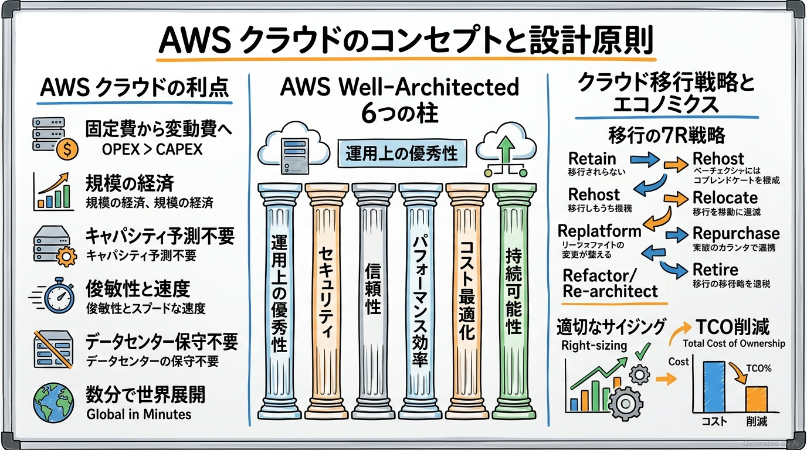
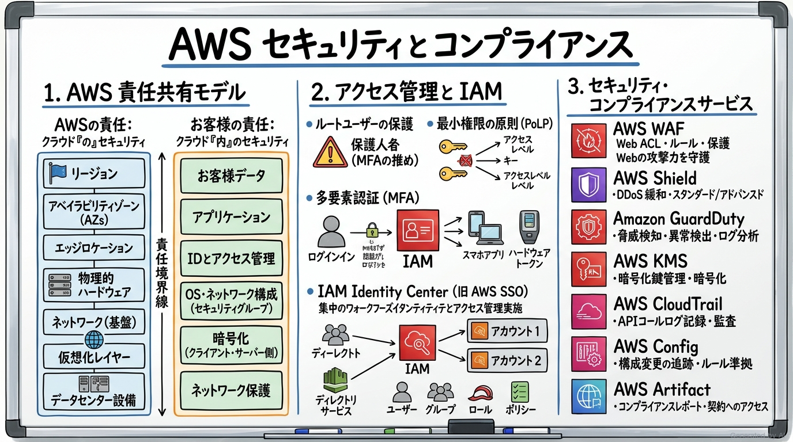
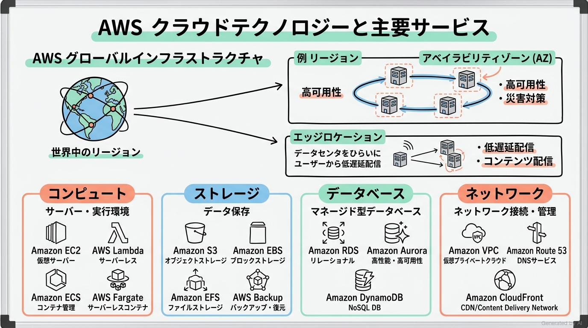
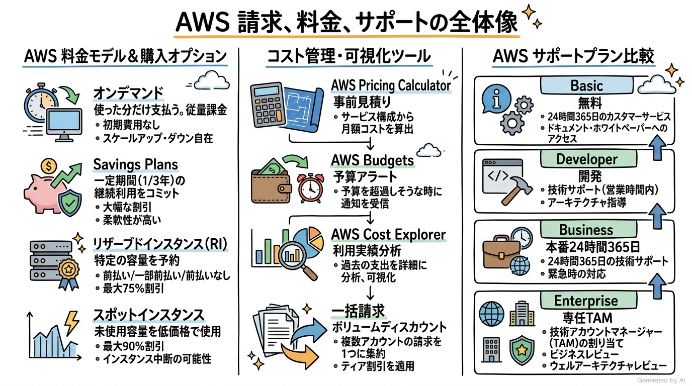

# AWS Certified Cloud Practitioner (CLF-C02) 完全対策＆実践学習ガイド

- **対象資格**: AWS Certified Cloud Practitioner
- **試験コード**: CLF-C02
- **公式試験ガイド**: [AWS Certified Cloud Practitioner (CLF-C02) 試験ガイド](https://docs.aws.amazon.com/ja_jp/aws-certification/latest/cloud-practitioner-02/cloud-practitioner-02.html)
- **最終更新日**: 2026-10-04

---

## はじめに

現代のITインフラストラクチャは、オンプレミス環境の物理データセンターから、クラウドベンダーが提供するマネージドサービスやサーバーレスアーキテクチャへと根本的なパラダイムシフトを遂げました。この変革の中で、AWS (Amazon Web Services) は世界最大シェアを誇るクラウドプラットフォームとして、エンタープライズからスタートアップまで多種多様なシステムを支えています。

AWS Certified Cloud Practitioner (CLF-C02) は、技術職・非技術職を問わず、AWS クラウドの包括的な価値提案、設計原則、セキュリティ・責任共有モデル、主要コアサービス、および料金体系・サポート体制に関する総合的な理解を認定する基礎資格です。

本ガイドは、最新の CLF-C02 出題範囲に含まれる全4ドメインの重要トピック、サービス選定のトレードオフ、各タスク・ユースケースを網羅した実践シナリオ、および公式一次ドキュメント・推奨ハンズオンをカプセル化して記述した完全対策ノートです。

### AWS Certified Cloud Practitioner 試験とは

AWS Certified Cloud Practitioner は、AWS クラウドに関する全体的な知識と理解を実証するファウンデーショナルレベルの認定資格です。エンジニアだけでなく、プロジェクトマネージャー、セールス、財務、IT調達担当者など、クラウド関連業務に関わるあらゆるビジネスパーソンに推奨されます。

- **試験時間**: 90 分
- **出題問題数**: 65 問（採点対象: 50 問 / 未採点テスト設問: 15 問）
- **出題形式**: 択一選択問題（4肢中1つ選択）、複数選択問題（5肢以上中2つ以上選択）
- **合格基準点**: 100〜1,000 点のスケールドスコアで 700 点以上
- **前提知識**: AWS クラウドの設計・実装・運用に関する 6 か月程度の基礎的な知識、またはクラウドに関わる実務経験が推奨されます。なお、コーディング、詳細なアーキテクチャ設計、詳細なトラブルシューティング、負荷テストなどは本試験の出題範囲外です。

### 難易度と求められる思考力

当試験の難易度は **ファウンデーショナル（基礎レベル・概念理解とユースケース適合性判断重視）** に位置づけられます。

アソシエイトレベルのような複雑なCLIコマンド構文やトラブルシューティング手順は問われませんが、単なるサービス名の丸暗記では合格できません。「なぜ固定費から変動費への転換が俊敏性を高めるのか」「RDS と EC2 上の自前データベースで責任境界はどう異なるのか」「S3 の各ストレージクラスをアクセス頻度と耐障害性要件に応じてどう選定すべきか」「突発的なスパイクアクセスに対して Auto Scaling と Elastic Load Balancing がどう協調するのか」といった、**具体的なビジネスシナリオに応じたクラウドの基本原則とサービス適合性の判断力** が問われます。

特に、以下の基本思想を深く腹落ちさせておくことが極めて重要です：
1. **クラウドらしさ（Cloud Native）の追求**: ハードウェア調達の待ち時間をゼロにし、API駆動で弾力的にスケールさせる発想
2. **AWS 責任共有モデルの明確な意識**: AWS が担保する「クラウドのセキュリティ」と、ユーザーが管理する「クラウド内のセキュリティ」の境界線
3. **AWS Well-Architected Framework の 6 つの柱**: 運用上の優秀性、セキュリティ、信頼性、パフォーマンス効率、コスト最適化、持続可能性に基づく意思決定

### 推奨の勉強法

1. **公式一次ドキュメントと Well-Architected Framework の精読**
   各分野の末尾に掲載している AWS 公式ドキュメントの「概要」「コンセプトガイド」「ホワイトペーパー」に必ず目を通します。特に「クラウドの6大メリット」「責任共有モデル」「Well-Architected 6つの柱」は頻出です。
2. **実際に AWS マネジメントコンソールを操作する実機ハンズオン体験**
   AWS 無料利用枠や AWS Skill Builder の学習コンテンツを活用し、VPC の作成、EC2 インスタンスの起動、S3 バケットへのファイルアップロード、IAM ユーザーとポリシーの作成、AWS 料金見積りツールの試算などを実際に操作して体感します。
3. **実践シナリオ（状況・対応・結果・解説）による意思決定プロセスの追体験**
   各ドメインに収録した実践シナリオにおいて、特に **解説（なぜ他の有力代替案では不適格なのか）** を熟読し、試験で出題される紛らわしい選択肢を論理的に消去できる判断基準を習得します。

---

## 目次

1. [はじめに](#はじめに)
2. [学習カリキュラム・出題範囲ロードマップ](#学習カリキュラム出題範囲ロードマップ)
3. [Domain 1: クラウドのコンセプト (24%)](#domain-1-クラウドのコンセプト-24)
4. [Domain 2: セキュリティとコンプライアンス (30%)](#domain-2-セキュリティとコンプライアンス-30)
5. [Domain 3: クラウドテクノロジーとサービス (34%)](#domain-3-クラウドテクノロジーとサービス-34)
6. [Domain 4: 請求、料金、サポート (12%)](#domain-4-請求料金サポート-12)
7. [まとめと推奨学習ステップ](#まとめと推奨学習ステップ)

---

## 学習カリキュラム・出題範囲ロードマップ

### セクション一覧と出題比率

本試験は全4ドメインで構成されており、「セキュリティとコンプライアンス (30%)」と「クラウドテクノロジーとサービス (34%)」の2分野で全体の 64% を占めます。さらに「クラウドのコンセプト (24%)」を含めると全体の約9割となるため、これら3つのドメインの確実な理解が合格の決定打となります。

| ドメイン番号 | ドメイン名 / 出題分野 | 出題比率 | 主要対象サービス・ツール |
| :--- | :--- | :--- | :--- |
| **Domain 1** | クラウドのコンセプト | 24% | AWS Well-Architected Framework, AWS CAF, クラウドの6大利点, クラウド移行戦略 (7R), クラウドエコノミクス |
| **Domain 2** | セキュリティとコンプライアンス | 30% | AWS 責任共有モデル, AWS IAM, IAM Identity Center, AWS Artifact, GuardDuty, AWS WAF, AWS Shield, KMS |
| **Domain 3** | クラウドテクノロジーとサービス | 34% | Amazon EC2, AWS Lambda, Amazon ECS/EKS, Amazon S3, Amazon EBS, Amazon RDS, Amazon DynamoDB, Amazon VPC, Route 53, CloudFront |
| **Domain 4** | 請求、料金、サポート | 12% | AWS 料金モデル, AWS Pricing Calculator, AWS Cost Explorer, AWS Budgets, AWS Organizations (一括請求), AWS サポートプラン |

---

### ドメイン別出題詳細

#### Domain 1: クラウドのコンセプト (24%)
- **出題の狙い**: AWS クラウドの価値提案（高可用性、俊敏性、弾力性、グローバル展開）、オンプレミスに対する優位性、AWS Well-Architected Framework の 6 つの柱、AWS クラウド導入フレームワーク (AWS CAF)、およびクラウドエコノミクス（CapEx から OpEx への転換、TCO、規模の経済）の理解を検証します。
- **主要タスク**:
  - Task 1.1: AWS クラウドの利点を定義する（デプロイ速度、グローバルリーチ、俊敏性、弾力性、規模の経済）
  - Task 1.2: AWS クラウドの設計原則を特定する（Well-Architected Framework の 6 つの柱）
  - Task 1.3: AWS クラウドへの移行の利点と戦略を理解する（AWS CAF の 6 つの視点、クラウド移行 7R 戦略）
  - Task 1.4: クラウドエコノミクスのコンセプトを理解する（固定費 vs 変動費、オンプレミス TCO、BYOL vs ライセンス込み、サイジング最適化）
- **重要キーワード**: CapEx to OpEx, Economies of Scale, Well-Architected Framework (6 Pillars), AWS CAF, Migration Strategies (7R), Right Sizing, BYOL

#### Domain 2: セキュリティとコンプライアンス (30%)
- **出題の狙い**: AWS 責任共有モデルにおける責任分担（サービスモデルごとの差異を含む）、IAM による厳格なアクセス制御（ルートユーザー保護、最小権限、MFA）、コンプライアンス確認リソース、および多層防御を実現する AWS セキュリティサービスの選定能力を検証します。
- **主要タスク**:
  - Task 2.1: AWS の責任共有モデルを理解する（インフラ側の責任 vs 顧客側の責任、EC2・RDS・Lambda における境界変化）
  - Task 2.2: AWS クラウドのセキュリティ、ガバナンス、コンプライアンスのコンセプトを理解する（AWS Artifact、暗号化、CloudWatch/CloudTrail/Config による監査）
  - Task 2.3: AWS アクセス管理機能を特定する（IAM ユーザー/グループ/ロール/ポリシー、ルートユーザー保護、MFA、IAM Identity Center）
  - Task 2.4: セキュリティのためのコンポーネントとリソースを特定する（AWS WAF、Shield、GuardDuty、Inspector、Security Hub、KMS、Secrets Manager）
- **重要キーワード**: Shared Responsibility Model, AWS IAM, Root User, MFA, IAM Identity Center, AWS Artifact, AWS KMS, AWS CloudTrail, AWS Config, Amazon GuardDuty, AWS WAF, AWS Shield

#### Domain 3: クラウドテクノロジーとサービス (34%)
- **出題の狙い**: AWS グローバルインフラストラクチャ（リージョン、AZ、エッジ）の構造と利点、各種デプロイモデルとアクセス手法、ならびにコンピュート、ストレージ、データベース、ネットワーク、AI/ML、分析、アプリケーション統合などの主要サービスの適切な位置づけとユースケースの特定能力を検証します。
- **主要タスク**:
  - Task 3.1: AWS クラウドでのデプロイと運用の方法を定義する（コンソール、CLI、SDK、IaC/CloudFormation、デプロイモデル）
  - Task 3.2: AWS のグローバルインフラストラクチャを定義する（リージョン、アベイラビリティーゾーン、エッジロケーション、低レイテンシー、DR）
  - Task 3.3: AWS のコンピューティングサービスを特定する（Amazon EC2、AWS Lambda、Amazon ECS/EKS、AWS Fargate、ELB、Auto Scaling）
  - Task 3.4: AWS データベースサービスを特定する（Amazon RDS、Amazon Aurora、Amazon DynamoDB、Amazon ElastiCache、AWS DMS）
  - Task 3.5: AWS のネットワークサービスを特定する（Amazon VPC、サブネット、セキュリティグループ、ネットワーク ACL、Route 53、Direct Connect、VPN）
  - Task 3.6: AWS ストレージサービスを特定する（Amazon S3、Amazon EBS、Amazon EFS、Amazon FSx、AWS Storage Gateway、AWS Backup）
  - Task 3.7: AWS の人工知能および機械学習 (AI/ML) サービスと分析サービスを特定する（Amazon SageMaker、Lex、Rekognition、Athena、Glue、Kinesis）
  - Task 3.8: 試験対象内のその他の AWS サービスカテゴリを特定する（Amazon SQS/SNS/EventBridge、Amazon Connect/SES、Developer Tools、WorkSpaces）
- **重要キーワード**: Region, Availability Zone (AZ), Edge Location, EC2, Lambda, Fargate, ECS/EKS, S3, EBS, EFS, RDS, Aurora, DynamoDB, VPC, Route 53, CloudFront, Direct Connect, CloudFormation

#### Domain 4: 請求、料金、サポート (12%)
- **出題の狙い**: Amazon EC2 をはじめとするコンピューティング購入オプション（オンデマンド、Savings Plans、リザーブド、スポット）、データ転送料金の特性、コスト見積もり・可視化・予算管理ツール、AWS Organizations による一括請求の仕組み、および AWS サポートプランの機能差分の特定能力を検証します。
- **主要タスク**:
  - Task 4.1: AWS 料金モデルを比較する（オンデマンド、Savings Plans、リザーブドインスタンス、スポットインスタンス、専有ホスト、データ転送料金）
  - Task 4.2: 請求、予算、コスト管理のためのリソースを理解する（AWS Pricing Calculator、AWS Cost Explorer、AWS Budgets、一括請求、コスト配分タグ）
  - Task 4.3: AWS の技術リソースと AWS サポートオプションを特定する（AWS サポートプラン 5種、AWS Trusted Advisor、AWS Health Dashboard、AWS Marketplace）
- **重要キーワード**: On-Demand, Savings Plans, Reserved Instances, Spot Instances, AWS Pricing Calculator, AWS Cost Explorer, AWS Budgets, Consolidated Billing, AWS Support Plans (Basic/Developer/Business/Enterprise), Trusted Advisor

---

## Domain 1: クラウドのコンセプト (24%)

クラウドコンピューティングは、ITリソースをインターネット経由でオンデマンドに提供し、使った分だけ支払う従量課金モデルです。本ドメインでは、従来のオンプレミスインフラストラクチャと比較したクラウド固有の価値、AWS Well-Architected Framework に基づく健全な設計原則、エンタープライズのクラウド移行フレームワーク、およびコスト構造の変革（エコノミクス）について学習します。



---

### 1. セクション概要

クラウドの価値を理解する上で最も重要な観点は、「ビジネスのアジリティ（俊敏性）の獲得」と「ITリソースの弾力的な調達」です。従来のIT調達では、数ヶ月におよぶハードウェア選定、見積もり、発注、ラッキング、初期設定という先行投資が必要でしたが、AWS クラウドではAPIの呼び出しやコンソール操作により数分でグローバルインフラを活用できます。

#### 重要キーワード

- **固定費（CapEx）から変動費（OpEx）への転換**: 事前の大規模な設備投資（Capital Expenditure）を行わず、システムが稼働した分だけの運用費用（Operational Expenditure）として支払うモデル。
- **規模の経済（Economies of Scale）**: AWS が数十万以上のお客様のリソースを集約・最適化することでインフラコストを劇的に引き下げ、継続的な値下げや高性能ハードウェアの低価格提供に還元する仕組み。
- **俊敏性（Agility）**: 開発リソースを数分で立ち上げ、迅速なプロトタイピングや市場投入（Time-to-Market）を実現する能力。
- **伸縮性（Elasticity）**: 需要の増減に応じて、コンピューティングリソースを自動的または容易に拡大（スケールアウト/アップ）および縮小（スケールイン/ダウン）し、無駄な余剰キャパシティを排除する性質。
- **高可用性（High Availability: HA）**: コンポーネントの障害が発生しても、人間の介入なしにサービスが継続稼働する状態。
- **AWS Well-Architected Framework**: 安全で高性能、耐障害性に優れ、効率的なクラウドアーキテクチャを設計・運用するための公式ベストプラクティス体系。6つの柱で構成。
- **AWS クラウド導入フレームワーク (AWS CAF)**: 組織がクラウド移行を成功させるための包括的ガイダンスフレームワーク。6つのパースペクティブ（視点）で構成。
- **移行の 7R 戦略**: 既存ワークロードをクラウドへ移行する際のアプローチ分類（Rehost, Relocate, Replatform, Refactor/Rearchitect, Repurchase, Retain, Retire）。
- **適切なサイジング（Right Sizing）**: ワークロードの実績メトリクスに基づいて、EC2 や RDS などのインスタンスサイズを過不足なく最適なスペックに調整する継続的なコスト最適化プロセス。

---

### 2. 重要トピック

#### 1. AWS クラウドの 6 大利点（Six Advantages of Cloud Computing）

AWS 公式が定義するクラウドコンピューティングの 6 大メリットは、本試験において極めて頻出のテーマです。

1. **固定費を変動費に変える（Trade capital expense for variable expense）**:
   データセンターや物理サーバーへの多額の事前投資を行わず、実際に利用したコンピュート時間やストレージ容量に対してのみ支払います。
2. **規模の経済の恩恵を受ける（Benefit from massive economies of scale）**:
   AWS の巨大なスケールメリットにより、自社単独で調達するよりも圧倒的に低い従量課金単価で高品質なインフラを利用できます。
3. **キャパシティの当て推量をやめる（Stop guessing capacity）**:
   将来のピーク需要を過剰に予測して高価なハードウェアを死蔵させるリスクがなく、必要に応じて自動で拡張・縮小できます。
4. **速度と俊敏性を高める（Increase speed and agility）**:
   エンジニアが新しいリソースをわずか数クリックやAPIリクエストで利用可能になるため、実験とイノベーションのサイクルを劇的に加速できます。
5. **データセンターの維持管理費を使わない（Stop spending money running and maintaining data centers）**:
   サーバーのラッキング、冷却、電源、ネットワーク配線、物理セキュリティといった「差別化につながらない重労働（Undifferentiated Heavy Lifting）」から解放され、自社のビジネスロジック開発に専念できます。
6. **数分で世界中に展開する（Go global in minutes）**:
   世界各地の AWS リージョンを活用し、最小限のコストと数クリックで世界中のエンドユーザーに対して低レイテンシーなサービスを提供できます。

#### 2. AWS Well-Architected Framework の 6 つの柱

クラウドアーキテクチャを評価・改善するための標準規範であり、各柱がどのような目標を担っているかを正確に識別する必要があります。

| 柱の名称 | 中核的な目標・設計原則 | 主な推奨プラクティス・対象サービス |
| :--- | :--- | :--- |
| **運用上の優秀性 (Operational Excellence)** | ワークロードを効果的に実行・監視し、ビジネス価値を継続的に改善する。コードとしての運用、小規模かつ可逆的な変更、障害の事前予想。 | AWS CloudFormation によるインフラのコード化、Amazon CloudWatch による監視、AWS Systems Manager による自動運用 |
| **セキュリティ (Security)** | データ、システム、資産を保護しながら、クラウドテクノロジーを活用してセキュリティ体制を向上させる。強固なアイデンティティ基盤、トレーサビリティの適用、全レイヤーでの多層防御、保管時・転送時の暗号化。 | AWS IAM, AWS KMS, AWS CloudTrail, Amazon GuardDuty, AWS WAF |
| **信頼性 (Reliability)** | 期待される機能を要求どおり正しく一貫して実行する能力。障害からの自動復旧、復旧手順のテスト、水平方向のスケーラビリティ（疎結合化）。 | AWS Auto Scaling, Elastic Load Balancing, Amazon Route 53, Multi-AZ 構成, AWS Backup |
| **パフォーマンス効率 (Performance Efficiency)** | コンピューティングリソースを効率的に使用してシステム要件を満たし、需要の変化や技術の進化に合わせてその効率を維持する。先進テクノロジーの民主化、サーバーレスの採用、マルチAZ/グローバル展開。 | AWS Lambda, Amazon ECS/EKS, Amazon CloudFront, AWS Graviton プロセッサ |
| **コスト最適化 (Cost Optimization)** | 最も低い価格ポイントでビジネス価値を提供するシステムを運用する。クラウド財務管理（FinOps）の確立、消費モデルの採用、費用対効果の高いリソース選定、適切なサイジング。 | AWS Cost Explorer, AWS Budgets, AWS Compute Optimizer, Savings Plans, Amazon S3 ライフサイクル |
| **持続可能性 (Sustainability)** | クラウドワークロードの実行による環境への影響（二酸化炭素排出量やエネルギー消費）を継続的に最小化する。使用率の最大化、効率的なハードウェア/ソフトウェアの採用、マネージドサービスの活用。 | AWS Graviton プロセッサの採用、サーバーレス（Lambda）によるアイドルリソース排除、AWS Customer Carbon Footprint Tool |

#### 3. クラウド移行戦略（AWS CAF と 移行の 7R）

組織的なクラウド導入を加速するためのフレームワークとして **AWS クラウド導入フレームワーク (AWS CAF)** が定義されています。AWS CAF は組織の変革領域を以下の 6 つの視点（Perspectives）に整理しています：
- **ビジネス視点 (Business)**: クラウド投資が事業目標（収益向上、ビジネスリスク軽減）に整合しているかを担保。
- **人材視点 (People)**: クラウド時代における組織文化の醸成、スキル習得、組織構造の適応を推進。
- **ガバナンス視点 (Governance)**: プログラム管理、ポートフォリオ管理、クラウド財務管理（FinOps）を統括。
- **プラットフォーム視点 (Platform)**: クラウド上でのアーキテクチャ原則、環境構築、ハイブリッド連携を設計。
- **セキュリティ視点 (Security)**: クラウド環境におけるコンプライアンス、アイデンティティ、データ保護を確立。
- **オペレーション視点 (Operations)**: クラウドワークロードの健全性維持、インシデント管理、サービスレベル管理を実行。

また、既存システムの移行方式として **移行の 7R 戦略** が用いられます：
1. **Rehost（リホスト / リフト＆シフト）**: アプリケーションを変更せず、既存の仮想マシンイメージをそのまま EC2 等へ移行（AWS Application Migration Service 等を活用）。
2. **Relocate（リロケート）**: VMware Cloud on AWS などを利用し、ハイパーバイザーレベルで設定変更なしにワークロードを AWS へ移動。
3. **Replatform（リプラットフォーム / リフト＆リシェイプ）**: コアアーキテクチャは変えず、データベースを自前運用から Amazon RDS などのマネージドサービスに置き換えて運用負荷を軽減。
4. **Refactor / Rearchitect（リファクタリング / リアーキテクティング）**: クラウドネイティブな利点を最大化するため、コードや構成を全面的に再設計（マイクロサービス化、サーバーレス化、コンテナ化）。
5. **Repurchase（リパーチェス / ドロップ＆ショップ）**: 既存システムを廃止し、SaaS（Salesforce や Workday など）または AWS Marketplace 上の既製品に乗り換え。
6. **Retain（リテイン / 保持）**: 減価償却期間中である、または移行の緊急性が低いシステムをオンプレミスに残す判断。
7. **Retire（リタイア / 廃止）**: 調査の結果、現在利用されておらず価値を生まない不要なシステムを安全に停止・削除。

---

### 3. 実践シナリオ

#### シナリオ 1-1: 急激なアクセス集中に耐えうるインフラの柔軟性確保

- **状況**: オンラインチケット販売企業が、人気イベントのチケット発売開始時にアクセスが急増し、オンプレミスサーバーが高負荷でダウンして販売機会を損失している場合
- **対応**: ワークロードを AWS クラウドへ移行し、Amazon EC2 Auto Scaling と Elastic Load Balancing (ELB) を組み合わせた構成を採用する
- **結果**: トラフィックの急増を検知してコンピュートリソースが自動拡張され、ピーク終了後は自動縮小することで、ダウンタイムの完全排除とコスト最適化が両立される
- **解説**: これはクラウドの「伸縮性（Elasticity）」および「俊敏性（Agility）」を活用した典型例であるためです。オンプレミス環境でピーク時に合わせた過剰な物理サーバーを事前購入（CapEx）すると、オフピーク時に膨大なアイドルコストが発生します。AWS の伸縮性を活用することで、需要変動にリアルタイム追従する従量課金アーキテクチャ（OpEx）を実現できます。固定スペックの物理サーバー増強（代替案A）ではコストが莫大となり、単一の大規模インスタンスへの置き換え（代替案B）では単一障害点（SPOF）を排除できず耐障害性が低下するため不適格です。
- **参考ドキュメント**:
  - [AWS クラウドコンピューティングの利点](https://docs.aws.amazon.com/ja_jp/whitepapers/latest/aws-overview/six-advantages-of-cloud-computing.html): 6大メリットと伸縮性の基本概念

#### シナリオ 1-2: データベース管理の運用負荷を最小化するクラウド移行

- **状況**: オンプレミスの MySQL サーバーを運用している企業が、OS や DBMS のセキュリティパッチ適用、バックアップ取得、ハードウェア障害対応などの日常的な保守運用負荷に忙殺されている場合
- **対応**: クラウド移行戦略として Replatform（リプラットフォーム）を選択し、データベースエンジンを Amazon RDS for MySQL に移行する
- **結果**: OS やデータベースエンジンのパッチ適用、自動バックアップ、Multi-AZ による自動フェイルオーバーが AWS 側にオフロードされ、運用保守工数が大幅に削減される
- **解説**: Amazon RDS はマネージド型のリレーショナルデータベースサービスであり、インフラ保守という「差別化につながらない重労働」を AWS が肩代わりするためです。EC2 インスタンス上に MySQL を自前でインストールして動かす Rehost 方式（代替案A）では、OS や DBMS のパッチ適用・バックアップ管理責任が顧客に残るため運用負荷低減の要件を満たせません。また、初手から完全な NoSQL（DynamoDB）への Refactor（代替案B）を実施すると、アプリケーションの大規模なコード改修が必要となり移行リスクと期間が肥大化するため不適切です。
- **参考ドキュメント**:
  - [クラウド移行の 7 つの戦略 (7R)](https://docs.aws.amazon.com/prescriptive-guidance/latest/strategy-migration/overview.html): ワークロード特性に応じた移行戦略選定

#### シナリオ 1-3: Well-Architected Framework によるセキュリティ体制の強化

- **状況**: スタートアップ企業が急ピッチでシステムを本番稼働させたものの、セキュリティ設定の漏れや権限管理の不備に懸念を抱えており、体系的なフレームワークに基づいて客観的に現状評価を実施したい場合
- **対応**: AWS Well-Architected Tool を使用し、Well-Architected Framework の「セキュリティの柱」の質問項目に沿ってワークロードのレビューを実施する
- **結果**: ルートユーザーの使用状況、最小権限の原則、保管時暗号化の適用状況などの高リスク・中リスク課題が明確に可視化され、優先順位付きの改善ガイダンスを取得できる
- **解説**: AWS Well-Architected Tool は、自社のアーキテクチャを公式の 6 つの柱に照らし合わせてレビューし、ベストプラクティスとのギャップを特定するための専用サービスであるためです。「信頼性の柱」（代替案A）は障害からの回復力や単一障害点排除を対象としており、「コスト最適化の柱」（代替案B）は不要リソースの削減を対象としているため、セキュリティ体制の包括的な診断という要件には合致しません。
- **参考ドキュメント**:
  - [AWS Well-Architected Framework - セキュリティの柱](https://docs.aws.amazon.com/ja_jp/wellarchitected/latest/security-pillar/welcome.html): クラウドセキュリティ設計の基本原則

#### シナリオ 1-4: グローバル展開におけるレイテンシー削減と展開速度の向上

- **状況**: 日本国内向けにサービスを提供していたメディア配信企業が、北米および欧州のユーザー向けにも動画および静的Webサイトを低遅延で迅速に提供したい場合
- **対応**: Amazon CloudFront（コンテンツ配信ネットワーク）を導入し、世界中にあるエッジロケーションからコンテンツをキャッシュ配信する
- **結果**: 新たに海外現地データセンターの契約やサーバー調達を行うことなく、わずか数分で世界中のユーザーに低遅延なコンテンツ配信環境を整備できる
- **解説**: クラウドの「数分で世界中に展開する（Go global in minutes）」という利点と、AWS のエッジロケーションネットワークを活用した最適なアプローチであるためです。海外リージョンごとに個別の Web サーバー群を新設して個別運用する構成（代替案A）は、運用コストとインフラ管理が複雑化します。また、日本の単一リージョンのオリジンサーバーから直接グローバル配信し続ける構成（代替案B）では、物理的距離による通信遅延（レイテンシー）が発生し、海外ユーザーのUXを著しく損ないます。
- **参考ドキュメント**:
  - [Amazon CloudFront の主要概念](https://docs.aws.amazon.com/ja_jp/AmazonCloudFront/latest/DeveloperGuide/Introduction.html): エッジロケーションを活用したコンテンツ配信

#### シナリオ 1-5: クラウドエコノミクスに基づく過剰プロビジョニングの解消

- **状況**: オンプレミス時代に最大の将来予測に基づいて購入した物理サーバーの平均CPU使用率が 15% にとどまっており、過剰スペックによる無駄なコストを削減したい場合
- **対応**: AWS Compute Optimizer を活用して実績メトリクスを分析し、適切なサイジング（Right Sizing）を実施して適正スペックの EC2 インスタンスタイプへ変更する
- **結果**: リソースの無駄な余剰キャパシティが排除され、システムパフォーマンスを維持したままコンピュート費用が大幅に削減される
- **解説**: クラウドエコノミクスにおける「適切なサイジング（Right Sizing）」の原則に則ったアプローチであるためです。オンプレミスでは機器交換のリードタイムや将来予測の難しさから「大きめのサーバーを買う（Guessing capacity）」ことが常態化していましたが、AWS では数クリックでインスタンスタイプを変更できるため、実稼働データに基づいた過不足のない最小リソースの維持が可能です。単にインスタンスを停止する（代替案A）では業務要件を満たせず、高価なリザーブドインスタンスを過剰スペックのまま長期契約する（代替案B）では無駄な支出を長期固定化してしまうため不適格です。
- **参考ドキュメント**:
  - [AWS Compute Optimizer ユーザーガイド](https://docs.aws.amazon.com/ja_jp/compute-optimizer/latest/ug/what-is-compute-optimizer.html): 機械学習に基づくリソースサイジング推奨

---

### 4. 参考ドキュメント & 推奨ハンズオン

#### 公式一次ドキュメント
- [AWS クラウドコンピューティングの概要 (ホワイトペーパー)](https://docs.aws.amazon.com/ja_jp/whitepapers/latest/aws-overview/aws-overview.html): クラウドの 6 大利点と基本用語
- [AWS Well-Architected Framework 公式ドキュメント](https://docs.aws.amazon.com/ja_jp/wellarchitected/latest/framework/welcome.html): 6 つの柱の設計原則と実践ガイダンス
- [AWS クラウド導入フレームワーク (AWS CAF)](https://docs.aws.amazon.com/ja_jp/whitepapers/latest/overview-aws-cloud-adoption-framework/overview-aws-cloud-adoption-framework.html): 組織的な移行視点

#### 推奨ハンズオン・ラボ（実機検証）
- **AWS Skill Builder: AWS Cloud Practitioner Essentials (第 2 版)**:
  - **学習目標**: クラウドの基礎概念、Well-Architected Framework の各柱、およびオンプレミスとの違いをインタラクティブな講義とデモで体感する。
- **AWS Well-Architected Tool による自己診断演習**:
  - **学習目標**: マネジメントコンソール上で架空のワークロードを定義し、6 つの柱に関する質問に回答してリスク特定レポートを生成する流れを体験する。

---

## Domain 2: セキュリティとコンプライアンス (30%)

クラウドセキュリティは AWS において最優先事項（Day 0）です。AWS はインフラ自体の強固な保護を提供しますが、クラウド上のデータやアクセス権限の保護はお客様自身の責務です。本ドメインでは、AWS 責任共有モデルの境界線、Identity and Access Management (IAM) によるアイデンティティ統制、コンプライアンス適合性の検証、および多層防御を実現する主要セキュリティサービスを体系的に学習します。



---

### 1. セクション概要

AWS のセキュリティアーキテクチャの根底にあるのは「責任共有モデル（Shared Responsibility Model）」です。AWS が責任を持つ領域とお客様が責任を持つ領域を明確に線引きすることで、セキュリティの穴（見落とし）を防ぎます。さらに、ID（アイデンティティ）を中心としたアクセス制御、通信経路および保存データの暗号化、そして機械学習を活用したインテリジェントな脅威検知を多層的に組み合わせることがベストプラクティスとされています。

#### 重要キーワード

- **責任共有モデル (Shared Responsibility Model)**: AWS が担う「クラウド“の”セキュリティ (Security OF the Cloud)」と、お客様が担う「クラウド“内”のセキュリティ (Security IN the Cloud)」を定義した境界モデル。
- **AWS アカウントのルートユーザー**: アカウント作成時に設定されるメールアドレスとパスワードでサインインする最高権限ユーザー。日常業務での利用は厳禁であり、多要素認証 (MFA) で厳重に保護する。
- **AWS Identity and Access Management (IAM)**: AWS リソースへの認証（誰が）と認可（何ができるか）を一元管理するサービス。IAM ユーザー、IAM グループ、IAM ロール、IAM ポリシーで構成。
- **最小権限の原則 (Principle of Least Privilege)**: ユーザーやサービスに対し、業務を遂行するために必要不可欠な最小限のアクセス許可のみを付与するセキュリティ原則。
- **多要素認証 (Multi-Factor Authentication: MFA)**: パスワード（知識情報）に加え、認証アプリや物理セキュリティキー（所持情報）を組み合わせる多要素認証。
- **AWS IAM Identity Center (旧 AWS SSO)**: 複数の AWS アカウントやビジネスアプリケーションへのシングルサインオン（SSO）と一元的なアクセス権限管理を提供するサービス。
- **AWS Key Management Service (AWS KMS)**: データの暗号化に使用する暗号化キー（KMS キー）を作成、管理、制御するマネージドサービス。
- **AWS CloudTrail**: AWS アカウント内で発生した API 呼び出し履歴やユーザーアクティビティをすべて記録・保存する監査ログサービス。
- **AWS Config**: AWS リソースの構成変更履歴を記録し、定義されたコンプライアンスルールに適合しているかを継続的に評価・監査するサービス。
- **Amazon GuardDuty**: VPC フローログ、DNS ログ、CloudTrail イベントなどを機械学習で分析し、不正アクセスや不審なアクティビティを自動検知するマネージド脅威検出サービス。
- **AWS Artifact**: AWS のコンプライアンスレポート（SOC レポート、PCI DSS、ISO 認証等）や各種セキュリティ合意書をオンデマンドで無償ダウンロードできるポータル。

---

### 2. 重要トピック

#### 1. AWS 責任共有モデルの徹底理解

本試験における最も重要かつ頻出のテーマが「責任共有モデル」です。AWS の責任範囲とお客様の責任範囲を混同しないことが正答の鍵となります。

```text
┌────────────────────────────────────────────────────────────────────────┐
│                        お客様の責任 (Security IN the Cloud)              │
│  ・お客様のデータ（暗号化設定、アクセス権限）                              │
│  ・IAM によるアイデンティティとアクセス管理（パスワード、MFA、ロール）       │
│  ・OSのパッチ適用と設定、ファイアウォール（セキュリティグループ、NACL）設定  │
│  ・ネットワークトラフィックの保護（転送時暗号化）                           │
├────────────────────────────────────────────────────────────────────────┤
│                          AWS の責任 (Security OF the Cloud)            │
│  ・ハードウェアと物理データセンターのセキュリティ（入退館管理、生体認証、電源） │
│  ・ハイパーバイザー（仮想化レイヤー）の管理                               │
│  ・基盤ソフトウェアのパッチ適用と保守                                     │
│  ・グローバルネットワークインフラ（リージョン、AZ、エッジロケーション）       │
└────────────────────────────────────────────────────────────────────────┘
```

サービスモデルによって、責任の境界線は以下のように変化します：
- **IaaS (例: Amazon EC2)**:
  AWS は物理ホストとハイパーバイザーのみを担当します。ゲスト OS の選定・インストール・パッチ適用、ウイルス対策ソフトの導入、ファイアウォール設定、アプリケーションの保守はお客様の責任です。
- **PaaS / マネージドサービス (例: Amazon RDS)**:
  AWS は物理インフラに加え、ゲスト OS のパッチ適用や DBMS のマイナーバージョン更新、自動バックアップ機構の保守まで担当します。お客様はデータベースのパラメータチューニング、テーブル設計、暗号化有効化、接続元セキュリティグループ設定に集中できます。
- **サーバーレス (例: AWS Lambda, Amazon S3)**:
  お客様は OS やサーバーの存在を意識する必要がありません。インフラ、OS、実行環境（ランタイム）のすべてを AWS が管理し、お客様は実行するコードやアップロードするオブジェクトデータ、アクセス権限設定のみに責任を持ちます。

#### 2. IAM (Identity and Access Management) の中核概念

IAM は AWS のセキュリティ境界を形成する最重要コンポーネントです。

| IAM コンポーネント | 定義と役割 | ベストプラクティス |
| :--- | :--- | :--- |
| **ルートユーザー** | アカウント作成時の全体最高権限。解約やサポートプラン変更など特定タスクのみに使用。 | 日常業務での使用厳禁。複雑なパスワード＋ハードウェア MFA 有効化。アクセスキーは削除。 |
| **IAM ユーザー** | 人間やアプリケーションが AWS 操作を行うための個別アイデンティティ。 | 人間 1 人につき 1 つ作成（共有禁止）。MFA 必須化。パスワードポリシーの適用。 |
| **IAM グループ** | 複数の IAM ユーザーの集合体。同一職務（例: Developers, Admins）に一括権限付与。 | 個別ユーザーへ直接ポリシーをアタッチせず、グループ経由で効率的に権限付与。 |
| **IAM ロール** | 特定のユーザーではなく、EC2 インスタンスや Lambda、別アカウント等に一時的認証情報を委譲。 | 永続的なアクセスキーの埋め込みを廃止し、EC2 には IAM インスタンスプロファイルでロールを付与。 |
| **IAM ポリシー** | JSON 形式で記述されたアクセス許可ルール（Effect: Allow/Deny, Action, Resource, Condition）。 | 最小権限の原則（Least Privilege）を適用。AWS 管理ポリシーから始め、必要に応じてインライン/カスタム作成。 |

#### 3. セキュリティ監視・防御サービスの比較マトリクス

AWS には多くのセキュリティ・ガバナンスサービスが存在しますが、それぞれの「役割（防御、検知、監査、暗号化）」を明確に区別することが試験対策で決定的に重要です。

| サービス名 | 主要カテゴリ | 主な機能と役割 | 試験での典型的なキーワード |
| :--- | :--- | :--- | :--- |
| **AWS WAF** | アプリケーション保護 | Web アプリケーションへのレイヤー 7 攻撃（SQL インジェクション、クロスサイトスクリプティング: XSS）を検知・遮断。 | 「Web アプリケーションファイアウォール」「SQL インジェクション対策」「悪意のある IP ブロック」 |
| **AWS Shield** | DDoS 防御 | レイヤー 3/4 の DDoS 攻撃から自動保護する Standard（無償・自動有効）と、専任チーム支援・追加保護を提供する Advanced（有償）。 | 「DDoS 攻撃対策」「SYN フラッド攻撃」「すべての AWS 利用者に自動提供（Standard）」 |
| **Amazon GuardDuty** | 脅威検出 | CloudTrail、VPC フローログ、DNS ログを機械学習で常時分析し、不正な暗号通貨マイニングや不審な通信を検知。 | 「インテリジェントな脅威検出」「機械学習による異常検知」「アカウント侵害の発見」 |
| **Amazon Inspector** | 脆弱性管理 | EC2 インスタンスの OS やパッケージ、ECR コンテナイメージ、Lambda 関数の既知のソフトウェア脆弱性（CVE）を自動スキャン。 | 「ソフトウェア脆弱性診断」「パッケージの既知のセキュリティ問題」「EC2 / ECR のスキャン」 |
| **Amazon Macie** | データプライバシー | 機械学習を用いて Amazon S3 内のオブジェクトをスキャンし、個人識別情報（PII: クレジットカード番号等）を自動発見・保護。 | 「S3 バケット内の個人情報 (PII) 検出」「データプライバシー」「機密データの可視化」 |
| **AWS KMS** | データ暗号化 | データの暗号化・復号に使用する暗号鍵（KMS キー）を一元作成・管理。FIPS 140-2 準拠のハードウェアで鍵を保護。 | 「保管時データの暗号化」「暗号鍵の一元管理」「エンベロープ暗号化」 |
| **AWS Secrets Manager** | 認証情報管理 | データベースのパスワードや API キーを安全に保存し、自動ローテーション（定期更新）機能を提供。 | 「データベース認証情報のローテーション」「API キーの安全な保管」「ハードコードの排除」 |
| **AWS CloudTrail** | API 監査ログ | アカウント内のすべての API 呼び出し（コンソール操作、CLI、SDK、AWS サービス間通信）を時系列でログ保存。 | 「誰が・いつ・何を操作したかの監査」「API 呼び出し履歴」「コンプライアンス監査」 |
| **AWS Config** | 構成管理・監査 | AWS リソースの構成変更履歴を追跡し、設定ルール（例: S3 バケットがパブリック公開されていないか）への適合性を継続監視。 | 「リソース構成変更の追跡」「設定ドリフトの検出」「コンプライアンスルールの適合性」 |
| **AWS Artifact** | コンプライアンスポータル | AWS の各種セキュリティ認証や監査レポート（SOC 1/2/3、PCI DSS、ISO 等）を無償でダウンロード・確認できるポータル。 | 「サードパーティ監査レポートの取得」「コンプライアンス認証の証明」「セキュリティ協定書」 |

---

### 3. 実践シナリオ

#### シナリオ 2-1: 責任共有モデルにおける EC2 インスタンスの OS パッチ適用責任

- **状況**: エンタープライズ企業が基幹業務システムを Amazon EC2 インスタンス上で稼働させており、OS の重要なセキュリティ脆弱性パッチが公開された場合
- **対応**: 自社のシステム運用担当者が EC2 インスタンスにログインし、あるいは AWS Systems Manager Patch Manager を使用してゲスト OS にパッチを適用する
- **結果**: ゲスト OS の脆弱性が解消され、責任共有モデルに基づいた適切なセキュリティ体制が維持される
- **解説**: AWS 責任共有モデルにおいて、Amazon EC2 のような IaaS モデルにおけるゲスト OS のパッチ適用・設定・ウイルス対策は完全に「お客様の責任 (Security IN the Cloud)」であるためです。AWS の責任範囲（Security OF the Cloud）は物理インフラ、ハードウェア、およびハイパーバイザーの保護に限られます。AWS が自動的に EC2 の OS パッチを適用すること（代替案A）は設計上あり得ず、AWS サポートにパッチ適用作業を依頼する（代替案B）こともサポート規約外となるため不適格です。
- **参考ドキュメント**:
  - [AWS 責任共有モデル公式ガイダンス](https://aws.amazon.com/compliance/shared-responsibility-model/): サービスカテゴリごとの責任範囲の定義

#### シナリオ 2-2: AWS アカウント開設直後のルートユーザーセキュリティ強化

- **状況**: 新規に AWS アカウントを開設した管理者が、アカウントの最高権限を持つルートユーザーの不正利用や乗っ取りリスクを最小化したい場合
- **対応**: ルートユーザーに対して多要素認証 (MFA) を有効化し、日常業務用の個別 IAM ユーザー（または IAM Identity Center 経由のユーザー）を作成して管理者権限を付与した上で、ルートユーザーのアクセスキーを作成せずサインアウトする
- **結果**: ルートユーザーへの不正サインインが物理的に防止され、日々の作業ログが個別ユーザーに紐づいて CloudTrail で追跡可能になる
- **解説**: ルートユーザーはアカウント内のあらゆる操作（アカウント解約や課金情報の変更等）が無制限に実行できるため、日常業務での利用を避け、MFA で厳格に保護することが AWS の最優先セキュリティベストプラクティスであるためです。日常的な運用作業をルートユーザーのまま実施する構成（代替案A）は重大なセキュリティ違反です。また、日常作業のためにルートユーザーのアクセスキーを発行してローカル PC に保存する行為（代替案B）は、キー漏洩時のリスクが極めて高いため厳禁とされています。
- **参考ドキュメント**:
  - [AWS アカウントのルートユーザーのベストプラクティス](https://docs.aws.amazon.com/ja_jp/IAM/latest/UserGuide/root-user-best-practices.html): ルート保護手順と MFA 設定

#### シナリオ 2-3: 監査法人へのセキュリティコンプライアンス認証の証明

- **状況**: 金融系サービスを提供する企業が外部のセキュリティ監査を受け、AWS クラウド基盤自体が ISO 27001 や PCI DSS、SOC 2 などの国際的なセキュリティ基準に適合している公的証明書類を提出するよう求められた場合
- **対応**: AWS マネジメントコンソールから AWS Artifact にアクセスし、該当する最新のコンプライアンスレポートや認証証明書をオンデマンドでダウンロードして監査法人に提出する
- **結果**: 追加費用や AWS への個別問い合わせを要することなく、公式な第三者監査レポートを即座に入手・提出できる
- **解説**: AWS Artifact は、AWS が取得しているセキュリティおよびコンプライアンスに関する認証証明書や SOC レポートを、すべてのお客様に無償でオンデマンド提供する公式ポータルであるためです。AWS Trusted Advisor（代替案A）はお客様環境の設定最適化チェックツールであり、AWS基盤の公的監査証明書は提供しません。AWS Config（代替案B）はお客様のアカウント内リソースの構成ルール監査ツールであり、AWS 本体の第三者監査レポートを取得する機能はありません。
- **参考ドキュメント**:
  - [AWS Artifact ユーザーガイド](https://docs.aws.amazon.com/ja_jp/artifact/latest/ug/what-is-aws-artifact.html): コンプライアンスレポートの取得方法

#### シナリオ 2-4: 不正な暗号通貨マイニングや不審な通信のインテリジェントな検知

- **状況**: クラウド運用チームが、万が一 EC2 インスタンスや IAM 認証情報が侵害され、攻撃者によって不正な暗号通貨マイニングが行われたり、既知の悪意ある C&C サーバーとの通信が発生した場合に、即座に検知してアラートを受け取りたい場合
- **対応**: アカウントで Amazon GuardDuty を有効化し、EventBridge および SNS と連携させて通知を設定する
- **結果**: ログの収集・解析基盤を自前構築することなく、機械学習によるリアルタイムの脅威分析によって侵害の兆候が自動検知される
- **解説**: Amazon GuardDuty は、CloudTrail イベント、VPC フローログ、DNS ログなどを機械学習と脅威インテリジェンスを用いて分析し、アカウントやワークロードの侵害を自動検知するマネージド脅威検出サービスであるためです。Amazon Inspector（代替案A）は静的な脆弱性（CVE）をスキャンするツールであり、稼働中の動的な不審通信やマイニング挙動をリアルタイム検知するものではありません。AWS WAF（代替案B）は外部からの Web アプリケーション攻撃（SQLi 等）を遮断するものであり、内部からの不正通信や認証情報悪用を検知する用途には合致しません。
- **参考ドキュメント**:
  - [Amazon GuardDuty の概要](https://docs.aws.amazon.com/ja_jp/guardduty/latest/ug/what-is-guardduty.html): インテリジェントな脅威検出アーキテクチャ

#### シナリオ 2-5: 管理者による設定変更や不正なアクセス操作の完全な証跡記録

- **状況**: セキュリティ統制上、AWS 環境内のすべてのリソースに対して「誰が、いつ、どの IP アドレスから、どの API を呼び出して変更を行ったか」を完全に記録し、最低 1 年間改ざん不能な状態で保存したい場合
- **対応**: AWS CloudTrail の証跡（Trail）を作成してすべてのリージョンでログ記録を有効化し、Amazon S3 バケットに出力した上で MFA Delete や S3 Object Lock を設定する
- **結果**: マネジメントコンソール、CLI、SDK からのすべての API 呼び出しが確実に記録され、法規制や監査要件を満たす証跡基盤が確立される
- **解説**: AWS CloudTrail は、アカウント内のすべての API アクティビティを記録・保管する標準の監査ログサービスであるためです。Amazon CloudWatch（代替案A）は CPU 使用率などのパフォーマンスメトリクスやアプリケーションログの収集・監視を行うサービスであり、誰がどの API を呼び出したかという管理証跡の一次ソースではありません。AWS Secrets Manager（代替案B）は認証情報の安全な保管・ローテーションサービスであり、監査ログの収集機能は持ちません。
- **参考ドキュメント**:
  - [AWS CloudTrail のユーザーガイド](https://docs.aws.amazon.com/ja_jp/awscloudtrail/latest/userguide/cloudtrail-user-guide.html): API アクティビティのロギングと証跡の作成

---

### 4. 参考ドキュメント & 推奨ハンズオン

#### 公式一次ドキュメント
- [AWS セキュリティの柱 - Well-Architected Framework](https://docs.aws.amazon.com/ja_jp/wellarchitected/latest/security-pillar/welcome.html): 多層防御とアイデンティティ設計の規範
- [AWS IAM ユーザーガイド](https://docs.aws.amazon.com/ja_jp/IAM/latest/UserGuide/introduction.html): IAM の主要概念とセキュリティベストプラクティス
- [AWS セキュリティ、アイデンティティ、コンプライアンス サービス一覧](https://aws.amazon.com/products/security/): 提供サービスの全体マップ

#### 推奨ハンズオン・ラボ（実機検証）
- **AWS Skill Builder: Getting Started with AWS Identity and Access Management (IAM)**:
  - **学習目標**: IAM コンソールでユーザー、グループ、ロールを作成し、カスタム JSON ポリシーによるアクセス制御と MFA 設定を実体験する。
- **AWS Artifact からのレポート取得実機演習**:
  - **学習目標**: コンソールから AWS Artifact を開き、SOC 2 レポートなどのドキュメントをダウンロードする手順を確認する。

---

## Domain 3: クラウドテクノロジーとサービス (34%)

本ドメインは試験全体の 34% を占める最大の分野です。AWS の強大なグローバルインフラストラクチャ（リージョン、AZ、エッジ）の構造を理解し、コンピュート、ストレージ、データベース、ネットワーキングなどの主要サービス群の特性とユースケースを体系的に習得します。



---

### 1. セクション概要

AWS のサービスエコシステムは、ビルディングブロック（組み合わせ可能な構成要素）として設計されています。物理サーバーの仮想化から始まったクラウドは、コンテナ、サーバーレス、フルマネージドデータベース、グローバルコンテンツ配信へと進化しました。アーキテクトやクラウド担当者は、システムの機能要件・非機能要件（可用性、レイテンシー、スケーラビリティ、運用負荷）に合わせて、最適なサービスを正しく選定する判断力が求められます。

#### 重要キーワード

- **AWS リージョン (Region)**: 世界各地の地理的エリア。複数の物理的に隔離された独立したアベイラビリティーゾーン (AZ) で構成。
- **アベイラビリティーゾーン (Availability Zone: AZ)**: 1つ以上のディスクリートな（独立した電源、冷却、物理セキュリティを備えた）データセンター群。リージョン内の AZ 間は高速・低遅延の専用光ファイバーネットワークで接続。
- **エッジロケーション (Edge Location)**: Amazon CloudFront（CDN）や Route 53 が使用する、世界中の主要都市に展開された配信拠点。オリジンサーバーから遠いユーザーへ低遅延でコンテンツを届ける。
- **Amazon EC2 (Elastic Compute Cloud)**: クラウド内でサイズ変更可能な仮想サーバーを提供する IaaS コンピュートサービス。
- **AWS Lambda**: サーバーのプロビジョニングや管理なしにコードを実行できるイベント駆動型サーバーレスコンピューティングサービス。ミリ秒単位の従量課金。
- **Amazon ECS / Amazon EKS**: コンテナ化されたワークロードを大規模にオーケストレーションするサービス（ECS: AWS 独自仕様、EKS: オープンソース Kubernetes 準拠）。
- **AWS Fargate**: EC2 インスタンスの管理を不要にする、ECS および EKS 向けのサーバーレスコンテナ実行エンジン。
- **Amazon S3 (Simple Storage Service)**: 99.999999999% (11 ナインズ) の耐久性を備えた、業界標準のオブジェクトストレージサービス。
- **Amazon EBS (Elastic Block Store)**: EC2 インスタンス向けに提供される、低レイテンシーで永続的な高性能ブロックストレージ。
- **Amazon EFS (Elastic File System)**: 複数の EC2 インスタンスから同時にマウント可能な、サーバーレスで伸縮自在な NFS ファイルストレージ。
- **Amazon RDS (Relational Database Service)**: MySQL, PostgreSQL, Oracle, SQL Server などのリレーショナル DB のセットアップ、運用、スケーリングを自動化するマネージドサービス。
- **Amazon Aurora**: AWS がクラウド向けに再設計した MySQL / PostgreSQL 互換の超高性能リレーショナルデータベース。標準の MySQL に比べ最大 5 倍の高速性を実現。
- **Amazon DynamoDB**: 任意の規模で一貫して 1 桁ミリ秒の応答速度を提供する、フルマネージド型の Key-Value / ドキュメント NoSQL データベース。
- **Amazon VPC (Virtual Private Cloud)**: AWS アカウント内に論理的に隔離されたプライベートな仮想ネットワーク空間を定義・構築するサービス。

---

### 2. 重要トピック

#### 1. AWS グローバルインフラストラクチャの階層関係

AWS の物理的・論理的なインフラストラクチャ構造は、試験において確実に問われる重要テーマです。

```text
┌────────────────────────────────────────────────────────────────────────┐
│                        AWS リージョン (例: 東京リージョン ap-northeast-1) │
│                                                                        │
│   ┌───────────────────────────┐      ┌───────────────────────────┐    │
│   │ アベイラビリティーゾーン A   │      │ アベイラビリティーゾーン C   │    │
│   │ (ap-northeast-1a)         │      │ (ap-northeast-1c)         │    │
│   │  [DC 1]  [DC 2]           │      │  [DC 3]                   │    │
│   └─────────────┬─────────────┘      └─────────────┬─────────────┘    │
│                 │      低遅延・高帯域 光ファイバー    │                 │
│                 └──────────────────────────────────┘                  │
│                                                                        │
│   ┌───────────────────────────┐                                        │
│   │ アベイラビリティーゾーン D   │                                        │
│   │ (ap-northeast-1d)         │                                        │
│   └───────────────────────────┘                                        │
└────────────────────────────────────────────────────────────────────────┘
              ▲
              │ オリジン通信
              ▼
┌────────────────────────────────────────────────────────────────────────┐
│  エッジロケーション / Points of Presence (PoP) (世界 400 以上の主要都市)      │
│  ・Amazon CloudFront によるキャッシュ配信                                 │
│  ・Amazon Route 53 による DNS ルーティング                              │
│  ・AWS Shield によるエッジでの DDoS 攻撃緩和                             │
└────────────────────────────────────────────────────────────────────────┘
```

- **リージョン選定の 4 大基準**:
  1. **データ主権・コンプライアンス**: 法規制によりデータを特定国内に保持する要件。
  2. **レイテンシー（遅延時間）**: 主要な顧客層に物理的に最も近いリージョンを選択。
  3. **利用可能なサービス**: 最新サービスや特定機能は一部リージョンから順次展開される。
  4. **利用料金**: 電力コストや税制等により、リージョンごとにサービス単価が異なる。
- **アベイラビリティーゾーン (AZ) と高可用性**:
  各 AZ は洪水多発地帯や同一電源系統から地理的に隔離されており、1 つの AZ が自然災害で停止しても他の AZ が影響を受けないように設計されています。複数の AZ にリソースを分散配置（Multi-AZ 構成）することで、単一障害点を排除した高可用性を実現します。

#### 2. 主要コンピュートサービスの選定基準

ワークロードの特性、開発スタイル、運用負荷に応じて適切なコンピュートサービスを選定します。

| サービス名 | アーキテクチャ分類 | 主な特徴とユースケース | 管理責任範囲 |
| :--- | :--- | :--- | :--- |
| **Amazon EC2** | 仮想マシン (IaaS) | OS やミドルウェアの完全な制御が必要な場合、レガシー移行、長時間実行のバッチ。 | ゲスト OS、ランタイム、アプリのパッチ適用と保守が必要。 |
| **Amazon ECS / EKS** | コンテナオーケストレーション | マイクロサービス化、Docker コンテナの統合管理。ECS はシンプル、EKS は K8s 標準。 | コンテナ定義とタスクの管理。ホスト基盤は EC2 か Fargate を選択。 |
| **AWS Fargate** | サーバーレスコンテナエンジン | サーバーのプロビジョニングなしでコンテナ（ECS/EKS）を直接実行。OS 保守不要。 | コンテナイメージとリソース要件のみ管理。インフラ管理はゼロ。 |
| **AWS Lambda** | サーバーレス (FaaS) | イベント駆動（S3 アップロード、API 呼び出し等）で短時間（最大 15 分）実行されるコード。 | コードのみ管理。OS、スケーリング、高可用性は AWS が完全自動化。 |
| **AWS Elastic Beanstalk** | PaaS (プラットフォーム) | コードをアップロードするだけで、EC2、ロードバランサー、Auto Scaling を自動構築。 | アプリケーションコードと環境設定。基盤のカスタマイズも可能。 |
| **Amazon Lightsail** | クラウドVPS | 初心者向けにコンピュート、ストレージ、ネットワーキングを定額パッケージで提供。 | シンプルな Web サイトや個人ブログの迅速な立ち上げに最適。 |

#### 3. 主要ストレージサービスの比較マトリクス

データのアクセス頻度、共有要件、レイテンシー要件によってストレージサービスを使い分けます。

| ストレージ名 | ストレージ形式 | 代表的な特徴とアクセス方式 | 主なユースケース |
| :--- | :--- | :--- | :--- |
| **Amazon S3** | オブジェクトストレージ | HTTP/HTTPS 経由でアクセス。無制限の容量。11 ナインズの耐久性。静的 Web ホスティング対応。 | バックアップ、静的メディア配信、データレイク、ログ保存。 |
| **Amazon EBS** | ブロックストレージ | EC2 インスタンスにアタッチして使用する仮想ハードディスク。同一 AZ 内で自動レプリケーション。 | OS のブートボリューム、高 IOPS を要求するデータベース。 |
| **Amazon EFS** | 共有ファイルストレージ | 複数の EC2（複数 AZ）から NFS 経由で同時マウント可能。容量は自動伸縮。 | Linux ベースの共有 Web サーバー、CMS（WordPress 等）のファイル共有。 |
| **Amazon FSx** | 特化型ファイルストレージ | Windows File Server (SMB) や Lustre（HPC/機械学習）向けの完全マネージドファイルシステム。 | Windows ネイティブアプリのファイル共有、ハイパフォーマンス分析。 |
| **AWS Storage Gateway** | ハイブリッドストレージ | オンプレミス環境と AWS クラウドストレージ（S3/EBS）を seamless に接続するゲートウェイ。 | オンプレミスからのクラウドバックアップ、ローカルキャッシュ付き S3 アクセス。 |

#### 4. 主要データベースサービスの選定マトリクス

| サービス名 | データモデル | スケーラビリティと特性 | 最適なユースケース |
| :--- | :--- | :--- | :--- |
| **Amazon RDS** | リレーショナル (SQL) | 6 大エンジン対応（MySQL, PostgreSQL, MariaDB, Oracle, SQL Server）。Multi-AZ 自動フェイルオーバー。 | 構造化データ、トランザクション整合性（ACID）が不可欠な基幹システム。 |
| **Amazon Aurora** | リレーショナル (SQL) | クラウド最適化。MySQL の最大 5 倍、PostgreSQL の最大 3 倍のスループット。ストレージ自動拡張。 | エンタープライズレベルの超高性能・高可用性が求められる商用 DB。 |
| **Amazon DynamoDB** | NoSQL (Key-Value / ドキュメント) | フルマネージド、サーバーレス。データ量に関係なく 1 桁ミリ秒の超低遅延。自動スケーリング。 | モバイルバックエンド、ゲームのセッション管理、IoT データ取り込み。 |
| **Amazon ElastiCache** | インメモリキャッシュ (Redis / Memcached) | メモリ上でデータを保持し、マイクロ秒単位の超高速レスポンスを提供。 | データベース負荷軽減のための読み取りキャッシュ、セッションストア。 |
| **Amazon Redshift** | データウェアハウス (列指向) | ペタバイト級の大規模データを SQL で高速集計・分析できる列指向型分析 DB。 | ビジネスインテリジェンス (BI)、企業横断の大規模データ分析レポート。 |

#### 5. ネットワークの基本構成要素

- **Amazon VPC**: プライベートな仮想ネットワーク。CIDR ブロックで IP アドレス範囲を指定。
- **サブネット (Subnet)**: VPC 内の IP アドレス範囲をアベイラビリティーゾーン単位で分割したもの。
  - **パブリックサブネット**: インターネットゲートウェイ (IGW) へのルートを持ち、インターネットから直接アクセス可能なサブネット。
  - **プライベートサブネット**: インターネットからの直接の着信を遮断したサブネット（DB やバックエンド AP を配置）。
- **インターネットゲートウェイ (IGW)**: VPC とインターネット間の双方向通信を可能にするコンポーネント。
- **NAT ゲートウェイ**: プライベートサブネット内のリソースが、インターネットから着信を受けることなく、安全に外部へアウトバウンド通信（パッチダウンロード等）を行うためのマネージドゲートウェイ。
- **セキュリティグループ vs ネットワーク ACL**:
  - **セキュリティグループ**: インスタンス単位の仮想ファイアウォール。**ステートフル**（戻り通信を自動許可）。許可ルールのみ定義可能。
  - **ネットワーク ACL (NACL)**: サブネット単位のファイアウォール。**ステートレス**（行きと戻りの両方で明示的許可が必要）。許可と拒否の両方のルールを番号順に評価。
- **Amazon Route 53**: 高可用性でスケーラブルなクラウド DNS Web サービス。ドメイン登録、名前解決、ヘルスチェックによるフェイルオーバールーティングを提供。
- **AWS Direct Connect**: オンプレミスと AWS 間にインターネットを経由しない専用のプライベート物理ネットワーク接続を確立するサービス。高い帯域幅、安定した通信、セキュリティ向上を実現。
- **AWS VPN (Site-to-Site VPN)**: インターネット経由でオンプレミスと VPC 間を IPsec 暗号化トンネルで接続する迅速かつ経済的な接続オプション。

---

### 3. 実践シナリオ

#### シナリオ 3-1: サーバーインフラの運用管理を完全に排除した Web API の構築

- **状況**: スタートアップ企業が新しいモバイルアプリのバックエンド API を迅速に構築したく、サーバーの OS 管理やスケーリング設定に工数を割かずに、リクエスト発生時のみコードを実行してコストを最小化したい場合
- **対応**: Amazon API Gateway と AWS Lambda を組み合わせたサーバーレスアーキテクチャを採用する
- **結果**: サーバーのプロビジョニングやパッチ適用が一切不要となり、リクエスト数に応じたミリ秒単位の従量課金で自動スケーリングする堅牢な API が完成する
- **解説**: AWS Lambda は完全なサーバーレスコンピューティングであり、インフラのプロビジョニング、OS 管理、自動スケーリングをすべて AWS が担うためです。API Gateway と連携することで、アイドル時のコストを完全ゼロ（リクエストが発生しなければ無料）に抑えられます。Amazon EC2 で Web サーバーを自前構築する構成（代替案A）では、OS の管理やキャパシティプランニングの工数が発生し、アクセスがない時間帯もインスタンス稼働費用が発生するため要件に反します。また、EC2 上に Docker をインストールして手動運用する構成（代替案B）も運用負荷が高いため不適格です。
- **参考ドキュメント**:
  - [AWS サーバーレスアーキテクチャ概要](https://aws.amazon.com/serverless/): Lambda と API Gateway によるサーバーレス設計

#### シナリオ 3-2: データ損失を防ぐ堅牢なオブジェクトストレージの選定

- **状況**: 医療機関が患者のデジタルレントゲン写真や電子カルテデータをクラウドに保存するにあたり、ハードウェア故障によるデータ損失リスクを極限まで排除し、法的に義務付けられた 10 年以上の長期保管を安全に実現したい場合
- **対応**: Amazon S3 の標準ストレージクラス（S3 Standard）にデータを保存し、ライフサイクルポリシーを設定して一定期間経過後に S3 Glacier Flexible Deep Archive へ自動移行する
- **結果**: 年間 99.999999999% (11 ナインズ) の極めて高いデータ耐久性が確保され、かつ保管期間に応じたストレージコストの劇的な低減が実現される
- **解説**: Amazon S3 はデータを同一リージョン内の少なくとも 3 つ以上の物理的に隔離されたアベイラビリティーゾーン (AZ) にわたって自動レプリケーションし、11 ナインズの耐久性を提供する設計となっているためです。単一の Amazon EBS ボリュームにデータを保存する構成（代替案A）では、単一 AZ 内での冗長化にとどまり、大規模な災害や誤削除に対する長期アーカイブとしての耐久性要件を満たせません。また、EC2 インスタンスストア（代替案B）は揮発性（インスタンス停止・終了時にデータが消失する）ストレージであるため、永続データの保管には絶対に使用できません。
- **参考ドキュメント**:
  - [Amazon S3 ストレージクラスの比較](https://docs.aws.amazon.com/ja_jp/AmazonS3/latest/userguide/storage-class-intro.html): 耐久性とアクセス頻度に応じた階層化

#### シナリオ 3-3: 単一 AZ の障害に耐えうるリレーショナルデータベースの高可用化

- **状況**: ECサイトを運営する企業が、本番データベースのデータセンター障害時に人間の介入なしで即座にサービスを継続稼働させ、ダウンタイムを最小限に抑えたい場合
- **対応**: Amazon RDS で Multi-AZ 配置を有効化する
- **結果**: 別の AZ にスタンバイレプリカが同期的に維持され、プライマリ DB インスタンスに障害が発生した場合でも、DNS エンドポイントが自動的にスタンバイへ切り替わり（自動フェイルオーバー）、数分以内にサービスが復旧する
- **解説**: Amazon RDS Multi-AZ は、別のアベイラビリティーゾーンに同期レプリカを常時待機させ、プライマリ障害時に自動フェイルオーバーを実行することで高可用性と耐障害性を担保する公式機能であるためです。RDS リードレプリカの追加（代替案A）は非同期レプリケーションであり、主に読み取りスループット向上のための機能であって自動フェイルオーバー機能は備えていません。また、定期的な手動スナップショット作成（代替案B）では、スナップショットからの手動復元に時間がかかり、直近のデータ損失（RPO の悪化）と長時間のダウンタイム（RTO の悪化）を招くため不適格です。
- **参考ドキュメント**:
  - [Amazon RDS Multi-AZ 配置の構成](https://docs.aws.amazon.com/ja_jp/AmazonRDS/latest/UserGuide/Concepts.MultiAZ.html): 高可用性と自動フェイルオーバー機構

#### シナリオ 3-4: データベースの読み取り負荷軽減とマイクロ秒応答の実現

- **状況**: ソーシャルゲームのランキング表示機能において、数万人規模の同時アクセスによりリレーショナルデータベースへの読み取り負荷が急増し、応答速度が低下している場合
- **対応**: データベースの前段に Amazon ElastiCache for Redis をインメモリキャッシュとして導入し、ランキングデータをキャッシュする
- **結果**: 頻繁にアクセスされるデータがメモリからマイクロ秒単位で返却され、データベース本体への読み取り負荷が大幅に軽減される
- **解説**: Amazon ElastiCache はメモリ内にデータを保持するマネージドキャッシュサービスであり、ディスク I/O を伴うリレーショナルデータベースへの負荷を劇的にオフロードできるためです。Amazon Redshift を導入する構成（代替案A）はデータウェアハウス（大規模バッチ集計・分析）向けであり、ミリ秒・マイクロ秒のトランザクション応答には適していません。また、RDS インスタンスの垂直スケーリング（CPU/メモリ増強）（代替案B）は一時しのぎに過ぎず、コストが跳ね上がる上にスケーラビリティの限界に直面するため不適切です。
- **参考ドキュメント**:
  - [Amazon ElastiCache の概要](https://docs.aws.amazon.com/ja_jp/AmazonElastiCache/latest/red-ug/WhatIs.html): インメモリキャッシングによるパフォーマンス最適化

#### シナリオ 3-5: プライベートサブネットからの安全なアウトバウンド通信

- **状況**: 金融システムのバックエンドサーバーがプライベートサブネットに配置されており、インターネットからの直接の接続は遮断しつつ、OS のセキュリティアップデートを取得するためにインターネットへアウトバウンド接続を行いたい場合
- **対応**: パブリックサブネットに NAT ゲートウェイを配置し、プライベートサブネットのルートテーブルに NAT ゲートウェイ経由のデフォルトルート（`0.0.0.0/0`）を設定する
- **結果**: バックエンドサーバーはインターネットから直接アクセスされることなく、安全に外部のパッチ配布サーバーと通信できる
- **解説**: NAT ゲートウェイは、プライベートサブネット内のリソースが外部インターネットへ一方行のアウトバウンド通信を行うことを可能にしつつ、外部からの直接のインバウンド接続を完全に遮断するための専用コンポーネントであるためです。バックエンドサーバーに直接パブリック IP を付与してインターネットゲートウェイに接続する構成（代替案A）では、外部からの直接攻撃に晒されるためセキュリティ要件を満たせません。また、セキュリティグループでインバウンドを全拒否してもパブリック IP を持たせる構成（代替案B）は誤設定時のリスクが極めて高いため非推奨です。
- **参考ドキュメント**:
  - [Amazon VPC NAT ゲートウェイ](https://docs.aws.amazon.com/ja_jp/vpc/latest/userguide/vpc-nat-gateway.html): プライベートサブネットのアウトバウンド接続

#### シナリオ 3-6: 複数インスタンス間での共有ファイルストレージの提供

- **状況**: コンテンツ管理システム (CMS) を複数の Amazon EC2 インスタンスで水平スケーリングさせて運用しており、すべてのインスタンスから同時に同一のメディアファイルを読み書きできる共有ストレージが必要な場合
- **対応**: Amazon EFS (Elastic File System) を作成し、各 EC2 インスタンスから NFS 経由で共有マウントする
- **結果**: 複数台の EC2 インスタンスが同一のファイルシステムをリアルタイムに共有可能となり、ファイル追加に伴う容量の事前プロビジョニングも不要となる
- **解説**: Amazon EFS は、複数の EC2 インスタンスから同時にマウント可能なサーバーレスの共有ファイルストレージ（NFS プロトコル対応）であり、ストレージ容量も使用量に応じて自動的に拡張・縮小するためです。一般的な Amazon EBS ボリューム（代替案A）は、同一 AZ 内の単一の EC2 インスタンスにのみアタッチして使用するブロックストレージであり、複数サーバー間での一般的なファイル共有には適しません。また、Amazon S3（代替案B）はオブジェクトストレージであり、ファイルシステムとして OS に直接ディレクトリマウントしてローカルファイルのように同期的に読み書きする用途には適していません。
- **参考ドキュメント**:
  - [Amazon EFS のユーザーガイド](https://docs.aws.amazon.com/ja_jp/efs/latest/ug/what-is.html): 共有ファイルストレージのアーキテクチャ

#### シナリオ 3-7: インフラ環境のコード化（IaC）による自動展開と再現性確保

- **状況**: 開発チームが開発環境、ステージング環境、本番環境の構築を手作業のコンソール操作で行っており、環境ごとの設定の差異（設定ドリフト）や人的ミスが多発している場合
- **対応**: AWS CloudFormation を導入し、VPC、EC2、RDS などの構成を YAML または JSON テンプレートとしてコード化（Infrastructure as Code）して一元管理・自動展開する
- **結果**: 同一のインフラ構成が数分で再現性高く自動展開され、環境間の設定不一致や構築ミスが完全に排除される
- **解説**: AWS CloudFormation は、AWS リソースを宣言的なテンプレートとしてモデル化し、スタックとして自動プロビジョニングおよび更新管理を行う公式の IaC サービスであるためです。マネジメントコンソールの手作業手順書を作成してチェックリストで運用する方式（代替案A）は、人的ミスを根絶できず展開速度も著しく低下します。また、AWS CLI スクリプトを個別に記述して手動実行する方式（代替案B）は、エラーハンドリングや依存関係の管理、ロールバック機構の自作が必要となり保守コストが肥大化するため不適切です。
- **参考ドキュメント**:
  - [AWS CloudFormation の概念](https://docs.aws.amazon.com/ja_jp/AWSCloudFormation/latest/UserGuide/Welcome.html): テンプレートによるインフラ自動化

#### シナリオ 3-8: 音声対話ボットと自然言語処理の迅速な組み込み

- **状況**: カスタマーサポート部門が自社のWebサイトに音声対話型のチャットボットを導入したく、機械学習の専門知識を持たないエンジニアが短期間で音声認識および自然言語理解機能を実装したい場合
- **対応**: Amazon Lex を利用して対話型ボットを構築し、Amazon Polly を組み合わせて自然な音声合成を実現する
- **結果**: 複雑なディープラーニングモデルをゼロからトレーニングすることなく、API 連携のみで高精度な音声対応チャットボットが稼働する
- **解説**: Amazon Lex は Amazon Alexa と同一の自動音声認識 (ASR) および自然言語理解 (NLU) 技術を提供するマネージド AI サービスであり、Amazon Polly はテキストを自然な音声に変換するサービスであるためです。Amazon SageMaker（代替案A）は機械学習モデルを独自に開発・トレーニング・デプロイするためのプラットフォームであり、高度なデータサイエンスの専門知識と開発期間が必要となるため迅速な導入要件に反します。Amazon Rekognition（代替案B）は画像および動画の分析サービスであり、音声や自然言語の処理機能は持たないため不適格です。
- **参考ドキュメント**:
  - [Amazon Lex 開発者ガイド](https://docs.aws.amazon.com/ja_jp/lexv2/latest/dg/what-is.html): 会話型 AI インターフェースの構築

---

### 4. 参考ドキュメント & 推奨ハンズオン

#### 公式一次ドキュメント
- [AWS グローバルインフラストラクチャ](https://aws.amazon.com/about-aws/global-infrastructure/): リージョン、AZ、エッジロケーションの最新拠点マップ
- [Amazon EC2 ユーザーガイド](https://docs.aws.amazon.com/ja_jp/AWSEC2/latest/UserGuide/concepts.html): インスタンスタイプと仮想マシンの基礎
- [Amazon S3 ユーザーガイド](https://docs.aws.amazon.com/ja_jp/AmazonS3/latest/userguide/Welcome.html): バケット管理とオブジェクトストレージ設計
- [Amazon VPC ユーザーガイド](https://docs.aws.amazon.com/ja_jp/vpc/latest/userguide/what-is-amazon-vpc.html): 仮想プライベートクラウドの基本ネットワーク設計

#### 推奨ハンズオン・ラボ（実機検証）
- **AWS Skill Builder: Build a Modern Web App (ハンズオンラボ)**:
  - **学習目標**: S3、Lambda、DynamoDB、API Gateway を組み合わせたシンプルなサーバーレス Web アプリケーションの構築を体験する。
- **Amazon VPC & EC2 起動演習**:
  - **学習目標**: パブリックサブネットとプライベートサブネットを持つ VPC を手動作成し、Web サーバー用 EC2 を起動してセキュリティグループの通信制御を確認する。

---

## Domain 4: 請求、料金、サポート (12%)

AWS の従量課金モデルは高い柔軟性を提供する一方で、適切なコスト管理やガバナンスを行わないと予期せぬ支出を招くリスクがあります。本ドメインでは、コンピューティング購入オプション（オンデマンド、Savings Plans、スポット等）の使い分け、コスト見積もり・分析ツール、AWS Organizations による一括請求、および事業規模やシステム要件に応じた AWS サポートプランの選定基準を体系的に学習します。



---

### 1. セクション概要

クラウド財務管理（FinOps）の基本は、「使用した分だけ支払う」「長期確約により割引を受ける」「余剰キャパシティを安価に活用する」「コストを可視化して継続的に最適化する」という4つのアプローチです。また、システム障害や設計上の疑問が生じた際に適切なレベルの技術的支援を受けられるよう、AWS サポートプランの機能差分を正確に把握しておく必要があります。

#### 重要キーワード

- **オンデマンドインスタンス**: 事前コミットメントなしで、秒単位または時間単位でコンピュート容量を利用する標準モデル。中断不可で柔軟性が最優先の短期ワークロード向け。
- **Savings Plans**: 1年または3年の期間、特定のコンピュート使用量（例: 10ドル/時間）をコミットすることで、オンデマンドと比較して最大 72% の大幅割引を提供する料金モデル。
- **リザーブドインスタンス (RI)**: 1年または3年の期間確約を行うことで大幅な割引を受ける従来のモデル。スタンダード RI、コンバーティブル RI が存在。
- **スポットインスタンス**: AWS クラウド内の未使用の EC2 余剰キャパシティを、オンデマンド比で最大 90% 引きの破格で利用できるモデル。AWS 側の需要により 2 分前の事前通知で中断されるリスクがある。
- **AWS Organizations**: 複数の AWS アカウントを一元管理・統合統制するためのサービス。一括請求（Consolidated Billing）やサービスコントロールポリシー (SCP) を提供。
- **一括請求 (Consolidated Billing)**: Organizations 配下の全アカウントの請求を単一の親アカウント（管理アカウント）に集約し、アカウント横断でボリュームディスカウント（一括割引）を適用する機能。
- **AWS Pricing Calculator (料金見積りツール)**: AWS サービスの利用構成をWeb上でシミュレーションし、月額または年間の推定コストを見積もるための無償ツール。
- **AWS Cost Explorer**: 過去の利用実績データを視覚的なグラフで分析し、将来のコスト予測や傾向把握、リソース使用の異常を検知するツール。
- **AWS Budgets**: カスタムの予算額（コストまたは使用量）を設定し、実績または予測が閾値（例: 80%）を超えた際にメールや SNS でアラートを発報する予防的コスト管理ツール。
- **コスト配分タグ (Cost Allocation Tags)**: AWS リソースに付与するメタデータキーと値（例: `Department: Marketing`, `Environment: Production`）。請求明細書に反映させて部門別・プロジェクト別の費用を可視化。
- **AWS Trusted Advisor**: AWS 環境をリアルタイムでスキャンし、コスト最適化、パフォーマンス、セキュリティ、耐障害性、サービスクォータの 5 つのカテゴリでベストプラクティス推奨を提供するオンラインツール。
- **AWS サポートプラン**: Basic、Developer、Business、Enterprise On-Ramp、Enterprise の 5 段階で提供される公式サポートプログラム。

---

### 2. 重要トピック

#### 1. EC2 コンピューティング購入オプションの比較マトリクス

どの購入オプションをどのようなワークロードに適用すべきかは、本ドメインにおける最大の頻出ポイントです。

| 購入オプション | 割引率 | コミットメント | 中断リスク | 最適なユースケース |
| :--- | :--- | :--- | :--- | :--- |
| **オンデマンド (On-Demand)** | 基準価格 (割引なし) | なし（秒単位課金） | なし | スパイクのある短期ワークロード、予測不能なトラフィック、初回開発・検証環境。 |
| **Savings Plans** | 最大 72% | 1年 または 3年（時間あたり利用金額を確約） | なし | 継続的・安定的に稼働するワークロード（Compute SP はインスタンスファミリーやリージョン変更に柔軟追従）。 |
| **リザーブドインスタンス (RI)** | 最大 72% | 1年 または 3年（特定の属性を確約） | なし | 定常状態の安定したワークロード（Standard RI は他社への転売が可能、Convertible RI は属性変更が可能）。 |
| **スポットインスタンス (Spot)** | 最大 90% | なし | あり（2分前に通知後、回収される） | バッチ処理、画像レンダリング、並列計算、フォールトトレラント（中断耐性のある）ワークロード。 |
| **専有ホスト (Dedicated Host)** | 最も高価 | オンデマンド または RI | なし | 既存のソケット単位・コア単位のソフトウェアライセンス（BYOL）の持ち込み、厳格なコンプライアンス要件。 |
| **ハードウェア専有インスタンス (Dedicated Instance)** | 高価 | オンデマンド または RI | なし | ハードウェアレベルで他のお客様と物理的に隔離された環境（ホスト全体の完全な制御は不要な場合）。 |

#### 2. コスト管理ツールの役割分担

それぞれのツールが「いつ、何の目的で使用されるか」を明確に区別します。

```text
【計画フェーズ】
  AWS Pricing Calculator
    └─ 導入前・構成変更前に、月額の推定費用をシミュレーション見積もり
       │
       ▼
【監視・統制フェーズ】
  AWS Budgets
    └─ 月額予算を設定し、使用実績や予測が閾値を超えたらアラート通知
       │
       ▼
【実績分析・予測フェーズ】
  AWS Cost Explorer
    └─ 過去最大 12 か月の利用データをグラフ分析し、今後 3 か月のコストを予測
       │
       ▼
【詳細請求明細フェーズ】
  AWS Cost and Usage Report (CUR)
    └─ 最も詳細な生データ（リソース単位、時間単位、タグ付き）を S3 に CSV 出力
```

#### 3. AWS サポートプランの比較マトリクス

ビジネスサポート以上で利用可能になる機能（Trusted Advisor 全項目、24時間365日の電話/チャット対応、レスポンスタイム）が試験で頻繁に比較されます。

| プラン名 | 月額最低料金 | 営業時間と問い合わせ手段 | 最短レスポンスタイム | 特徴的な提供機能 |
| :--- | :--- | :--- | :--- | :--- |
| **Basic** | 無料 | カスタマーサービス（請求・アカウント）のみ。技術サポートなし。 | なし | ドキュメント、ホワイトペーパー、Trusted Advisor のコアチェック（7項目）のみ。 |
| **Developer** | 29 ドル または 月額利用料の 3% | 平日営業時間内（メールのみ）。1 人の主契約者。 | 一般的なガイダンス: 24時間以内<br>システム障害: 12時間以内 | 開発・実験環境向け。クラウドサポートアソシエイトによる技術支援。 |
| **Business** | 100 ドル または 月額利用料の段階制 (3〜10%) | **24時間365日**（電話、チャット、Web）。無制限の担当者。 | システム障害: 12時間以内<br>本番システム障害: 4時間以内<br>**本番システム停止: 1時間以内** | **Trusted Advisor の全チェック項目**。<br>サードパーティソフトウェアのサポート。 |
| **Enterprise On-Ramp** | 5,500 ドル または 月額利用料の 10% | 24時間365日（電話、チャット、Web）。 | **業務停止 (Business-critical): 30分以内** | プールされた技術カスタマーマネージャー (TAM) チームによる支援。<br>年 1 回のアーキテクチャレビュー。 |
| **Enterprise** | 15,000 ドル または 月額利用料の段階制 (3〜10%) | 24時間365日（電話、チャット、Web）。 | **重要システム停止 (Mission-critical): 15分以内** | **専任の技術カスタマーマネージャー (TAM)** によるプロアクティブな支援。<br>インフラストラクチャイベント管理 (IEM)。 |

---

### 3. 実践シナリオ

#### シナリオ 4-1: 中断耐性のある大規模バッチ処理のコスト最小化

- **状況**: データ分析企業が、毎晩夜間にテラバイト級のログデータを分析するバッチ処理を実行しており、処理が一時的に中断しても後から安全に再実行できる設計となっている場合
- **対応**: コンピューティングリソースとして Amazon EC2 スポットインスタンスを採用する
- **結果**: オンデマンド料金と比較して最大 90% の大幅なコスト削減が達成され、分析処理の総費用を劇的に抑制できる
- **解説**: スポットインスタンスは、AWS の余剰キャパシティを破格の割引料金で利用できるオプションであり、中断耐性（フォールトトレラント）のあるバッチ処理や並列計算ワークロードに最も適しているためです。オンデマンドインスタンス（代替案A）では定価での支払いとなりコスト削減効果が得られません。また、3年の Savings Plans やリザーブドインスタンス（代替案B）は長期間の継続利用コミットメントが必要となるため、不定期または柔軟な夜間バッチ処理に対しては過剰な長期固定費となってしまうため不適切です。
- **参考ドキュメント**:
  - [Amazon EC2 スポットインスタンス](https://aws.amazon.com/ec2/spot/): 余剰キャパシティの活用と中断時の挙動

#### シナリオ 4-2: 予算超過を未然に防ぐプロアクティブなアラート通知

- **状況**: スタートアップの開発チームが、月間の AWS 利用料金が 1,000 ドルを超えないように厳格に管理したく、予測利用額が月半ばで予算の 80% に達した時点で即座に財務担当者へメールで通知したい場合
- **対応**: AWS Budgets で月間コスト予算を作成し、予測コストが予算の 80% を超えた際に Amazon SNS またはメールで通知するアラートルールを設定する
- **結果**: 月末に高額な請求書が届いてから慌てることなく、予算超過の兆候をプロアクティブに検知して不要リソースの停止などの対策を迅速に講じることができる
- **解説**: AWS Budgets は、設定した予算に対する実績および「予測」コストを監視し、指定した閾値に達した時点で自動アラートを送信できる専用ツールであるためです。AWS Cost Explorer（代替案A）は過去の利用実績の分析やグラフ可視化ツールであり、閾値超過時に自動でメール通知を発報する機能は持ちません。AWS Pricing Calculator（代替案B）は導入前の事前見積もりシミュレーションツールであり、実際の稼働コストの監視には使用できません。
- **参考ドキュメント**:
  - [AWS Budgets によるコスト管理](https://docs.aws.amazon.com/ja_jp/cost-management/latest/userguide/budgets-managing-costs.html): 予算アラートの設定手順

#### シナリオ 4-3: 複数アカウント環境での一括請求とボリュームディスカウントの享受

- **状況**: グループ企業が開発部門、本番部門、新規事業部門で別々の AWS アカウントを運用しており、請求処理を本社財務部門で一元化し、アカウント全体のリソース利用量を合算してボリュームディスカウント（スケール割引）を適用させたい場合
- **対応**: AWS Organizations を導入して組織を作成し、すべてのアカウントを一括請求（Consolidated Billing）の配下に統合する
- **結果**: 親アカウント（管理アカウント）にすべての請求明細が集約されて支払いが一本化され、全アカウントの S3 ストレージ容量やデータ転送量が合算されてより安価な料金ティアが適用される
- **解説**: AWS Organizations の一括請求機能は、複数アカウントの請求を 1 つにまとめるとともに、データ転送やストレージ使用量を組織全体で合算して大口利用割引（ボリュームディスカウント）を適用できるためです。各アカウントで個別にクレジットカード決済を行い経費精算する方式（代替案A）では、請求処理が煩雑化しボリュームディスカウントも享受できません。また、すべてのアカウントを単一の AWS アカウントに統合して IAM ユーザーで運用する方式（代替案B）は、セキュリティ境界やガバナンスが崩壊するため推奨されません。
- **参考ドキュメント**:
  - [AWS Organizations の一括請求](https://docs.aws.amazon.com/ja_jp/organizations/latest/userguide/orgs_manage_accounts_billing.html): アカウント統合による割引適用

#### シナリオ 4-4: 本番システム障害時の迅速な技術サポート要件への適合

- **状況**: エンタープライズ企業が自社の基幹幹部向け本番 Web サービスを AWS 上で稼働させるにあたり、本番システムに致命的な障害（システムダウン）が発生した際に、24時間365日いつでも電話やチャットで AWS のエンジニアから 1 時間以内に初期対応の回答を受けられるサポート体制を整えたい場合
- **対応**: AWS サポートプランを「AWS ビジネスサポート（Business Support）」以上にアップグレードする
- **結果**: 24時間365日の電話・チャットサポート体制が確保され、本番システム停止時のレスポンスタイム 1 時間以内という SLA が提供される
- **解説**: AWS ビジネスサポートは、24時間365日の電話、チャット、Web による問い合わせを無制限の担当者から受け付け、「本番システムの停止（Production system down）」に対して 1 時間以内のレスポンスタイムを提供する最安のプランであるためです。AWS デベロッパーサポート（代替案A）は平日の営業時間内のみの対応（メールのみ）であり、レスポンスタイムもシステム障害で 12 時間以内であるため本番システムの要件を満たせません。AWS ベーシックサポート（代替案B）はアカウント・請求の問い合わせのみに対応し、技術サポート自体が提供されないため不適格です。
- **参考ドキュメント**:
  - [AWS サポートプランの比較](https://aws.amazon.com/premiumsupport/plans/): レスポンスタイムと提供機能の完全一覧

#### シナリオ 4-5: 部門別・プロジェクト別の正確なクラウド費用配分

- **状況**: 全社共有の AWS アカウント内で複数の開発プロジェクトが同時に進行しており、月末に発生した EC2 や S3 の利用費用を各事業部門の予算コードに正確に按分・請求したい場合
- **対応**: AWS コスト配分タグ（ユーザー定義タグ: `CostCenter` や `ProjectName`）を各リソースに付与し、AWS 請求コンソールでコスト配分タグをアクティブ化する
- **結果**: AWS Cost Explorer や AWS Cost and Usage Report (CUR) 上でタグごとの費用内訳が明確に分類され、部門別の正確な費用按分が可能となる
- **解説**: コスト配分タグは、AWS リソースにキーと値のペアを割り当てることで、請求レポート上でリソースごとの費用をプロジェクトや部門単位にフィルタリング・集計できる標準機能であるためです。アカウントを毎日手動で棚卸ししてリソースをエクセルで集計する方式（代替案A）は膨大な工数がかかり不正確です。また、AWS Trusted Advisor（代替案B）はベストプラクティス診断ツールであり、ユーザー定義のメタデータに基づいた詳細な請求按分レポートを出力する機能は持ちません。
- **参考ドキュメント**:
  - [AWS コスト配分タグの使用](https://docs.aws.amazon.com/ja_jp/cost-management/latest/userguide/allocating-costs.html): タグのアクティブ化とレポート連携

---

### 4. 参考ドキュメント & 推奨ハンズオン

#### 公式一次ドキュメント
- [AWS 料金見積りツール (AWS Pricing Calculator)](https://calculator.aws/#/): 導入前コストシミュレーションツール
- [AWS コスト管理ドキュメント](https://docs.aws.amazon.com/ja_jp/cost-management/latest/userguide/what-is-costmanagement.html): Cost Explorer, Budgets, コスト配分タグの解説
- [AWS サポートプラン一覧](https://aws.amazon.com/premiumsupport/plans/): サポートレベルと SLA の比較表

#### 推奨ハンズオン・ラボ（実機検証）
- **AWS Pricing Calculator によるアーキテクチャ試算演習**:
  - **学習目標**: EC2（オンデマンド vs Savings Plans）、RDS（Multi-AZ）、S3 の概算月額コストを見積もり、PDF / CSV でレポートを出力する。
- **AWS Budgets による予算作成演習**:
  - **学習目標**: 請求ダッシュボードで 10 ドルの月次予算を設定し、80% 超過時に自身のメールアドレスへアラートが飛ぶ設定を作成する。

---

## まとめと推奨学習ステップ

### 本認定試験対策の全体要約

AWS Certified Cloud Practitioner (CLF-C02) 合格の鍵は、個々のサービス名称を丸暗記することではなく、以下のコア思想を体系的に理解することにあります：

1. **クラウドの価値提案と Well-Architected の 6 つの柱**:
   「なぜオンプレミスではなくクラウドなのか」「どのような設計原則に従うべきか」を常に念頭に置き、CapEx から OpEx への転換、伸縮性、俊敏性、規模の経済の意義を説明できるようにします。
2. **AWS 責任共有モデルの境界識別**:
   「ハードウェアや物理施設は AWS の責任」「データ、IAM、OSパッチはお客様の責任」という大原則をベースに、EC2 (IaaS)、RDS (PaaS)、Lambda (サーバーレス) で境界がどうシフトするかを正確に見極めます。
3. **主要サービスの役割分担とユースケース適合性**:
   コンピュート（EC2 / Lambda / ECS / Fargate）、ストレージ（S3 / EBS / EFS）、データベース（RDS / DynamoDB / ElastiCache）、ネットワーク（VPC / Route 53 / CloudFront）の最適な組み合わせを判断できるようにします。
4. **クラウド財務管理とサポート体制**:
   利用特性に応じた購入オプション（オンデマンド、Savings Plans、スポット）の選択、コスト監視ツール（Budgets / Cost Explorer）、およびビジネス要件に合致したサポートプラン（Business vs Developer）の差異を把握します。

### 推奨学習・復習ステップ

1. **実践シナリオの「解説」に着目した意思決定トレーニング**
   本ガイドに収録された各ドメインの実践シナリオを読み返し、「なぜこのサービスが正解なのか」だけでなく、「なぜ他の選択肢では不適格なのか」を自分の言葉で論理的に説明できる状態を目指します。
2. **AWS Pricing Calculator やマネジメントコンソールでの実機確認**
   実際に AWS マネジメントコンソールにログインし、無料利用枠の範囲内で IAM ユーザーの作成、VPC ウィザードの確認、S3 バケットの作成、Pricing Calculator での見積もり作成を体験し、用語と画面イメージを結びつけます。
3. **公式練習問題・模擬試験での実力測定**
   AWS Skill Builder で提供されている公式練習問題（AWS Certified Cloud Practitioner Official Practice Question Set 等）を解き、時間配分（90分で65問）と問題文の読解スピードを確認します。
