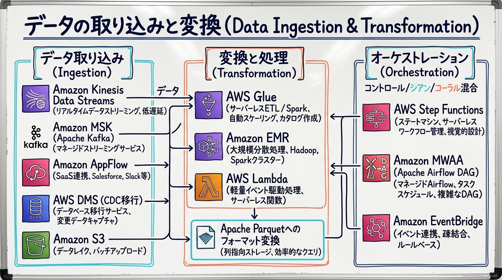
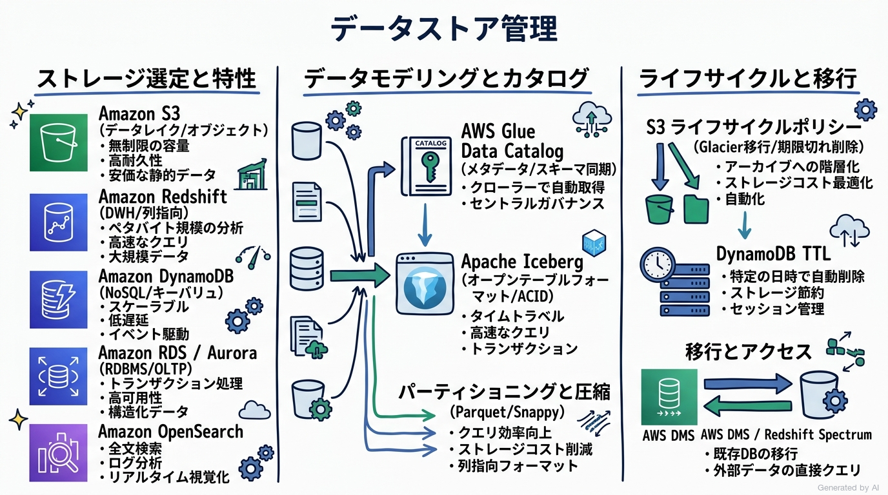
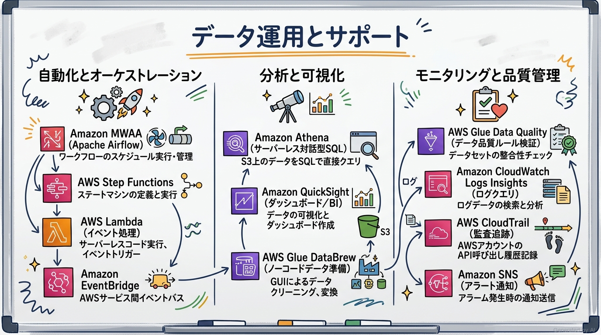
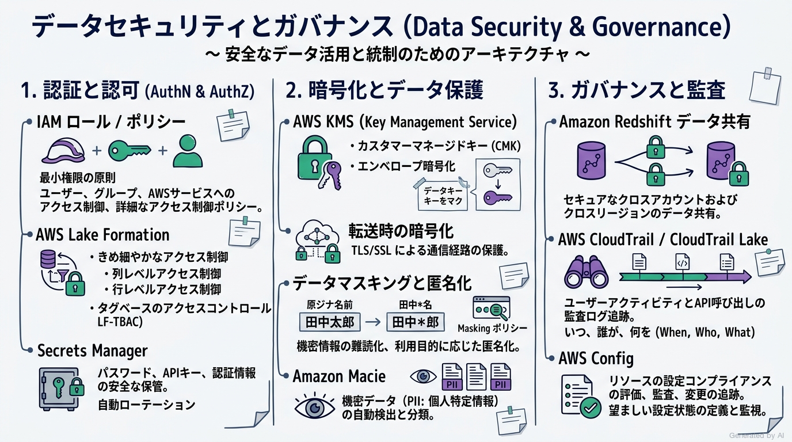

# AWS Certified Data Engineer - Associate (DEA-C01) 完全対策＆実践学習ガイド

- **対象資格**: AWS Certified Data Engineer - Associate
- **試験コード**: DEA-C01
- **公式試験ガイド**: [AWS Certified Data Engineer - Associate (DEA-C01) Exam Guide](https://docs.aws.amazon.com/ja_jp/aws-certification/latest/data-engineer-associate-01/data-engineer-associate-01.html)
- **最終更新日**: 2026-10-06

---

## はじめに

現代のエンタープライズにおけるデータ活用は、静的な夜間バッチ処理によるリレーショナルデータベースへの集約から、ストリーミングデータ（IoT、アクセスログ、変更データキャプチャ等）のリアルタイム処理、オブジェクトストレージ（Amazon S3）を中心としたモダンデータレイクハウス、オープンテーブルフォーマット（Apache Iceberg）、そして生成AI（LLM）と連携するベクトル検索基盤へと劇的な進化を遂げています。

AWS Certified Data Engineer - Associate (DEA-C01) は、単なるデータ分析SQLの記述や個別ツールの操作にとどまらず、**「要件（データ量・速度・多様性・コスト・レイテンシ）に応じて最適なデータ取り込み・変換・データストアを選定し、セキュアで高可用・弾力的なデータパイプラインをエンドツーエンドで設計・実装・オーケストレーション・運用監視できる能力」**を認定する中核資格です。

本ガイドは、最新の DEA-C01 出題範囲（全4ドメイン・全17タスク・全75スキル）に完全準拠し、各ドメインのアーキテクチャ設計原則、サービス選定・比較マトリクス、手描き板書風インフォグラフィック図解、**全出題タスクを完全網羅した 22 本の構造化実践シナリオ（状況・対応・結果・解説）**、および実在検証済みの公式一次ドキュメント・推奨ハンズオンラボを完全カプセル化した決定版対策ノートです。

### AWS Certified Data Engineer - Associate 試験とは

AWS Certified Data Engineer - Associate は、データエンジニアリングの実務において、データの取り込みから保存、変換、パイプライン運用、セキュリティ、ガバナンスに至るライフサイクル全体を適切に構築・最適化する能力を検証します。

- **試験時間**: 130 分
- **出題問題数**: 65 問（採点対象: 50 問 / 未採点テスト設問: 15 問）
- **出題形式**: 択一選択問題（4 肢中 1 つ選択）、複数選択問題（5 肢以上中 2 つ以上選択）
- **合格基準点**: 100〜1,000 点のスケールドスコアで 720 点以上
- **前提知識**: データの取り込み、変換、モデリング、セキュリティ、ガバナンス、スキーマ設計における 2〜3 年相当のデータエンジニアリング実務経験と、1〜2 年以上の AWS サービスの実務経験が推奨されます。

### 難易度と求められる思考力

当試験の難易度は **アソシエイト最上位（データアーキテクチャのトレードオフ判断力重視）** に位置づけられます。

ソリューションアーキテクト（SAA）のようなインフラ全般の広範な知識や、デベロッパー（DVA）のようなアプリケーションコード実装力とは異なり、DEA-C01 では**「データの特性（Volume, Velocity, Variety）とビジネス要件（レイテンシ, コスト, ガバナンス）に合致した最適なデータパイプライン設計の意思決定」**が問われます。
具体的には、以下のようなデータエンジニアリング固有のディテールとトレードオフ判断が問われます：

1. **取り込み方式の最適化**: Amazon Kinesis Data Streams、Amazon Data Firehose（旧 Amazon Data Firehose）、Amazon MSK、AWS DMS（CDC: 変更データキャプチャ）、Amazon AppFlow の選定基準と、シャードスケーリング・背圧制御・スロットリング対策。
2. **変換エンジンの特性比較**: サーバーレス分散 ETL（AWS Glue）、大規模 Hadoop/Spark クラスタ（Amazon EMR / EMR Serverless）、軽量イベント駆動（AWS Lambda）のコスト・処理時間・運用負荷の分岐点。
3. **データストレージとオープンテーブルフォーマット**: Amazon S3 データレイク、Amazon Redshift（列指向 DWH / RA3 ノード / Redshift Serverless）、Amazon DynamoDB（NoSQL）、Apache Iceberg による ACID トランザクション・タイムトラベルの活用。
4. **オーケストレーションの適材適所**: イベント駆動・サーバーレスに最適化された AWS Step Functions と、複雑な依存関係や DAG（有向非巡回グラフ）のスケジュール管理に長けた Amazon MWAA（Managed Workflows for Apache Airflow）の使い分け。
5. **きめ細やかなセキュリティと統制**: AWS Lake Formation による列レベル・行レベル・セルレベルの詳細アクセス制御（LF-TBAC）、AWS KMS によるエンベロープ暗号化、Amazon Redshift データ共有によるゼロ ETL・セキュア共有。
6. **オブザーバビリティとデータ品質**: AWS Glue Data Quality による自動データバリデーション、CloudWatch Logs Insights クエリ、AWS CloudTrail Lake による監査証跡追跡。

### 推奨の勉強法

1. **公式一次ドキュメントとアーキテクチャガイドの精読**:
   各サービスの概要にとどまらず、AWS Glue のワーカータイプ（G.1X, G.2X）やダイナミックフレームの仕様、Redshift のソートキー・分散キー（DISTSTYLE）、Kinesis の拡張ファンアウト（Enhanced Fan-Out）などのメカニズムを一次情報で確認します。
2. **実機コンソールおよび CLI でのハンズオン検証**:
   AWS Glue クローラーによるカタログ化、Athena による S3 上の Parquet クエリ実行、Step Functions による ETL ステートマシン構築、Lake Formation によるアクセス権限設定を実際に構築して体感します。
3. **構造化実践シナリオによる意思決定プロセスの追体験**:
   本ガイドに収録された 22 本の実践シナリオにおいて、**「解説」に記載された代替案の棄却理由（なぜ他の選択肢では要件を満たせないのか）** を徹底的にインプットし、出題者の意図を読み解く思考回路を構築します。

---

## 目次

1. [はじめに](#はじめに)
2. [学習カリキュラム・出題範囲ロードマップ](#学習カリキュラム出題範囲ロードマップ)
3. [Domain 1: データの取り込みと変換 (34%)](#domain-1-データの取り込みと変換-34)
4. [Domain 2: データストア管理 (26%)](#domain-2-データストア管理-26)
5. [Domain 3: データ運用とサポート (22%)](#domain-3-データ運用とサポート-22)
6. [Domain 4: データセキュリティとガバナンス (18%)](#domain-4-データセキュリティとガバナンス-18)
7. [まとめと推奨学習ステップ](#まとめと推奨学習ステップ)

---

## 学習カリキュラム・出題範囲ロードマップ

### セクション一覧と出題比率

本試験は全4ドメインで構成されており、「データの取り込みと変換（Domain 1: 34%）」と「データストア管理（Domain 2: 26%）」の2ドメインで全体の 60% を占めています。これにデータ運用・サポート（22%）、データセキュリティ・ガバナンス（18%）が加わります。

| ドメイン番号 | ドメイン名 / 出題分野 | 出題比率 | 主要対象サービス・ツール |
| :--- | :--- | :--- | :--- |
| **Domain 1** | データの取り込みと変換 | 34% | Amazon Kinesis Data Streams, Amazon Data Firehose (旧 Amazon Data Firehose), Amazon MSK, AWS Glue (ETL / Streaming), Amazon EMR, AWS Lambda, AWS Step Functions, Amazon MWAA, Amazon AppFlow, AWS DMS |
| **Domain 2** | データストア管理 | 26% | Amazon S3, Amazon Redshift, AWS Lake Formation, Amazon DynamoDB, Amazon RDS / Aurora, Amazon OpenSearch Service, AWS Glue Data Catalog, Apache Iceberg |
| **Domain 3** | データ運用とサポート | 22% | Amazon Athena, AWS Glue Data Quality, AWS Glue DataBrew, Amazon QuickSight, Amazon CloudWatch Logs Insights, AWS CloudTrail, Amazon EventBridge, Amazon SNS |
| **Domain 4** | データセキュリティとガバナンス | 18% | AWS Lake Formation (LF-TBAC), AWS IAM, AWS KMS, AWS Secrets Manager, Amazon Macie, AWS CloudTrail Lake, AWS Config, Amazon Redshift データ共有 |

---

### ドメイン別出題詳細

#### Domain 1: データの取り込みと変換 (34%)
- **出題の狙い**: ストリーミング・バッチ双方の多様なデータソースから効率的にデータを取り込み、スケーラブルな分散処理基盤で変換・整形し、信頼性の高いワークフローとしてオーケストレーションする能力を検証します。
- **主要タスク**:
  - Task 1.1: データ取り込みの実行（ストリーミング [Kinesis, MSK]、バッチ [S3, Glue, EMR, AppFlow]、CDC [AWS DMS]、ファンイン/ファンアウト、スロットリング緩和、再現性）
  - Task 1.2: データの変換と処理（コンテナ最適化 [ECS, EKS]、JDBC/ODBC 接続、データ統合、フォーマット変換 [.parquet, .orc]、コスト最適化、LLM 統合）
  - Task 1.3: データパイプラインのオーケストレーション（AWS Step Functions、Amazon MWAA、AWS Glue ワークフロー、障害通知 [SNS, SQS]、サーバーレスワークフロー）
  - Task 1.4: プログラミングの概念の応用（Python/SQL/Scala、分散コンピューティング、Lambda 同時実行・EFS マウント、AWS SAM / CloudFormation による IaC デプロイ）
- **重要キーワード**: Amazon Kinesis Data Streams, Amazon Data Firehose (旧 Amazon Data Firehose), Amazon Managed Streaming for Apache Kafka (Amazon MSK), AWS Glue (DynamicFrame), Amazon EMR, AWS Step Functions, Amazon MWAA, AWS DMS (CDC), Apache Parquet

#### Domain 2: データストア管理 (26%)
- **出題の狙い**: コスト、レイテンシ、クエリパターンに応じた最適なストレージサービスを選定し、カタログ化、データライフサイクル管理、およびスキーマ進化（モデリング）を設計する能力を検証します。
- **主要タスク**:
  - Task 2.1: データストアの選択（Redshift、EMR、Lake Formation、RDS、DynamoDB、MemoryDB、OpenSearch、ベクトルインデックス [HNSW, IVF]、Apache Iceberg、Redshift フェデレーテッドクエリ）
  - Task 2.2: データカタログシステムの理解（AWS Glue Data Catalog、クローラー、パーティション同期、Apache Hive メタストア）
  - Task 2.3: データのライフサイクルの管理（S3 ライフサイクルポリシー、S3 バージョニング、DynamoDB TTL、Redshift COPY / UNLOAD、データ消去要件）
  - Task 2.4: データモデルとスキーマの進化の設計（Redshift スター/スノーフレークスキーマ、ソートキー・分散キー、DynamoDB シングルテーブル設計、AWS SCT、データリネージュ）
- **重要キーワード**: Amazon S3 (Storage Classes), Amazon Redshift (RA3, Spectrum, Federated Query), Apache Iceberg, AWS Glue Data Catalog, DynamoDB TTL, Partitioning & Compression (Snappy/Parquet), Vector Index (HNSW/IVF)

#### Domain 3: データ運用とサポート (22%)
- **出題の狙い**: データ処理の自動化とアドホック分析を両立し、分散ログ・メトリクスを用いたパイプライン監視、トラブルシューティング、およびデータ品質検証を確実に実施する能力を検証します。
- **主要タスク**:
  - Task 3.1: AWS サービスを使用したデータ処理の自動化（Step Functions、MWAA、Glue ジョブ、Lambda、EventBridge スケジューラ）
  - Task 3.2: AWS サービスを使用したデータ分析（Amazon Athena、QuickSight、Glue DataBrew、Athena for Apache Spark、サーバーレス vs プロビジョンド比較）
  - Task 3.3: データパイプラインの保守とモニタリング（CloudWatch Logs Insights、CloudTrail API 追跡、EMR / Glue デバッグ、SNS アラート）
  - Task 3.4: データ品質の確保（AWS Glue Data Quality、品質ルールの自動定義、DataBrew プロファイリング、データスキュー対策）
- **重要キーワード**: Amazon Athena, AWS Glue Data Quality, AWS Glue DataBrew, Amazon QuickSight, CloudWatch Logs Insights, AWS CloudTrail, Data Skew (データスキュー), Salting (ソルト付与)

#### Domain 4: データセキュリティとガバナンス (18%)
- **出題の狙い**: 最小権限原則に基づく IAM 設計、Lake Formation による詳細アクセス制御、KMS エンベロープ暗号化、PII マスキング、クロスアカウントデータ共有、および監査ログ記録を実装する能力を検証します。
- **主要タスク**:
  - Task 4.1: 認証メカニズムの適用（VPC セキュリティグループ、IAM ロール、Secrets Manager 認証情報自動ローテーション、PrivateLink）
  - Task 4.2: 認可メカニズムの適用（カスタム IAM ポリシー、AWS Lake Formation 列・行レベル制御、Redshift ロール・オブジェクト権限）
  - Task 4.3: データ暗号化とマスキングの実行（AWS KMS CMK、エンベロープ暗号化、転送時暗号化 [TLS]、クロスアカウント暗号化、データマスキング・トークン化）
  - Task 4.4: 監査用のログの準備（AWS CloudTrail、CloudTrail Lake による SQL クエリ、CloudWatch Logs 保存、EMR/Athena ログ統合）
  - Task 4.5: データプライバシーとガバナンスの理解（Amazon Redshift データ共有、Amazon Macie PII 検出、AWS Config コンプライアンス、データ主権・リージョン制限）
- **重要キーワード**: AWS Lake Formation (LF-TBAC), AWS KMS, Customer Managed Keys (CMK), Envelope Encryption, AWS Secrets Manager, Amazon Macie, Amazon Redshift Data Sharing, AWS CloudTrail Lake, AWS Config

---

## Domain 1: データの取り込みと変換 (34%)

本ドメインは試験全体の 34% という最大の配点を占める最重要分野です。ストリーミング（リアルタイム）およびバッチの双方において、大量かつ多様なデータを効率的に取り込み、分散処理基盤を活用して高品質なデータセットへと変換・整形し、堅牢なワークフローとしてオーケストレーションする能力が検証されます。

---

### 1. セクション概要

現代のデータアーキテクチャでは、単一の処理エンジンですべてを解決することは不可能です。データの発生頻度、到達許容レイテンシ、データ量、およびビジネス上の緊急性に応じて、適切な取り込み・変換・オーケストレーション方式を選択することが求められます。

#### 重要キーワード

- **ストリーミング取り込み（Amazon Kinesis vs Amazon MSK）**: Amazon Kinesis Data Streams は AWS フルマネージドでシャードベースのストリーミングサービスであり、ミリ秒単位の取り込みと Lambda 連携に優れます。Amazon MSK はオープンソースの Apache Kafka 互換マネージドサービスであり、既存 Kafka エコシステムとの統合や高度なパーティション制御・大容量メッセージ保持に適用されます。
- **拡張ファンアウト（Enhanced Fan-Out: EFO）**: Kinesis Data Streams において、複数のコンシューマーが同一ストリームから同時にデータを読み取る際、コンシューマーごとに専用の 2 MB/秒の読み取りスループットを提供し、HTTP/2 プッシュによってレイテンシを約 70ms に低減する機能です。
- **AWS Glue DynamicFrame**: Apache Spark DataFrame を拡張した AWS Glue 独自のデータ構造です。事前のスキーマ定義を強制せず、入れ子構造や型が混在した半構造化データ（JSON等）を自動推論しながら効率的に変換処理を行うことが可能です。
- **AWS DMS（データベース移行サービス）と CDC**: 稼働中のデータベースから Amazon S3 や Redshift へ最小限のダウンタイムでデータを移行します。CDC（Change Data Capture）を有効化することで、トランザクションログを読み取り、継続的な挿入・更新・削除をターゲットへニアリアルタイムで伝播します。
- **ワークフローオーケストレーション（AWS Step Functions vs Amazon MWAA）**: Step Functions は JSON/ASL で定義されるサーバーレスステートマシンであり、AWS サービスネイティブな連携、ミリ秒単位のイベント駆動、低運用負荷に最適です。Amazon MWAA は Python コードで複雑な DAG（有向非巡回グラフ）を定義するマネージド Apache Airflow であり、外部オンプレミスシステムやマルチクラウドを含む複雑なスケジュール依存関係の制御に適しています。

---

### 2. 重要トピック

#### 1. データ取り込み方式とメッセージング特性の深掘り

データ取り込みレイヤーでは、「プッシュ型 vs プル型」「バッファリング vs 即時配信」の設計トレードオフを正確に把握する必要があります。

- **Amazon Kinesis Data Streams**:
  - スケーリングモデル: プロビジョンドモード（シャード数を手動/自動で調整）とオンデマンドモード（トラフィックに応じて自動キャパシティ管理）を選択可能。
  - レート制限とスロットリング: 1 シャードあたり書き込みは最大 1 MB/秒または 1,000 レコード/秒。これを超過すると `ProvisionedThroughputExceededException` が発生するため、パーティションキーのランダム化（高カーディナリティ確保）やクライアント側の指数バックオフとジッターによるリトライが必要です。
- **Amazon Data Firehose (旧 Amazon Data Firehose (旧 Amazon Data Firehose))**:
  - サーバーレスで S3、Redshift、OpenSearch、Splunk 等へストリームデータを直接配信するロードサービス。
  - バッファリング条件（サイズ: 1〜128 MB、間隔: 60〜900 秒）に基づき自動集約して書き込むため、S3 のスモールファイル問題を自動回避できます。
  - 配信途中で AWS Lambda を呼び出してデータ変換（フォーマット変換、マスキング）を行ったり、Apache Parquet / ORC への変換もインラインで実行可能です。
- **Amazon AppFlow**:
  - Salesforce、SAP、ServiceNow、Zendesk などの SaaS アプリケーションと AWS（S3, Redshift）間でデータをセキュアに転送するフルマネージド統合サービス。コード記述不要で、転送時のマスキングやフィルタリング、暗号化が可能です。

#### 2. データ変換エンジンの選定比較マトリクス

| 比較項目 / 方式 | AWS Glue (ETL / Streaming) | Amazon EMR / EMR Serverless | AWS Lambda |
| :--- | :--- | :--- | :--- |
| **アーキテクチャ** | サーバーレス Apache Spark | 分散クラスタ (Hadoop, Spark, Presto, Trino, Flink) | サーバーレスイベント駆動コンピュート |
| **主要ユースケース** | バッチ ETL、データカタログ連携、ストリーミング ETL | ペタバイト級の大規模分散処理、カスタムビッグデータフレームワーク | 小〜中規模のファイル単位変換、リアルタイムバリデーション |
| **最大実行時間** | 制限なし（設定可能） | 制限なし | 最大 15 分 |
| **スケーリング** | DPU (Data Processing Unit) 自動スケーリング | インスタンスフリート / EMR Serverless 自動スケーリング | 同時実行数による自動スケーリング |
| **運用負荷** | 極小（インフラ管理不要） | 中（Serverless）〜 高（EC2クラスタ管理） | 極小 |
| **主なトレードオフ** | 起動に数分のコールドスタートがある（Flex 実行でコスト削減可能） | クラスタ構成の最適化やチューニング知識が必要 | 実行時間 15 分・メモリ 10 GB・一時ディスク 10 GB の制約 |

- **アーキテクトの選定基準**:
  - 標準的なデータレイクハウス構築（S3 上の Parquet 変換やスキーマ推論）には、運用負荷が最小の **AWS Glue** を第一選択とします。
  - 既存のオープンソースビッグデータエコシステム（Hive, HBase, Flink）の移行やペタバイト規模の超大規模ワークロードには **Amazon EMR** を選定します。
  - S3 へのオブジェクト PUT イベント等をトリガーとした軽量なフォーマット検証やヘッダー加工には **AWS Lambda** を選定します。

---

### 3. 実践シナリオ

#### シナリオ 1-1: 大規模 IoT デバイスからのストリーミング取り込みと複数コンシューマーの低遅延処理

- **状況**: 数万台の IoT デバイスから毎秒 50 MB のテレメトリデータが継続的に送信されており、リアルタイム異常検知エンジン（Lambda）と長期分析用データレイク（Firehose 経由 S3）の 2 系統の独立したコンシューマーが同時にデータを読み取る必要があるが、読み取りスロットリングと配信遅延が懸念される場合
- **対応**: Amazon Kinesis Data Streams をプロビジョンドモードで構築し、異常検知エンジン側の Lambda イベントソースマッピングにおいて拡張ファンアウト（Enhanced Fan-Out）を有効化して専用スループットを割り当てる。
- **結果**: 各コンシューマーに専用の 2 MB/秒/シャードのスループットが確保され、複数アプリケーションの同時読み取りによる競合やスロットリングを排除し、70ms 未満の超低遅延でリアルタイム異常検知を実行できる。
- **解説**: Kinesis Data Streams の標準コンシューマーはシャードあたり合計 2 MB/秒の読み取り帯域をすべてのコンシューマーで共有するため、複数システムが同時にポーリングすると帯域不足や遅延が発生するためです。拡張ファンアウトを利用することで、コンシューマーごとに独立した専用帯域が HTTP/2 プッシュ方式で提供され、相互干渉を完全に防ぐことができます。Amazon SQS はストリーミング順序保持とマルチコンシューマー並列配信の要件に合致せず、Amazon MSK はフルマネージドな Lambda 統合の容易性と運用負荷の観点から過剰構成となるため不適格です。
- **参考ドキュメント**:
  - [Amazon Kinesis Data Streams 開発者ガイド](https://docs.aws.amazon.com/ja_jp/streams/latest/dev/introduction.html): 拡張ファンアウトと専用スループットの仕様

#### シナリオ 1-2: 基幹 RDBMS からデータレイクへの変更データキャプチャ（CDC）移行

- **状況**: オンプレミスデータセンターで稼働するミッションクリティカルな Oracle データベースから Amazon S3 データレイクへデータを同期するにあたり、本番業務トランザクションへの負荷を最小限に抑えつつ、継続的なデータ変更（挿入・更新・削除）をニアリアルタイムで反映したい場合
- **対応**: AWS Database Migration Service (AWS DMS) を使用し、既存データの全ロードタスクに加えてトランザクションログ読み取りに基づく継続的レプリケーション（CDC）タスクを設定して Amazon S3 をターゲットに指定する。
- **結果**: 本番データベースに対して SELECT クエリによるポーリング負荷をかけることなく、変更ログから差分トランザクションのみを抽出して S3 へ Parquet 形式で継続的にストリーミング出力できる。
- **解説**: AWS DMS の CDC 機能はデータベースのトランザクションログ（Redo ログやバイナリログ）を直接読み取って変更をキャプチャするため、本番データベースのテーブルスキャンによる性能劣化を回避できるためです。定期的なバッチ抽出スクリプト（Lambda や Glue）では削除データの検知が困難であり、高頻度実行時に本番 DB へ過大な負荷を与えてしまいます。また、AWS AppFlow は SaaS アプリケーション向けであり、オンプレミス RDBMS のトランザクションログ CDC には対応していないため要件を満たせません。
- **参考ドキュメント**:
  - [AWS Database Migration Service ユーザーガイド](https://docs.aws.amazon.com/ja_jp/dms/latest/userguide/Welcome.html): CDC レプリケーションタスクの設定

#### シナリオ 1-3: SaaS アプリケーション（Salesforce）データの安全な自動取り込み

- **状況**: マーケティング部門が利用する Salesforce の顧客商談データを、パブリックインターネットを経由させることなく定期的に Amazon S3 データレイクに取り込み、かつ PII（個人特定情報）のマスキング処理を適用したい場合
- **対応**: Amazon AppFlow を利用して Salesforce と Amazon S3 間のデータ転送フローを作成し、AWS PrivateLink によるプライベート接続を構成するとともに、AppFlow のインラインフィールドマスキング設定を適用する。
- **結果**: カスタムコードやコネクタを自作することなく、ネットワーク的に隔離された安全な経路でスケジュールに従ってデータが同期され、機密情報が自動的に難読化されて S3 に格納される。
- **解説**: Amazon AppFlow は AWS と主要 SaaS 間で双方向のデータ転送を提供するフルマネージドサービスであり、AWS PrivateLink と統合してパブリックインターネットにデータを露出させないセキュアな転送をサポートしているためです。さらに、転送パイプライン内でデータバリデーションや PII マスキングをコードレスで適用できます。AWS Glue や Lambda で Salesforce REST API を直接叩くカスタムスクリプトを実装する方式は、認証トークン管理や API レート制限、スキーマ変更への追従など多大な開発・運用保守コストが発生するため不適格です。
- **参考ドキュメント**:
  - [Amazon AppFlow ユーザーガイド](https://docs.aws.amazon.com/ja_jp/appflow/latest/userguide/what-is-appflow.html): SaaS データ連携とデータ保護

#### シナリオ 1-4: 大規模 JSON データの Apache Parquet 変換とスキーマ柔軟性担保

- **状況**: 日次で数百ギガバイト発生するネストの深い半構造化 JSON ログデータを、Athena での分析クエリ性能向上とストレージコスト削減のために列指向フォーマット（Apache Parquet）へ一括変換したいが、一部のレコードでフィールドの型が不揃いでスキーマが厳格に固定されていない場合
- **対応**: AWS Glue ETL ジョブを構成し、DynamicFrame を用いてデータを読み込んだ上で、`ResolveChoice` トランスフォーメーションで曖昧なデータ型を統合・キャストし、Snappy 圧縮を適用した Apache Parquet 形式で Amazon S3 に出力する。
- **結果**: 厳格なスキーマ定義エラーによるジョブ中断を起こすことなく、入れ子データや型の揺らぎを自動解消しながら効率的に Parquet へ変換でき、Athena クエリのスキャンデータ量を最大 90% 削減できる。
- **解説**: AWS Glue の DynamicFrame は自己記述的なスキーマ解決機能を備えており、スキーマ定義が不揃いな半構造化データに対してもジョブを停止させずに型推論や `ResolveChoice` による型の統一（キャストや構造体化）を行えるためです。標準の Spark DataFrame では事前スキーマ不一致時に例外が発生しやすく、前処理スクリプトの工数が増大します。また、Amazon Redshift COPY コマンドによる直接ロードは、スキーマが頻繁に変動する半構造化ログの一次変換・保管には柔軟性が欠け、コスト効率も劣るため不適格です。
- **参考ドキュメント**:
  - [AWS Glue 開発者ガイド](https://docs.aws.amazon.com/ja_jp/glue/latest/dg/what-is-glue.html): DynamicFrame によるスキーマ変換

#### シナリオ 1-5: 複雑な機械学習データ準備パイプラインのサーバーレスオーケストレーション

- **状況**: S3 への新規データ着信をトリガーとして、AWS Glue でのデータクレンジング、Athena による品質チェック、条件分岐によるエラーハンドリングと再試行、および完了時の Amazon SNS 通知という一連の依存関係を持つパイプラインを、インフラ管理不要でミリ秒単位の俊敏性で実行したい場合
- **対応**: AWS Step Functions ステートマシンを構築し、Amazon EventBridge で S3 オブジェクト作成イベントをキャプチャしてステートマシンを起動し、タスク状態のエラーキャッチ（`Catch`）と再試行（`Retry`）ポリシーを定義する。
- **結果**: サーバーを一切プロビジョニングすることなく、グラフィカルに可視化されたワークフローで耐障害性の高い ETL パイプラインが実行され、障害発生時も自動再試行と的確なアラート通知が行われる。
- **解説**: AWS Step Functions は AWS サービス（Glue, Athena, Lambda, SNS）と直接 API 統合されたフルマネージドなサーバーレスオーケストレーターであり、待機時間中のコストがゼロで状態管理やリトライを自動実行できるためです。Amazon MWAA（Apache Airflow）は非常に強力ですが、専用のワーカー環境が常時プロビジョニングされるため、イベント駆動型のスパイクな実行頻度に対しては最低稼働コストが過大になります。また、Lambda 関数同士を非同期で数珠つなぎに呼び出す方式は、エラーハンドリングや状態追跡がブラックボックス化しアンチパターンとなるため不適格です。
- **参考ドキュメント**:
  - [AWS Step Functions 開発者ガイド](https://docs.aws.amazon.com/ja_jp/step-functions/latest/dg/welcome.html): サーバーレスワークフローとエラー処理

#### シナリオ 1-6: 外部システム連携を伴う複雑な DAG パイプラインの集中スケジュール運用

- **状況**: オンプレミスのデータウェアハウス、外部 API、および AWS 上の EMR / Redshift にまたがる数百本のデータ処理ジョブが存在し、各ジョブが複雑な時間依存関係とデータ依存関係を持つ有向非巡回グラフ（DAG）として Python コードで一元管理・テスト・運用される必要がある場合
- **対応**: Amazon Managed Workflows for Apache Airflow (Amazon MWAA) を導入し、パイプラインの依存関係を Python の Airflow DAG 定義として Amazon S3 に配置して実行・スケジュール管理を行う。
- **結果**: 既存の Apache Airflow エコシステムやカスタム Python オペレーターをそのまま活用し、オンプレミスとクラウドをまたぐ複雑な大規模 DAG を高可用なマネージド環境で安定稼働させることができる。
- **解説**: 複雑なスケジュール依存関係、クロスプラットフォーム連携、および Python コードベースでの柔軟な DAG 定義が求められるエンタープライズユースケースには Amazon MWAA が最も適しているためです。Airflow の豊富なプロバイダーパッケージを利用して異機種システム間の依存関係を明瞭に管理できます。AWS Step Functions でも DAG の表現は可能ですが、外部オンプレミスシステムに対する多様な接続コネクタの資産や、データエンジニアリングチームにおける Python DAG 資産の再利用性の観点から MWAA が圧倒的な優位性を持つためです。
- **参考ドキュメント**:
  - [Amazon MWAA ユーザーガイド](https://docs.aws.amazon.com/ja_jp/mwaa/latest/userguide/what-is-mwaa.html): マネージド Apache Airflow の運用

---

### 4. 参考ドキュメント & 推奨ハンズオン

#### 公式一次ドキュメント
- [Amazon Kinesis Data Streams 開発者ガイド](https://docs.aws.amazon.com/ja_jp/streams/latest/dev/introduction.html): シャードアーキテクチャ、スケーリング、拡張ファンアウトの設計原則
- [AWS Glue 開発者ガイド](https://docs.aws.amazon.com/ja_jp/glue/latest/dg/what-is-glue.html): サーバーレス分散 ETL、DynamicFrame、自動スケーリングの仕組み
- [AWS Step Functions 開発者ガイド](https://docs.aws.amazon.com/ja_jp/step-functions/latest/dg/welcome.html): ステートマシン言語（ASL）、エラーハンドリング、サービス統合
- [Amazon MWAA ユーザーガイド](https://docs.aws.amazon.com/ja_jp/mwaa/latest/userguide/what-is-mwaa.html): Apache Airflow のマネージド環境構築と DAG 設計

#### 推奨ハンズオン・ラボ（実機検証）
- [Getting Started with AWS Glue (AWS Skill Builder)](https://skillbuilder.aws/search?searchText=Getting+Started+with+AWS+Glue):
  - **学習目標**: Glue クローラーによるメタデータ収集、Glue Studio による ETL ジョブ作成、Parquet へのフォーマット変換を実機検証。
- [AWS Certified Data Engineer - Associate Official Practice Question Set (DEA-C01 - Japanese)](https://skillbuilder.aws/search?searchText=AWS+Certified+Data+Engineer+-+Associate+Official+Practice+Question+Set+DEA-C01):
  - **学習目標**: 公式模擬問題を通じて、ストリーミング取り込みや ETL サービス選定のトレードオフ判断力を測定。

---

## Domain 2: データストア管理 (26%)

本ドメインは試験全体の 26% を占め、データエンジニアリングの根幹となるストレージ設計分野です。アクセスパターン、スループット、クエリレイテンシ、およびコスト要件に応じた最適なデータストアの選定、AWS Glue Data Catalog によるメタデータ集中管理、オープンテーブルフォーマット（Apache Iceberg）の活用、そしてライフサイクル管理とスキーマモデリングの能力が検証されます。

---

### 1. セクション概要

現代のクラウドデータ基盤では、単一のリレーショナルデータベースにすべてを格納するアプローチは破綻しています。オブジェクトストレージ（Amazon S3）をハブとしたデータレイク、ペタバイト級の高速分析を担うデータウェアハウス（Amazon Redshift）、超低遅延 NoSQL（Amazon DynamoDB）、そしてインメモリキャッシュ（Amazon MemoryDB）を用途に応じて使い分ける「目的特化型データストア（Purpose-Built Databases）」の設計思想が必須となります。

#### 重要キーワード

- **Amazon Redshift アーキテクチャ**: リーダーノード（クエリ解析・実行計画策定）とコンピュートノード（スライス単位での並行処理）からなる超並列処理（MPP）アーキテクチャです。RA3 ノードインスタンスを採用することで、コンピュートとマネージドストレージ（Redshift Managed Storage: RMS）を完全に分離して独立スケーリングが可能です。
- **Redshift テーブル設計（分散スタイルとソートキー）**:
  - 分散スタイル（DISTSTYLE）: `KEY`（結合キーでハッシュ分散）、`ALL`（全ノードに複製、ディメンションテーブル向け）、`EVEN`（ラウンドロビン均等分散）、`AUTO`（サイズに応じて自動選定）。
  - ソートキー（SORTKEY）: `COMPOUND`（複合ソートキー、プレフィックス検索に有効）、`INTERLEAVED`（インターリーブソートキー、全列に同等の重み付け）。
- **オープンテーブルフォーマット（Apache Iceberg）**: S3 上の Parquet データに対して、リレーショナルデータベースと同等の ACID トランザクション、タイムトラベル（特定時点のスナップショット読み取り）、インプレーススキーマ進化、およびパーティション進化を提供するオープン標準フォーマットです。Athena や EMR、Glue からネイティブに操作可能です。
- **AWS Glue Data Catalog**: Apache Hive メタストアと互換性を持つ中央集中型のメタデータリポジトリです。データベース、テーブル、スキーマ、パーティション情報を保持し、Athena、EMR、Redshift Spectrum 等の各種分析エンジンから単一のカタログとして参照されます。
- **Amazon S3 ライフサイクル管理**: オブジェクトの作成日やプレフィックスに基づき、S3 Standard から S3 Standard-IA、S3 Glacier Flexible Deep Archive への自動階層移行（ストレージコスト削減）や、期限切れオブジェクトの自動消去（法的コンプライアンス順守）を自動化します。

---

### 2. 重要トピック

#### 1. データストア選定比較マトリクス

| 比較項目 / 方式 | Amazon S3 (データレイク) | Amazon Redshift (DWH) | Amazon DynamoDB (NoSQL) | Amazon OpenSearch Service |
| :--- | :--- | :--- | :--- | :--- |
| **データモデル** | オブジェクト（非構造化・半構造化・構造化） | リレーショナル（列指向ストレージ） | キー・バリュー / ドキュメント | ドキュメント（転置インデックス） |
| **主要クエリパターン** | スキャン、一括抽出 (Athena/Spark) | 複雑な集計・結合 (OLAP, SQL) | キーによるポイント取得・小規模範囲クエリ (OLTP) | 全文検索、ファセット検索、ログ分析 |
| **読み取りレイテンシ** | 100〜200 ミリ秒 | 数百ミリ秒〜数秒 | 1 桁ミリ秒 (DAX でマイクロ秒) | 数十ミリ秒 |
| **スケーラビリティ** | 無制限 | ペタバイト級 (RA3 ノード) | 水平自動スケール (無制限) | ノード追加によるスケール |
| **コスト構造** | 格安なストレージ容量従量課金 | コンピュートノードまたは Serverless RPU | RCU / WCU またはオンデマンドリクエスト課金 | インスタンス稼働時間 + EBS ボリューム |

- **アーキテクトの選定基準**:
  - すべての生データ、加工中データ、長期アーカイブデータの永続層には **Amazon S3** を採用します。
  - BI ダッシュボードやアナリストによる複雑な SQL 集計・マルチテーブル JOIN には **Amazon Redshift** を選定します。
  - マイクロサービスや Web アプリのバックエンドでミリ秒単位のキーアクセスが求められる場合は **Amazon DynamoDB** を選定します。
  - 非構造化テキストのあいまい検索やリアルタイムログ分析には **Amazon OpenSearch Service** を選定します。

#### 2. Amazon Redshift の高度な機能とデータアクセス方式

- **Amazon Redshift Spectrum**: Redshift クラスタから、S3 上のオープンフォーマット（Parquet, ORC, CSV 等）の外部テーブルに対して、クラスタ内にデータをロードすることなく直接 SQL クエリを実行できる機能。
- **Amazon Redshift フェデレーテッドクエリ (Federated Query)**: Redshift から外部の Amazon RDS PostgreSQL / MySQL や Amazon Aurora データベースに対して直接クエリを発行し、DWH 内のデータとトランザクション DB のライブデータを JOIN して分析できる機能。
- **マテリアライズドビュー (Materialized Views)**: 頻繁に実行される集計クエリの結果を事前に計算してクラスタ内に保持し、クエリ実行を劇的に高速化する機能。ベーステーブル更新時には増分リフレッシュ（Incremental Refresh）が可能です。
- **Redshift COPY / UNLOAD ベストプラクティス**:
  - `COPY`: S3 から Redshift へデータを並列一括ロードする際、クラスタのスライス数と同数またはその倍数の圧縮ファイル（GZIP 等）に分割してロードすることで、全スライスが均等に動作し最速でロードが完了します。
  - `UNLOAD`: Redshift のクエリ結果を S3 へ並列アンロードする際、`PARALLEL ON` で高速並列出力し、`FORMAT AS PARQUET` を指定して列指向圧縮で保存します。

---

### 3. 実践シナリオ

#### シナリオ 2-1: ペタバイト規模の BI クエリ高速化とコンピュート/ストレージ独立拡張

- **状況**: 数ペタバイトの販売データを日次で集計して全社 BI ダッシュボードに提供しているが、データ量の急増に伴ってストレージ容量が逼迫し、かつ月末の特定時間帯に集計クエリが集中してレスポンスが極端に悪化する場合
- **対応**: Amazon Redshift クラスタを RA3 ノードインスタンスに移行し、マネージドストレージ（RMS）を活用するとともに、頻繁に参照されるダッシュボード用集計クエリに対してマテリアライズドビューを作成し、同時実行スケーリング（Concurrency Scaling）を有効化する。
- **結果**: ストレージ容量のために不要なコンピュートノードを過剰プロビジョニングする必要がなくなり、クエリスパイク時にも一時的クラスタが自動追加されてキュー待ちが解消され、ダッシュボードの表示がミリ秒〜秒単位で完了する。
- **解説**: Amazon Redshift RA3 ノードはコンピュートとストレージを完全に分離し、大容量データを安価な S3 ベースの Redshift Managed Storage (RMS) に自動オフロードしながら、ローカル SSD キャッシュを活用して高速処理できるためです。さらに同時実行スケーリングにより、スパイク時のクエリキュー待ちをゼロにできます。従来の Dense Compute (DC2) ノードではストレージ追加のためにコンピュートを無駄に増設する必要がありコスト効率が極めて悪くなります。また、RDS PostgreSQL ではペタバイト規模の並列集計（MPP）に対応できず破綻するため不適格です。
- **参考ドキュメント**:
  - [Amazon Redshift 管理ガイド](https://docs.aws.amazon.com/ja_jp/redshift/latest/mgmt/welcome.html): RA3 ノードとマネージドストレージの設計

#### シナリオ 2-2: S3 データレイクにおける ACID トランザクションとタイムトラベルの実現

- **状況**: Amazon S3 上に構築されたデータレイクにおいて、GDPR 等の規制要件に伴う特定の個別ユーザーレコードの削除（Delete）や更新（Update）が頻繁に発生し、従来の Parquet ファイル上書きではデータの不整合や同時書き込み競合が発生する場合
- **対応**: テーブル管理フォーマットとして Apache Iceberg を採用し、AWS Glue Data Catalog で Iceberg テーブルとして登録した上で、Amazon Athena または AWS Glue を使用して行単位の UPDATE / DELETE トランザクションを実行する。
- **結果**: S3 オブジェクトストレージ上にありながら ACID トランザクションが完全に保証され、データ競合や不整合を排除しつつ、スナップショットによるタイムトラベル機能で過去時点のデータ再現も可能になる。
- **解説**: Apache Iceberg はオープンテーブルフォーマットであり、メタデータツリー構造を用いてスナップショット単位でコミットを管理するため、S3 上のデータセットに対してファイル全体の書き換えを伴わずに安全な ACID トランザクション（行レベルの UPDATE/DELETE）を提供できるためです。プレーンな Parquet ファイルに対して直接ファイル上書きを行う運用では、クエリ実行中の読み取りエラーや書き込み衝突によるデータ破損が不可避となります。また、全データを Amazon RDS や DynamoDB に移行する方式は、ペタバイト級のデータ分析基盤としてはコストとスケーラビリティの面で劣るため不適格です。
- **参考ドキュメント**:
  - [Amazon Athena ユーザーガイド](https://docs.aws.amazon.com/ja_jp/athena/latest/ug/what-is.html): Apache Iceberg テーブルのクエリと操作

#### シナリオ 2-3: S3 ライフサイクルポリシーによる長期ストレージコストの大幅削減

- **状況**: 毎日数十ギガバイト蓄積される Web アクセスログがあり、直近 30 日間は高頻度で分析されるが、30 日を超えると月次レポート作成時に稀にしか参照されず、90 日を経過した後は法令順守のため 7 年間保存するのみで参照はほぼ発生しない場合
- **対応**: Amazon S3 ライフサイクルルールを設定し、作成から 30 日経過後に S3 Standard-IA へ移行し、90 日経過後に S3 Glacier Flexible Deep Archive へ移行し、7 年（2,555 日）経過後にオブジェクトを期限切れ（自動削除）とする。
- **結果**: アプリケーションコードを変更することなく、アクセス頻度の低下に応じてオブジェクトがより安価なストレージクラスへ全自動で階層化され、ストレージコストを最大 90% 以上削減できる。
- **解説**: Amazon S3 ライフサイクル管理はプレフィックスやタグに基づいて自動的にストレージ階層を遷移させるマネージド機能であり、監査要件を満たしつつ最も安価な Glacier Deep Archive を活用してコストを最適化できるためです。定期的なバッチスクリプト（Lambda や Glue）でオブジェクトを別バケットにコピーして元ファイルを削除する手動運用は、スクリプト保守の負荷、API コール課金、および削除漏れのリスクが生じるため不適格です。
- **参考ドキュメント**:
  - [Amazon S3 ユーザーガイド](https://docs.aws.amazon.com/ja_jp/AmazonS3/latest/userguide/object-lifecycle-mgmt.html): ライフサイクルの設定と移行ルール

#### シナリオ 2-4: AWS Glue クローラーによるスキーマドリフトの自動検知とカタログ同期

- **状況**: 複数の IoT デバイスから S3 に毎時アップロードされるログファイルのスキーマが予告なく変更され、新しいセンサー属性（フィールド）が追加されたりパーティションが自動作成される環境において、手動操作なしで Athena から最新構造をクエリ可能にしたい場合
- **対応**: AWS Glue クローラーをスケジュール実行または EventBridge トリガーで実行し、スキーマ変更時の動作として「データストアの新しい列でオブジェクト定義を更新する」を設定して AWS Glue Data Catalog を同期する。
- **結果**: 新たに追加された列や新規日付パーティションが自動的にカタログへ反映され、データエンジニアが DDL 文を手動実行することなく Athena ユーザーが最新スキーマで即座に分析を開始できる。
- **解説**: AWS Glue クローラーは S3 上のデータファイルを走査してスキーマとパーティション構造を自動推論し、Data Catalog のテーブルメタデータを増分更新する機能を提供しているためです。スキーマの進化（Schema Evolution）にも対応し、新しいカラムの追加を自動検出できます。Athena の `MSCK REPAIR TABLE` コマンドは Hive 互換のパーティション追加のみを行い、カラムの追加や型変更などのスキーマ更新には対応できないため要件を満たせません。
- **参考ドキュメント**:
  - [AWS Glue 開発者ガイド](https://docs.aws.amazon.com/ja_jp/glue/latest/dg/what-is-glue.html): クローラーによるデータカタログ作成とスキーマ推論

#### シナリオ 2-5: Redshift COPY コマンドによるペタバイトデータの超高速一括ロード

- **状況**: S3 バケットに格納された 10 TB の日次トランザクションデータを夜間バッチ時間枠（2 時間以内）内に Amazon Redshift クラスタにロードする必要があるが、単一の巨大な CSV ファイルで `COPY` コマンドを実行したところ著しい遅延が発生した場合
- **対応**: ロード元データをクラスタのコンピュートノードのスライス数と同数（またはその倍数）に均等分割した GZIP 圧縮ファイルとして S3 に配置し、マニフェストファイルを使用して `COPY` コマンドを実行する。
- **結果**: Redshift の全スライスが並列にファイルを読み込む超並列ロード（MPP）が実現し、ボトルネックが解消されて目標時間枠内でロードが完了する。
- **解説**: Amazon Redshift の `COPY` コマンドは、複数ファイルが存在する場合に全コンピュートノードの各スライスが並列にファイルを読み込んでロードを実行するためです。単一の巨大ファイルでは 1 つのスライスのみが読み込みを担当し、他の全ノード・スライスがアイドル状態になるため並列処理の恩恵を一切受けられません。また、JDBC 経由で INSERT 文を逐次発行する手法はネットワークラウンドトリップとトランザクションオーバーヘッドにより著しく遅くなるため不適格です。
- **参考ドキュメント**:
  - [Amazon Redshift データベース開発者ガイド](https://docs.aws.amazon.com/ja_jp/redshift/latest/dg/r_COPY.html): COPY コマンドの並列ロードベストプラクティス

---

### 4. 参考ドキュメント & 推奨ハンズオン

#### 公式一次ドキュメント
- [Amazon Redshift 管理ガイド](https://docs.aws.amazon.com/ja_jp/redshift/latest/mgmt/welcome.html): クラスタ管理、RA3 ノード、データ共有、パフォーマンスチューニング
- [Amazon S3 オブジェクトライフサイクル管理](https://docs.aws.amazon.com/ja_jp/AmazonS3/latest/userguide/object-lifecycle-mgmt.html): ストレージクラスの移行ルールとコスト最適化
- [Amazon Athena ユーザーガイド](https://docs.aws.amazon.com/ja_jp/athena/latest/ug/what-is.html): Glue Data Catalog との統合、パーティショニング、Apache Iceberg サポート
- [Amazon DynamoDB 開発者ガイド](https://docs.aws.amazon.com/ja_jp/amazondynamodb/latest/developerguide/Introduction.html): パーティションキー設計、TTL、セカンダリインデックス

#### 推奨ハンズオン・ラボ（実機検証）
- [Getting Started with Amazon Redshift (AWS Skill Builder)](https://skillbuilder.aws/search?searchText=Getting+Started+with+Amazon+Redshift):
  - **学習目標**: Redshift クラスタのプロビジョニング、S3 からの並列 COPY 実行、ソートキー・分散キーの効果を実機検証。
- [Getting Started with Amazon Athena (AWS Skill Builder)](https://skillbuilder.aws/search?searchText=Getting+Started+with+Amazon+Athena):
  - **学習目標**: S3 上の Parquet データに対するクエリ作成、パーティションプルーニングによるスキャンデータ量削減を体感。

---

## Domain 3: データ運用とサポート (22%)

本ドメインは試験全体の 22% を占め、データパイプラインの安定稼働、自動化、アドホックデータ分析、オブザーバビリティ、およびデータ品質保証を担う運用エンジニアリング分野です。ワークフローの監視・トラブルシューティング、CloudWatch Logs Insights や Athena を用いたログ分析、そして AWS Glue Data Quality によるデータ整合性の自動担保が評価されます。

---

### 1. セクション概要

構築されたデータ基盤がビジネス価値を生み出し続けるためには、日々のデータ鮮度、パイプラインの実行ステータス、そして「データの正確性・品質」を自動的かつ継続的に検証する運用体制が不可欠です。本ドメインでは、障害のプロアクティブな検知、根本原因の迅速な特定、およびデータの汚染を未然に防ぐ品質制御メカニズムを学習します。

#### 重要キーワード

- **AWS Glue Data Quality**: データレイクや ETL パイプライン内のデータに対して、データ品質ルール（DQDL: Data Quality Definition Language）を定義し、ジョブ実行時に「NULL値の比率」「重複レコード」「特定列の型や値の範囲」を自動検証する機能です。品質基準を満たさないデータを隔離し、通知を発行できます。
- **Amazon Athena (サーバーレス対話型クエリ)**: インフラのセットアップ不要で、S3 上のデータに対して標準 SQL を用いて直接分析を実行するサービスです。スキャンされたデータ量（テラバイトあたり）に基づく従量課金モデルであり、パーティショニングと列指向圧縮（Parquet）によってスキャンデータ量を最小化することが運用の鉄則です。
- **AWS Glue DataBrew**: 視覚的なインターフェイスを備えたノーコードデータ準備ツールです。250 以上のビルトイン変換機能を用いて、データのプロファイリング、異常値の視覚化、クレンジングレシピの作成をGUI上で行えます。
- **CloudWatch Logs Insights**: 大量のログデータ（Glue ジョブログ、Lambda ログ、VPC フローログ等）に対して専用のクエリ言語を用いて高速に対話型検索を実行し、エラーの発生頻度やスパイクの傾向を可視化する機能です。
- **データスキュー (Data Skew) と対策**: 分散処理（Spark 等）において、特定のパーティションキーや結合キーにデータが偏在し、特定のワーカーノードだけに負荷が集中してジョブ全体が著しく遅延する現象です。ソルト付与（Salting）などのキー分散技術を用いて均等化を図ります。

---

### 2. 重要トピック

#### 1. データパイプライン運用・分析ツールの比較

| 比較項目 / 方式 | Amazon Athena | AWS Glue DataBrew | Amazon QuickSight |
| :--- | :--- | :--- | :--- |
| **主要役割** | サーバーレス対話型 SQL クエリ | ノーコードデータプロファイリング・前処理 | クラウドネイティブ BI ダッシュボード |
| **対象ユーザー** | データエンジニア、アナリスト | データサイエンティスト、ビジネスアナリスト | 経営層、ビジネスユーザー、アナリスト |
| **インターフェイス** | SQL エディタ、JDBC/ODBC | ビジュアル GUI、レシピエディタ | ビジュアルダッシュボード、SPICE |
| **課金モデル** | スキャンデータ量従量課金 ($5/TB) | ノード時間課金 | ユーザーライセンス + SPICE 容量 |
| **得意なユースケース** | アドホック調査、ログ分析、Iceberg クエリ | データの品質診断、外れ値除去、対話型整形 | 定期レポート、KPI モニタリング、予測分析 |

#### 2. 分散処理のパフォーマンスチューニングとデータスキュー対策

- **データスキューの検知と兆候**:
  - Spark ジョブにおいて、99% のタスクが数分で完了しているにもかかわらず、最後の数タスクだけが数時間完了しない（Straggler タスク）。
  - 原因: 特定のキー（例: `country_code = 'US'` や `null` 値）にレコードが極端に偏っている。
- **解決アプローチ（Salting）**:
  - 偏りのあるキーに対して、ランダムなサフィックス（例: `key_0` 〜 `key_9`）を付与して一時的にキーを分散させ、結合先テーブルも対応するサフィックスで複製して並列処理させた後、最終的に集約する手法。
- **AWS Glue Auto Scaling**:
  - Glue 3.0 以降で利用可能な動的キャパシティ調整機能。ジョブの実行メトリクス（Executor の負荷やキュー待ちタスク数）に応じてワーカー数（DPU）をリアルタイムで自動増減させ、リソースの無駄遣いと処理遅延を防止します。

---

### 3. 実践シナリオ

#### シナリオ 3-1: ETL パイプラインにおける自動データ品質検証と不正データの隔離

- **状況**: サードパーティから毎朝 S3 に納品される売上データファイルを取り込む際、稀に顧客 ID が NULL であったり金額が負の数である不正レコードが混入し、後続の全社集計 DWH ジョブがエラー停止したり不正なレポートが出力される事故を防ぎたい場合
- **対応**: AWS Glue ETL ジョブ内に AWS Glue Data Quality を組み込み、DQDL ルールセット（`IsComplete "customer_id"`, `ColumnValues "amount" > 0`）を定義して、ルールを満たさない不正レコードを隔離バケットへ自動ルーティングし、管理者に Amazon SNS でアラートを発行する。
- **結果**: 正常なデータのみが後続の分析基盤へロードされ、データ汚染とパイプラインの異常停止が未然に防止され、不正データは原因調査のために安全に隔離保存される。
- **解説**: AWS Glue Data Quality は ETL パイプライン実行中にインラインでデータ品質を検証し、しきい値に応じたアクション（ジョブ停止、警告通知、レコードフィルタリング）を宣言的に実装できるためです。Lambda 関数を自作して全レコードを Python で走査する方式は、大容量ファイルに対するメモリ超過（OOM）や 15 分の実行時間制限に抵触しやすく、保守コストも肥大化します。また、Athena で事後的にクエリして検出する方式は、既にデータストアが汚染された後の検知となるため要件を満たせません。
- **参考ドキュメント**:
  - [AWS Glue 開発者ガイド](https://docs.aws.amazon.com/ja_jp/glue/latest/dg/glue-data-quality.html): AWS Glue Data Quality によるデータ検証

#### シナリオ 3-2: Spark ETL ジョブにおける特定タスクの遅延（データスキュー）の解消

- **状況**: AWS Glue (Apache Spark) で 2 つの巨大テーブルを顧客 ID で結合（JOIN）する処理を実行したところ、全体の 95% のタスクは数分で完了するが、特定の 1 つのタスクのみがメモリ不足で頻繁にクラッシュするか完了までに数時間を要している場合
- **対応**: ログから顧客 ID のデータ分布を調査して特定のデフォルト値や大量購入顧客への偏り（データスキュー）を特定し、結合キーに対してランダムなプレフィックス/サフィックスを付加する「ソルティング（Salting）」処理を適用してパーティションを均等分散させる。
- **結果**: 特定の Spark Executor へのデータ集中とメモリ溢れが解消され、全ワーカーノードで均等に並列処理が実行されるようになり、ジョブ全体の所要時間が大幅に短縮される。
- **解説**: Apache Spark の分散処理において、結合キーに極端な偏りがあると特定のエグゼキューターに大量のデータがシャッフルされ、処理のボトルネック（Straggler）や OOM（Out Of Memory）を引き起こすためです。ソルティングを適用することで論理キーを物理的に分散させ、均等な並列度を回復できます。ワーカー数（DPU）を単に増やすだけでは、同一キーのデータは同一パーティションに集約される Spark の仕様上、問題の根本解決にはならず費用が無駄になるため不適格です。
- **参考ドキュメント**:
  - [AWS Glue 開発者ガイド](https://docs.aws.amazon.com/ja_jp/glue/latest/dg/what-is-glue.html): パフォーマンス最適化とトラブルシューティング

#### シナリオ 3-3: CloudWatch Logs Insights による大規模パイプラインエラーの迅速な根本原因分析

- **状況**: 複数の AWS Glue ジョブと Lambda 関数から構成されるバッチパイプラインが深夜に突然失敗したが、各ジョブが大量のログを出力しているため、どのコンポーネントでどのような例外が発生したのかを標準のログコンソールから特定するのに多大な時間を要している場合
- **対応**: Amazon CloudWatch Logs Insights を使用し、対象のロググループ群に対して専用のクエリを実行して `fields @timestamp, @message | filter @message like /Exception|Error/ | stats count() by bin(5m)` でエラー発生時刻の特定と例外メッセージの抽出を行う。
- **結果**: 数ギガバイトに及ぶ膨大なログの中から、エラーの発生箇所、頻度、および具体的なスタックトレースを数秒でピンポイントに特定し、迅速な復旧対応が可能になる。
- **解説**: CloudWatch Logs Insights は分散された大量のログストリームに対して集約・フィルタリング・統計処理を対話型クエリ言語で高速実行できるためです。個別ログストリームを手動で開いて目視確認する手法は時間がかかり障害対応 SLA を満たせません。また、ログを S3 にエクスポートしてから EMR クラスタを起動してログ解析する方式は、初動対応として時間がかかりすぎ過剰構成となるため不適格です。
- **参考ドキュメント**:
  - [Amazon CloudWatch ユーザーガイド](https://docs.aws.amazon.com/ja_jp/AmazonCloudWatch/latest/logs/AnalyzingLogData.html): CloudWatch Logs Insights によるログ分析

#### シナリオ 3-4: Athena による S3 アクセスログのアドホック集約とクエリコスト最適化

- **状況**: セキュリティ監査のため、過去 1 年間にわたる Amazon S3 バケットのアクセスログから特定の IAM ロールによるアクセス履歴を緊急で抽出する必要があるが、スキャンデータ量が数テラバイトに達し Athena のクエリコストが高額になる懸念がある場合
- **対応**: S3 アクセスログを日付（年・月・日）でパーティショニングされた Apache Parquet 形式に変換して保存し、Athena でパーティションプルーニング（`WHERE year = '2026' AND month = '09'`）を活用してクエリを実行する。
- **結果**: 不要な過去データのスキャンがスキップされ、クエリスキャン量がテラバイト規模からギガバイト規模へと 90% 以上削減され、高速かつ極めて安価に監査データを取得できる。
- **解説**: Amazon Athena はスキャンされたデータ量に基づいて課金されるため、パーティショニングによって必要なフォルダのみを読み込み（パーティションプルーニング）、かつ Parquet などの列指向フォーマットを採用することで対象列のみをスキャンすることが最大のコスト削減策となるためです。生ログのテキスト（CSV/TSV）に対してフルスキャンを実行すると、不要な全データが読み込まれ高額なクエリ料金が発生します。また、一時的な監査クエリのために Redshift クラスタを常時立ち上げるのはインフラコストが過大となるため不適格です。
- **参考ドキュメント**:
  - [Amazon Athena ユーザーガイド](https://docs.aws.amazon.com/ja_jp/athena/latest/ug/what-is.html): パーティショニングとコストの最適化

#### シナリオ 3-5: Glue DataBrew による探索的データプロファイリングと GUI クレンジング

- **状況**: 新規事業のデータ分析プロジェクトにおいて、データアナリストが数十万件の顧客アンケートデータの欠損値、外れ値、およびフォーマットの不統一を調査し、コードを書かずに視覚的にデータクレンジングレシピを作成してパイプライン化したい場合
- **対応**: AWS Glue DataBrew を使用して S3 上のデータセットを接続し、プロファイリングジョブを実行して統計的品質レポート（相関、欠損率、分布）を視覚的に確認した上で、GUI 上でクレンジングステップを定義してレシピジョブを発行する。
- **結果**: Python や SQL のコードを一切記述することなく、アナリスト自身が直感的なインターフェイスでデータの特性を把握し、反復可能な前処理パイプラインを短期間で完成させることができる。
- **解説**: AWS Glue DataBrew はビジュアルなノーコードデータ準備ツールであり、データの統計プロファイリングや 250 以上のビルトイントランスフォーメーションを GUI 操作だけで実行できるためです。作成した「レシピ」は自動化ジョブとして定期実行可能です。AWS Glue Studio や Spark スクリプトによる実装はプログラミングスキルを要し、アナリストが迅速に探索的分析を行う目的には適していません。また、Amazon QuickSight は可視化・ダッシュボードツールであり、データクレンジングや前処理のレシピ作成機能が限定的であるため要件を満たせません。
- **参考ドキュメント**:
  - [AWS Glue DataBrew 開発者ガイド](https://docs.aws.amazon.com/ja_jp/databrew/latest/dg/what-is.html): ノーコードデータ準備とプロファイリング

---

### 4. 参考ドキュメント & 推奨ハンズオン

#### 公式一次ドキュメント
- [AWS Glue Data Quality 開発者ガイド](https://docs.aws.amazon.com/ja_jp/glue/latest/dg/glue-data-quality.html): データ品質ルールセット定義（DQDL）とモニタリング
- [Amazon CloudWatch Logs ユーザーガイド](https://docs.aws.amazon.com/ja_jp/AmazonCloudWatch/latest/logs/AnalyzingLogData.html): CloudWatch Logs Insights のクエリ構文とベストプラクティス
- [AWS Glue DataBrew 開発者ガイド](https://docs.aws.amazon.com/ja_jp/databrew/latest/dg/what-is.html): データプロファイリング、クレンジングレシピの作成
- [Amazon QuickSight ユーザーガイド](https://docs.aws.amazon.com/ja_jp/quick/latest/userguide/what-is.html): データセット作成、ビジュアライゼーション、SPICE アーキテクチャ

#### 推奨ハンズオン・ラボ（実機検証）
- [Getting Started with Amazon EMR (AWS Skill Builder)](https://skillbuilder.aws/search?searchText=Getting+Started+with+Amazon+EMR):
  - **学習目標**: EMR クラスタ上での Spark ジョブ実行、ログの監視、トラブルシューティング手法を実機検証。
- [Exam Prep Standard Course: AWS Certified Data Engineer - Associate (DEA-C01 - Japanese)](https://skillbuilder.aws/search?searchText=Exam+Prep+Standard+Course%3A+AWS+Certified+Data+Engineer+-+Associate+DEA-C01):
  - **学習目標**: データ運用とサポート分野におけるトラブルシューティング問題の思考プロセスを体系的に学習。

---

## Domain 4: データセキュリティとガバナンス (18%)

本ドメインは試験全体の 18% を占め、エンタープライズにおけるデータパイプライン構築で最も厳格さが求められる分野です。最小権限原則に基づく IAM ロール設計、AWS Lake Formation による詳細アクセス制御、AWS KMS による暗号化、Amazon Macie による PII 検出、Amazon Redshift データ共有、および CloudTrail による監査証跡管理の能力が検証されます。

---

### 1. セクション概要

データエンジニアリングにおけるセキュリティは、インフラの境界防御だけでなく「データそのものに対するきめ細やかな統制」が核心となります。誰が、どのテーブルの、どの列（カラム）や行（ロウ）を参照できるのかを一元管理し、保存時・転送時の暗号化を徹底し、すべてのデータアクセスログを改ざん不可能な形で監査証跡として保存するアーキテクチャを確立します。

#### 重要キーワード

- **AWS Lake Formation**: S3 データレイクに対するセキュリティガバナンスを一元化するマネージドサービスです。IAM ポリシーや S3 バケットポリシーでは困難だった「列レベル（Column-level）」「行レベル（Row-level）」「セルレベル（Cell-level）」のきめ細やかなアクセス制御をグラフィカルに設定できます。
- **LF-TBAC (Lake Formation タグベースのアクセス制御)**: ビジネス属性（例: `confidentiality=restricted`, `department=finance`）を表すタグをカタログリソース（データベース、テーブル、列）に付与し、同一のタグを持つプリンシパル（IAM ユーザー/ロール）に一括してアクセスを許可するスケーラブルな認可方式です。
- **AWS KMS エンベロープ暗号化 (Envelope Encryption)**: データをプレーンテキストで暗号化する際、KMS のカスタマーマネージドキー（KMS CMK）から生成されたデータキー（Data Key）を用いてローカルでデータを暗号化し、データキー自体を KMS キーで暗号化してデータ本体と一緒に保管する手法です。KMS API のネットワーク負荷と呼び出し制限を回避できます。
- **Amazon Redshift データ共有 (Data Sharing)**: Redshift クラスタ間、または別 AWS アカウント・別リージョン間で、データをコピーしたり移動（アンロード/リロード）することなく、ライブデータをセキュアに即時共有する機能です。コンピュートリソースを分離しながら同一データソースを参照できます。
- **Amazon Macie**: 機械学習とパターンマッチングを活用して、Amazon S3 内に保存されている PII（個人特定情報: クレジットカード番号、社会保障番号、パスポート番号等）や機密データを自動検出・分類・可視化するセキュリティサービスです。
- **AWS CloudTrail Lake**: CloudTrail で記録されたすべての API アクティビティ監査ログを取り込み、S3 や Athena を個別構築することなく、マネージドな SQL クエリ環境で長期間（最長 7 年間）にわたって監査分析を実行できる機能です。

---

### 2. 重要トピック

#### 1. データレイクアクセス制御モデルの比較

| 比較項目 / 方式 | IAM ポリシー + S3 バケットポリシー | AWS Lake Formation (詳細アクセス制御) |
| :--- | :--- | :--- |
| **制御粒度** | バケット単位、プレフィックス（フォルダ）単位、オブジェクト単位 | データベース単位、テーブル単位、**列レベル、行レベル、セルレベル** |
| **制御対象** | S3 API コール（GetObject, PutObject 等） | 分析エンジンからのテーブル・列参照（Athena, EMR, Redshift Spectrum） |
| **管理モデル** | JSON ポリシードキュメントの手動作成・保守 | コンソール GUI、API、**LF-TBAC (タグベースアクセス制御)** |
| **スケーラビリティ** | ポリシーサイズ制限（上限数 KB）があり大規模組織で破綻しやすい | タグベースで数千テーブル・数万ユーザーに対してもスケール可能 |
| **マスキング機能** | なし（S3 側での動的マスキングは不可） | データセルフィルターによる動的データマスキング・行フィルタリング |

- **アーキテクトの選定基準**:
  - 単純なファイル単位の保管・取り込み権限には **IAM / S3 バケットポリシー** を使用します。
  - 複数部門が同一のデータレイクテーブルを共有し、「人事部には全列を表示するが、マーケティング部には給与列と PII 列を非表示にする」といった要件には、必ず **AWS Lake Formation** を採用します。

#### 2. 暗号化方式とクロスアカウントセキュリティ

- **保存時の暗号化 (Encryption at Rest)**:
  - `SSE-S3`: AWS マネージドキーによるサーバー側暗号化（設定が最も容易で追加費用なし）。
  - `SSE-KMS`: KMS キー（AWS マネージドまたはカスタマーマネージド）による暗号化。キーのアクセス権限分離、ローテーション管理、CloudTrail による復号ログ追跡が可能。
  - `DSSE-KMS`: 二重レイヤーのサーバー側暗号化（規制基準が極めて厳しいコンプライアンス要件向け）。
  - `クライアント側暗号化`: クライアントアプリケーション側で AWS KMS SDK 等を用いて暗号化してから S3 にアップロードする方式。
- **クロスアカウントアクセスにおける KMS キーポリシーの鉄則**:
  - アカウント A の S3 バケットにアカウント B から KMS 暗号化データをアップロードまたは読み取る場合、バケットポリシーでアカウント B を許可するだけでなく、**KMS キーのキーポリシー（Key Policy）においてアカウント B のプリンシパルに対して `kms:GenerateDataKey` および `kms:Decrypt` の権限を明示的に許可**しなければアクセスが拒否されます。

---

### 3. 実践シナリオ

#### シナリオ 4-1: マルチテナントデータレイクにおける列レベル・行レベルアクセス制御の実現

- **状況**: 全社の顧客購買履歴テーブルが Amazon S3 上に Parquet 形式で格納されており、営業部門のアナリストにはすべての購買履歴を閲覧させたいが、アナリストが所属する地域（リージョン）の行データのみに限定し、かつクレジットカード番号などの機密列は完全にマスクして非表示にしたい場合
- **対応**: 対象の S3 パスを AWS Lake Formation に登録し、Glue Data Catalog テーブルに対してデータセルフィルター（Data Cell Filter）を作成して行フィルター条件（`region = 'APAC'` 等）と列の除外設定を適用し、営業部門の IAM ロールに割り当てる。
- **結果**: S3 上の物理ファイルを地域ごとに分割して複製することなく、単一のマスターデータセットに対して Athena からクエリを実行した際に自動的に許可された行と列のみが返却される。
- **解説**: AWS Lake Formation はデータセルフィルターにより、単一のテーブル定義に対して行レベルのフィルタリングと列レベルのアクセスコントロールを同時に実現できるためです。物理的にデータを地域ごとの S3 フォルダに分割して複製保存するアプローチは、ストレージコストの増大、ETL パイプラインの複雑化、およびデータ同期遅れを引き起こします。また、標準の IAM ポリシーや S3 バケットポリシーでは列や行といったデータ構造レベルのフィルタリングが原理的に不可能であるため要件を満たせません。
- **参考ドキュメント**:
  - [AWS Lake Formation 開発者ガイド](https://docs.aws.amazon.com/ja_jp/lake-formation/latest/dg/what-is-lake-formation.html): きめ細やかなアクセス制御とデータセルフィルター

#### シナリオ 4-2: 大規模組織におけるタグベースアクセス制御（LF-TBAC）のスケーラブルな運用

- **状況**: 数千のテーブルと数百の IAM ユーザー・ロールが存在するエンタープライズにおいて、テーブルや列が新規作成されるたびに個別の IAM ポリシーや Lake Formation 権限を個別に手動更新しており、アクセス権限の棚卸しと管理が破綻している場合
- **対応**: Lake Formation タグベースアクセス制御（LF-TBAC）を導入し、`Confidentiality=High/Low` や `Department=Finance/HR` などの LF タグを定義してデータベース・テーブル・列に付与し、IAM プリンシパル側にも対応する LF タグ権限を付与する。
- **結果**: 新しいテーブルや列が追加されても適切なタグを付与するだけで即座にアクセス制御が自動適用され、個別の権限付与作業が不要となり権限設定ミスや漏れが完全に防止される。
- **解説**: LF-TBAC（Lake Formation Tag-Based Access Control）はポリシー管理をタグの一致ルールに抽象化するため、リソース数やユーザー数が急増しても権限マトリクスの組み合わせ爆発を防ぎ、スケーラブルに統制できるためです。個別テーブルや列ごとに直接プリンシパルを指定してアクセス許可を与える方式は、テーブル追加や人事異動のたびに設定変更が必要となり、運用負荷とセキュリティリスクが極大化するため不適格です。
- **参考ドキュメント**:
  - [AWS Lake Formation 開発者ガイド](https://docs.aws.amazon.com/ja_jp/lake-formation/latest/dg/lf-permissions-reference.html): タグベースアクセス制御（LF-TBAC）のアーキテクチャ

#### シナリオ 4-3: Amazon Macie によるデータレイク内の意図しない PII 露出の自動検知

- **状況**: 社内の各開発チームが自由にログやテストデータを Amazon S3 データレイクにアップロードしているが、開発者の不注意により本番の顧客氏名、マイナンバー、クレジットカード番号などの PII（個人特定情報）が暗号化されずにプレーンテキストで保存されていないかを定期監査したい場合
- **対応**: Amazon Macie を有効化し、データレイクの S3 バケットを対象に機密データ検出ジョブをスケジュール構成し、検出結果（Findings）を Amazon EventBridge 経由でセキュリティチームへ即座に通知する。
- **結果**: S3 内のペタバイト規模のオブジェクトから PII や機密データが機械学習により高精度で自動スキャン・分類され、セキュリティポリシー違反がリアルタイムに可視化されて迅速な是正措置が取られる。
- **解説**: Amazon Macie は S3 内の機密データを自動検出するために特化されたマネージドセキュリティサービスであり、個人識別情報（PII）や機密文書のパターンを事前定義およびカスタムデータ識別子で自動検知できるためです。AWS Glue DataBrew や Athena で手動クエリを実行して PII を探す手法は、網羅性に欠け、新規アップロードされるオブジェクトを継続的に監視する運用としては成立しません。また、Amazon GuardDuty は悪意あるアクティビティや不正アクセスの検出に特化しており、S3 内のコンテンツ（テキスト）を精査して PII を分類する機能を持たないため要件を満たせません。
- **参考ドキュメント**:
  - [Amazon Macie ユーザーガイド](https://docs.aws.amazon.com/ja_jp/macie/latest/user/what-is-macie.html): 機密データの自動検出と分類

#### シナリオ 4-4: Amazon Redshift データ共有によるゼロ ETL・セキュアなクロスアカウント共有

- **状況**: 全社のデータウェアハウス（Redshift プロデューサー）に蓄積された集約データを、グループ会社の別 AWS アカウントで稼働する分析用 Redshift クラスタ（コンシューマー）に共有したいが、データのコピー作業（S3 エクスポート・インポート）による鮮度低下とストレージ二重課金を回避したい場合
- **対応**: Amazon Redshift データ共有（Data Sharing）を構成し、プロデューサー側でデータ共有オブジェクト（Datashare）を作成して共有対象のスキーマ・テーブルを指定し、コンシューマーアカウントへ安全に認可を付与する。
- **結果**: データを物理的にコピーしたり移動させることなく、コンシューマークラスタからプロデューサークラスタのライブデータに対して即座に SQL クエリを実行できるようになり、データ鮮度とコスト効率が最大化される。
- **解説**: Amazon Redshift データ共有は基盤となる Redshift Managed Storage (RMS) レベルで安全なアクセス共有を実現するため、データの移動や ETL パイプラインを介さずに複数クラスタ間で一貫した最新データを参照できるためです。プロデューサークラスタのコンピュートリソースを消費しないため、コンシューマーの重い分析クエリがプロデューサーの集計処理に影響を与えることもありません。S3 に `UNLOAD` して別アカウントから `COPY` する従来方式は、データ鮮度の低下、二重ストレージ費用、パイプライン監視工数が発生するため不適格です。
- **参考ドキュメント**:
  - [Amazon Redshift データベース開発者ガイド](https://docs.aws.amazon.com/ja_jp/redshift/latest/dg/datashare-overview.html): Redshift データ共有の構成とセキュリティ

#### シナリオ 4-5: AWS CloudTrail Lake によるデータアクセス監査ログの一元 SQL 追跡

- **状況**: 金融コンプライアンス監査において、過去 3 年間にわたりデータレイク内の S3 バケットや Redshift クラスタに対して誰がどの IAM 認証情報を用いてアクセス・設定変更を行ったかを、改ざん不能な形で長期間保管し、監査法人からの要求に応じて即座に SQL で抽出できるようにしたい場合
- **対応**: AWS CloudTrail Lake を有効化し、組織全体の管理イベントおよび S3 データイベントを記録するイベントデータストア（Event Data Store）を作成し、最長 7 年間の保持期間を設定した上でビルトインの SQL クエリ機能を利用する。
- **結果**: 個別に S3 バケット、KMS キー、Glue カタログ、Athena を手動構築することなく、マネージドなセキュア環境で監査ログが保護され、必要な監査クエリを即座に実行してレポートを作成できる。
- **解説**: AWS CloudTrail Lake は監査ログの収集、保存、SQL クエリ分析を単一のフルマネージドサービスとして統合したソリューションであり、取り込まれたログは不変性（イミュータブル）が担保され長期保存と高速検索が可能なためです。従来の CloudTrail ログを S3 に配信して Athena でテーブル定義を作成する手法は、パーティション管理やクローラーの運用、ログファイルの暗号化・バケット保護など多数のインフラ設計と運用保守が必要となるため不適格です。
- **参考ドキュメント**:
  - [AWS CloudTrail ユーザーガイド](https://docs.aws.amazon.com/ja_jp/awscloudtrail/latest/userguide/cloudtrail-lake.html): CloudTrail Lake による監査ログの分析

#### シナリオ 4-6: AWS Secrets Manager による RDS / Redshift 認証情報の自動ローテーション

- **状況**: データパイプラインを実行する AWS Glue ジョブや Lambda 関数が Amazon RDS / Redshift に接続する際のデータベースユーザー名とパスワードを、ソースコードやジョブパラメータにハードコードすることなく安全に管理し、かつ社内セキュリティ規程に従って 30 日ごとに自動更新したい場合
- **対応**: データベース認証情報を AWS Secrets Manager に格納し、対象データベース用の組み込み Lambda ローテーション関数を設定して 30 日ごとの自動ローテーションを有効化し、Glue / Lambda コードからは SDK を介して実行時にシークレット値を取得する。
- **結果**: 認証情報が暗号化されて一元管理され、ダウンタイムを発生させることなくパスワードが定期的に自動更新され、コードやリポジトリへの認証情報漏洩リスクが完全に排除される。
- **解説**: AWS Secrets Manager は RDS、Redshift、DocumentDB などのデータベース認証情報の自動ローテーション機能をネイティブに備えており、シークレットの更新中も古いシークレットと新しいシークレットの切り替えを安全にハンドリングできるためです。Systems Manager Parameter Store（SecureString）は暗号化パラメータの保管には適していますが、データベースパスワードの自動ローテーション機能は組み込まれておらず自作の Lambda 等が必要になります。また、環境変数への平文ハードコードは重大なセキュリティインシデントの原因となるため不適格です。
- **参考ドキュメント**:
  - [AWS Secrets Manager ユーザーガイド](https://docs.aws.amazon.com/ja_jp/secretsmanager/latest/userguide/intro.html): データベース認証情報の自動ローテーション

---

### 4. 参考ドキュメント & 推奨ハンズオン

#### 公式一次ドキュメント
- [AWS Lake Formation 開発者ガイド](https://docs.aws.amazon.com/ja_jp/lake-formation/latest/dg/what-is-lake-formation.html): データレイクのセキュリティ、LF-TBAC、詳細アクセス制御
- [AWS Key Management Service 開発者ガイド](https://docs.aws.amazon.com/ja_jp/kms/latest/developerguide/overview.html): カスタマーマネージドキー、エンベロープ暗号化、キーポリシー設計
- [Amazon Macie ユーザーガイド](https://docs.aws.amazon.com/ja_jp/macie/latest/user/what-is-macie.html): 機密データ（PII）の検出、バケットセキュリティ評価
- [AWS Secrets Manager ユーザーガイド](https://docs.aws.amazon.com/ja_jp/secretsmanager/latest/userguide/intro.html): 機密情報の安全な保管と自動ローテーション

#### 推奨ハンズオン・ラボ（実機検証）
- [AWS Certified Data Engineer - Associate Official Practice Question Set (DEA-C01 - Japanese)](https://skillbuilder.aws/search?searchText=AWS+Certified+Data+Engineer+-+Associate+Official+Practice+Question+Set+DEA-C01):
  - **学習目標**: Lake Formation や暗号化、データ共有を含むセキュリティ・ガバナンス設問の実践演習。
- [Exam Prep Standard Course: AWS Certified Data Engineer - Associate (DEA-C01 - Japanese)](https://skillbuilder.aws/search?searchText=Exam+Prep+Standard+Course%3A+AWS+Certified+Data+Engineer+-+Associate+DEA-C01):
  - **学習目標**: クラウドデータ基盤のセキュリティ原則とガバナンス設計の総復習。

---

## まとめと推奨学習ステップ

### 本認定試験対策の全体要約

AWS Certified Data Engineer - Associate (DEA-C01) の本質は、**「データのライフサイクル（取り込み → 格納 → 変換 → 運用監視 → セキュリティ統制）において、ビジネス要件・データ特性に応じた最適なマネージドサービスを選定し、トレードオフを正しく判断できるアーキテクト的思考力」**にあります。

- **取り込みと変換 (34%)**: Kinesis（ミリ秒ストリーミング）と MSK（Kafka）の使い分け、Glue（サーバーレス Spark / DynamicFrame）と EMR（大規模 Hadoop/Spark）の境界線、Step Functions と MWAA（Airflow）のオーケストレーション使い分けを徹底する。
- **データストア管理 (26%)**: S3（データレイク / ライフサイクル）をハブとし、Redshift（RA3 / 列指向 DWH）、DynamoDB（超低遅延 NoSQL）、Apache Iceberg（ACID / タイムトラベル）の特性とインデックス・パーティション戦略を理解する。
- **データ運用とサポート (22%)**: Athena（サーバーレスクエリ）による低コスト分析、Glue Data Quality（DQDL）による自動品質担保、CloudWatch Logs Insights による迅速なトラブルシューティング、データスキュー（Salting）対策を押さえる。
- **データセキュリティとガバナンス (18%)**: AWS Lake Formation による列・行レベルの詳細アクセス制御（LF-TBAC）、KMS エンベロープ暗号化、Amazon Redshift データ共有によるゼロ ETL 共有、Amazon Macie による PII 検出を網羅する。

### 推奨学習・復習ステップ

1. **実践シナリオの「解説」に着目した意思決定トレーニング**:
   本ガイドに収録された 22 本の実践シナリオを反復学習し、「なぜ他の選択肢（代替案）では要件を満たせないのか」という棄却理由を自身の言葉で説明できるようにします。
2. **公式ハンズオンラボ（AWS Skill Builder）での実機検証**:
   特に AWS Glue Studio での ETL ジョブ作成、Glue Data Quality による品質チェック、Amazon Athena による S3 / Iceberg クエリ、Lake Formation のアクセス権限設定を実際にコンソールで操作し、サービスの挙動を体感します。
3. **公式練習問題集（Official Practice Question Set）での実力測定**:
   試験直前に AWS Skill Builder の公式問題集（20問）および模擬試験を解き、出題文の制約条件（「運用負荷を最小限に」「最もコスト効率よく」「ニアリアルタイムで」等）から正解を導く時間配分と解法パターンを定着させます。
