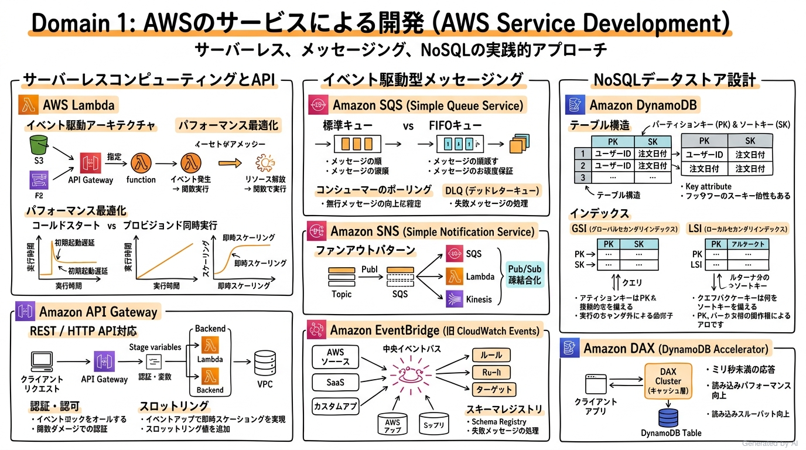
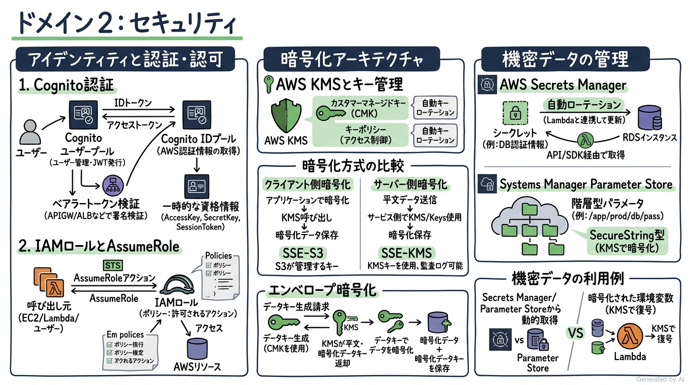
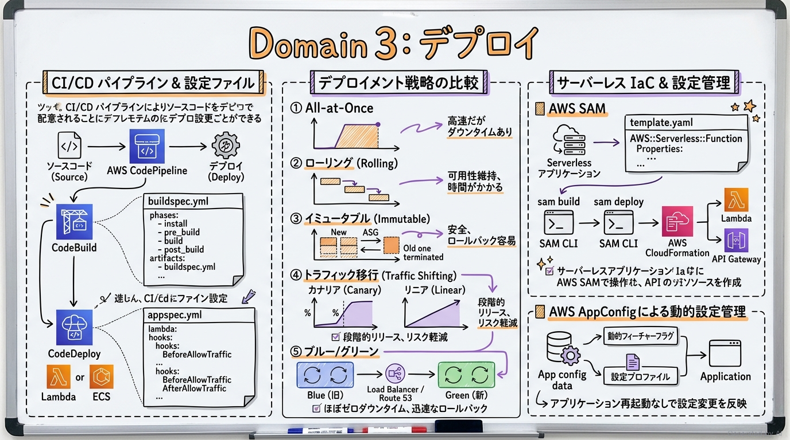
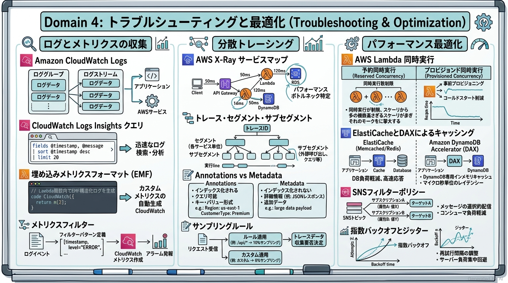

# AWS Certified Developer - Associate (DVA-C02) 完全対策＆実践学習ガイド

- **対象資格**: AWS Certified Developer - Associate
- **試験コード**: DVA-C02
- **公式試験ガイド**: [AWS Certified Developer - Associate (DVA-C02) Exam Guide](https://docs.aws.amazon.com/ja_jp/aws-certification/latest/developer-associate-02/developer-associate-02.html)
- **最終更新日**: 2026-10-06

---

## はじめに

クラウドネイティブアプリケーションの開発手法は、仮想マシン上で動作するモノリシックな構成から、AWS Lambda や Amazon API Gateway を中核としたサーバーレスアーキテクチャ、コンテナ（Amazon ECS/EKS）、そして Amazon SQS や Amazon EventBridge を活用した疎結合・イベント駆動型分散システムへと不可逆な進化を遂げました。

AWS Certified Developer - Associate (DVA-C02) は、単にインフラを設計・構築するだけでなく、**「AWS の主要サービス API・SDK・CLI を駆使して、セキュア・高可用・スケーラブルかつ最適化されたクラウドアプリケーションコードを自ら実装・テスト・デプロイ・デバッグできる能力」**を認定する中核資格です。

本ガイドは、最新の DVA-C02 出題範囲（全4ドメイン・全13タスク）に完全準拠し、各ドメインの核心概念、サービス選定・比較マトリクス、手描き板書風インフォグラフィック図解、**全出題タスクを完全網羅した 26 本の構造化実践シナリオ（状況・対応・結果・解説）**、および公式一次ドキュメント・推奨ハンズオンラボを完全カプセル化した決定版対策ノートです。

### AWS Certified Developer - Associate 試験とは

AWS Certified Developer - Associate は、開発者の観点から AWS サービスを統合し、安全で高パフォーマンスなクラウドアプリケーションのライフサイクル全般（開発、テスト、セキュリティ、CI/CD デプロイ、トラブルシューティング、最適化）を担う実務スキルを検証します。

- **試験時間**: 130 分
- **出題問題数**: 65 問（採点対象: 50 問 / 未採点テスト設問: 15 問）
- **出題形式**: 択一選択問題（4 肢中 1 つ選択）、複数選択問題（5 肢以上中 2 つ以上選択）
- **合格基準点**: 100〜1,000 点のスケールドスコアで 720 点以上
- **前提知識**: 1 種類以上の高水準プログラミング言語（Python, TypeScript, JavaScript, Java, Go, C# 等）の深い理解と、AWS サービスを使用したアプリケーション開発・保守における 1 年以上の実務経験が推奨されます。

### 難易度と求められる思考力

当試験の難易度は **アソシエイト中核（コード実装・API 連携・デプロイ戦略の具体判断力重視）** に位置づけられます。

インフラ構成図を描くだけのソリューションアーキテクト（SAA）試験とは異なり、DVA-C02 では**「開発者の視点に立った具体的な実装上の意思決定」**が問われます。
具体的には以下のような、コードや設定ファイル、API レベルのディテールが問われます：
1. **AWS SDK と API の振る舞い**: 指数バックオフとジッターを伴うリトライロジック、ページネーション処理、バッチ API（`BatchWriteItem` など）における一部失敗時の未処理アイテム（`UnprocessedItems`）の再試行処理。
2. **Lambda 実行環境のライフサイクル**: グローバルスコープでの DB コネクション確立による実行コンテキスト再利用、コールドスタート低減、プロビジョンド同時実行、エイリアスと重み付けルーティング設定。
3. **DynamoDB のデータアクセス設計**: 高カーディナリティなパーティションキー選定、GSI（グローバルセカンダリインデックス）と LSI（ローカルセカンダリインデックス）の特性差、`Query` と `Scan` のコストと性能差、楽観的排他制御（条件付き書き込み）。
4. **CI/CD とデプロイメントの自動化**: `buildspec.yml`（CodeBuild）および `appspec.yml`（CodeDeploy）のライフサイクルフック、Lambda のカナリア/リニアトラフィック移行、SAM テンプレートによる IaC 定義。
5. **セキュリティと機密性**: Amazon Cognito のユーザープール（認証）と ID プール（認可・一時クレデンシャル）の分離、AWS KMS エンベロープ暗号化、Secrets Manager と Parameter Store の使い分け。
6. **オブザーバビリティの実装**: AWS X-Ray のセグメントとサブセグメント、Annotations（インデックス化・検索可能）と Metadata（インデックス化不可・詳細格納）の違い、CloudWatch 埋め込みメトリクスフォーマット (EMF)。

### 推奨の勉強法

1. **公式一次ドキュメントと開発者ガイドの精読**:
   各サービスの概要にとどまらず、AWS SDK の仕様、API パラメータ、設定ファイル（`appspec.yml`, `buildspec.yml`, `template.yaml`）の構文仕様を一次情報で確認します。
2. **ローカル環境および実機でのハンズオン開発**:
   AWS SAM CLI を用いたローカルエミュレーション、Lambda 関数の作成とテスト、DynamoDB テーブルのインデックス検証、CodePipeline による自動デプロイを実際に自身の手で構築します。
3. **構造化実践シナリオによる意思決定プロセスの追体験**:
   本ガイドに収録された 26 本の実践シナリオにおいて、**「解説」に記載された代替案の棄却理由（なぜ他の選択肢では要件を満たせないのか）** を徹底的にインプットし、出題者の意図を読み解く思考回路を構築します。

---

## 目次

1. [はじめに](#はじめに)
2. [学習カリキュラム・出題範囲ロードマップ](#学習カリキュラム出題範囲ロードマップ)
3. [Domain 1: AWS のサービスによる開発 (32%)](#domain-1-aws-のサービスによる開発-32)
4. [Domain 2: セキュリティ (26%)](#domain-2-セキュリティ-26)
5. [Domain 3: デプロイ (24%)](#domain-3-デプロイ-24)
6. [Domain 4: トラブルシューティングと最適化 (18%)](#domain-4-トラブルシューティングと最適化-18)
7. [まとめと推奨学習ステップ](#まとめと推奨学習ステップ)

---

## 学習カリキュラム・出題範囲ロードマップ

### セクション一覧と出題比率

本試験は全4ドメインで構成されており、アプリケーション開発（Domain 1: 32%）とセキュリティ（Domain 2: 26%）の2ドメインで全体の 58% を占めています。これに CI/CD デプロイ（24%）、トラブルシューティング（18%）が加わります。

| ドメイン番号 | ドメイン名 / 出題分野 | 出題比率 | 主要対象サービス・ツール |
| :--- | :--- | :--- | :--- |
| **Domain 1** | AWS のサービスによる開発 | 32% | AWS Lambda, Amazon API Gateway, Amazon DynamoDB, Amazon SQS, Amazon SNS, Amazon EventBridge, AWS Step Functions, Amazon S3, Amazon Kinesis Data Streams, Amazon Q Developer |
| **Domain 2** | セキュリティ | 26% | AWS IAM, AWS STS (AssumeRole), Amazon Cognito (User Pools / Identity Pools), AWS KMS, AWS Secrets Manager, AWS Systems Manager Parameter Store, AWS Private CA |
| **Domain 3** | デプロイ | 24% | AWS CodePipeline, AWS CodeBuild, AWS CodeDeploy, AWS SAM, AWS CloudFormation, AWS AppConfig, Amazon Elastic Container Registry (ECR), Amazon Elastic Container Service (ECS) |
| **Domain 4** | トラブルシューティングと最適化 | 18% | Amazon CloudWatch Logs / Metrics, CloudWatch Logs Insights, 埋め込みメトリクスフォーマット (EMF), AWS X-Ray, Amazon ElastiCache, DynamoDB Accelerator (DAX), 指数バックオフとジッター |

---

### ドメイン別出題詳細

#### Domain 1: AWS のサービスによる開発 (32%)
- **出題の狙い**: クラウドネイティブなマイクロサービス、サーバーレスアーキテクチャ、イベント駆動型メッセージング、および NoSQL データベースを用いた高可用・スケーラブルなコードを実装する能力を検証します。
- **主要タスク**:
  - Task 1.1: AWS でホストされているアプリケーション用のコードの開発（マイクロサービス/イベント駆動型/オーケストレーションアーキテクチャ、ステートフル vs ステートレス、疎結合設計、同期 vs 非同期、SDK リトライ・エラーハンドリング、API Gateway リクエスト変換、サードパーティ連携）
  - Task 1.2: AWS Lambda 用コードの開発（VPC 内リソースアクセス、実行コンテキスト再利用、レイヤー・拡張機能、Lambda 送信先 vs DLQ、ストリーム処理）
  - Task 1.3: アプリケーション開発でのデータストアの使用（DynamoDB パーティションキー設計、強整合性 vs 結果整合性、Query vs Scan、GSI / LSI、TTL、DynamoDB Streams）
- **重要キーワード**: AWS Lambda, Amazon API Gateway, Amazon DynamoDB, Amazon SQS (Standard / FIFO), Amazon SNS (Fanout), Amazon EventBridge, AWS Step Functions, Amazon Kinesis Data Streams, Amazon Q Developer

#### Domain 2: セキュリティ (26%)
- **出題の狙い**: 最小権限原則に基づく IAM ロール設計、フェデレーション認証、KMS エンベロープ暗号化、および Secrets Manager や Parameter Store を用いた機密情報保護コードを実装する能力を検証します。
- **主要タスク**:
  - Task 2.1: アプリケーションと AWS のサービスの認証および/または認可の実装（Cognito ユーザープール vs ID プール、ベアラートークン検証、AWS STS AssumeRole、一時認証情報、API 認可）
  - Task 2.2: AWS のサービスを使用した暗号化の実装（保存時・転送時暗号化、KMS カスタマーマネージドキー、エンベロープ暗号化、クライアント側暗号化 vs サーバー側暗号化 [SSE-S3, SSE-KMS]、キーローテーション）
  - Task 2.3: アプリケーションコードでの機密データの管理（PII/PHI のサニタイズ・マスキング、Secrets Manager 自動ローテーション、Parameter Store SecureString、環境変数管理）
- **重要キーワード**: Amazon Cognito User Pools, Cognito Identity Pools, AWS STS AssumeRole, Temporary Security Credentials, AWS KMS, Envelope Encryption, Customer Master Key (CMK), SSE-KMS, AWS Secrets Manager, Systems Manager Parameter Store

#### Domain 3: デプロイ (24%)
- **出題の狙い**: CI/CD パイプラインを介したアーティファクトの自動ビルド・テスト・デプロイ、トラフィック移行型リリース戦略、IaC テンプレートの保守・適用を確実に実行する能力を検証します。
- **主要タスク**:
  - Task 3.1: AWS にデプロイするアプリケーションアーティファクトの準備（コンテナイメージ作成、依存関係パッケージング、AWS AppConfig による動的設定・フィーチャーフラグ）
  - Task 3.2: 開発環境でのアプリケーションのテスト（ローカルテスト、モック API、API Gateway ステージ、AWS SAM ローカルエミュレーション）
  - Task 3.3: デプロイテストの自動化（JSON テストイベント、Lambda エイリアス、IaC テンプレート検証、Amazon Q Developer テスト生成）
  - Task 3.4: AWS の継続的インテグレーションおよび継続的デリバリー (CI/CD) サービスを使用したコードのデプロイ（CodePipeline、CodeBuild `buildspec.yml`、CodeDeploy `appspec.yml`、Canary / Linear デプロイ、自動ロールバック）
- **重要キーワード**: AWS CodePipeline, AWS CodeBuild (buildspec.yml), AWS CodeDeploy (appspec.yml), AWS SAM (template.yaml), AWS CloudFormation, AWS AppConfig, Traffic Shifting (Canary / Linear), Blue/Green Deployment

#### Domain 4: トラブルシューティングと最適化 (18%)
- **出題の狙い**: 分散システムのオブザーバビリティ（ログ、メトリクス、トレース）をコードレベルで計装し、障害の根本原因分析とアプリケーションパフォーマンスの最適化を実現する能力を検証します。
- **主要タスク**:
  - Task 4.1: 根本原因分析の支援（CloudWatch Logs Insights クエリ、EMF によるカスタムメトリクス、サービス出力ログ解析、デプロイ失敗トラブルシューティング）
  - Task 4.2: オブザーバビリティのためのコードの考案（AWS X-Ray 分散トレーシング、セグメント・サブセグメント、Annotations vs Metadata、サンプリングルール、構造化ロギング）
  - Task 4.3: AWS のサービスと機能を使用したアプリケーションの最適化（Lambda 予約同時実行 vs プロビジョンド同時実行、キャッシュ戦略 [ElastiCache, DAX]、SNS サブスクリプションフィルター、指数バックオフとジッター）
- **重要キーワード**: Amazon CloudWatch Logs, CloudWatch Logs Insights, Embedded Metric Format (EMF), AWS X-Ray, Segments & Subsegments, Annotations vs Metadata, Lambda Provisioned Concurrency, Amazon ElastiCache, DynamoDB Accelerator (DAX), Exponential Backoff and Jitter

---

## Domain 1: AWS のサービスによる開発 (32%)

本ドメインは試験全体の 32% という最大の配点を占める最重要分野です。クラウドネイティブなマイクロサービス、サーバーレス、イベント駆動型メッセージング、および NoSQL データベースを用いたスケーラブルで耐障害性の高いアプリケーションコードの実装能力が検証されます。



---

### 1. セクション概要

モダンなクラウドアプリケーション開発において、開発者はインフラのプロビジョニングやサーバー管理の重労働から解放され、ビジネスロジックの実装に専念することが求められます。本セクションでは、AWS Lambda と Amazon API Gateway によるサーバーレスアーキテクチャ、Amazon SQS / SNS / EventBridge による疎結合メッセージング、そして Amazon DynamoDB による超低遅延データストアアクセスの 3 つの柱を中心に学習します。

#### 重要キーワード

- **AWS Lambda 実行環境ライフサイクル**: ハンドラー外部（グローバルスコープ）の初期化（Init フェーズ）、ハンドラーの実行（Invoke フェーズ）、シャットダウンフェーズから構成されます。DB コネクションや SDK クライアントをグローバルで初期化することで、実行コンテキストの再利用によるオーバーヘッド削減が図れます。
- **Amazon API Gateway 統合タイプ**: Lambda プロキシ統合（クライアントのリクエスト全体をそのまま Lambda に渡す方式）と非プロキシ統合（マッピングテンプレート [VTL] を用いてリクエスト/レスポンスの構造を変換する方式）が存在します。
- **Amazon DynamoDB パーティションキーとカーディナリティ**: DynamoDB の内部パーティション間で負荷を均等に分散するため、アクセス頻度が一箇所に集中しない「高カーディナリティ（値の種類が極めて多い）」属性をパーティションキーに選定することが鉄則です。
- **セカンダリインデックス（GSI vs LSI）**: LSI（ローカルセカンダリインデックス）はテーブル作成時のみ定義可能で同一パーティションキー・別ソートキーを持ち、強整合性読み込みが可能です。一方、GSI（グローバルセカンダリインデックス）はいつでも追加・削除可能で任意のパーティションキーとソートキーを指定でき、結果整合性のみをサポートします。
- **メッセージングモデル（キューイング vs Pub/Sub vs イベントバス）**: SQS はメッセージの消費・保持・ポーリングを行う 1 対 1 のキューイングモデル、SNS はトピックへの発行と複数サブスクライバーへのファンアウトを行う Pub/Sub モデル、EventBridge は JSON スキーマに基づく柔軟なルーティングルールと SaaS 連携を持つ中央イベントバスです。

---

### 2. 重要トピック

#### 1. サーバーレスコンピューティングと API 統合詳細

AWS Lambda を利用した開発では、関数の起動オーバーヘッドである「コールドスタート」と「実行コンテキストの再利用」のメカニズムを理解することが不可欠です。

- **コールドスタート対策**:
  - メモリ割り当ての最適化: メモリを増やすと CPU パワーも比例して増強されるため、実行時間が短縮されコールドスタート時間も削減されます。
  - プロビジョンド同時実行（Provisioned Concurrency）: 事前に初期化済みの実行環境プールを維持し、二桁ミリ秒以内の低遅延で即座に関数を起動します。
- **VPC 接続の最適化**:
  - AWS Lambda は Hyperplane ENI（Elastic Network Interface）を利用して VPC 内のリソース（RDS や ElastiCache など）にアクセスします。関数インスタンスごとに ENI を作成するのではなく、同一サブネット/セキュリティグループの関数間で ENI が共有・再利用されるため、VPC 接続時の起動遅延は大幅に解消されています。

#### 2. メッセージングおよび非同期アーキテクチャ比較マトリクス

| 比較項目 | Amazon SQS (標準) | Amazon SQS (FIFO) | Amazon SNS | Amazon EventBridge |
| :--- | :--- | :--- | :--- | :--- |
| **配信モデル** | プル型（ポーリング） | プル型（ポーリング） | プッシュ型（ファンアウト） | プッシュ型（イベントバス） |
| **順序保証** | ベストエフォート（順序不同） | 完全な FIFO（先入れ先出し） | 順序保証なし（FIFO トピックを除く） | 順序保証なし |
| **重複排除** | 少なくとも 1 回配信（重複あり） | 厳密に 1 回処理（重複排除 ID） | 複数回配信される可能性あり | 少なくとも 1 回配信 |
| **スループット** | ほぼ無制限 | 300〜3,000 件/秒（バッチ時） | ほぼ無制限 | ソフトリミット（クォータ緩和可） |
| **主な用途** | ワークロードの平準化、バッファリング | 金融取引、注文処理の厳密順序 | 複数システムへの一斉通知、ファンアウト | クロスサービス連携、SaaS イベント連携 |
| **フィルタリング機能** | なし（コンシューマ側で判断） | なし | サブスクリプション属性フィルター | 高度な JSON ルールパターンマッチング |

#### 3. Amazon DynamoDB データアクセスと整合性モデル

- **整合性モデルの選択**:
  - **結果整合性（Eventually Consistent Reads）**: デフォルト設定。直前の書き込みが反映されるまでにわずかな遅延（通常 1 秒未満）が生じる可能性がありますが、読み込みキャパシティユニット（RCU）の消費は半分（4 KB あたり 0.5 RCU）で済みます。
  - **強い整合性（Strongly Consistent Reads）**: 直前の成功した書き込み内容を確実に反映した最新データを返します。4 KB あたり 1 RCU を消費します。
- **`Query` vs `Scan`**:
  - `Query`: パーティションキーの完全一致と、ソートキーの条件比較（`begins_with`, `between` 等）を使用して特定項目を直接検索します。非常に効率的で低コストです。
  - `Scan`: テーブルまたはインデックス全体のすべてのアイテムを全件走査した後にフィルタを適用します。データ量が増加すると消費 RCU が激増し、レイテンシが悪化するため、本番のトランザクション処理での利用は厳禁です。

---

### 3. 実践シナリオ

#### シナリオ 1-1: マイクロサービス間における疎結合なファンアウト非同期処理の実装

- **状況**: E コマースシステムにおいて、注文確定イベントをトリガーとして在庫引当サービス、決済サービス、および配送通知サービスの 3 つの独立したバックエンドシステムを並行して実行する必要があり、各サービスの障害が他の処理に波及してはならない場合
- **対応**: 注文受付 API の背後に Amazon SNS トピックを配置し、各バックエンドサービス専用の Amazon SQS キューをトピックのサブスクライバーとして登録するファンアウトパターンを採用する。
- **結果**: 注文受付処理は SNS へのメッセージ発行のみで即座に完了し、各サービスは独立したキューから独自のペースでメッセージを取得・処理可能となり、単一サービスの遅延や障害が他へ影響しない耐障害性を獲得する。
- **解説**: SNS と複数の SQS を組み合わせるファンアウト構成を採用することで、送信元（注文 API）と受信元（各バックエンド）を完全に疎結合化できるためです。API から各サービスを同期的に HTTP 呼び出しする構成では、いずれか 1 つのサービスの障害やレイテンシ悪化が注文全体の失敗に直結します。また、単一の SQS キューから全サービスが取得する構成では、メッセージを最初に取得したコンシューマしか処理できず、全サービスへの同報配信が実現できないため要件を満たせません。
- **参考ドキュメント**:
  - [Amazon SNS ファンアウトシナリオ公式ガイド](https://docs.aws.amazon.com/ja_jp/sns/latest/dg/sns-sqs-as-subscriber.html): SNS から複数 SQS へのメッセージ配信パターン

#### シナリオ 1-2: 順序保証が必須な決済トランザクションの重複排除処理

- **状況**: オンラインバンキングアプリケーションにおいて、口座振替や送金トランザクションを送信された順序通りに厳密に実行し、同一の送金リクエストがネットワーク再試行によって重複処理される事態を完全に防ぐ必要がある場合
- **対応**: Amazon SQS FIFO キューを導入し、同一口座の取引に対して同一の `MessageGroupId` を付与するとともに、トランザクション一意のハッシュ値またはトークンを `MessageDeduplicationId` として指定してメッセージを送信する。
- **結果**: 5 分間の重複排除ウィンドウ内で重複メッセージが自動破棄され、同一メッセージグループ内のトランザクションが到着順に厳密に 1 回のみ処理される。
- **解説**: SQS FIFO キューは完全な先入れ先出し（FIFO）順序配信と「厳密に 1 回のみの処理」をネイティブに保証するためです。標準 SQS キューでは「ベストエフォートの順序付け」かつ「少なくとも 1 回の配信」であるため、メッセージの順序が逆転したり重複配信されたりするリスクがあり、厳密な金融取引要件を満たせません。また、DynamoDB 等の外部 DB で自前ロックや重複チェック機構を作り込むアプローチは、アプリケーションコードの複雑化と競合時の性能低下を招くため不適格です。
- **参考ドキュメント**:
  - [Amazon SQS FIFO キュー開発者ガイド](https://docs.aws.amazon.com/ja_jp/AWSSimpleQueueService/latest/SQSDeveloperGuide/sqs-fifo-queues.html): メッセージの順序性と重複排除の仕組み

#### シナリオ 1-3: Lambda 関数のデータベース接続オーバーヘッドとコールドスタートの削減

- **状況**: リレーショナルデータベース（Amazon RDS PostgreSQL）に接続する Python 製 AWS Lambda 関数において、トラフィック急増時に接続確立のレイテンシが増大し、データベースのコネクション上限数に達してエラーが多発している場合
- **対応**: データベース接続オブジェクトの生成処理を Lambda ハンドラー関数の外側（グローバルスコープ）に移動して実行コンテキスト間で接続を再利用し、さらに Lambda と RDS の間に Amazon RDS Proxy を配置する。
- **結果**: 関数呼び出しごとの新規接続確立オーバーヘッドが解消され、RDS Proxy がコネクションプールを効率的に管理することで DB 接続枯渇が防止される。
- **解説**: Lambda の実行コンテキストは複数回の関数呼び出し間で再利用されるため、グローバルスコープで確立した DB コネクションを再利用することで接続処理時間を削減できるためです。ハンドラー内部で接続を確立・切断するコードでは、呼び出しごとにハンドシェイクが発生しレイテンシが大幅に悪化します。また、RDS Proxy を介在させることで、数千規模の Lambda 同時実行による突発的な接続要求をプーリング・多重化し、リレーショナル DB 側の接続枯渇障害を完全に防ぐことができるためです。
- **参考ドキュメント**:
  - [AWS Lambda 実行環境のライフサイクル](https://docs.aws.amazon.com/ja_jp/lambda/latest/dg/lambda-runtime-environment.html): グローバルスコープの再利用と初期化フェーズ

#### シナリオ 1-4: 非同期 Lambda 関数の処理失敗時におけるリトライとイベント追跡

- **状況**: Amazon S3 へのオブジェクト作成イベントによって非同期に起動される Lambda 関数において、一時的なネットワークエラーや処理失敗が発生した際、手動介入なしで安全にエラーを退避し、失敗理由を追跡可能にする必要がある場合
- **対応**: Lambda 関数の非同期呼び出し設定において「最大再試行回数」を適切に設定し、失敗時の「送信先（On-Failure Destination）」として Amazon SQS キューまたは SNS トピックを設定する。
- **結果**: 2 回の自動再試行が失敗した場合、未処理のペイロードとスタックトレース等のメタデータが自動的に指定の送信先キューに格納され、データ欠損が防止される。
- **解説**: Lambda の「送信先（Destinations）」機能は、関数の実行結果（成功・失敗）に応じたルーティングを宣言的に設定でき、呼び出しコンテキストやエラー詳細を含むリッチな JSON を送信先へ渡せるためです。古い手法である関数のデッドレターキュー（DLQ）設定ではペイロード本体しか転送されず、エラーのスタックトレースや詳細メタデータが含まれないため不適格です。
- **参考ドキュメント**:
  - [AWS Lambda 非同期呼び出しの送信先設定](https://docs.aws.amazon.com/ja_jp/lambda/latest/dg/invocation-async.html): 成功・失敗時の宛先ルーティング

#### シナリオ 1-5: DynamoDB におけるホットパーティション回避と高スループット設計

- **状況**: IoT デバイスから毎秒数十万件のセンサーログが送信される DynamoDB テーブルにおいて、パーティションキーを `DeviceType`（10 種類のみ）に設定したところ、プロビジョニングキャパシティに余裕があるにもかかわらず `ProvisionedThroughputExceededException` が頻発している場合
- **対応**: パーティションキーをカーディナリティの極めて高い `DeviceId` または `DeviceId#Timestamp` の複合値に変更し、必要に応じてランダムなサフィックス（Write Sharding）を付加してデータを分散書き込みする。
- **結果**: 全物理パーティションに対して書き込み I/O が均等に分散され、スロットリングエラーが完全に解消される。
- **解説**: DynamoDB はパーティションキーのハッシュ値に基づいて物理ストレージにデータを分散配置するため、カーディナリティが低い（10 種類しかない）キーを設定すると特定の物理パーティションにアクセスが集中して「ホットパーティション」が発生するためです。総キャパシティをいくら引き上げても、単一パーティションの秒間上限（1,000 WCU / 3,000 RCU）を超過すればスロットリングが発生します。したがって、値のばらつきが大きい属性をパーティションキーに採用することが根本的な解決策となるためです。
- **参考ドキュメント**:
  - [Amazon DynamoDB パーティションキーの設計ベストプラクティス](https://docs.aws.amazon.com/ja_jp/amazondynamodb/latest/developerguide/bp-partition-key-design.html): ホットパーティションの回避手法

#### シナリオ 1-6: DynamoDB Streams と Lambda を用いたリアルタイム集計パイプライン

- **状況**: E コマースの購入履歴テーブル（DynamoDB）へのレコード挿入・更新を検知し、即座に顧客ごとの累計購入金額を更新するとともに、外部の検索エンジンへインデックスを同期させる必要がある場合
- **対応**: DynamoDB テーブルで DynamoDB Streams（表示形式: 新旧両方のイメージ）を有効化し、ストリームをイベントソースとして AWS Lambda 関数をトリガーする。
- **結果**: データベースへの書き込み変更が 24 時間保持される分散コミットログとしてストリーミングされ、Lambda 関数がミリ秒単位のニアリアルタイムで後続処理を自動実行する。
- **解説**: DynamoDB Streams は変更履歴を時系列順に厳密に記録し、Lambda のイベントソースマッピングとネイティブに統合されているため、テーブルへの変更を低遅延かつ確実にキャプチャできるためです。アプリケーション側でデータ更新後に別途メッセージキューへ二重書き込み（Dual Write）する設計では、DB 書き込み成功後のキュー送信失敗によるデータ不整合やトランザクション境界の崩壊リスクが発生するため不適格です。
- **参考ドキュメント**:
  - [DynamoDB Streams と AWS Lambda の統合](https://docs.aws.amazon.com/ja_jp/amazondynamodb/latest/developerguide/Streams.Lambda.html): 変更データキャプチャ (CDC) の実装

#### シナリオ 1-7: API Gateway と Lambda を用いたリクエスト検証とマッピング

- **状況**: モバイルアプリ向けの REST API において、無効な JSON ペイロードや必須パラメータ欠落によるバックエンド Lambda 関数の無駄な起動を抑止し、コンピューティングコストとレイテンシを削減したい場合
- **対応**: Amazon API Gateway で JSON スキーマモデルを定義してリクエストバリデーションを有効化し、不正なリクエストは API Gateway のエッジで直接 HTTP 400 Bad Request として遮断する。
- **結果**: 不正な構文やパラメータ欠落のリクエストが Lambda に到達する前に自動排除され、バックエンドの実行回数とコストが削減される。
- **解説**: API Gateway のリクエストバリデータ機能を利用することで、Lambda コードを実行することなくエッジ層でスキーマ検証を完了できるためです。Lambda ハンドラー内部にバリデーションロジックを実装した場合、不正なリクエストに対しても Lambda の起動回数と実行時間に対する課金が発生してしまい、コスト最適化の観点から非効率であるため不適格です。
- **参考ドキュメント**:
  - [Amazon API Gateway でのリクエスト検証の設定](https://docs.aws.amazon.com/ja_jp/apigateway/latest/developerguide/api-gateway-method-request-validation.html): スキーマモデルによるバリデーション

---

### 4. 参考ドキュメント & 推奨ハンズオン

#### 公式一次ドキュメント
- [AWS Lambda デベロッパーガイド](https://docs.aws.amazon.com/ja_jp/lambda/latest/dg/welcome.html): 実行環境のライフサイクル、関数の設定、ベストプラクティス
- [Amazon DynamoDB デベロッパーガイド](https://docs.aws.amazon.com/ja_jp/amazondynamodb/latest/developerguide/Introduction.html): NoSQL データモデリング、セカンダリインデックス、ストリーム処理
- [Amazon API Gateway デベロッパーガイド](https://docs.aws.amazon.com/ja_jp/apigateway/latest/developerguide/welcome.html): REST API / HTTP API、リクエスト検証、ステージング

#### 推奨ハンズオン・ラボ（実機検証）
- [AWS Skill Builder: Getting Started with AWS Lambda](https://skillbuilder.aws/search?searchText=Getting+Started+with+AWS+Lambda):
  - **学習目標**: Lambda 関数の作成、トリガー設定、環境変数、CloudWatch ログ出力の確認
- [AWS Skill Builder: Amazon DynamoDB - Data Modeling Patterns](https://skillbuilder.aws/search?searchText=Amazon+DynamoDB+-+Data+Modeling+Patterns):
  - **学習目標**: パーティションキーとソートキーの設計、GSI による非キー属性のクエリ、DynamoDB Streams と Lambda 連携の実機検証

---

## Domain 2: セキュリティ (26%)

本ドメインは試験全体の 26% を占めるセキュリティ中核分野です。AWS 上のアプリケーション開発における認証・認可アーキテクチャ、暗号化の実装、および機密データ（API キー、DB 接続情報、クレデンシャル等）のセキュアな管理手法を検証します。



---

### 1. セクション概要

クラウド開発におけるセキュリティは「多層防御」と「最小権限原則」が基本です。コード内にクレデンシャルをハードコードすることは厳禁であり、AWS Identity and Access Management (IAM) や Amazon Cognito による動的かつ一時的なクレデンシャル発行、AWS Key Management Service (KMS) を利用したエンベロープ暗号化、そして AWS Secrets Manager や Systems Manager Parameter Store による動的シークレット取得が標準的な実装パターンとなります。

#### 重要キーワード

- **Amazon Cognito ユーザープール vs ID プール**:
  - **ユーザープール（User Pools）**: アプリケーションの「認証（Authentication）」を担当。サインアップ、サインイン、パスワードリセット、多要素認証（MFA）を提供し、認証成功時に JWT（ID トークン、アクセストークン、リフレッシュトークン）を発行します。
  - **ID プール（Identity Pools / Federated Identities）**: アプリケーションの「認可（Authorization）」を担当。Cognito ユーザープールや外部 IdP（Google, Apple, SAML）のトークンを交換し、AWS リソース（S3 や DynamoDB など）に直接アクセスするための一時的な AWS 認証情報（Access Key, Secret Key, Session Token）を発行します。
- **AWS STS `AssumeRole` API**: アプリケーションやサービスが別の IAM ロールの権限を一時的に引き受けるための API です。発行される一時クレデンシャルは有効期限（15 分〜12 時間）を持ち、永続的なアクセスキーの保持を不要にします。
- **AWS KMS エンベロープ暗号化**: データを暗号化する「データキー（Data Key）」を、KMS が保護する「カスタマーマスターキー（KMS キー / CMK）」で暗号化して二重に保護する方式です。平文データと平文データキーを KMS に都度送信することなく、大量のデータをローカル環境で高速に暗号化・復号できます。
- **サーバー側暗号化（SSE-S3 vs SSE-KMS）**:
  - SSE-S3: S3 が管理する 256 ビット AES キーで自動暗号化。追加コスト不要ですが、KMS キーポリシーによる詳細なアクセス制御や CloudTrail での鍵使用履歴追跡はできません。
  - SSE-KMS: KMS キーを使用して暗号化。キーのアクセス権限分離、ユーザーごとの復号権限管理、および CloudTrail による鍵利用の完全な監査証跡が可能です。
- **AWS Secrets Manager vs Systems Manager Parameter Store**:
  - Secrets Manager: データベース認証情報などの自動ローテーション機能（Lambda 関数連携）をネイティブに備え、機密情報のクロスアカウント共有も容易です。
  - Parameter Store: 構成パラメータ、環境変数、ライセンスキーなどを階層型（`/app/prod/db_url` 等）でシンプルに管理します。暗号化が必要な場合は `SecureString` 型を使用します。

---

### 2. 重要トピック

#### 1. Amazon Cognito 認証・認可フロー詳細

モダンなモバイル・Web アプリケーションにおける認証フローは、Cognito ユーザープールと ID プールの協調動作によって完結します。

- **ステップ 1 (認証)**: クライアントがユーザー名とパスワード（またはソーシャル IdP）をユーザープールに送信し、JWT（JSON Web Token）を取得します。
- **ステップ 2 (API 認可)**: Amazon API Gateway を呼び出す際、Authorization ヘッダーに JWT アクセストークンを付与します。API Gateway は Cognito オーソライザーまたは Lambda オーソライザーを用いてトークンの署名と有効期限を検証します。
- **ステップ 3 (直接アクセス認可)**: クライアントが S3 へ直接ファイルをアップロードする場合、JWT を ID プールに渡して AWS STS の一時クレデンシャルを取得し、IAM ポリシーに基づいた限定的なアクセスを実行します。

#### 2. 機密情報管理サービス選定・比較マトリクス

| 比較項目 | AWS Secrets Manager | AWS Systems Manager Parameter Store (Standard) | AWS Systems Manager Parameter Store (Advanced) |
| :--- | :--- | :--- | :--- |
| **主な用途** | DB パスワード、API キー、OAuth トークン | 環境設定パラメータ、フラグ、文字列 | 大容量パラメータ（最大 8 KB）、ポリシ制御 |
| **暗号化サポート** | 必須（KMS で常時暗号化） | 任意（String / StringList / SecureString） | 任意（SecureString 対応） |
| **自動ローテーション** | ネイティブ対応（RDS, DocumentDB, Redshift 等） | なし（EventBridge + Lambda で自作が必要） | なし（自作が必要） |
| **バージョニング** | 自動バージョニング（ステージングラベル対応） | 自動バージョニング（数値管理） | 自動バージョニング（パラメータポリシー対応） |
| **コスト特性** | シークレットあたり月額課金 ＋ API 従量課金 | 無料（Standard パラメータ保存は無制限） | パラメータ保存あたり従量課金 |
| **推奨ユースケース** | 頻繁な定期ローテーションが必要な DB 認証情報 | コストを抑えた環境変数、設定値の階層管理 | 4 KB を超える設定データ、有効期限付きパラメータ |

---

### 3. 実践シナリオ

#### シナリオ 2-1: モバイルアプリからの Amazon S3 バケット直接アップロードと認可

- **状況**: モバイルアプリケーションから各ユーザーが撮影した写真を S3 バケットに直接アップロードさせる必要があり、ユーザーごとに自分自身の専用フォルダ（`user-id/`）にのみ書き込みを許可し、サーバー側に恒久的な AWS 認証情報を埋め込んではならない場合
- **対応**: Amazon Cognito ユーザープールでユーザーを認証した後、ID プールにトークンを渡して一時的な AWS 認証情報を取得し、ポリシー変数 `${cognito-identity.amazonaws.com:sub}` を使用した IAM ロールを割り当てる。
- **結果**: ユーザーは自分の一意な Cognito ID に一致する S3 プレフィックスにのみ一時クレデンシャルを用いて直接アップロード可能となり、バックエンドサーバーのプロキシ負荷が完全に排除される。
- **解説**: Cognito ID プールの一時クレデンシャルと IAM ポリシー変数を組み合わせることで、ユーザーごとに動的かつセキュアなアクセス制御を最小限の管理コストで実現できるためです。アプリケーション内に永続的な IAM ユーザーのアクセスキーを埋め込むことは致命的なセキュリティリスクであり、全ユーザー共通の単一 IAM ロールでは他ユーザーのフォルダへの不正書き込みを防止できないため要件を満たせません。
- **参考ドキュメント**:
  - [Amazon Cognito ID プールにおける IAM ポリシー変数](https://docs.aws.amazon.com/ja_jp/cognito/latest/developerguide/iam-roles.html): ポリシー変数による個別フォルダのアクセス制限

#### シナリオ 2-2: Amazon API Gateway におけるマイクロサービス間トークン検証

- **状況**: フロントエンドから送信された JWT ベアラートークンを検証してバックエンドのマイクロサービスへリクエストを中継する際、不正なトークンを最前線で排除しつつ、クライアントの属性情報（テナント ID や権限スコープ）を Lambda に安全に渡す必要がある場合
- **対応**: API Gateway に Amazon Cognito ユーザープールオーソライザー（またはカスタム Lambda オーソライザー）を設定し、認可成功時にトークンのクレーム（Claims）をコンテキストとしてバックエンド Lambda に渡す。
- **結果**: 署名が無効または期限切れのトークンを持つリクエストは API Gateway で直ちに HTTP 401 Unauthorized として拒否され、バックエンドには検証済みの認証コンテキストのみが連携される。
- **解説**: API Gateway ネイティブのオーソライザー機能を利用することで、インフラ境界で一括して JWT 検証を実施でき、各バックエンド関数のコード重複を排除できるためです。各マイクロサービス内部で個別にトークン検証ロジックを実装すると、実装漏れや脆弱性の原因となり、不正リクエスト時にもバックエンドのコンピューティングコストが発生するため不適格です。
- **参考ドキュメント**:
  - [API Gateway での Cognito ユーザープールのオーソライザー](https://docs.aws.amazon.com/ja_jp/apigateway/latest/developerguide/apigateway-integrate-with-cognito.html): JWT トークンのエッジ検証

#### シナリオ 2-3: AWS Secrets Manager によるデータベース認証情報の自動ローテーション

- **状況**: コンプライアンス基準により、RDS データベースの管理者パスワードおよびアプリケーション接続パスワードを 30 日ごとに自動ローテーションする必要があり、ローテーション中に稼働中アプリケーションのダウンタイムを発生させてはならない場合
- **対応**: 認証情報を AWS Secrets Manager に格納し、ローテーションスケジュールを 30 日に設定するとともに、組み込みのローテーション Lambda 関数を関連付け、アプリケーションコード側ではキャッシュ付きクライアントライブラリを用いて動的にシークレットを取得する。
- **結果**: Secrets Manager が Lambda をトリガーして新旧パスワードを段階的に更新（`AWSCURRENT`, `AWSPENDING`, `AWSPREVIOUS`）し、アプリケーションは無停止で新しいパスワードへシームレスに切り替わる。
- **解説**: Secrets Manager のネイティブ自動ローテーション機能は、マルチステージラベルを使用してデータベースとシークレットの同期を安全に行うため、無停止ローテーションが実現できるためです。Parameter Store にパスワードを保存する方式では自動ローテーションの仕組みが存在せず、手動更新や自作スクリプトでの対応が必要となり、運用負荷と切り替え失敗時の障害リスクが増大するため不適格です。
- **参考ドキュメント**:
  - [AWS Secrets Manager の自動シークレットローテーション](https://docs.aws.amazon.com/ja_jp/secretsmanager/latest/userguide/rotating-secrets.html): データベース認証情報の安全な更新

#### シナリオ 2-4: AWS KMS によるエンベロープ暗号化を用いた大容量ファイルのクライアント側暗号化

- **状況**: アプリケーションが機密性の高いギガバイト単位の医療画像データを Amazon S3 に保存するにあたり、AWS ネットワークに送信する前のローカルメモリ上で暗号化（クライアント側暗号化）する必要があり、かつ KMS のリクエストレート上限（スロットリング）を回避したい場合
- **対応**: AWS Encryption SDK を使用してエンベロープ暗号化を実装し、KMS の `GenerateDataKey` API で取得した平文データキーを用いてファイルをローカル暗号化した後、平文キーをメモリから破棄し、暗号化されたデータキーをファイルメタデータと一緒に S3 に保存する。
- **結果**: ギガバイト規模のファイル全体を KMS に送信することなく高速にクライアント側暗号化が完了し、KMS API の呼び出し回数とコストを最小化できる。
- **解説**: KMS の `Encrypt` API は最大 4 KB のデータしか直接暗号化できない仕様であるため、大容量データの暗号化にはエンベロープ暗号化が必須となるためです。データキーをローカルで生成してデータを暗号化し、データキー自体のみを KMS で暗号化して保管することで、KMS の制限を回避しつつ最高強度の暗号化を達成できるためです。
- **参考ドキュメント**:
  - [AWS KMS エンベロープ暗号化の仕組み](https://docs.aws.amazon.com/ja_jp/kms/latest/developerguide/concepts.html#enveloping): データキーと CMK の役割

#### シナリオ 2-5: クロスアカウント環境における IAM ロールの一時的な引き受け

- **状況**: 開発用 AWS アカウント（アカウント A）で動作する CI/CD パイプライン用 EC2 インスタンスが、本番用 AWS アカウント（アカウント B）の S3 バケットにリリース資材をアップロードする必要がある場合
- **対応**: アカウント B にアカウント A を信頼する IAM ロールを作成し、アカウント A の EC2 インスタンスロールに対してそのロールへの `sts:AssumeRole` 権限を付与し、ビルドスクリプト内で STS から取得した一時クレデンシャルを使用して S3 へアクセスする。
- **結果**: アカウント境界を越えたアクセスが一時的な認証情報によって安全に実行され、アカウント B の恒久的なアクセスキーをアカウント A に保持する必要がなくなる。
- **解説**: AWS STS の `AssumeRole` を用いるクロスアカウントアクセスは、アカウント間での永続クレデンシャルの共有を完全に排除し、アクセスログを両アカウントの CloudTrail で追跡可能にするベストプラクティスであるためです。アカウント B で IAM ユーザーを作成してそのアクセスキーをアカウント A のインスタンスにハードコードする手法は、キー漏洩リスクが高いため不適格です。
- **参考ドキュメント**:
  - [IAM ロールを使用したクロスアカウントアクセス](https://docs.aws.amazon.com/ja_jp/IAM/latest/UserGuide/tutorial_cross-account-with-roles.html): STS AssumeRole の設定

#### シナリオ 2-6: アプリケーションログにおける個人情報 (PII) のマスキングとサニタイズ

- **状況**: アプリケーションのデバッグログに顧客のクレジットカード番号やマイナンバーなどの個人を特定できる情報 (PII) が平文で出力されており、セキュリティ監査で重大な指摘を受けた場合
- **対応**: ロギングライブラリのミドルウェア層に正規表現によるデータマスキングフィルターを組み込み、機密フィールドをハッシュ化またはマスク値（例: `****-****-****-1234`）に置換してから CloudWatch Logs へ出力する。
- **結果**: ログの可読性と障害調査に必要なトレース情報を維持しつつ、機密情報の平文露出を完全に遮断しコンプライアンス要件を充足する。
- **解説**: ログ収集のパイプラインや CloudWatch への送信前にアプリケーションコード側でサニタイズを実施することが、情報漏洩を根本から防ぐ唯一確実な手段であるためです。CloudWatch 側に送信された後にログを加工・削除しようとすると、転送中の漏洩リスクが残るだけでなく、ロググループ内の不整合やデータ削除の運用負荷が増大するため不適格です。
- **参考ドキュメント**:
  - [CloudWatch Logs におけるデータ保護とマスキング](https://docs.aws.amazon.com/ja_jp/AmazonCloudWatch/latest/logs/mask-sensitive-log-data.html): 機密データのマスキング機能

---

### 4. 参考ドキュメント & 推奨ハンズオン

#### 公式一次ドキュメント
- [AWS IAM デベロッパーガイド](https://docs.aws.amazon.com/ja_jp/IAM/latest/UserGuide/introduction.html): 最小権限のポリシー、AssumeRole、一時セキュリティ認証情報
- [AWS Key Management Service デベロッパーガイド](https://docs.aws.amazon.com/ja_jp/kms/latest/developerguide/overview.html): エンベロープ暗号化、キーポリシー、キーローテーション
- [AWS Secrets Manager ユーザーガイド](https://docs.aws.amazon.com/ja_jp/secretsmanager/latest/userguide/intro.html): シークレット管理、自動ローテーション、SDK 統合

#### 推奨ハンズオン・ラボ（実機検証）
- [AWS Skill Builder: AWS Security Fundamentals](https://skillbuilder.aws/search?searchText=AWS+Security+Fundamentals):
  - **学習目標**: IAM ロールとポリシーの作成、STS AssumeRole の動作確認、Secrets Manager による DB 接続文字列の動的取得検証
- [AWS Skill Builder: Deep Dive into AWS Key Management Service (KMS)](https://skillbuilder.aws/search?searchText=Deep+Dive+into+AWS+Key+Management+Service+%28KMS%29):
  - **学習目標**: カスタマーマネージドキーの作成、AWS CLI を用いたデータキーの生成（GenerateDataKey）とローカル暗号化の体験

---

## Domain 3: デプロイ (24%)

本ドメインは試験全体の 24% を占める CI/CD およびデプロイメント自動化の分野です。AWS CodePipeline、CodeBuild、CodeDeploy を用いた自動化パイプライン、AWS SAM や CloudFormation による Infrastructure as Code (IaC)、および各種デプロイメント戦略の実装能力を検証します。



---

### 1. セクション概要

現代のソフトウェアデリバリーでは、手動によるサーバー作業や環境差異による障害を排除し、コードのコミットから本番稼働までを一貫して自動化するパイプラインが不可欠です。本セクションでは、AWS のマネージド CI/CD サービス群の連携、`buildspec.yml` と `appspec.yml` の正確な設定、AWS Serverless Application Model (SAM) によるサーバーレス IaC、そしてダウンタイムゼロと迅速なロールバックを可能にするトラフィック移行戦略を体系的に学びます。

#### 重要キーワード

- **AWS CodeBuild と `buildspec.yml`**: ソースコードのビルド、依存関係のダウンロード、単体テストの実行、成果物（アーティファクト）のパッケージングを行うフルマネージドビルドサービスです。ルート直下に配置する `buildspec.yml` は `install`, `pre_build`, `build`, `post_build` の 4 つのフェーズと、後続ステージに渡す `artifacts` を定義します。
- **AWS CodeDeploy と `appspec.yml`**: EC2、オンプレミスサーバー、ECS、および Lambda へのデプロイを自動化するサービスです。
  - **EC2/オンプレミス向け**: `ApplicationStop`, `BeforeInstall`, `AfterInstall`, `ApplicationStart`, `ValidateService` などのライフサイクルフックを実行します。
  - **Lambda 向け**: `BeforeAllowTraffic` および `AfterAllowTraffic` のフックでテスト用 Lambda 関数を実行し、検証が成功した場合のみ本番トラフィックを段階的に移行します。
- **AWS Serverless Application Model (SAM)**: サーバーレスアプリケーションに特化した CloudFormation の拡張オープンソースフレームワークです。短縮された構文（`AWS::Serverless::Function`, `AWS::Serverless::Api` 等）を用いて、API、Lambda、DynamoDB などを簡潔に定義します。`sam build`, `sam local invoke`, `sam deploy` コマンドで開発サイクルを高速化します。
- **デプロイメント戦略の分類**:
  - **All-at-Once（一括）**: 最速で全インスタンスを更新しますが、デプロイ中にダウンタイムが発生します。
  - **ローリング（Rolling）**: 指定バッチ単位でインスタンスを順番に更新します。キャパシティ低下を防ぐには「追加バッチによるローリング」を選択します。
  - **イミュータブル（Immutable）**: 既存環境を一切変更せず、完全に新しい Auto Scaling グループを作成して新バージョンを展開し、成功後に旧環境を破棄します。最も安全ですが一時的にコストが増加します。
  - **トラフィックシフティング（Canary / Linear）**: Lambda や ECS において、重み付けルーティングを用いて 10% ずつ 10 分ごとに移行（Linear）したり、最初に 10% だけ移行して検証後に一括移行（Canary）したりする高度なリリース戦略です。

---

### 2. 重要トピック

#### 1. CodeBuild と CodeDeploy の設定ファイル仕様比較

開発者試験において頻出となる `buildspec.yml` と `appspec.yml` の構造とライフサイクルの相違点は以下の通りです。

```yaml
# CodeBuild: buildspec.yml の代表的構造
version: 0.2
phases:
  install:
    runtime-versions:
      python: 3.11
    commands:
      - pip install -r requirements.txt
  pre_build:
    commands:
      - flake8 .
      - pytest tests/
  build:
    commands:
      - aws sam build
  post_build:
    commands:
      - echo "Build completed on `date`"
artifacts:
  files:
    - '**/*'
```

```yaml
# CodeDeploy: appspec.yml (Lambda デプロイ時) の代表的構造
version: 0.0
Resources:
  - MyFunction:
      Type: AWS::Lambda::Function
      Properties:
        Name: "orderProcessingFunction"
        Alias: "live"
        CurrentVersion: "1"
        TargetVersion: "2"
Hooks:
  - BeforeAllowTraffic: "preTrafficHookValidationLambda"
  - AfterAllowTraffic: "postTrafficHookValidationLambda"
```

#### 2. デプロイメント戦略選定・比較マトリクス

| デプロイ戦略 | ダウンタイム | ロールバック速度 | 一時的リソースコスト | デプロイ所要時間 | 推奨ユースケース |
| :--- | :--- | :--- | :--- | :--- | :--- |
| **All-at-Once** | あり | 遅い（再デプロイ必要） | なし（既存流用） | 最速 | 開発・検証環境、ダウンタイム許容バッチ |
| **ローリング** | なし（容量維持時） | 中程度（逆順更新） | なし〜小 | 中程度 | EC2 ベースの大規模 Web アプリケーション |
| **イミュータブル** | なし | 高速（ASG 切り戻し） | 大（2 倍リソース） | 遅い | 本番環境、設定ドリフトを完全排除したい場合 |
| **ブルー/グリーン** | なし | 最速（DNS/ALB 切替） | 大（2 倍リソース） | 中程度 | ゼロダウンタイム本番リリース、即時切り戻し |
| **Canary (トラフィック移行)** | なし | 最速（自動アラーム） | 最小（サーバーレス） | 設定時間による | Lambda / API Gateway、リスク低減リリース |

---

### 3. 実践シナリオ

#### シナリオ 3-1: AWS SAM と CodeDeploy を用いた Lambda 関数のカナリアリリースの自動化

- **状況**: 高頻度で更新される決済処理 Lambda 関数において、新バージョンのデプロイ時に障害が発生した場合の影響範囲を最小限に抑え、本番トラフィックの 10% だけをまず 10 分間流して CloudWatch アラームで異常を監視し、エラー発生時は自動ロールバックする必要がある場合
- **対応**: AWS SAM テンプレート（`template.yaml`）の関数プロパティにおいて `AutoPublishAlias: live` および `DeploymentPreference: Type: Canary10Percent10Minutes` を定義し、監視対象の CloudWatch アラームを `Alarms` セクションに関連付ける。
- **結果**: CodeDeploy が自動的に Lambda エイリアスの重み付けを制御してトラフィックの 10% を新バージョンに流し、10 分間エラーが検知されなければ 100% へ移行し、アラーム検知時は即座に旧バージョンへ自動切り戻しされる。
- **解説**: AWS SAM は CodeDeploy と緊密に統合されており、`DeploymentPreference` を記述するだけで複雑なトラフィック移行設定と自動ロールバックを宣言的に実現できるためです。API Gateway 側で手動でステージ変数の比率を変更するアプローチは、監視アラームと連動した自動ロールバックの仕組みを独自に作り込む必要があり、運用の信頼性が低下するため不適格です。
- **参考ドキュメント**:
  - [AWS SAM によるサーバーレスアプリケーションの段階的デプロイ](https://docs.aws.amazon.com/ja_jp/serverless-application-model/latest/developerguide/automating-updates-to-serverless-apps.html): DeploymentPreference の設定

#### シナリオ 3-2: CodeDeploy における EC2 インスタンス群へのインプレースデプロイと検証フック

- **状況**: Auto Scaling グループ内の EC2 インスタンス群で稼働する Java アプリケーションを CodeDeploy で更新する際、アプリの起動完了と正常性確認（HTTP 200 応答）が完了するまでロードバランサーのトラフィックを再開させてはならず、起動失敗時は自動でデプロイを停止する必要がある場合
- **対応**: `appspec.yml` 内の `ValidateService` フックにヘルスチェックエンドポイント（`curl -f http://localhost:8080/health`）をポーリングするシェルスクリプトを記述する。
- **結果**: アプリケーションプロセスが完全に起動してヘルスチェックをパスするまでデプロイフェーズが待機し、検証失敗時は CodeDeploy がデプロイを失敗と判定してトラフィック投入を阻止する。
- **解説**: CodeDeploy のライフサイクルフックにおいて、`ValidateService` はデプロイ完了判定と ELB トラフィック再開直前に実行される最後の検証ステップであるためです。`ApplicationStart` フックで起動コマンドを投げるだけでは、アプリケーションの内部初期化が完了する前に ELB がトラフィックを流し始め、一時的な 502/503 エラーが発生するため不適格です。
- **参考ドキュメント**:
  - [CodeDeploy の AppSpec ライフサイクルフックリファレンス](https://docs.aws.amazon.com/ja_jp/codedeploy/latest/userguide/reference-appspec-file-structure-hooks.html): EC2 デプロイフック順序

#### シナリオ 3-3: AWS CodeBuild のビルド環境における環境変数とシークレットの安全な注入

- **状況**: CI/CD パイプライン（CodeBuild）内で Docker イメージをビルドしてサードパーティのリポジトリにプッシュするにあたり、リポジトリの認証トークンを Git リポジトリ（`buildspec.yml`）にコミットせず、安全にビルドコンテナ内に渡す必要がある場合
- **対応**: 認証トークンを AWS Systems Manager Parameter Store（`SecureString`）または AWS Secrets Manager に格納し、`buildspec.yml` の `env` セクション（`parameter-store` または `secrets-manager`）から参照する。
- **結果**: トークンは平文でコード管理されることなく、ビルド実行時にのみメモリ内に安全に読み込まれ、ビルドログへの露出も自動的にマスキングされる。
- **解説**: CodeBuild の `buildspec.yml` はネイティブに Parameter Store および Secrets Manager との連携をサポートしており、`env` セクションでキーを指定するだけで安全に機密変数をインジェクションできるためです。`buildspec.yml` 内に直接トークンを記述することはセキュリティ侵害に直結し、ビルドスクリプトの引数で平文渡しするとビルドログにトークンが出力される危険があるため不適格です。
- **参考ドキュメント**:
  - [AWS CodeBuild のビルド環境における環境変数](https://docs.aws.amazon.com/ja_jp/codebuild/latest/userguide/build-spec-ref.html#build-spec-ref-syntax): env セクションでのシークレット参照

#### シナリオ 3-4: AWS AppConfig を用いた無停止フィーチャーフラグ管理

- **状況**: 本番稼働中の Web アプリケーションにおいて、新機能の有効/無効フラグを特定の顧客グループ向けに動的に切り替える必要があり、フラグ変更のたびにコードを再デプロイしたりアプリケーションコンテナを再起動したりしてはならない場合
- **対応**: AWS AppConfig を導入してフィーチャーフラグ設定を作成し、バリデータ（JSON スキーマ検証）とデプロイ戦略（段階的ロールアウト）を構成して、アプリケーションコード側で AWS AppConfig Agent または SDK 経由で定期的に最新設定をポーリング取得する。
- **結果**: アプリケーションを再起動することなくミリ秒単位で設定変更が反映され、誤った設定値が投入された場合はバリデータによってデプロイが事前にブロックされる。
- **解説**: AWS AppConfig はアプリケーション設定の動的配信、バリデーション、段階的デプロイ、および自動ロールバックをネイティブに提供する専用サービスであるためです。環境変数にフラグを持たせる方式では、変数の変更時にコンテナやプロセスの再起動が必要となり、可用性に影響を与えるため要件を満たせません。
- **参考ドキュメント**:
  - [AWS AppConfig デベロッパーガイド](https://docs.aws.amazon.com/ja_jp/appconfig/latest/userguide/what-is-appconfig.html): 動的設定とフィーチャーフラグ

#### シナリオ 3-5: AWS SAM CLI によるローカルでのサーバーレスアプリケーション統合テスト

- **状況**: AWS Lambda と Amazon API Gateway で構築されたバックエンド API の開発において、開発者がコードを修正するたびに AWS クラウド環境へデプロイして動作確認を行っていたため、開発フィードバックループが極めて遅く開発効率が著しく低下している場合
- **対応**: 開発環境に Docker と AWS SAM CLI を導入し、`sam local start-api` コマンドを実行してローカルマシン上で API Gateway と Lambda の実行環境をエミュレートする。
- **結果**: 開発者はローカル環境でコードを保存した瞬間に `localhost` への HTTP リクエストで即座に動作検証が可能となり、クラウドへのデプロイ待ち時間がゼロになる。
- **解説**: AWS SAM CLI はローカル Docker コンテナを利用して AWS Lambda の実行環境を忠実にエミュレートするため、クラウドへ一切デプロイすることなく完全なテストサイクルを高速に回せるためです。自前でローカル Express サーバー等を立ち上げてテストする手法では、Lambda のイベントオブジェクト形式（コンテキストやヘッダー構造）との差異が生じ、本番環境デプロイ時に予期せぬ不具合が発生するため不適格です。
- **参考ドキュメント**:
  - [AWS SAM CLI を使用したローカルでのテストとデバッグ](https://docs.aws.amazon.com/ja_jp/serverless-application-model/latest/developerguide/serverless-sam-cli-using-debugging.html): sam local コマンドの活用

#### シナリオ 3-6: Amazon ECS サービスにおけるブルー/グリーンデプロイと自動ロールバック

- **状況**: Amazon ECS (AWS Fargate) 上で稼働するミッションクリティカルなコンテナサービスにおいて、新しいコンテナイメージのロールアウト中にエラー率が急増した場合に備え、旧環境を即時切り戻せる状態で待機させ、ゼロダウンタイムで切り替える必要がある場合
- **対応**: AWS CodeDeploy と連携した Amazon ECS ブルー/グリーンデプロイを設定し、新タスクセットを起動した後にテスト用リスナーポートで動作確認を行い、正常確認後に Application Load Balancer の本番リスナーのターゲットグループを切り替える。
- **結果**: 本番トラフィックを瞬時に新旧タスク間で切り替えることが可能となり、切り替え後に CloudWatch アラームが発報した場合は自動的にターゲットグループが旧タスクセットへ即時切り戻される。
- **解説**: ECS の CodeDeploy ブルー/グリーンデプロイは、新旧 2 つのターゲットグループを ALB の背後で制御し、トラフィックの安全な移行と即時ロールバックを実現する標準パターンであるためです。ECS 標準のローリングアップデートでは、新タスクが立ち上がると旧タスクが順次終了していくため、リリース後に深刻な不具合が発覚した際に旧イメージのタスクを再起動するまでロールバックに時間がかかるため要件を満たせません。
- **参考ドキュメント**:
  - [CodeDeploy を使用した Amazon ECS ブルー/グリーンデプロイ](https://docs.aws.amazon.com/ja_jp/AmazonECS/latest/developerguide/deployment-type-bluegreen.html): ECS の安全なリリース

---

### 4. 参考ドキュメント & 推奨ハンズオン

#### 公式一次ドキュメント
- [AWS CodePipeline ユーザーガイド](https://docs.aws.amazon.com/ja_jp/codepipeline/latest/userguide/welcome.html): CI/CD パイプラインの作成、ステージ構成、アーティファクト
- [AWS CodeDeploy ユーザーガイド](https://docs.aws.amazon.com/ja_jp/codedeploy/latest/userguide/welcome.html): AppSpec 仕様、デプロイライフサイクルフック、トラフィック移行
- [AWS SAM デベロッパーガイド](https://docs.aws.amazon.com/ja_jp/serverless-application-model/latest/developerguide/what-is-sam.html): SAM テンプレート仕様、SAM CLI コマンド

#### 推奨ハンズオン・ラボ（実機検証）
- [AWS Skill Builder: DevOps Essentials on AWS](https://skillbuilder.aws/search?searchText=DevOps+Essentials+on+AWS):
  - **学習目標**: CodeConnections（GitHub 連携等）、CodeBuild、CodeDeploy を組み合わせた CodePipeline のエンドツーエンド構築
- [AWS Skill Builder: Serverless CI/CD with AWS SAM](https://skillbuilder.aws/search?searchText=Serverless+CI%2FCD+with+AWS+SAM):
  - **学習目標**: SAM テンプレートを用いた Lambda デプロイ、`sam local` によるローカル検証、Canary トラフィックシフティングの実機検証

---

## Domain 4: トラブルシューティングと最適化 (18%)

本ドメインは試験全体の 18% を占めるオブザーバビリティ、パフォーマンス分析、および障害トラブルシューティングの分野です。Amazon CloudWatch、AWS X-Ray を用いた分散トレーシング、Lambda 同時実行の最適化、キャッシング戦略、および SDK の耐障害性パターンの実装能力を検証します。



---

### 1. セクション概要

マイクロサービスやサーバーレスで構成された分散システムでは、単一サーバーのログファイルを SSH で確認する従来の手法は通用しません。分散トレーシングによるリクエストの横断的追跡、高解像度メトリクスの非同期生成、そしてキャッシュの多層化やスロットリング対策を通じたアプリケーションの最適化が求められます。

#### 重要キーワード

- **AWS X-Ray（分散トレーシング）**:
  - **トレース（Trace）**: エンドツーエンドのリクエスト全体の移動経路。
  - **セグメント（Segment）**: 各コンピューティングリソース（EC2, ECS, Lambda 等）における処理情報。
  - **サブセグメント（Subsegment）**: セグメント内のより詳細な処理単位（ダウンストリームサービス呼び出し、SQL クエリ、HTTP 外部 API 呼び出し等）。
  - **Annotations vs Metadata**:
    - **Annotations（注釈）**: キーと値のペアで、**インデックス化されてフィルター検索（Filter Expressions）に使用可能**（例: `CustomerID`, `Region`, `UserTier`）。
    - **Metadata（メタデータ）**: 任意の JSON オブジェクトを保存できますが、**インデックス化されず検索には使用できない**詳細情報（デバッグ用トレースデータ等）。
- **CloudWatch Logs Insights**: ロググループ内の大量のログデータを高速にクエリ・集計するためのインタラクティブな分析機能です。`fields`, `filter`, `stats`, `sort`, `limit` 構文を用いて、エラー発生傾向やレイテンシ上位のリクエストを瞬時に抽出します。
- **Amazon CloudWatch 埋め込みメトリクスフォーマット (EMF)**: 構造化 JSON ログを出力するだけで、CloudWatch Logs が自動的に非同期でカスタムメトリクスを抽出し、CloudWatch Metrics に二重課金や API 呼び出しオーバーヘッドなしで反映するメカニズムです。
- **AWS Lambda 同時実行制御**:
  - **予約同時実行（Reserved Concurrency）**: 関数に割り当てる最大同時実行数を固定。他の関数のスパイクによるアカウント上限枯渇を防ぎ、ダウンストリーム（DB 等）への過負荷を防止（スロットリングによる保護）。
  - **プロビジョンド同時実行（Provisioned Concurrency）**: 事前に初期化済みの実行環境を用意し、コールドスタートを完全排除。二桁ミリ秒の応答が必須な用途に適用。
- **指数バックオフとジッター（Exponential Backoff and Jitter）**: API 呼び出しが一時的なスロットリングや 503 エラーに遭遇した際、再試行間隔を指数関数的（1秒, 2秒, 4秒...）に延ばし、さらにランダムな揺らぎ（ジッター）を加えることで、複数クライアントが一斉に同一タイミングで再試行する「サンダリングハード（Thundering Herd）問題」を回避するアルゴリズムです。

---

### 2. 重要トピック

#### 1. AWS X-Ray 計装とデータ分析モデル

分散アプリケーションにおけるボトルネック特定のため、X-Ray SDK による計装（Instrumentation）のポイントは以下の通りです。

- **SDK ハンドラーのラップ**: HTTP クライアントや AWS SDK クライアントを X-Ray SDK でラップすることで、外部呼び出しが自動的にサブセグメントとして記録されます。
- **サンプリングルール（Sampling Rules）**: すべてのリクエストをトレースするとコストとオーバーヘッドが増大するため、「毎秒最初の 1 リクエスト（リザーブド）＋ 残りのリクエストの 5%（レート）」のように柔軟なサンプリングルールを定義します。

#### 2. キャッシュおよびパフォーマンス最適化比較マトリクス

| 比較項目 | Amazon ElastiCache (Redis) | Amazon ElastiCache (Memcached) | DynamoDB Accelerator (DAX) | Amazon CloudFront |
| :--- | :--- | :--- | :--- | :--- |
| **主な対象データ** | 汎用オブジェクト、セッション、ランキング | 単純な Key-Value キャッシュ | DynamoDB の読み込み結果 | 静的/動的 Web コンテンツ、API レスポンス |
| **レイテンシ特性** | サブミリ秒（ミリ秒未満） | サブミリ秒 | マイクロ秒単位 | エッジロケーションで低遅延 |
| **データ構造** | 文字列、ハッシュ、リスト、セット、ソート済みセット | 単純な文字列・バイナリ | DynamoDB アイテム/クエリ結果 | HTTP レスポンス（ファイル、JSON） |
| **高可用性/永続性** | Multi-AZ、レプリケーション、スナップショット | なし（ノード障害時はデータ消失） | Multi-AZ クラスター対応 | エッジ冗長化 |
| **アプリケーション改修** | キャッシュ読み書きロジックの追加が必要 | キャッシュ読み書きロジックの追加が必要 | **SDK のエンドポイント変更のみ（コード改修不要）** | クライアントの接続先 URL 変更のみ |

---

### 3. 実践シナリオ

#### シナリオ 4-1: マイクロサービス間通信における AWS X-Ray 分散トレーシングとボトルネック分析

- **状況**: API Gateway、Lambda、および外部 REST API を連携させた分散マイクロサービスにおいて、特定のユーザーリクエストでエンドツーエンドの応答時間が 5 秒を超過しているが、どのコンポーネントが遅延の原因であるか特定できていない場合
- **対応**: Lambda 関数で X-Ray アクティブトレースを有効化し、コード内で X-Ray SDK を用いて発信 HTTP リクエストをキャプチャするサブセグメントを作成し、X-Ray サービスマップとトレースタイムラインを分析する。
- **結果**: 外部 REST API 呼び出しのサブセグメントで 4.8 秒のレイテンシが発生していることがサービスマップ上で視覚的に特定され、問題箇所が即座に判明する。
- **解説**: AWS X-Ray はリクエストごとに一意の `Trace-ID`（`X-Amzn-Trace-Id`）を伝播させ、各サービスの処理時間とダウンストリーム呼び出しをタイムライン形式で可視化するためです。個々の CloudWatch ログを別々に検索する手法では、マイクロサービス間の相関関係を突き止めるのに膨大な時間を要し、真のボトルネックを特定できないため不適格です。
- **参考ドキュメント**:
  - [AWS X-Ray の概念とサービスマップ](https://docs.aws.amazon.com/ja_jp/xray/latest/devguide/xray-concepts.html): セグメント、サブセグメント、トレース

#### シナリオ 4-2: X-Ray における Annotations を用いた特定顧客エラーの高速フィルタリング

- **状況**: 数百万件のトレースデータが蓄積される X-Ray において、特定の大口顧客（`CustomerID: 98765`）で発生したエラー（HTTP 5xx）のみを X-Ray コンソールからクエリ式で即座に絞り込んで調査したい場合
- **対応**: X-Ray サブセグメントに対して、`CustomerID` を **Annotation（注釈）** として追加するコード（`subsegment.addAnnotation("CustomerID", "98765")`）を実装し、X-Ray コンソールで `annotation.CustomerID = "98765" AND error` のフィルター式を実行する。
- **結果**: 数百万件のトレースから該当顧客のエラートレースのみがミリ秒単位で瞬時にフィルタリングされ、原因究明が迅速化される。
- **解説**: X-Ray の Annotations は検索用にインデックス化されるキーと値のペアであり、フィルター式（Filter Expressions）による高速検索が可能であるためです。Metadata（メタデータ）として顧客 ID を記録した場合はインデックス化されないため要件を満たせません。
- **参考ドキュメント**:
  - [AWS X-Ray の注釈とメタデータ](https://docs.aws.amazon.com/ja_jp/xray/latest/devguide/xray-sdk-java-segment.html#xray-sdk-java-segment-annotations): Annotations と Metadata の使い分け

#### シナリオ 4-3: CloudWatch 埋め込みメトリクスフォーマット (EMF) を用いた非同期高解像度メトリクス生成

- **状況**: トラフィックの激しい Lambda 関数において、ビジネス上のカスタムメトリクス（処理済み注文金額、処理アイテム数等）をミリ秒単位で CloudWatch に記録したいが、同期的な `PutMetricData` API の呼び出しレイテンシと追加コストを排除したい場合
- **対応**: Lambda コード内で CloudWatch 埋め込みメトリクスフォーマット (EMF) の仕様に従った構造化 JSON ログを標準出力に出力する。
- **結果**: Lambda は API 呼び出しの待機時間なしで即座に処理を完了し、CloudWatch Logs がバックグラウンドで自動的にメトリクスを抽出・発行してダッシュボードに反映する。
- **解説**: CloudWatch EMF はログ出力メカニズムを利用して非同期かつゼロオーバーヘッドでカスタムメトリクスを生成できるためです。コード内で `PutMetricData` API を同期的に呼び出すと、HTTP ネットワークオーバーヘッドが発生して Lambda の実行時間が延び、API コール費用と Lambda 実行費用の双方が増大するため不適格です。
- **参考ドキュメント**:
  - [CloudWatch 埋め込みメトリクスフォーマット (EMF) の仕様](https://docs.aws.amazon.com/ja_jp/AmazonCloudWatch/latest/monitoring/CloudWatch_Embedded_Metric_Format_Specification.html): 構造化ログからのメトリクス自動生成

#### シナリオ 4-4: AWS Lambda 予約同時実行数による下流データベースの過負荷保護

- **状況**: 急激なアクセススパイクが発生するプロモーション期間中、サーバーレス API（API Gateway + Lambda）が毎秒数万回起動され、下流の共有 MySQL データベース（最大 100 接続上限）に大量の接続が殺到してデータベース全体がクラッシュする恐れがある場合
- **対応**: Lambda 関数の「予約同時実行数（Reserved Concurrency）」をデータベースの許容上限（例: 80）に明示的に制限する。
- **結果**: 同時実行数が 80 を超えた呼び出しは Lambda 側で安全に HTTP 429 Too Many Requests（またはスロットリング）として遮断され、共有データベースの接続枯渇とクラッシュが未然に防がれる。
- **解説**: Lambda の予約同時実行数を設定することで、その関数のスケール上限を厳格にキャップ（制約）し、下流の脆弱なリソースに対する過負荷を物理的に防止できるためです。制限を設けない場合、Lambda がアカウント上限（デフォルト 1,000 以上）まで無制限にスケールし、下流の DB コネクションを瞬時に枯渇させるため不適格です。
- **参考ドキュメント**:
  - [AWS Lambda 関数の同時実行数の管理](https://docs.aws.amazon.com/ja_jp/lambda/latest/dg/configuration-concurrency.html): 予約同時実行とスロットリング

#### シナリオ 4-5: AWS SDK における指数バックオフとジッターによる API スロットリングの回避

- **状況**: バッチ処理スクリプトから AWS サービス API（例: SQS の `SendMessageBatch` や DynamoDB の `BatchWriteItem`）を一斉に呼び出した際、`ThrottlingException` や `ProvisionedThroughputExceededException` が発生し、固定間隔の再試行によって全スレッドが一斉にリトライを繰り返してエラーが収束しない場合
- **対応**: 再試行間隔に「指数バックオフ（Exponential Backoff）」を適用し、さらに各待機時間にランダムな揺らぎ（Full Jitter）を加えるリトライアルゴリズムを SDK クライアントに設定する。
- **結果**: 呼び出し元の再試行タイミングが時間軸上に完全に分散され、サービスのレート上限内へとトラフィックが平滑化されて再試行が成功する。
- **解説**: 指数バックオフにジッター（ランダム揺らぎ）を加えることで、すべてのクライアントが同一のタイミングで一斉に再試行をぶつける「サンダリングハード問題」を根本的に解消できるためです。単なる固定間隔リトライやジッターなしの指数バックオフでは、クライアント群の再試行タイミングが同期してしまい、スロットリング状態が長期化するため不適格です。
- **参考ドキュメント**:
  - [AWS での指数バックオフとジッター](https://aws.amazon.com/jp/blogs/architecture/exponential-backoff-and-jitter/): サンダリングハード問題の解決

#### シナリオ 4-6: DynamoDB Accelerator (DAX) による読み込み集中テーブルのマイクロ秒レイテンシ化

- **状況**: リアルタイムゲームのリーダーボードや製品カタログを表示する DynamoDB テーブルにおいて、特定の人気アイテムに対する読み込みクエリが集中し、1 桁ミリ秒の応答時間でも要件を満たせず、かつ RCU 消費コストが急増している場合
- **対応**: DynamoDB テーブルの手前に DynamoDB Accelerator (DAX) クラスターを配置し、アプリケーション側の AWS SDK を DAX クライアント SDK に切り替えて既存のクエリコードをそのまま実行する。
- **結果**: キャッシュヒット時の読み込みレイテンシがミリ秒単位から 1 桁マイクロ秒単位へと劇的に高速化され、DynamoDB テーブルの RCU 消費が大幅に削減される。
- **解説**: DAX は DynamoDB 専用の完全マネージドなインメモリキャッシュであり、API 互換性を持つためアプリケーションのデータアクセスロジックを一切書き換えることなくシームレスに導入できるためです。Amazon ElastiCache を導入する場合、キャッシュのチェック、キャッシュミス時の DB 取得、およびキャッシュへの格納ロジック（Cache-Aside パターン）を自前で実装する必要があり、開発工数が増大するため不適格です。
- **参考ドキュメント**:
  - [Amazon DynamoDB Accelerator (DAX) 開発者ガイド](https://docs.aws.amazon.com/ja_jp/amazondynamodb/latest/developerguide/DAX.html): インメモリキャッシュによるマイクロ秒応答

#### シナリオ 4-7: Amazon SNS サブスクリプションフィルターポリシーによる不要トラフィックと処理コストの削減

- **状況**: 各種トランザクションイベントを発行する単一の SNS トピックに多数の SQS キュー（サブスクライバー）が接続されているが、各キューは特定のイベント種別（例: `eventType: ORDER_CANCELLED`）しか処理しないにもかかわらず、全メッセージを受信して Lambda で破棄しているため無駄な実行コストが発生している場合
- **対応**: 各 SQS キューの SNS サブスクリプションに対して「サブスクリプションフィルターポリシー（Subscription Filter Policy）」を設定し、対象の属性を持つメッセージのみをキューに配信するよう構成する。
- **結果**: 不要なメッセージが SQS キューに配信されなくなり、コンシューマ Lambda の不要な起動回数と課金がゼロになる。
- **解説**: SNS サブスクリプションフィルターポリシーを利用することで、メッセージのルーティングとフィルタリングを SNS 側で完全に処理でき、不要なメッセージがキューや後続コンピュートに到達するのをエッジで防止できるためです。全メッセージを一度キューに投入してからコンシューマコードで `if` 文判定して破棄する構成は、キューの通信費用および Lambda の実行費用が無駄に発生し、コストとスループットの面で極めて非効率であるため不適格です。
- **参考ドキュメント**:
  - [Amazon SNS サブスクリプションフィルターポリシー](https://docs.aws.amazon.com/ja_jp/sns/latest/dg/sns-subscription-filter-policies.html): 属性によるメッセージの選択的配信

---

### 4. 参考ドキュメント & 推奨ハンズオン

#### 公式一次ドキュメント
- [AWS X-Ray デベロッパーガイド](https://docs.aws.amazon.com/ja_jp/xray/latest/devguide/aws-xray.html): サブセグメントの計装、注釈とメタデータ、サンプリングルール
- [Amazon CloudWatch ユーザーガイド](https://docs.aws.amazon.com/ja_jp/AmazonCloudWatch/latest/monitoring/WhatIsCloudWatch.html): CloudWatch Logs Insights クエリ構文、EMF 仕様
- [Amazon DynamoDB Accelerator (DAX) ガイド](https://docs.aws.amazon.com/ja_jp/amazondynamodb/latest/developerguide/DAX.html): DAX クラスター設定、SDK 統合

#### 推奨ハンズオン・ラボ（実機検証）
- [AWS Skill Builder: Observability with Amazon CloudWatch and AWS X-Ray](https://skillbuilder.aws/search?searchText=Observability+with+Amazon+CloudWatch+and+AWS+X-Ray):
  - **学習目標**: 分散アプリケーションの X-Ray トレーシング有効化、Annotations の付与とフィルター検索、CloudWatch Logs Insights クエリの実践
- [AWS Skill Builder: Optimizing Serverless Applications](https://skillbuilder.aws/search?searchText=Optimizing+Serverless+Applications):
  - **学習目標**: Lambda プロビジョンド同時実行の設定とコールドスタート検証、EMF によるカスタムメトリクス生成の実機検証

---

## まとめと推奨学習ステップ

### 本認定試験対策の全体要約

AWS Certified Developer - Associate (DVA-C02) に合格し、かつ実務で優れたクラウドネイティブ開発者として活躍するための核心は、**「コードとマネージドサービスが交差する実装境界を正しく設計すること」**に尽きます。

1. **インフラの管理をマネージドサービスに委託する**: Lambda、DynamoDB、SQS、EventBridge などのフルマネージドサービスを標準とし、コード側はビジネスロジックと冪等性（Idempotency）の担保に集中する。
2. **最小権限と動的クレデンシャルの徹底**: 永続的なアクセスキーの埋め込みを根絶し、Cognito ユーザープール/ID プール、IAM ロール、STS AssumeRole、KMS エンベロープ暗号化、Secrets Manager を組み合わせた安全なコードを実装する。
3. **CI/CD とデプロイの自動化**: `buildspec.yml` と `appspec.yml` のライフサイクルを熟知し、AWS SAM と CodeDeploy を連動させたカナリア/リニアトラフィック移行によって、本番リリースのリスクを極限まで低減する。
4. **オブザーバビリティの組み込み**: X-Ray の Annotations と CloudWatch EMF を活用して、分散システムのボトルネックをミリ秒単位で可視化・追跡できるコードを実装する。

### 次のステップへの推奨学習ロードマップ

- **ステップ 1: 本ガイドの精読と実践シナリオの思考追体験**
  - 各ドメインの「実践シナリオ」における解説（なぜ代替案では不適格なのか）を繰り返し読み込み、出題者が求める判断軸を確立します。
- **ステップ 2: AWS SAM と CLI による実機ハンズオン**
  - `sam init` から始まるサーバーレスアプリの構築、`sam local` での検証、CodePipeline による自動デプロイを一度は自身の手でエンドツーエンド構築します。
- **ステップ 3: AWS 公式模擬試験（AWS Skill Builder）での実力測定**
  - 公式練習問題集を解き、時間配分（130 分 65 問）と問題文の制約条件（「最もコストが低い」「コードの変更が不要な」など）を素早く見極める解法テクニックを体得します。
