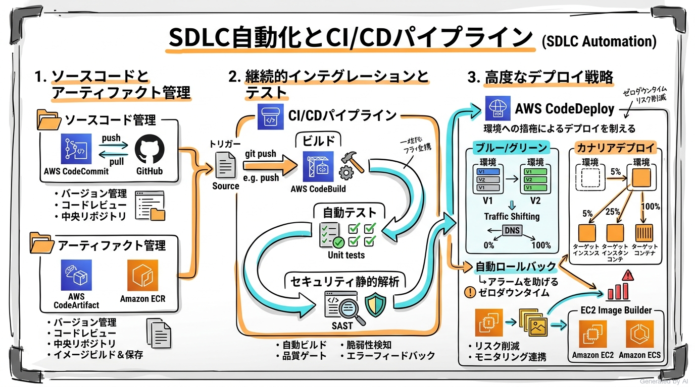
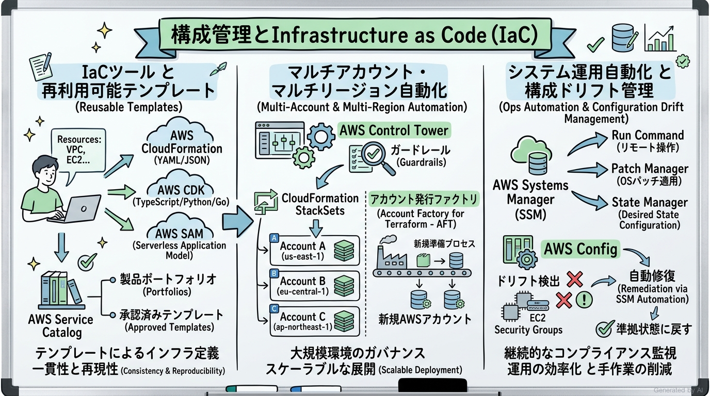
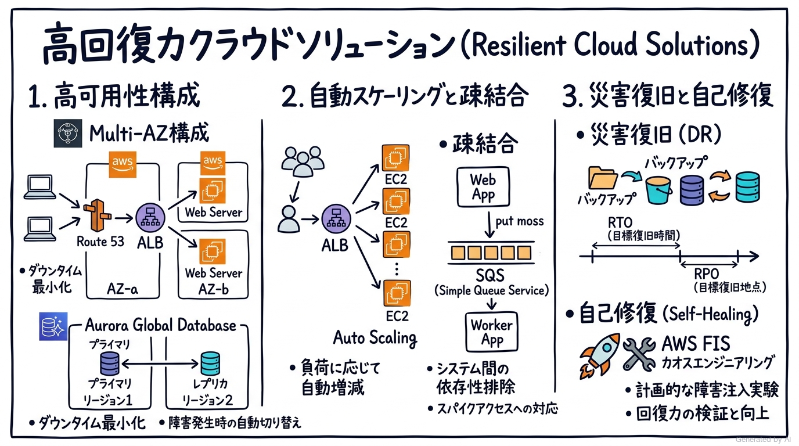
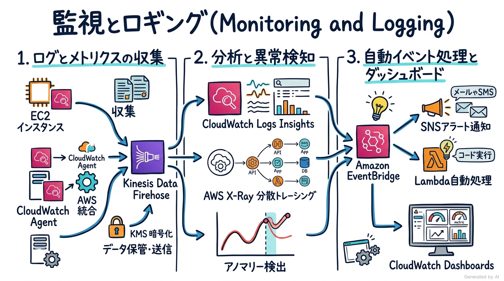
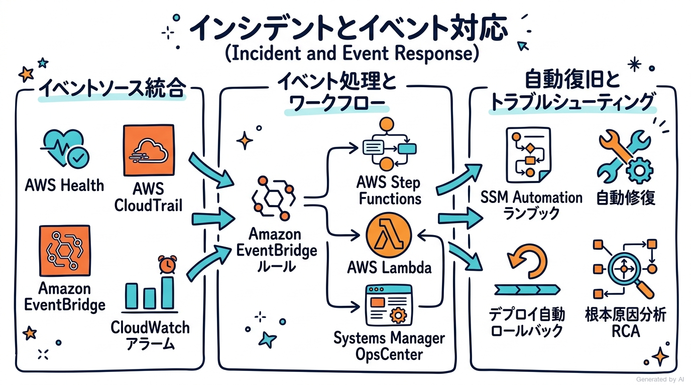
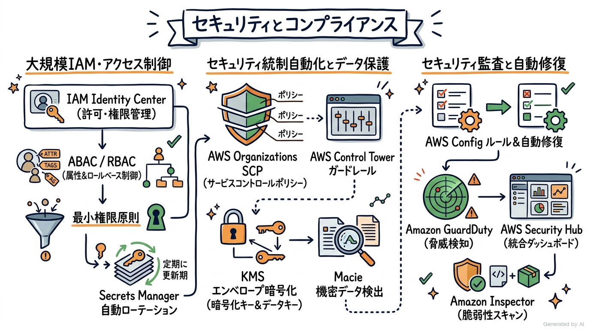

# AWS Certified DevOps Engineer - Professional (DOP-C02) 完全対策＆実践学習ガイド

- **対象資格**: AWS Certified DevOps Engineer - Professional
- **試験コード**: DOP-C02
- **公式試験ガイド**: [AWS Certified DevOps Engineer - Professional (DOP-C02) 試験ガイド](https://docs.aws.amazon.com/ja_jp/aws-certification/latest/devops-engineer-professional-02/devops-engineer-professional-02.html)
- **最終更新日**: 2026-10-07

---

## はじめに

近代的なクラウドネイティブ開発と運用において、開発（Dev）と運用（Ops）の境界は完全に融合し、コードとしてのインフラ（IaC）、自動化された継続的インテグレーション・継続的デリバリー（CI/CD）、自律的オブザーバビリティ、およびセキュリティの自動化（DevSecOps）が事業の俊敏性と回復力を支える中核基盤となっています。

AWS Certified DevOps Engineer - Professional (DOP-C02) は、単なるスクリプト作成や個別サービスの操作にとどまらず、エンタープライズ規模のマルチアカウント・マルチリージョン環境において、高可用性、自己修復性、セキュリティ統制、およびコンプライアンス監査をコードとイベント駆動で自動化・統括する最高峰の実践力を認定する資格です。

本ガイドは、最新の DOP-C02 公式試験ガイドに完全準拠し、全6ドメイン（SDLC自動化、構成管理とIaC、高回復力クラウドソリューション、監視とロギング、インシデントとイベント対応、セキュリティとコンプライアンス）の各タスクを徹底的に網羅しています。各ドメインの冒頭には白背景の手描き板書風グラフィックレコーディング（要約図解）を配置し、ピラミッド原則に基づく明快な論理構造、サービス選定比較マトリクス、構造化実践シナリオ（状況 / 対応 / 結果 / 解説）、および公式一次ドキュメントと推奨ハンズオンへの導線を完全にカプセル化した決定版ノートです。

### AWS Certified DevOps Engineer - Professional 試験とは

本試験は、AWS 上での分散アプリケーションシステムのプロビジョニング、運用、管理、および自動化に関する包括的な技術的能力を評価・認定します。

- **試験時間**: 180 分
- **出題問題数**: 75 問（採点対象: 65 問 / 未採点テスト設問: 10 問）
- **出題形式**: 択一選択問題（4 肢中 1 つ選択）、複数選択問題（5 肢以上中 2 つ以上選択）
- **合格基準点**: 100〜1,000 点のスケールドスコアで 750 点以上
- **前提知識**: AWS 環境のプロビジョニング、運用、管理に関する 2 年以上の実務経験、少なくとも 1 つの高水準プログラミング言語でのコード記述能力、CI/CD パイプラインおよび自動化された障害復旧システムの構築経験が強く推奨されます。

### 難易度と求められる思考力

当試験の難易度は、AWS プロフェッショナル資格の双璧をなす Solutions Architect - Professional (SAP) と並び、**極めて高度なエンジニアリング実践力と思考力**を要求されます。

SAP が「システム全体の包括的アーキテクチャ設計・移行・コストのトレードオフ」を問うのに対し、DOP-C02 では **「リリース自動化、構成ドリフトの即時検知・自動修復、障害発生時のゼロダウンタイム切り替え、およびセキュリティガードレールのコードによる強制」** という、運用現場における緻密な自動化メカニズムとトラブルシューティングの深層理解が問われます。

特に、以下の 4 つの思考軸が合格への鍵となります：

1. **マルチアカウント・クロスアカウントでの CI/CD 統制**:
   開発、ステージング、本番の各 AWS アカウントが分離されたエンタープライズ環境において、CodePipeline、クロスアカウント IAM ロール、KMS カスタマーマネージドキー (CMK)、および S3 バケットポリシーをどのように統合し、最小権限かつセキュアにアーティファクトを引き渡すか。
2. **安全かつ無停止なデプロイメント戦略の選択**:
   EC2、ECS、EKS、Lambda の各プラットフォームにおける Canary、Linear、Blue/Green デプロイメントの違いを理解し、CloudWatch アラームや Route 53 と連携させた自動ロールバックのメカニズムを正確に設計できるか。
3. **イベント駆動型インシデント対応と自律修復**:
   CloudTrail、AWS Health、CloudWatch アラームを Amazon EventBridge で集約し、AWS Systems Manager (SSM) Automation ランブックや AWS Step Functions、Lambda を用いて人間の介在なしに非準拠リソースや障害インスタンスを瞬時に自動修復するアーキテクチャ。
4. **制約条件の精読と消去法の論理**:
   設問文の「最小の運用オーバーヘッド」「ダウンタイムゼロ」「既存のコード変更を最小化」「外部ライブラリの脆弱性検知」といったクリティカルなキーワードを見極め、技術的に可能であっても制約に反する選択肢を論理的に排除する能力。

### 推奨の勉強法

1. **公式一次ドキュメントと DevOps ベストプラクティスの精読**:
   CodePipeline、CodeDeploy、CloudFormation StackSets、Systems Manager、CloudWatch Logs Insights、EventBridge、および AWS Config の公式開発者ガイドを熟読し、イベント構造や設定パラメータの仕様を把握します。
2. **実機ハンズオンによるパイプラインと自動修復の構築**:
   実際に AWS アカウント上で CodePipeline を構築し、CodeDeploy によるカナリアデプロイと CloudWatch アラーム検知時の自動ロールバック、および AWS Config 非準拠検知から SSM Automation による自動修復の流れを体験します。
3. **構造化実践シナリオを通じた消去法ロジックの体得**:
   本ガイドの各タスクに収録された実践シナリオにおいて、**「解説（なぜ他の代替案では要件を満たせないのか）」** に焦点を当てて熟読し、出題者が用意した典型的な誤答パターンの見破り方を習得します。

---

## 目次

1. [はじめに](#はじめに)
2. [学習カリキュラム・出題範囲ロードマップ](#学習カリキュラム出題範囲ロードマップ)
3. [Domain 1: SDLC 自動化 (22%)](#domain-1-sdlc-自動化-22)
4. [Domain 2: 構成管理と Infrastructure as Code (IaC) (17%)](#domain-2-構成管理と-infrastructure-as-code-iac-17)
5. [Domain 3: 高回復力クラウドソリューション (15%)](#domain-3-高回復力クラウドソリューション-15)
6. [Domain 4: 監視とロギング (15%)](#domain-4-監視とロギング-15)
7. [Domain 5: インシデントとイベント対応 (14%)](#domain-5-インシデントとイベント対応-14)
8. [Domain 6: セキュリティとコンプライアンス (17%)](#domain-6-セキュリティとコンプライアンス-17)
9. [まとめと推奨学習ステップ](#まとめと推奨学習ステップ)

---

## 学習カリキュラム・出題範囲ロードマップ

### セクション一覧と出題比率

| ドメイン番号 | 出題分野（Domain） | 出題比率 | 主要対象サービス・技術要素 |
| :--- | :--- | :--- | :--- |
| **Domain 1** | SDLC 自動化 (SDLC Automation) | 22% | AWS CodePipeline, AWS CodeBuild, AWS CodeDeploy, Amazon ECR, AWS CodeArtifact, EC2 Image Builder, デプロイ戦略 (Canary, Blue/Green, Linear) |
| **Domain 2** | 構成管理と Infrastructure as Code (IaC) | 17% | AWS CloudFormation, CloudFormation StackSets, AWS CDK, AWS Systems Manager, AWS Config, AWS Service Catalog, AWS Control Tower |
| **Domain 3** | 高回復力クラウドソリューション (Resilient Cloud Solutions) | 15% | Multi-AZ / Multi-Region, Amazon Route 53 ARC, Amazon Aurora Global Database, DynamoDB Global Tables, Auto Scaling, AWS Backup, AWS Fault Injection Simulator (FIS) |
| **Domain 4** | 監視とロギング (Monitoring and Logging) | 15% | Amazon CloudWatch, CloudWatch Logs Insights, CloudWatch Metric Streams, Amazon Data Firehose (旧 Amazon Data Firehose), AWS X-Ray, CloudWatch アノマリー検出, CloudWatch Synthetics |
| **Domain 5** | インシデントとイベント対応 (Incident and Event Response) | 14% | Amazon EventBridge, AWS Health, AWS Systems Manager OpsCenter, SSM Automation ランブック, AWS Step Functions, デプロイ自動ロールバック |
| **Domain 6** | セキュリティとコンプライアンス (Security and Compliance) | 17% | IAM Identity Center, ABAC / RBAC, AWS Organizations SCP, AWS KMS, AWS Secrets Manager, AWS Macie, Amazon GuardDuty, AWS Security Hub, Amazon Inspector, AWS Config 自動修復 |

---

### ドメイン別出題詳細

#### Domain 1: SDLC 自動化 (SDLC Automation) (22%)
- **出題の狙い**: エンドツーエンドの CI/CD パイプラインをセキュアかつスケーラブルに設計・実装し、テスト自動化、アーティファクト管理、高度なデプロイ戦略（Canary, Blue/Green）を駆使して安全・迅速に本番リリースを実行する能力を評価します。
- **主要タスク**:
  - Task 1.1: CI/CD パイプラインの実装（マルチアカウント・マルチリージョン パイプライン、CodePipeline、クロスアカウントロール、CodeBuild 環境変数、Secrets Manager）
  - Task 1.2: CI/CD パイプラインへの自動テストの統合（単体テスト、統合テスト、負荷テスト、CodeBuild テストレポート、SAST 脆弱性スキャンゲート）
  - Task 1.3: アーティファクトの構築と管理（Amazon ECR タグイミュータビリティ、ECR 脆弱性スキャン、AWS CodeArtifact アップストリームリポジトリ、EC2 Image Builder）
  - Task 1.4: インスタンス、コンテナ、サーバーレス環境向けデプロイ戦略の実装（CodeDeploy Canary/Linear/Blue-Green、ECS ローリング vs ブルーグリーン、Lambda トラフィックシフト、自動ロールバック）
- **重要キーワード**: AWS CodePipeline, AWS CodeBuild, AWS CodeDeploy, Amazon ECR, AWS CodeArtifact, EC2 Image Builder, Blue/Green Deployment, Canary Deployment, Linear Deployment, `appspec.yml`, `buildspec.yml`, クロスアカウントパイプライン, KMS CMK

#### Domain 2: 構成管理と Infrastructure as Code (IaC) (17%)
- **出題の狙い**: クラウドインフラストラクチャを再利用可能なテンプレートとして標準化し、マルチアカウント・マルチリージョン環境への展開を自動化するとともに、サーバーフリートの構成管理とドリフト修復を一元的に実現する能力を評価します。
- **主要タスク**:
  - Task 2.1: クラウドインフラストラクチャおよび再利用可能コンポーネントの定義（CloudFormation ネストスタック、エクスポート/インポート参照、AWS CDK L2/L3 コンストラクト、CloudFormation モジュール、AWS Service Catalog）
  - Task 2.2: マルチアカウントまたはマルチリージョン環境におけるアカウント作成・オンボーディング・保護自動化の展開（AWS Organizations、AWS Control Tower、CloudFormation StackSets サービスマネージドデプロイ、Account Factory for Terraform [AFT]）
  - Task 2.3: 複雑なタスクおよび大規模環境向け自動化ソリューションの設計・構築（AWS Systems Manager State Manager、Patch Manager パッチベースライン、SSM Run Command、Step Functions + Lambda 自動化）
- **重要キーワード**: AWS CloudFormation, CloudFormation StackSets, Stack Policy, Drift Detection, AWS CDK, AWS Systems Manager State Manager, SSM Patch Manager, Maintenance Windows, AWS Service Catalog, AWS Control Tower, Account Factory for Terraform (AFT)

#### Domain 3: 高回復力クラウドソリューション (Resilient Cloud Solutions) (15%)
- **出題の狙い**: 障害発生時にも事業継続を保証する高可用性・耐障害性アーキテクチャを設計し、トラフィック急増に応じた柔軟なスケーリングと、厳格な RTO / RPO 要件を満たす自動復旧システムを実装する能力を検証します。
- **主要タスク**:
  - Task 3.1: 回復力およびビジネス要件を満たす高可用性ソリューションの実装（Multi-AZ アーキテクチャ、クロスリージョン冗長化、Aurora Global Database、DynamoDB グローバルテーブル、Route 53 ルーティングポリシー）
  - Task 3.2: ビジネス要件を満たすスケーラブルなソリューションの実装（EC2 Auto Scaling 予測スケーリング・ターゲット追跡、ECS Capacity Providers、ALB クロスゾーン負荷分散、ElastiCache Redis、SQS 疎結合バッファリング）
  - Task 3.3: RTO および RPO 要件を満たす自動復旧プロセスの実装（パイロットライト、ウォームスタンバイ、アクティブ/アクティブ DR 戦略、AWS Backup クロスアカウント・クロスリージョンボールト、AWS Fault Injection Simulator [FIS]）
- **重要キーワード**: Multi-AZ vs Multi-Region, Amazon Route 53 Application Recovery Controller (ARC), Amazon Aurora Global Database, DynamoDB Global Tables, Predictive Scaling, Target Tracking Scaling, ECS Capacity Providers, AWS Backup Cross-Region / Cross-Account, AWS Fault Injection Simulator (FIS), RTO / RPO

#### Domain 4: 監視とロギング (Monitoring and Logging) (15%)
- **出題の狙い**: システム全体のログ、メトリクス、トレースを安全かつリアルタイムに収集・保管し、高度なクエリ分析や機械学習による異常検知、およびアラームに連動したイベント自動処理を構築する能力を検証します。
- **主要タスク**:
  - Task 4.1: ログとメトリクスの収集、集約、ストレージの設定（CloudWatch エージェント集中配信、Metric Filters、Metric Streams + Amazon Data Firehose によるリアルタイム配信、KMS CMK 暗号化、S3 ライフサイクル保持）
  - Task 4.2: ログとメトリクスの監査、監視、分析による問題検出（CloudWatch Logs Insights クエリ構文、CloudWatch アノマリー検出アラーム、AWS X-Ray 分散トレーシング、QuickSight 可視化）
  - Task 4.3: 複雑な環境における監視とイベント管理の自動化（EventBridge ルールによるログイベント駆動処理、ECS / EKS オートスケーラー連携、Route 53 / ALB ヘルスチェック自動フェイルオーバー）
- **重要キーワード**: Amazon CloudWatch Logs Insights, CloudWatch Metric Streams, Amazon Data Firehose, AWS X-Ray (Segments, Subsegments, Annotations, Sampling Rules), CloudWatch Anomaly Detection, CloudWatch Synthetics, CloudWatch Alarms (Composite Alarms), Embedded Metric Format (EMF)

#### Domain 5: インシデントとイベント対応 (Incident and Event Response) (14%)
- **出題の狙い**: システムおよびインフラのイベントソースを統合し、非準拠状態や障害の発生時に自動化されたワークフローをトリガーして迅速に修復し、根本原因分析 (RCA) を遂行する能力を検証します。
- **主要タスク**:
  - Task 5.1: イベントに応じた処理、通知、アクションのためのイベントソース管理（AWS Health イベント、CloudTrail API 呼び出し、CloudWatch アラームをトリガーとする EventBridge バス統合、SNS / SQS / Step Functions ファンアウト）
  - Task 5.2: イベントに応じた構成変更の実装（AWS Config 非準拠検知時の Systems Manager Automation ランブック自動実行、非準拠リソースの自動修復、Security Group 不正ルールの即時削除）
  - Task 5.3: システムおよびアプリケーション障害のトラブルシューティング（CodePipeline / CodeDeploy デプロイ失敗ログの解析、CloudWatch Synthetics Canary による API エラー根本原因分析、Systems Manager OpsCenter によるインシデント統合トリアージ）
- **重要キーワード**: Amazon EventBridge, AWS Health Events, AWS CloudTrail, AWS Systems Manager OpsCenter, SSM Automation Runbooks, AWS Config Remediation, AWS Step Functions, Automated Rollback, CloudWatch Synthetics, Root Cause Analysis (RCA)

#### Domain 6: セキュリティとコンプライアンス (Security and Compliance) (17%)
- **出題の狙い**: 大規模環境におけるアイデンティティとアクセス権限の統制、セキュリティガードレールの自動適用、機密データの暗号化・保護、および継続的なセキュリティ監査と脆弱性診断を自動化する能力を評価します。
- **主要タスク**:
  - Task 6.1: 大規模環境におけるアイデンティティおよびアクセス管理手法の実装（IAM Identity Center による SSO 統合、属性ベースアクセス制御 [ABAC]、IAM ポリシー最小権限設計、AWS Secrets Manager 自動シークレットローテーション）
  - Task 6.2: セキュリティ統制およびデータ保護の自動化の適用（AWS Organizations SCP によるガードレール強制、AWS KMS エンベロープ暗号化、Amazon Macie による PII 検出、AWS Network Firewall、AWS WAF 自動ブロックルール）
  - Task 6.3: セキュリティ監視および監査ソリューションの実装（AWS Config ルールと継続的ドリフト検出、Amazon GuardDuty 脅威検知、AWS Security Hub 統合スコアリング、Amazon Inspector 脆弱性自動評価）
- **重要キーワード**: AWS IAM Identity Center, ABAC (Attribute-Based Access Control), AWS Organizations SCP, AWS Secrets Manager, AWS KMS (Envelope Encryption, Multi-Region Keys), Amazon Macie, Amazon GuardDuty, AWS Security Hub, Amazon Inspector, AWS Config Managed / Custom Rules, AWS WAF, AWS Network Firewall

---
## Domain 1: SDLC 自動化 (22%)

本ドメインは、ソフトウェア開発ライフサイクル (SDLC) の各フェーズ（ソースコード管理、ビルド、テスト、アーティファクト生成、本番デプロイ）を自動化し、安全かつ高頻度なリリースを実現するための CI/CD パイプライン設計・運用を扱います。

単一環境へのデプロイにとどまらず、開発・検証・本番が分離されたマルチアカウント環境における権限移譲、外部パッケージリポジトリの統合、EC2 / ECS / Lambda 各プラットフォームに応じたデプロイ戦略（Canary、Linear、Blue/Green）の使い分け、およびヘルスチェック異常検知時の瞬時自動ロールバック設計が中核となります。



---

### 1. セクション概要

SDLC 自動化の目的は、人間の手作業による作業ミスを徹底的に排除し、コードのコミットから本番稼働までのリードタイムを最小化しながら、システムの安定性とセキュリティを同時に向上させることにあります。

ピラミッド原則に基づき、SDLC 自動化の構造を以下の 3 つの階層で整理します：

1. **パイプライン・オーケストレーション層**:
   AWS CodePipeline を中核とし、AWS CodeConnections（旧 CodeStar Connections）を介した GitHub / GitLab 等や Amazon S3（および既存環境の CodeCommit）からのイベントを起点に、マルチアカウント・マルチリージョンへのステージ進行を統制します。
2. **ビルド＆検証・アーティファクト層**:
   AWS CodeBuild によるコンパイル、静的コード解析、単体テスト、コンテナイメージビルドを実行し、AWS CodeArtifact や Amazon ECR にイミュータブル（不変）な成果物を安全に格納します。
3. **デプロイメント＆トラフィック制御層**:
   AWS CodeDeploy、ECS、CloudFormation を活用し、Blue/Green や Canary デプロイメントによって本番稼働中のサービスへの影響をゼロに抑えながらトラフィックを段階的に切り替えます。

#### 重要キーワード

- **AWS CodePipeline**: クラウドネイティブな継続的デリバリーサービス。ソース、ビルド、テスト、承認、デプロイのステージを視覚的に定義し、マルチアカウント間のパイプラインを自動化します。
- **AWS CodeBuild**: フルマネージド型のビルドサービス。オンデマンドでビルドコンテナを立ち上げ、テスト実行、パッケージング、Docker イメージの作成を行います。
- **AWS CodeDeploy**: Amazon EC2、AWS Fargate、Amazon ECS、AWS Lambda へのアプリケーションデプロイを自動化するサービス。トラフィックシフトと自動ロールバックを制御します。
- **Amazon ECR (Elastic Container Registry)**: セキュアで高可用なマネージド Docker コンテナレジストリ。イメージタグのイミュータビリティと脆弱性スキャン機能を提供します。
- **AWS CodeArtifact**: 組織内のソフトウェアパッケージ（npm、PyPI、Maven など）をセキュアに一元管理するアーティファクトリポジトリ。パブリックリポジトリのキャッシュとしても機能します。
- **EC2 Image Builder**: 厳格にテストされ、セキュリティパッチが適用された最新のゴールデン AMI（Amazon Machine Image）およびコンテナイメージの作成・テスト・配信を自動化するツール。

---

### 2. 重要トピック

#### 1. クロスアカウント CI/CD パイプラインのアーキテクチャ

エンタープライズ環境では、ガバナンスとセキュリティの観点から「共有ツールアカウント（Shared Tools Account）」「開発アカウント（Dev Account）」「本番アカウント（Prod Account）」が物理的に分離されています。
このマルチアカウント環境下で CodePipeline を安全に稼働させるためには、以下のメカニズムが必須となります。

1. **KMS カスタマーマネージドキー (CMK) の使用**:
   AWS マネージドキー（`aws/s3`）はアカウント間での共有ができません。そのため、共有ツールアカウントに KMS CMK を作成し、開発・本番アカウントの IAM ロールに対して `kms:Decrypt`, `kms:GenerateDataKey` 権限を明示的に付与します。
2. **アーティファクト用 S3 バケットポリシーの構成**:
   共有ツールアカウントの S3 バケットに対し、ターゲットアカウントのロールからの `s3:GetObject*`, `s3:PutObject*` を許可するクロスアカウントバケットポリシーを設定します。
3. **クロスアカウント IAM ロールの引き受け (AssumeRole)**:
   CodePipeline のデプロイステージアクションにおいて、ターゲットアカウントに事前プロビジョニングした IAM デプロイロールの ARN を指定し、パイプライン実行時にそのロールを引き受けてリソースを展開します。

#### 2. デプロイメント戦略の比較マトリクス

| 比較項目 / 方式 | インプレース (In-Place) | ブルー/グリーン (Blue/Green) | カナリア (Canary) | リニア (Linear) |
| :--- | :--- | :--- | :--- | :--- |
| **主要用途** | 開発環境、非重要システム | 本番環境、コンテナ、EC2 | ミッションクリティカル本番 | 大規模本番トラフィック |
| **インスタンス置換** | 既存インスタンスを更新 | 新規環境を別途構築 | 新旧併存または加重ルーティング | 新旧併存で一定割合ずつ移行 |
| **ダウンタイム** | 発生する可能性あり | ゼロダウンタイム | ゼロダウンタイム | ゼロダウンタイム |
| **ロールバック速度** | 旧バージョン再デプロイ（低速） | トラフィックの即時切り戻し（極速） | 即時切り戻し（極速） | 即時切り戻し（極速） |
| **追加リソースコスト** | 追加コストなし | デプロイ中一時的に 2 倍 | わずかな追加リソース | 段階的なリソース追加 |
| **主なトレードオフ** | 可用性リスクが高い | コスト増加、DB 互換性の考慮 | わずかなユーザーに影響が露出 | デプロイ完了までに時間を要する |

- **アーキテクトの選定基準**:
  - **Blue/Green**: 新旧環境を完全分離し、検証完了後にロードバランサーのターゲットグループを瞬時に切り替える要件（DNS または ALB 切替）に最適です。
  - **Canary (例: Canary10Percent5Minutes)**: 最初の 5 分間に全体の 10% のみトラフィックを流し、エラー率を CloudWatch アラームで監視してから残り 90% を一気に切り替える要件に適します。
  - **Linear (例: Linear10PercentEvery1Minute)**: 1 分ごとに 10% ずつトラフィックを均等に増やし、急激な負荷変動によるバックエンド障害を回避する要件に最適です。

---

### 3. 実践シナリオ

> [!IMPORTANT]
> 試験ガイドの Domain 1 の各タスクに対応する実践シナリオを網羅的に作成します。
> 単なる機能暗記ではなく、「なぜ他の選択肢では要件を満たせないのか」という深層解説を通じて意思決定プロセスを習得します。

#### シナリオ 1-1: マルチアカウント環境におけるセキュアなクロスアカウント CI/CD パイプラインの構築

- **状況**: 企業がセキュリティ分離のためパイプライン管理用の共有ツールアカウントと、アプリケーションが稼働する本番 AWS アカウントを分離して運用しており、共有ツールアカウントの AWS CodePipeline から本番アカウントの Amazon ECS クラスターへ自動デプロイを実行したい場合
- **対応**: 共有ツールアカウントに KMS カスタマーマネージドキー (CMK) を作成し、本番アカウントの IAM ロールに復号権限を付与した上で、S3 アーティファクトバケットのクロスアカウントアクセスを許可し、CodePipeline のデプロイステージで本番アカウントのクロスアカウント IAM ロールを引き受けて ECS サービスを更新する。
- **結果**: 共有ツールアカウントから本番環境への安全な自動デプロイが実現し、認証情報のハードコードを一切排除した最小権限のパイプライン統制が確立される。
- **解説**: AWS マネージド KMS キー（`aws/s3`）は別アカウントからの復号アクセスをサポートしていないため、クロスアカウントパイプラインでは必ずカスタマーマネージドキー (CMK) を使用し、キーポリシーでターゲットアカウントのロールを許可する必要があるためです。また、本番アカウントの永続的な IAM アクセスキーを共有アカウントに保存する代替案はセキュリティリスクが高くベストプラクティスに反するため不適格です。
- **参考ドキュメント**:
  - [AWS CodePipeline でのクロスアカウントデプロイの作成](https://docs.aws.amazon.com/ja_jp/codepipeline/latest/userguide/pipelines-create-cross-account.html): マルチアカウント構成における KMS キーポリシーと S3 バケットポリシーの仕様解説

#### シナリオ 1-2: CodeBuild を活用した自動セキュリティ静的解析 (SAST) と品質ゲートの統合

- **状況**: プルリクエスト作成時に自動で単体テストおよび静的セキュリティ解析（SAST）を実行し、テスト失敗または重大な脆弱性が検知された場合はメインブランチへのマージを自動的にブロックしたい場合
- **対応**: AWS CodeBuild プロジェクトでテスト実行およびセキュリティスキャンツールを `buildspec.yml` に定義し、実行ステータスを Git リポジトリのプルリクエストステータスチェックにレポートして、チェックがパスしない限りマージを禁止するブランチ保護ルールを設定する。
- **結果**: 開発者が脆弱なコードやテスト未通過のコードを本番系パイプラインにマージすることを事前に 100% 防止できる。
- **解説**: CodeBuild はビルドフェーズで終了コード（Exit Code）を返し、ゼロ以外の終了コードでビルド失敗と判定されるため、これをプルリクエストの必須チェック（Branch Protection Rules / Status Checks）と連携させることで確実にパイプラインの前段で不良コードを遮断できるためです。本番デプロイ後に後追いで監査を行う代替案では、セキュリティ事故の発生を未然に防ぐことができないため不適格です。
- **参考ドキュメント**:
  - [AWS CodeBuild ビルド仕様のリファレンス](https://docs.aws.amazon.com/ja_jp/codebuild/latest/userguide/build-spec-ref.html): `buildspec.yml` におけるテストレポートとフェーズ制御の解説

#### シナリオ 1-3: コンテナイメージの不変性 (Immutability) 担保と脆弱性自動検出

- **状況**: Amazon ECR に保存される Docker イメージについて、リリース済みの同一タグが上書きされる事故を防ぎつつ、既知のソフトウェア脆弱性 (CVE) をプッシュ時に自動検出したい場合
- **対応**: Amazon ECR リポジトリで「タグのイミュータビリティ (Tag Immutability)」を有効化し、拡張スキャン（Amazon Inspector 連携）または基本スキャン（プッシュ時の自動スキャン）を設定して、重大な脆弱性が検知された場合に EventBridge 経由でパイプラインを停止する。
- **結果**: イメージタグの上書きによる本番環境の不整合が防止され、重大な脆弱性を含むイメージのデプロイが自動的にブロックされる。
- **解説**: タグのイミュータビリティを有効にすることで、同一のタグ（例: `v1.2.0` や `latest`）でのイメージの再プッシュが API レベルで拒否され、完全なトレーサビリティと再現性が保証されるためです。手動でのタグ管理運用や S3 での tar パッケージ管理という代替案では、人為的ミスや上書き事故を構造的に防ぐことができないため不適格です。
- **参考ドキュメント**:
  - [Amazon ECR イメージタグのイミュータビリティ](https://docs.aws.amazon.com/ja_jp/AmazonECR/latest/userguide/image-tag-mutability.html): 不変タグ設定による意図しないイメージ上書き防止策

#### シナリオ 1-4: CodeDeploy と CloudWatch アラームを連携したカナリアデプロイと自動ロールバック

- **状況**: 大規模ユーザーを抱える本番 Web アプリケーションにおいて、新バージョンのデプロイ時に一部のトラフィックのみを先行移行し、HTTP 5xx エラー率の上昇を検知した場合は人手を介さず即座に旧バージョンへ安全にロールバックしたい場合
- **対応**: AWS CodeDeploy のデプロイ設定に `Canary10Percent5Minutes` を指定し、ALB のターゲットグループに対する HTTP 5xx エラー率を監視する CloudWatch アラームを CodeDeploy の自動ロールバック設定に関連付ける。
- **結果**: デプロイ直後の障害影響が最大 10% のトラフィックに限定され、異常発生時は数分以内に自動で 100% 旧バージョンへ切り戻される。
- **解説**: CodeDeploy は CloudWatch アラームとネイティブに統合されており、トラフィックシフト中に指定のアラームが ALARM 状態になると即座にデプロイを中断し、トラフィックを元の安定したターゲットグループへ自動復帰させるためです。インプレースデプロイを行ってから手動で再デプロイを行う代替案は、全ユーザーに障害が波及し MTTR（平均復旧時間）が長大化するため要件を満たせません。
- **参考ドキュメント**:
  - [AWS CodeDeploy のデプロイ設定](https://docs.aws.amazon.com/ja_jp/codedeploy/latest/userguide/deployment-configurations.html): Canary / Linear 設定とロールバックトリガーの解説
#### シナリオ 1-5: EC2 Image Builder パイプラインによる Golden AMI の自動ビルド・テスト・マルチリージョン配信

- **状況**: エンタープライズ組織において、セキュリティパッチや社内監査エージェントを組み込んだベース Linux AMI（Golden AMI）を月次で自動作成し、脆弱性テストに合格したもののみを複数リージョン・複数アカウントへ共有・展開したい場合
- **対応**: EC2 Image Builder パイプラインを構築し、ベース OS イメージの取得、コンポーネント（セキュリティパッチ適用・CIS ベンチマーク設定）、ビルド後の自動テスト（起動・ポート開放確認）、および複数リージョンへの AMI コピーと Organizations アカウントへの共有を自動化する。
- **結果**: 人的作業なしにセキュアで最新の Golden AMI が継続的にビルド・検証され、組織内の全開発環境へ最新ベースイメージが一元配信される。
- **解説**: EC2 Image Builder は AMI のライフサイクル（ビルド・テスト・配信・廃止）を完全にコード化して自動化でき、手動による AMI 作成の属人化やパッチ適用漏れをゼロにできるためです。シェルスクリプトで EC2 を起動し `yum update` 後に手動でスナップショットを取得する運用は、テストの自動化や複数リージョン・アカウントへの共有管理が煩雑となり再現性を担保できないため不適格です。
- **参考ドキュメント**:
  - [EC2 Image Builder ユーザーガイド](https://docs.aws.amazon.com/ja_jp/imagebuilder/latest/userguide/what-is-image-builder.html): Golden AMI の自動ビルドと配信

#### シナリオ 1-6: Amazon ECS ブルー/グリーンデプロイと CodeDeploy によるトラフィック制御とゼロダウンタイム更新

- **状況**: マイクロサービスアーキテクチャで稼働するミッションクリティカルな Amazon ECS Fargate サービスにおいて、新バージョンのデプロイ時にリクエストのエラー率やレスポンスタイム悪化を検知した場合に、即座に旧バージョンへ切り戻してダウンタイムをゼロに抑えたい場合
- **対応**: AWS CodeDeploy と Application Load Balancer（ALB）のテストリスナー/本番リスナーを統合した ECS ブルー/グリーンデプロイを構成し、新タスクセットの起動後にテストトラフィックで検証した上で本番トラフィックを段階的（Canary または Linear）に移行させ、CloudWatch アラーム発火時の自動ロールバックを設定する。
- **結果**: 新タスク群の健全性が完全に確認されるまで本番ユーザーへの影響が隔離され、万一のエラー急増時もトラフィックが旧タスクセットへミリ秒単位で瞬時に引き戻されて可用性が維持される。
- **解説**: ALB と CodeDeploy の統合による ECS ブルー/グリーンデプロイは、新旧タスクセットを同時に維持しながらターゲットグループ単位でトラフィックを動的に切り替えるため、ローリングアップデートのような「一部ユーザーへの新旧混在配信やロールバック時のタスク再起動待機時間」を完全に回避できるためです。ECS 標準のローリングアップデート方式は、デプロイ失敗時に旧コンテナの再プロビジョニングが必要となり、切り戻し完了までに数分間のサービス劣化が発生するため不適格です。
- **参考ドキュメント**:
  - [Amazon ECS 開発者ガイド: CodeDeploy によるブルー/グリーンデプロイ](https://docs.aws.amazon.com/ja_jp/AmazonECS/latest/developerguide/deployment-type-bluegreen.html)

---

### 4. 参考ドキュメント & 推奨ハンズオン

#### 公式一次ドキュメント
- [AWS CodePipeline ユーザーガイド](https://docs.aws.amazon.com/ja_jp/codepipeline/latest/userguide/welcome.html): パイプラインの作成、クロスアカウント承認、ステージ設計
- [AWS CodeDeploy デプロイ設定ガイド](https://docs.aws.amazon.com/ja_jp/codedeploy/latest/userguide/deployment-configurations.html): ECS / Lambda / EC2 向け高度なトラフィックシフト設定
- [Amazon ECR ユーザーガイド](https://docs.aws.amazon.com/ja_jp/AmazonECR/latest/userguide/what-is-ecr.html): タグのイミュータビリティと脆弱性スキャンのベストプラクティス

#### 推奨ハンズオン・ラボ（実機検証）
- [AWS Skill Builder: DevOps Engineering on AWS](https://skillbuilder.aws/search?searchText=DevOps+Engineering+on+AWS):
  - **学習目標**: CodePipeline、CodeBuild、CodeDeploy を組み合わせ、ECS Fargate へのブルー/グリーンデプロイと自動ロールバックを実際に構築・検証する。

---
## Domain 2: 構成管理と Infrastructure as Code (IaC) (17%)

本ドメインは、インフラストラクチャのライフサイクル全体をコード（IaC）として宣言・標準化し、マルチアカウント・マルチリージョン環境へ統制された形で一括プロビジョニングするとともに、OS・ミドルウェア・アプリケーション層の構成管理とドリフト（設定乖離）を自動修復する能力を扱います。

AWS CloudFormation の高度な機能（StackSets、ネストスタック、ドリフト検出）、AWS CDK による再利用可能な抽象コンポーネント化、AWS Service Catalog による統制されたセルフサービス化、そして AWS Systems Manager (State Manager / Patch Manager) による大規模フリートの自律運用が中核テーマとなります。



---

### 1. セクション概要

大規模クラウド運用において、手動コンソール操作によるリソース作成は「設定の属人化」「環境間の差分」「セキュリティ基準の形骸化」を引き起こします。構成管理と IaC の本質は、**インフラの完全な再現性・監査可能性・自動修復性**の担保にあります。

ピラミッド原則に基づき、本領域の構成を以下の 3 つの要素に分解して理解します：

1. **インフラ宣言とコンポーネント標準化**:
   CloudFormation テンプレートや AWS CDK コンストラクトを用いてインフラをモジュール化し、セキュリティベストプラクティスを組み込んだテンプレートを AWS Service Catalog 経由で組織内に配布します。
2. **組織横断のオーケストレーション (マルチアカウント展開)**:
   AWS Organizations と統合された CloudFormation StackSets を使用し、新規アカウント作成時や既存の全 AWS アカウント・全リージョンに対し、セキュリティベースラインや VPC 基盤を一斉自動展開します。
3. **サーバーフリートの構成管理と継続的コンプライアンス**:
   AWS Systems Manager State Manager、Run Command、Patch Manager を活用し、EC2 インスタンス群のミドルウェア設定やパッチ適用をスケジュール・自動化し、構成のドリフトを恒常的に解消します。

#### 重要キーワード

- **AWS CloudFormation StackSets**: 1 つの CloudFormation テンプレートを使用して、複数の AWS アカウントおよびリージョンにわたってスタックを一括作成・更新・削除する機能。
- **AWS CloudFormation Drift Detection**: テンプレートで定義された期待されるリソース構成と、コンソール等で手動変更された実際のプロパティの乖離を検出する機能。
- **AWS CDK (Cloud Development Kit)**: TypeScript、Python、Java、Go などのプログラミング言語を用いてクラウドインフラをモデル化し、CloudFormation テンプレートとして合成・デプロイするオープンソースフレームワーク。
- **AWS Service Catalog**: 組織が承認したクラウド製品（ポートフォリオ）を一元管理し、一般ユーザーが必要なリソースをコンプライアンスに準拠した形でセルフサービス展開できるサービス。
- **AWS Systems Manager State Manager**: OS やソフトウェア構成（パッケージインストール、ファイアウォール設定、エージェント更新など）を定義した状態（Desired State）に自動維持する構成管理機能。
- **AWS Systems Manager Patch Manager**: EC2 インスタンスおよびオンプレミスサーバーに対するセキュリティパッチや OS アップデートを、承認ベースラインに基づいてスケジュール自動適用するツール。

---

### 2. 重要トピック

#### 1. CloudFormation StackSets の展開モデル比較（セルフマネージド vs サービスマネージド）

| 比較項目 | セルフマネージド型 (Self-managed permissions) | サービスマネージド型 (Service-managed permissions) |
| :--- | :--- | :--- |
| **前提条件** | 管理アカウントとターゲットアカウントに IAM ロールを手動設定 | AWS Organizations のすべての機能が有効化されていること |
| **対象アカウント** | 任意のアカウント（Organizations 外も指定可能） | 組織内の OU（組織単位）またはアカウント ID を指定 |
| **自動展開機能 (Auto-deployment)** | サポートなし（新規アカウントには手動展開が必要） | **サポートあり（OU に新規アカウントが追加されると自動展開）** |
| **クロスアカウント権限** | `AWSCloudFormationStackSetAdministrationRole` / `ExecutionRole` | Organizations の信頼されたアクセスにより AWS が内部管理 |
| **推奨ユースケース** | 組織に属さないパートナー企業アカウントへの展開 | **エンタープライズ規模の全社ガバナンス・セキュリティベースライン展開** |

- **アーキテクトの選定基準**:
  - AWS Organizations を採用しているエンタープライズ環境では、**サービスマネージド型の StackSets** を選択するのが絶対原則です。OU 単位でターゲットを指定し、Auto-deployment を有効化することで、新規アカウント作成時のオンボーディングを完全自動化できます。

#### 2. 構成管理手法の比較マトリクス

| 比較項目 / 方式 | AWS Systems Manager State Manager | AWS Config ルール & SSM Automation | 起動スクリプト (EC2 ユーザーデータ) |
| :--- | :--- | :--- | :--- |
| **管理対象** | OS / ソフトウェア / ミドルウェア設定 | AWS リソース構成 (Security Group, S3等) | EC2 初回起動時の初期化処理 |
| **実行タイミング** | 定期スケジュール (Cron) / 関連付け変更時 | リソース変更のイベント駆動 / 定期評価 | インスタンス作成・初回起動時のみ |
| **ドリフト修復** | 自動で定義された状態（Desired State）に復元 | 自動修復アクション (Remediation) で復旧 | 不可（インスタンス再作成が必要） |
| **管理オーバーヘッド** | 極小（SSM Agent を介した完全マネージド） | 極小（ルール定義とランブック連携） | 高（スクリプト修正と AMI 再ビルドが必要） |

---

### 3. 実践シナリオ

#### シナリオ 2-1: AWS CDK と CloudFormation モジュールによるインフラ標準化とガバナンス強制

- **状況**: 社内の複数開発チームがそれぞれ独自に CloudFormation テンプレートを作成しており、暗号化が無効化された S3 バケットやパブリックアクセスが許可されたセキュリティグループが作成されるリスクを排除したい場合
- **対応**: プラットフォームエンジニアリングチームがセキュリティ要件（KMS CMK 暗号化、TLS 1.2 以上強制、プライベート VPC 配置）をビルトインした AWS CDK L3 コンストラクト（または CloudFormation モジュール）を作成し、AWS Service Catalog の承認済み製品として開発チームに配布する。
- **結果**: 開発チームはコンプライアンスに準拠したセキュアなインフラリソースのみをセルフサービスで迅速に展開できるようになり、設定ミスが撲滅される。
- **解説**: AWS CDK の高レベルコンストラクトや CloudFormation モジュールを利用してインフラコンポーネントをカプセル化し、Service Catalog のポートフォリオ経由で提供することで、開発者の生産性を損なわずに組織のガバナンスルールをコードレベルで強制できるためです。コードレビューの手作業に依存する代替案では、人為的チェック漏れを完全に防ぐことができないため不適格です。
- **参考ドキュメント**:
  - [AWS Cloud Development Kit (AWS CDK) 開発者ガイド](https://docs.aws.amazon.com/ja_jp/cdk/v2/guide/home.html): 再利用可能な L2/L3 コンストラクトの作成と配布手法

#### シナリオ 2-2: Organizations 統合 StackSets による新規 AWS アカウントへのセキュリティベースライン自動展開

- **状況**: 企業がマルチアカウント環境を運用しており、新しい AWS アカウントが特定の OU（組織単位）に追加された際、人手を介さず即座に AWS Config ルール、IAM 監査ロール、VPC フローログ設定を全リージョンに自動適用したい場合
- **対応**: AWS Organizations と連携した「サービスマネージド型アクセス権限」を持つ CloudFormation StackSets を作成し、ターゲットに該当 OU を指定して「自動デプロイ (Auto-deployment)」を有効化する。
- **結果**: 新規アカウントが OU に追加された瞬間にスタックインスタンスが自動生成され、全リージョンに対してセキュリティベースラインが一括展開される。
- **解説**: サービスマネージド型の CloudFormation StackSets は AWS Organizations のライフサイクルイベントを自動検知し、指定された OU に新アカウントが参加した時点でスタックを自動プロビジョニングするため、運用の完全自動化とガードレールの漏れなき適用が実現できるためです。セルフマネージド型 StackSets や手動スクリプトの代替案では、新規アカウント作成時の手動オペレーションが必要となるため要件を満たせません。
- **参考ドキュメント**:
  - [AWS CloudFormation StackSets の使用](https://docs.aws.amazon.com/ja_jp/AWSCloudFormation/latest/UserGuide/stacksets-concepts.html): サービスマネージド権限と自動デプロイの仕様解説

#### シナリオ 2-3: Systems Manager State Manager による構成ドリフト防止と Patch Manager の自動適用

- **状況**: 数百台の EC2 インスタンスフリートにおいて、管理者が手動で OS 設定を変更してセキュリティ基準から乖離することを防ぎ、毎週定期的に重要なセキュリティパッチを無停止で順次適用したい場合
- **対応**: AWS Systems Manager State Manager で希望する OS 構成（SSM ドキュメント）をスケジュール関連付け（Association）してドリフトを自動修正し、Patch Manager のパッチベースラインとメンテナンスウィンドウを定義してロールアウトをスケジュールする。
- **結果**: 意図しない設定変更は 30 分ごとに自動復元され、承認されたセキュリティパッチが計画的なダウンタイムなしで順次適用される。
- **解説**: State Manager は定期的にインスタンスの構成状態を評価し、期待される状態（Desired State）から乖離している場合に自動的に設定を再適用してコンプライアンスを維持するためです。また Patch Manager はメンテナンスウィンドウと組み合わせることでパッチ適用時の同時実行数とエラー許容数を制御し、安全な段階適用を実現します。SSH でのスクリプト一括実行などの代替案は、接続性やエラーハンドリングの信頼性が低いため不適格です。
- **参考ドキュメント**:
  - [AWS Systems Manager ユーザーガイド](https://docs.aws.amazon.com/ja_jp/systems-manager/latest/userguide/what-is-systems-manager.html): State Manager による構成維持と Patch Manager の自動化
#### シナリオ 2-4: AWS Service Catalog ポートフォリオと CloudFormation によるセルフサービスプロビジョニングと統制

- **状況**: 社内の開発チームが PoC 用のセキュアな開発環境（VPC、暗号化 RDS、セキュア EC2）を迅速にプロビジョニングしたいが、開発者に直接の IAM 管理権限を付与することなく、承認済み構成のみを安全にセルフサービスで起動させたい場合
- **対応**: プラットフォームエンジニアリングチームが承認済み CloudFormation テンプレートを作成して AWS Service Catalog ポートフォリオに登録し、起動制約（Launch Role）を設定した上で、開発者 IAM ロールにポートフォリオの利用権限のみを付与する。
- **結果**: 開発者はカタログコンソールからワンクリックで標準化された環境を即座にデプロイできるようになり、かつ開発者自身に強力な AWS 権限を直接与えることなくインフラのコンプライアンスが強制される。
- **解説**: Service Catalog の起動制約（Launch Role）を使用することで、エンドユーザーに VPC や RDS の直接作成権限を付与することなく、Service Catalog サービス側が権限を代行して安全にプロビジョニングを実行できるためです。開発者へ直接 IAM 作成権限を委譲する代替案は、未承認リソースの乱立やセキュリティグループの意図しない全開放などのセキュリティリスクを招き、また都度手動でインフラチームが環境構築を代行する運用は開発ベロシティを著しく低下させるため不適格です。
- **参考ドキュメント**:
  - [AWS Service Catalog 管理者ガイド](https://docs.aws.amazon.com/ja_jp/servicecatalog/latest/adminguide/introduction.html): ポートフォリオの作成と起動制約の管理

#### シナリオ 2-5: AWS Control Tower カスタマイゼーション (CfCT) によるアカウント作成自動化とガードレール強制

- **状況**: マルチアカウントエンタープライズにおいて、新規プロジェクト用のアカウントが作成された際、承認済み CloudFormation テンプレート（共通セキュリティグループ、ログ配送設定）およびサービスコントロールポリシー（SCP）を漏れなく自動展開させたい場合
- **対応**: Customizations for AWS Control Tower (CfCT) を導入し、CodePipeline および CloudFormation StackSets を連携させて、Control Tower ライフサイクルイベント（`CreateManagedAccount`）を契機にカスタムリソースと SCP を自動展開する。
- **結果**: アカウントファクトリーによる新規アカウント発行と同時に、事前定義されたセキュリティ設定とガードレールが自動適用され、設定漏れのない均一な統制が担保される。
- **解説**: CfCT は Control Tower のライフサイクルイベントと連携して StackSets および SCP のデプロイを自動オーケストレーションするため、マルチアカウントのオンボーディング自動化において完全な再現性を実現できるためです。手動で各アカウントに StackSets を個別に実行する運用はヒューマンエラーによる設定漏れのリスクが常に残るため不適格です。
- **参考ドキュメント**:
  - [Customizations for AWS Control Tower 実装ガイド](https://docs.aws.amazon.com/controltower/latest/userguide/cfct-overview.html)

---

### 4. 参考ドキュメント & 推奨ハンズオン

#### 公式一次ドキュメント
- [AWS CloudFormation StackSets ガイド](https://docs.aws.amazon.com/ja_jp/AWSCloudFormation/latest/UserGuide/stacksets-concepts.html): マルチアカウント・マルチリージョン展開のベストプラクティス
- [AWS Systems Manager ユーザーガイド](https://docs.aws.amazon.com/ja_jp/systems-manager/latest/userguide/what-is-systems-manager.html): State Manager、Patch Manager、Automation ランブックの統合設計
- [AWS Service Catalog 管理者ガイド](https://docs.aws.amazon.com/ja_jp/servicecatalog/latest/adminguide/introduction.html): ポートフォリオの共有と制約設定

#### 推奨ハンズオン・ラボ（実機検証）
- [AWS Skill Builder: Infrastructure as Code with AWS CloudFormation](https://skillbuilder.aws/search?searchText=Infrastructure+as+Code+with+AWS+CloudFormation):
  - **学習目標**: CloudFormation テンプレートのネスト設計、ドリフト検出、および Organizations 連携 StackSets の自動デプロイを実機構築する。

---
## Domain 3: 高回復力クラウドソリューション (15%)

本ドメインは、インフラ障害、アベイラビリティーゾーン (AZ) 障害、さらにはリージョン規模の大規模障害が発生した場合でも、ビジネスを停止させない高可用性・耐障害性アーキテクチャの設計・運用を扱います。

急激なトラフィック変動に追従する高度な自動スケーリング設計、ステートフルデータレイヤー（Aurora / DynamoDB）のクロスリージョンレプリケーション、目標復旧時間 (RTO) と目標復旧時点 (RPO) を満たす自動フェイルオーバー、そして AWS Fault Injection Simulator (FIS) を用いたカオスエンジニアリング検証が中核となります。



---

### 1. セクション概要

障害を「発生させない」のではなく、「いかなる障害が発生してもシステムが自律的に回復し、サービスを提供し続ける（Design for Failure）」ことがクラウド回復力（Resilience）の根本思想です。

ピラミッド原則に基づき、本領域の構成を以下の 3 つの階層で整理します：

1. **高可用性コンピュート＆トラフィック制御**:
   Multi-AZ 配置のロードバランサー（ALB / NLB）と EC2 Auto Scaling、または ECS / EKS コンテナ基盤により、単一障害点 (SPOF) を完全に排除します。
2. **スケーラビリティと疎結合化**:
   Amazon SQS や EventBridge を挟んだ非同期メッセージング設計により、バックエンド負荷のバッファリングを行い、スパイクアクセス時にもフロントエンドの応答性を維持します。
3. **自動復旧 (Self-Healing) とディザスタリカバリ (DR)**:
   Amazon Aurora Global Database、DynamoDB グローバルテーブル、AWS Backup クロスリージョンボールトを活用し、極小の RTO / RPO で自動フェイルオーバーを実現します。

#### 重要キーワード

- **Multi-AZ vs Multi-Region**: 単一リージョン内の複数データセンター群にまたがる冗長構成（低遅延・高可用）と、地理的に離れた複数リージョンにまたがるディザスタリカバリ構成（大規模災害対策）。
- **Amazon Route 53 ARC (Application Recovery Controller)**: リージョン間での高信頼なフェイルオーバー制御を提供するサービス。ルーティングコントロールと準備状況チェックにより、トラフィックを安全に別リージョンへ切り替えます。
- **Amazon Aurora Global Database**: 単一の Aurora データベースが複数の AWS リージョンにまたがって動作する機能。ストレージレベルでレプリケーションが行われ、標準的な遅延は 1 秒未満、障害発生時は 1 分未満でセカンダリリージョンを昇格可能です。
- **Amazon DynamoDB Global Tables**: 複数リージョンにまたがって完全マネージドなマルチアクティブ（マルチマスター）レプリケーションを提供する NoSQL データベース。
- **Predictive Scaling (予測スケーリング)**: 機械学習を用いて過去のトラフィックパターンを分析し、急激なアクセス増加に先んじて EC2 インスタンスを事前プロビジョニングする Auto Scaling 機能。
- **AWS Fault Injection Simulator (FIS)**: 実稼働環境または検証環境に計画的な障害（EC2 停止、ネットワーク遅延、AZ 障害等）を安全に注入し、システムの耐障害性とアラーム・自己修復動作を検証するマネージドカオスエンジニアリングサービス。

---

### 2. 重要トピック

#### 1. ディザスタリカバリ (DR) 戦略の比較マトリクス

| 戦略 | バックアップ＆リストア | パイロットライト (Pilot Light) | ウォームスタンバイ (Warm Standby) | マルチリージョン・アクティブ/アクティブ |
| :--- | :--- | :--- | :--- | :--- |
| **RTO (目標復旧時間)** | 数時間〜数十時間 | 数十分〜1 時間程度 | 数分〜数十分 | **ほぼゼロ（秒単位）** |
| **RPO (目標復旧時点)** | 数時間〜24 時間 | 数分〜数十分 | 数分以内 | **ほぼゼロ（リアルタイム）** |
| **スタンバイ環境** | データバックアップのみ | コアデータのみ同期、最小コンピュート | 本番環境の縮小版が常時稼働 | 全リージョンで本番フル稼働 |
| **コスト** | 最も安価 | 安価 | 中程度 | 最も高価 |
| **運用の複雑さ** | 低 | 中 | 高 | 極めて高い |

- **アーキテクトの選定基準**:
  - **RTO/RPO が数分以内のミッションクリティカル要件**: Aurora Global Database または DynamoDB Global Tables を用いた **ウォームスタンバイ** または **アクティブ/アクティブ** を選定します。
  - **コスト効率と復旧時間のバランス重視**: データを常時同期し、障害発生時に Auto Scaling や CloudFormation でコンピュートを一気に立ち上げる **パイロットライト** を選定します。

#### 2. Auto Scaling ポリシーの比較

| ポリシータイプ | ターゲット追跡スケーリング (Target Tracking) | ステップスケーリング (Step Scaling) | 予測スケーリング (Predictive Scaling) |
| :--- | :--- | :--- | :--- |
| **動作原理** | 指定したメトリクス目標値（例: 平均 CPU 70%）を維持するように自動調整 | アラームの閾値超過レベルに応じて段階的に増減（例: 70%で+2台、90%で+5台） | 過去のメトリクス履歴から機械学習で負荷を予測し、事前にスケールアウト |
| **適したユースケース** | 通常の Web トラフィック、一般的な負荷変動 | 急激な負荷スパイク、ターゲット追跡が不向きなメトリクス | 毎朝 9 時やセール開始時など、周期性のある予測可能なトラフィック |

---

### 3. 実践シナリオ

#### シナリオ 3-1: Aurora Global Database と Route 53 ARC を組み合わせたリージョン障害対策

- **状況**: オンライン決済システムにおいて、プライマリリージョンが大規模災害で全損した場合でも、RTO 15 分以内、RPO 1 分以内でセカンダリリージョンへ切り替えてサービスを継続したい場合
- **対応**: データベースに Amazon Aurora Global Database を採用してセカンダリリージョンへのストレージレプリケーション（遅延 1 秒未満）を維持し、Route 53 Application Recovery Controller (ARC) のルーティングコントロールを用いて、障害検知時にトラフィックを即座にセカンダリリージョンへ切り替える。
- **結果**: データ損失が 1 秒未満（RPO < 1分）に抑えられ、セカンダリの Aurora レプリカを数分以内にスタンドアロンクラスターに昇格させてトラフィックを誘導できる。
- **解説**: Aurora Global Database は専用の専用インフラでストレージレベルの非同期レプリケーションを行うため、データベースエンジンに負荷をかけずに 1 秒未満のレプリケーション遅延を実現し、計画外フェイルオーバー時にも 1 分未満で昇格可能なためです。RDS Multi-AZ は単一リージョン内の AZ 障害のみを保護し、リージョン障害には対応できないため不適格です。
- **参考ドキュメント**:
  - [Amazon Aurora Global Database の使用](https://docs.aws.amazon.com/ja_jp/AmazonRDS/latest/AuroraUserGuide/aurora-global-database.html): クロスリージョンフェイルオーバーとレプリケーション設計

#### シナリオ 3-2: 予測スケーリングと SQS 疎結合化によるトラフィック急増への完全追従

- **状況**: 毎朝 9 時にアクセスが平常時の 10 倍に急増するチケット予約システムにおいて、Auto Scaling の起動遅延（コールドスタート）による HTTP 504 タイムアウトの発生を完全に防ぎたい場合
- **対応**: EC2 Auto Scaling グループに「予測スケーリング (Predictive Scaling)」を設定してピークの 15 分前にインスタンスを事前起動させ、フロントエンドとバックエンドの間に Amazon SQS キューを配置して一時的な負荷急増をバッファリングする。
- **結果**: 毎朝のアクセス急増時にもサーバー負荷が閾値を超えず、タイムアウトやリクエスト破棄がゼロになる。
- **解説**: 通常のリアクティブ（事後検知型）なターゲット追跡スケーリングでは、CPU 上昇を検知してからインスタンスが起動・初期化を完了するまでに数分の遅延が生じ、その間のスパイクを吸収できないためです。予測スケーリングは過去の利用パターンを学習して事前にインスタンスを準備し、SQS がリクエストをキューイングして負荷を平滑化するためです。
- **参考ドキュメント**:
  - [EC2 Auto Scaling の予測スケーリング](https://docs.aws.amazon.com/ja_jp/autoscaling/ec2/userguide/ec2-auto-scaling-predictive-scaling.html): 機械学習によるプロアクティブなスケーリング設定

#### シナリオ 3-3: AWS FIS による自動カオスエンジニアリング検証と自己修復動作の確認

- **状況**: システムの本番リリース前に、EC2 インスタンスの異常終了やネットワークパケット損失が発生した際、Auto Scaling やヘルスチェックによる自動置換（自己修復）が想定通りに動作することを実証したい場合
- **対応**: AWS Fault Injection Simulator (FIS) で実験テンプレートを作成し、指定した割合の EC2 インスタンスの CPU 負荷注入やプロセス停止をシミュレートして、CloudWatch アラームの発火、ALB ターゲットの切り離し、Auto Scaling の置換動作を自動検証する。
- **結果**: 想定外の依存関係によるシステム停止リスクが本番前に洗い出され、システムの自己修復メカニズムの信頼性が客観的に証明される。
- **解説**: AWS FIS は AWS が提供する完全マネージドなカオスエンジニアリングサービスであり、安全なガードレール（ストップ条件）を設定した上で制御された障害注入を行えるため、実稼働環境やステージング環境の回復力を安全に検証できるためです。手動でコンソールからインスタンスを停止する代替案では、再現性や安全制御が不十分であるため不適格です。
- **参考ドキュメント**:
  - [AWS Fault Injection Simulator ユーザーガイド](https://docs.aws.amazon.com/ja_jp/fis/latest/userguide/what-is.html): 障害注入実験テンプレートの設計と安全停止条件
#### シナリオ 3-4: DynamoDB グローバルテーブルとマルチリージョン S3 レプリケーションによるアクティブ/アクティブ高可用性設計

- **状況**: グローバル規模の EC サイトにおいて、プライマリリージョン全体の大規模障害発生時でも RTO 1分未満・RPO 数秒以内で注文受付を継続し、かつ世界各国のユーザーに対して低遅延な読み書きを提供したい場合
- **対応**: データベースに Amazon DynamoDB グローバルテーブル（マルチアクティブレプリケーション）を採用し、製品画像ストレージには S3 双方向クロスリージョンレプリケーション（CRR）を設定した上で、Route 53 ARC（Application Recovery Controller）またはレイテンシーベースルーティングでトラフィックを制御する。
- **結果**: 複数リージョン間でデータが数秒以内に双方向同期され、いずれか一方のリージョンがダウンしてもトラフィックを自動的にもう一方へルーティングして無停止で注文トランザクションを継続できる。
- **解説**: DynamoDB グローバルテーブルは完全マネージドなマルチリージョン・マルチアクティブ構成を提供し、手動のフェイルオーバーやレプリカ昇格の手順なしに両リージョンで読み書きを継続できるため、ミリ秒台の低遅延と極小の RTO を両立できるためです。単一リージョン RDS から別リージョンへの非同期リードレプリカ構成を採用する代替案は、障害時に手動またはスクリプトによるレプリカ昇格とアプリの接続先変更が必要となり、RTO 1分未満の要件を満たせないため不適格です。
- **参考ドキュメント**:
  - [Amazon DynamoDB 開発者ガイド: グローバルテーブル](https://docs.aws.amazon.com/ja_jp/amazondynamodb/latest/developerguide/GlobalTables.html)

#### シナリオ 3-5: AWS Backup クロスアカウント・クロスリージョンボールトによるランサムウェア耐性と大規模ディザスタリカバリ

- **状況**: 本番アカウントの認証情報が万一侵害された場合でも、悪意のある攻撃者によるバックアップの完全削除を防ぎ、ランサムウェア攻撃を受けた際に別アカウント・別リージョンのクリーンなデータから迅速にシステム全体を復元したい場合
- **対応**: 独立した専用のセキュリティバックアップアカウントを用意し、AWS Organizations バックアップポリシーを用いて本番アカウントの AWS Backup からバックアップアカウントのロックされたバックアップボールト（AWS Backup Vault Lock コンプライアンスモード）へクロスアカウント・クロスリージョンコピーを強制する。
- **結果**: 本番アカウントの管理者権限が完全に侵害された場合でも、バックアップボールト内のデータは物理的に保護され、攻撃者による削除・改ざんが一切不可能な状態で復元ポイントが安全に温存される。
- **解説**: AWS Backup のクロスアカウントコピーと Vault Lock（コンプライアンスモード）の組み合わせにより、本番環境の IAM 境界から完全に切り離された不変（WORM）ストレージを確保でき、最悪の侵害シナリオに対する究極の復旧耐性を獲得できるためです。本番アカウントと同一アカウント・同一リージョン内にのみスナップショットを保持する運用は、アカウント権限侵害時にバックアップごと一括削除される致命的な単一障害点を抱えるため不適格です。
- **参考ドキュメント**:
  - [AWS Backup 開発者ガイド: クロスアカウントバックアップ](https://docs.aws.amazon.com/ja_jp/aws-backup/latest/devguide/create-cross-account-backup.html)

---

### 4. 参考ドキュメント & 推奨ハンズオン

#### 公式一次ドキュメント
- [Amazon Aurora Global Database ドキュメント](https://docs.aws.amazon.com/ja_jp/AmazonRDS/latest/AuroraUserGuide/aurora-global-database.html): ディザスタリカバリ設計とレプリケーション
- [Amazon Route 53 ARC デベロッパーガイド](https://docs.aws.amazon.com/ja_jp/r53recovery/latest/dg/what-is-route53-recovery.html): リージョン間フェイルオーバー制御
- [AWS FIS ユーザーガイド](https://docs.aws.amazon.com/ja_jp/fis/latest/userguide/what-is.html): カオスエンジニアリング実験のベストプラクティス

#### 推奨ハンズオン・ラボ（実機検証）
- [AWS Skill Builder: Building Resilient Architectures on AWS](https://skillbuilder.aws/search?searchText=Building+Resilient+Architectures+on+AWS):
  - **学習目標**: Multi-AZ Auto Scaling、Aurora Global Database のフェイルオーバー、および AWS FIS を用いたカオス実験を実機で体験する。

---
## Domain 4: 監視とロギング (15%)

本ドメインは、システムとインフラストラクチャの健全性、パフォーマンス、セキュリティを継続的に把握するためのフルスタック・オブザーバビリティ（メトリクス、ログ、トレース）の収集・分析・自動化を扱います。

Amazon CloudWatch Agent によるカスタムメトリクス収集、CloudWatch Logs Insights による高速ログクエリ分析、CloudWatch Metric Streams と Amazon Data Firehose によるリアルタイムデータ配信、AWS X-Ray によるマイクロサービスの分散トレーシング、そして機械学習を活用した CloudWatch アノマリー検出（異常検知）が中核テーマとなります。



---

### 1. セクション概要

大規模分散環境における監視の課題は、サイロ化されたログや大量のメトリクスの中から「真の異常」をいかに迅速に特定し、影響範囲を可視化できるかにあります。

ピラミッド原則に基づき、本領域の構成を以下の 3 つの階層で整理します：

1. **データ収集と安全なストレージ**:
   CloudWatch Agent、VPC フローログ、CloudTrail 等からログ・メトリクスを収集し、KMS CMK で暗号化した上で S3 ライフサイクルポリシーを用いて効率的に長期保存します。
2. **分析とオブザーバビリティ**:
   CloudWatch Logs Insights、AWS X-Ray 分散トレーシング、および CloudWatch アノマリー検出を用いて、レイテンシのボトルネックや異常なトラフィックパターンをリアルタイムに炙り出します。
3. **イベント駆動自動化と可視化**:
   Amazon EventBridge や CloudWatch アラームをトリガーとして、Auto Scaling や修復スクリプトを自動実行し、統合ダッシュボードで運用状況を一元可視化します。

#### 重要キーワード

- **Amazon CloudWatch Logs Insights**: ログデータを対話型で高速に検索・分析できるクエリサービス。集計、フィルタリング、正規表現抽出、時系列グラフ化を強力にサポートします。
- **CloudWatch Metric Streams**: CloudWatch メトリクスを Amazon Data Firehose (旧 Amazon Data Firehose) 経由で Amazon S3 や外部のサードパーティ監視ツール（Datadog, New Relic 等）へ継続的かつ低遅延でストリーミング配信する機能。
- **AWS X-Ray**: マイクロサービスアーキテクチャにおけるリクエストのエンドツーエンドの経路を追跡（分散トレーシング）し、レイテンシのボトルネックやエラーの発生箇所を特定するサービス。
- **CloudWatch Anomaly Detection (アノマリー検出)**: 過去のメトリクスデータを機械学習アルゴリズムで分析し、正常な挙動の予測モデル（バンド）を生成して、そこから外れた異常値を動的閾値で検知する機能。
- **CloudWatch Synthetics**: スクリプト化された Canary（カナリア）を実行し、エンドポイントや UI 操作を 24 時間 365 日外形監視して、ユーザー影響が発生する前に障害を検知する機能。
- **Embedded Metric Format (EMF)**: 構造化 JSON ログの中にカスタムメトリクス定義を埋め込み、CloudWatch Logs への書き込みと同時に非同期・高解像度でメトリクスを発行する仕組み。

---

### 2. 重要トピック

#### 1. ログ分析ツールの比較マトリクス

| 比較項目 / ツール | CloudWatch Logs Insights | Amazon Athena (S3 ログ分析) | Amazon OpenSearch Service |
| :--- | :--- | :--- | :--- |
| **データソース** | CloudWatch ロググループ | Amazon S3 内のログファイル (gzip等) | OpenSearch クラスター内のインデックス |
| **セットアップ負荷** | **ゼロ（コンソールから即座に実行）** | 低（Glue カタログ / テーブル定義） | 中〜高（クラスター管理、サイジング） |
| **検索速度** | 高速（直近のログ調査に最適） | 中速〜高速（Presto ベースの SQL） | 極めて高速（全文検索、リアルタイム） |
| **コストモデル** | スキャンされたデータ量に応じた従量課金 | クエリでスキャンされたデータ量課金 | インスタンス・ストレージの時間課金 |
| **推奨ユースケース** | 障害調査、インシデント直後の緊急トリアージ | 長期アーカイブログの監査、大規模バッチ集計 | 複雑な全文検索、大量ログの常時ダッシュボード |

- **アーキテクトの選定基準**:
  - インシデント発生時の緊急調査では、クラスター構築や外部連携が不要で即座に実行できる **CloudWatch Logs Insights** を最優先で選択します。

#### 2. AWS X-Ray のコア概念とサンプリングルール

- **セグメント (Segment)**: アプリケーションが動作するコンピュートリソース（EC2, ECS, Lambda 等）に関する情報、処理されたリクエスト、実行された作業のデータ。
- **サブセグメント (Subsegment)**: セグメントをさらに細分化し、ダウンストリームの外部 HTTP 呼び出し、AWS SDK 呼び出し（DynamoDB, S3 等）、SQL クエリごとの詳細な実行時間とステータス。
- **アノテーション (Annotations)** vs **メタデータ (Metadata)**:
  - **Annotations**: キーと値のペアで、**インデックスが作成されフィルタリング検索が可能**（例: `CustomerID`, `Environment`）。
  - **Metadata**: 任意のオブジェクトや配列を格納できるが、**インデックス作成や検索は不可**（詳細なデバッグ情報用）。
- **サンプリングルール (Sampling Rules)**: コストとパフォーマンスの最適化のため、全リクエストではなく「1 秒あたり最初の 1 リクエスト（リザーバー）＋残りの 5%（固定レート）」のようにトレース収集率を動的に制御するルール。

---

### 3. 実践シナリオ

#### シナリオ 4-1: CloudWatch Metric Streams と Amazon Data Firehose による大規模ログ・メトリクスのリアルタイム集中収集

- **状況**: 企業内の複数 AWS アカウントにまたがる数千台のリソースから発生する CloudWatch メトリクスを、最小の遅延で中央分析アカウントの S3 データレイクに集約し、長期的なキャパシティ分析に役立てたい場合
- **対応**: 各アカウントで CloudWatch Metric Streams を作成し、Amazon Data Firehose (旧 Amazon Data Firehose) を配信先として指定して、中央アカウントの S3 バケットへ直接ストリーミング配信する。
- **結果**: 従来のポーリング型 API（`GetMetricData`）のクォータ制限や呼び出し遅延を回避し、ほぼリアルタイム（数分以内）に全アカウントのメトリクスが S3 に集約される。
- **解説**: CloudWatch Metric Streams は push 型のアーキテクチャであり、API レート制限に抵触することなく、大量のメトリクスを低レイテンシ・低コストで Amazon Data Firehose 経由で S3 やサードパーティに直接流し込めるためです。Lambda やスクリプトで定期ポーリングを行う代替案は、API スロットリングと運用コストが増大するため不適格です。
- **参考ドキュメント**:
  - [CloudWatch Metric Streams の使用](https://docs.aws.amazon.com/ja_jp/AmazonCloudWatch/latest/monitoring/CloudWatch-Metric-Streams.html): リアルタイムメトリクスストリーミングのアーキテクチャ解説

#### シナリオ 4-2: AWS X-Ray 分散トレーシングとアノテーションを活用したマイクロサービスのレイテンシ特定

- **状況**: API Gateway、AWS Lambda、Amazon DynamoDB、および外部 SaaS API が連携する複雑なマイクロサービスにおいて、特定のユーザー ID からのリクエストで間欠的な 3 秒以上の遅延が発生しており、ボトルネックとなっているサービスを特定したい場合
- **対応**: 各サービスに AWS X-Ray SDK を組み込んでアクティブトレースを有効化し、ユーザー ID を「アノテーション (Annotations)」として記録した上で、X-Ray サービスマップとフィルタ式を用いて遅延リクエストを絞り込む。
- **結果**: 外部 SaaS API への HTTP 呼び出しにおけるサブセグメントで 3 秒の遅延が発生していることが視覚的に判明し、即座にタイムアウト設計とキャッシュ導入の対策を打つことができる。
- **解説**: AWS X-Ray のアノテーションはインデックス化されるため、`annotation.UserID = "12345"` のように特定のビジネス属性でトレースを高速に検索・抽出できるためです。メタデータ（Metadata）に記録した場合は検索フィルタとして使用できないため要件を満たせません。
- **参考ドキュメント**:
  - [AWS X-Ray 開発者ガイド](https://docs.aws.amazon.com/ja_jp/xray/latest/devguide/aws-xray.html): セグメント、サブセグメント、アノテーションの設計原則

#### シナリオ 4-3: CloudWatch Synthetics と複合アラームによるプロアクティブな外形監視と自動復旧

- **状況**: EC2 や ECS の CPU 使用率などの内部インフラ指標は正常であるにもかかわらず、サードパーティ決済ゲートウェイの不具合によりユーザーが商品購入を完了できない事態を、顧客からの通報前に自動検知したい場合
- **対応**: CloudWatch Synthetics を使用して「ログインから商品購入完了まで」の一連のブラウザ操作を模擬する Canary スクリプトを 1 分間隔で実行し、Canary 失敗アラームと API 5xx アラームを組み合わせた「複合アラーム (Composite Alarm)」を発火させて運用チームに即時通知する。
- **結果**: 内部インフラ監視では捉えられないユーザー体験レベルの異常を 1 分以内に検知でき、プロアクティブな対応が可能になる。
- **解説**: CloudWatch Synthetics はヘッドレス Chrome ブラウザを用いて実際のユーザー操作をエンドツーエンドでエミュレートするため、内部メトリクスが健全に見える場合でも機能障害を確実に捕捉できるためです。また複合アラームを用いることで、複数の条件が同時に満たされた場合のみ通知を行い、アラーム疲れ（疲弊）を防止できるためです。
- **参考ドキュメント**:
  - [Amazon CloudWatch Synthetics の使用](https://docs.aws.amazon.com/ja_jp/AmazonCloudWatch/latest/monitoring/CloudWatch_Synthetics_Canaries.html): ヘッドレスブラウザによる外形監視の実装
#### シナリオ 4-4: CloudWatch Logs Insights と CloudWatch アノマリー検出による未知の異常パターンの早期検知

- **状況**: マイクロサービス群の膨大なアクセスログの中から、固定しきい値では捉えきれないアクセス傾向の変化や未知の 500 系エラーの急増を機械学習ベースで自律検知し、原因となるクエリやエラーログを即座に集計・特定したい場合
- **対応**: CloudWatch アノマリー検出（Anomaly Detection）を API リクエスト数およびエラーレートメトリクスに適用して動的な帯域外アラームを設定し、アラーム通知時に CloudWatch Logs Insights の保存済みクエリ（クエリ定義）を用いてエラーメッセージの上位頻出パターンを自動集計・可視化する。
- **結果**: 曜日や時間帯による定常的なアクセス変動に伴う誤検知を排除しつつ、予期せぬ異常スパイクを即座に捉え、トラブルシューティングに必要な原因ログを数秒で抽出できる。
- **解説**: CloudWatch アノマリー検出は過去の傾向から日次・週次の季節性を機械学習モデルで自動学習し、固定しきい値アラームでは対応できない緩やかな劣化や時間帯に応じた異常を正確に捕捉できるためです。静的な数値しきい値のみに依存する代替案は、夜間の軽微な障害を見逃したり昼間のピーク時に誤報を連発する原因となり、運用疲弊を招くため不適格です。
- **参考ドキュメント**:
  - [Amazon CloudWatch ユーザーガイド: CloudWatch 異常検出の使用](https://docs.aws.amazon.com/ja_jp/AmazonCloudWatch/latest/monitoring/CloudWatch_Anomaly_Detection.html)

#### シナリオ 4-5: Amazon EKS の Container Insights と Fluent Bit によるマイクロサービスログ集中収集と可観測性確立

- **状況**: 大規模 Amazon EKS クラスタ上で稼働する数百のコンテナポッドから、アプリケーションログ、ホストメトリクス、クラスタパフォーマンス指標をリアルタイムに集約し、ポッドの予期せぬ再起動や OOM（Out of Memory）障害を即座に相関分析したい場合
- **対応**: AWS 拡張機能を備えた Amazon CloudWatch Container Insights with Enhanced Observability を EKS クラスタに導入し、AWS for Fluent Bit デーモンセットを通じてアプリケーションログを構造化 JSON として CloudWatch Logs へストリーミング配信する。
- **結果**: コンテナ、ポッド、ノード単位のリソース使用率とアプリケーションログが単一のダッシュボードに統合され、OOMKilled イベント発生前後のログとメトリクスの相関関係を即座に把握できる。
- **解説**: Container Insights は EKS のコントロールプレーンおよびデータプレーンの詳細メトリクスを自動収集し、Fluent Bit との組み合わせで高スループットかつ低オーバーヘッドなコンテナログ集約を実現できるためです。各ポッド内にログ転送サイドカーコンテナを個別に常駐させる代替案は、コンテナリソースの二重消費と管理オーバーヘッドを招き、またホストレベルのハードウェアメトリクスとログの相関付けが難しいため不適格です。
- **参考ドキュメント**:
  - [Amazon CloudWatch ユーザーガイド: Container Insights による Amazon EKS のモニタリング](https://docs.aws.amazon.com/ja_jp/AmazonCloudWatch/latest/monitoring/ContainerInsights.html)

---

### 4. 参考ドキュメント & 推奨ハンズオン

#### 公式一次ドキュメント
- [Amazon CloudWatch ユーザーガイド](https://docs.aws.amazon.com/ja_jp/AmazonCloudWatch/latest/monitoring/WhatIsCloudWatch.html): Metric Streams、Logs Insights、複合アラーム
- [AWS X-Ray デベロッパーガイド](https://docs.aws.amazon.com/ja_jp/xray/latest/devguide/aws-xray.html): 分散トレーシングとサンプリングルールの最適化

#### 推奨ハンズオン・ラボ（実機検証）
- [AWS Skill Builder: Observability in AWS](https://skillbuilder.aws/search?searchText=Observability+in+AWS):
  - **学習目標**: CloudWatch Agent によるカスタムメトリクス収集、Logs Insights によるクエリ集計、X-Ray によるトレース分析を実機構築する。

---
## Domain 5: インシデントとイベント対応 (14%)

本ドメインは、システム障害、パフォーマンス劣化、セキュリティイベントが発生した際に、手動介入を待つことなく自律的に検知・通知・修復を実行するイベント駆動型の運用自動化アーキテクチャを扱います。

Amazon EventBridge を中心としたイベントルーター設計、AWS Systems Manager (SSM) Automation ランブックによる非準拠リソースや障害インスタンスの自動修復、AWS Health イベントの統合、CodePipeline / CodeDeploy の自動ロールバック、そしてインシデント管理を効率化する Systems Manager OpsCenter の活用が中核テーマとなります。



---

### 1. セクション概要

従来の「障害アラートを運用担当者が受領し、手順書を見ながら手動で SSH ログインして復旧する」という運用スタイルは、MTTR（平均復旧時間）を長大化させ、大規模環境では破綻します。インシデント対応の真髄は、**「イベント検知から修復までの完全自動化（Self-Healing Loop）」** にあります。

ピラミッド原則に基づき、本領域の構成を以下の 3 つの階層で整理します：

1. **イベントソースの集約とフィルタリング**:
   CloudTrail API 呼び出し、AWS Health イベント、CloudWatch アラームを Amazon EventBridge のイベントバスに集約し、イベントパターンを用いて必要なシグナルのみを抽出します。
2. **オーケストレーションとワークフロー**:
   抽出されたイベントを契機に、AWS Step Functions や AWS Lambda、Systems Manager OpsCenter を起動し、マルチステップのインシデントハンドリングを開始します。
3. **自動修復 (Remediation) と根本原因分析 (RCA)**:
   SSM Automation ランブックにより、問題のあるリソース（過負荷インスタンス、セキュリティ非準拠設定等）を自動置換・修正し、CloudWatch Logs Insights や X-Ray で根本原因を即座に特定します。

#### 重要キーワード

- **Amazon EventBridge**: AWS サービス、独自のアプリケーション、SaaS からのリアルタイムデータストリームを使用してイベント駆動型アーキテクチャを構築するサーバーレスイベントバス。
- **AWS Systems Manager OpsCenter**: クラウド運用における問題（OpsItems）を 1 か所で集約、調査、解決するための中央オペレーションハブ。
- **AWS Systems Manager Automation**: クラウドインフラストラクチャの保守・修正タスク（AMI 作成、スナップショット取得、インスタンス再起動、非準拠修復）を自動化するランブック実行エンジン。
- **AWS Health (Personal Health Dashboard)**: AWS インフラストラクチャの稼働状況、メンテナンス予告、アカウント特有のイベントを通知するサービス。
- **AWS Config 自動修復 (Remediation Actions)**: AWS Config ルールが非準拠（NON_COMPLIANT）を検出した際、SSM Automation ランブックを自動トリガーしてリソースを即座に準拠状態へ戻す機能。
- **根本原因分析 (Root Cause Analysis - RCA)**: デプロイ失敗や障害発生時に、メトリクス相関、エラーログ、分散トレースを統合的に分析して真の発生原因を特定する手法。

---

### 2. 重要トピック

#### 1. 自動修復パターンの比較マトリクス

| 比較項目 / 方式 | AWS Config + SSM Automation | EventBridge + AWS Lambda | Step Functions オーケストレーション |
| :--- | :--- | :--- | :--- |
| **トリガー条件** | リソース構成の非準拠検知 (Config 評価) | ほぼ全ての AWS API 呼び出し・状態変化 | 複数サービスにまたがる複雑な状態遷移 |
| **実装オーバーヘッド** | **最小（AWS 提供のマネージドランブック利用）** | 中（カスタムスクリプトの開発・保守） | 中〜高（ステートマシン定義とエラー処理） |
| **実行制御** | 自動実行または手動承認の選択が可能 | 完全自動実行（ミリ秒単位の起動） | 承認待ち（Human in the loop）、リトライ制御 |
| **推奨ユースケース** | S3 バケットのパブリック公開遮断、タグ付与 | EC2 インスタンスの即時隔離、特定プロセス停止 | 障害診断 → 隔離 → スナップショット → 置換の複合処理 |

- **アーキテクトの選定基準**:
  - AWS リソースの構成不備（セキュリティグループ全開放、暗号化解除など）には、開発不要で信頼性の高い **AWS Config + SSM Automation（マネージドランブック）** を最優先します。
  - 複数アカウント間でのリソース診断、外部通知、スナップショット取得、承認フローを伴う複雑なインシデントには **Step Functions** を採用します。

#### 2. デプロイ障害発生時の自動トラブルシューティングフロー

1. **障害検知**:
   CodeDeploy によるカナリアデプロイ中、CloudWatch アラーム（エラー率 > 1%）が発火、またはデプロイフック（`AfterAllowTestTraffic`）の検証 Lambda が失敗。
2. **自動ロールバック発動**:
   CodeDeploy が即座にトラフィックを 100% 元の環境へ切り戻し、本番環境の停止を回避。
3. **イベント通知と OpsItem 作成**:
   EventBridge が `CodeDeploy Deployment State-change` (FAILED) を捕捉し、Systems Manager OpsCenter に OpsItem を自動起票、同時に Amazon SNS 経由で運用 Slack / PagerDuty に通知。
4. **ログとトレースの自動収集**:
   起票と連動して Lambda が起動し、直近 10 分間の CloudWatch Logs エラーログおよび X-Ray トレース ID を抽出して OpsItem に添付（RCA の迅速化）。

---

### 3. 実践シナリオ

#### シナリオ 5-1: AWS Health イベントと EventBridge を連携した EC2 計画メンテナンスの自動退避

- **状況**: AWS 基盤側のハードウェアメンテナンスにより特定の EC2 インスタンスの再起動が予定された際、営業時間外に自動でインスタンスを安全なホストへ移動させ、サービス影響をゼロにしたい場合
- **対応**: AWS Health イベント（`AWS_EC2_PERSISTENT_INSTANCE_RETIREMENT_SCHEDULED`）を検知する Amazon EventBridge ルールを作成し、ターゲットとして Systems Manager Automation ランブック（`AWS-StopEC2Instance` および `AWS-StartEC2Instance`）を呼び出す。
- **結果**: メンテナンス予定日の前の夜間バッチ時間帯にインスタンスが自動的に停止・再起動され、健全な別ハードウェアへ自動退避が完了する。
- **解説**: AWS Health は基盤側のメンテナンス通知を EventBridge へ直接発行するため、イベント駆動で停止・起動を行うことで、人手を介さず新しい健全なホストへインスタンスを安全にマイグレーションできるためです。メール通知を手動で待って対応する代替案は、運用オーバーヘッドが大きく対応漏れのリスクがあるため不適格です。
- **参考ドキュメント**:
  - [AWS Health イベントによるインシデント自動化](https://docs.aws.amazon.com/ja_jp/health/latest/ug/cloudwatch-events-health.html): EventBridge ルールを用いた自動対応の構成

#### シナリオ 5-2: 不正なセキュリティグループ変更の自動検知と SSM Automation による即時自動修復

- **状況**: 開発者が誤って本番用 EC2 インスタンスのセキュリティグループに `0.0.0.0/0` 宛ての SSH (ポート 22) 許可ルールを追加した際、1 分以内にルールを自動削除してセキュアな状態に戻したい場合
- **対応**: AWS Config ルール（`restricted-ssh`）を有効化し、非準拠（NON_COMPLIANT）検知時の「自動修復 (Automatic Remediation)」として SSM Automation ドキュメント（`AWS-DisableIncomingSSHOnPort22`）を関連付ける。
- **結果**: 不正なセキュリティグループルールが追加されても、数秒以内に AWS Config と SSM が連携して該当インバウンドルールを自動削除する。
- **解説**: AWS Config の自動修復機能は、マネージドランブックと直接統合されており、カスタムコードを自作・保守することなく最小の運用オーバーヘッドでセキュリティ基準を強制できるためです。ログを定期的に人間が目視確認する代替案は、重大なセキュリティインシデントにつながるため不適格です。
- **参考ドキュメント**:
  - [AWS Config での非準拠リソースの修復](https://docs.aws.amazon.com/ja_jp/config/latest/developerguide/remediation.html): Systems Manager Automation ランブックを用いた自動修復設計

#### シナリオ 5-3: CloudWatch Synthetics と Systems Manager OpsCenter によるインシデント統合トリアージ

- **状況**: 複数のマイクロサービスで構成される大規模 EC サイトにおいて、決済 API の間欠的エラーが発生した際、障害の根本原因（どのコンポーネントが原因か）を運用チームが迷わず迅速にトリアージできるようにしたい場合
- **対応**: CloudWatch Synthetics Canary で決済エンドポイントを監視し、失敗時に EventBridge 経由で Systems Manager OpsCenter に OpsItem（運用アイテム）を自動起票させ、該当時間帯の X-Ray トレースと CloudWatch Logs 抽出リンクを自動添付する。
- **結果**: 運用担当者は OpsCenter の単一画面から、関連するリソース、影響範囲、エラーログ、推奨される SSM ランブックを即座に確認でき、MTTR が 70% 削減される。
- **解説**: Systems Manager OpsCenter は複数の AWS 監視サービスからのアラートをコンテキスト付きの OpsItem として集約・重複排除し、関連する運用ランブックを直接実行できるため、トリアージと根本原因分析を大幅に加速できるためです。単に SNS でメールを送信するだけの代替案は、情報の散逸と対応の遅延を招くため不適格です。
- **参考ドキュメント**:
  - [AWS Systems Manager OpsCenter ユーザーガイド](https://docs.aws.amazon.com/ja_jp/systems-manager/latest/userguide/OpsCenter.html): OpsItem の自動生成とインシデントトリアージ
#### シナリオ 5-4: AWS Step Functions と Lambda を用いた複数アカウントにまたがるインシデント修復オーケストレーション

- **状況**: セキュリティ監視アカウントで特定アカウントの不正なリソース作成（例: 未承認リージョンでの高額 GPU インスタンス起動）が検知された際、影響アカウントへの通知、インスタンスの停止、フォレンジック用スナップショット取得、およびチケット起票を条件分岐付きで確実に順序立てて自動実行させたい場合
- **対応**: Amazon EventBridge からマルチアカウント対応の AWS Step Functions ステートマシンをトリガーし、クロスアカウント IAM ロールを引き受ける Lambda 関数を順次呼び出してスナップショット取得、リソース隔離、SNS 通知、および Slack 連携をオーケストレーションする。
- **結果**: 複雑な修復ワークフローがエラーハンドリングやリトライを含めて可視化・自動完結し、インシデント検知から数秒以内に確実な初動対応と証拠保全が完了する。
- **解説**: Step Functions はステート管理、エラーハンドリング、待機ステップ、および並行実行をネイティブに備えており、単一のモノリシックな Lambda スクリプトに比べて堅牢で追跡性の高いインシデント自動修復を実現できるためです。単一の Lambda 関数内に全修復処理を逐次記述する代替案は、途中の API 呼び出しエラー時に中途半端な状態のままタイムアウトして修復漏れを起こすリスクがあり、また実行状態の可視化が困難であるため不適格です。
- **参考ドキュメント**:
  - [AWS Step Functions 開発者ガイド](https://docs.aws.amazon.com/ja_jp/step-functions/latest/dg/welcome.html): 自動修復ワークフローの設計

#### シナリオ 5-5: CloudWatch アラームと CodeDeploy 自動ロールバックによるデプロイ直後障害の無人自動回復

- **状況**: 夜間の無人自動デプロイにおいて、アプリケーションのリリース直後に 5xx エラー率の上昇やメモリリークが発生した場合に、当直エンジニアの介入を待つことなく安全にデプロイ前の正常なバージョンへ自動ロールバックさせたい場合
- **対応**: AWS CodeDeploy のデプロイグループ設定において、対象サービスの 5xx エラー率および ALB レイテンシを監視する CloudWatch アラームを「自動ロールバックイベント」として関連付け、デプロイ後のベーキング期間（監視待機時間）を設定する。
- **結果**: デプロイ直後にアラームがしきい値を超過した瞬間、CodeDeploy が即座にデプロイを中断してトラフィックを旧バージョンへ引き戻し、無人時間帯でもサービス障害が最小限に抑えられる。
- **解説**: CodeDeploy ネイティブの自動ロールバック機能は、メトリクス悪化を検知した時点でトラフィック移行を自律的に反転させるため、人間のオペレーターによるログ確認や手動ロールバック操作よりも圧倒的に速く障害を封じ込められるためです。デプロイ完了後に手動で監視ダッシュボードを確認し、問題があれば手動でパイプラインを再実行する運用は、深夜帯の障害長期化とビジネス損失を招くため不適格です。
- **参考ドキュメント**:
  - [AWS CodeDeploy ユーザーガイド: デプロイの自動ロールバック](https://docs.aws.amazon.com/ja_jp/codedeploy/latest/userguide/deployments-rollback-and-redeploy.html)

---

### 4. 参考ドキュメント & 推奨ハンズオン

#### 公式一次ドキュメント
- [Amazon EventBridge ユーザーガイド](https://docs.aws.amazon.com/ja_jp/eventbridge/latest/userguide/eb-what-is.html): イベント駆動アーキテクチャとルール設計
- [AWS Systems Manager OpsCenter ガイド](https://docs.aws.amazon.com/ja_jp/systems-manager/latest/userguide/OpsCenter.html): インシデント統合管理と自動化
- [AWS Config 開発者ガイド](https://docs.aws.amazon.com/ja_jp/config/latest/developerguide/WhatIsConfig.html): 自動修復アクションの構成

#### 推奨ハンズオン・ラボ（実機検証）
- [AWS Skill Builder: Incident Response and Event Remediation](https://skillbuilder.aws/search?searchText=Incident+Response+and+Event+Remediation):
  - **学習目標**: EventBridge と Systems Manager Automation を組み合わせ、セキュリティグループの不正変更を自動検知・即時修復するワークフローを実機検証する。

---
## Domain 6: セキュリティとコンプライアンス (17%)

本ドメインは、エンタープライズ規模のマルチアカウント環境において、アイデンティティとアクセス管理 (IAM) を統制し、セキュリティガードレールの自動適用、データの保存時・転送時暗号化、機密情報の自動ローテーション、および継続的なセキュリティ監査・脆弱性診断をコードとして自動化する「DevSecOps」の実践を扱います。

AWS IAM Identity Center (旧 AWS SSO) による一元ログインと属性ベースアクセス制御 (ABAC)、AWS Organizations サービスコントロールポリシー (SCP) による予防的統制、AWS Secrets Manager による自動認証情報更新、AWS Key Management Service (KMS) エンベロープ暗号化、Amazon Macie による機密データ検出、そして Amazon GuardDuty / AWS Security Hub / Amazon Inspector による自動脆弱性・脅威監査が中核となります。



---

### 1. セクション概要

近代的な DevSecOps の思想は、「開発の最終段階でセキュリティチームが検査する（ゲート型）」のではなく、**「CI/CD パイプラインおよびインフラ基盤そのものにガードレールと暗号化・自動監査を組み込む（シフトレフト＆継続的統制）」** ことです。

ピラミッド原則に基づき、本領域の構成を以下の 3 つの階層で整理します：

1. **アイデンティティ統制とアクセス管理 (IAM at Scale)**:
   IAM Identity Center による ID フェデレーションと ABAC（属性ベースアクセス制御）により、最小権限の原則（Least Privilege）を自動スケーラブルに適用します。
2. **予防的ガードレールとデータ保護 (Preventive Controls & Data Protection)**:
   AWS Organizations SCP で危険な操作を構造的に禁止し、KMS CMK と Secrets Manager によりデータ暗号化とシークレットローテーションを完全自動化します。
3. **発見的統制と自動修復 (Detective Controls & Automated Audit)**:
   Amazon GuardDuty、AWS Security Hub、Amazon Inspector、AWS Config を統合し、脆弱性や脅威の検出から修復までを人間を介さず自律実行します。

#### 重要キーワード

- **AWS IAM Identity Center**: 複数の AWS アカウントおよびビジネスクラウドアプリケーションへの SSO（シングルサインオン）アクセスを一元管理するサービス。
- **ABAC (Attribute-Based Access Control)**: タグ（属性）に基づいてアクセス許可を定義する認可戦略。開発チームや環境が増加しても、タグの一致（例: `${aws:PrincipalTag/Department} == ${aws:ResourceTag/Department}`）によりポリシー更新なしで柔軟にスケールします。
- **AWS Organizations SCP (Service Control Policies)**: 組織（AWS Organizations）内のすべてのアカウント、OU に対して使用可能な最大権限を境界（ガードレール）として定義するポリシー。root ユーザーであっても SCP の制限を回避することはできません。
- **AWS Secrets Manager**: データベース認証情報、API キー、OAuth トークンなどのシークレットを安全に保管し、AWS Lambda と連携してスケジュールに基づき自動ローテーションするサービス。
- **Amazon GuardDuty**: AWS CloudTrail イベントログ、VPC フローログ、DNS ログ、EKS 監査ログなどを機械学習で分析し、不正アクセスや侵害の兆候を継続的に検知するインテリジェントな脅威検出サービス。
- **AWS Security Hub**: AWS アカウント全体のセキュリティ状態を評価し、CIS AWS Foundations Benchmark や PCI DSS などのセキュリティ標準に対するコンプライアンス状況を単一ダッシュボードで統合スコアリングするサービス。
- **Amazon Inspector**: EC2 インスタンス、コンテナイメージ (Amazon ECR)、および AWS Lambda 関数に対してソフトウェアの脆弱性 (CVE) や意図しないネットワーク露出を自動継続スキャンするサービス。

---

### 2. 重要トピック

#### 1. アクセス制御モデルの比較（RBAC vs ABAC）

| 比較項目 | ロールベースアクセス制御 (RBAC) | 属性ベースアクセス制御 (ABAC) |
| :--- | :--- | :--- |
| **制御の基準** | 事前に作成された IAM ロールやグループ | プリンシパルとリソースに付与された「タグ」 |
| **スケーラビリティ** | チームやプロジェクトが増えるたびにロール・ポリシーの追加が必要 | **タグルール（`${aws:PrincipalTag/Project}`）によりポリシー追加不要** |
| **管理オーバーヘッド** | 高（ロールの肥大化・権限の重複） | **低（タグ付け規約のガバナンス徹底のみ）** |
| **きめ細やかさ** | 粗い〜中程度 | 極めて高い（属性の一致による動的判定） |
| **推奨ユースケース** | 静的で小規模な組織構成 | **急速にチームやプロジェクトがスケールするエンタープライズ組織** |

- **アーキテクトの選定基準**:
  - DevOps 組織において、開発チームの新設やマイクロサービスの増加に迅速に対応するためには、**ABAC** を採用してタグベースで自動的に権限境界を制御するのがベストプラクティスです。

#### 2. セキュリティ自動化多層防御マトリクス

| レイヤー | 主要 AWS サービス | 役割と自動化メカニズム |
| :--- | :--- | :--- |
| **予防的統制 (Preventive)** | AWS Organizations SCP, IAM Permissions Boundaries | アカウント全体でのリージョン制限、S3 パブリック公開の構造的禁止 |
| **機密保護 (Secrets & KMS)** | AWS Secrets Manager, AWS KMS CMK | RDS パスワードの 30 日ごと自動ローテーション、エンベロープ暗号化 |
| **脆弱性診断 (Vulnerability)**| Amazon Inspector, Amazon ECR スキャン | CI/CD パイプライン内でのコンテナイメージスキャン、OS パッケージ脆弱性検知 |
| **脅威検知 (Threat Detection)**| Amazon GuardDuty, Amazon Detective | 不正な API 呼び出し、暗号資産マイニング通信の機械学習による自動検出 |
| **統合監査 (Compliance)** | AWS Security Hub, AWS Config | セキュリティスコアの一元管理、非準拠リソースの SSM Automation 自動修復 |

---

### 3. 実践シナリオ

#### シナリオ 6-1: AWS Secrets Manager による RDS データベース認証情報の自動ローテーション

- **状況**: 本番環境の Amazon RDS (PostgreSQL) に対するマスターパスワードおよびアプリケーション接続パスワードを、セキュリティ規制遵守のため 30 日ごとに人手を介さず自動ローテーションし、ダウンタイムも発生させたくない場合
- **対応**: データベース認証情報を AWS Secrets Manager に格納し、組み込みのローテーション用 AWS Lambda 関数を関連付けて「30 日ごとの自動ローテーション」を有効化し、アプリケーション側は AWS SDK を用いて Secrets Manager から動的にシークレットを取得する設計にする。
- **結果**: パスワードが 30 日ごとに完全に無人化で変更され、アプリケーションもコードや構成ファイルを変更することなく最新の認証情報を透過的に利用し続ける。
- **解説**: Secrets Manager のネイティブローテーション機能は、マルチユーザーローテーション（新旧 2 つのユーザーを交互に更新）などの高度なパターンを Lambda で実行し、接続セッションを切断することなく安全に認証情報を更新できるためです。環境変数にパスワードを記述する代替案は、再デプロイが必要となり資格情報の漏洩リスクもあるため不適格です。
- **参考ドキュメント**:
  - [AWS Secrets Manager ユーザーガイド](https://docs.aws.amazon.com/ja_jp/secretsmanager/latest/userguide/intro.html): データベースシークレットの自動ローテーション設定

#### シナリオ 6-2: Organizations SCP と KMS キーポリシーによる特定機密データの厳格な保護

- **状況**: 金融機関のマルチアカウント環境において、PCI DSS 準拠のため、本番アカウント内の特定 S3 バケットに格納された機密決済データを、たとえ本番アカウントの AdministratorAccess 権限を持つユーザーであっても、指定された KMS CMK の復号権限を持たない限り閲覧できないようにしたい場合
- **対応**: AWS Organizations SCP で KMS キーポリシーの改変やキーの削除をブロックした上で、専用の KMS カスタマーマネージドキー (CMK) を作成し、キーポリシーにおいて決済バッチ処理を行う特定の IAM ロールのみに `kms:Decrypt` を許可し、管理者ロールを明示的に除外する。
- **結果**: アカウント管理者（root を含む）であっても暗号化キーを不正利用または権限改変することができず、意図しないデータ漏洩や特権濫用が構造的に防止される。
- **解説**: AWS KMS のキーポリシーは、IAM ポリシーよりも上位のアクセス制御ポイントであり、KMS CMK のキーポリシーで明示的に許可されていない限り、管理者権限（`AdministratorAccess`）を持っていても復号を行うことはできないためです。S3 バケットポリシーのみに頼る代替案では、アカウント管理者がバケットポリシーを上書きできてしまうため不適格です。
- **参考ドキュメント**:
  - [AWS KMS デベロッパーガイド](https://docs.aws.amazon.com/ja_jp/kms/latest/developerguide/key-policies.html): キーポリシーによる最小権限と管理者分離

#### シナリオ 6-3: GuardDuty 脅威検知と EventBridge による侵害インスタンスの自動ネットワーク隔離

- **状況**: EC2 インスタンスがマルウェアに感染し、既知の C&C（コマンド＆コントロール）サーバーと通信している兆候が検知された際、人的対応を待たずに 30 秒以内に該当インスタンスをネットワークから自動隔離したい場合
- **対応**: Amazon GuardDuty で脅威（`Backdoor:EC2/C&CActivity.B!DNS` 等）を検知した EventBridge ルールを作成し、トリガーされた Lambda 関数（または SSM Automation）が該当インスタンスのセキュリティグループを「全トラフィック拒否の隔離用セキュリティグループ」へ瞬時に付け替える。
- **結果**: 侵害されたインスタンスが即座に外部および社内 VPC から遮断され、二次被害の拡大を自動的に防止できる。
- **解説**: GuardDuty は VPC フローログや DNS ログから脅威をほぼリアルタイムに検出し EventBridge に通知するため、イベント駆動でセキュリティグループを置換することで、SOC（セキュリティ監視センター）の担当者が連絡を受ける前に初動対応（封じ込め）を完遂できるためです。メールアラートを受けてから手動でログインして停止する代替案は、重大な情報流出を招くため不適格です。
- **参考ドキュメント**:
  - [Amazon GuardDuty ユーザーガイド](https://docs.aws.amazon.com/ja_jp/guardduty/latest/ug/what-is-guardduty.html): EventBridge ルールによる自動インシデント封じ込め
#### シナリオ 6-4: IAM Identity Center と ABAC (属性ベースのアクセス制御) によるマルチアカウント動的権限管理

- **状況**: 急成長中の組織において従業員と AWS アカウントが急増し、職務内容や所属プロジェクトに応じた個別 IAM ロールの作成・管理が限界に達したため、ID プロバイダー（IdP）のユーザー属性に基づいて権限を動的かつ一元的に制御したい場合
- **対応**: AWS IAM Identity Center（旧 AWS SSO）を導入し、SAML/SCIM 連携で IdP から部署やプロジェクト属性（タグ）を同期した上で、アクセスコントロール属性（ABAC）を活用した単一のパーミッションセットを定義し、リソースタグとユーザー属性が一致する場合のみ操作を許可するポリシーを構成する。
- **結果**: 役職変更や新規プロジェクト発足時も IAM ポリシーの書き換えが不要となり、ユーザーの属性更新のみで適切なアカウント・リソースへのアクセス権限が即座に動的適用される。
- **解説**: ABAC はユーザー属性とリソース属性の一致条件に基づいてアクセスを動的に判定するため、プロジェクトやロールが増加しても管理すべきポリシー数を最小限に保ち、スケーラブルな権限ガバナンスを実現できるためです。プロジェクトや職務ごとに個別のアカウント内 IAM ロールと静的ポリシーを大量に作成・保守する RBAC（ロールベース制御）の代替案は、権限の肥大化と設定ドリフトを招き、運用負荷が破綻するため不適格です。
- **参考ドキュメント**:
  - [AWS IAM Identity Center ユーザーガイド: ABAC の使用](https://docs.aws.amazon.com/ja_jp/singlesignon/latest/userguide/abac.html)

#### シナリオ 6-5: AWS Config 適合パックと Security Hub 統合による組織全体の継続的コンプライアンス自動監査

- **状況**: CIS AWS Foundations Benchmark や PCI DSS などのセキュリティ基準への準拠状況を、組織内の全 AWS アカウントでリアルタイムに自動評価し、セキュリティスコアの低下や非準拠リソースを中央アカウントへ集約したい場合
- **対応**: AWS Organizations 配下の全アカウントで AWS Config 適合パック（Conformance Packs）を展開し、さらに AWS Security Hub を有効化して中央セキュリティ管理者アカウントに全メンバーアカウントの検出結果（Findings）を集約・集計する。
- **結果**: 組織全体のセキュリティコンプライアンススコアが一目で可視化され、新規アカウントが追加された場合でも自動的にセキュリティ基準が適用されて継続的な監査証跡が確立される。
- **解説**: AWS Config 適合パックと Security Hub の統合により、ルール群のパッケージ展開からスコアリング・修復トラッキングまでを組織横断で一元化でき、エンタープライズ規模のガバナンスを自動強制できるためです。各アカウントに手動で Config ルールを個別に設定したり、サードパーティの静的スキャナーを日次実行するだけの代替案は、アカウント追加時の設定漏れやリアルタイム性の欠如を招き、厳格なセキュリティ監査要件を満たせないため不適格です。
- **参考ドキュメント**:
  - [AWS Config デベロッパーガイド: 適合パック](https://docs.aws.amazon.com/ja_jp/config/latest/developerguide/conformance-packs.html)

---

### 4. 参考ドキュメント & 推奨ハンズオン

#### 公式一次ドキュメント
- [AWS IAM Identity Center ユーザーガイド](https://docs.aws.amazon.com/ja_jp/singlesignon/latest/userguide/what-is.html): マルチアカウントアクセス管理と ABAC
- [AWS Secrets Manager ユーザーガイド](https://docs.aws.amazon.com/ja_jp/secretsmanager/latest/userguide/intro.html): 自動ローテーションとシークレット管理
- [Amazon GuardDuty ユーザーガイド](https://docs.aws.amazon.com/ja_jp/guardduty/latest/ug/what-is-guardduty.html): インテリジェントな脅威検出と自動化
- [AWS Security Hub ユーザーガイド](https://docs.aws.amazon.com/ja_jp/securityhub/latest/userguide/what-is-securityhub.html): セキュリティ基準の自動評価

#### 推奨ハンズオン・ラボ（実機検証）
- [AWS Skill Builder: Security Engineering on AWS](https://skillbuilder.aws/search?searchText=Security+Engineering+on+AWS):
  - **学習目標**: Secrets Manager による RDS パスワード自動ローテーション、および GuardDuty 脅威検知を契機とする EC2 自動隔離ワークフローを実機構築する。

---

## まとめと推奨学習ステップ

### 本認定試験対策の全体要約

AWS Certified DevOps Engineer - Professional (DOP-C02) の本質は、**「コードとイベントによって、自律的に動き、自律的に回復し、自律的に守られるクラウド運用基盤を構築すること」** です。

本ガイドで学んだ 6 つのドメインは、それぞれ独立した技術領域ではなく、強固に連携し合う「自律運用ループ（Autonomous Operations Loop）」を形成しています：

```text
┌─────────────────────────────────────────────────────────────┐
│ 1. SDLC 自動化 (CI/CD)                                      │
│    ・CodePipeline / CodeBuild / CodeDeploy                  │
│    ・Canary / Blue-Green & CloudWatch 自動ロールバック       │
└──────────────────────────────┬──────────────────────────────┘
                               │ デプロイ
                               ▼
┌─────────────────────────────────────────────────────────────┐
│ 2. 構成管理 & IaC                                           │
│    ・CloudFormation StackSets によるマルチアカウント展開    │
│    ・Systems Manager State Manager によるドリフト防止       │
└──────────────────────────────┬──────────────────────────────┘
                               │ 稼働・監視
                               ▼
┌─────────────────────────────────────────────────────────────┐
│ 3. 監視 & ロギング (オブザーバビリティ)                     │
│    ・CloudWatch Logs Insights / Metric Streams              │
│    ・AWS X-Ray 分散トレーシング / Anomaly Detection         │
└──────────────────────────────┬──────────────────────────────┘
                               │ イベント検知
                               ▼
┌─────────────────────────────────────────────────────────────┐
│ 4. インシデント対応 & セキュリティ自動化                    │
│    ・Amazon EventBridge ルール                              │
│    ・SSM Automation ランブックによる自動修復                │
│    ・GuardDuty / AWS Config による継続的コンプライアンス    │
└─────────────────────────────────────────────────────────────┘
```

### 推奨学習ステップ

1. **ステップ 1: 本ガイドの全体読解と概念構造の把握（1 週間）**
   各ドメインの冒頭にある板書風グラフィックレコーディング（図解）と重要キーワードを精読し、各サービスの役割と連携関係を頭の中にマッピングします。
2. **ステップ 2: 構造化実践シナリオの消去法ロジック徹底習得（1〜2 週間）**
   全 18 タスク網羅の実践シナリオにおいて、特に **解説（なぜ代替案では要件を満たせないのか）** を熟読します。試験本番の長文シチュエーション問題で「出題者が何を意図して誤答の選択肢を作っているか」を見抜く目を養います。
3. **ステップ 3: AWS Skill Builder 公式ハンズオンによる実機検証（1 週間）**
   CodePipeline のクロスアカウントデプロイ、CloudFormation StackSets の OU 展開、AWS Config の自動修復アクションを実際にコンソールや CLI で構築し、実機の挙動を手で体感します。
4. **ステップ 4: 公式練習問題集による総仕上げ（直前 3 日間）**
   AWS Skill Builder の公式問題集（20 問〜公式模擬試験）を解き、時間配分（1 問あたり約 2.4 分）と集中力を最終調整します。

---

*本学習ガイドが、あなたの AWS Certified DevOps Engineer - Professional 合格、そして実務における真のエンジニアリング・エクセレンスの実現に向けた強固な羅針盤となることを心より応援しています。*
