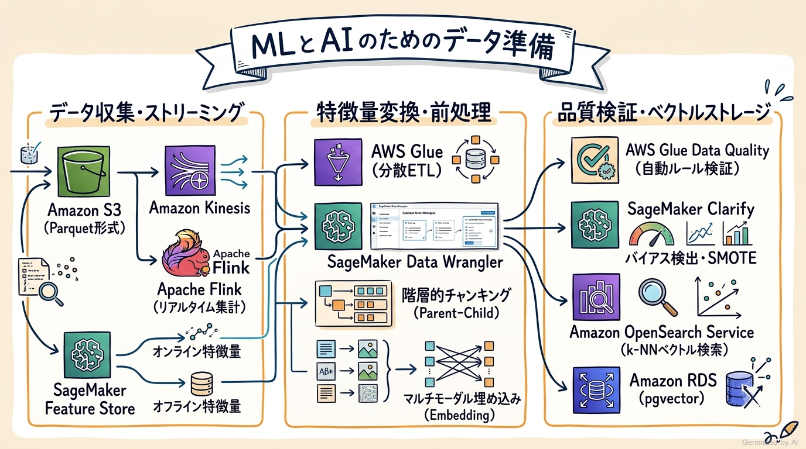
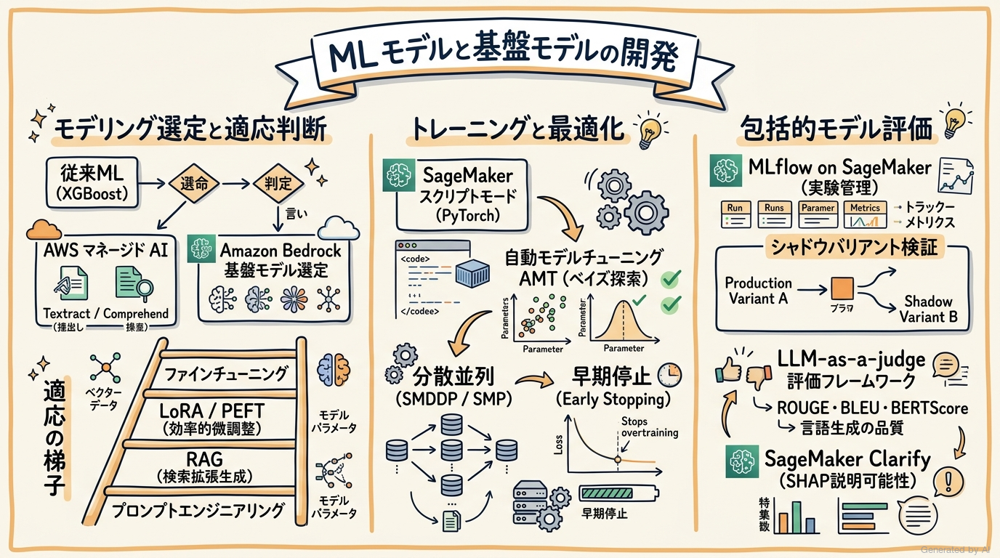
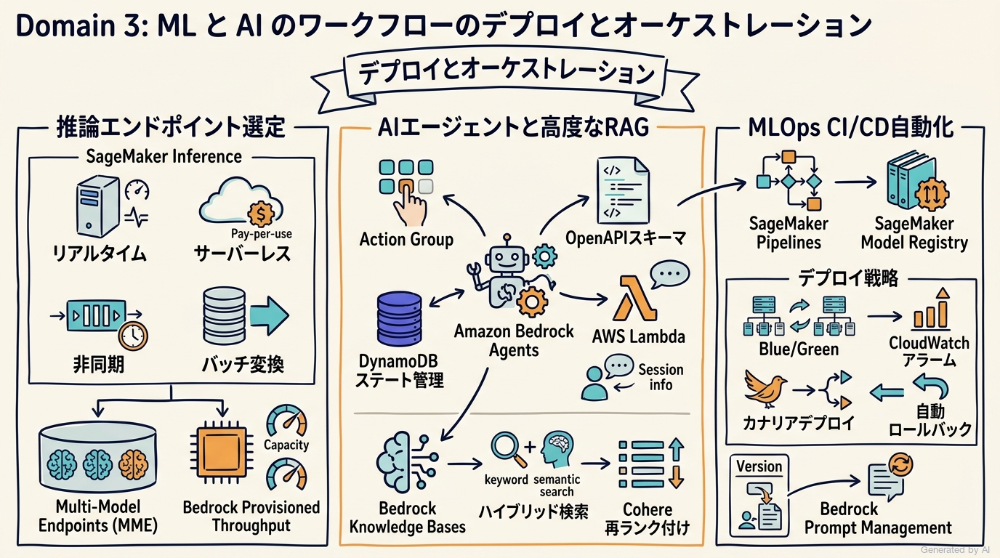
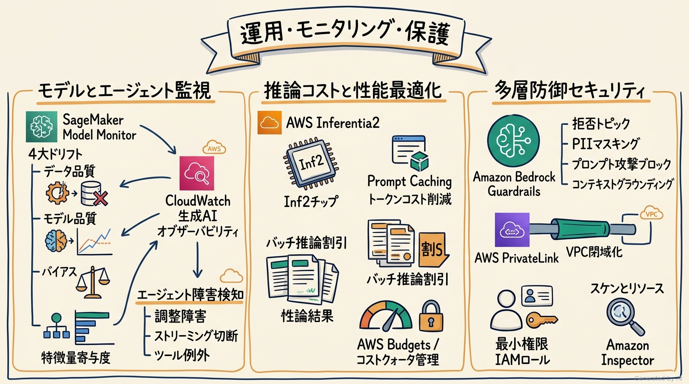

# AWS Certified Machine Learning Engineer - Associate (MLA-C02) 完全対策＆実践学習ガイド

- **対象資格**: AWS Certified Machine Learning Engineer - Associate
- **試験コード**: MLA-C02
- **公式試験ガイド**: [AWS Certified Machine Learning Engineer - Associate (MLA-C02) 試験ガイド](https://docs.aws.amazon.com/ja_jp/aws-certification/latest/machine-learning-engineer-associate-02/machine-learning-engineer-associate-02.html)
- **最終更新日**: 2026-10-04

---

## はじめに

クラウドプラットフォームにおける機械学習（ML）および人工知能（AI）の実装パラダイムは、従来の統計的学習や深層学習モデルのスクラッチ開発から、大規模基盤モデル（Foundation Models: FM）の活用、自律型 AI エージェント（Agentic AI）の連携、そしてセキュアでスケーラブルなパイプラインの自動化（MLOps / LLMOps）へと劇的な進化を遂げています。
企業における AI の本番導入においては、単にアルゴリズムの挙動を理解するだけでは不十分であり、データエンジニアリング、モデル選定と適応（RAG、ファインチューニング）、低レイテンシ・高可用な推論基盤の設計、推論コストの適正化、継続的な品質・ドリフト監視、そしてエンタープライズ水準のセキュリティと責任ある AI（Responsible AI）の統制を包含した、包括的なエンジニアリング能力が不可欠です。

AWS は、これら現代の ML/AI エンジニアリングに求められる実践能力を客観的に検証・認定するため、認定試験「AWS Certified Machine Learning Engineer - Associate (MLA-C02)」を提供しています。本試験は、前世代の試験（MLA-C01）から大幅な改定が加えられ、Amazon Bedrock、Amazon Bedrock AgentCore、高度な RAG アーキテクチャ、エージェントステート管理、LLM-as-a-judge 評価フレームワーク、生成 AI 特有のオブザーバビリティ、および Amazon Bedrock Guardrails などの最新テクノロジーが全面的に網羅されています。

本学習ガイドは、最新の MLA-C02 公式試験ガイドに完全準拠し、全4ドメイン（出題比率 100%）にわたる核心概念、詳細なアーキテクチャ比較、公式試験タスクを網羅した構造化実践シナリオ、および公式ドキュメントと推奨ハンズオンをカプセル化した完全対策ノートです。

### AWS Certified Machine Learning Engineer - Associate 試験とは

AWS Certified Machine Learning Engineer - Associate (MLA-C02) は、AWS クラウド環境における ML および AI ソリューションの構築、運用化、デプロイ、保守を担うエンジニアを対象としたアソシエイトレベルの専門認定試験です。

- **試験時間**: 130 分
- **出題問題数**: 65 問（採点対象: 50 問 / 採点対象外テスト設問: 15 問）
- **出題形式**: 択一選択問題（4つの選択肢から1つ選択）、複数選択問題（5つ以上の選択肢から2つ以上選択）
- **合格基準点**: 100〜1,000 点中 720 点以上
- **前提知識**:
  - Amazon SageMaker AI、Amazon Bedrock などの AWS サービスを活用した ML エンジニアリングの実務経験 1 年以上
  - データエンジニアリング、DevOps、バックエンド開発における 1 年以上の実務経験
  - 従来の機械学習モデリング（特徴量エンジニアリング、回帰/分類、ハイパーパラメータ最適化）および最新の生成 AI 技術（基盤モデル、RAG、プロンプト管理、AI エージェント）の実践知識

### 難易度と求められる思考力

当試験の難易度は **アソシエイト最上位（実務的アーキテクチャ設計・トレードオフ判断力重視）** に位置づけられます。
専門用語の単なる記憶やツールの機能名称当ては一切通用せず、以下のような実務的なアーキテクチャ判断能力が問われます：

1. **データ処理基盤のトレードオフ判断**:
   - リアルタイムストリーミング要件に対して Amazon Kinesis Data Streams と Managed Service for Apache Flink をどう組み合わせるか、バッチ変換における AWS Glue と Amazon EMR (Spark) の使い分け。
   - リレーショナル DB、Amazon OpenSearch Service、pgvector を用いた Amazon RDS のベクトルストレージ選定基準。
2. **モデル開発アプローチの最適化**:
   - ビジネス課題に対して、フルカスタム学習（SageMaker Script Mode）、AWS マネージド AI サービス（Textract, Comprehend 等）、基盤モデルのプロンプトエンジニアリング、RAG、ファインチューニングのどれを選択すべきか。
   - 過学習・未学習の防止、分散学習（データ並列 vs モデル並列）の適切なプロビジョニング。
3. **推論エンドポイントとオーケストレーションの選定**:
   - レイテンシ要件とトラフィック特性に応じた SageMaker の 4 大エンドポイント（Real-time, Serverless, Asynchronous, Batch Transform）の選定。
   - Amazon Bedrock Agents における OpenAPI スキーマと Action Group の設定、セッションステート管理、ストリーミング切断やツール呼び出し障害の検知。
4. **MLOps / LLMOps のライフサイクル自動化**:
   - SageMaker Pipelines と Model Registry を用いた CI/CD 自動化、Blue/Green やカナリアデプロイによる無停止更新、CloudWatch アラームに基づく自動ロールバック。
   - RAG ナレッジベースの更新同期パイプラインと Bedrock Prompt Management によるプロンプトテストの自動化。
5. **運用監視・コスト最適化・多層防御**:
   - SageMaker Model Monitor による 4 大ドリフト（Data Quality, Model Quality, Bias Drift, Feature Attribution Drift）の監視と自動再学習トリガー。
   - AWS Inferentia (Inf2) や GPU (G5) の選定、Prompt Caching やバッチ推論によるトークンコスト削減。
   - VPC PrivateLink による閉域ネットワーク構築、Amazon Bedrock Guardrails による有害トピック遮断と PII マスキング。

### 推奨の勉強法

1. **ピラミッド原則に基づいたアーキテクチャ体系の理解**
   各ドメインの「セクション概要」および「重要トピック」を精読し、各サービスがシステム全体の中で担う責任範囲と設計トレードオフを論理的に整理します。
2. **構造化実践シナリオを通じた「消去法」の確立**
   各セクションに収録した実践シナリオ（状況・対応・結果・解説）を熟読してください。正解理由だけでなく、「なぜ他の選択肢では要件を満たせないのか（棄却理由）」を完全に理解することが、本番試験の紛らわしい選択肢を瞬時に見抜く最大の武器となります。
3. **公式ドキュメントと実機ハンズオンでの挙動確認**
   各セクション末尾に提示した AWS 公式ドキュメントの「デベロッパーガイド」「アーキテクチャベストプラクティス」を参照し、コンソールまたは AWS SDK (Boto3 / SageMaker Python SDK) で実際の挙動を追体験してください。

---

## 目次

1. [はじめに](#はじめに)
2. [学習カリキュラム・出題範囲ロードマップ](#学習カリキュラム出題範囲ロードマップ)
3. [Domain 1: ML と AI のためのデータの準備 (28%)](#domain-1-ml-と-ai-のためのデータの準備-28)
4. [Domain 2: ML モデルと基盤モデル (FM) の開発 (24%)](#domain-2-ml-モデルと基盤モデル-fm-の開発-24)
5. [Domain 3: ML と AI のワークフローのデプロイとオーケストレーション (24%)](#domain-3-ml-と-ai-のワークフローのデプロイとオーケストレーション-24)
6. [Domain 4: ML と AI のソリューションの運用、モニタリング、保護 (24%)](#domain-4-ml-と-ai-のソリューションの運用モニタリング保護-24)
7. [まとめと推奨学習ステップ](#まとめと推奨学習ステップ)

---

## 学習カリキュラム・出題範囲ロードマップ

### セクション一覧と出題比率

本試験は全4つのドメインで構成されており、Domain 1（データの準備）が 28% と最も高い配点比率を占め、残る3つのドメイン（モデル開発、デプロイとオーケストレーション、運用・監視・保護）がそれぞれ 24% ずつ均等に配分されています。データエンジニアリングから推論ホスティング、MLOps/LLMOps、ガバナンスに至るエンドツーエンドのスキルがバランスよく評価されます。

| ドメイン番号 | 出題分野（Domain） | 出題比率 | 主要対象サービス・ツール |
| :--- | :--- | :--- | :--- |
| **Domain 1** | ML と AI のためのデータの準備 | 28% | Amazon S3, AWS Glue, AWS Glue DataBrew, AWS Glue Data Quality, Amazon EMR, SageMaker Data Wrangler, SageMaker Feature Store, Amazon Kinesis, Managed Service for Apache Flink, Amazon OpenSearch Service, pgvector, SageMaker Clarify, Amazon SageMaker Ground Truth |
| **Domain 2** | ML モデルと基盤モデル (FM) の開発 | 24% | Amazon Bedrock, Amazon SageMaker AI (組み込みアルゴリズム, Script Mode, 自動モデルチューニング AMT, 分散トレーニング), MLflow on SageMaker, Bedrock Model Evaluation, Amazon Bedrock Prompt Management, LLM-as-a-judge, SageMaker Clarify, ROUGE / BLEU / BERTScore |
| **Domain 3** | ML と AI のワークフローのデプロイとオーケストレーション | 24% | Amazon SageMaker 推論エンドポイント (Real-time, Serverless, Asynchronous, Batch Transform), Multi-Model Endpoints (MME), Multi-Container Endpoints (MCE), Amazon Bedrock Provisioned Throughput, Bedrock Agents & AgentCore, Bedrock Knowledge Bases, AWS CodePipeline, SageMaker Pipelines, SageMaker Model Registry |
| **Domain 4** | ML と AI のソリューションの運用、モニタリング、保護 | 24% | Amazon CloudWatch 生成 AI オブザーバビリティ, Amazon SageMaker Model Monitor (Data, Model, Bias, Feature Attribution), Amazon Bedrock AgentCore Observability, AWS X-Ray, AWS Inferentia (Inf2), AWS Trainium (Trn1), Amazon Bedrock Guardrails, AWS IAM, AWS KMS, AWS PrivateLink, Amazon Inspector |

---

### セクション別出題詳細

#### Domain 1: ML と AI のためのデータの準備 (28%)
- **出題の狙い**: 多様なデータソースからの効率的なデータ収集・保存、高度な特徴量エンジニアリング、RAG および FM ファインチューニング向けデータ前処理、データ品質の自動検証、およびバイアスの検出と是正を実装する能力を検証します。
- **主要タスク**:
  - Task 1.1: データを収集して保存する（S3, Kinesis, Flink, Vector DB, SageMaker Feature Store 等）
  - Task 1.2: データ変換、特徴量エンジニアリング、前処理を実行する（Glue DataBrew, EMR Spark, Data Wrangler, 埋め込みモデル, チャンキング）
  - Task 1.3: データ品質を検証し、バイアスを管理する（Glue Data Quality, SageMaker Ground Truth, Clarify バイアス評価, クラス不均衡是正）
- **重要キーワード**: Amazon S3, AWS Glue, AWS Glue DataBrew, AWS Glue Data Quality, Amazon EMR, SageMaker Data Wrangler, SageMaker Feature Store, Amazon Kinesis, Managed Service for Apache Flink, Amazon OpenSearch Service, pgvector, SageMaker Clarify, Amazon SageMaker Ground Truth

#### Domain 2: ML モデルと基盤モデル (FM) の開発 (24%)
- **出題の狙い**: 課題に応じた最適なモデリングアプローチ（従来 ML vs FM vs マネージド AI）の選定、モデルのトレーニング・ファインチューニング・カスタマイズ、および包括的なパフォーマンス評価（NLP 指標、LLM-as-a-judge 等）を遂行する能力を検証します。
- **主要タスク**:
  - Task 2.1: ML と AI のソリューションに適したモデリングアプローチを選択する（Bedrock FM 選定, RAG パターン, マネージド AI 比較）
  - Task 2.2: ML と AI のソリューションのモデルをトレーニング、ファインチューニング、カスタマイズする（SageMaker Script Mode, AMT, 分散学習, PEFT/LoRA）
  - Task 2.3: ML と AI のシステムのパフォーマンスを分析および評価する（MLflow, Bedrock Model Evaluation, Clarify 説明可能性, ROUGE/BLEU/BERTScore）
- **重要キーワード**: Amazon Bedrock, SageMaker AI, 組み込みアルゴリズム, Script Mode, 自動モデルチューニング (AMT), 分散トレーニング, MLflow on SageMaker, Bedrock Model Evaluation, Prompt Management, LLM-as-a-judge, SageMaker Clarify, ROUGE / BLEU / BERTScore

#### Domain 3: ML と AI のワークフローのデプロイとオーケストレーション (24%)
- **出題の狙い**: 推論要件に応じたインフラストラクチャの選定・プロビジョニング、エージェントワークフローの配備、および MLOps/LLMOps を支える自動化パイプライン（CI/CD、自動ロールバック）を構築する能力を検証します。
- **主要タスク**:
  - Task 3.1: ML と AI のモデルタイプのデプロイインフラストラクチャを管理する（Real-time, Serverless, Async, Batch Transform, MME, Bedrock Provisioned Throughput）
  - Task 3.2: 既存のアーキテクチャと要件に基づいて ML と AI のワークロードのリソースをプロビジョニングして設定する（ECR, PrivateLink, ターゲット追跡自動スケーリング, Bedrock ナレッジベース同期）
  - Task 3.3: MLOps と AI のワークロードのための、自動オーケストレーション、継続的インテグレーションおよび継続的デリバリー (CI/CD) パイプラインを実装する（CodePipeline, SageMaker Pipelines, Model Registry, Blue/Green デプロイ）
- **重要キーワード**: SageMaker 推論エンドポイント, Multi-Model Endpoints (MME), Multi-Container Endpoints (MCE), Amazon Bedrock Provisioned Throughput, Bedrock Agents & AgentCore, Bedrock Knowledge Bases, AWS CodePipeline, SageMaker Pipelines, SageMaker Model Registry

#### Domain 4: ML と AI のソリューションの運用、モニタリング、保護 (24%)
- **出題の狙い**: 本番モデルおよび生成 AI アプリケーションのパフォーマンス・ドリフト監視、インフラコストの最適化、ならびに包括的なセキュリティ・ガバナンスガードレールの実装能力を検証します。
- **主要タスク**:
  - Task 4.1: ML と AI のモデルの推論とパフォーマンスをモニタリングする（CloudWatch 生成 AI オブザーバビリティ, Model Monitor 4大ドリフト検出, AgentCore 監視）
  - Task 4.2: ML と AI のインフラストラクチャのコストとパフォーマンスを最適化および管理する（AWS Inferentia / Inf2, Prompt Caching, バッチ推論, Compute Optimizer）
  - Task 4.3: ML と AI のワークロードとモデルエンドポイントのセキュリティを確保する（最小権限 IAM, KMS 暗号化, VPC 閉域化, Bedrock Guardrails 多層防御）
- **重要キーワード**: CloudWatch 生成 AI オブザーバビリティ, SageMaker Model Monitor, Bedrock AgentCore Observability, AWS X-Ray, AWS Inferentia (Inf2), AWS Trainium (Trn1), Amazon Bedrock Guardrails, AWS IAM, AWS KMS, AWS PrivateLink, Amazon Inspector

---

## Domain 1: ML と AI のためのデータの準備 (28%)

機械学習および生成 AI システムの成否は、モデリングに投入されるトレーニングデータおよび推論コンテキストの品質、スケーラビリティ、鮮度に決定的に左右されます。Domain 1 では、多様なソースからのストリーミングおよびバッチデータの効率的な収集と保存、高度な特徴量エンジニアリングと前処理パイプラインの実装、ベクトル埋め込みの生成、そしてデータ品質の自動検証とバイアスの検出・是正に至る、堅牢なデータエンジニアリング基盤の構築能力が問われます。



---

### 1. セクション概要

機械学習エンジニアリングにおけるデータ準備は、「データ収集・蓄積」「特徴量変換・前処理」「品質検証・バイアス管理」の3つの階層から構成されます。本ドメインでは、従来の表形式データのみならず、非構造化テキスト、音声、画像、およびベクトルデータに対するスケーラブルなパイプライン設計が要求されます。

```text
+-----------------------------------------------------------------------------------+
|                        Domain 1: ML/AI データ準備ライフサイクル                      |
+-----------------------------------------------------------------------------------+
                                         |
         +-------------------------------+-------------------------------+
         |                               |                               |
         v                               v                               v
+-----------------------+       +-----------------------+       +-----------------------+
| 1.1 収集と保存         |       | 1.2 変換と特徴量       |       | 1.3 品質とバイアス     |
+-----------------------+       +-----------------------+       +-----------------------+
| - S3 / EFS / EBS      |       | - Glue / DataBrew     |       | - Glue Data Quality   |
| - Kinesis / Flink     |       | - Data Wrangler       |       | - Ground Truth        |
| - Parquet / ORC       |       | - Feature Store       |       | - SMOTE / 重み付け     |
| - OpenSearch/pgvector |       | - チャンキング / 埋込  |       | - Clarify バイアス分析 |
+-----------------------+       +-----------------------+       +-----------------------+
```

#### 重要キーワード

- **Amazon S3**: オブジェクトストレージ。プレフィックスによるリクエスト分散、S3 Intelligent-Tiering による自動階層化、および Apache Parquet 形式での圧縮保存がベストプラクティス。
- **Amazon Kinesis Data Streams / Data Firehose**: リアルタイムストリーミング取り込み。低レイテンシ処理には Data Streams、S3 へのバッファリング・自動変換（Parquet 変換等）には Firehose を採用。
- **Amazon Managed Service for Apache Flink**: 複雑なストリーミングイベント処理（スライディングウィンドウ、タンブリングウィンドウ計算）をミリ秒未満のレイテンシで実行するサーバーレス基盤。
- **Amazon SageMaker Feature Store**: 機械学習モデルの学習（オフラインストア: S3）とリアルタイム推論（オンラインストア: 低レイテンシ NoSQL）の間で特徴量を共有・一元管理し、トレーニング・推論間のデータスキュー（Training-Serving Skew）を防止。
- **Amazon SageMaker Data Wrangler**: ノーコード/ローコードで 300 種類以上の組み込みデータ変換、データプロファイリング、リーク検出を実行し、コード（PySpark, Python, SageMaker Pipelines）としてエクスポート。
- **AWS Glue / AWS Glue DataBrew / AWS Glue Data Quality**: サーバーレス ETL 基盤。Data Quality はデータプロファイリング結果に基づく自動検証ルール生成をサポートし、DataBrew は視覚的な前処理レシピを提供。
- **ベクトルデータベース (Vector Databases)**: 高次元埋め込みベクトルをインデックス化し近傍探索を実行。Amazon OpenSearch Service（大規模全文＋k-NN ハイブリッド検索）、Amazon RDS for PostgreSQL / Amazon Aurora (pgvector: リレーショナルデータとの統合）、Amazon OpenSearch Serverless。
- **チャンキング戦略 (Chunking Strategies)**: RAG システムにおいて長文ドキュメントを意味単位（固定長、句読点区切り、セマンティックチャンキング、階層的チャンキング）で分割し、検索精度とコンテキスト適合性を両立。
- **SageMaker Clarify**: トレーニング前のデータセットにおける不均衡メトリクス（CI: Class Imbalance、CDD: Conditional Demographic Disparity 等）を計測し、バイアスを可視化。

---

### 2. 重要トピック

#### 1. データストレージ・処理基盤の選定アーキテクチャ

機械学習ワークロードにおけるデータ基盤は、アクセス頻度、レイテンシ要件、データ構造（構造化、非構造化、ベクトル）に応じて明確に分離・選定する必要があります。

- **オブジェクトストレージの最適化**:
  - Amazon S3 において高いスループットを達成するため、プレフィックスごとにリクエストを分散させます（プレフィックスあたり毎秒 3,500 PUT/POST/DELETE、毎秒 5,500 GET 要求）。
  - ストレージフォーマットには、列指向で高い圧縮率を誇り、クエリ時のスキャンデータ量を最小化する **Apache Parquet (Snappy 圧縮)** を標準採用します。CSV や JSON と比較してストレージ容量を 70〜80% 削減し、Amazon Athena や AWS Glue でのクエリコストと実行時間を劇的に低減します。
- **ストリーミング取り込みアーキテクチャ**:
  - リアルタイム推論や即時集計が求められる場合、**Amazon Kinesis Data Streams** でストリームを取り込み、**Amazon Managed Service for Apache Flink** を用いてイベント時間（Event Time）ベースの集計ウィンドウ処理を実行します。
  - バッチ学習用のデータ蓄積のみが目的である場合、**Amazon Data Firehose** を用いて S3 への自動配信、Parquet への動的変換、およびパーティショニング（年/月/日/時）を設定します。
- **ベクトルデータベースの選定比較**:
  - **Amazon OpenSearch Service / OpenSearch Serverless**: 数億件規模の大規模ベクトル探索、BM25 による全文キーワード検索とベクトル検索を融合した「ハイブリッド検索」、およびフィルタリングメタデータが多いユースケースに最適。
  - **Amazon RDS / Aurora (pgvector)**: 既存の業務システムで PostgreSQL を利用しており、トランザクションデータ（ACID）とベクトル検索を同一の SQL クエリ内で結合（JOIN）したい場合に最適。追加の DB クラスタ運用負荷を排除。

#### 2. データ変換・前処理ツールの方式比較マトリクス

| ツール / サービス | 主要アーキテクチャ | 適用ユースケース | 運用負荷 | 特徴量の再利用性 |
| :--- | :--- | :--- | :--- | :--- |
| **AWS Glue (ETL)** | サーバーレス Apache Spark | ペタバイト級の大規模バッチ ETL、データレイク構築、定期バッチ前処理 | 極めて低い（サーバーレス） | Glue Data Catalog によるメタデータ一元管理 |
| **AWS Glue DataBrew** | 視覚的 GUI ベース ETL | データアナリストによる探索的データ分析、コード不要の前処理レシピ作成 | 極めて低い | レシピを Glue ジョブに組み込み可能 |
| **Amazon EMR** | 専用 EC2 / EKS クラスタ | カスタムオープンソースコンポーネント（Hadoop, Spark, Presto）の細密な制御、超大規模クラスタのコスト最適化 | 中〜高（インスタンス管理・サイジング要） | カスタムスクリプト依存 |
| **SageMaker Data Wrangler** | SageMaker Studio 統合 GUI | ML 開発初期のデータ探索、プロファイリング、特徴量影響度分析 | 低い（Studio 内で完結） | Feature Store や Pipelines への直接エクスポート |
| **SageMaker Feature Store** | 低レイテンシ Key-Value (Online) + S3 (Offline) | 学習と推論で同一特徴量の一貫性を保証、リアルタイム推論時のサブ 10ms 取得 | 極めて低い（フルマネージド） | **最高**（全社・モデル間で特徴量を共有・監査可能） |

- **アーキテクトの選定基準**:
  - エンジニアがコードで制御する大規模データパイプラインには **AWS Glue** を選定します。
  - ML 特有のデータリーク分析や特徴量重要度確認を迅速に行いたい場合は **SageMaker Data Wrangler** を採用します。
  - オンラインリアルタイム推論とバッチ学習で特徴量の一貫性を保ち、Training-Serving Skew を完全に排除する場合は **SageMaker Feature Store** の導入が必須です。

#### 3. 特徴量エンジニアリングとマルチモーダル前処理

- **数値・カテゴリカル特徴量の処理**:
  - **標準化 (Standardization / Z-score)**: 平均 0、分散 1 に変換。正規分布に近いデータや線形モデル・ニューラルネットワークに有効。
  - **正規化 (Normalization / Min-Max Scaling)**: 0 から 1 の範囲にスケーリング。外れ値に弱いため、外れ値処理後の適用が前提。
  - **ビニング (Binning)**: 連続変数を離散的なカテゴリに変換。非線形な関係を捉える際に有効。
  - **One-Hot Encoding**: 濃度の低い（カーディナリティの小さい）カテゴリカル変数に適用。高カーディナリティ変数の場合は Target Encoding や埋め込み層への変換を検討。
- **テキスト・画像前処理と埋め込みモデル**:
  - 非構造化テキストは、トークン化、ストップワード除去、ステミング/レマタイゼーションを経て、**Amazon Titan Text Embeddings** などの埋め込みモデルにより高次元ベクトル化します。
  - 画像データは、リサイズ、正規化、クロッピング、色調補正を経て、マルチモーダル埋め込みモデル（Titan Multimodal Embeddings 等）を用いて共通のベクトル空間に投影します。
- **RAG 向けチャンキング（分割）戦略**:
  - **固定長チャンキング (Fixed-size Chunking)**: 一定のトークン数（例: 512 トークン）で分割し、前後の文脈断絶を防ぐために 10〜20% のオーバーラップ（Overlap）を設定。実装が平易だが文脈の論理境界を無視する欠点がある。
  - **セマンティックチャンキング (Semantic Chunking)**: 文章間の埋め込みベクトルのコサイン類似度を計算し、話題の転換点（類似度が急減するポイント）で境界を分割。検索精度が最も高くなる。
  - **階層的チャンキング (Parent-Child Chunking)**: 小さなチャンク（Child: 128 トークン）で精密なベクトル検索を行い、LLM へのプロンプトにはそのチャンクが属する大きな親ドキュメント（Parent: 1024 トークン）を投入することで、検索精度と文脈理解を両立。

#### 4. データ品質検証・クラス不均衡・バイアス是正

- **データ品質の自動検証**:
  - **AWS Glue Data Quality**: Deequ オープンソースをベースとした検証エンジン。SQL ライクなルール言語（DQDL: Data Quality Definition Language）を用いて、「`Completeness "customer_id" = 1.0`」「`IsUnique "transaction_id"`」「`ColumnValues "age" between 18 and 100`」などのルールをパイプライン内で自動実行し、品質基準を満たさないデータを隔離（Quarantine）。
- **クラス不均衡（Imbalanced Data）の是正手法**:
  - **アンダーサンプリング (Random Under-sampling)**: 多数派クラスのデータを間引く。情報損失のリスクがある。
  - **オーバーサンプリング (SMOTE: Synthetic Minority Over-sampling Technique)**: 少数派クラスの最近傍点（k-NN）を線形補間して合成サンプルを生成。境界付近の過学習を抑えつつ表現力を向上。
  - **クラス重み付け損失 (Class-weighted Loss)**: 損失関数において少数派クラスの誤分類ペナルティを大きく設定。データセット自体を変更しないため高速かつ安全。
- **SageMaker Clarify による事前学習バイアス検出**:
  - **Class Imbalance (CI)**: ファセット（保護属性、例: 性別や年齢層）ごとのサンプル数の偏りを計測。
  - **Difference in Positive Proportions in Labels (DPL)**: 異なるファセット間での肯定的なラベル（例: ローン承認）の付与比率の差を測定。0 に近いほど公平。

---

### 3. 実践シナリオ

> [!IMPORTANT]
> 本試験の各タスクおよび主要ユースケースに対応する実践シナリオです。
> 前提条件・ビジネス制約を踏まえたアーキテクチャの採否判断と、不適格な代替案の論理的棄却プロセスを徹底解説します。

#### シナリオ 1-1: 大規模 IoT ストリーミングデータの取り込みと低レイテンシ特徴量ストア登録

- **状況**: スマートファクトリーの製造ラインに設置された 100,000 台の IoT センサーから、毎秒 500,000 件の時系列メトリクス（温度、振動、回転数）が JSON 形式で継続的に送信されており、製造設備の異常検知モデルにおいてミリ秒単位のリアルタイム推論と、月次のバッチ再学習の両方を実現する必要がある場合
- **対応**: センサーからのデータを Amazon Kinesis Data Streams で直接取り込み、Amazon Managed Service for Apache Flink を用いて 10 秒間のタンブリングウィンドウで統計量（移動平均、最大値）を集計した上で、Amazon SageMaker Feature Store のオンラインストア（低レイテンシ推論用）およびオフラインストア（S3 への Parquet 蓄積）に同時に書き込むパイプラインを構築する。
- **結果**: リアルタイム推論エンドポイントから 10ms 未満で最新の特徴量を取得可能になると同時に、オフラインストア経由で Apache Parquet 形式の履歴データが自動的に S3 へ同期され、トレーニングと推論における特徴量の一貫性が担保される。
- **解説**: 本ユースケースでは、ミリ秒単位のストリーミング処理と、推論・学習間でのデータ整合性（Training-Serving Skew の排除）が必須要件となるためです。Amazon Managed Service for Apache Flink はイベント時間ベースの正確なストリーミング集計をミリ秒未満のレイテンシで処理可能であり、SageMaker Feature Store は 1 回の書き込みで低レイテンシ NoSQL（オンライン）と S3（オフライン）への自動永続化を実現する唯一のマネージドサービスです。代替案として Amazon Data Firehose を直接用いて S3 に保存し、DynamoDB に別途書き込む構成は、複雑なウィンドウ集計に対応できず、推論用と学習用のデータ二重管理によるスキューを誘発するため不適格です。また、Amazon EMR 上で Spark Streaming を常時稼働させる構成は、クラスタのプロビジョニングおよびサイジングの運用負荷が極めて高く、インフラコストが肥大化するため不適格です。
- **参考ドキュメント**:
  - [Amazon SageMaker Feature Store ドキュメント](https://docs.aws.amazon.com/sagemaker/latest/dg/feature-store.html): オンラインおよびオフラインストアの概念と同期メカニズム
  - [Amazon Managed Service for Apache Flink 開発者ガイド](https://docs.aws.amazon.com/managed-flink/latest/java/how-it-works.html): ストリーミングウィンドウ処理とシンク設定

#### シナリオ 1-2: マルチモーダル AI 検索システムにおけるベクトルストレージの選定

- **状況**: E コマース企業が、数千万件の商品カタログデータ（テキスト説明文および商品画像）に対して、自然言語による曖昧検索と画像による類似商品検索を可能にするマルチモーダル検索基盤を新規構築するにあたり、毎秒 2,000 クエリを超える読み取りスループットと、商品カテゴリや価格帯による厳格な事前メタデータフィルタリング要件を満たす必要がある場合
- **対応**: 商品画像およびテキスト説明文を Amazon Titan Multimodal Embeddings を用いて高次元ベクトル化し、専用のベクトル検索クラスタとしてプロビジョニングした Amazon OpenSearch Service を採用し、HNSW (Hierarchical Navigable Small World) アルゴリズムによるベクトルインデックスとキーワード検索インデックスを同一ドキュメント内に設定する。
- **結果**: 毎秒数千クエリのピークトラフィック下でも 50ms 未満のベクトル類似度検索を達成し、価格帯や在庫状況に応じた高速なメタデータフィルタリングと BM25 全文検索を組み合わせたハイブリッド検索が実現する。
- **解説**: 数千万件規模の大規模ベクトルコレクションに対し、高スループットかつ柔軟なメタデータフィルタリングやハイブリッド検索を実行するには、Amazon OpenSearch Service のベクトルエンジンが最も適しているためです。OpenSearch Service は k-NN プラグインを統合しており、大規模なインデックスの分散シャーディング、レプリケーションによる読み取りスケーリング、および BM25 スコアとベクトル類似度スコアの動的結合をネイティブにサポートします。代替案として Amazon RDS for PostgreSQL に pgvector 拡張を導入する構成は、リレーショナルデータとの JOIN には優れるものの、数千万件規模のベクトルデータに対する毎秒 2,000 クエリの高並行アクセス下では CPU リソースが枯渇し、水平スケーリングが困難であるため不適格です。また、Amazon DynamoDB にベクトルをバイナリとして格納しクライアント側で総当たりコサイン類似度を計算する構成は、計算量およびネットワーク転送量が天文学的に増大し、レイテンシ SLA を達成できないため不適格です。
- **参考ドキュメント**:
  - [Amazon OpenSearch Service ベクトル検索ガイド](https://docs.aws.amazon.com/opensearch-service/latest/developerguide/knn.html): k-NN アルゴリズム（HNSW, IVF）とハイブリッド検索の実装

#### シナリオ 1-3: 金融不正検知モデルのための分散特徴量変換パイプラインの構築

- **状況**: 金融決済プラットフォームにおいて、過去 5 年分に及ぶ 100 億件超のトランザクションログ（S3 上の生 CSV 形式、合計 20 TB）から、カード番号ごとの過去 24 時間の決済件数、取引金額の Z-score 標準化、加盟店カテゴリの頻度エンコーディングなどの特徴量を生成し、週次のモデル学習用データセットを作成する必要がある場合
- **対応**: AWS Glue のサーバーレス Apache Spark ジョブを構築し、DynamicFrame を使用して S3 からデータを読み込み、Spark SQL および Glue 組み込み変換を用いて分散環境下でウィンドウ集計、外れ値のクリッピング、および標準化を実行した上で、結果をパーティション化された Apache Parquet 形式で S3 に出力する。
- **結果**: 20 TB の大規模生データに対する前処理が完全サーバーレスで数時間以内に完了し、後続のモデルトレーニングジョブにおけるデータ読み込み時間が CSV 時代と比較して 80% 削減される。
- **解説**: テラバイト〜ペタバイト規模の大規模データセットに対する複雑な分散特徴量変換には、AWS Glue のマネージド Apache Spark 環境が最適であるためです。インフラのプロビジョニングやクラスタの停止管理が不要であり、ジョブ実行時のみコンピューティングリソース（DPU: Data Processing Unit）を自動スケールさせることで、コスト効率と処理性能を極大化できます。代替案として AWS Lambda を用いて S3 イベントトリガーで処理する構成は、15 分の実行時間制限およびメモリ・ディスク制限を超過するため、数十 TB の一括処理には適用できません。また、SageMaker Data Wrangler の GUI 上で全件処理を実行する構成は、探索的分析には有用であるものの、100 億件の大規模分散バッチ処理を定期実行する本番パイプラインとしては DPU コストおよび実行効率が劣るため不適格です。
- **参考ドキュメント**:
  - [AWS Glue 開発者ガイド](https://docs.aws.amazon.com/glue/latest/dg/what-is-glue.html): 大規模分散 ETL ジョブの設計と最適化

#### シナリオ 1-4: RAG アプリケーションのための階層的ドキュメントチャンキングとメタデータ抽出

- **状況**: 社内技術規程や法務ガイドライン（数万件の PDF/Word ドキュメント、章・節・項の複雑な階層構造を含む）を対象とした社内 RAG 検索システムにおいて、一般的な固定長トークン分割を採用した結果、重要な文脈の分断や検索精度の低下（ハルシネーションの誘発）が発生している場合
- **対応**: Amazon Bedrock Knowledge Bases の高度なチャンキング戦略を設定し、ドキュメントの構造に基づいた階層的チャンキング（Parent-Child チャンキング）を適用し、子チャンク（200 トークン）に親チャンク（1,000 トークン）の ID およびドキュメントのメタデータ（部署、制定日、アクセス権限）を付与してベクトルインデックスを作成する。
- **結果**: ベクトル検索時には小さな子チャンクを用いてピンポイントで高い類似度スコアを獲得しつつ、基盤モデルへのプロンプト生成時には親チャンクの十分な文脈を提供することが可能となり、検索再現率と回答の忠実性が大幅に向上する。
- **解説**: 単純な固定長チャンキングでは、文や段落の途中で強制的にテキストが切断され、主語の脱落や意味の欠落が発生するためです。階層的チャンキングを採用することで、「高精度な類似度検索に必要な粒度の細かさ」と「LLM が正しい推論を行うために必要な文脈の広さ」という相反する要件を完全に両立できます。代替案としてドキュメント全体を分割せずに丸ごと埋め込みベクトル化する構成は、埋め込みモデルの最大入力トークン数制限に抵触するだけでなく、文書全体の平均的なベクトルになってしまい、個別トピックの検索精度が著しく劣化するため不適格です。また、単語単位でオーバーラップなしに分割する構成は、意味論的なまとまりが完全に崩壊するため不適格です。
- **参考ドキュメント**:
  - [Amazon Bedrock ナレッジベースのドキュメントチャンキング](https://docs.aws.amazon.com/bedrock/latest/userguide/kb-chunking.html): 階層的チャンキングとセマンティックチャンキングの仕様

#### シナリオ 1-5: 医療画像・テキストマルチモーダルデータセットにおける極端なクラス不均衡の是正

- **状況**: 希少疾患の自動診断支援モデルを開発するにあたり、収集された 100,000 件の胸部レントゲン画像および診断レポートにおいて、正常例が 99,000 件（99%）を占め、疾患陽性例が 1,000 件（1%）しか存在せず、単純に学習させたモデルがすべての症例を「正常」と予測してしまい適合率・再現率が極端に低下している場合
- **対応**: トレーニングデータセットに対して、画像データにはランダム回転・反転・アフィン変換による画像拡張（Data Augmentation）を施し、テキストレポートには少数派クラスに対して SMOTE を適用して特徴空間上で合成サンプルを生成するとともに、モデル学習時の損失関数にクラス不均衡の逆比率を反映した重み付け（Class-weighted Cross-Entropy Loss）を設定する。
- **結果**: 少数派クラス（疾患陽性例）に対する誤分類ペナルティが適切に機能し、多数派クラスの予測精度を維持したまま、希少疾患の検出再現率（Recall）が 35% から 91% へと大幅に改善される。
- **解説**: 99:1 という極端なクラス不均衡に対しては、単一のアプローチ（単純なアンダーサンプリング等）では正常例の貴重な特徴量を大量に喪失（99,000 件から 1,000 件へ削減）してしまい汎化性能が崩壊するためです。データ拡張による少数派サンプルの多様性向上、特徴量空間での SMOTE による補間、および損失関数でのペナルティ重み付けを重層的に組み合わせることが、医療・不正検知などの不均衡学習におけるデファクトスタンダードです。代替案として多数派クラスのみを無作為に 1,000 件まで削減する単純アンダーサンプリングは、データ全体の 98% を破棄することになり重大な情報損失を招くため不適格です。また、不均衡を放置したまま学習エポック数のみを増大させるアプローチは、多数派クラスに対する過学習を悪化させるだけであるため不適格です。
- **参考ドキュメント**:
  - [Amazon SageMaker Clarify データバイアス検出](https://docs.aws.amazon.com/sagemaker/latest/dg/clarify-detect-data-bias.html): 不均衡メトリクスと軽減戦略

#### シナリオ 1-6: 基盤モデルファインチューニング用データの品質自動検証と安全性スクリーニング

- **状況**: 顧客対応業務に特化した LLM をファインチューニングするため、過去のサポートチャット履歴から 50 万件の「プロンプト - 回答」ペア（JSONL 形式）を生成したが、データ内に不完全な対話、PII（クレジットカード番号、住所）、および攻撃的な表現が含まれており、モデルの安全性低下やデータ漏洩が懸念される場合
- **対応**: AWS Glue Data Quality を用いて JSONL ファイルのスキーマ検証（必須キーの存在、空文字列の除外、トークン長制約）を自動実行し、さらに Amazon Comprehend の PII 検出 API および毒性検出（Toxicity detection）をパイプラインに統合して、問題のある対話ペアを隔離バケットへ自動ルーティング・除外するクレンジングジョブを実装する。
- **結果**: PII や攻撃的コンテンツを含む不適切な対話ペアが完全に除去され、厳格な品質基準を満たした高品質なデータセットのみがファインチューニングジョブに供給される。
- **解説**: 基盤モデルは学習データに含まれる毒性や機密情報をそのまま記憶・再現するリスク（データポイズニングおよび PII 漏洩）があるため、事前学習・ファインチューニング前のスクリーニングが不可欠であるためです。AWS Glue Data Quality による構造的完全性チェックと、Amazon Comprehend による自然言語レベルでの意味論的安全性フィルタリングを組み合わせることで、完全自動化されたガバナンスパイプラインが確立されます。代替案として数万件のデータをすべて人手（Amazon A2I / Ground Truth）で目視チェックする構成は、膨大な人件費と数週間の納期を要し、スケーラビリティが皆無であるため不適格です。また、単なる正規表現によるキーワード置換のみに頼る構成は、文脈に応じた巧妙なプロンプト攻撃表現や多様な PII パターンを検知できないため要件を満たせません。
- **参考ドキュメント**:
  - [AWS Glue Data Quality ドキュメント](https://docs.aws.amazon.com/glue/latest/dg/glue-data-quality.html): データプロファイリングと DQDL ルールの作成
  - [Amazon Comprehend PII 分析ガイド](https://docs.aws.amazon.com/comprehend/latest/dg/pii.html): 個人特定可能情報の検出とマスキング

---

### 4. 参考ドキュメント & 推奨ハンズオン

#### 公式一次ドキュメント
- [Amazon S3 パフォーマンスの最適化ガイド](https://docs.aws.amazon.com/AmazonS3/latest/userguide/optimizing-performance.html): プレフィックス分散設計とマルチパートアップロードの原則
- [Amazon SageMaker Feature Store デベロッパーガイド](https://docs.aws.amazon.com/sagemaker/latest/dg/feature-store.html): オンライン・オフライン特徴量管理の実装
- [AWS Glue Data Quality 開発者ガイド](https://docs.aws.amazon.com/glue/latest/dg/glue-data-quality.html): データ品質検証ルールの定義と自動化

#### 推奨ハンズオン・ラボ（実機検証）
- [AWS Skill Builder: Building Data Pipelines for Machine Learning on AWS](https://skillbuilder.aws/search?searchText=Building+Data+Pipelines+for+Machine+Learning+on+AWS):
  - **学習目標**: S3、AWS Glue、SageMaker Feature Store を統合したデータ取り込み・変換・蓄積パイプラインの実機構築
- [AWS Skill Builder: End-to-End Data Preparation with Amazon SageMaker Studio](https://skillbuilder.aws/search?searchText=Amazon+SageMaker+Data+Preparation):
  - **学習目標**: SageMaker Data Wrangler によるデータプロファイリング、欠損値補完、および SageMaker Clarify による事前学習バイアス可視化の実践

## Domain 2: ML モデルと基盤モデル (FM) の開発 (24%)

機械学習エンジニアは、特定ビジネス課題の解像度を高め、数あるアルゴリズムや事前学習済み基盤モデルの中から最適なアプローチを選定し、トレーニング、チューニング、そして厳密な評価を実施する能力が求められます。Domain 2 では、従来の統計的機械学習アルゴリズム（XGBoost、DeepAR 等）から最新の LLM / マルチモーダルモデルに至るモデリング選定、SageMaker AI スクリプトモードや分散学習を用いた効率的なトレーニング、過学習や壊滅的忘却の防止、そして MLflow や LLM-as-a-judge を活用した再現性のある高度な評価手法が問われます。



---

### 1. セクション概要

モデル開発フェーズは、「モデリングアプローチの選定」「モデルのトレーニング・カスタマイズ」「パフォーマンスの分析・評価」の3軸で展開されます。特に MLA-C02 では、基盤モデル（FM）のカスタマイズ手法の峻別や、生成 AI に特化した自動評価フレームワーク（LLM-as-a-judge 等）が重要な評価対象となります。

```text
+-----------------------------------------------------------------------------------+
|                     Domain 2: モデル開発・カスタマイズ・評価サイクル                    |
+-----------------------------------------------------------------------------------+
                                         |
         +-------------------------------+-------------------------------+
         |                               |                               |
         v                               v                               v
+-------------------+           +-------------------+           +-------------------+
| 2.1 アプローチ選定 |           | 2.2 学習とチューニング |         | 2.3 性能分析と評価 |
+-------------------+           +-------------------+           +-------------------+
| - 従来ML vs マネージド |       | - 組み込み vs スクリプト |      | - MLflow / 実験管理|
| - Bedrock FM 選定  |          | - 自動モデル調整 (AMT)  |      | - シャドウデプロイ |
| - Prompt vs RAG   |           | - 分散並列 (SMDDP/SMP)|        | - Clarify (SHAP)  |
| - Fine-tuning 判断 |          | - LoRA / PEFT         |        | - LLM-as-a-judge  |
+-------------------+           +-------------------+           +-------------------+
```

#### 重要キーワード

- **Amazon Bedrock**: フルマネージド型で業界をリードする基盤モデル（Anthropic Claude、Meta Llama、Amazon Titan、Cohere 等）を単一 API で利用可能にするサービス。
- **Amazon SageMaker AI 組み込みアルゴリズム**: AWS が最適化したスケーラブルなアルゴリズム群（XGBoost, Linear Learner, Image Classification, DeepAR, BlazingText, K-Means 等）。
- **SageMaker スクリプトモード (Script Mode)**: PyTorch、TensorFlow、Hugging Face などの独自 Python 学習スクリプトを、AWS が管理する Deep Learning Containers (DLC) 上でそのまま実行する方式。
- **自動モデルチューニング (Automatic Model Tuning: AMT)**: ベイズ最適化を用いてハイパーパラメータ空間を効率的に探索し、目的関数を最大化/最小化するジョブ。
- **SageMaker 分散トレーニング**:
  - **SageMaker Distributed Data Parallelism (SMDDP)**: 同一モデルを全 GPU に複製し、バッチデータを分割して並列計算（AllReduce 最適化）。
  - **SageMaker Distributed Model Parallelism (SMP)**: 単一 GPU メモリに収まらない超巨大モデルの層やテンソルを複数 GPU に分割配置。
- **PEFT (Parameter-Efficient Fine-Tuning) / LoRA (Low-Rank Adaptation)**: 基盤モデルの全重みを固定し、低ランク行列のみを追加学習させることで、メモリ消費量と計算コストを大幅に抑制しつつ特定タスクに適応。
- **壊滅的忘却 (Catastrophic Forgetting)**: 事前学習済みモデルを特定タスクで過剰にファインチューニングした結果、元来保持していた汎用的な言語能力や推論能力が失われる現象。
- **MLflow on SageMaker AI**: 実験トラッキング、パラメータ、メトリクス、モデルアーティファクトを一元管理し、実験の再現性を担保するフルマネージド基盤。
- **Amazon Bedrock Model Evaluation**: 自動評価（ROUGE, BLEU, BERTScore 等の組み込みメトリクス）および人間による評価（社内作業者または AWS マネージドチーム）をサポートする評価機能。
- **LLM-as-a-judge**: 高性能な LLM（例: Claude 3.5 Sonnet）を評価者として使用し、候補モデルの出力の関連性、正確性、毒性、論理的整合性をスコアリングする評価フレームワーク。
- **SageMaker Clarify (SHAP)**: ゲーム理論に基づく Shapley 値を用いて、各特徴量がモデルの個別推論結果に与えた寄与度（アトリビューション）を算出し、ブラックボックス性を解消。

---

### 2. 重要トピック

#### 1. モデリング選定決定木（従来 ML vs マネージド AI vs FM）

ビジネス要件、データ量、求める説明可能性、および開発運用コストに基づき、最適なモデリング手法を論理的に選定します。

```text
Q1: 解決したい課題は一般的な標準タスク（OCR、音声認識、翻訳、センチメント分析）か？
    ├── YES ──> AWS マネージド AI サービス (Textract, Transcribe, Translate, Comprehend)
    └── NO
         │
Q2: 入力データは表形式（数値・カテゴリ）であり、厳格な決定論的予測や特徴量解釈性が必須か？
    ├── YES ──> 従来の機械学習 (SageMaker XGBoost, LightGBM, Random Forest)
    └── NO
         │
Q3: 複雑な自然言語理解、文脈把握、クリエイティブな文章・コード生成、マルチモーダル推論か？
    └── YES ──> 基盤モデル (Amazon Bedrock / Hugging Face FM)
                 │
                 Q4: 自社固有の知識や最新情報が必要か？
                     ├── NO ──> プロンプトエンジニアリング (Prompt Engineering / Few-shot)
                     └── YES
                          │
                          Q5: 目的は「最新ナレッジの参照」か、それとも「固有のトーン・特定構文の習得」か？
                              ├── 最新ナレッジの参照 ──> 検索拡張生成 (RAG: Bedrock Knowledge Bases)
                              └── 固有スタイル/語彙の習得 ──> ファインチューニング (Fine-tuning / PEFT)
```

- **アーキテクトの選定基準**:
  - 画像からの文字抽出に SageMaker で CNN を自作するのはアンチパターンであり、**Amazon Textract** の採用が最優先です。
  - チャットボットに社内最新マニュアルを反映させる目的でファインチューニングを行うのはアンチパターンであり、**RAG** の採用が正解です（ファインチューニングは知識の更新ではなく「振る舞いや文体」の学習に適しています）。

#### 2. 学習手法比較マトリクス

| 手法 / フレームワーク | インフラ制御度 | 開発スピード | コスト / 計算資源 | 適用例 |
| :--- | :--- | :--- | :--- | :--- |
| **SageMaker 組み込みアルゴリズム** | フルマネージド（コンテナ準備不要） | 最速（S3 のデータを指定するのみ） | 最適化済みで極めて高効率 | XGBoost による解約予測、DeepAR による需要予測 |
| **SageMaker スクリプトモード** | 高（独自の `train.py` を持ち込み可能） | 高（標準的な PyTorch/TensorFlow コードを再利用） | インスタンスタイプを自由に選択 | Hugging Face トランスフォーマーのカスタム学習 |
| **Amazon Bedrock ファインチューニング** | 完全サーバーレス（インフラ意識不要） | 極めて速い（JSONL データをアップロードして実行） | 使用したトークン数に応じた従量課金 | 自社独自の対話トーンや特定スキーマでの JSON 出力 |
| **PEFT / LoRA (SageMaker)** | 高（GPU メモリ割り当てを細かく調整可能） | 中 | 全結合チューニングに比べ GPU メモリを 70% 削減 | 70B パラメータ LLM の省メモリ適応 |

#### 3. ハイパーパラメータ自動最適化 (AMT) と過学習・忘却防止

- **自動モデルチューニング (AMT) のアルゴリズム**:
  - **ベイズ最適化 (Bayesian Optimization)**: 過去の試行結果の事後分布をガウス過程などでモデル化し、最も改善が見込めるパラメータ領域をインテリジェントにサンプリング（デフォルト推奨）。
  - **早期停止 (Early Stopping)**: 探索中の学習ジョブにおいて、直近のエポックで検証メトリクスが改善しない場合にジョブを自動終了し、コンピューティングコストの無駄を排除。
- **過学習 (Overfitting) の防止技術**:
  - **L1/L2 正則化 (Weight Decay)**: 重みパラメータの肥大化をペナルティ化。L1 はスパース性を促し特徴量選択に寄与、L2 は重み全体を小さく抑える。
  - **Dropout**: 学習時にニューロンをランダムに不活性化させ、特定ニューロンへの過度な依存を排除。
  - **Data Augmentation**: 訓練データを人工的に拡張し、未知データへの頑健性を向上。
- **壊滅的忘却 (Catastrophic Forgetting) の防止技術**:
  - **PEFT / LoRA**: 事前学習済みの基底重みを完全に凍結（Freeze）し、低ランクのアダプタ層のみを学習させることで、事前学習で獲得した広範な知識の喪失を完全に防止。
  - **学習率の低減 (Learning Rate Decay / Warmup)**: ファインチューニング時の学習率を事前学習時の 1/10〜1/100 程度に設定し、急激な重み変動を抑制。

#### 4. 包括的モデル評価メトリクスと LLM-as-a-judge

- **従来の分類・回帰メトリクス**:
  - **ROC-AUC vs PR-AUC**: バランスデータでは ROC-AUC を指標とし、不正検知などの極端な不均衡データでは少数派クラスの性能を忠実に反映する **PR-AUC (Precision-Recall AUC)** を採用。
  - **RMSE vs MAE**: 外れ値に対するペナルティを重くしたい場合は二乗誤差平均（RMSE）、外れ値の影響を穏やかにしたい場合は絶対誤差平均（MAE）を選定。
- **自然言語処理 (NLP) 評価メトリクス**:
  - **BLEU (BiLingual Evaluation Understudy)**: 機械翻訳の評価。正解テキストと生成テキストの n-gram 一致率（適合率）を基に計算。
  - **ROUGE (Recall-Oriented Understudy for Gisting Evaluation)**: 要約タスクの評価。正解テキストに含まれる n-gram をどれだけ網羅できたか（再現率）を基に計算（ROUGE-1, ROUGE-2, 最長共通部分列 ROUGE-L）。
  - **BERTScore**: 表層的な単語一致ではなく、事前学習済み BERT 埋め込みベクトルのコサイン類似度を用いて意味論的な類似性を評価。言い換え表現を正しく評価可能。
- **LLM-as-a-judge フレームワークと RAG 評価 3 大メトリクス**:
  - **忠実性 (Faithfulness / Groundedness)**: 生成された回答が、検索された参照コンテキストの事実に基づいているか（ハルシネーションの有無）。
  - **回答の関連性 (Answer Relevance)**: ユーザーの入力質問に対して適切かつ的を射た回答になっているか。
  - **コンテキスト適合性 (Context Precision / Recall)**: 検索されたドキュメントチャンクの中に、質問に答えるために必要な情報がノイズなく含まれているか。

---

### 3. 実践シナリオ

#### シナリオ 2-1: コンタクトセンターの音声分析におけるマネージド AI と LLM の選定

- **状況**: 大規模カスタマーサポートセンターにおいて、顧客とオペレーターの通話録音音声ファイル（年間 100 万件）から、通話テキストの文字起こし、顧客感情（ポジティブ/ネガティブ）の判定、および通話内容の要約を自動生成するシステムを新規開発するにあたり、運用保守工数を最小限に抑えつつ高精度に実現する必要がある場合
- **対応**: 通話音声の文字起こしには Amazon Transcribe（通話分析機能 Call Analytics を有効化）を採用し、オペレーターと顧客の発話者分離および感情・センチメントスコアを取得した上で、生成された対話テキストを Amazon Bedrock 上の Anthropic Claude モデルに入力して構造化された通話要約（問題点、対応内容、未解決アクション）を生成する。
- **結果**: 機械学習モデルのインフラ管理やカスタムトレーニングを一切行うことなく、完全サーバーレスなパイプラインにより通話後 30 秒以内に対話分析と高精度な要約が自動生成される。
- **解説**: 各タスクの特性に応じて最適な AWS マネージド AI サービスと基盤モデルを疎結合に組み合わせることが、運用負荷最小化と品質最大化を両立するベストプラクティスであるためです。Amazon Transcribe Call Analytics は通話ドメインに特化した発話者分離や感情分析をネイティブに備えており、独自の音声認識モデルを SageMaker 上でスクラッチ学習させる必要がありません。また、複雑な対話要約には高い文脈理解力を持つ Bedrock の基盤モデルが最適です。代替案として音声認識から要約までをすべて SageMaker のスクラッチモデルで構築する構成は、モデル開発および GPU インフラ保守に莫大な人月とコストを要するため不適格です。また、音声認識を行わずに音声波形データを直接テキスト要約 LLM に入力しようとする構成は、アーキテクチャ上実現不可能であるため不適格です。
- **参考ドキュメント**:
  - [Amazon Transcribe Call Analytics 開発者ガイド](https://docs.aws.amazon.com/transcribe/latest/dg/call-analytics.html): 通話分析と発話者分離の実装
  - [Amazon Bedrock ユーザーガイド](https://docs.aws.amazon.com/bedrock/latest/userguide/what-is-bedrock.html): テキスト生成・要約タスクのモデル選定

#### シナリオ 2-2: ドメイン特化型医療診断サマリーにおける RAG vs ファインチューニングのトレードオフ判断

- **状況**: 病院グループにおいて、医師向けに最新の臨床治療ガイドラインや新薬の適応情報を即座に回答する AI アシスタントを構築するプロジェクトにおいて、ガイドラインや薬品情報は毎月更新され、かつ回答には必ず「どのガイドラインの第何章に基づくか」という一次情報のリファレンス提示が義務付けられている場合
- **対応**: 基盤モデルに対するファインチューニングは行わず、Amazon Bedrock Knowledge Bases を用いた検索拡張生成（RAG）アーキテクチャを採用し、ドキュメントのベクトル検索結果をプロンプトのコンテキストに注入して、回答生成時に引用元ドキュメント（Citation）を自動付与する構成とする。
- **結果**: 毎月のガイドライン改定時も S3 バケットのドキュメントを同期するだけで即座に最新知識が反映され、医師が検証可能な正確な引用リンクを伴う回答が提供される。
- **解説**: ファインチューニングはモデルの「文体、口調、タスク形式」を適応させる手法であり、「頻繁に更新される知識の注入」や「正確な出典元の明示」には不適格であるためです。RAG を採用することで、ハルシネーションを劇的に抑制し、引用元（Citation）による説明責任を果たし、知識の更新コストをインデックス同期のみ（モデル再学習不要）に抑えることができます。代替案として毎月のガイドライン更新ごとにモデルの全重みファインチューニングを行う構成は、莫大なトレーニングコストが発生する上に、モデルが過去の知識を忘却（壊滅的忘却）するリスクがあり、かつ出典元の特定が不可能なため不適格です。また、プロンプトのシステムプロンプト内に全ガイドラインを直接ベタ書きする構成は、コンテキストウィンドウの上限を超過し、推論コストが爆発するため不適格です。
- **参考ドキュメント**:
  - [Amazon Bedrock ナレッジベースの概要](https://docs.aws.amazon.com/bedrock/latest/userguide/knowledge-base.html): RAG アーキテクチャと引用（Citations）の実装

#### シナリオ 2-3: ペタバイト級画像分類モデルにおける SageMaker 分散学習と早期停止の実装

- **状況**: 自動運転開発チームにおいて、1,000 万枚の高解像度車載カメラ画像を用いて深層学習ビジョンモデル（ResNet/Vision Transformer）をトレーニングするにあたり、単一の GPU インスタンスでは学習完了までに 3 週間以上を要しており、開発サイクルを加速するために数日以内に学習を完了させ、かつ過学習による計算リソースの浪費を防ぎたい場合
- **対応**: Amazon SageMaker AI のスクリプトモードを使用し、複数台のマルチ GPU インスタンス（ml.p4d.24xlarge × 8 台、計 64 GPU）で構成されたクラスタをプロビジョニングし、SageMaker Distributed Data Parallelism (SMDDP) ライブラリを有効化した上で、自動モデルチューニング (AMT) ジョブにおいて検証損失が 5 エポック連続で改善しない場合に早期停止（Early Stopping）を発火させる設定を行う。
- **結果**: GPU クラスタ間での効率的な AllReduce 通信により学習線形スケーリングが達成され、学習期間が 3 週間から 36 時間へと大幅に短縮され、最適解到達後の不要なエポックが自動停止されて GPU 課金が適正化される。
- **解説**: モデル自体が単一 GPU メモリに収まる場合の分散学習では、データを各 GPU に分割して並列処理するデータ並列（Data Parallelism）が最もスケーラビリティが高く効率的であるためです。SageMaker Distributed Data Parallelism (SMDDP) は AWS のハイパフォーマンスネットワーク（EFA: Elastic Fabric Adapter）に最適化された通信プロトコルを提供し、標準の PyTorch DDP よりも高いスループットを発揮します。さらに早期停止を組み合わせることで、過学習の抑止と計算コスト削減を同時に達成できます。代替案として SageMaker Distributed Model Parallelism (SMP) を採用する構成は、モデルが単一 GPU メモリに入り切らない場合のパイプライン分割手法であり、本ユースケースのようなデータ並列で解決できるタスクに適用すると不必要な通信オーバーヘッドを生じるため不適格です。また、手動で単一インスタンスをスケールアップ（垂直スケーリング）するのみの構成は、単一ハードウェアの上限に達するため要件を満たせません。
- **参考ドキュメント**:
  - [Amazon SageMaker 分散データ並列ライブラリ](https://docs.aws.amazon.com/sagemaker/latest/dg/data-parallel.html): SMDDP の仕組みと実装
  - [SageMaker 自動モデルチューニングの早期停止](https://docs.aws.amazon.com/sagemaker/latest/dg/automatic-model-tuning-early-stopping.html): ストップ条件の設定

#### シナリオ 2-4: 特定業界の法令文書解析モデルにおける LoRA を用いたパラメータ効率的ファインチューニング

- **状況**: 法律系スタートアップ企業において、オープンソースの大規模言語モデル（Llama 3 70B）を自社の契約書レビュー要件に特化させ、特定の条項抽出とリスク評価を行わせたいが、70B パラメータモデルの全層ファインチューニングを行うには GPU インフラの予算が大幅に不足しており、かつモデルの一般的な推論能力を維持したい場合
- **対応**: Amazon SageMaker AI のスクリプトモードおよび Hugging Face PEFT ライブラリを使用し、LoRA (Low-Rank Adaptation) を適用して Transformer の Attention 重みに対してのみ低ランク分解行列（rank=16, alpha=32）を追加し、ベースモデルの重みを凍結した状態で学習を実行する。
- **結果**: 学習に必要な GPU メモリ消費量が全層学習と比較して 75% 削減され、少数の ml.g5.12xlarge インスタンスで低コストに学習が完了し、壊滅的忘却を起こすことなく契約書レビューの抽出精度が向上する。
- **解説**: パラメータ数が膨大な LLM において、計算リソースを抑えつつ特定タスクに適応させるには、PEFT / LoRA が最も優れた費用対効果を発揮するためです。元モデルの重みを完全に凍結（Freeze）するため壊滅的忘却が原理的に発生せず、更新対象となる重みパラメータ数が全体の 1% 未満に削減されるため、学習時間と必要な GPU メモリが劇的に低減します。代替案としてモデルの全パラメータを更新するフルファインチューニング（Full Fine-Tuning）は、膨大な GPU メモリ（複数台の A100/H100 クラスタ）と長期の学習時間を要し、予算制約を超過するため不適格です。また、モデルの最終分類層（Linear Head）のみを学習させる単純な転移学習は、複雑な生成タスクやコンテキスト理解を伴う LLM の適応には表現力が不足するため不適格です。
- **参考ドキュメント**:
  - [SageMaker による Hugging Face モデルのファインチューニング](https://docs.aws.amazon.com/sagemaker/latest/dg/hugging-face.html): PEFT と LoRA の設定

#### シナリオ 2-5: SageMaker 上の MLflow を用いた複数モデル実験管理とシャドウ検証

- **状況**: 金融機関の信用スコアリングモデル開発において、データサイエンティストチームが多様なハイパーパラメータや特徴量セットを用いた 50 回以上のトレーニング試行を行っているが、各モデルの成果物・評価メトリクス・コードのバージョン管理が属人化しており、本番環境への投入前に本番トラフィックを用いてノーリスクで性能比較を行いたい場合
- **対応**: Amazon SageMaker AI に完全統合されたマネージド MLflow トラッキングサーバーを起動し、学習スクリプト内に `mlflow.log_params()` および `mlflow.log_metrics()` を埋め込んで実験を体系的に可視化・比較した上で、最も有望な新モデルを既存本番モデルの「シャドウバリアント (Shadow Variant)」として SageMaker 推論エンドポイントにデプロイする。
- **結果**: すべての実験パラメータと評価指標が自動記録されて完全な再現性が担保され、シャドウバリアントによって本番の生トラフィックに対する新モデルのレイテンシと予測精度を、エンドユーザーに一切影響を与えることなく本番同等の環境で客観的に検証できる。
- **解説**: 実験管理のガバナンス確立には SageMaker AI 上の MLflow が最適であり、新モデルの本番検証にはシャドウデプロイが最も安全であるためです。シャドウデプロイでは、本番リクエストのコピーが裏側の新モデル（シャドウ）にも非同期で転送されますが、レスポンスは既存モデル（本番）のもののみがクライアントに返却されるため、新モデルにバグや性能劣化があってもユーザー影響は完全にゼロです。代替案として Canary デプロイを採用する構成は、少数の実トラフィックが新モデルに直接ルーティングされるため、万が一モデルに致命的な不具合があった場合に一部の顧客に損害を与えるリスクがあり、「ノーリスクでの検証」という要件を満たせないため不適格です。また、スプレッドシートや手作業のログファイルで実験を管理する構成は、監査要件を満たせず人的ミスを誘発するため不適格です。
- **参考ドキュメント**:
  - [Amazon SageMaker AI での MLflow の使用](https://docs.aws.amazon.com/sagemaker/latest/dg/mlflow.html): 実験トラッキングとモデル登録
  - [SageMaker シャドウテストデプロイガイド](https://docs.aws.amazon.com/sagemaker/latest/dg/shadow-tests.html): シャドウバリアントの設定

#### シナリオ 2-6: RAG チャットボットにおける LLM-as-a-judge と人間評価を統合したハイブリッド品質評価

- **状況**: 社内情報システム向け RAG チャットボットの回答精度を継続的に評価するにあたり、数万件に及ぶユーザーからの質問・回答ログに対して、人間が全件チェックすることはコスト・時間的に不可能である一方、自動評価スコアのみでは現場特有の業務ニュアンスや微妙なハルシネーションを見落とす危険性がある場合
- **対応**: Amazon Bedrock のモデル評価機能および LLM-as-a-judge フレームワーク（Claude 3.5 Sonnet を評価者として設定）をパイプラインに導入し、全回答ログに対して「忠実性 (Faithfulness)」「回答関連性」「有害性」を自動採点させ、評価スコアが一定の閾値を下回った境界ケース（Borderline cases）のみを Amazon Augmented AI (Amazon A2I) を通じて社内の専門スタッフによる人間評価（Human-in-the-loop）へエスカレーションするハイブリッド評価システムを構築する。
- **結果**: 評価コストと所要時間を 90% 削減しながら、全件の自動スクリーニングと問題ログの人間による精緻なレビューが両立され、RAG システムの回答品質と信頼性が持続的に保証される。
- **解説**: 大規模な生成 AI システムの評価において、スケーラビリティと評価深度を両立する最高峰のアーキテクチャが「LLM-as-a-judge」と「Human-in-the-loop (A2I)」のハイブリッド構成であるためです。LLM 評価者が 1 次フィルターとして全件を瞬時に多角的な基準でスコアリングし、低信頼度なケースや合否判定が困難な事例のみを人間にルーティングすることで、限られた人的リソースを最大活用できます。代替案として単語一致ベースの BLEU や ROUGE メトリクスのみで評価する構成は、正解テキストと一字一句一致しない有効な言い換えや柔軟な回答をすべて不当に低スコアと判定してしまうため、自由文生成 RAG の品質評価には不適格です。また、全件を最初から人手で採点する構成は、莫大な時間とコストを要し継続的な評価パイプラインとして破綻するため不適格です。
- **参考ドキュメント**:
  - [Amazon Bedrock モデル評価のユーザーガイド](https://docs.aws.amazon.com/bedrock/latest/userguide/evaluation.html): 自動評価と人間評価の設定
  - [Amazon Augmented AI (A2I) 開発者ガイド](https://docs.aws.amazon.com/sagemaker/latest/dg/a2i-use-augmented-ai-a2i-human-review-loops.html): 人間によるレビューワークフローの統合

---

### 4. 参考ドキュメント & 推奨ハンズオン

#### 公式一次ドキュメント
- [Amazon SageMaker AI アルゴリズム開発者ガイド](https://docs.aws.amazon.com/sagemaker/latest/dg/algos.html): 組み込みアルゴリズムの仕様と入出力フォーマット
- [Amazon Bedrock モデルカスタマイズガイド](https://docs.aws.amazon.com/bedrock/latest/userguide/custom-models.html): 事前トレーニング済み FM のファインチューニング手順
- [Amazon SageMaker Clarify モデル説明可能性ガイド](https://docs.aws.amazon.com/sagemaker/latest/dg/clarify-model-explainability.html): SHAP 値の算出と解釈

#### 推奨ハンズオン・ラボ（実機検証）
- [AWS Skill Builder: Model Customization and Fine-Tuning with Amazon Bedrock](https://skillbuilder.aws/search?searchText=Amazon+Bedrock+Customization):
  - **学習目標**: JSONL 形式の学習データの準備から Bedrock 上でのファインチューニングジョブ実行、推論検証までの実践
- [AWS Skill Builder: Model Training and Distributed Learning on Amazon SageMaker](https://skillbuilder.aws/search?searchText=Amazon+SageMaker+Model+Training):
  - **学習目標**: スクリプトモードを用いた PyTorch 学習、SageMaker AMT によるハイパーパラメータ探索、および MLflow 実験トラッキングの構築

## Domain 3: ML と AI のワークフローのデプロイとオーケストレーション (24%)

機械学習モデルや生成 AI アプリケーションは、本番環境において安定して稼働し、トラフィックの変動に柔軟にスケールし、障害発生時には瞬時に自己修復できる堅牢なインフラストラクチャの上に展開される必要があります。Domain 3 では、推論要件に応じた SageMaker エンドポイントの選定、Amazon Bedrock Agents を用いたエージェンティックワークフローの構築、高度な RAG パイプラインの実装、そして SageMaker Pipelines や AWS CodePipeline を活用した完全自動化された MLOps / LLMOps CI/CD パイプラインの実践能力が検証されます。



---

### 1. セクション概要

本ドメインは、「デプロイインフラの選定と管理」「リソースプロビジョニングとエージェント基盤」「CI/CD とパイプラインオーケストレーション」の3つの柱で構成されます。特に MLA-C02 では、従来の推論エンドポイント運用に加え、自律型 AI エージェントのデプロイやプロンプトのバージョン管理、ナレッジベース同期の自動化が重要項目となっています。

```text
+-----------------------------------------------------------------------------------+
|               Domain 3: ML/AI デプロイ・オーケストレーション・MLOps                  |
+-----------------------------------------------------------------------------------+
                                         |
         +-------------------------------+-------------------------------+
         |                               |                               |
         v                               v                               v
+-----------------------+       +-----------------------+       +-----------------------+
| 3.1 デプロイ基盤       |       | 3.2 プロビジョニング   |       | 3.3 CI/CDと自動化      |
+-----------------------+       +-----------------------+       +-----------------------+
| - 4大エンドポイント    |       | - オンデマンド / PT    |       | - Blue/Green / カナリア|
| - MME / MCE           |       | - Bedrock Agents      |       | - 自動ロールバック     |
| - Custom Model Import |       | - AgentCore / State   |       | - SageMaker Pipelines |
| - RAG 再ランク付け    |       | - ナレッジベース構築   |       | - Model Registry      |
+-----------------------+       +-----------------------+       +-----------------------+
```

#### 重要キーワード

- **Amazon SageMaker 4大推論オプション**:
  - **Real-time Inference**: 常時稼働の専用インスタンスによるミリ秒単位の低レイテンシ推論。
  - **Serverless Inference**: リクエスト発生時のみコンテナを自動起動する従量課金推論（不定期トラフィック向け）。
  - **Asynchronous Inference**: ペイロードサイズ最大 1 GB、処理時間最大 1 時間に対応するキューイング型推論（S3 経由で入出力）。オートスケールでインスタンス数を 0 にスケール可能。
  - **Batch Transform**: ペタバイト級の静的データセット全体に対して一括でオフライン予測を実行し、完了後にリソースを自動破棄。
- **Multi-Model Endpoints (MME)**: 単一のエンドポイント（同一コンテナ環境）で数千個のモデルを動的にメモリにロード・ホストし、ホスティングコストを劇的に削減。
- **Amazon Bedrock Provisioned Throughput (PT)**: 大規模かつ安定したスループット（モデルユニット: MU）を確約し、厳格なレイテンシ SLA と一貫したパフォーマンスを保証する購入オプション。
- **Amazon Bedrock Custom Model Import**: AWS 外部（オンプレミスやオープンソース環境）で学習・カスタマイズされた重み（Hugging Face 等）を Bedrock にインポートし、サーバーレス API として呼び出す機能。
- **Amazon Bedrock Agents & AgentCore**: 基盤モデルに推論・計画能力を与え、OpenAPI スキーマで定義された外部ツール（Action Group / AWS Lambda）や Bedrock Knowledge Bases を自律的に実行させるフレームワーク。
- **エージェントステート管理 (Agent State Management)**: ユーザーとの複数ターンの対話履歴、実行計画、中間変数を Amazon DynamoDB や AgentCore セッションストレージに永続化し、耐障害性を担保。
- **再ランク付け (Rerank / Cohere Rerank)**: ベクトル類似度検索やハイブリッド検索で取得された上位候補（例: 20 件）に対し、質問との文脈的関連性を高精度モデルで再評価し、上位 3〜5 件に絞り込む技術。
- **デプロイ戦略 (Deployment Strategies)**:
  - **Blue/Green デプロイ**: 新旧環境を完全並行稼働させ、トラフィックを一括または段階的に切り替え。
  - **Canary デプロイ**: 最初にごく一部（例: 10%）のトラフィックのみを新モデルに流し、メトリクス健全性を確認後に全量移行。
  - **自動ロールバック**: CloudWatch アラーム（エラー率上昇、レイテンシ悪化）が発火した際、即座に旧バージョンへ無停止で切り戻す自動復旧。
- **Amazon SageMaker Pipelines & Model Registry**: ML 専用のワークフロースケジューラーと、モデルメタデータ・学習リネージ・承認ステータスを一元管理するガバナンス基盤。
- **Amazon Bedrock Prompt Management**: プロンプトテンプレートのバージョン管理、パラメータ定義、および環境（開発/ステージング/本番）への安全なプロモーションを支援。

---

### 2. 重要トピック

#### 1. SageMaker 4大推論エンドポイント比較マトリクス

| 推論オプション | レイテンシ要件 | ペイロード上限 | 処理時間上限 | コスト特性 | 最適ユースケース |
| :--- | :--- | :--- | :--- | :--- | :--- |
| **Real-time** | ミリ秒単位 (ms) | 6 MB | 60 秒 | 常時プロビジョニング課金 | オンライン決済不正検知、レコメンデーション |
| **Serverless** | 秒単位 (コールドスタート有) | 4 MB | 60 秒 | リクエスト処理時間のみ従量課金 | 社内平日限定ツール、散発的なバッチ問合せ |
| **Asynchronous** | 数秒〜数分 (キューイング) | **1 GB** | **1 時間 (3,600秒)** | ゼロスケール可能（アイドル時 0 円） | 高解像度画像/動画解析、長文 PDF 解析、音声書き起こし |
| **Batch Transform** | オフライン (時間単位) | S3 上の全データ | ジョブ完了まで | ジョブ実行時間のみ課金 | 毎晩の全顧客解約スコア計算、週次需要予測 |

- **アーキテクトの選定基準**:
  - ペイロードが 6 MB を超える場合や、1 回の推論処理に数分を要する場合は、**Asynchronous Inference** が唯一の正解となります。
  - 夜間や休日にリクエストがゼロになる散発的ワークロードでは、ゼロスケール可能な **Serverless** または **Asynchronous** を選定してコストを最適化します。

#### 2. 自律型エージェント (Amazon Bedrock Agents) のアーキテクチャ

Amazon Bedrock Agents は、複雑なビジネス課題を多段階のサブタスクに分解して自律実行する機構を提供します。

```text
+-----------------------------------------------------------------------------------+
|                        Amazon Bedrock Agent の処理サイクル                         |
+-----------------------------------------------------------------------------------+
  ユーザー入力 ──> [ オーケストレーター (Foundation Model) ]
                          │
         +----------------+----------------+
         │ 1. 計画・推論                   │ 2. 検索・知識参照
         v                                 v
   [ Action Group ]             [ Bedrock Knowledge Base ]
         │ (OpenAPI スキーマ)               │ (ベクトル検索 / RAG)
         v                                 v
   [ AWS Lambda ]                  [ OpenSearch Serverless ]
         │
         v
   外部 API / DB / 業務システム
```

- **構成要素と役割**:
  - **Instruction (指示)**: エージェントのペルソナ、達成すべきゴール、判断基準、利用可能なツールの使い分けルールを自然言語で記述。
  - **Action Group (アクショングループ)**: エージェントが実行可能な外部アクション。**OpenAPI 3.0 スキーマ (JSON/YAML)** で API の入力パラメータと仕様を定義し、ビジネスロジックは **AWS Lambda 関数** に委任。
  - **Knowledge Base (ナレッジベース)**: 最新の規程集や社内ドキュメントを RAG 形式で参照し、グラウンディングされた事実情報を提供。
  - **エージェントバージョニング**: 開発中の `DRAFT` バージョンと、本番運用用の固定バージョン（数値タグ）および **Alias (エイリアス)**（例: `PROD`, `STAGING`）により、無停止でのリリース管理を実現。

#### 3. 高度な RAG アーキテクチャと再ランク付け (Rerank)

初期の単純なベクトル検索（Naive RAG）における検索漏れや無関係なコンテキスト混入を解消するため、エンタープライズ RAG では「ハイブリッド検索＋再ランク付け」が必須となります。

- **ハイブリッド検索 (Hybrid Search)**:
  - **密な検索 (Dense Retrieval)**: 埋め込みベクトルによるコサイン類似度検索（意味論的・概念的な近さを捕捉）。
  - **疎な検索 (Sparse Retrieval)**: BM25 / TF-IDF による全文キーワード一致検索（型番、固有名詞、専門用語の完全一致を捕捉）。
  - 両者のスコアを正規化して結合（Reciprocal Rank Fusion 等）することで、双方の弱点を補完。
- **再ランク付け (Rerank) のメカニズム**:
  - ハイブリッド検索で絞り込んだ上位候補（例: 20 件）に対し、Cross-Encoder 型の再ランク付けモデル（例: **Cohere Rerank**）を適用。
  - ユーザーのクエリと各候補ドキュメントを同時にペアとして入力し、文脈の一致度を極めて高精度に再採点。
  - 最終的に最も関連性の高い上位 3〜5 件のみをプロンプトのコンテキストに挿入することで、LLM の入力トークン数を削減し、回答精度を向上。

#### 4. MLOps CI/CD パイプラインと Blue/Green 自動ロールバック

本番環境へのモデルデプロイにおいてダウンタイムをゼロにし、新モデルの不具合時に即座に自動復旧するアーキテクチャを確立します。

- **SageMaker Pipelines と Model Registry の統合**:
  1. データ前処理ステップ（ProcessingStep）
  2. モデル学習ステップ（TrainingStep）
  3. モデル評価ステップ（EvaluationStep）
  4. 条件分岐ステップ（ConditionStep: 評価メトリクスが閾値を超えたか判定）
  5. モデル登録ステップ（RegisterModel: SageMaker Model Registry へ `PendingManualApproval` 状態で登録）
- **Blue/Green デプロイと自動ロールバックのシーケンス**:
  1. 新モデル用の Green フリートを裏でプロビジョニングし、ヘルスチェックを実施。
  2. トラフィックシフティング設定に基づき、トラフィックを Blue（旧）から Green（新）へ徐々に移行（Canary または Linear）。
  3. 移行期間中に **Amazon CloudWatch アラーム**（5XX エラー率、InvocationLatency、ModelErrorRate）を常時監視。
  4. アラームが発火した場合、AWS CodeDeploy / SageMaker はトラフィックを即座に 100% Blue フリートへ自動切り戻し（Rollback）、Green フリートを安全に破棄。

---

### 3. 実践シナリオ

#### シナリオ 3-1: 大規模ペイロードと不定期バッチ処理を伴う文書解析モデルの非同期推論

- **状況**: 保険会社において、契約者が提出する請求書類（数十〜数百ページの PDF ファイル、ファイルサイズは平均 200 MB、最大 800 MB）から損害明細を抽出する深層学習モデルを運用するにあたり、1 件あたりの処理時間が 3〜8 分かかり、かつ夜間や休日はリクエストが完全に途絶える場合
- **対応**: Amazon SageMaker Asynchronous Inference（非同期推論）エンドポイントを作成し、クライアントからのリクエストは入力データを S3 に配置した上で S3 URI をエンドポイントに送信する構成とし、Auto Scaling ポリシーにおいて `ApproximateBacklogSizePerInstance` をスケーリングメトリクスに設定し、待機リクエストが 0 件の際にインスタンス数を 0 にスケールダウン（Zero Scaling）する設定を行う。
- **結果**: 最大 1 GB の大容量ペイロードおよび長時間の推論処理がタイムアウトなく安全に実行され、処理完了時には Amazon SNS 経由で完了通知がバックエンドに非同期送信され、夜間・休日のインスタンス課金が完全に 0 円に抑えられる。
- **解説**: ペイロードが 6 MB を超え、処理時間が 60 秒を超える推論ワークロードには、Amazon SageMaker Asynchronous Inference が唯一の適合解であるためです。非同期エンドポイントは内蔵されたキューによってリクエストをバッファリングし、最大 1 時間の処理時間および 1 GB の入力に対応します。さらに「アイドル時のインスタンス数 0 へのスケール」をネイティブにサポートしているため、不定期トラフィック下でのコスト効率を最大化できます。代替案として SageMaker Real-time Inference を採用する構成は、ペイロード上限 6 MB および 60 秒のタイムアウト制限により即座にエラーとなり不適格です。また、Serverless Inference を採用する構成も、ペイロード上限 4 MB かつ最大実行時間 60 秒の制限があるため不適格です。
- **参考ドキュメント**:
  - [Amazon SageMaker 非同期推論ガイド](https://docs.aws.amazon.com/sagemaker/latest/dg/async-inference.html): 大容量ペイロード処理とゼロスケールの設定

#### シナリオ 3-2: 外部学習済みオープンソース LLM の Amazon Bedrock へのインポート

- **状況**: 金融研究機関において、独自のオンプレミス GPU クラスタ上で厳格な金融コーパスを用いて継続的事前学習を行ったオープンソース LLM（Mistral 7B ベース）を、AWS 上の社内アプリケーションから低レイテンシ・高可用なサーバーレス API として呼び出せるようにしたいが、自前で EC2 や SageMaker エンドポイントのクラスタ管理・オートスケール設定を維持する運用工数を排除したい場合
- **対応**: モデルアーティファクト（重みとトークナイザー）を Amazon S3 バケットにアップロードし、Amazon Bedrock Custom Model Import 機能を用いて Bedrock にモデルをインポートし、専用の Provisioned Throughput（プロビジョンドスループット）を購入してモデルユニットを関連付ける。
- **結果**: 外部で学習された独自モデルが Amazon Bedrock のフルマネージド基盤に統合され、インフラ管理不要の単一 Bedrock API (`InvokeModel`) を通じて高スループットかつ安定したレイテンシでセキュアに推論呼び出しが可能になる。
- **解説**: 外部でトレーニングされた独自重みを持つモデルを AWS のマネージド生成 AI 基盤に統合する最新のベストプラクティスが Amazon Bedrock Custom Model Import であるためです。インポート後は Bedrock の標準 API、セキュリティ統制（IAM、VPC エンドポイント）、および Guardrails とシームレスに連携でき、自前でコンテナや推論サーバーを管理する必要が一切ありません。代替案として Amazon EC2 インスタンス上に vLLM を手動セットアップしてホストする構成は、OS パッチ適用、Auto Scaling、ロードバランサーの構築など膨大な運用保守負担が発生するため不適格です。また、外部モデルの重みを無視して Bedrock 標準の Titan モデルをゼロから使い直す提案は、オンプレミスでの独自学習成果を無駄にするため要件を満たせません。
- **参考ドキュメント**:
  - [Amazon Bedrock カスタムモデルインポート](https://docs.aws.amazon.com/bedrock/latest/userguide/model-customization-import-model.html): サポート対象アーキテクチャとインポート手順

#### シナリオ 3-3: 複数ステップの業務自動化を実行する自律型 Bedrock Agent とステート管理の実装

- **状況**: 旅行代理店において、顧客からの「来週末に北海道で 3 泊 4 日の旅行をしたい。予算 15 万円以内で飛行機とホテルを予約し、日程表をメール送信してほしい」という複合的な自然言語要求に対し、航空券予約 API、ホテル予約 API、および通知 API を正しい順序で呼び出し、対話が複数往復しても旅行条件や予約ステータスを見失わない自律型エージェントを構築したい場合
- **対応**: Amazon Bedrock Agents を設定し、オーケストレーターモデルとして Claude 3.5 Sonnet を選定し、各外部 API のインターフェースを OpenAPI 3.0 スキーマ（JSON 形式）で定義した Action Group として登録して AWS Lambda に接続するとともに、エージェントセッションの会話コンテキストおよび中間ステート管理に Amazon DynamoDB を連携させ、エージェントのプロンプト指示（Instruction）にゴール達成のための思考ステップ（ReAct パターン）を記述する。
- **結果**: エージェントがユーザーの意図を自律的に「フライト検索 -> ホテル検索 -> 予約実行 -> メール送信」というサブタスクに分解して実行し、複数回の対話を経ても DynamoDB に保持されたセッション情報により文脈を維持したまま安全に一連のトランザクションが完了する。
- **解説**: 複数ステップの外部システム連携と長期的なセッション状態の維持には、Amazon Bedrock Agents と Action Group、および DynamoDB ステート管理の組み合わせが最適であるためです。Bedrock Agents は ReAct（Reasoning + Acting）思考フレームワークを内蔵しており、OpenAPI スキーマを読み取って必要なパラメータをユーザー入力から自動抽出して Lambda を呼び出します。会話ステートを DynamoDB に永続化することで、セッション切断時にも安全に対話を再開できます。代替案として 単一の基盤モデル（Bedrock InvokeModel）に対してユーザー入力とシステムプロンプトを毎回全量投げ直す構成は、外部 API の動的呼び出しやエラー時のリカバリーロジックをクライアント側コードで膨大に記述する必要があり、アーキテクチャが極めて脆弱になるため不適格です。
- **参考ドキュメント**:
  - [Amazon Bedrock エージェント開発者ガイド](https://docs.aws.amazon.com/bedrock/latest/userguide/agents.html): Action Group、OpenAPI スキーマ、およびセッション管理

#### シナリオ 3-4: 企業向けセキュア RAG におけるハイブリッド検索と再ランク付けの構築

- **状況**: エンジニアリング企業において、社内の数十万件に及ぶ機械設計書や部品マニュアルを対象とした RAG 検索システムを構築しているが、「型番（例: ABC-987-X）」などの固有英数字コードによる検索ではベクトル検索が的外れな類似文書を返してしまい、一方で専門用語の概念検索ではキーワード検索が機能しないという問題に直面している場合
- **対応**: Amazon Bedrock Knowledge Bases において、ベクトルストレージとして Amazon OpenSearch Serverless をバックエンドに採用し、ベクトル検索と BM25 全文検索を組み合わせた「ハイブリッド検索」を有効化するとともに、検索結果に対して Cohere Rerank モデルを用いた再ランク付け（Reranking）プラグインを統合する。
- **結果**: 固有名詞や部品型番の完全一致と、自然言語による設計思想の曖昧検索の双方が高い精度でカバーされ、再ランク付けによって最も関連性の高いドキュメント上位 3 件のみが基盤モデルに渡されることで、ハルシネーションが根絶される。
- **解説**: 型番などの厳密な文字列一致（疎な検索 / BM25）と、自然言語の文脈・意味検索（密な検索 / ベクトル）を融合するハイブリッド検索に、Cross-Encoder 型の再ランク付けモデル（Rerank）を組み合わせる構成が、エンタープライズ RAG の精度問題を解決する最高峰のソリューションであるためです。再ランク付けにより、初期検索で取得した候補の中から本当に質問に答えるために不可欠な情報だけを濃縮して LLM に供給できます。代替案として ベクトル検索のみ（Dense Only）を単独で運用する構成は、型番やコード番号などの記号的テキストを意味空間で正しく区別できず、誤った設計書を返してしまうため不適格です。また、すべての検索結果（20 件以上）をそのままプロンプトに詰め込む構成は、コンテキスト長を圧迫し「Lost in the Middle（中間情報の見落とし）」現象を引き起こすため不適格です。
- **参考ドキュメント**:
  - [Amazon Bedrock ナレッジベースの検索設定](https://docs.aws.amazon.com/bedrock/latest/userguide/kb-test-config.html): ハイブリッド検索と再ランク付けの適用

#### シナリオ 3-5: SageMaker Pipelines と Model Registry を統合した Blue/Green 自動ロールバック CI/CD パイプライン

- **状況**: 通信事業者の解約予測モデルにおいて、毎週更新される顧客行動データを取り込んで自動的に再学習・検証・本番デプロイを行う MLOps パイプラインを運用しているが、新モデルに予期せぬ劣化があった場合に本番トラフィックへの悪影響を完全に防ぎ、無停止で旧モデルに自動復旧させたい場合
- **対応**: Amazon SageMaker Pipelines で「データ前処理 -> モデル学習 -> 評価 -> 性能条件分岐（PR-AUC >= 0.85）」を定義し、合格したモデルを SageMaker Model Registry に自動登録した上で、承認イベントをトリガーに AWS CodePipeline が起動して SageMaker 本番エンドポイントへの Blue/Green カナリアデプロイ（新モデルに 10% トラフィックを 15 分間ルーティング）を実行し、CloudWatch アラームで 5XX エラーまたはレイテンシ悪化を検知した場合は即座に自動ロールバックさせる。
- **結果**: 人手を介さないエンドツーエンドの再学習と品質ゲートが確立され、新モデルのデプロイ時もユーザー影響ゼロで本番検証が行われ、異常検知時には数秒以内に旧モデルへ自動切り戻しが完了する。
- **解説**: MLOps におけるガバナンスと信頼性を極大化するには、SageMaker Pipelines による再現可能なワークフロー、Model Registry によるバージョンとリネージの追跡、および Blue/Green デプロイと CloudWatch アラーム連動の自動ロールバックの連携が不可欠であるためです。カナリアトラフィックシフティングにより本番環境での安全なスモークテストが可能となり、万が一の障害時にもトラフィックが旧環境（Blue）へ即座に復旧します。代替案として スクリプトから手動で `UpdateEndpoint` API を呼び出して一括インプレース更新を行う構成は、新コンテナの起動失敗やモデルのロード異常時にエンドポイント全体がダウンタイムに陥るため極めて危険であり不適格です。また、評価ステップを設けずに学習完了後直ちに本番デプロイする構成は、データ異常による性能劣化モデルを本番に混入させるリスクがあるため不適格です。
- **参考ドキュメント**:
  - [Amazon SageMaker パイプライン概要](https://docs.aws.amazon.com/sagemaker/latest/dg/pipelines.html): CI/CD ワークフローの構築
  - [SageMaker デプロイガードレールと自動ロールバック](https://docs.aws.amazon.com/sagemaker/latest/dg/deployment-guardrails.html): Blue/Green デプロイの設定

#### シナリオ 3-6: Amazon Bedrock Prompt Management を活用したプロンプトバージョン管理と自動テスト

- **状況**: 生成 AI アプリケーションを開発するチームにおいて、複数のエンジニアがプロンプトの調整（Few-shot 例の追加、トーン指示の変更等）を行っているが、プロンプトがアプリケーションコード内にハードコードされており、プロンプトの変更履歴の追跡や、変更が回答品質に与えるリグレッション（改悪）の自動テストが困難になっている場合
- **対応**: プロンプトをコードから分離して Amazon Bedrock Prompt Management に登録し、バージョン（Version）および本番/開発環境用のエイリアス（Alias）を付与して管理するとともに、CI/CD パイプライン内でテストデータセットを用いた自動テストステップを組み込み、Bedrock のモデル評価 API を呼び出して回答品質スコアが合格基準をクリアしたプロンプトバージョンのみを本番エイリアス（`PROD`）にプロモートする。
- **結果**: アプリケーションコードの再デプロイを伴わずにプロンプトの更新・切り戻しが可能となり、自動化された品質テストによりリグレッションが本番環境に到達するのを完全に防止できる。
- **解説**: LLMOps におけるプロンプト管理のベストプラクティスは、アプリケーションロジックとプロンプトアセットを疎結合にし、専用のバージョン管理とテスト自動化を適用することであるためです。Amazon Bedrock Prompt Management はプロンプトのパラメータ化、バージョン管理、エイリアス付与をネイティブにサポートしており、CI/CD パイプラインと連携して「テスト合格済みのプロンプト」のみを本番環境へ安全に昇格させることができます。代替案として Git リポジトリの Python コード内に文字列定数としてプロンプトを埋め込み続ける構成は、文言の軽微な修正のたびにコンテナイメージの再ビルドとパイプライン全体の再デプロイを余儀なくされ、俊敏性が著しく損なわれるため不適格です。また、テストを行わずに開発者がコンソールから手動でプロンプトを書き換える運用は、本番障害の主原因となるため不適格です。
- **参考ドキュメント**:
  - [Amazon Bedrock プロンプトマネジメント開発者ガイド](https://docs.aws.amazon.com/bedrock/latest/userguide/prompt-management.html): プロンプトの作成、バージョニング、および共有

---

### 4. 参考ドキュメント & 推奨ハンズオン

#### 公式一次ドキュメント
- [Amazon SageMaker 推論ホスティングガイド](https://docs.aws.amazon.com/sagemaker/latest/dg/deploy-model.html): 各種エンドポイントタイプとデプロイガードレールの設計
- [Amazon Bedrock エージェント開発者ガイド](https://docs.aws.amazon.com/bedrock/latest/userguide/agents.html): OpenAPI スキーマと Action Group の定義
- [Amazon SageMaker Pipelines ガイド](https://docs.aws.amazon.com/sagemaker/latest/dg/pipelines.html): MLOps ワークフローの構築と自動化

#### 推奨ハンズオン・ラボ（実機検証）
- [AWS Skill Builder: Deploying Machine Learning Models on Amazon SageMaker](https://skillbuilder.aws/search?searchText=Deploying+Machine+Learning+Models+on+Amazon+SageMaker):
  - **学習目標**: Real-time、Serverless、Asynchronous エンドポイントの作成、Auto Scaling ポリシーの設定、および Blue/Green デプロイの実践
- [AWS Skill Builder: Building Agents and RAG with Amazon Bedrock](https://skillbuilder.aws/search?searchText=Amazon+Bedrock+Agents+Knowledge+Bases):
  - **学習目標**: OpenAPI スキーマによる Bedrock Agent の構築、ナレッジベースとの統合、および Prompt Management の活用

## Domain 4: ML と AI のソリューションの運用、モニタリング、保護 (24%)

本番環境に展開された機械学習モデルおよび基盤モデルは、データ分布の変化やモデル性能の劣化（ドリフト）、予期せぬインフラコストの急増、そして外部からの敵対的プロンプト攻撃やデータ漏洩といった重大なリスクに常に晒されています。Domain 4 では、SageMaker Model Monitor や CloudWatch 生成 AI オブザーバビリティによる継続的な品質・エージェント監視、AWS 独自シリコン（Inferentia）や Prompt Caching を活用したコスト・性能の最適化、そして Amazon Bedrock Guardrails や VPC 閉域化による多層防御セキュリティの実装能力が検証されます。



---

### 1. セクション概要

本ドメインは、「モデルおよびエージェントのパフォーマンス監視」「インフラと推論コストの最適化」「ワークロードとエンドポイントのセキュリティ統制」の3つの領域から構成されます。特に生成 AI の普及に伴い、単なるサーバーリソースの監視にとどまらず、トークン消費パターン、エージェントのツール呼び出し例外、プロンプトインジェクション防御、および個人情報（PII）の動的マスキングが極めて重要視されます。

```text
+-----------------------------------------------------------------------------------+
|               Domain 4: ML/AI ソリューションの運用・コスト最適化・多層防御               |
+-----------------------------------------------------------------------------------+
                                         |
         +-------------------------------+-------------------------------+
         |                               |                               |
         v                               v                               v
+-------------------+           +-------------------+           +-------------------+
| 4.1 パフォーマンス監視|        | 4.2 コストと性能最適化|        | 4.3 セキュリティと保護|
+-------------------+           +-------------------+           +-------------------+
| - Model Monitor 4種|          | - Inf2 / Trn1 最適化  |        | - Bedrock Guardrails|
| - CloudWatch GenAI |          | - Prompt Caching   |          | - PII マスキング   |
| - エージェント障害検知|        | - トークン消費監視  |          | - VPC PrivateLink  |
| - ストリーミング監視  |        | - Savings Plans    |          | - IAM 最小権限 / 監査 |
+-------------------+           +-------------------+           +-------------------+
```

#### 重要キーワード

- **Amazon SageMaker Model Monitor**: 本番エンドポイントの推論リクエスト/レスポンスを S3 にキャプチャし、定期的にベースラインと比較して 4 種類のドリフトを自動検出。
  - **Data Quality Drift (データ品質ドリフト)**: 欠損値の急増、データ型不一致、値の範囲逸脱を検知。
  - **Model Quality Drift (モデル品質ドリフト)**: 正解ラベル（Ground Truth）の到着後に、正解率、PR-AUC、F1 スコアの低下を検知。
  - **Bias Drift (バイアスドリフト)**: 本番推論結果における特定グループに対する公平性メトリクスの変化を検知。
  - **Feature Attribution Drift (特徴量寄与度ドリフト)**: 各特徴量が推論結果に与える影響度（SHAP 値）の分布変化を検知。
- **Amazon CloudWatch 生成 AI オブザーバビリティ (GenAI Observability)**: LLM の入力/出力トークン数、レイテンシ、スループット、エラーレートを一元監視する専用ダッシュボード。
- **Amazon Bedrock AgentCore Observability**: 自律型エージェントの内部思考プロセス、オーケストレーション障害（Orchestration Failure）、ツールの呼び出し例外、ストリーミング切断（Truncated Streaming）を可視化。
- **AWS Inferentia (Inf2) / AWS Trainium (Trn1)**: AWS が独自開発した深層学習・生成 AI 専用シリコン。汎用 GPU インスタンス（G5 等）と比較して、推論コストを最大 50% 削減しスループットを劇的に向上。
- **Prompt Caching (プロンプトキャッシング)**: システムプロンプトや長大な参照ドキュメントなど、リクエスト間で共通するプロンプト先頭部分の KV キャッシュをモデル側で再利用し、入力トークン処理コストを最大 90% 削減しレイテンシを大幅に短縮。
- **Amazon Bedrock Guardrails (ガードレール)**: アプリケーションと基盤モデルの間に配置される独立したセーフガードレイヤー。5 大保護機能（拒否トピック、有害コンテンツフィルター、機密情報 PII マスキング、プロンプト攻撃検出、コンテキストグラウンディング検証）を提供。
- **AWS PrivateLink / インターフェイス VPC エンドポイント**: インターネットゲートウェイを経由せず、AWS バックボーンネットワーク内のみで SageMaker や Bedrock と閉域通信を実行。
- **Amazon Inspector & Amazon CodeGuru**: コンテナイメージの CVE 脆弱性スキャンおよび CI/CD コード内のセキュリティ欠陥の自動検出。

---

### 2. 重要トピック

#### 1. SageMaker Model Monitor 4大ドリフト監視の仕組み

本番モデルの劣化を未然に防ぐため、Model Monitor は以下のパイプラインで自動監視を実施します。

```text
+-----------------------------------------------------------------------------------+
|                        SageMaker Model Monitor の処理フロー                        |
+-----------------------------------------------------------------------------------+
  クライアント ──> [ SageMaker エンドポイント ] ──> レスポンス
                             │
                             │ (Data Capture により S3 へ保存)
                             v
                 [ Amazon S3 (キャプチャデータ) ]
                             │
                             v
                 [ Model Monitor スケジューラ ] <── [ ベースライン制約ファイル ]
                             │
         +-------------------+-------------------+
         │ 逸脱・異常を検知                         │ 正常
         v                                       v
   [ CloudWatch アラーム ]                 [ メトリクス記録 ]
         │
         v
   Amazon EventBridge ──> AWS Step Functions (自動再学習パイプライン起動)
```

- **4大ドリフトの監視対象と特徴**:
  1. **Data Quality**: トレーニングデータの統計情報（平均、標準偏差、最小/最大）をベースラインとし、入力データのスキーマ逸脱や欠損率を Deequ で比較。
  2. **Model Quality**: 推論結果と後から判明した実測値（Ground Truth）を結合し、モデル性能指標の悪化を監視。
  3. **Bias Drift**: 本番環境での推論結果における特定グループの承認率や偏りを Clarify で定期計算。
  4. **Feature Attribution Drift**: 特徴量ごとの SHAP 値分布が学習時と乖離していないかを監視し、モデルが誤った根拠で予測し始めていないかを早期発見。

#### 2. 生成 AI & エージェント特有の障害検知メカニズム

自律型 AI エージェントやストリーミング LLM では、従来の HTTP 5XX エラーとは異なる特有の障害モードが発生します。

- **調整障害 (Orchestration Failure)**:
  - エージェントがユーザーの意図を誤解し、無限ループに陥る、または無関係な Action Group を呼び出し続ける現象。
  - **検知手法**: Bedrock Agent のステップ実行回数の上限設定、および CloudWatch メトリクスにおけるエージェント実行ステップ数・タイムアウト発生率の監視。
- **切り取られたストリーミング (Truncated Streaming)**:
  - SSE (Server-Sent Events) によるトークンストリーミング中に、モデルの最大出力トークン数超過、ネットワーク瞬断、または Guardrails のブロックによってストリームが途中で強制終了する現象。
  - **検知手法**: レスポンスメタデータの `stop_reason`（`max_tokens` や `guardrail_intervening`）のログ監視、およびクライアント切断イベントの CloudWatch アラーム化。
- **ツール障害 (Tool Failure)**:
  - エージェントが呼び出した外部 Lambda 関数や API がタイムアウト、スキーマ不一致、または 500 エラーを返却する現象。
  - **検知手法**: AWS X-Ray による分散トレーシングと Lambda エラーメトリクスを Bedrock AgentCore のトレース ID と紐付けて一元監視。

#### 3. ML/AI 推論コスト最適化マトリクス

| 最適化手法 | 対象レイヤー | コスト削減効果 | レイテンシへの影響 | 適用条件・トレードオフ |
| :--- | :--- | :--- | :--- | :--- |
| **AWS Inferentia (Inf2)** | ハードウェア (チップ) | GPU 比較で **最大 50% 削減** | 同等または高速化 | Neuron SDK によるモデルコンパイルが必要 |
| **Prompt Caching** | プロンプト / API | 入力トークンコスト **最大 90% 削減** | **最大 80% 短縮 (TTFT)** | 先頭 1,024 トークン以上の静的プロンプトが必要 |
| **バッチ推論 (Bedrock Batch)** | API ホスティング | オンデマンド比較で **50% 割引** | 非同期 (最大 24 時間以内) | リアルタイム性が不要な大規模オフライン処理 |
| **SageMaker インスタンス 0 スケール** | オートスケーリング | アイドル時 **100% 削減 (0 円)** | リクエスト時にコールドスタート発生 | 非同期推論エンドポイントでのみ利用可能 |
| **OpenSearch ベクトル量子化** | ストレージ / メモリ | RAM 消費量 **最大 75% 削減** | 検索速度向上 | 類似度計算精度（Recall）がわずかに低下する可能性 |

- **アーキテクトの選定基準**:
  - 長大な社内マニュアルを参照するチャットボットでは、**Prompt Caching** の導入が最も即効性の高いコスト・レイテンシ改善策となります。
  - 自社ホストモデル（Llama 等）の定常的なリアルタイム推論には、汎用 GPU（G5）から **AWS Inferentia2 (inf2)** への移行を最優先で検証します。

#### 4. エンタープライズ AI 多層防御と Amazon Bedrock Guardrails

基盤モデルのセキュアな本番運用において、データの保護とモデルの暴走防止を同時に達成する多層防御アーキテクチャを確立します。

```text
+-----------------------------------------------------------------------------------+
|                        Amazon Bedrock Guardrails の多層防御                        |
+-----------------------------------------------------------------------------------+
  ユーザー入力 ──> [ 1. 拒否トピックフィルター ] (投資助言、競合他社等の言及を禁止)
                          │ (通過)
                          v
                   [ 2. 有害コンテンツフィルター ] (ヘイト、暴力、性的、侮辱を遮断)
                          │ (通過)
                          v
                   [ 3. プロンプト攻撃フィルター ] (Jailbreak, Prompt Injection をブロック)
                          │ (通過)
                          v
                   [ 4. 機密情報 (PII) マスキング ] (電話番号、メール、カード番号をマスク)
                          │ (安全な入力)
                          v
                   [ 基盤モデル (Foundation Model) ]
                          │ (生成された回答)
                          v
                   [ 5. コンテキストグラウンディング ] (参照文書に基づく事実か検証)
                          │ (通過)
                          v
  エンドユーザー <── クリーンで安全な回答
```

- **5大保護機能の詳細**:
  1. **Denied Topics (拒否トピック)**: 自然言語のカスタムポリシー定義により、業務対象外のトピック（例: 「税務アドバイスの提供」「特定製品の誹謗中傷」）への応答を厳格に禁止。
  2. **Content Filters (コンテンツフィルター)**: ヘイトスピーチ、侮辱、性的表現、暴力コンテンツの強度（High/Medium/Low）を設定し、自動検閲。
  3. **Sensitive Information Filters (PII フィルター)**: 30 種類以上の定義済み PII（マイナンバー、クレジットカード番号、社会保障番号等）や正規表現パターンを検知し、ブロックまたは動的マスキング（`[ANONYMIZED]` 等へ置換）。
  4. **Prompt Attack Filters (プロンプト攻撃フィルター)**: システムプロンプトを上書きしようとする巧妙な「ジェイルブレイク（脱獄）」や「プロンプトインジェクション」攻撃を自然言語の意味解析で遮断。
  5. **Contextual Grounding Check (コンテキストグラウンディング検証)**: RAG システムにおいて、生成された回答が検索された参照ドキュメントに客観的事実として基づいているか（Grounding Score）を検証し、事実無根のハルシネーションを最終出力直前にブロック。

---

### 3. 実践シナリオ

#### シナリオ 4-1: 信用審査モデルにおけるデータ品質ドリフトおよび特徴量寄与度ドリフトの自動検知

- **状況**: オンライン銀行の個人向けローン信用審査モデル（SageMaker リアルタイムエンドポイントで稼働）において、景気変動やマーケティング施策の変更に伴い、申請者の属性分布やモデルの予測根拠が徐々に変化している兆候があるが、人間が定期的にデータをサンプリングして分析するのでは検知が数ヶ月遅れ、不良債権リスクが増大する恐れがある場合
- **対応**: SageMaker エンドポイントでデータキャプチャ（Data Capture）を有効化して全リクエストと推論結果を S3 に蓄積し、Amazon SageMaker Model Monitor スケジューラを設定して日次で「Data Quality Drift」および Clarify と連携した「Feature Attribution Drift」を実行し、ベースラインからの統計的カイ二乗距離または Wasserstein 距離が閾値を超えた場合に CloudWatch アラームを発火させ、Amazon EventBridge 経由で AWS Step Functions の自動再学習パイプラインを起動する。
- **結果**: 申請者の年収分布の急変や、審査モデルが特定の特徴量（勤続年数等）に異常に偏重し始めた現象が数時間以内に自動検知され、人間が介入することなく最新データを用いたモデルの再検証と通知が完了する。
- **解説**: 本番モデルの健全性を保つには、入力データの統計的変化（Data Quality）と、モデルの判断基準の変化（Feature Attribution）の双方を自動監視することが不可欠であるためです。SageMaker Model Monitor は S3 にキャプチャされた生データを基に、事前のベースライン制約ファイルと照合してドリフトを自動検出します。EventBridge と組み合わせることで、検知から再学習・アラート通知までの完全自律運用が確立されます。代替案として 月次で手動の SQL クエリを実行して平均値を比較する運用は、検知までのタイムラグが大きすぎて貸倒リスクを防止できないため不適格です。また、CloudWatch の標準メトリクス（CPU 使用率やレイテンシ）のみを監視する構成は、インフラの死活監視に過ぎず、モデルの予測精度やデータドリフトを検知することが原理的に不可能であるため要件を満たせません。
- **参考ドキュメント**:
  - [Amazon SageMaker Model Monitor 開発者ガイド](https://docs.aws.amazon.com/sagemaker/latest/dg/model-monitor.html): ドリフト検出とスケジューリング
  - [SageMaker Clarify による特徴量寄与度ドリフトの監視](https://docs.aws.amazon.com/sagemaker/latest/dg/clarify-model-monitor-feature-attribution-drift.html): SHAP 値のベースライン監視

#### シナリオ 4-2: 自律型 AI エージェントにおけるオーケストレーション障害とストリーミング切断の監視

- **状況**: カスタマーサクセス業務を担う Amazon Bedrock Agent において、ユーザーが複雑な条件を入力した際にエージェントが内部で同一の検索ツールを無限に再試行し続ける調整障害（Orchestration Failure）や、ネットワーク負荷時にストリーミング出力が途中で強制終了する切り取られたストリーミング（Truncated Streaming）が散発的に発生し、顧客体験が損なわれている場合
- **対応**: Amazon Bedrock AgentCore Observability および Amazon CloudWatch Logs Insights を有効化し、エージェントのログから `stop_reason: "max_tokens"`、`orchestration_loop_count > 5`、および `tool_invocation_status: "FAILED"` を抽出するカスタム CloudWatch メトリクスフィルターを作成し、異常パターンが検知された際にアラームを発火させてクライアントへ「現在混雑しています。別の表現でお試しください」という代替メッセージをフォールバック返却する Lambda ロジックを実装する。
- **結果**: エージェントの無限ループやツール障害が即座に特定・遮断され、顧客が応答不能のまま放置される事態が解消されるとともに、障害発生時の詳細なトレースログが開発チームに自動通知されてプロンプト指示の迅速な修正が可能になる。
- **解説**: エージェント特有の障害（ツールの呼び出し失敗、オーケストレーションのループ、ストリーミング切断）を早期検知・ハンドリングするには、Bedrock AgentCore の構造化トレースログと CloudWatch メトリクスフィルターの組み合わせが最適であるためです。クライアント側に適切なフォールバック処理を実装することで、LLM 特有の非決定的な異常時でも可用性を維持できます。代替案として アプリケーション層で単純な HTTP タイムアウトのみを設定する構成は、なぜエージェントが応答しないのか（モデル側の思考停止なのか、外部ツールの 500 エラーなのか、最大トークン超過なのか）を切り分けられず、根本的な原因追究が不可能です。また、エージェントの実行ログを CloudWatch Logs に出力させずに放置する構成は、運用監査およびトラブルシューティングが不可能となるため不適格です。
- **参考ドキュメント**:
  - [Amazon Bedrock エージェントのモニタリングとログ記録](https://docs.aws.amazon.com/bedrock/latest/userguide/monitoring.html): トレースとメトリクス
  - [Amazon CloudWatch Logs Insights ユーザーガイド](https://docs.aws.amazon.com/AmazonCloudWatch/latest/logs/AnalyzingLogData.html): クエリ構文とメトリクス抽出

#### シナリオ 4-3: 高トラフィック LLM 推論における AWS Inferentia2 への移行と Prompt Caching によるコスト削減

- **状況**: SaaS 企業において、数万行に及ぶプログラミング言語のコーディング支援およびドキュメント照会チャットボット（共通の長大な API 仕様書 8,000 トークンを全リクエストの先頭に付与）を自社運用しているが、月間の推論インスタンス（Amazon EC2 g5.12xlarge）および API トークン課金が数万ドル規模に肥大化しており、品質を落とさずにコストを 70% 削減したい場合
- **対応**: 共通の API 仕様書および指示プロンプトを先頭に配置した上で Amazon Bedrock の Prompt Caching 機能を有効化し、さらに自社ホストモデルの推論基盤として AWS Inferentia2 を搭載した `ml.inf2.8xlarge` インスタンスへ移行して AWS Neuron SDK を用いてモデルをコンパイル・デプロイする。
- **結果**: 共通プロンプトの読み込みトークンコストが 90% 削減され、さらに Inferentia2 による推論ハードウェア効率化と相乗効果を発揮することで、全体の月間推論コストが 75% 削減され、初回答までの初回トークン生成時間 (TTFT: Time To First Token) も 60% 短縮される。
- **解説**: 生成 AI 推論における最大かつ即効性の高いコスト削減アプローチは、「ハードウェアアクセラレータの適正化（Inferentia2）」と「重複トークン処理の排除（Prompt Caching）」の組み合わせであるためです。Prompt Caching はリクエスト間で同一の長大コンテキストの計算結果（KV キャッシュ）を再利用するため、大幅なコスト削減とレイテンシ短縮を同時に達成します。また、AWS Inferentia2 は NVIDIA A10G 等の汎用 GPU と比較して圧倒的に優れたコストパフォーマンス（推論あたりのスループット/コスト）を発揮します。代替案として プロンプトから API 仕様書を完全に削り落とす構成は、モデルが自社固有の仕様を回答できなくなりハルシネーションが爆発するため不適格です。また、単にインスタンスを小型の CPU インスタンスに変更する構成は、推論レイテンシが数十秒に跳ね上がり、SaaS アプリケーションとしての実用性を喪失するため不適格です。
- **参考ドキュメント**:
  - [Amazon Bedrock プロンプトキャッシングガイド](https://docs.aws.amazon.com/bedrock/latest/userguide/prompt-caching.html): キャッシュの仕組みと課金
  - [AWS Neuron SDK ドキュメント](https://awsdocs-neuron.readthedocs-hosted.com/en/latest/): AWS Inferentia2 / Trainium1 へのモデルデプロイ

#### シナリオ 4-4: ベクトル検索とマルチエージェント基盤における動的キャパシティ制御とコストクォータ管理

- **状況**: グローバルエンタープライズにおいて、社内の複数部門（営業、法務、開発）が共通の Amazon OpenSearch Serverless ベクトルコレクションおよび Bedrock エージェント基盤を共有して利用しているが、特定部門による大規模なバッチ問合せにより OpenSearch の OCU (OpenSearch Compute Units) が急増し、全社的な予算超過が発生している場合
- **対応**: AWS Cost Allocation Tags（コスト配分タグ）を用いて部門別にリクエストをタグ付けし、AWS Budgets を設定して部門ごとの月次利用上限額および警告通知（80%、100% 到達時）を構成するとともに、OpenSearch Serverless においてインデックス作成および検索の最大 OCU キャパシティ制限（Capacity Limit）を明示的に設定し、さらに夜間や閑散期におけるエージェントのバッチリクエストを Amazon Bedrock バッチ推論（50% 割引）へオフロードするスケジューリングを導入する。
- **結果**: 予期せぬ OCU スパイクによるクラウド費用の暴走が完全に防止され、部門別の正確なチャージバック（費用按分）が可能になると同時に、オフライン処理のバッチ化により全体の月間インフラコストが大幅に最適化される。
- **解説**: マルチテナント・複数部門での AI 基盤運用において、コストガバナンスを確立するには「可視化（コスト配分タグ）」「予防的制限（Budgets / キャパシティクォータ）」「安価な購入オプションの活用（バッチ推論）」の 3 要素が不可欠であるためです。OpenSearch Serverless の OCU 上限を設定することで、特定部門の異常な負荷が全社コストを押し上げるのを確実に防止できます。代替案として 費用超過が発生した後に手動で Cost Explorer を開いて原因を調査するだけの事後対応は、既に発生した多額の請求を防げないため不適格です。また、各部門ごとに個別の OpenSearch ドメインや Bedrock 環境を無秩序に乱立させる構成は、ベースコストの重複と運用管理のサイロ化を招き、全社的なコスト効率を著しく悪化させるため不適格です。
- **参考ドキュメント**:
  - [Amazon OpenSearch Serverless のキャパシティ制限管理](https://docs.aws.amazon.com/opensearch-service/latest/developerguide/serverless-scaling.html): OCU クォータの設定
  - [AWS Budgets によるコスト管理](https://docs.aws.amazon.com/cost-management/latest/userguide/budgets-managing-costs.html): アラートとアクションの設定

#### シナリオ 4-5: CI/CD パイプラインにおけるコンテナ脆弱性スキャンと最小権限 IAM ロール設計

- **状況**: 防衛・公共分野の機械学習システムにおいて、カスタム推論コンテナイメージ（PyTorch ベース）を Amazon ECR にプッシュし、SageMaker エンドポイントにデプロイする CI/CD パイプラインを運用しているが、ベースイメージに既知の CVE 脆弱性が含まれたまま本番環境にデプロイされるリスクがあり、かつ SageMaker 実行ロールに `AdministratorAccess` が付与されておりセキュリティ監査で重大な指摘を受けた場合
- **対応**: Amazon ECR の拡張スキャン（Amazon Inspector 連携）を有効化してイメージプッシュ時に OS パッケージおよびプログラミング言語パッケージの脆弱性を自動スキャンし、重大度「CRITICAL」または「HIGH」の脆弱性が検出された場合に AWS CodePipeline を自動停止する品質ゲートを設定するとともに、SageMaker 実行ロールから管理者権限を剥奪し、特定の S3 バケット、KMS キー、ECR リポジトリ、および CloudWatch Logs へのアクセスのみを許可する最小権限の IAM ポリシーを再設計・適用する。
- **結果**: 脆弱性を含むコンテナの本番混入が自動的にブロックされてサプライチェーンセキュリティが確立され、万が一コンテナが侵害された場合でも攻撃者の水平移動（ラテラルムーブメント）が最小権限 IAM ロールによって完全に封じ込められる。
- **解説**: ML/AI システムのセキュリティにおいて、CI/CD パイプラインにおけるシフトレフト（Amazon Inspector によるコンテナ自動検査）と、ランタイムにおける最小権限の原則（Least Privilege IAM Role）の徹底は不可欠の基本原則であるためです。Amazon Inspector は ECR にプッシュされたイメージを継続的かつ詳細にスキャンし、パイプラインのゲートキーパーとして機能します。また、SageMaker 実行ロールをタスク固有のリソース ARN に限定することで、過剰な権限奪取を防ぎます。代替案として 手動で定期的に Dockerfile を目視レビューする運用は、新しく公開されるゼロデイ脆弱性や依存ライブラリの推移的脆弱性を検知できず不適格です。また、開発の利便性を優先してワイルドカード（`*`）権限を含む IAM ポリシーを維持する構成は、セキュリティコンプライアンス要件に明確に違反するため不適格です。
- **参考ドキュメント**:
  - [Amazon Inspector による Amazon ECR コンテナイメージのスキャン](https://docs.aws.amazon.com/inspector/latest/user/scanning-ecr.html): 自動脆弱性評価
  - [Amazon SageMaker 実行ロールの最小権限ベストプラクティス](https://docs.aws.amazon.com/sagemaker/latest/dg/sagemaker-roles.html): IAM ポリシーの設計

#### シナリオ 4-6: 機密顧客データを扱う生成 AI における Amazon Bedrock Guardrails と VPC 閉域化

- **状況**: 大手保険会社において、加入者の個人健康情報や医療履歴（PHI/PII）を参照して保険金請求の助言を行う社内生成 AI チャットボットを構築するにあたり、インターネット経由のデータ通信を一切排除し、プロンプトインジェクション攻撃による社外秘データの漏洩を防止し、かつ回答文からクレジットカード番号や電話番号などの機密情報が誤って出力されないよう厳格に遮断する必要がある場合
- **対応**: アプリケーションをプライベートサブネットに配置し、AWS PrivateLink（インターフェイス VPC エンドポイント）を経由して Amazon Bedrock API と閉域接続させるとともに、Amazon Bedrock Guardrails を作成して「機密情報フィルター（PII マスキング）」「拒否トピック（法的免責事項外の助言禁止）」「プロンプト攻撃フィルター（Jailbreak / Injection 検出）」および「コンテキストグラウンディング検証」をすべて有効化し、エンドポイント呼び出し時に Guardrail ID を適用する。
- **結果**: すべての推論トラフィックが AWS バックボーンネットワーク内に完全に隔離されてインターネットへの露出がゼロになり、悪意あるプロンプトインジェクションが即座にブロックされ、万が一モデルが個人情報を出力しようとした場合も自動的にマスキングされて安全な応答のみが返却される。
- **解説**: 機密データを扱うエンタープライズ生成 AI システムにおいて、ネットワークレベルの防御（AWS PrivateLink）と、コンテンツレベルの防御（Amazon Bedrock Guardrails）を組み合わせた「多層防御（Defense in Depth）」が必須要件であるためです。Guardrails は入出力の両方向をミリ秒単位で検査し、プロンプトインジェクションや有害トピック、PII 漏洩をモデルの実行前後に確実にインターセプトします。代替案として Python アプリケーションコード側で正規表現を用いてブラックリスト判定を行う自作スクリプト構成は、巧妙な言い回しや多言語でのプロンプトインジェクション、多種多様な PII パターンを網羅できず、容易にバイパスされるため不適格です。また、VPC エンドポイントを設けずインターネットゲートウェイ経由でパブリックエンドポイントに通信する構成は、医療・金融業界のデータレジデンシー規制に違反するため不適格です。
- **参考ドキュメント**:
  - [Amazon Bedrock ガードレール開発者ガイド](https://docs.aws.amazon.com/bedrock/latest/userguide/guardrails.html): 機密データ保護とプロンプト攻撃対策
  - [AWS PrivateLink による Amazon Bedrock へのアクセス保護](https://docs.aws.amazon.com/bedrock/latest/userguide/vpc-interface-endpoints.html): インターフェイス VPC エンドポイントの設定

---

### 4. 参考ドキュメント & 推奨ハンズオン

#### 公式一次ドキュメント
- [Amazon SageMaker Model Monitor 開発者ガイド](https://docs.aws.amazon.com/sagemaker/latest/dg/model-monitor.html): 本番ドリフトの検出と自動アラート
- [Amazon Bedrock ガードレールユーザーガイド](https://docs.aws.amazon.com/bedrock/latest/userguide/guardrails.html): 安全な生成 AI ガバナンスの実装
- [AWS 生成 AI セキュリティスコーピングマトリクス](https://aws.amazon.com/ai/security/): 生成 AI ワークロードにおけるセキュリティ責任分担

#### 推奨ハンズオン・ラボ（実機検証）
- [AWS Skill Builder: Implementing Responsible AI with Amazon Bedrock Guardrails](https://skillbuilder.aws/search?searchText=Amazon+Bedrock+Guardrails):
  - **学習目標**: 拒否トピック、PII フィルター、プロンプト攻撃検出を設定し、安全な対話インターフェースの実機検証
- [AWS Skill Builder: Monitoring and Optimizing Machine Learning Workloads on AWS](https://skillbuilder.aws/search?searchText=Monitoring+and+Optimizing+Machine+Learning+Workloads+on+AWS):
  - **学習目標**: SageMaker Model Monitor によるデータドリフト検知、CloudWatch アラーム連動の Step Functions 実行、および Inferentia2 インスタンスへのモデルデプロイ

## まとめと推奨学習ステップ

### 本認定試験対策の全体要約

AWS Certified Machine Learning Engineer - Associate (MLA-C02) は、単なるモデル学習やアルゴリズムの知識にとどまらず、エンタープライズ水準の ML/AI システムを AWS 上で「構築し、デプロイし、自動化し、安全に運用し続ける」ための総合的なエンジニアリング能力を評価する試験です。

本試験で合格点を獲得し、かつ実務において卓越した成果を挙げるための設計思想は、以下の 4 大コア原則に集約されます。

1. **データファーストと特徴量の一貫性 (Domain 1)**:
   - 機械学習モデルの品質はデータの品質を上回ることはできません。S3 のプレフィックス最適化、Kinesis / Flink によるストリーミング処理、そして Training-Serving Skew を完全に排除する **SageMaker Feature Store** の一貫活用が基盤となります。
2. **モデル適応の梯子（Ladder of Customization）の厳格な適用 (Domain 2)**:
   - 差別化につながらない重労働（スクラッチ学習や無闇なフルファインチューニング）を排し、「マネージド AI サービス -> プロンプトエンジニアリング -> RAG -> PEFT/LoRA -> ファインチューニング」という優先順位で検討するトレードオフ判断を徹底します。
3. **推論要件に応じたインフラ選定とパイプライン自動化 (Domain 3)**:
   - ペイロードと処理時間、トラフィックパターンに応じた SageMaker 4 大エンドポイントの正確な使い分け、Amazon Bedrock Agents によるエージェンティック自動化、そして **SageMaker Pipelines** と **Model Registry** を統合した自動ロールバック付き Blue/Green デプロイによるゼロダウンタイム運用を確立します。
4. **プロアクティブな監視と多層防御ガバナンス (Domain 4)**:
   - **SageMaker Model Monitor** による 4 大ドリフト（Data, Model, Bias, Feature Attribution）の自動検知、エージェント特有の障害（調整障害、ストリーミング切断、ツール例外）のオブザーバビリティ、**AWS Inferentia2** や **Prompt Caching** によるコスト削減、そして **Amazon Bedrock Guardrails** と **VPC PrivateLink** による堅牢な多層防御を統合します。

---

### 推奨学習・復習ステップ

#### Step 1: 実践シナリオの「解説」に着目した意思決定トレーニング
本ガイドの各ドメインに収録した計 24 件の構造化実践シナリオ（状況 / 対応 / 結果 / 解説）を繰り返し読み込んでください。
単に「正解の対応」を覚えるのではなく、「解説」に記載された **他の選択肢がなぜ要件を満たせないのか（棄却理由）** を自力で論理的に説明できるように訓練します。

#### Step 2: 公式一次ドキュメントとアーキテクチャガイドの精読
各ドメイン末尾の「参考ドキュメント」に掲載されている AWS 公式ガイドラインを参照してください。
特に以下のドキュメントは重点項目です：
- Amazon SageMaker デベロッパーガイド（推論エンドポイント、Feature Store、Model Monitor）
- Amazon Bedrock ユーザーガイド（Agents、Knowledge Bases、Prompt Management、Guardrails）
- AWS Well-Architected Framework - Machine Learning Lens

#### Step 3: 実機マネジメントコンソールおよび SDK でのハンズオン検証
知識を血肉とするため、実際に AWS 環境で以下の操作を行ってください：
- SageMaker Studio で Data Wrangler を操作し、特徴量エクスポートと Feature Store への登録を体験する。
- Bedrock コンソールで Knowledge Bases を作成し、チャンキング設定とハイブリッド検索の挙動を確認する。
- Bedrock Agents で OpenAPI スキーマを登録し、Lambda 関数との連携フローとセッション管理を追体験する。
- Bedrock Guardrails を作成し、PII マスキングおよびプロンプトインジェクションブロックの動作を Playgrounds でテストする。

#### Step 4: タイムアタック模擬試験と弱点補強
130 分間で 65 問を解き切るペース配分（1 問あたり約 2 分）を身につけるため、公式模擬試験（AWS Skill Builder Official Practice Exam 等）を受験し、知識の抜け漏れを本ガイドに戻って再確認してください。

