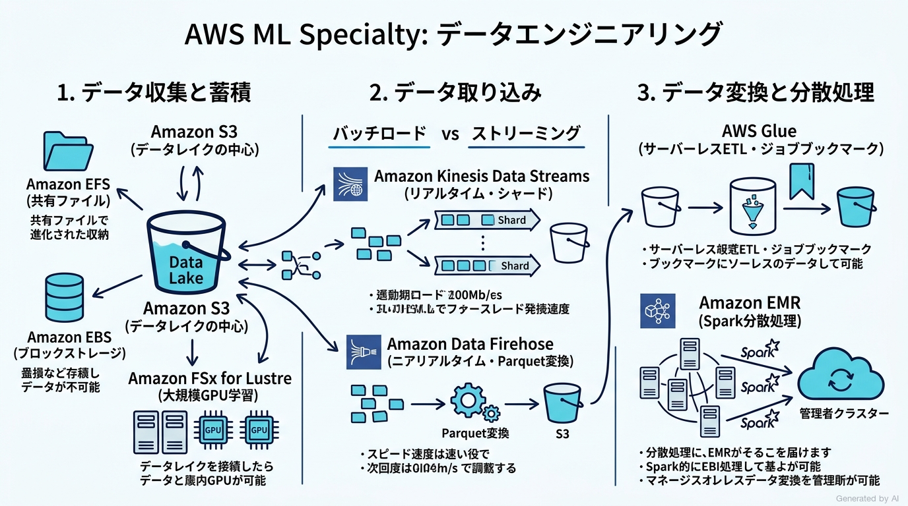
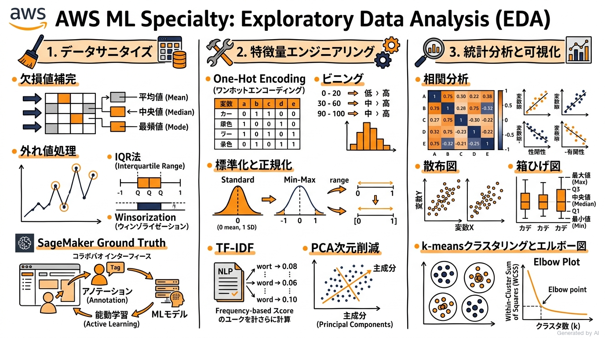
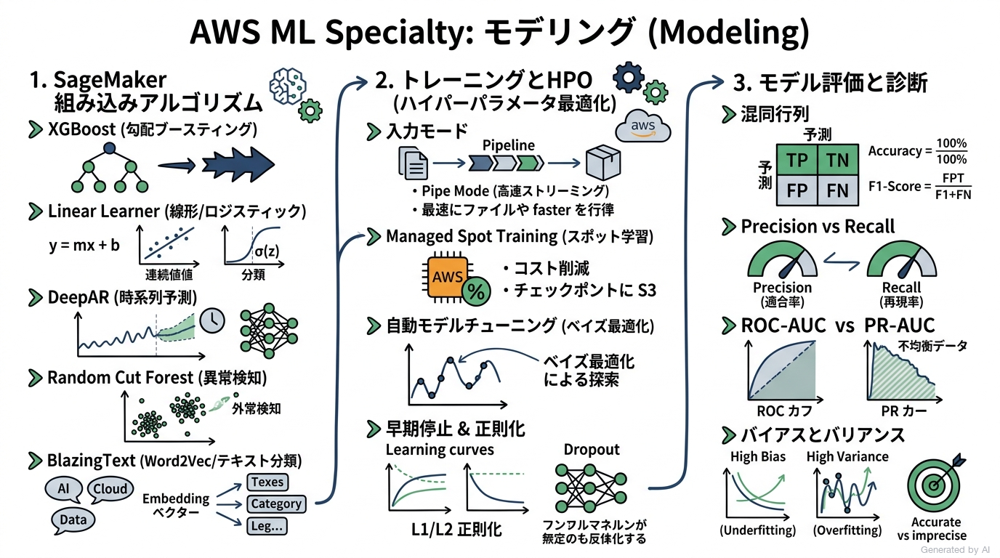
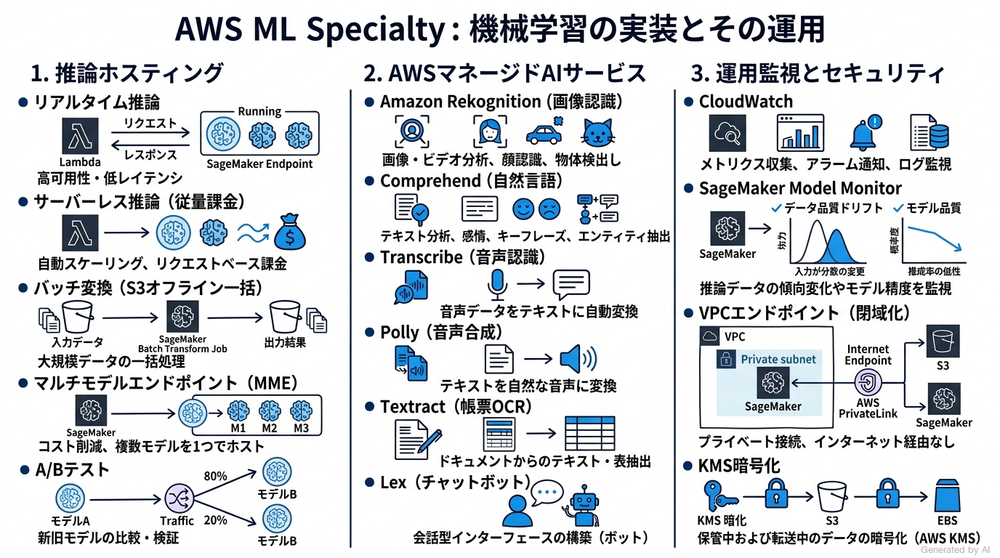

# AWS Certified Machine Learning - Specialty (MLS-C01) 完全対策＆実践学習ガイド

- **対象資格**: AWS Certified Machine Learning - Specialty
- **試験コード**: MLS-C01
- **公式試験ガイド**: [AWS Certified Machine Learning - Specialty (MLS-C01) 試験ガイド](https://docs.aws.amazon.com/ja_jp/aws-certification/latest/machine-learning-specialty-01/machine-learning-specialty-01.html)
- **最終更新日**: 2026-10-11

---

## はじめに

クラウドプラットフォームにおける機械学習（ML）の導入は、単なるアルゴリズムの適用やモデル訓練の枠組みを超え、データ取り込みから特徴量エンジニアリング、モデル開発、分散スケーリング、推論基盤の耐障害性、継続的監視、セキュリティ統制に至るエンドツーエンドのMLライフサイクル全体のエンジニアリングへと成熟しています。

AWS における機械学習エンジニアリングの実践では、Amazon SageMaker を中核とするマネージドMLプラットフォームの活用に加え、Amazon S3、AWS Glue、Amazon EMR、Amazon Kinesis などのデータ基盤サービス、さらには Amazon Rekognition、Amazon Comprehend、Amazon Textract などの高レベルマネージド AI サービスを的確に組み合わせる設計判断が求められます。単一のベストプラクティスが存在するわけではなく、「リアルタイム推論 vs バッチ変換」「マネージド組み込みアルゴリズム vs カスタムスクリプト」「CPU vs GPU vs 専用アクセラレータ」「オンデマンド vs スポットインスタンス」など、常に性能・コスト・レイテンシ・運用負荷のトレードオフを論理的に評価する能力が試されます。

本学習ガイドは、AWS Certified Machine Learning - Specialty (MLS-C01) 試験の公式試験ガイドに完全準拠し、全4ドメイン（データエンジニアリング、探索的データ分析、モデリング、機械学習の実装とその運用）を包括的かつ構造化された論理構成で解説します。各セクションには、カリスマ講師の板書風インフォグラフィック図解、アーキテクチャの比較マトリクス、公式タスクに対応した構造化実践シナリオ（状況・対応・結果・解説）、そして公式一次ドキュメントと実機ハンズオンラボをカプセル化して収録しています。

### AWS Certified Machine Learning - Specialty 試験とは

AWS Certified Machine Learning - Specialty (MLS-C01) は、AWS クラウドにおける機械学習ソリューションの設計、実装、デプロイ、保守を担う機械学習エンジニア、データサイエンティスト、クラウドアーキテクトを対象としたスペシャリティレベルの専門認定試験です。

- **試験時間**: 180 分
- **出題問題数**: 65 問（採点対象: 50 問 / 採点対象外テスト設問: 15 問）
- **出題形式**: 択一選択問題（4つの選択肢から1つ選択）、複数選択問題（5つ以上の選択肢から2つ以上選択）
- **合格基準点**: 100〜1,000 点中 750 点以上
- **前提知識**:
  - AWS クラウド環境における ML/深層学習ワークロードの開発、アーキテクチャ設計、運用の実務経験 1〜2 年以上
  - 基本的な機械学習アルゴリズム（線形モデル、ツリーアンサンブル、深層学習、クラスタリング、時系列予測、異常検知など）の数理的背景とハイパーパラメータ最適化に関する知識
  - 特徴量エンジニアリング、データクレンジング、モデル評価メトリクス（ROC-AUC、混同行列、F1 スコア、RMSE など）に関する深い理解
  - AWS のセキュリティ、データ保護、ネットワーク分離（VPC、IAM、KMS）に関するベストプラクティス

### 難易度と求められる思考力

当試験の難易度は **スペシャリティ区分における最上位クラス（深いデータサイエンス知識と AWS インフラ設計の融合）** に位置づけられます。
表面的なサービス仕様や用語の暗記だけでは合格点に届かず、以下のような複合的な思考力と判断基準が問われます：

1. **データサイエンスと統計学の基礎理論に基づく判断力**:
   - 欠損値補完手法（平均値・中央値・最頻値・モデル予測）の適切な選択と、データ分布の歪み（歪度・尖度）の解釈。
   - 分類モデルにおける評価指標のトレードオフ（Precision vs Recall、False Positive のコスト vs False Negative のコスト）に応じた分類閾値の調整。
   - 過学習（高バリアンス）と未学習（高バイアス）の診断、および正則化（L1/L2、ドロップアウト、ツリー深度制限）の適用。
2. **Amazon SageMaker 組み込みアルゴリズムの完全な特性理解**:
   - 17 種類に及ぶ SageMaker 組み込みアルゴリズム（XGBoost, Linear Learner, DeepAR, Random Cut Forest, BlazingText, Object2Vec, K-Means, PCA, Factorization Machines 等）の入力データ形式（RecordIO-Protobuf, CSV, JSON Lines）、ハイパーパラメータ、および適用ユースケースの正確な把握。
3. **コストとパフォーマンスを最適化するインフラ選定**:
   - トレーニングにおける File Mode vs Pipe Mode vs Fast File Mode の選定、Managed Spot Training とチェックポイントによるコスト削減。
   - 推論におけるリアルタイム、サーバーレス、非同期、バッチ変換、マルチモデルエンドポイント (MME) のトラフィック特性に応じた選定。
4. **エンタープライズ水準のセキュリティとガバナンス**:
   - VPC 内でのセキュアなトレーニングおよび推論実行（インターネット接続遮断と VPC エンドポイント経由での S3/ECR アクセス）。
   - 保管時暗号化（AWS KMS）と転送時暗号化（TLS、ノード間暗号化）、IAM によるアクセス制御。
   - SageMaker Model Monitor によるデータ品質・モデル精度のドリフト検知と自動再学習トリガー。

### 推奨の勉強法

1. **ピラミッド原則に基づいたアーキテクチャ体系の理解**
   各ドメインの「セクション概要」および「重要トピック」を精読し、各サービスがシステム全体の中で担う責任範囲と設計トレードオフを論理的に整理します。
2. **構造化実践シナリオを通じた「消去法」の確立**
   各セクションに収録した実践シナリオ（状況・対応・結果・解説）を熟読してください。単なる正解の確認にとどまらず、「なぜ他の有力代替案では要件を満たせないのか（棄却理由）」を完全に理解することが、本番試験の紛らわしい選択肢を瞬時に見抜く最大の武器となります。
3. **公式ドキュメントと実機ハンズオンでの挙動確認**
   各セクション末尾に提示した AWS 公式ドキュメントの「開発者ガイド」「アルゴリズムリファレンス」を参照し、コンソールまたは AWS SDK (Boto3 / SageMaker Python SDK) で実際の挙動を体感してください。

---

## 目次

1. [はじめに](#はじめに)
2. [学習カリキュラム・出題範囲ロードマップ](#学習カリキュラム出題範囲ロードマップ)
3. [Domain 1: データエンジニアリング (20%)](#domain-1-データエンジニアリング-20)
   - [1. セクション概要](#1-セクション概要)
   - [2. 重要トピック](#2-重要トピック)
   - [3. 実践シナリオ](#3-実践シナリオ)
   - [4. 参考ドキュメント & 推奨ハンズオン](#4-参考ドキュメント--推奨ハンズオン)
4. [Domain 2: 探索的データ分析 (24%)](#domain-2-探索的データ分析-24)
   - [1. セクション概要](#1-セクション概要-1)
   - [2. 重要トピック](#2-重要トピック-1)
   - [3. 実践シナリオ](#3-実践シナリオ-1)
   - [4. 参考ドキュメント & 推奨ハンズオン](#4-参考ドキュメント--推奨ハンズオン-1)
5. [Domain 3: モデリング (36%)](#domain-3-モデリング-36)
   - [1. セクション概要](#1-セクション概要-2)
   - [2. 重要トピック](#2-重要トピック-2)
   - [3. 実践シナリオ](#3-実践シナリオ-2)
   - [4. 参考ドキュメント & 推奨ハンズオン](#4-参考ドキュメント--推奨ハンズオン-2)
6. [Domain 4: 機械学習の実装とその運用 (20%)](#domain-4-機械学習の実装とその運用-20)
   - [1. セクション概要](#1-セクション概要-3)
   - [2. 重要トピック](#2-重要トピック-3)
   - [3. 実践シナリオ](#3-実践シナリオ-3)
   - [4. 参考ドキュメント & 推奨ハンズオン](#4-参考ドキュメント--推奨ハンズオン-3)
7. [まとめと推奨学習ステップ](#まとめと推奨学習ステップ)

---

## 学習カリキュラム・出題範囲ロードマップ

### セクション一覧と出題比率

本試験は全4つのドメインで構成されており、Domain 3（モデリング）が 36% と最も高い配点比率を占めています。次いで Domain 2（探索的データ分析）が 24%、Domain 1（データエンジニアリング）と Domain 4（機械学習の実装とその運用）がそれぞれ 20% となっています。データの取り込みから統計分析、アルゴリズムの適用、そして耐障害性とセキュリティを備えた運用に至るまで、機械学習エンジニアリングの全工程がバランスよく出題されます。

| ドメイン番号 | 出題分野（Domain） | 出題比率 | 主要対象サービス・ツール |
| :--- | :--- | :--- | :--- |
| **Domain 1** | データエンジニアリング | 20% | Amazon S3, AWS Glue, Amazon EMR (Hadoop/Spark), Amazon Kinesis Data Streams, Amazon Data Firehose, Amazon Managed Service for Apache Flink, AWS Batch |
| **Domain 2** | 探索的データ分析 | 24% | データサニタイズ（欠損値・外れ値処理）, 特徴量エンジニアリング（One-Hot, ビニング, TF-IDF, PCA）, Amazon SageMaker Ground Truth, 統計分析・可視化（相関, 箱ひげ図, エルボー図） |
| **Domain 3** | モデリング | 36% | SageMaker 組み込みアルゴリズム（XGBoost, Linear Learner, DeepAR, RCF, BlazingText 等）, ハイパーパラメータ最適化 (AMT), 分散学習, モデル評価メトリクス (ROC-AUC, 混同行列, F1, RMSE) |
| **Domain 4** | 機械学習の実装とその運用 | 20% | SageMaker 推論エンドポイント（リアルタイム, バッチ変換, MME, A/Bテスト）, AWS マネージド AI サービス（Rekognition, Comprehend, Transcribe, Polly, Textract, Lex）, CloudWatch, SageMaker Model Monitor, VPC, KMS, IAM |

---

### セクション別出題詳細

#### Domain 1: データエンジニアリング (20%)
- **出題の狙い**: 機械学習モデルのトレーニングおよび推論に必要な大規模データを安全かつ効率的に蓄積、取り込み、変換するデータエンジニアリング基盤の構築能力を評価します。
- **主要タスク**:
  - Task 1.1: ML 用のデータリポジトリを作成する。
  - Task 1.2: データ取り込みソリューションを特定および実装する。
  - Task 1.3: データ変換ソリューションを特定および実装する。
- **重要キーワード**: Amazon S3, Amazon EFS, Amazon EBS, Amazon FSx for Lustre, Amazon Kinesis Data Streams, Amazon Data Firehose, Amazon Managed Service for Apache Flink, AWS Glue, Amazon EMR, Apache Spark, AWS Batch

#### Domain 2: 探索的データ分析 (24%)
- **出題の狙い**: モデリングの前段階として、データの統計的特性を把握し、欠損値・外れ値を適切にクレンジングし、モデルの予測力を最大化する特徴量エンジニアリングおよび可視化を実行する能力を評価します。
- **主要タスク**:
  - Task 2.1: モデリング用のデータをサニタイズおよび準備する。
  - Task 2.2: 特徴量エンジニアリングを実行する。
  - Task 2.3: ML のデータを分析および視覚化する。
- **重要キーワード**: 欠損値補完, 外れ値処理 (IQR / Winsorization), Amazon SageMaker Ground Truth, 能動学習 (Active Learning), One-Hot Encoding, ビニング, TF-IDF, 単語埋め込み, 主成分分析 (PCA), 散布図, 箱ひげ図, ヒートマップ, エルボー図

#### Domain 3: モデリング (36%)
- **出題の狙い**: ビジネス課題を数理的な機械学習問題に定式化し、最適な SageMaker 組み込みアルゴリズムまたはカスタムモデルを選定・トレーニング・チューニングし、評価指標に基づきモデルを客観的に評価する能力を評価します。
- **主要タスク**:
  - Task 3.1: 特定の ML 問題を適切な機械学習フレームワークおよびアプローチへと落とし込む。
  - Task 3.2: 特定の問題に対して適切なモデルを選択する。
  - Task 3.3: 機械学習モデルをトレーニングする。
  - Task 3.4: ハイパーパラメータの最適化を実行する。
  - Task 3.5: ML モデルを評価する。
- **重要キーワード**: XGBoost, Linear Learner, DeepAR, Random Cut Forest (RCF), BlazingText, K-Means, File Mode vs Pipe Mode vs Fast File Mode, Managed Spot Training, 自動モデルチューニング (AMT), ベイズ最適化, 早期停止 (Early Stopping), L1/L2 正則化, ドロップアウト, 混同行列, Precision, Recall, F1 スコア, ROC-AUC, RMSE

#### Domain 4: 機械学習の実装とその運用 (20%)
- **出題の狙い**: トレーニング済みモデルを低レイテンシ・高可用・スケーラブルな推論環境としてデプロイし、高レベル AI サービスを適材適所で活用しつつ、厳格なセキュリティ統制と継続的なドリフト監視を確立する運用能力を評価します。
- **主要タスク**:
  - Task 4.1: パフォーマンス、可用性、スケーラビリティ、レジリエンス、耐障害性を備えた ML ソリューションを構築する。
  - Task 4.2: 特定の問題に対して適切な ML サービスと特徴を推奨し、実装する。
  - Task 4.3: 基本的な AWS セキュリティプラクティスを ML ソリューションに適用する。
  - Task 4.4: ML ソリューションをデプロイし、運用可能にする。
- **重要キーワード**: SageMaker リアルタイムエンドポイント, バッチ変換 (Batch Transform), マルチモデルエンドポイント (MME), サーバーレス推論, A/B テスト, Amazon Rekognition, Amazon Comprehend, Amazon Transcribe, Amazon Polly, Amazon Textract, Amazon Lex, SageMaker Model Monitor, AWS PrivateLink (VPC エンドポイント), AWS KMS, IAM 実行ロール

## Domain 1: データエンジニアリング (20%)

機械学習プロジェクトにおけるモデルの予測精度と学習効率は、投入されるデータの品質、スケーラビリティ、鮮度に根本から依存します。Domain 1 では、多様なデータソース（ログ、トランザクション、IoT ストリーム等）からの安全かつ効率的なデータ収集と蓄積、バッチおよびリアルタイムでのデータ取り込みパイプラインの設計、そして分散コンピューティング基盤を用いた大規模データ変換（ETL）に至る、堅牢なデータエンジニアリング基盤の構築能力が問われます。



---

### 1. セクション概要

機械学習におけるデータエンジニアリングは、データライフサイクルの最上流に位置し、「収集と蓄積」「データ取り込み」「データ変換・分散処理」の 3 つのフェーズで構成されます。各フェーズにおいて、レイテンシ要件、データ量、スループット、運用管理コストを勘案した最適な AWS サービスの選定が求められます。

```text
+-----------------------------------------------------------------------------------+
|                        Domain 1: データエンジニアリングの全体像                       |
+-----------------------------------------------------------------------------------+
                                         |
         +-------------------------------+-------------------------------+
         |                               |                               |
         v                               v                               v
+-------------------+           +-------------------+           +-------------------+
| 1.1 収集と蓄積     |           | 1.2 データ取り込み |           | 1.3 データ変換・ETL |
+-------------------+           +-------------------+           +-------------------+
| - Amazon S3       |           | - Kinesis Streams |           | - AWS Glue        |
| - Amazon EFS      |           | - Kinesis Firehose|           | - Amazon EMR      |
| - Amazon EBS      |           | - MS for Flink    |           | - AWS Batch       |
| - FSx for Lustre  |           | - バッチ vs リアル|           | - Spark / Hadoop  |
+-------------------+           +-------------------+           +-------------------+
```

#### 重要キーワード

- **Amazon S3 (Simple Storage Service)**: 機械学習データレイクの中心となるオブジェクトストレージ。高い耐久性（99.999999999%）と無制限のスケーラビリティを提供し、パーティショニング（年/月/日/時間）や列指向フォーマット（Apache Parquet / ORC）と組み合わせることでスキャンコストとクエリ時間を劇的に削減します。
- **Amazon FSx for Lustre**: 高性能コンピューティング (HPC) および機械学習トレーニング向けの高スループット・低レイテンシな POSIX 準拠共有ファイルシステム。Amazon S3 バケットと直接リンクし、初回アクセス時にデータを自動ロードして数百万 IOPS の超高速スループットを実現します。
- **Amazon Kinesis Data Streams**: リアルタイムで大規模なストリーミングデータを収集・処理するサービス。シャード単位でスケールし、サブ秒（ミリ秒単位）のレイテンシで複数のコンシューマー（Lambda、Kinesis Client Library (KCL) アプリケーション、Managed Service for Apache Flink）にデータを配信します。
- **Amazon Data Firehose (旧 Kinesis Data Firehose)**: ストリーミングデータを S3、Redshift、OpenSearch Service などのストレージへサーバーレスで確実に配信するニアリアルタイムサービス。バッファサイズ（1〜128 MB）またはバッファ間隔（60〜900 秒）の条件に基づき自動配信し、転送中の Lambda によるデータ変換や Parquet/ORC へのフォーマット変換をサポートします。
- **Amazon Managed Service for Apache Flink (旧 Kinesis Data Analytics)**: ストリーミングデータに対して SQL や Apache Flink を用いてリアルタイム分析・集計を実行するサーバーレスサービス。タンブリングウィンドウやスライディングウィンドウを用いた時系列特徴量の算出に最適です。
- **AWS Glue**: サーバーレスのデータ統合・ETL サービス。AWS Glue Data Catalog によるメタデータ自動収集（クローラー）、Apache Spark ベースの分散 ETL ジョブ実行、および過去の処理済みデータを自動識別して重複処理を防ぐジョブブックマーク機能を提供します。
- **Amazon EMR (Elastic MapReduce)**: Apache Spark、Hadoop、Hive、Presto などのオープンソース分散フレームワークをマネージドに実行するビッグデータプラットフォーム。ペタバイト規模の大規模クラスタのカスタム構成や、細かいチューニングが必要な高度なデータ処理パイプラインに適しています。
- **AWS Batch**: ドッカーコンテナを使用して、数十万件規模のバッチコンピューティングジョブを効率的にスケジューリング・実行するフルマネージドサービス。計算リソース（EC2 / Fargate）の動的プロビジョニングを自動化します。

---

### 2. 重要トピック

#### 1. 機械学習ワークロード向けストレージの選定と最適化

機械学習モデルのトレーニングおよび前処理において、ストレージメディアの選定は I/O ボトルネックの解消とコスト適正化に直結します。

| ストレージサービス | 特性・アクセスプロトコル | 主な用途・適合シナリオ | パフォーマンス・拡張性 | 主なトレードオフ |
| :--- | :--- | :--- | :--- | :--- |
| **Amazon S3** | オブジェクトストレージ (REST API) | データレイク、生データ蓄積、学習済みモデルの永続化 | 無制限の容量、高スループット | POSIX 準拠ではないため、ファイル追記やランダム I/O には不向き |
| **Amazon FSx for Lustre** | 高性能分散ファイルシステム (POSIX) | 大規模深層学習（GPU 学習）のトレーニングデータ共有 | 数百万 IOPS、サブミリ秒の低レイテンシ、数十 GB/s のスループット | S3 よりストレージ単価が高いため、一時的な学習実行時に起動して S3 へ永続化する運用が推奨 |
| **Amazon EFS** | フルマネージド NFS 共有ファイルシステム (POSIX) | 複数インスタンスや SageMaker Studio でのコード・共有アセット保持 | 自動拡張、GB/s レベルのスループット | Lustre ほどの極限の I/O スループットは出ず、大量の小さなファイルではレイテンシが蓄積 |
| **Amazon EBS** | ブロックストレージ (インスタンス専用) | 個別 EC2 / SageMaker インスタンスのローカルスクラッチ領域 | ボリュームタイプに応じた高 IOPS (io2) | 単一インスタンスへの排他アタッチ（Multi-Attach を除く）であり、分散共有には不向き |

- **アーキテクトの選定基準**:
  - 大規模な画像や音声データセットを用いた深層学習（GPU 分散トレーニング）で、S3 からの毎エポックのデータ読み込みが I/O ボトルネックになる場合は、**Amazon FSx for Lustre** を S3 と連携させます。
  - テラバイト〜ペタバイト規模の構造化・非構造化データの長期保存とメタデータ管理には、**Amazon S3** をパーティショニングおよび Parquet 形式で設計します。

#### 2. ストリーミングデータ取り込み方式の比較

| 比較項目 | Amazon Kinesis Data Streams | Amazon Data Firehose | Amazon Managed Service for Apache Flink |
| :--- | :--- | :--- | :--- |
| **処理レイテンシ** | リアルタイム（70〜200 ミリ秒） | ニアリアルタイム（バッファリング: 最短 60 秒） | リアルタイム（ミリ秒未満〜秒単位） |
| **データ保持期間** | 24 時間（最大 365 日まで延長可能） | 保持機能なし（宛先へ直接ロード） | 保持機能なし（入力ストリームに依存） |
| **宛先ストレージ** | カスタムコンシューマー（Lambda, EC2, Flink） | S3, Redshift, OpenSearch, HTTP エンドポイント | Kinesis Streams, Firehose, S3 等 |
| **管理・スケーリング** | シャード管理（プロビジョンドモード / オンデマンドモード） | フルマネージド（完全自動スケール） | KPU (Kinesis Processing Unit) 自動スケール |
| **変換処理** | コンシューマー側で任意の実装 | AWS Lambda とのインライン連携 | SQL / Apache Flink によるステートフル集計 |
| **主な用途** | リアルタイム異常検知、複数システムへのイベント分岐 | S3 データレイクへの連続書き込み、Parquet 変換 | スライディングウィンドウでの移動平均算出、リアルタイム特徴量生成 |

- **アーキテクトの選定基準**:
  - 単にデータを S3 や OpenSearch にバッファリングして蓄積したい場合は、運用負荷が最小の **Amazon Data Firehose** を選択します。
  - 複数のアプリケーションが同一ストリームをリアルタイム（サブ秒）で読み出す必要がある場合や、カスタムロジックによる連続処理には **Amazon Kinesis Data Streams** を選択します。

#### 3. 分散データ変換と ETL 基盤の選定（AWS Glue vs Amazon EMR）

| 比較項目 | AWS Glue | Amazon EMR | AWS Batch |
| :--- | :--- | :--- | :--- |
| **アーキテクチャ** | サーバーレス Apache Spark | マネージドクラスタ（EC2 ベース） | コンテナベースのバッチスケジューラ |
| **セットアップ時間** | 迅速（インフラ管理不要、即座に起動） | クラスタ起動に数分を要する | コンテナイメージのロードのみ |
| **管理オーバーヘッド** | 最小（DPU 単位で従量課金） | 中〜高（インスタンスタイプ、AMI、クラスタ構成の管理） | 低〜中（コンテナ環境定義とコンピューティング環境管理） |
| **適したユースケース** | スケジュールされた定時 ETL、データカタログ連携、Parquet 変換 | 複雑な分散処理、ペタバイト規模、Hive/HBase 併用、Spark チューニング | カスタムスクリプト、C++/Python コンテナ、非 Spark バッチ処理 |
| **ジョブ状態管理** | ジョブブックマークにより未処理差分のみを自動処理 | スクリプト内で状態管理ロジックの実装が必要 | キューとジョブ定義による再試行管理 |

---

### 3. 実践シナリオ

> [!IMPORTANT]
> 試験ガイドのタスク・主要ユースケースに対応する実践シナリオを網羅的に作成します。
> 単なる機能暗記ではなく、「なぜ他の選択肢では要件を満たせないのか」という深層解説を通じて意思決定プロセスを習得します。

#### シナリオ 1-1: S3 バケットのパーティショニングと Apache Parquet 形式への変換

- **状況**: E コマース企業において、毎日数十ギガバイトのトランザクションログが JSON 形式で単一の S3 バケット直下に保存されており、Amazon Athena および Amazon SageMaker でのデータ抽出クエリの実行時間が増大し、S3 のデータスキャン課金が高騰している場合
- **対応**: AWS Glue クローラーと ETL ジョブを構成し、データを年・月・日のディレクトリ階層（`/year=YYYY/month=MM/day=DD/`）でパーティショニング分割した上で、列指向の Apache Parquet 形式（Snappy 圧縮）に変換して S3 に再配置する。
- **結果**: クエリ実行時に必要な列と日付範囲のパーティションのみがスキャンされるようになり、スキャンデータ量が 90% 以上削減され、クエリ実行速度とコスト効率が劇的に改善する。
- **解説**: Athena および SageMaker におけるクエリ性能とコストはスキャンデータ量に直結するためです。Apache Parquet は列指向フォーマットであり、必要なカラムのみを読み取るプルーニングが機能するほか、日付ベースのパーティションにより不要なプレフィックスの探索をスキップできます。代替案として S3 の単一フォルダ内で JSON データを GZIP 圧縮する構成では、特定カラムの抽出時にもファイル全体を解凍・スキャンする必要があり、スキャンデータ量と CPU コストの削減効果が極めて限定的となるため不適格です。
- **参考ドキュメント**:
  - [Top 10 Performance Tuning Tips for Amazon Athena](https://aws.amazon.com/blogs/big-data/top-10-performance-tuning-tips-for-amazon-athena/): パーティショニングと列指向圧縮のベストプラクティス。

#### シナリオ 1-2: クリックストリームデータのニアリアルタイム取り込みと S3 データレイク保存

- **状況**: Web アプリケーションからの数万 TPS に達するユーザー行動ログを、最低限の運用管理オーバーヘッドで S3 データレイクに蓄積し、ストレージコストを抑えるために Parquet 形式への変換を自動適用したい場合
- **対応**: Amazon Data Firehose を配信ストリームとして構成し、バッファリング条件（例: 128 MB または 300 秒）を設定した上で、AWS Glue Data Catalog のスキーマを参照して Firehose 内蔵のフォーマット変換機能により Apache Parquet 形式に変換して S3 に配信する。
- **結果**: サーバーのプロビジョニングやカスタム ETL コンシューマーの構築を行うことなく、サーバーレスで自動スケーリングするニアリアルタイム取り込みパイプラインが完成する。
- **解説**: Amazon Data Firehose は完全マネージドな配信サービスであり、独自のインフラ管理なしで自動スケーリングし、Glue Data Catalog と連携して Parquet/ORC へのインライン変換をネイティブにサポートしているためです。代替案として Amazon Kinesis Data Streams を使用して自前の EC2 や ECS コンシューマーで Parquet 変換を実装する構成は、シャード管理やコンシューマーのスケーリング、障害復旧の運用負荷が過大となるため要件（最小の運用負荷）に反します。また、Lambda を毎イベント起動して S3 に書き込む構成は、大量の小さなファイル（スモールファイル問題）を生成し、後続のクエリ性能を著しく悪化させるため不適格です。
- **参考ドキュメント**:
  - [Amazon Data Firehose 開発者ガイド](https://docs.aws.amazon.com/firehose/latest/dev/what-is-this-service.html): データフォーマット変換と S3 配信の仕様。

#### シナリオ 1-3: AWS Glue ジョブブックマークによる差分データの自動検知と重複なし ETL 処理

- **状況**: 毎日数回 S3 バケットに追加投入される IoT センサーログに対して、前回の実行以降に新しく追加されたファイルのみを対象に Spark ETL 処理を実行し、データの重複処理を完全に排除したい場合
- **対応**: AWS Glue ETL ジョブを作成し、設定で「ジョブブックマーク (Job Bookmarks)」を「有効 (Enable)」に設定して実行する。
- **結果**: 過去の実行で処理された S3 オブジェクトのメタデータが Glue 側で永続管理され、新しいジョブ実行時には未処理の新規ファイルのみが自動的に抽出・処理される。
- **解説**: AWS Glue のジョブブックマーク機能は、S3 の最終更新日時やオブジェクトキーなどのステート情報を追跡し、前回のジョブ実行以降に到着した新規データまたは変更データのみを処理対象として自動抽出するためです。代替案として、処理済みファイルを別の S3 フォルダにスクリプト内で移動（コピー＆削除）する方式は、オブジェクト数が増加した際に S3 API のリクエストコストとレイテンシが増大し、ジョブ失敗時のアトミックなロールバックが極めて困難になるため推奨されません。
- **参考ドキュメント**:
  - [AWS Glue ジョブブックマークを使用した処理済みデータの追跡](https://docs.aws.amazon.com/glue/latest/dg/monitor-continuations.html): ジョブブックマークの動作メカニズムとステート追跡。

#### シナリオ 1-4: Amazon EMR (Apache Spark) によるテラバイト級非構造化テキストログの分散前処理

- **状況**: 過去数年分に及ぶ数十テラバイトの Apache アクセスログから、自然言語処理モデルの事前学習用コーパスを作成するため、高度にカスタマイズされたテキスト正規化、トークン化、正規表現抽出パイプラインを短時間で分散実行したい場合
- **対応**: 一時的な（エフェメラルな）Amazon EMR クラスタを立ち上げ、コアノードとタスクノードにスポットインスタンスを活用し、PySpark ジョブにより大規模並列前処理を実行後、処理結果を S3 に書き出してクラスタを自動終了する。
- **結果**: 巨大な計算リソースを短時間集中的にプロビジョニングすることで、数時間以内にテラバイト級のテキスト前処理が完了し、スポットインスタンスの活用によりインフラコストを最大 80% 削減できる。
- **解説**: テラバイト級の大規模かつ複雑なデータ処理に対して、Amazon EMR はクラスタサイズ（数百インスタンス規模）やメモリパラメータ、Spark 最適化設定をきめ細かく制御でき、エフェメラルクラスタ運用とスポットインスタンスの併用により圧倒的なコストパフォーマンスを発揮するためです。代替案として単一の大型 EC2 インスタンスで処理を実行する構成は、メモリ不足 (OOM) のリスクが高くスケールアウトできないため不適格です。また、AWS Glue のみで実行する場合、デフォルトのタイムアウト制約や細かい Spark 内部チューニングの自由度の面で、数十テラバイトの特大ワークロードには EMR の方が適しています。
- **参考ドキュメント**:
  - [Amazon EMR 管理ガイド](https://docs.aws.amazon.com/emr/latest/ManagementGuide/emr-what-is-emr.html): 一時的クラスタとスポットインスタンスの活用。

#### シナリオ 1-5: Amazon Managed Service for Apache Flink によるスライディングウィンドウ集計

- **状況**: 金融取引システムにおいて、クレジットカード決済の不正検知モデルにリアルタイムで特徴量を供給するため、「過去 10 分間における同一カードの決済回数および合計金額」を 10 秒ごとのスライディングウィンドウでミリ秒単位の遅延なく集計・出力したい場合
- **対応**: 決済ストリームを Amazon Kinesis Data Streams で受け取り、Amazon Managed Service for Apache Flink アプリケーションを構築して、スライディングウィンドウ集計クエリを実行し、結果の特徴量を低レイテンシなストア（Amazon DynamoDB や SageMaker Feature Store）へ書き込む。
- **結果**: イベント到着からミリ秒単位で最新のウィンドウ集計特徴量が更新され、下流の推論 API がリアルタイムに不正スコアを判定できるようになる。
- **解説**: スライディングウィンドウ（重なり合う時間枠）でのステートフルなイベント集計を低レイテンシで処理するには、Apache Flink のストリーム処理エンジンが最適であるためです。Amazon Managed Service for Apache Flink は、障害復旧のためのチェックポイント管理やスケーリングを自動で行います。代替案として Amazon Data Firehose を使用する構成は、バッファリング間隔（最短 60 秒）による遅延が発生し、スライディングウィンドウのような重複時間枠の集計がネイティブにできないため不適格です。また、定期的な CloudWatch Events（EventBridge）と Lambda で S3 から集計する方式は、ミリ秒〜秒単位のリアルタイム要件を満たせません。
- **参考ドキュメント**:
  - [Amazon Managed Service for Apache Flink 開発者ガイド](https://docs.aws.amazon.com/managed-flink/latest/java/what-is.html): ウィンドウ集計とステートフルストリーム処理。

#### シナリオ 1-6: 大規模深層学習モデル訓練のための Amazon FSx for Lustre 導入

- **状況**: 自動運転開発チームが数百万枚の高解像度画像（数百テラバイト）を用いてマルチノード GPU クラスタ（SageMaker）で深層学習を実行しているが、各エポックで S3 からの画像読み込みによるネットワーク I/O 待ちが発生し、高価な GPU の使用率が 40% 未満に低迷している場合
- **対応**: Amazon S3 データレイクバケットとデータリポジトリ連携した Amazon FSx for Lustre ファイルシステムをプロビジョニングし、SageMaker トレーニングジョブのデータ入力チャネルとして FSx for Lustre のファイルシステムパスを指定する。
- **結果**: トレーニングジョブ初回実行時に必要なデータが Lustre キャッシュに読み込まれ、後続のエポックでは数百 GB/s のローカル並列ファイルアクセスが実現し、GPU 使用率が 95% 以上に向上して総トレーニング時間が大幅に短縮される。
- **解説**: 大規模な深層学習では、GPU の計算速度に対してストレージのランダム読み込みスループットがボトルネック（I/O バウンド）になりやすいためです。Amazon FSx for Lustre は S3 とシームレスに同期する分散 POSIX ファイルシステムであり、数百万 IOPS と超高スループットを提供して GPU を常にフル稼働させることができます。代替案として S3 の File Mode で毎回各インスタンスのローカル EBS に全画像（数百テラバイト）をダウンロードする構成は、ジョブ開始までに数時間のダウンロード待ちが発生し、EBS ストレージコストも膨大になるため不適格です。
- **参考ドキュメント**:
  - [Amazon SageMaker 開発者ガイド: FSx for Lustre を使用したトレーニングの高速化](https://docs.aws.amazon.com/sagemaker/latest/dg/model-access-training-data.html): 高速ファイルシステム入力チャネルの設計。

---

### 4. 参考ドキュメント & 推奨ハンズオン

#### 公式一次ドキュメント
- [Amazon S3 ユーザーガイド - パフォーマンスの最適化](https://docs.aws.amazon.com/AmazonS3/latest/userguide/optimizing-performance.html): S3 プレフィックスの分散とリクエストスループット設計。
- [AWS Glue 開発者ガイド - ジョブブックマーク](https://docs.aws.amazon.com/glue/latest/dg/monitor-continuations.html): 状態保持と増分 ETL 処理の仕様。
- [Amazon Kinesis Data Streams 開発者ガイド](https://docs.aws.amazon.com/streams/latest/dev/introduction.html): シャード設計とキャパシティプランニング。
- [Amazon FSx for Lustre ユーザーガイド](https://docs.aws.amazon.com/fsx/latest/LustreGuide/what-is.html): S3 データリポジトリとの自動同期とキャッシュ機構。

#### 推奨ハンズオン・ラボ（実機検証）
- [AWS Skill Builder: Building Data Lakes on AWS](https://explore.skillbuilder.aws/):
  - **学習目標**: S3、AWS Glue、Athena を連携させたサーバーレスデータレイクの構築と、Glue ジョブブックマークによる増分 ETL の挙動確認。
- [AWS Skill Builder: Streaming Data Solutions with Amazon Kinesis](https://explore.skillbuilder.aws/):
  - **学習目標**: Kinesis Data Streams、Firehose、Managed Service for Apache Flink を連携させ、ストリーミングログの集計と S3 への Parquet 変換を検証。

## Domain 2: 探索的データ分析 (24%)

機械学習モデルの性能と汎化性能は、モデルの学習前にデータの統計的特性、分布、欠損、外れ値、および変数間の相関をどれだけ深く理解できているかに大きく依存します。Domain 2 では、データのサニタイズ（クレンジング、欠損値・外れ値処理、アノテーション）、モデリングに最適な入力表現を作成する特徴量エンジニアリング、そしてデータの構造を視覚的かつ統計的に解釈する探索的データ分析 (EDA) の実践能力が問われます。



---

### 1. セクション概要

探索的データ分析は、「データサニタイズとラベリング」「特徴量エンジニアリング」「統計分析と可視化」の 3 つの核心ステップに体系化されます。生データの不備を修正し、モデルが学習しやすい形式へと変換すると同時に、データの背後にある相関や多重共線性を見極めることが本ドメインの目標です。

```text
+-----------------------------------------------------------------------------------+
|                        Domain 2: 探索的データ分析 (EDA) の体系                        |
+-----------------------------------------------------------------------------------+
                                         |
         +-------------------------------+-------------------------------+
         |                               |                               |
         v                               v                               v
+-------------------+           +-------------------+           +-------------------+
| 2.1 データサニタイズ |           | 2.2 特徴量エンジニア |           | 2.3 統計分析・可視化 |
+-------------------+           +-------------------+           +-------------------+
| - 欠損値補完/削除  |           | - One-Hot / ビニング|           | - 記述統計 / 相関 |
| - 外れ値 (IQR)    |           | - スケーリング/正規化|           | - 箱ひげ図 / 散布図 |
| - Ground Truth    |           | - TF-IDF / 埋め込み |           | - エルボー図 / k-means|
| - データ拡張      |           | - PCA による次元削減|           | - 歪度 / シルエット |
+-------------------+           +-------------------+           +-------------------+
```

#### 重要キーワード

- **欠損値補完 (Imputation)**: データセット内の欠損値 (NaN / Null) を補完するアプローチ。完全無作為欠損 (MCAR)、無作為欠損 (MAR)、非無作為欠損 (MNAR) の性質を考慮し、平均値補完（正規分布向け）、中央値補完（外れ値・歪みがある分布向け）、最頻値補完（カテゴリカル変数向け）、または k-NN / 回帰モデルによる予測補完を適用します。
- **外れ値処理 (Outlier Treatment)**: 四分位範囲 (IQR = Q3 - Q1) を用いた基準（$Q1 - 1.5 	imes 	ext{IQR}$ 未満、または $Q3 + 1.5 	imes 	ext{IQR}$ 超）や Z スコア（標準偏差の $\pm 3\sigma$ 外）により極端な値を検出し、トリミング（削除）または Winsorization（閾値でのクリッピング）を行います。
- **Amazon SageMaker Ground Truth**: 機械学習用の高品質なトレーニングデータセットを迅速に構築するフルマネージドデータラベリングサービス。社内作業者、ベンダー、または Amazon Mechanical Turk のクラウドワーカーを活用できるほか、少数のラベル付けデータから能動学習 (Active Learning) を行い、信頼度の高いサンプルに自動でアノテーションを付与する自動データラベリング機能を提供します。
- **One-Hot Encoding vs Label Encoding**: カテゴリカル変数の数値化手法。順序関係のない名義変数（例: 色、地域）には One-Hot Encoding を適用し、順序関係のある順序変数（例: 満足度: 低/中/高）には Label (Ordinal) Encoding を適用します。基数が膨大な場合は Target Encoding やハッシングを検討します。
- **特徴量スケーリング (Feature Scaling)**: 勾配降下法や距離ベースのアルゴリズム（線形モデル、ニューラルネットワーク、k-means、KNN、PCA）において、特徴量ごとのスケール差による学習の偏りを防ぐ手法。最小最大正規化 (Min-Max Scaling: $[0, 1]$ へのスケーリング）と標準化 (Standardization: 平均 0、分散 1 への変換）が存在します。決定木系（XGBoost 等）はスケール不変であるためスケーリングは不要です。
- **TF-IDF (Term Frequency-Inverse Document Frequency)**: テキストデータから特徴量を抽出する手法。単語の出現頻度 (TF) と、その単語が出現する文書数の逆数 (IDF) の積を計算し、「特定の文書において頻出するが、コーパス全体では一般的でない重要単語」に高い重みを与えます。
- **主成分分析 (PCA: Principal Component Analysis)**: 直交変換を用いて相関のある多変量データを無相関な少数の主成分に変換する教師なし次元削減手法。多重共線性 (Multicollinearity) の解消や、分散の大部分（累積寄与率 80〜90% 等）を保持した状態での特徴量次元圧縮に用いられます。
- **エルボー図 (Elbow Method) とシルエット分析**: k-means クラスタリングにおける最適なクラスタ数 ($k$) を決定する手法。エルボー図ではクラスタ内誤差平方和 (SSE / Inertia) の減少率が急激に緩やかになる「肘 (Elbow)」を特定し、シルエット分析ではサンプルの凝集度と乖離度を $[-1, 1]$ のスコアで評価します。

---

### 2. 重要トピック

#### 1. 欠損値補完および外れ値処理の方式比較

| 処理方式 | 手法・アルゴリズム | メリット | デメリット・注意点 | 適用推奨シーン |
| :--- | :--- | :--- | :--- | :--- |
| **行の完全削除 (Listwise Deletion)** | 欠損を含むサンプルを除去 | 実装が容易、バイアス導入がない | データ量が激減し、情報損失が大きい | 欠損割合がごくわずか（5% 未満）かつデータ量が十分にある場合 |
| **平均値補完 (Mean Imputation)** | 当該特徴量の平均値で埋める | 計算コストが極めて低い | 分散が過小評価され、外れ値に引っ張られる | 正規分布に近く、外れ値が存在しない数値データ |
| **中央値補完 (Median Imputation)** | 当該特徴量の中央値で埋める | 外れ値や歪んだ分布に対して頑健 | 変数間の相関関係が無視される | 歪度（左右の非対称性）が高く外れ値を含む数値データ |
| **最頻値補完 (Mode Imputation)** | 出現頻度が最大のカテゴリで埋める | カテゴリカル変数に直接適用可能 | 最頻カテゴリの比率が過大に偏る | カテゴリカル変数の欠損補完 |
| **モデル予測補完 (KNN / MICE)** | 他の特徴量から欠損値を回帰予測 | 変数間の相関を維持できる | 計算コストが高く、パイプラインが複雑化 | 欠損値が多く、変数間の相関が重要な高品質データセット |
| **IQR クリッピング (Winsorization)** | 境界値 ($Q1 - 1.5	ext{IQR}, Q3 + 1.5	ext{IQR}$) に丸める | サンプル数を減らさずに極端な影響を排除 | データの真の極値を歪めるリスク | 金融取引額など、外れ値は存在するがサンプルを削除できない場合 |

#### 2. 特徴量スケーリングとテキスト表現の比較マトリクス

| 変換手法 | 計算式・メカニズム | 特徴・適用対象アルゴリズム | 決定木系 (XGBoost) での要否 |
| :--- | :--- | :--- | :--- |
| **標準化 (Standardization / Z-score)** | $z = rac{x - \mu}{\sigma}$ | 平均 0、標準偏差 1 に変換。外れ値の影響を完全には排除しないが正規分布を前提とするモデル（線形回帰、ロジスティック回帰、ニューラルネットワーク、PCA）に最適 | 不要（ツリー分岐の閾値選択にスケールは影響しない） |
| **最小最大スケーリング (Min-Max)** | $x_{	ext{scaled}} = rac{x - x_{\min}}{x_{\max} - x_{\min}}$ | 値を $[0, 1]$（または $[-1, 1]$）の固定範囲に収める。画像ピクセル値や、境界が明確な入力に適合。外れ値に極めて敏感 | 不要 |
| **対数変換 (Log Transformation)** | $y = \log(x + 1)$ | 右に裾野が長い（正の歪度）ロングテール分布を釣鐘状（正規分布調）に変換 | 不要（ただしターゲット変数の変換には有効な場合あり） |
| **TF-IDF** | $	ext{TF}(t, d) 	imes \lograc{N}{	ext{DF}(t)}$ | 単語の重要度をスカラー重み付けした疎行列 (Sparse Matrix) を生成。古典的 NLP 分類に強力 | アルゴリズムによる |
| **単語埋め込み (Word2Vec / FastText)** | 浅いニューラルネットによる分散表現 | 単語の意味的類似度を密な低次元ベクトル（100〜300次元）として表現。文脈的意味を保持 | アルゴリズムによる |

#### 3. データの探索的分析と可視化チャートの選定基準

| 目的・分析タスク | 推奨グラフ・可視化チャート | 読み取るべき統計的洞察 |
| :--- | :--- | :--- |
| **単一数値変数の分布確認** | ヒストグラム、KDE（密度プロット） | 分布の形状（釣鐘型、二峰性、ロングテール）、歪度（Skewness）、尖度（Kurtosis） |
| **外れ値と分位点の確認** | 箱ひげ図 (Box Plot) | 中央値 (Q2)、四分位範囲 (Q1, Q3)、外れ値（ヒゲの外側のプロット点） |
| **2 変数間の相関関係** | 散布図 (Scatter Plot) | 線形相関、非線形相関、クラスタの存在、異常なペア |
| **多変量間の相関・多重共線性** | ヒートマップ (Correlation Matrix) | ピアソン相関係数（$r pprox \pm 1$ のペアは多重共線性を示唆し、除外や PCA を検討） |
| **k-means のクラスタ数決定** | エルボー図 (Inertia Curve) | クラスタ数 $k$ の増加に伴う SSE の減少率。傾きが急から緩やかになる「屈曲点」を特定 |

---

### 3. 実践シナリオ

#### シナリオ 2-1: 歪んだ分布を持つ数値データにおける欠損値補完戦略

- **状況**: 不動産価格予測モデルの構築において、特徴量「土地面積（平方メートル）」に 15% の欠損値が存在し、データのヒストグラムを確認したところ右に長い裾野を持つ著しい正の歪度（ロングテール分布）を示し、多数の超高額物件（外れ値）が含まれている場合
- **対応**: 欠損値を平均値ではなく「中央値 (Median)」で補完し、さらに後続の線形モデルの学習安定化のために対数変換（$\log(x + 1)$）を適用する。
- **結果**: 極端な外れ値物件の土地面積によって補完値が不当に釣り上げられる事態が回避され、分布が正規分布に近づいてモデルの予測誤差が安定化する。
- **解説**: 歪んだ分布や外れ値が存在する特徴量に対して平均値補完を行うと、少数の巨大な外れ値に引っ張られて補完値が実態より高くなり、データセット全体の統計的代表性が歪むためです。中央値は外れ値の影響を受けにくい頑健（ロバスト）な統計量です。代替案として、欠損値を含む行をすべて削除する方式は、データ全体の 15% という貴重なサンプルを喪失し、標本バイアスを生むため不適格です。また、平均値補完をそのまま適用する案は、外れ値の影響をまともに受けてモデリング性能を損ないます。
- **参考ドキュメント**:
  - [AWS Machine Learning 概念ガイド: データの準備](https://docs.aws.amazon.com/sagemaker/latest/dg/data-prep.html): 特徴量の分布変換と欠損値処理。

#### シナリオ 2-2: 四分位範囲 (IQR) 法を用いた外れ値の検出とクリッピング処理

- **状況**: 金融決済データを用いた不正検知モデルの前処理において、「送金金額」に数件の記録ミスに起因する桁違いに巨大な異常値（例: 数十億円）が存在し、モデルの勾配計算が発散する原因となっているが、該当行のレコード自体には重要な不正フラグが含まれており行ごと削除することは許容されない場合
- **対応**: 四分位範囲 ($	ext{IQR} = Q3 - Q1$) を算出し、上限境界値 ($Q3 + 1.5 	imes 	ext{IQR}$) を超える極端な値をその上限境界値に置き換える Winsorization（クリッピング処理）を実施する。
- **結果**: 行を削除して貴重な不正事例ラベルを失うことなく、極端な外れ値がモデルの損失関数に与える悪影響を完全に抑制できる。
- **解説**: Winsorization は、外れ値を削除するのではなく分布の上下限境界値でクリッピング（置換）する手法であり、行全体の情報（他の特徴量やターゲットラベル）を保持したまま異常値の影響を中和できるためです。代替案として外れ値の行を丸ごと削除するアプローチは、希少な不正トランザクションの正解データを破棄することになり、不均衡データにおける検知率を大幅に低下させるため不適格です。また、外れ値をゼロに置き換える処理は、本来高額であった送金を「無送金」と誤認させ、データ分布を不自然に歪めるため厳禁です。
- **参考ドキュメント**:
  - [Scikit-learn ドキュメント: RobustScaler と外れ値処理](https://scikit-learn.org/stable/modules/preprocessing.html): 四分位範囲に基づくスケーリングとクリッピング。

#### シナリオ 2-3: Amazon SageMaker Ground Truth による能動学習を用いたアノテーション効率化

- **状況**: 製造ラインの欠陥検査モデルを構築するため、50 万枚の製品画像に対するアノテーション（良品/欠陥品のラベリング）が必要であるが、外部クラウドワーカーに全件を依頼すると莫大なコストと納期がかかる場合
- **対応**: Amazon SageMaker Ground Truth の自動データラベリング（能動学習: Active Learning）機能を有効化し、社内専任チームまたはプライベート作業チームを連携させてラベリングジョブを実行する。
- **結果**: 初期の少数の人手ラベリング結果から Ground Truth の機械学習モデルが自動学習を開始し、高い信頼度スコアを持つ大部分の画像はモデルによって自動ラベル付けされ、信頼度が低い境界サンプルのみが人間に振り分けられることで、アノテーション費用と所要時間が 70% 以上削減される。
- **解説**: Amazon SageMaker Ground Truth の自動データラベリング機能は、能動学習アルゴリズムを用いてモデルが自信を持って判定できる画像を自動ラベリングし、曖昧な画像のみを人間の作業者にエスカレーションするためです。代替案として Amazon Mechanical Turk（パブリック作業者）に 50 万枚すべてを無差別に依頼する構成は、機密性の高い製造ライン画像が外部に漏洩するセキュリティリスクがあるだけでなく、全件人手作業となるためコストが削減できません。
- **参考ドキュメント**:
  - [Amazon SageMaker Ground Truth 開発者ガイド: 自動データラベリング](https://docs.aws.amazon.com/sagemaker/latest/dg/sms-automated-labeling.html): 能動学習と信頼度スコアの仕組み。

#### シナリオ 2-4: 高基数カテゴリカル変数に対する Target Encoding と過学習対策

- **状況**: クリック率 (CTR) 予測モデルにおいて、「郵便番号（Zip Code）」特徴量に 10,000 種類以上のユニークなカテゴリが存在し、One-Hot Encoding を適用すると特徴量空間が 10,000 次元に爆発し、メモリ不足と学習時間の増大を招いている場合
- **対応**: 各郵便番号における過去のクリック率（ターゲット変数の平均値）でカテゴリを置き換える Target Encoding（Mean Encoding）を採用し、リークと過学習を防ぐために K-分割交差検証 (Out-of-Fold) による平滑化（Smoothing）を適用する。
- **結果**: 10,000 次元の疎なダミー変数を単一の連続値特徴量に圧縮でき、メモリ消費とトレーニング時間を劇的に削減しつつ、ターゲットに対する予測力を維持できる。
- **解説**: 高基数（ユニーク数が多い）のカテゴリカル変数に対して One-Hot Encoding を行うと、極めてスパース（疎）な巨大行列が生成され、次元の呪いと計算リソース枯渇を引き起こすためです。Target Encoding はターゲットラベルの統計量を用いて 1 次元の密な数値に変換するため効率的です。ただし、訓練データ全体で単純に平均を計算するとターゲットリークが発生して過学習するため、Out-of-Fold 計算やスムージング正則化を併用することが必須です。代替案として任意の連番を振る Label Encoding は、郵便番号という無順序なカテゴリに不当な大小関係を導入してしまい、線形モデルやツリーの分割を狂わせるため不適格です。
- **参考ドキュメント**:
  - [Amazon SageMaker Data Wrangler による特徴量変換](https://docs.aws.amazon.com/sagemaker/latest/dg/data-wrangler.html): 高度なエンコーディング手法の適用。

#### シナリオ 2-5: テキストデータに対する TF-IDF 抽出とストップワード除去

- **状況**: カスタマーサポートの問い合わせテキスト（数万件）を分類するモデルにおいて、テキスト内に「the」「is」「at」「それ」「これ」といった頻出語が大量に含まれており、Bag-of-Words で単純に単語頻度をカウントしたところ、分類に寄与しない一般的な助詞や冠詞が最重要特徴量として扱われてしまい分類精度が低下している場合
- **対応**: テキスト前処理パイプラインでストップワード除去（Stop Words Removal）を実施し、特徴量抽出手法として単純な単語出現数ではなく TF-IDF (Term Frequency-Inverse Document Frequency) を適用する。
- **結果**: 全文書で共通して現れる意味のない単語の重みが激減し、各クレームや問い合わせ内容を特徴づけるドメイン固有の重要単語（「不具合」「ログインエラー」「返金」等）に高い重みが付与されて分類精度が向上する。
- **解説**: 単純な単語頻度 (Count Vectorizer) では出現回数が多いだけの無意味な機能語が高スコア化してしまうためです。TF-IDF は、コーパス全体の文書頻度の逆数 (IDF) を乗じることで、どの文書にも登場する一般的な単語の重みをほぼゼロに減衰させ、特定文書でのみ頻出する差別化単語を強調できます。代替案として単語の文字数でフィルタリングする方式は、「bug」などの短い重要キーワードを誤って除外してしまうため不適格です。
- **参考ドキュメント**:
  - [AWS Machine Learning テキスト処理のベストプラクティス](https://docs.aws.amazon.com/sagemaker/latest/dg/blazingtext.html): 自然言語前処理と TF-IDF。

#### シナリオ 2-6: 主成分分析 (PCA) による多重共線性解消と次元削減

- **状況**: 工場センサーから収集された 200 個の数値特徴量を用いて回帰モデルを学習させたが、複数の温度センサーや圧力センサー同士のピアソン相関係数が 0.95 以上と極めて高く、回帰係数の推定が不安定になり過学習（テストデータの精度低下）が発生している場合
- **対応**: データを標準化（Standardization）した上で主成分分析 (PCA) を適用し、固有値に基づく累積寄与率が 90% に達する上位 20 個の主成分を選択してモデルの学習データセットとする。
- **結果**: 変数間の強い線形依存関係（多重共線性: Multicollinearity）が完全に解消され、直交する無相関な 20 次元の特徴量空間上でモデルが安定して汎化性能の高い予測を行えるようになる。
- **解説**: 独立変数間に強い相関が存在する多重共線性下では、線形モデルやニューラルネットワークのパラメータ推定の分散が極端に大きくなり、モデルの信頼性が崩壊するためです。PCA は互いに直交（無相関）する主成分ベクトルへと座標軸を回転させるため、多重共線性を根本的に除去しつつ、分散の大部分を保持して次元を圧縮できます。なお、PCA はスケール差に極めて敏感であるため、事前の標準化（平均 0、分散 1）が必須です。代替案として、相関の高い特徴量をランダムに手動削除する方式は、重要な複合情報やノイズ耐性を損なうため推奨されません。
- **参考ドキュメント**:
  - [Amazon SageMaker 組み込みアルゴリズム: 主成分分析 (PCA)](https://docs.aws.amazon.com/sagemaker/latest/dg/pca.html): PCA の数理とハイパーパラメータ選定。

#### シナリオ 2-7: エルボー図とシルエット分析による k-means 最適クラスタ数の選定

- **状況**: マーケティング部門が顧客購買行動データに基づいて顧客セグメンテーション（k-means クラスタリング）を実施したいが、ビジネス側で適切なクラスタ数 ($k$) が事前に決まっておらず、担当者が感覚で $k=10$ を指定して結果が過度に細分化され解釈不能になっている場合
- **対応**: $k=2$ から $k=15$ までの範囲で k-means を実行して各 $k$ におけるクラスタ内誤差平方和 (SSE) をプロットした「エルボー図」を作成し、さらに各サンプルの「シルエット係数」の平均値を算出して評価する。
- **結果**: エルボー図において SSE の減少傾斜が劇的に緩やかになる「屈曲点（エルボー）」が $k=4$ に存在することが視覚的に特定され、シルエットスコアも最大化したため、数学的かつビジネス的に最も妥当な 4 つのセグメントを根拠を持って導き出せる。
- **解説**: k-means におけるクラスタ数 $k$ の決定には客観的な基準が必要であるためです。$k$ を増やせば SSE は単調減少しますが、エルボー図の変曲点を超える過剰な分割は過学習に相当します。シルエット係数はクラスタ内の凝集度と他クラスタとの分離度を統合評価するため、エルボー法と組み合わせることで最適な $k$ を論理的に裏付けられます。代替案として、単に学習時間を基準に $k$ を決めることや、クラスタ内のサンプル数が均等になるように $k$ を選ぶ手法は、データ本来の分布構造を無視しているため不適格です。
- **参考ドキュメント**:
  - [Amazon SageMaker 組み込みアルゴリズム: K-Means](https://docs.aws.amazon.com/sagemaker/latest/dg/k-means.html): クラスタリング評価基準とパラメータ設定。

---

### 4. 参考ドキュメント & 推奨ハンズオン

#### 公式一次ドキュメント
- [Amazon SageMaker Ground Truth 開発者ガイド](https://docs.aws.amazon.com/sagemaker/latest/dg/sms.html): ラベリングワークフォースの構成と能動学習。
- [Amazon SageMaker 組み込みアルゴリズム: PCA](https://docs.aws.amazon.com/sagemaker/latest/dg/pca.html): 教師なし次元削減の仕組みと分散比率。
- [Amazon SageMaker 組み込みアルゴリズム: K-Means](https://docs.aws.amazon.com/sagemaker/latest/dg/k-means.html): 距離尺度とクラスタ数ハイパーパラメータ。

#### 推奨ハンズオン・ラボ（実機検証）
- [AWS Skill Builder: Process and Cleanse Data with SageMaker Data Wrangler](https://explore.skillbuilder.aws/):
  - **学習目標**: SageMaker Data Wrangler を用いた欠損値補完、外れ値フィルタリング、One-Hot エンコーディングの視覚的パイプライン構築。
- [AWS Skill Builder: Labeling Datasets with Amazon SageMaker Ground Truth](https://explore.skillbuilder.aws/):
  - **学習目標**: プライベートワークフォースの作成、バウンディングボックスアノテーションジョブの実行、および能動学習の挙動確認。

## Domain 3: モデリング (36%)

モデリングは機械学習エンジニアリングの中核であり、出題比率 36% と本試験で最大のウェイトを占めます。Domain 3 では、現実のビジネス課題を適切な機械学習フレームワーク（教師あり、教師なし、強化学習）に定式化し、最適なアルゴリズム（SageMaker 組み込みアルゴリズムやカスタムフレームワーク）を選定し、スケーラブルかつコスト効率の高いトレーニングパイプラインを実行し、ハイパーパラメータ最適化 (HPO) を施し、客観的な評価指標（混同行列、ROC-AUC、PR 曲線、RMSE 等）に基づいてモデルを評価・診断する総合力が徹底的に試されます。



---

### 1. セクション概要

モデリングのライフサイクルは、「問題の定式化とアルゴリズム選定」「トレーニングの実行と分散最適化」「ハイパーパラメータチューニングと正則化」「モデル評価とトレードオフ診断」の 4 つのフェーズに大別されます。特に Amazon SageMaker 組み込みアルゴリズムの特性、入力形式、主要ハイパーパラメータの役割を完璧に理解することが合格への決定的な分岐点となります。

```text
+-----------------------------------------------------------------------------------+
|                            Domain 3: モデリングの全体構造                            |
+-----------------------------------------------------------------------------------+
                                         |
         +-------------------------------+-------------------------------+
         |                               |                               |
         v                               v                               v
+-------------------+           +-------------------+           +-------------------+
| 3.1 & 3.2 選定     |           | 3.3 トレーニング   |           | 3.4 & 3.5 チューニング |
+-------------------+           +-------------------+           +-------------------+
| - 組み込みアルゴリズム|          | - File vs Pipe Mode|          | - AMT (ベイズ最適化)|
| - XGBoost / Linear|           | - Spot Training   |           | - 早期停止 (Early) |
| - DeepAR / RCF    |           | - S3 チェックポイント|        | - L1/L2 / Dropout |
| - BlazingText / FM|           | - 分散並列学習     |           | - 混同行列 / ROC-AUC|
+-------------------+           +-------------------+           +-------------------+
```

#### 重要キーワード

- **Amazon SageMaker 組み込みアルゴリズム (Built-in Algorithms)**: AWS が高度に最適化し、Docker コンテナとして提供する 17 種類のアルゴリズム。GPU アクセラレーションやマルチノード分散学習にネイティブ対応し、独自の学習コードを書くことなく高速にトレーニングできます。
  - **XGBoost**: 勾配ブースティング決定木。表形式データの回帰・二値分類・多クラス分類で最も高い実績と汎用性を持つ。
  - **Linear Learner**: 線形回帰およびロジスティック回帰。大規模な高次元データセットに対応し、L1/L2 正則化をサポート。
  - **DeepAR**: 自己回帰型リカレントニューラルネットワーク (RNN) に基づく時系列予測。複数の一連の時系列（クロスセクショナル時系列）を同時に学習し、確率的予測（信頼区間付き予測）を出力。
  - **Random Cut Forest (RCF)**: 教師なし異常検知アルゴリズム。データの部分空間をランダムに分割する決定木アンサンブルにより、各データポイントの異常度スコアを算出。ストリーミングデータに最適。
  - **BlazingText**: Word2Vec（CBOW / Skip-gram）の高速実装および教師ありテキスト分類。FastText をベースとし、GPU 上で数分で数百万単語を学習。
  - **Object2Vec**: 任意の高次元オブジェクトペア（単語、ユーザー-アイテム、文章ペア等）間の意味的埋め込み関係を学習するニューラルネットワーク。協調フィルタリングや類似検索に応用。
  - **Factorization Machines (FM)**: 疎な高次元データ（レコメンデーションシステム、クリック予測など）における特徴量間の 2 次の相互作用を効率的に学習するモデル。
  - **K-Means / PCA**: 教師なしクラスタリングおよび線形次元削減。
  - **IP Insights**: IPv4 アドレスとリソース ID（ユーザー ID 等）の利用パターンを学習し、不審な IP アドレスからのアクセスを検知。
- **データ入力モード (Input Data Modes)**:
  - **File Mode**: トレーニング開始前に S3 からインスタンスのローカルストレージ (EBS) へデータセット全体をダウンロード。小〜中規模データ向け。
  - **Pipe Mode**: S3 から Linux FIFO パイプを介してストリーミングで直接メモリに読み込む。EBS 容量が不要で、テラバイト級データでもダウンロード待ち時間ゼロで学習を開始可能。
  - **Fast File Mode**: S3 をローカル POSIX ファイルシステムとして透過的にマウントし、ファイルアクセス時にオンデマンドでストリーミング。コード変更不要。
- **Managed Spot Training**: Amazon EC2 スポットインスタンスを活用して最大 90% のトレーニングコストを削減する機能。インスタンスが中断されるリスクに備え、S3 へのチェックポイント保存設定が必須。
- **自動モデルチューニング (Automatic Model Tuning: AMT)**: ハイパーパラメータ探索を自動化するサービス。グリッド探索やランダム探索より効率的な「ベイズ最適化 (Bayesian Optimization)」を採用し、過去の評価結果から最も有望なパラメータ領域を集中的に探索。早期停止 (Early Stopping) により見込みのない試行を打ち切り。
- **正則化 (Regularization)**: 過学習（高バリアンス）を防ぐためのペナルティ項。重みの絶対値の和を制約する **L1 正則化 (Lasso: スパース化・特徴量選択効果)** と、二乗和を制約する **L2 正則化 (Ridge: 重みを全体的に縮小)** がある。深層学習ではニューロンを確率的に無効化する **ドロップアウト (Dropout)** を併用。
- **混同行列 (Confusion Matrix)**: 二値分類の予測結果を 4 つの象限（TP: 真陽性、TN: 真陰性、FP: 偽陽性、FN: 偽陰性）に分類した評価表。
- **Precision（適合率）vs Recall（再現率）**:
  - **Precision**: $rac{	ext{TP}}{	ext{TP} + 	ext{FP}}$（陽性と予測した中で真に陽性だった割合。スパム判定など False Positive のコストが高い場合に重視）。
  - **Recall**: $rac{	ext{TP}}{	ext{TP} + 	ext{FN}}$（実際の陽性の中で陽性と正しく予測できた割合。病気スクリーニングや不正検知など False Negative のコストが高い場合に重視）。
- **ROC-AUC vs PR-AUC**:
  - **ROC-AUC**: 真陽性率 (TPR) vs 偽陽性率 (FPR) の曲線下面積。バランスの取れたデータセットでの識別性能評価に適する。
  - **PR-AUC**: 適合率 (Precision) vs 再現率 (Recall) の曲線下面積。極端な不均衡データ（陽性例が 1% 未満等）では、ROC-AUC が過度に楽観的な値を示すため、PR-AUC が必須の指標となる。

---

### 2. 重要トピック

#### 1. Amazon SageMaker 組み込みアルゴリズム完全選定マトリクス

| アルゴリズム名 | 学習タイプ | 主要ユースケース・対象データ | 入力データ形式 | 主要ハイパーパラメータ |
| :--- | :--- | :--- | :--- | :--- |
| **XGBoost** | 教師あり (回帰 / 分類) | 表形式データ、クレジットスコアリング、解約予測 | CSV, RecordIO-Protobuf, libsvm, Parquet | `max_depth`, `eta` (学習率), `subsample`, `scale_pos_weight` (不均衡対策), `gamma` |
| **Linear Learner** | 教師あり (回帰 / 分類) | 高次元線形データ、ベースラインモデル | RecordIO-Protobuf (推奨), CSV | `predictor_type`, `learning_rate`, `l1`, `wd` (L2正則化), `loss_binding_type` |
| **DeepAR** | 教師あり (時系列) | 需要予測、サーバー負荷予測、複数関連時系列 | JSON Lines (タイムスタンプ、ターゲット、動的特徴量) | `time_freq`, `prediction_length`, `context_length`, `epochs`, `learning_rate` |
| **Random Cut Forest (RCF)** | 教師なし (異常検知) | ストリーミングログ異常検知、スパイク検出 | RecordIO-Protobuf, CSV | `num_trees` (推奨50〜100), `num_samples_per_tree` (ツリーあたりのサンプル数) |
| **BlazingText** | 教師あり / 教師なし | テキスト分類 (Supervised), Word2Vec (Skip-gram, CBOW) | テキストファイル (1行1文、`__label__`接頭辞) | `mode` (supervised / skip_gram / cbow), `epochs`, `min_count`, `vector_dim` |
| **Object2Vec** | 教師あり / 教師なし | レコメンデーション、類似アイテム検索、文章ペア類似度 | JSON Lines (ペア形式) | `enc0_network`, `enc1_network`, `enc_dim`, `optimizer` |
| **Factorization Machines** | 教師あり (分類 / 回帰) | 疎なレコメンドデータ、クリックスルー予測 | RecordIO-Protobuf (float32) | `num_factors` (潜在次元数), `predictor_type`, `bias_init_method` |
| **Image Classification** | 教師あり (分類) | 画像全体に対するラベル分類 (ResNet ベース) | RecordIO-Protobuf, Image/Image-List (.lst) | `num_layers`, `image_shape`, `num_classes`, `epochs`, `mini_batch_size` |
| **Semantic Segmentation** | 教師あり (ピクセル分類) | 医療画像解析、自動運転の走行領域識別 | RecordIO-Protobuf, JPEG/PNG マスク | `backbone` (ResNet-50/101), `algorithm` (fcn / psp / deeplab), `crop_size` |
| **Sequence-to-Sequence** | 教師あり (seq2seq) | 機械翻訳、要約、テキスト生成 (RNN/LSTM/Attention) | RecordIO-Protobuf (トークン化済み) | `batch_size`, `num_layers_enc`, `num_layers_dec`, `max_seq_len` |
| **K-Means** | 教師なし (クラスタリング) | 顧客クラスタリング、類似グループ化 | RecordIO-Protobuf, CSV | `k` (クラスタ数), `init_method` (random / kmeans++), `extra_center_factor` |
| **PCA** | 教師なし (次元削減) | 特徴量圧縮、多重共線性排除、可視化 | RecordIO-Protobuf, CSV | `num_components` (主成分数), `mode` (regular / randomized / stable) |
| **IP Insights** | 教師なし (異常検知) | IPv4 アドレスとユーザー ID の不正利用検知 | CSV (IP アドレス, エンティティ ID) | `vector_dim`, `epochs`, `learning_rate`, `batch_metrics_publish_interval` |

#### 2. トレーニングデータ入力モードの比較

| 項目 | File Mode | Pipe Mode | Fast File Mode |
| :--- | :--- | :--- | :--- |
| **データ転送方式** | ジョブ開始時に S3 からインスタンスのローカル EBS へ全件一括ダウンロード | S3 からインスタンスの Linux FIFO パイプへメモリ直接ストリーミング | S3 を POSIX 仮想マウントし、読み込み要求時にオンデマンド取得 |
| **起動待機時間** | データサイズに比例（数百 GB で数十分の待機） | ほぼゼロ（データ転送完了を待たずに即時学習開始） | ほぼゼロ（マウント直後から学習開始） |
| **ローカルストレージ要件** | データセットサイズ以上の巨大な EBS ボリュームが必要 | 最小限の EBS で動作可能（ディスクを消費しない） | 最小限の EBS で動作可能 |
| **対応データ形式** | すべてのファイル形式 | RecordIO-Protobuf, TFRecord, CSV (改行単位) | すべてのファイル形式 |
| **コードの変更** | なし（通常のファイルパス） | FIFO パイプ読み込み用の SDK 対応が必要 | なし（通常のローカルファイルパスとしてアクセス） |

#### 3. 分類モデル評価指標の選択マトリクス

| 指標 | 定義・計算式 | 重視すべきビジネス要件・ユースケース | 注意点・トレードオフ |
| :--- | :--- | :--- | :--- |
| **Accuracy (正解率)** | $rac{	ext{TP} + 	ext{TN}}{	ext{TP} + 	ext{TN} + 	ext{FP} + 	ext{FN}}$ | クラス分布がほぼ均等（50:50）な一般的な分類 | 不均衡データ（例: 陰性 99%, 陽性 1%）では、全件陰性と予測するだけで 99% に達し無価値 |
| **Precision (適合率)** | $rac{	ext{TP}}{	ext{TP} + 	ext{FP}}$ | **False Positive のコストが極めて高い場合**（スパム誤判定、重要メールの誤ブロック、YouTube の著作権侵害申し立て） | Recall が低下し、見逃し（False Negative）が増加するリスク |
| **Recall (再現率 / 感度)** | $rac{	ext{TP}}{	ext{TP} + 	ext{FN}}$ | **False Negative のコストが極めて高い場合**（がん検診スクリーニング、重大事故の予兆検知、不正送金検知） | Precision が低下し、空振り（False Positive）が増加するリスク |
| **F1 スコア** | $2 	imes rac{	ext{Precision} 	imes 	ext{Recall}}{	ext{Precision} + 	ext{Recall}}$ | Precision と Recall の調和平均。クラス不均衡があり、両者のバランスを単一数値で評価したい場合 | どちらか一方の誤りを特に重視したい場合は $F_eta$ スコア（$eta=2$ で Recall 重視など）を使用 |
| **ROC-AUC** | TPR vs FPR の曲線下面積 | モデル全体の順位付け（判別力）を閾値非依存で評価したい場合 | 極端な不均衡データでは FPR の母数（TN）が巨大なため、過度に良好なスコアになりやすい |
| **PR-AUC** | Precision vs Recall の曲線下面積 | **極端な不均衡データ（陽性比率 1% 未満）におけるモデル評価** | 陽性例の検出精度を厳格に評価できるため、不正検知の標準指標 |

---

### 3. 実践シナリオ

#### シナリオ 3-1: 大規模不均衡表形式データにおける詐欺検出と XGBoost の最適化

- **状況**: 金融機関において、数百万件の決済ログから不正トランザクションを検知するモデルを開発しているが、不正ラベルが全体の 0.2% しか存在しない深刻なクラス不均衡データであり、デフォルトのパラメータで SageMaker XGBoost を学習させると全件「正常」と判定してしまいリコールが 0 になっている場合
- **対応**: 評価メトリクスを `error` から `aucpr`（PR 曲線下面積）に変更し、ハイパーパラメータ `scale_pos_weight` に「負例数 / 正例数（例: 998 / 2 = 499）」を設定した上で、確率予測に対する分類閾値をデフォルトの 0.5 から 0.1 程度に引き下げる。
- **結果**: 陽性（不正事例）の誤分類に対する損失関数のペナルティが 499 倍に強化され、不正トランザクションの見逃し（False Negative）が劇的に減少し、目標とする高水準の Recall を達成できる。
- **解説**: 不均衡データにおいて決定木を損失最小化で学習させると、多数派クラス（正常）のみを当てる局所解に陥るためです。`scale_pos_weight` は正例の勾配計算に重み係数を乗じることで少数派クラスの予測力を引き上げます。また、極端な不均衡下では ROC-AUC ではなく `aucpr` を監視し、分類閾値を下げることで Recall を最大化するのがベストプラクティスです。代替案として、多数派の正常データを 0.2% まで単純アンダーサンプリングする手法は、数百万件の貴重な正常パターンの 99% 以上を破棄することになりモデルの安定性を著しく損なうため不適格です。
- **参考ドキュメント**:
  - [Amazon SageMaker 組み込みアルゴリズム: XGBoost](https://docs.aws.amazon.com/sagemaker/latest/dg/xgboost.html): 不均衡データ処理とハイパーパラメータ。

#### シナリオ 3-2: 小売チェーンの多店舗・多品目需要予測における DeepAR アルゴリズムの選定

- **状況**: 全国 500 店舗で展開するスーパーマーケットにおいて、10,000 品目におよぶ商品の翌月の日次売上需要を予測したいが、新商品のように過去の履歴データが短い品目が多数存在し、古典的な ARIMA やプロフェットでは個別の品目ごとにモデルを学習させる必要があり計算コストと予測精度に限界がある場合
- **対応**: Amazon SageMaker DeepAR 組み込みアルゴリズムを採用し、全店舗・全品目の売上履歴を JSON Lines 形式にまとめ、「店舗 ID」「商品カテゴリ」などの静的特徴量および「プロモーション実施日」「祝日フラグ」などの動的特徴量を入力して単一のグローバル DeepAR モデルを学習させる。
- **結果**: 複数時系列間のパターンが RNN で横断学習され、販売履歴の浅い新商品に対しても類似商品のトレンドを活用した高精度な需要予測（確率的予測区間）が可能になり、モデル管理工数も大幅に削減される。
- **解説**: DeepAR は自己回帰型 RNN を用いたディープラーニング時系列アルゴリズムであり、大量の関連時系列（Cross-sectional Time Series）をまとめて単一モデルで学習することで、各時系列固有のノイズを抑え、履歴の短い時系列に対しても全体の相関からコールドスタート予測を行えるためです。代替案として Linear Learner や単純な回帰モデルを使用する構成は、時系列の長期的な時間依存関係や自己相関を捉えきれず不適格です。また、商品ごとに 10,000 個の個別 ARIMA モデルを回す構成は、トレーニングの並列管理が極めて煩雑で新商品への汎化が効きません。
- **参考ドキュメント**:
  - [Amazon SageMaker 組み込みアルゴリズム: DeepAR](https://docs.aws.amazon.com/sagemaker/latest/dg/deepar.html): 確率的時系列予測と動的特徴量。

#### シナリオ 3-3: サーバーログのストリーミング異常検知における Random Cut Forest (RCF) の適用

- **状況**: クラウド基盤の運用監視において、数万台の EC2 インスタンスからストリーミングされる CPU 使用率およびリクエスト数のメトリクスから突発的な障害スパイクをリアルタイムに検知したいが、どのような障害が発生するかの事前正解ラベルが存在しない場合
- **対応**: Amazon SageMaker Random Cut Forest (RCF) 組み込みアルゴリズムを採用し、メトリクスデータをストリーミング入力して異常度スコア（Anomaly Score）を算出し、スコアが標準偏差の 3 倍（$3\sigma$）を超えた場合にアラートを発報する。
- **結果**: 教師データ（ラベル）が一切存在しない環境下でも、平常値のデータ分布から乖離した異常スパイクが即座に高いスコアとして検知され、障害の早期特定が実現する。
- **解説**: Random Cut Forest (RCF) は教師なしのアンサンブル異常検知アルゴリズムであり、決定木群（フォレスト）を構築して、あるデータポイントを追加した際にツリーの複雑度がどれだけ変化するかによって異常スコアを算出するためです。正解ラベルのないストリーミングデータの外れ値検出に最適です。代替案として XGBoost や Linear Learner を使用する構成は、異常ラベルが付与された教師あり学習データセットが必須であるため、ラベルが存在しない本シナリオには適用できません。
- **参考ドキュメント**:
  - [Amazon SageMaker 組み込みアルゴリズム: Random Cut Forest](https://docs.aws.amazon.com/sagemaker/latest/dg/randomcutforest.html): 教師なし異常検知とツリーハイパーパラメータ。

#### シナリオ 3-4: BlazingText による高速な単語分散表現 (Word2Vec) の生成

- **状況**: 巨大な社内ナレッジベース（数億単語）の文書検索エンジンを構築するため、テキストコーパスから単語の分散表現（Word2Vec）を迅速に事前学習させたいが、オープンソースのライブラリでは CPU で数十時間を要しプロトタイピングの反復が遅れている場合
- **対応**: Amazon SageMaker BlazingText 組み込みアルゴリズムを選択し、GPU インスタンス（`ml.p3.2xlarge` 等）を指定して `mode=skip_gram` または `cbow` でトレーニングジョブを実行する。
- **結果**: GPU に最適化された高度な並列処理により、数億単語のコーパスに対する単語埋め込みベクトルの生成が数分〜数十分以内に完了する。
- **解説**: BlazingText は FastText および Word2Vec アルゴリズムを GPU 向けに極限まで最適化した AWS 独自実装であり、標準的な CPU 実装と比較して数十倍以上の高速化を達成できるためです。代替案として Amazon Comprehend を使用する構成は、マネージドなエンティティ抽出や感情分析には適しているものの、社内固有のテキストコーパスからカスタムな Word2Vec 埋め込みモデルを直接学習してベクトル空間をエクスポートする用途には対応していません。
- **参考ドキュメント**:
  - [Amazon SageMaker 組み込みアルゴリズム: BlazingText](https://docs.aws.amazon.com/sagemaker/latest/dg/blazingtext.html): Word2Vec と GPU 分散学習。

#### シナリオ 3-5: SageMaker Pipe Mode による大容量トレーニングの起動遅延解消

- **状況**: 自動運転開発において、S3 上の 500 GB のセンサーデータセット（TFRecord 形式）を用いてモデルを学習させているが、トレーニングジョブを投入してからインスタンスへのデータダウンロード（File Mode）に 30 分以上を要し、開発イテレーションが著しく阻害されている場合
- **対応**: SageMaker トレーニングジョブのデータ入力チャネル設定を `File` モードから `Pipe` モードに変更し、アルゴリズム側のデータローダーで Linux FIFO パイプからのストリーミング読み込みを有効化する。
- **結果**: S3 からインスタンスへの 500 GB の事前ダウンロード待ち時間が完全にゼロになり、ジョブ投入から数十秒以内に GPU の計算が開始され、インスタンスにアタッチするローカル EBS ストレージ容量も最小限に削減される。
- **解説**: Pipe Mode は、S3 からデータを直接インスタンスのインメモリ FIFO パイプへとストリーミングしながら並行して学習を進めるアーキテクチャであるため、事前のディスクダウンロードが不要になるためです。代替案として、より高速な EBS ボリューム（io2 プロビジョンド IOPS）をプロビジョニングする構成は、データ転送待ち時間自体の根本解決にはならず、ストレージ課金が高騰するため不適格です。
- **参考ドキュメント**:
  - [Amazon SageMaker 開発者ガイド: Pipe Mode によるデータストリーミング](https://docs.aws.amazon.com/sagemaker/latest/dg/your-algorithms-training-algo-running-container.html): FIFO パイプの構成。

#### シナリオ 3-6: Managed Spot Training とチェックポイントによるトレーニングコスト最適化

- **状況**: 自然言語処理の深層学習モデルを 24 時間連続で学習させているが、オンデマンドの GPU インスタンス費用が開発予算を圧迫しているため、処理の中断を許容しつつインフラコストを最小限に抑えたい場合
- **対応**: SageMaker トレーニングジョブで「Managed Spot Training」を有効化（`use_spot_instances=True`）し、学習コード内で定期的にエポックごとの重みを S3 チェックポイントパス（`checkpoint_s3_uri`）へ保存するように構成する。
- **結果**: スポットインスタンスの中断が発生しても、インスタンス再起動時に最新のチェックポイントからシームレスに学習が再開され、オンデマンド比でトレーニングコストを最大 70〜90% 削減できる。
- **解説**: Managed Spot Training は余剰 EC2 キャパシティを格安で利用できる機能ですが、AWS 側の需要急増により 2 分前の警告でインスタンスが回収されるリスクがあります。S3 へのチェックポイント保存を設定しておくことで、中断前の進捗を完全に引き継いで再開できるため、長時間の学習でも安全にスポット割引を享受できます。代替案としてチェックポイントを設定せずにスポット学習を実行する構成は、中断時に最初から学習をやり直すことになり、かえってコストと納期が増大するため厳禁です。
- **参考ドキュメント**:
  - [Amazon SageMaker 開発者ガイド: マネージドスポットトレーニング](https://docs.aws.amazon.com/sagemaker/latest/dg/model-managed-spot-training.html): チェックポイントの設定とコスト削減。

#### シナリオ 3-7: 自動モデルチューニング (AMT) におけるベイズ最適化と早期停止の活用

- **状況**: 画像分類モデルのハイパーパラメータ（学習率、重み減衰、バッチサイズ）の最適化において、探索空間が広く、グリッド探索 (Grid Search) では数十回の試行を行っても最適な組み合わせに収束せず、莫大な GPU 費用と時間が消費されている場合
- **対応**: SageMaker 自動モデルチューニング (AMT) ジョブを構成し、探索戦略として「ベイズ探索 (Bayesian Optimization)」を指定し、さらに「早期停止 (Early Stopping)」を有効化する。
- **結果**: 過去の試行結果から目的メトリクス（検証精度）が向上する確率が最も高いパラメータ領域が数学的に推論されて効率的に探索され、精度の改善が見込めない試行は早期に打ち切られるため、従来の 1/3 の試行回数で最高精度のモデルに到達する。
- **解説**: ベイズ最適化は、目的関数の代理モデル（ガウス過程等）を構築し、過去の試行から「獲得関数（Acquisition Function）」を最大化するパラメータを逐次的に選ぶため、ランダム探索や全網羅的なグリッド探索よりも圧倒的に少ない試行回数で大域的最適解を探索できるためです。早期停止は無駄なエポックの計算コストをカットします。代替案としてランダム探索のみを使用する構成は、過去の試行からの学習（フィードバック）が行われないため、高次元な探索空間では効率が大幅に劣ります。
- **参考ドキュメント**:
  - [Amazon SageMaker 開発者ガイド: ハイパーパラメータ調整の仕組み](https://docs.aws.amazon.com/sagemaker/latest/dg/automatic-model-tuning-how-it-works.html): ベイズ最適化戦略。

#### シナリオ 3-8: 医療スクリーニングにおける Recall 最大化と PR 曲線に基づく閾値調整

- **状況**: X 線画像から特定の疾患兆候を検出する分類モデルにおいて、陰性と誤診（False Negative: 見逃し）した場合の患者のリスクが極めて高いため、多少の誤報（False Positive）を許容してでも疾患の見逃しを最小化（Recall 98% 以上）したい場合
- **対応**: テストデータセットを用いて Precision-Recall (PR) 曲線をプロットし、Recall が 0.98 以上を達成する最小の分類確率閾値（例: デフォルトの 0.5 から 0.15）を特定して、推論コード内の判定境界として設定する。
- **結果**: モデルの再学習を行うことなく、推論時の決定閾値をシフトさせるだけで、ビジネスおよび医療倫理の要件である Recall 98% 以上を確実に達成できる。
- **解説**: 分類モデルは通常 0.0〜1.0 の確率値を出力し、デフォルトの閾値は 0.5 です。False Negative（見逃し）の損失が極めて重大なシナリオでは、陽性と判定するハードルを下げる（閾値を 0.15 等に下げる）ことで、陽性判定が増加して Recall を直接引き上げることができます。代替案として Accuracy（正解率）を最大化するように閾値を調整する手法は、多数派の陰性に引っ張られて閾値が上がり、見逃しが多発するため医療・不正検知では致命的です。
- **参考ドキュメント**:
  - [Scikit-learn ドキュメント: Precision-Recall 曲線と閾値](https://scikit-learn.org/stable/auto_examples/model_selection/plot_precision_recall.html): 決定境界のチューニング。

#### シナリオ 3-9: 混同行列と ROC-AUC に基づく不均衡データ分類モデルの診断

- **状況**: E コマースの解約予測モデルを評価したところ、テストセット全体の Accuracy（正解率）が 95% と高スコアを示していたが、混同行列（Confusion Matrix）を詳細に確認したところ、解約した顧客（陽性 500 件）のうち正しく検知できたのはわずか 50 件（Recall 10%）であり、解約しなかった顧客（陰性 9,500 件）を当てているだけであった場合
- **対応**: 評価の主眼を Accuracy から F1 スコアおよび PR 曲線下面積 (PR-AUC) に切り替え、混同行列の Recall が目標水準に達するまでモデルの損失関数にクラス重み付けを施して再学習させる。
- **結果**: 単一の正解率による見せかけの高性能（Accuracy Paradox）に騙されることなく、実務上極めて重要な「解約顧客の検出力」を客観的に診断・改善できるようになる。
- **解説**: クラス比率が 95:5 のような不均衡データセットでは、すべてのサンプルを陰性と予測する愚直なモデルであっても正解率は 95% に達してしまう「正解率のパラドックス」が発生するためです。混同行列を展開して TP, TN, FP, FN を分解し、Precision や Recall、F1 スコアを精査しなければ、真の実用性能は評価できません。代替案として ROC 曲線のみを見る構成は、陰性（TN）が巨大な場合に偽陽性率（FPR = FP / (FP+TN)）が分母の大きさに隠れて小さく見えてしまい、過大評価につながるリスクがあります。
- **参考ドキュメント**:
  - [AWS Machine Learning 評価指標リファレンス](https://docs.aws.amazon.com/sagemaker/latest/dg/cdf-evaluation.html): 混同行列と不均衡評価。

#### シナリオ 3-10: 正則化 (L1/L2) およびドロップアウトによる深層学習の過学習抑制

- **状況**: 顧客レビューの感情分析深層ニューラルネットワークにおいて、トレーニングデータに対する損失 (Training Loss) は単調減少し精度 99% に達しているが、検証データに対する損失 (Validation Loss) が途中から上昇に転じ精度が 75% で頭打ちになっている場合
- **対応**: 過学習（Overfitting / 高バリアンス）が発生していると診断し、全結合層の間に「ドロップアウト (Dropout)」層（rate=0.3〜0.5）を追加し、重み減衰（Weight Decay / L2 正則化）をオプティマイザに設定した上で、検証損失の改善が停止した時点で自動停止する「早期停止 (Early Stopping)」を導入する。
- **結果**: 特定のニューロンへの過度な依存が排除され、検証損失の悪化が抑制されてテストデータに対する汎化性能が大幅に向上する。
- **解説**: トレーニング損失が減少し検証損失が増加する現象は典型的な「過学習（高バリアンス）」です。ドロップアウトはランダムにニューロンを間引くことで複数の部分ネットワークをアンサンブル学習させる効果があり、L2 正則化は重みパラメータが極端に巨大化することを防ぎます。これらによりモデルの表現能力を適切に制約し汎化力を高められます。代替案としてネットワークの層数や隠れユニット数をさらに増やすアプローチは、モデルの自由度を余計に拡大させ過学習をさらに悪化させるため完全に逆効果です。
- **参考ドキュメント**:
  - [AWS Deep Learning AMIs (DLAMI) 開発者ガイド](https://docs.aws.amazon.com/dlami/latest/devguide/what-is-dlami.html): 深層学習の正則化テクニック。

---

### 4. 参考ドキュメント & 推奨ハンズオン

#### 公式一次ドキュメント
- [Amazon SageMaker 組み込みアルゴリズムの選択](https://docs.aws.amazon.com/sagemaker/latest/dg/algos.html): 各組み込みアルゴリズムの仕様と入出力。
- [Amazon SageMaker 自動モデルチューニング開発者ガイド](https://docs.aws.amazon.com/sagemaker/latest/dg/automatic-model-tuning.html): ベイズ最適化と探索戦略。
- [Amazon SageMaker マネージドスポットトレーニング](https://docs.aws.amazon.com/sagemaker/latest/dg/model-managed-spot-training.html): チェックポイント設計と中断耐性。

#### 推奨ハンズオン・ラボ（実機検証）
- [AWS Skill Builder: Amazon SageMaker: Built-in Algorithms](https://explore.skillbuilder.aws/):
  - **学習目標**: XGBoost、Linear Learner、DeepAR を用いたモデルトレーニングジョブの実行とハイパーパラメータの調整。
- [AWS Skill Builder: Optimize Machine Learning Models with SageMaker](https://explore.skillbuilder.aws/):
  - **学習目標**: 自動モデルチューニング (AMT) ジョブの構成、ベイズ最適化の実行、および早期停止によるリソース節約の検証。

## Domain 4: 機械学習の実装とその運用 (20%)

機械学習モデルの価値は、本番環境において安定して高パフォーマンス・低レイテンシで推論結果を提供し、ビジネスの変化やデータ分布のドリフトに追従し続けることで初めて発揮されます。Domain 4 では、推論ワークロードの特性に応じた最適なホスティングアーキテクチャの設計、AWS マネージド AI アプリケーションサービスの適材適所での推奨と実装、エンタープライズ水準のセキュリティ統制（VPC 閉域化、KMS 暗号化、IAM 最小権限）、そして Amazon SageMaker Model Monitor を活用した継続的な運用監視と MLOps パイプラインの構築能力が問われます。



---

### 1. セクション概要

機械学習の実装と運用は、「推論ホスティングとデプロイ」「マネージド AI サービスの活用」「運用監視とドリフト検知」「セキュリティとコンプライアンス」の 4 つの柱で構成されます。リアルタイム推論とバッチ処理の使い分け、カスタム開発とマネージドサービスのトレードオフ判断、そして運用保守の自動化が本ドメインの核心です。

```text
+-----------------------------------------------------------------------------------+
|                        Domain 4: 機械学習の実装とその運用                            |
+-----------------------------------------------------------------------------------+
                                         |
         +-------------------------------+-------------------------------+
         |                               |                               |
         v                               v                               v
+-------------------+           +-------------------+           +-------------------+
| 4.1 & 4.4 ホスティング|         | 4.2 マネージド AI  |           | 4.1 & 4.3 監視・安全|
+-------------------+           +-------------------+           +-------------------+
| - リアルタイム推論 |           | - Rekognition     |           | - Model Monitor   |
| - サーバーレス推論 |           | - Comprehend      |           | - CloudWatch 監視 |
| - バッチ変換       |           | - Transcribe/Polly|           | - VPC 閉域ネットワーク|
| - MME (マルチモデル)|          | - Textract / Lex  |           | - KMS / IAM 制御  |
+-------------------+           +-------------------+           +-------------------+
```

#### 重要キーワード

- **Amazon SageMaker リアルタイム推論エンドポイント (Real-time Inference)**: ミリ秒単位の低レイテンシ応答が要求される同期推論環境。複数 AZ に跨るマネージドインスタンス群とロードバランサーで構成され、CloudWatch メトリクス（InvocationsPerInstance 等）に基づき Auto Scaling します。
- **Amazon SageMaker サーバーレス推論 (Serverless Inference)**: トラフィックが散発的で予測不能なワークロード向け。推論リクエストに応じて自動起動し、アイドル時のコストはゼロ。コールドスタートレイテンシを許容できるユースケースに最適です。
- **Amazon SageMaker バッチ変換 (Batch Transform)**: S3 に保存された数万〜数百万件の大規模データセットに対して、オフラインで一括予測を実行する機能。推論完了後にコンピューティングクラスタが自動シャットダウンされるため、常時稼働エンドポイントを保持する必要がありません。
- **マルチモデルエンドポイント (Multi-Model Endpoints: MME)**: 単一のエンドポイント（共通のコンピュートインスタンス群）の背後に数千〜数万のモデルを S3 に配置して動的にロード・ホストする方式。モデルごとの個別エンドポイント維持コストを大幅に削減します。
- **A/B テストとカナリアデプロイ (Production Variants)**: SageMaker エンドポイント構成内で複数のモデルバリアント（Variant A / Variant B）を定義し、トラフィック重み付け（例: 90% vs 10%）を設定して本番環境での新旧モデル性能を安全に比較検証する手法。
- **AWS 高レベルマネージド AI サービス**:
  - **Amazon Rekognition**: 画像・ビデオ分析（顔検出・認識、物体・シーン検出、不適切コンテンツ検出、有名人認識）。
  - **Amazon Comprehend**: 自然言語処理（感情分析、エンティティ抽出、キーフレーズ抽出、言語検出、構文解析、トピックモデリング）。
  - **Amazon Transcribe**: 音声認識 (Automatic Speech Recognition: ASR)。音声をテキストに変換。
  - **Amazon Polly**: テキスト読み上げ (Text-to-Speech: TTS)。テキストから自然な音声を合成。
  - **Amazon Textract**: ドキュメント・スキャン画像からのテキスト、フォームのキーバリューペア、および表形式データの高精度自動抽出（単純な OCR を超える構造化認識）。
  - **Amazon Lex**: 会話型 AI（チャットボット）の構築エンジン（Amazon Alexa と同等の技術）。
- **Amazon SageMaker Model Monitor**: 本番推論エンドポイントに送信されたリクエストとレスポンスを S3 にキャプチャし、ベースライン（学習時データ）と比較して以下の 4 大ドリフトを継続監視・アラート発報：
  - データ品質ドリフト (Data Quality Drift): 欠損値の増加や特徴量分布の乖離。
  - モデル品質ドリフト (Model Quality Drift): グラウンドトゥルース（正解データ）到着後の精度指標（AUC/F1 等）の劣化。
  - バイアスドリフト (Bias Drift): 特定属性に対する偏りの発生。
  - 特徴量帰属ドリフト (Feature Attribution Drift): 各特徴量が予測に与える影響度（SHAP 値）の変化。
- **AWS PrivateLink (VPC エンドポイント)**: SageMaker ノートブック、トレーニング、推論エンドポイントがパブリックインターネットを経由することなく、プライベート IP アドレスで AWS サービス（S3、ECR、SageMaker API）と通信する閉域ネットワーク設計。

---

### 2. 重要トピック

#### 1. Amazon SageMaker 推論オプション比較マトリクス

| 推論オプション | 応答性・レイテンシ | ペイロード制限 | 課金体系・インフラコスト | 最適なユースケース |
| :--- | :--- | :--- | :--- | :--- |
| **リアルタイム推論** | 低レイテンシ（ミリ秒単位、持続的） | 最大 6 MB | インスタンス稼働時間単位（常時課金）＋ データ処理課金 | Web/モバイルアプリ、即時決済判定、高頻度リクエスト |
| **サーバーレス推論** | 低〜中（コールドスタートあり） | 最大 4 MB | 推論実行時間（ミリ秒単位）およびデータ処理量 | 散発的なトラフィック、深夜に利用が途絶える社内ツール、PoC |
| **非同期推論** | 数分〜数時間（キューイング処理） | 最大 1 GB (S3 経由) | インスタンス稼働時間（アイドル時インスタンス数 0 へのスケール可能） | 画像・動画・大容量ドキュメント解析、時間のかかる深層推論 |
| **バッチ変換** | オフライン一括処理 | S3 上のデータサイズ無制限 | ジョブ実行時間のみ（処理完了でインスタンス破棄） | 毎晩のスコアリング、日次需要予測バッチ、大規模オフライン ETL |
| **マルチモデルエンドポイント (MME)** | 低レイテンシ（初回モデルロード時のみ若干遅延） | 最大 6 MB | 共通インスタンス稼働時間（複数モデルでリソース共有） | 顧客別・店舗別に数千個のパーソナライズモデルを保持する場合 |

#### 2. カスタムモデル開発 vs AWS マネージド AI サービスの選定基準

| 要件・課題 | 推奨アプローチ | 理由・判断基準 |
| :--- | :--- | :--- |
| **領収書や請求書からのテーブル・金額抽出** | **Amazon Textract** (AnalyzeDocument) | 単純な OCR では困難な表構造や「Key-Value」関係を機械学習で自動解釈するため。モデルを自作する必要がない |
| **コールセンターの通話音声のテキスト化** | **Amazon Transcribe** | 音声文字起こしに特化しており、専門用語（カスタム語彙）の追加もサポートされているため |
| **テキストからの顧客の感情（ポジティブ/ネガティブ）判定** | **Amazon Comprehend** | 汎用的な感情分析 API が即座に利用可能で、アノテーションデータやトレーニングが不要なため |
| **社内特有の専門用語を含む契約書の特定条項分類** | **Amazon Comprehend Custom** または **SageMaker (BlazingText/BERT)** | 汎用モデルでは対応できない社内固有の分類要件であるため、少数のラベル付きデータによるカスタム学習が必要 |
| **表形式データに基づく自社固有の売上・解約予測** | **Amazon SageMaker (XGBoost 等)** | 自社固有のビジネスデータに基づく数値・カテゴリカル特徴量のモデリングにはカスタムモデルが必須 |

#### 3. モデルドリフト監視と MLOps 再学習ループ

```text
[クライアント]
      │ (推論リクエスト)
      ▼
[SageMaker 推論エンドポイント] ──(Data Capture)──► [Amazon S3 (推論ログ)]
      │                                                   │
      │                                                   ▼
      │                                      [SageMaker Model Monitor]
      │                                       (ベースライン統計量と比較)
      │                                                   │
      ▼                                                   ▼ (ドリフト検知)
[CloudWatch Alarms] ◄─────────────────────────────────────┘
      │
      ▼
[Amazon EventBridge]
      │
      ▼
[AWS Lambda / Step Functions]
      │ (自動再学習トリガー)
      ▼
[SageMaker Pipelines / Training Job]
```

- **アーキテクトの設計ポイント**:
  - Model Monitor は、学習時に生成した `baseline_dataset` の統計プロファイル（Constraints と Statistics）と、推論ログを定期的に比較します。
  - スキュー（乖離）が閾値を超えた場合に CloudWatch アラームを発報し、EventBridge 経由で Step Functions または SageMaker Pipelines をトリガーして、最新データを用いた自動再学習パイプラインを起動します。

---

### 3. 実践シナリオ

#### シナリオ 4-1: 散発的なトラフィック特性を持つ社内 API に対するサーバーレス推論の適用

- **状況**: 人事部門向けの福利厚生推薦 API を開発したが、リクエストは平日の業務時間中に数件から数十件程度が散発的に発生するのみで、夜間や休日には全くアクセスがないため、常時起動の EC2 インスタンス型エンドポイントを維持するとアイドルコストが無駄になる場合
- **対応**: モデルを Amazon SageMaker サーバーレス推論エンドポイントとしてデプロイし、メモリサイズ（例: 2048 MB）と最大同時実行数を設定する。
- **結果**: リクエスト到着時のみコンピュートが起動してミリ秒単位で課金され、リクエストが存在しないアイドル時間帯のコストが完全にゼロになり、ホスティング費用を 90% 以上削減できる。
- **解説**: SageMaker サーバーレス推論は、トラフィックが断続的・散発的で予測不可能なワークロードに最適化されたマネージドオプションであり、完全に従量課金（実行時間と処理データ量）で動作するためです。数秒のコールドスタートを許容できる社内ツール等に最適です。代替案としてリアルタイム推論エンドポイントを使用する構成は、最小インスタンス数 1 台が常時稼働して課金が発生し続けるため要件（コスト最適化）を満たせません。また、非同期推論はキューイングによる数分以上の遅延を前提としており、同期的な API 呼び出しには適しません。
- **参考ドキュメント**:
  - [Amazon SageMaker 開発者ガイド: サーバーレス推論](https://docs.aws.amazon.com/sagemaker/latest/dg/serverless-endpoints.html): サーバーレス推論のアーキテクチャと設定。

#### シナリオ 4-2: 数千社向けモデルを単一基盤でホストするマルチモデルエンドポイント (MME)

- **状況**: SaaS 企業において、テナント企業 2,000 社それぞれに対して固有のデータで学習させた小規模な需要予測モデル（各数十 MB）を本番提供したいが、モデルごとに個別のリアルタイムエンドポイントを立ち上げると 2,000 台以上のインスタンスが必要となり莫大なコストが発生する場合
- **対応**: Amazon SageMaker マルチモデルエンドポイント (Multi-Model Endpoints: MME) を作成し、2,000 個のモデルアーティファクトを S3 バケットの共通プレフィックス配下に配置して単一のエンドポイントクラスタから呼び出す。
- **結果**: 数台の共通 EC2 インスタンス上で 2,000 個すべてのモデルが動的にメモリへロード・キャッシュされ、エンドポイントの維持コストを数十分の 1 に圧縮できる。
- **解説**: マルチモデルエンドポイント (MME) は、単一のエンドポイントの背後に数千〜数万のモデルを S3 からオンデマンドでロードして共存させる機能であり、小規模かつ利用頻度に偏りがある多数のモデルを極めて低コストに運用できるためです。頻繁に使われるモデルはメモリにキャッシュされ、リクエスト時にターゲットモデル名（`TargetModel` パラメータ）を指定してルーティングします。代替案として個別エンドポイントを 2,000 個デプロイする構成は、AWS サービスクォータの上限に抵触するだけでなく、コストが天文学的に膨れ上がるため不適格です。
- **参考ドキュメント**:
  - [Amazon SageMaker 開発者ガイド: マルチモデルエンドポイント](https://docs.aws.amazon.com/sagemaker/latest/dg/multi-model-endpoints.html): 単一エンドポイントでの複数モデルホスティング。

#### シナリオ 4-3: 夜間オフラインスコアリングに対する SageMaker バッチ変換の採用

- **状況**: 金融機関において、毎晩 23 時に 500 万件の口座トランザクションデータに対して信用リスクスコアリングを一括実行し、翌朝 6 時までに結果を S3 に出力する必要があるが、日中はこのモデルに対するリアルタイム推論のリクエストは一切発生しない場合
- **対応**: 常時稼働エンドポイントを保持せず、毎晩 23 時に EventBridge と AWS Step Functions から Amazon SageMaker バッチ変換 (Batch Transform) ジョブをトリガーする。
- **結果**: 複数台の分散インスタンスが自動的にプロビジョニングされて 500 万件のデータが数時間で並列スコアリングされ、結果が S3 に保存された直後にインスタンスが完全自動破棄されるため、日中の不要なホスティング課金がゼロになる。
- **解説**: バッチ変換は、大規模データセットに対するオフライン推論のために設計されており、処理の開始時に必要な計算リソースを動的に立ち上げ、完了後に自動破棄するため、常時稼働エンドポイントの維持コストを完全に排除できるためです。代替案としてリアルタイム推論エンドポイントを立ち上げっぱなしにして Lambda から 500 万回呼び出す構成は、常時課金が発生する上にネットワークオーバーヘッドが膨大でコスト・時間ともに非効率です。
- **参考ドキュメント**:
  - [Amazon SageMaker 開発者ガイド: バッチ変換による予測の取得](https://docs.aws.amazon.com/sagemaker/latest/dg/batch-transform.html): 大規模データセットのバッチ推論。

#### シナリオ 4-4: 本番エンドポイントにおける新旧モデルの A/B テストとトラフィック重み付け制御

- **状況**: E コマースのレコメンデーションモデルにおいて、新開発のモデル（Variant B）が既存モデル（Variant A）よりも購入転換率を向上させるかを本番トラフィックで検証したいが、新モデルに潜在的な不具合があった場合の影響を最小限に抑えたい場合
- **対応**: 単一の SageMaker エンドポイント構成内に 2 つの Production Variants（Variant A と Variant B）を定義し、初期トラフィックの重み付け（InitialVariantWeight）を Variant A: 90%、Variant B: 10% に設定してデプロイする。
- **結果**: 本番ユーザーの 10% のみに新モデルの推論結果が安全に提供され、CloudWatch メトリクスおよびビジネス KPI（転換率）を比較観察しながら、安全性が確認された段階で B の重みを徐々に 100% へ引き上げることができる。
- **解説**: SageMaker エンドポイントは単一の URL エンドポイント配下に複数のモデルバリアントを同居させ、トラフィック比率をパーセンテージで任意に振り分ける A/B テスト機能をネイティブに備えているためです。重みの変更は `UpdateEndpointWeightsAndCapacities` API によりダウンタイムなしで即座に反映されます。代替案として API Gateway や Application Load Balancer の配下に 2 つの別個の SageMaker エンドポイントを構築してルーティングする構成は、エンドポイントの二重管理となりインフラ構成と監視が複雑化するため推奨されません。
- **参考ドキュメント**:
  - [Amazon SageMaker 開発者ガイド: 本番環境でのモデルの A/B テスト](https://docs.aws.amazon.com/sagemaker/latest/dg/model-ab-testing.html): プロダクションバリアントの構成。

#### シナリオ 4-5: Amazon Textract と Amazon Comprehend を連携させた契約書自動解析

- **状況**: 保険会社において、毎日送られてくる PDF 形式の契約書や請求書（手書き文字や表組みを含むスキャン画像）から、氏名・契約金額・条項内容を抽出し、さらにクレームの深刻度を判定するシステムを開発したいが、機械学習エンジニアのリソースが不足しており数ヶ月かかるカスタム深層学習モデルの開発は避けたい場合
- **対応**: Amazon Textract の `AnalyzeDocument` API（FORMS および TABLES 特徴量）を用いて PDF から構造化データ（キーバリューペアと表）を自動抽出し、抽出されたテキストを Amazon Comprehend のエンティティ抽出および感情分析 API に渡して処理するサーバーレスパイプライン（AWS Lambda 連携）を構築する。
- **結果**: 独自のモデルトレーニングやデータセットのラベリングを一切行うことなく、数日間の開発期間で高精度なドキュメント解析基盤が稼働し、開発・保守コストを最小化できる。
- **解説**: Amazon Textract はドキュメントのレイアウト、表、フォームフィールドを事前学習済みモデルで高精度に認識でき、Amazon Comprehend は自然言語のエンティティや感情を即座に抽出できるため、これらを連携させることでカスタムモデル開発を行わずに高度な要件を迅速に充足できるためです。代替案として SageMaker 上でカスタムな OCR モデルや BERT モデルをスクラッチで学習・デプロイする構成は、大量のアノテーションデータ収集と膨大なトレーニング・検証期間が必要となり、「リソース不足・迅速な開発」というビジネス制約に反します。
- **参考ドキュメント**:
  - [Amazon Textract 開発者ガイド](https://docs.aws.amazon.com/textract/latest/dg/what-is.html): 表およびフォーム抽出。
  - [Amazon Comprehend 開発者ガイド](https://docs.aws.amazon.com/comprehend/latest/dg/what-is.html): エンティティとキーフレーズ抽出。

#### シナリオ 4-6: SageMaker Model Monitor によるデータ品質ドリフト検知と自動再学習

- **状況**: 本番デプロイしたクレジットカード不正検知モデルにおいて、時間の経過とともに顧客の購買行動パターンが変化（概念ドリフト）し、推論データの分布が学習データセットから乖離して予測精度が徐々に低下するリスクを自動検知し、自律的に対処したい場合
- **対応**: SageMaker エンドポイントで「データキャプチャ (Data Capture)」を有効化し、学習データから生成したベースライン統計量に基づく「Amazon SageMaker Model Monitor」スケジュールジョブを設定する。ドリフト検知時の CloudWatch アラームを EventBridge に連携し、最新データを用いた SageMaker Pipelines 再学習ジョブを自動実行する。
- **結果**: 特徴量の平均値や欠損率の分布乖離（データ品質ドリフト）が毎日自動検証され、異常検知時にエンジニアの介在なしで自動的に再学習パイプラインが起動し、常に最新トレンドに追従したモデルが維持される。
- **解説**: SageMaker Model Monitor は推論トラフィックの入出力を S3 に自動保存し、学習時のベースライン制約（Constraints）と比較してルール違反（ドリフト）を自律検知するためです。CloudWatch および EventBridge と統合することで、完全自動化された MLOps 閉ループ（ドリフト検知 → 再学習 → モデルレジストリ登録）を構築できます。代替案として毎週末に無条件で再学習を定期実行する構成は、ドリフトが発生していない場合でも高価な GPU 学習リソースを浪費する一方で、週の初めに急激なドリフトが発生した際に対応が遅れるため不適格です。
- **参考ドキュメント**:
  - [Amazon SageMaker 開発者ガイド: Model Monitor の仕組み](https://docs.aws.amazon.com/sagemaker/latest/dg/model-monitor.html): データドリフトの監視とベースライン。

#### シナリオ 4-7: 完全閉域 VPC 環境における SageMaker のセキュア運用

- **状況**: 金融機関の厳格なセキュリティポリシーにより、機械学習モデルのトレーニングおよびホスティング環境において、インターネットへの直接のアウトバウンド通信が一切禁止されており、データの漏洩を防止するために S3 へのアクセスも AWS バックボーン経由に制限する必要がある場合
- **対応**: SageMaker ノートブック、トレーニングジョブ、推論エンドポイントをプライベートサブネット内の VPC に配置し、パブリックインターネットアクセスを無効化（`EnableNetworkIsolation=True`）した上で、Amazon S3 用の Gateway VPC エンドポイント、および ECR / SageMaker API 用の Interface VPC エンドポイント (AWS PrivateLink) を構築する。
- **結果**: すべてのトレーニングデータ転送、コンテナイメージ取得、推論トラフィックがパブリックインターネットを一切経由せず AWS 内部ネットワークに閉域化され、最高水準のデータ保護とコンプライアンス要件を充足できる。
- **解説**: `EnableNetworkIsolation` を有効化することでコンテナからの外部通信を物理的に遮断でき、VPC エンドポイント（Gateway / Interface）を介して AWS バックボーンネットワークのみでセキュアにサービス間通信を行えるためです。また、S3 バケットポリシーで該当 VPC エンドポイントからのアクセスのみを許可することで、社外からの不正アクセスを完全に防ぐことができます。代替案として NAT Gateway を配置してインターネット経由で S3 にアクセスする構成は、トラフィックがインターネット境界を通過するため金融機関の厳格な閉域要件を満たせず不適格です。
- **参考ドキュメント**:
  - [Amazon SageMaker 開発者ガイド: VPC 内のリソースへのアクセス保護](https://docs.aws.amazon.com/sagemaker/latest/dg/process-vpc.html): ネットワーク分離と VPC エンドポイント。

---

### 4. 参考ドキュメント & 推奨ハンズオン

#### 公式一次ドキュメント
- [Amazon SageMaker 推論開発者ガイド](https://docs.aws.amazon.com/sagemaker/latest/dg/deploy-model.html): 各種ホスティングオプションと Auto Scaling 設計。
- [Amazon SageMaker Model Monitor 開発者ガイド](https://docs.aws.amazon.com/sagemaker/latest/dg/model-monitor.html): ドリフト監視の設定とベースライン生成。
- [Amazon SageMaker セキュリティベストプラクティス](https://docs.aws.amazon.com/sagemaker/latest/dg/security.html): VPC ネットワーク分離と KMS 暗号化。

#### 推奨ハンズオン・ラボ（実機検証）
- [AWS Skill Builder: Deploying Machine Learning Models on Amazon SageMaker](https://explore.skillbuilder.aws/):
  - **学習目標**: リアルタイムエンドポイントおよびサーバーレス推論の作成、Auto Scaling の構成、および A/B テストによるトラフィックルーティングの検証。
- [AWS Skill Builder: Monitoring Machine Learning Models with Amazon SageMaker Model Monitor](https://explore.skillbuilder.aws/):
  - **学習目標**: データキャプチャの有効化、ベースライン統計プロファイルの生成、およびデータドリフトのシミュレーションとアラーム発報の確認。

---

## まとめと推奨学習ステップ

### 本認定試験対策の全体要約

AWS Certified Machine Learning - Specialty (MLS-C01) 試験の合格に向けた最重要ポイントは、以下の 4 点に集約されます：

1. **データエンジニアリング基盤の適材適所の選定**:
   - リアルタイムストリーミング（Kinesis Data Streams）、ニアリアルタイムロード（Data Firehose）、ステートフル集計（Managed Service for Apache Flink）、サーバーレス分散 ETL（AWS Glue）、大規模ビッグデータ処理（Amazon EMR）の明確な使い分け。
2. **統計理論に基づく探索的データ分析と特徴量変換**:
   - 欠損値（平均値 vs 中央値 vs 最頻値）、外れ値（IQR vs Winsorization）、カテゴリカル変数（One-Hot vs Target Encoding）、テキスト（TF-IDF vs Word2Vec）、および次元削減（PCA）の数学的意図の理解。
3. **SageMaker 組み込みアルゴリズムの徹底習得と評価判断**:
   - 課題に応じた適切なアルゴリズム選定（XGBoost, Linear Learner, DeepAR, RCF, BlazingText, K-Means 等）、高速なデータ入力モード（Pipe Mode）、Managed Spot Training によるコスト削減、および混同行列・Precision/Recall/F1/ROC-AUC/PR-AUC に基づくモデル評価。
4. **本番運用における耐障害性・セキュリティ・MLOps 統制**:
   - ワークロード特性に応じたデプロイメント（リアルタイム、サーバーレス、バッチ変換、MME）、マネージド AI サービスの活用、Model Monitor によるドリフト検知と自動再学習、VPC 閉域化と KMS 暗号化による多層防御。

### 推奨学習・復習ステップ

1. **実践シナリオの「解説」に着目した意思決定トレーニング**
   各ドメインに収録した計 27 件の構造化実践シナリオを反復学習してください。単に正解の構成を覚えるのではなく、「なぜ他の代替案（例: 単純行削除、File Mode、過剰な個別エンドポイント等）では要件を満たせないのか」という棄却理由を自分の言葉で論理的に説明できるようにしてください。
2. **公式模擬試験および問題集での実力測定**
   公式試験問題集や AWS Skill Builder の Practice Exam を解き、時間配分（180 分で 65 問、1 問あたり約 2.7 分）と問題文の意図（「最小のコスト」「最小の運用負荷」「最高の再現率」などのキーワード）を瞬時に読み取る感覚を養ってください。
3. **実機コンソールおよび SageMaker Studio での検証**
   推奨ハンズオンラボを活用し、実際に SageMaker Studio やノートブックインスタンスから XGBoost や DeepAR の学習ジョブを起動し、エンドポイントの作成や Model Monitor のベースライン作成を体感してください。
