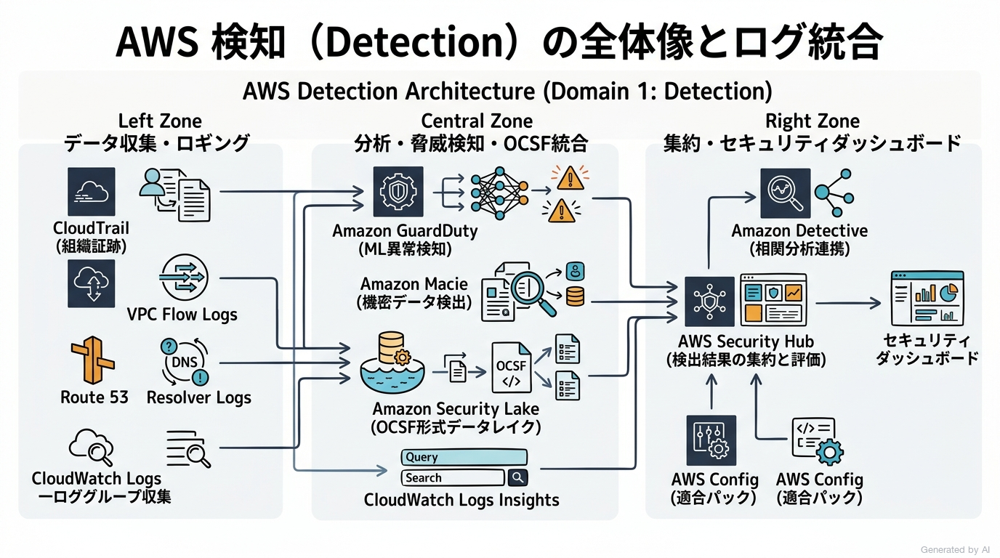
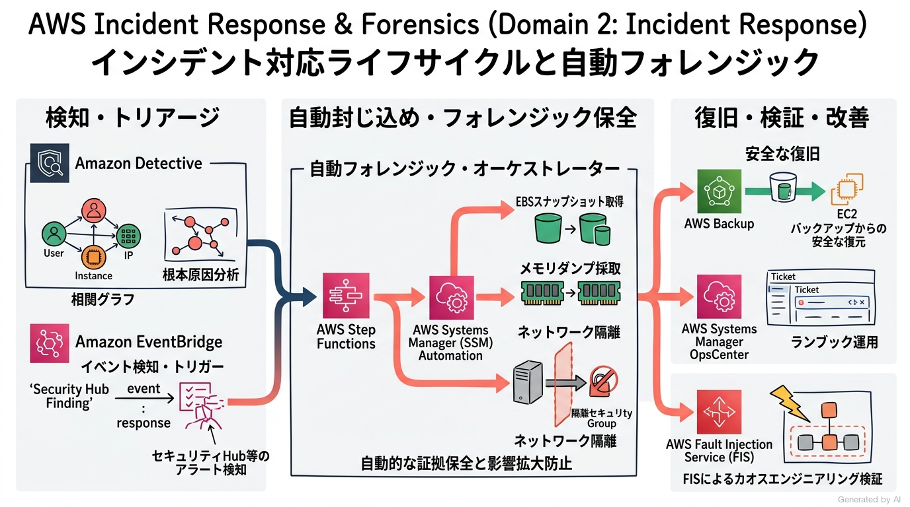
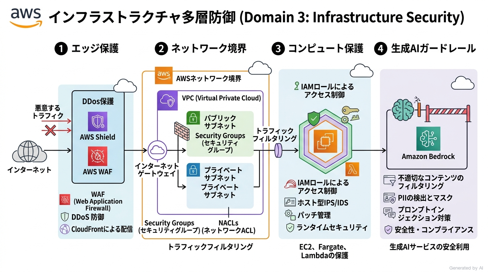
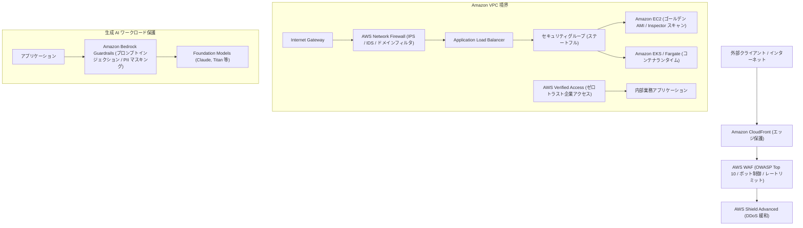
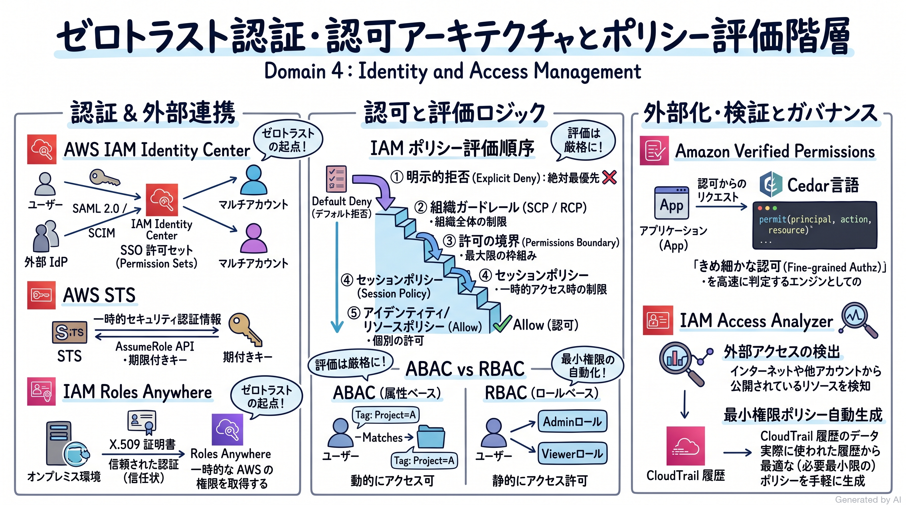
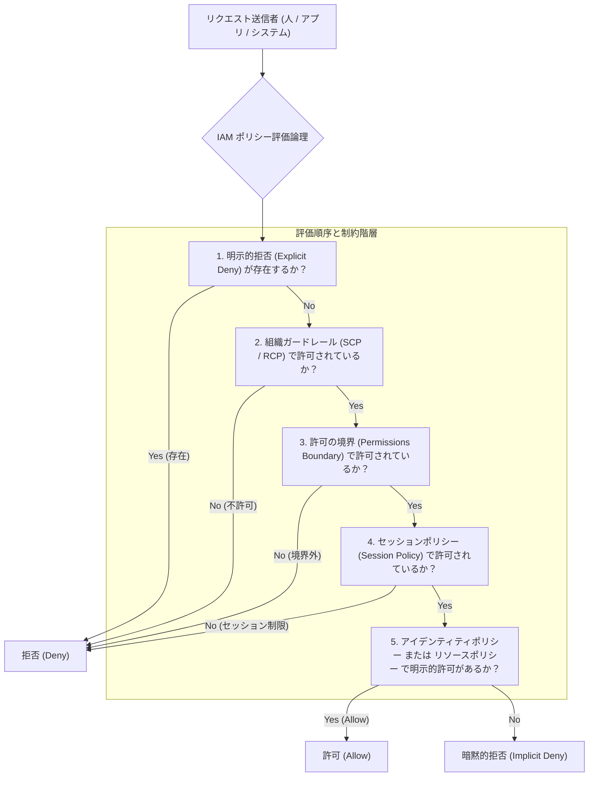
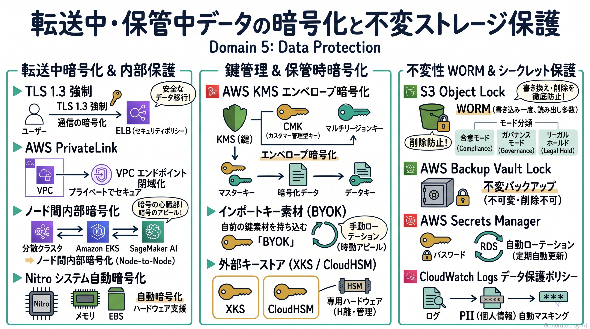
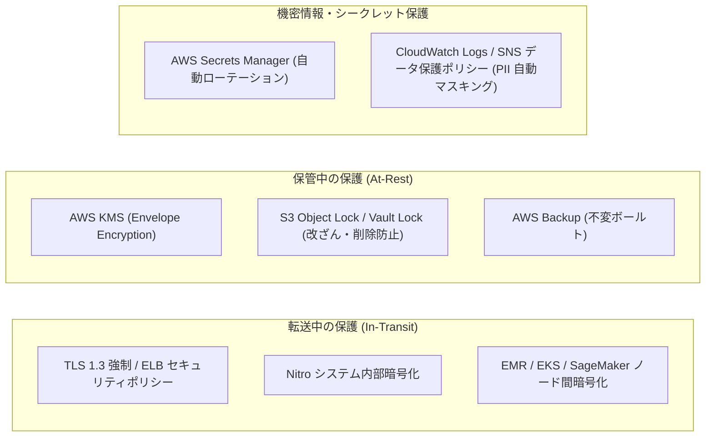
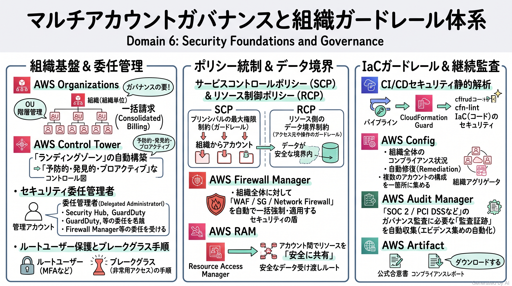
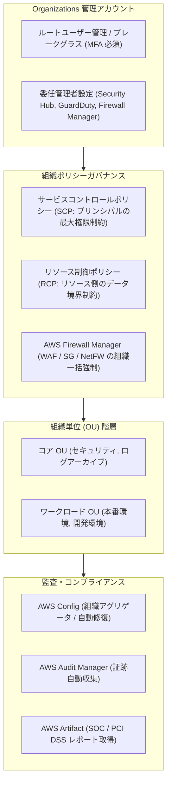

# AWS Certified Security - Specialty (SCS-C03) 完全対策＆実践学習ガイド

- **対象資格**: AWS Certified Security - Specialty
- **試験コード**: SCS-C03
- **公式試験ガイド**: [AWS Certified Security - Specialty (SCS-C03) Exam Guide](https://docs.aws.amazon.com/aws-certification/latest/security-specialty-03/security-specialty-03.html)
- **最終更新日**: 2026-10-11

---

## はじめに

現代のエンタープライズにおけるクラウドアーキテクチャは、境界防御型モデルから「ゼロトラスト（Zero Trust）」原則への完全な移行を遂げています。急速に拡大するマルチアカウント環境、分散マイクロサービス、コンテナやサーバーレス基盤、さらには基盤モデルを活用した生成 AI（Generative AI）アプリケーションに至るまで、攻撃対象領域（Attack Surface）はかつてないほど複雑化かつ多層化しています。このような環境下において、セキュリティは単なる運用上のチェック項目ではなく、システム全体の設計思想そのものであり、ビジネスのアジリティと堅牢性を両立するための最大の要となります。

本学習ガイドは、AWS 公式試験ガイド（SCS-C03）の最新改定内容に完全準拠し、AWS クラウドにおける高度なセキュリティアーキテクチャの設計・実装・運用・インシデント対応能力を体系的に習得できるよう構成されています。

### AWS Certified Security - Specialty 試験とは

AWS Certified Security - Specialty (SCS-C03) は、AWS 環境におけるワークロード、データ、インフラ、アイデンティティを保護するためのセキュリティソリューションの設計、実装、運用、トラブルシューティング能力を検証するスペシャリティレベルの認定資格です。

- **試験時間**: 170 分
- **出題問題数**: 65 問（採点対象: 50 問 / 未採点テスト設問: 15 問）
- **出題形式**: 択一選択問題（4つの選択肢から1つ選択）、複数選択問題（5つ以上の選択肢から2つ以上選択）
- **合格基準点**: 100〜1,000 点中 750 点以上
- **前提知識**:
  - AWS セキュリティサービス、暗号化技術、アクセス制御に関する 2 年以上の設計・実装・運用実務経験
  - クラウド共有責任モデル、多層防御、ゼロトラストアーキテクチャに関する深い理解
  - AWS KMS、CloudHSM による鍵ライフサイクル管理、エンタープライズ ID フェデレーション、ネットワーク境界制御の設計経験

### SCS-C02 から SCS-C03 への主要改定ポイント

前バージョンの SCS-C02 と比較して、SCS-C03 では以下の大規模な刷新が行われています：

1. **ドメイン構造の論理的再編**:
   - 旧「脅威検知とインシデント対応」「セキュリティログとモニタリング」が再編され、**Domain 1: 検知（Detection: 16%）** と **Domain 2: インシデント対応（Incident Response: 14%）** に明確に分離されました。ログの収集・分析・トラブルシューティングは Domain 1 に統合され、Domain 2 はトリアージ・証拠保全・自動隔離・根本原因分析に特化しています。
   - Domain 6 の名称が「マネジメントとセキュリティガバナンス」から「セキュリティの基盤とガバナンス」へ改称されました。
2. **最新クラウドセキュリティ技術の試験範囲追加**:
   - **生成 AI アプリケーションの保護とガードレール**: Task 3.2.7（Amazon Bedrock Guardrails、GenAI OWASP Top 10 for LLM Applications への対策）。
   - **オープン標準セキュリティデータレイク**: Task 3.1.4（Open Cybersecurity Schema Framework [OCSF] 形式によるエッジログ統合、Amazon Security Lake）。
   - **組織規模のリソース境界制御**: Task 6.1.3（リソース制御ポリシー [RCP: Resource Control Policies]）。
   - **ゼロトラスト認証・認可**: Task 4.1 / 4.2（Amazon Verified Permissions、Cedar ポリシー言語、IAM Roles Anywhere、AWS Verified Access）。
   - **内部・分散クラスタ通信の暗号化**: Task 5.1.3（Amazon EMR、Amazon EKS、SageMaker AI のノード間暗号化、Nitro 暗号化）。
   - **機密データマスキング**: Task 5.3.4（CloudWatch Logs データ保護ポリシー、SNS メッセージデータ保護）。
   - **鍵管理の厳格な要件**: Task 5.3.2 / 5.3.3（インポートキー [BYOK] と AWS 生成キーの完全比較、外部キーストア [XKS]）。

### 難易度と求められる思考力

当試験の難易度は、AWS 認定資格の中でも最上位クラスに位置づけられます。単なるセキュリティサービスの機能名称や設定手順の暗記だけでは合格することは極めて困難であり、以下のような複合的な判断力が厳格に問われます：

1. **多層防御と責任境界のトレードオフ判断**:
   - 「どこで防ぐのが最も適切か（エッジの WAF か、ネットワークの Security Group / Network Firewall か、アプリ層の認可か）」というレイヤー別の最適解判断。
   - セキュリティ強度、運用負荷、コスト、レイテンシのバランスを踏まえたアーキテクチャ選定。
2. **権限評価論理の厳密なトレードオフ判断**:
   - 明示的拒否（Explicit Deny）> SCP / RCP > 許可の境界（Permissions Boundary）> セッションポリシー > アイデンティティベースポリシー / リソースベースポリシーという認可評価順序の正確なトレース。
   - ABAC（属性ベース）と RBAC（ロールベース）の運用適合性の比較。
3. **インシデント発生時のフォレンジックと自動修復手順**:
   - 侵害が疑われる EC2 インスタンスや認証情報に対し、「証拠を保全しながら即時隔離する」ための正しい技術順序（メモリダンプ → EBS スナップショット → 隔離 SG 適用 → 認証情報無効化）。

### 推奨の勉強法

1. **ピラミッド原則に基づいた体系的理解**:
   各ドメインの「セクション概要」「重要キーワード」「重要トピック」を精読し、各サービスがセキュリティライフサイクルの中で果たす役割を論理的に整理します。
2. **構造化実践シナリオを通じた思考プロセスの習得**:
   各セクションに収録した実践シナリオ（状況・対応・結果・解説）を読み解き、「なぜその構成が選ばれるのか」に加え、「なぜ他の選択肢では要件を満たせないのか（棄却理由）」を完全に理解します。
3. **一次ドキュメントと実機ハンズオンによる挙動の確認**:
   各セクション末尾に提示した AWS 公式ドキュメントおよび AWS Skill Builder のラボを通じて、コンソールや CLI での実際の設定パラメータと挙動を体感します。

---

## 目次

1. [はじめに](#はじめに)
2. [学習カリキュラム・出題範囲ロードマップ](#学習カリキュラム出題範囲ロードマップ)
3. [Domain 1: 検知（Detection） (16%)](#domain-1-検知detection-16)
   - [1. セクション概要](#1-セクション概要)
   - [2. 重要トピック](#2-重要トピック)
   - [3. 実践シナリオ](#3-実践シナリオ)
   - [4. 参考ドキュメント & 推奨ハンズオン](#4-参考ドキュメント--推奨ハンズオン)
4. [Domain 2: インシデント対応（Incident Response） (14%)](#domain-2-インシデント対応incident-response-14)
   - [1. セクション概要](#1-セクション概要-1)
   - [2. 重要トピック](#2-重要トピック-1)
   - [3. 実践シナリオ](#3-実践シナリオ-1)
   - [4. 参考ドキュメント & 推奨ハンズオン](#4-参考ドキュメント--推奨ハンズオン-1)
5. [Domain 3: インフラストラクチャセキュリティ（Infrastructure Security） (18%)](#domain-3-インフラストラクチャセキュリティinfrastructure-security-18)
   - [1. セクション概要](#1-セクション概要-2)
   - [2. 重要トピック](#2-重要トピック-2)
   - [3. 実践シナリオ](#3-実践シナリオ-2)
   - [4. 参考ドキュメント & 推奨ハンズオン](#4-参考ドキュメント--推奨ハンズオン-2)
6. [Domain 4: アイデンティティおよびアクセス管理（Identity and Access Management） (20%)](#domain-4-アイデンティティおよびアクセス管理identity-and-access-management-20)
   - [1. セクション概要](#1-セクション概要-3)
   - [2. 重要トピック](#2-重要トピック-3)
   - [3. 実践シナリオ](#3-実践シナリオ-3)
   - [4. 参考ドキュメント & 推奨ハンズオン](#4-参考ドキュメント--推奨ハンズオン-3)
7. [Domain 5: データ保護（Data Protection） (18%)](#domain-5-データ保護data-protection-18)
   - [1. セクション概要](#1-セクション概要-4)
   - [2. 重要トピック](#2-重要トピック-4)
   - [3. 実践シナリオ](#3-実践シナリオ-4)
   - [4. 参考ドキュメント & 推奨ハンズオン](#4-参考ドキュメント--推奨ハンズオン-4)
8. [Domain 6: セキュリティの基盤とガバナンス（Security Foundations and Governance） (14%)](#domain-6-セキュリティの基盤とガバナンスsecurity-foundations-and-governance-14)
   - [1. セクション概要](#1-セクション概要-5)
   - [2. 重要トピック](#2-重要トピック-5)
   - [3. 実践シナリオ](#3-実践シナリオ-5)
   - [4. 参考ドキュメント & 推奨ハンズオン](#4-参考ドキュメント--推奨ハンズオン-5)
9. [まとめと推奨学習ステップ](#まとめと推奨学習ステップ)

---

## 学習カリキュラム・出題範囲ロードマップ

### セクション一覧と出題比率

| セクション番号 | セクション名 / 出題分野 | 出題比率 | 主要対象サービス・ツール |
| :--- | :--- | :--- | :--- |
| **Domain 1** | 検知（Detection） | 16% | Amazon GuardDuty, AWS Security Hub, Amazon Security Lake, AWS CloudTrail, CloudWatch Logs, Amazon Macie, AWS Config |
| **Domain 2** | インシデント対応（Incident Response） | 14% | Amazon Detective, Automated Forensics Orchestrator for EC2, Systems Manager OpsCenter, EventBridge, Step Functions, AWS FIS |
| **Domain 3** | インフラストラクチャセキュリティ | 18% | AWS WAF, AWS Shield, CloudFront, AWS Network Firewall, Verified Access, EC2 Image Builder, Inspector, Bedrock Guardrails |
| **Domain 4** | アイデンティティおよびアクセス管理 | 20% | AWS IAM, IAM Identity Center, STS, IAM Roles Anywhere, Amazon Verified Permissions, Permissions Boundaries, Access Analyzer |
| **Domain 5** | データ保護（Data Protection） | 18% | AWS KMS (CMK/BYOK/XKS), CloudHSM, Private CA, S3 Object Lock, Secrets Manager, CloudWatch Logs データ保護 |
| **Domain 6** | セキュリティの基盤とガバナンス | 14% | AWS Organizations, Control Tower, SCP, RCP, Firewall Manager, RAM, AWS Config, Audit Manager, Artifact |

---

### セクション別出題詳細

#### Domain 1: 検知（Detection） (16%)
- **出題の狙い**: AWS アカウントおよび組織全体における網羅的なロギング基盤の設計、脅威検知・異常検出の自動化、およびログ分析パイプラインのトラブルシューティング能力を評価します。
- **主要タスク**:
  - Task 1.1: AWS アカウントまたは組織のモニタリングおよびアラート戦略を設計・実装する
  - Task 1.2: ロギングソリューションを設計・実装する
  - Task 1.3: セキュリティモニタリング、ロギング、およびアラートのトラブルシューティング
- **重要キーワード**: Amazon GuardDuty, AWS Security Hub, Amazon Security Lake, OCSF (Open Cybersecurity Schema Framework), AWS CloudTrail 組織証跡, CloudWatch Logs Insights, Amazon Macie, Route 53 Resolver DNS Firewall

#### Domain 2: インシデント対応（Incident Response） (14%)
- **出題の狙い**: セキュリティ侵害発生時における影響範囲の迅速なトリアージ、フォレンジックアーティファクト（メモリダンプ、ディスクスナップショット）の完全性保全、自動修復・封じ込め、および根本原因分析（RCA）の設計・実行能力を評価します。
- **主要タスク**:
  - Task 2.1: インシデント対応計画を設計およびテストする
  - Task 2.2: セキュリティイベントに対応する
- **重要キーワード**: Amazon Detective, Automated Forensics Orchestrator for Amazon EC2, AWS Systems Manager (Automation / OpsCenter), Amazon EventBridge, AWS Step Functions, EBS スナップショット暗号化共有, AWS Fault Injection Service (FIS)

#### Domain 3: インフラストラクチャセキュリティ（Infrastructure Security） (18%)
- **出題の狙い**: エッジ層（CDN/WAF/DDoS防御）、コンピュート層（EC2/コンテナ/Lambda/生成AIモデル）、およびネットワーク層（VPC/ファイアウォール/ゼロトラストアクセス）における多層防御アーキテクチャの設計・実装・トラブルシューティング能力を評価します。
- **主要タスク**:
  - Task 3.1: ネットワークエッジサービスのセキュリティコントロールを設計・実装・トラブルシューティングする
  - Task 3.2: コンピュートワークロードのセキュリティコントロールを設計・実装・トラブルシューティングする
  - Task 3.3: ネットワークセキュリティコントロールを設計およびトラブルシューティングする
- **重要キーワード**: AWS WAF (マネージドルール / レートベース / ボット制御), AWS Shield Advanced, Amazon CloudFront (OAC / セキュリティヘッダー), AWS Network Firewall, AWS Verified Access, EC2 Image Builder, Amazon Inspector, Amazon Bedrock Guardrails, GenAI OWASP Top 10

#### Domain 4: アイデンティティおよびアクセス管理（Identity and Access Management） (20%)
- **出題の狙い**: 最小権限の原則に基づく認証および認可アーキテクチャの設計、エンタープライズ IdP とのフェデレーション、高度なポリシー評価論理の適用、および権限昇格リスクの排除能力を評価します。
- **主要タスク**:
  - Task 4.1: 認証戦略を設計・実装・トラブルシューティングする
  - Task 4.2: 認可戦略を設計・実装・トラブルシューティングする
- **重要キーワード**: AWS IAM Identity Center, AWS STS (AssumeRole / AssumeRoleWithWebIdentity), IAM Roles Anywhere, Amazon Verified Permissions (Cedar 言語), ABAC (属性ベースアクセス制御), RBAC (ロールベースアクセス制御), 許可の境界 (Permissions Boundaries), セッションポリシー, IAM Access Analyzer

#### Domain 5: データ保護（Data Protection） (18%)
- **出題の狙い**: 転送中および保管中データの暗号化、暗号鍵ライフサイクルの厳格な管理（KMS / CloudHSM / 外部キーストア）、データの改ざん防止（WORM）、シークレットの安全な保管と自動ローテーション、および機密データのマスキング能力を評価します。
- **主要タスク**:
  - Task 5.1: 転送中データのコントロールを設計・実装する
  - Task 5.2: 保管中データのコントロールを設計・実装する
  - Task 5.3: 機密データ、認証情報、シークレット、暗号鍵素材を保護するコントロールを設計・実装する
- **重要キーワード**: AWS KMS (カスタマー管理型キー / マルチリージョンキー / BYOK / XKS), AWS CloudHSM, S3 Object Lock (合意モード / ガバナンスモード / リーガルホールド), AWS Secrets Manager (自動ローテーション), AWS Private CA, ノード間内部暗号化 (EMR/EKS/SageMaker), CloudWatch Logs データ保護ポリシー

#### Domain 6: セキュリティの基盤とガバナンス（Security Foundations and Governance） (14%)
- **出題の狙い**: マルチアカウント環境における集中管理アーキテクチャ、ランディングゾーンとガードレールの展開、組織レベルの予防的・発見的統制、IaC セキュリティパイプライン、および継続的コンプライアンス監査能力を評価します。
- **主要タスク**:
  - Task 6.1: AWS アカウントを集中的にデプロイおよび管理する戦略を策定する
  - Task 6.2: クラウドリソースの安全で一貫したデプロイ戦略を実装する
  - Task 6.3: AWS リソースのコンプライアンスを評価する
- **重要キーワード**: AWS Organizations, AWS Control Tower, サービスコントロールポリシー (SCP), リソース制御ポリシー (RCP), AWS Firewall Manager, AWS RAM, AWS Config (適合パック / 自動修復), AWS Audit Manager, AWS Artifact, ルートユーザー管理・ブレークグラス手順

---

## Domain 1: 検知（Detection） (16%)

クラウド環境におけるセキュリティの第一歩は、発生している事象を漏れなく可視化し、異常な振る舞いや既知の攻撃パターンを即座に検知することです。本セクションでは、AWS のマネージド脅威検知サービス（Amazon GuardDuty）、機密データ検出（Amazon Macie）、ログの統合とオープン標準（Amazon Security Lake と OCSF）、およびセキュリティ状態の集中評価（AWS Security Hub）を組み合わせた、堅牢な監視・ロギングパイプラインの設計とトラブルシューティングを体系化します。

---

### 1. セクション概要

現代の大規模マルチアカウント環境では、個別のアカウントごとにログを収集・分析することは運用上の破綻を招きます。組織全体のログを中央のセキュリティアカウントへ安全かつ効率的に集約し、機械学習アルゴリズムや脅威インテリジェンスフィードを活用して異常をリアルタイムに炙り出すアーキテクチャが不可欠です。

ピラミッド原則に基づく検知アーキテクチャの階層は以下の通りです：
1. **データソース層（Data Ingestion）**: AWS CloudTrail（API 呼び出し履歴）、VPC Flow Logs（ネットワーク通信）、Amazon Route 53 Resolver クエリログ（DNS 要求履歴）、CloudWatch Logs（OS・アプリログ）。
2. **分析・脅威検知層（Analysis & Threat Detection）**: Amazon GuardDuty による機械学習ベースの異常検出、Amazon Macie による S3 内の個人情報・機密データスキャン、AWS Config による設定変更の追跡。
3. **データレイク・正規化層（Data Lake & Normalization）**: Amazon Security Lake による Open Cybersecurity Schema Framework (OCSF) への自動正規化と長期保管。
4. **集約・可視化層（Aggregation & Governance）**: AWS Security Hub による重要度スコアリング、セキュリティ標準（CIS Benchmark, FSBP）に対するコンプライアンス評価、およびアラート発報。

#### 重要キーワード

- **Amazon GuardDuty**: VPC Flow Logs、DNS ログ、CloudTrail 管理イベント/データイベント、EKS 監査ログ、RDS ログインイベント、Lambda 実行イベントを自動解析し、機械学習と脅威インテリジェンスを用いて侵害や不正利用を検知するインテリジェント脅威検出サービス。
- **AWS Security Hub**: AWS サービスおよびサードパーティ製品からのセキュリティ検出結果（Findings）を統合し、AWS 基本セキュリティのベストプラクティス（FSBP）や CIS AWS Foundations Benchmark に基づいて一元評価・管理するポスチャマネジメント（CSPM）サービス。
- **Amazon Security Lake**: 組織横断のセキュリティログを自動的に S3 へ集約し、OCSF（Open Cybersecurity Schema Framework）形式に正規化・パーティショニングして保管するセキュリティ専用データレイクサービス。
- **AWS CloudTrail 組織証跡 (Organization Trail)**: AWS Organizations の管理アカウントまたは委任管理者から、組織内のすべてのメンバーアカウントおよび全リージョンの API イベントを一括記録・集中転送する証跡。
- **Amazon CloudWatch Logs Insights**: 大規模なロググループに対して高スループットな対話型クエリを実行し、正規表現抽出、集計、グラフ化を可能にするサーバーレスクエリエンジン。
- **Amazon Macie**: 機械学習とパターンマッチングを活用して、Amazon S3 バケット内に存在する個人識別情報（PII）や認証情報などの機密データを自動検出・分類・保護するデータセキュリティサービス。
- **AWS Config 適合パック (Conformance Packs)**: 複数の AWS Config ルールと修復アクションを 1 つの YAML パックとしてパッケージ化し、組織全体に一括展開してコンプライアンス適合率を継続測定する機能。

---

### 2. 重要トピック

#### 1. 統合セキュリティログ基盤と OCSF (Open Cybersecurity Schema Framework)

エンタープライズにおける最大の課題の一つは、サービスごとにログ形式（スキーマ）が異なり、相関分析やサードパーティ SIEM（Splunk, Datadog 等）への取り込みに膨大な ETL コストが発生することでした。

SCS-C03 で重点評価される **Amazon Security Lake** は、この課題を解決するために OCSF オープン標準を採用しています：
- **ソースの自動収集**: VPC Flow Logs、CloudTrail、Route 53 Resolver ログ、GuardDuty Findings、Security Hub Findings、EKS 監査ログをエージェントレスで自動収集。
- **OCSF 形式への正規化**: JSON やテキスト形式の異種ログを Apache Parquet 形式および OCSF スキーマ（Event Class, Activity ID, Actor, Target など）に自動変換。
- **クエリの効率化**: Apache Iceberg 互換のテーブル形式でパーティショニングされ、Amazon Athena や Amazon OpenSearch Service から標準 SQL で高速・低コストに直接クエリが可能。

#### 2. 脅威検知・分析サービスの選定・比較マトリクス

| 比較項目 / サービス | Amazon GuardDuty | AWS Security Hub | Amazon Security Lake | Amazon CloudWatch Logs Insights | Amazon Macie |
| :--- | :--- | :--- | :--- | :--- | :--- |
| **主要役割** | 機械学習・インテリジェンスによる脅威検知 | 検出結果の集約・セキュリティ基準評価 (CSPM) | OCSF 準拠のセキュリティデータレイク構築 | ログの対話型リアルタイム検索・集計 | S3 データ内の機密情報 (PII) 検出 |
| **入力ソース** | CloudTrail, VPC Flow, DNS, EKS, RDS, S3 等 | GuardDuty, Inspector, Macie, IAM Access Analyzer, サードパーティ | 各種 AWS ログ, サードパーティセキュリティログ | CloudWatch Logs ロググループ | Amazon S3 オブジェクトデータ |
| **運用形態** | 完全マネージド（エージェント不要・数クリック有効化） | 委任管理者による組織一括有効化 | 委レン管理者による集中レイク設定 | オンデマンドクエリ課金 | 自動検出ジョブ / 継続的評価 |
| **保持期間 / 出力** | 90 日間保持、EventBridge へ出力 | 90 日間保持、EventBridge へ出力 | S3 ライフサイクルに従い無制限保管 | ロググループの保持設定に従う | 検出結果を Security Hub / EventBridge 出力 |
| **主なユースケース** | 暗号通貨マイニング、クレデンシャル漏洩、DNS トンネリング検知 | コンプライアンス適合率スコア測定、統合トリアージ | 長期セキュリティ証拠保管、SIEM / Athena 分析 | 障害調査、特定 IP アドレスのアクセス追跡 | 個人情報漏洩防止、GDPR / PCI DSS 準拠 |

- **アーキテクトの選定基準**:
  - 不審な通信や権限悪用を自動的に検知したい場合は **Amazon GuardDuty** を選定します。
  - 複数サービスや複数アカウントのアラートを一元化し、CIS ベンチマーク準拠状況を評価したい場合は **AWS Security Hub** を選定します。
  - 長期的なログ保管、マルチクラウド横断の相関分析、オープン標準形式でのクエリ基盤が必要な場合は **Amazon Security Lake** を選定します。
  - S3 バケット内に保護されていないクレジットカード番号や個人情報が格納されていないか監査したい場合は **Amazon Macie** を選定します。

---

### 3. 実践シナリオ

#### シナリオ 1-1: マルチアカウント組織における集中脅威検知と自動アラート通知

- **状況**: AWS Organizations 配下に 50 以上のアカウントを運用しており、全アカウント・全リージョンで発生するセキュリティインシデントを一元的に検知・集約し、高重要度のアラートのみをセキュリティ運用チーム（SOC）の Slack および PagerDuty へ即座に通知する仕組みを最小の運用負荷で構築したい場合
- **対応**: Organizations の管理アカウントからセキュリティ専用アカウントを Amazon GuardDuty および AWS Security Hub の委任管理者（Delegated Administrator）として指定し、新規アカウント作成時にも自動有効化されるよう設定する。セキュリティアカウント側で Amazon EventBridge ルールを作成し、Security Hub の Finding において `Severity.Label = "CRITICAL" または "HIGH"` かつ `RecordState = "ACTIVE"` のイベントをフィルタリングして Amazon SNS トピック経由で通知する。
- **結果**: 組織内の全アカウントにおける脅威検知とセキュリティ基準評価がセキュリティアカウントに自動集約され、運用チームは重要度の高いインシデントにのみ即時対応可能な体制が確立される。
- **解説**: AWS Organizations と連携した GuardDuty および Security Hub の委任管理者機能を利用することで、個別アカウントでの設定作業やカスタム集約スクリプトの保守を完全に排除できるためです。EventBridge で Security Hub の標準化された Finding スキーマ（ASFF: AWS Security Finding Format）をフィルタリングすることにより、アラート疲れ（Alert Fatigue）を回避しつつ重大インシデントのみを確実に通知できます。各メンバーアカウント側で個別に SNS や CloudWatch アラームを構成する代替案は、アカウント増減に伴う設定漏れが発生し、運用オーバーヘッドが著しく増大するため不適格です。
- **参考ドキュメント**:
  - [Managing GuardDuty accounts with AWS Organizations](https://docs.aws.amazon.com/guardduty/latest/ug/guardduty_organizations.html): 組織連携によるマルチアカウント集中管理の仕様
  - [AWS Security Hub delegated administrator](https://docs.aws.amazon.com/securityhub/latest/userguide/securityhub-delegated-admin.html): Security Hub 委任管理者の設定と自動有効化

#### シナリオ 1-2: AWS Config 適合パックによる継続的セキュリティベースライン評価

- **状況**: 金融業界の規制要件を満たすため、すべての AWS アカウントにおいて「S3 バケットのパブリックアクセス禁止」「EBS ボリュームのデフォルト暗号化」「ルートアカウントの MFA 有効化」などのセキュリティベースラインが維持されているかを一括評価し、違反発生時に即時検知したい場合
- **対応**: AWS Organizations の管理アカウントから、AWS Config 適合パック（Conformance Packs）として「Operational-Best-Practices-for-CIS-AWS-Foundations-Benchmark」またはカスタム YAML テンプレートを組織全体（Organization Conformance Pack）に向けてデプロイする。ルール違反（NON_COMPLIANT）が発生した際は、EventBridge 経由で AWS Systems Manager Automation ランブックを呼び出し、自動修復を実行する。
- **結果**: 組織配下の全アカウント・全リージョンに対して同一のコンプライアンスベースラインが均一に強制され、設定ドリフトや非準拠リソースがリアルタイムに是正される。
- **解説**: Organization Conformance Pack を利用することで、個々のアカウントにルールを個別にプロビジョニングすることなく、単一の宣言型テンプレートから組織横断でルールと修復アクションを一貫して展開できるためです。手動での IAM ポリシー検査や CloudTrail ログの事後検索による代替案では、リソース作成時の設定ミスをプロアクティブに評価・修正できず、監査要件を満たせないため不適格です。
- **参考ドキュメント**:
  - [AWS Config Conformance Packs](https://docs.aws.amazon.com/config/latest/developerguide/conformance-packs.html): 適合パックの作成と組織全体への展開仕様

#### シナリオ 1-3: OCSF 準拠の Amazon Security Lake による長期セキュリティログデータレイクの構築

- **状況**: 企業全体のセキュリティログ（CloudTrail, VPC Flow Logs, Route 53 Resolver ログ）を複数年にわたり長期保管しつつ、サードパーティ SIEM ツールおよび内部セキュリティアナリストが標準 SQL で高速・低コストに横断検索できる分析基盤を確立したい場合
- **対応**: セキュリティアカウントにおいて Amazon Security Lake を有効化し、組織全体のデータソースを自動取り込み対象として構成する。Security Lake はログを自動的に OCSF 準拠の Apache Parquet 形式に変換し、日付およびアカウント単位でパーティショニングされた Amazon S3 バケットに格納する。分析クエリ用には Amazon Athena を接続し、外部 SIEM には AWS Lake Formation のきめ細かなアクセス制御（タグベースアクセス制御）を通じて安全なサブスクライバーアクセスを提供する。
- **結果**: 異種ログのスキーマ変換にかかる膨大なカスタム ETL パイプラインの開発・運用コストが不要となり、OCSF 標準による一貫した高速クエリ環境と低コストな長期データ保管が実現される。
- **解説**: Amazon Security Lake が OCSF 形式への正規化と Apache Parquet/Iceberg 最適化を自動実行するため、クエリパフォーマンスが最大化され、Athena でのスキャンデータ量（課金対象）が大幅に削減されるためです。CloudWatch Logs に全ログを無制限に保持し続ける代替案は、ログ取り込みおよび保持コストが極めて高額になる上、異種ログ間のスキーマ統一が困難であるため不適格です。また、自前の EMR や Glue でカスタム変換パイプラインを構築する代替案は、継続的な運用保守負荷が過大となるため推奨されません。
- **参考ドキュメント**:
  - [Amazon Security Lake User Guide](https://docs.aws.amazon.com/security-lake/latest/userguide/what-is-security-lake.html): OCSF スキーマ連携とサブスクライバー設定

#### シナリオ 1-4: 大規模 VPC フローログおよび DNS クエリログの Athena / CloudWatch Logs Insights 最適化

- **状況**: 外部からの標的型攻撃が疑われるインシデントにおいて、過去 24 時間に特定の悪意あるパブリック IP アドレス（例: C2 サーバー）と通信を行った社内 VPC 内のプライベート IP アドレスおよび通信ポートを、数億件のフローログから 10 分以内に特定したい場合
- **対応**: S3 に 1 分間隔（Aggregation Interval: 60 秒）で出力されている VPC フローログに対し、Amazon Athena のパーティション射影（Partition Projection）が設定された外部テーブルを用いて、日付・時間・アカウント ID を絞り込んだ SQL クエリを実行する。直近数十分の極めてリアルタイムな通信の追跡には、VPC フローログを CloudWatch Logs にも配信するよう構成し、CloudWatch Logs Insights を用いて `filter @message like /悪意あるIP/ | stats count(*) by srcAddr, dstPort` の形式で即時クエリを実行する。
- **結果**: 数億レコードに及ぶ膨大な通信ログの中から、スキャンデータ量を最小限に抑えつつ、該当する内部インスタンスと通信タイムスタンプを数分以内に特定できる。
- **解説**: Athena のパーティション射影を使用することで、S3 上のディレクトリメタデータの探索オーバーヘッドを排除し、指定した時間帯のデータブロックのみを直接高速スキャンできるためです。また、VPC フローログの集約間隔をデフォルトの 10 分から 1 分（60 秒）に短縮することで、直近の攻撃活動に対する検知レイテンシを極小化できます。EC2 インスタンスにログインして tcpdump ログを収集する代替案や、S3 から全ログを手動ダウンロードして grep する代替案は、インスタンス台数が多い環境では現実的な時間内に調査を完了できないため不適格です。
- **参考ドキュメント**:
  - [Querying Amazon VPC Flow Logs using Amazon Athena](https://docs.aws.amazon.com/athena/latest/ug/vpc-flow-logs.html): パーティション射影による高速検索の構成

#### シナリオ 1-5: CloudTrail 組織証跡におけるログ配信遅延・パーミッション障害のトラブルシューティング

- **状況**: セキュリティ監査中に、特定のメンバーアカウントにおける一部の機密 S3 バケットへの `GetObject` 操作が、中央のログ記録用 S3 バケット内の CloudTrail ログに記録されていないことが判明した場合
- **対応**: まず CloudTrail 証跡の設定を確認し、管理イベント（Management Events）だけでなく、対象 S3 バケットをスコープに含む「データイベント（Data Events）」が明示的に有効化されているかを検証する。次に、ログ保存先 S3 バケットのバケットポリシーを検証し、対象メンバーアカウントからの `cloudtrail.amazonaws.com` サービスプリンシパルによる `s3:PutObject` 権限、および S3 バケットを暗号化している AWS KMS キーポリシーに CloudTrail サービスによる `kms:GenerateDataKey*` 権限が付与されているかを確認・修正する。
- **結果**: S3 データイベントが正確に記録され、バケットポリシーおよび KMS キーポリシーの権限不足に起因するログ書き込みエラーが解消される。
- **解説**: CloudTrail のデフォルト設定では管理イベント（API 制御プレーン）のみが記録され、S3 オブジェクト操作や Lambda 実行などの高頻度なデータイベントは明示的に追加指定しない限り記録されないためです。さらに、組織証跡において保存先 S3 バケットが KMS カスタマー管理型キー（CMK）で暗号化されている場合、KMS キーポリシー側で各アカウントおよび CloudTrail サービスに対する適切な鍵使用許可が定義されていないと、アクセス拒否（Access Denied）によりログ配信が静かに停止します。CloudWatch エージェントの再起動を行う代替案は、CloudTrail のサービスアーキテクチャと無関係であるため障害を解決できません。
- **参考ドキュメント**:
  - [Logging data events with CloudTrail](https://docs.aws.amazon.com/awscloudtrail/latest/userguide/logging-data-events-with-cloudtrail.html): S3 データイベントの有効化手順
  - [Troubleshooting CloudTrail](https://docs.aws.amazon.com/awscloudtrail/latest/userguide/cloudtrail-troubleshooting.html): バケットポリシーおよび KMS 権限起因の障害解決

---

### 4. 参考ドキュメント & 推奨ハンズオン

#### 公式一次ドキュメント
- [Amazon GuardDuty ユーザーガイド](https://docs.aws.amazon.com/guardduty/latest/ug/what-is-guardduty.html): 機械学習と脅威インテリジェンスによる異常検出の仕様
- [AWS Security Hub ユーザーガイド](https://docs.aws.amazon.com/securityhub/latest/userguide/what-is-securityhub.html): セキュリティ基準評価と ASFF 連携のアーキテクチャ
- [Amazon Security Lake ユーザーガイド](https://docs.aws.amazon.com/security-lake/latest/userguide/what-is-security-lake.html): OCSF フォーマットとデータレイク管理
- [AWS CloudTrail ユーザーガイド](https://docs.aws.amazon.com/awscloudtrail/latest/userguide/cloudtrail-user-guide.html): 組織証跡とデータイベントの設定原則

#### 推奨ハンズオン・ラボ（実機検証）
- **AWS Skill Builder: Amazon GuardDuty and AWS Security Hub Deep Dive**:
  - **学習目標**: 委任管理者アカウントを設定し、組織全体の脅威検知・コンプライアンス評価を有効化する。EventBridge ルールを用いて特定重要度の検出結果を自動通知するパイプラインを構築する。
- **AWS Skill Builder: Analyzing Logs with CloudWatch Logs Insights and Athena**:
  - **学習目標**: VPC フローログおよび CloudTrail ログに対してパーティション射影を設定し、複雑な条件によるクエリ実行とレスポンス速度の最適化を体感する。

## Domain 2: インシデント対応（Incident Response） (14%)

セキュリティインシデントが実際に発生した際、被害の拡大を最小限に抑え（Containment）、法的に有効な証拠を改ざんなく保全し（Forensics）、迅速にシステムを安全な状態へ復旧させる能力が問われます。SCS-C03 では旧バージョンから独立したドメインとして「インシデント対応」が新設され、Amazon Detective による根本原因分析、Automated Forensics Orchestrator による自動化、および AWS Fault Injection Service (FIS) による復元力テストが重点評価項目となっています。

---

### 1. セクション概要

インシデント対応における黄金原則は、「封じ込め（Containment）と証拠保全（Evidence Preservation）の順序を誤らないこと」および「人的ミスを排除するためのランブックの自動化（Automation）」です。

ピラミッド原則に基づくインシデント対応の階層は以下の通りです：
1. **準備・事前検証層（Preparation & Testing）**: 最小権限のインシデント対応用 IAM ロール、Systems Manager OpsCenter による標準運用手順書（SOP/Runbook）、AWS FIS によるカオスエンジニアリング検証。
2. **検知・トリアージ層（Detection & Triage）**: GuardDuty や Security Hub のアラートを EventBridge がトリガーし、インシデントの重大度と影響範囲（Blast Radius）を即時判定。
3. **自動封じ込め・保全層（Automated Containment & Forensics）**: Automated Forensics Orchestrator for Amazon EC2、AWS Step Functions、SSM Automation による「メモリダンプ採取 → EBS スナップショット作成 → 隔離用セキュリティグループ適用」。
4. **根本原因分析・復旧層（Root Cause Analysis & Recovery）**: Amazon Detective によるグラフベースの振る舞い分析、侵害されたクレデンシャルの無効化、クリーンな AMI またはバックアップからの安全な再構築。

#### 重要キーワード

- **Amazon Detective**: VPC Flow Logs、CloudTrail、GuardDuty Findings を自動的に取り込み、機械学習とグラフ理論を用いてアカウント、IP、IAM ロール、EC2 間の関係性とタイムラインを可視化する根本原因分析（RCA）サービス。
- **Automated Forensics Orchestrator for Amazon EC2**: 侵害された EC2 インスタンスに対して、メモリダンプの採取、EBS ボリュームのスナップショット作成、フォレンジック専用アカウントへの安全な転送を自動実行する AWS 提供のソリューション。
- **AWS Systems Manager OpsCenter**: クラウド環境における運用項目（OpsItem）を統合管理し、あらかじめ定義された SSM Automation ランブックと連携してインシデント対応を体系化する運用管理基盤。
- **隔離用セキュリティグループ (Isolation Security Group)**: すべてのインバウンド・アウトバウンドトラフィックを拒否（インバウンド・アウトバウンドともにルールなし）し、侵害されたインスタンスが C2 サーバーと通信したりラテラルムーブメント（横展開）を行うのを防ぐセキュリティグループ。
- **AWS Fault Injection Service (FIS)**: 実稼働またはステージング環境において障害（EC2 停止、ネットワーク遅延、IAM ポリシー拒否など）を意図的に注入し、インシデント対応プロセスとシステムの復元力を検証するカオスエンジニアリングサービス。
- **AWS Shield Advanced SRT (Shield Response Team)**: 大規模な DDoS 攻撃が発生した際に、AWS の DDoS 専門エンジニアチームが顧客に代わって WAF ルールの作成・適用や緩和措置を 24 時間体制で支援するプレミアムサポート機能。

---

### 2. 重要トピック

#### 1. EC2 フォレンジック証拠保全と隔離の厳格な手順

侵害が疑われるホストに対して、安易にインスタンスの「停止（Stop）」や「終了（Terminate）」を行ってはなりません。揮発性データ（メモリ上のマルウェアコード、アクティブなネットワーク接続、復号された暗号鍵など）が完全に消失してしまうためです。

正しいフォレンジック手順は以下のステップを厳格に順守します：
1. **メモリダンプの採取**: インスタンスを稼働させたまま、AWS Systems Manager Run Command 等を用いて揮発性メモリ（RAM）をダンプし、改ざん防止機能付きの S3 バケット（Object Lock 有効）へ保存する。
2. **ディスクの証拠保全**: すべての接続 EBS ボリュームに対してスナップショットを作成する。スナップショットを KMS カスタマー管理型キー（CMK）で暗号化し、フォレンジック専用の隔離アカウントへ共有する。
3. **ネットワークの隔離**: インスタンスに設定されているセキュリティグループを、インバウンド・アウトバウンドともにルールが存在しない「隔離セキュリティグループ」へ差し替える。ネットワークインターフェース（ENI）を削除したり再起動してはならない。
4. **Auto Scaling からの切り離し**: 対象インスタンスが Auto Scaling グループに所属している場合、Auto Scaling による自動終了（ヘルスチェック失敗時の強制終了）を防ぐため、インスタンスを「スタンバイ（Standby）」状態にするか、グループからデタッチする。

#### 2. インシデント対応・調査サービスの選定・比較マトリクス

| 比較項目 / サービス | Amazon Detective | Automated Forensics Orchestrator | Systems Manager OpsCenter | AWS Shield Advanced | AWS Fault Injection Service (FIS) |
| :--- | :--- | :--- | :--- | :--- | :--- |
| **主要役割** | グラフベースの根本原因分析 (RCA) | EC2 メモリ・ディスクの自動フォレンジック | インシデントチケット・ランブック実行 | DDoS 緩和・SRT 支援 | 障害注入・インシデント対応検証 |
| **トリガー方式** | コンソール分析 / GuardDuty リンク | EventBridge (GuardDuty Finding トリガー) | EventBridge / CloudWatch / 手動 | トラフィック異常検知・Route 53 ヘルス | 手動実行 / CI/CD スケジュール |
| **対象リソース** | アカウント, IAM, IP, EC2, EKS | Amazon EC2 インスタンス | 全 AWS リソース | CloudFront, Route 53, ALB, EIP | EC2, RDS, EKS, IAM, ネットワーク |
| **証拠の保全** | 1 年間の相関グラフ履歴保持 | S3 (Object Lock), EBS スナップショット | OpsItem 履歴・実行ログ | トラフィックメトリクス・攻撃ログ | 実行レポート・CloudWatch メトリクス |
| **主なユースケース** | 攻撃経路特定、影響を受けたリソースの追跡 | マルウェア感染時の自動証拠収集・隔離 | 運用インシデントの体系的追跡・手動/自動解決 | L3/L4/L7 大規模 DDoS 攻撃からの保護 | 避難訓練・フェイルオーバー復旧手順の事前検証 |

- **アーキテクトの選定基準**:
  - GuardDuty が検知したアラートの前後関係、関与した IAM ロール、通信先 IP の全体相関を視覚的に特定したい場合は **Amazon Detective** を選定します。
  - 感染ホストのメモリとストレージを、人の手を介さずに数分以内に保全・隔離したい場合は **Automated Forensics Orchestrator** を選定します。
  - レイヤー 7 の高度な DDoS 攻撃に対して、AWS エンジニアの介入（SRT）とコスト保護（Cost Protection）が必要な場合は **AWS Shield Advanced** を選定します。
  - インシデント対応ランブックが実環境で機能するか事前にテストしたい場合は **AWS Fault Injection Service (FIS)** を選定します。

---

### 3. 実践シナリオ

#### シナリオ 2-1: 侵害された EC2 インスタンスの自動フォレンジック保全とネットワーク隔離

- **状況**: 暗号通貨マイニングや不正な C2 通信を行うマルウェアへの感染が疑われる EC2 インスタンスが本番環境で GuardDuty により検知された際、証拠を破壊することなく自動的かつ即座に隔離およびフォレンジックデータを収集したい場合
- **対応**: GuardDuty の高重要度 Finding をトリガーとする Amazon EventBridge ルールを作成し、AWS Step Functions ステートマシンを起動する。ステートマシン内で Systems Manager Run Command を実行してインスタンスの揮発性メモリダンプを採取して S3（Object Lock 有効）へアップロードした後、接続されている全 EBS ボリュームのスナップショットを作成する。その後、インスタンスのセキュリティグループを「全インバウンド・アウトバウンドトラフィックを不許可とする隔離セキュリティグループ」に変更し、Auto Scaling グループからデタッチする。
- **結果**: 運用担当者が介入する前に数分以内にフォレンジックデータが確実に保全され、感染ホストの外部通信および横展開（ラテラルムーブメント）が完全に封じ込められる。
- **解説**: インスタンスを停止・再起動するとメモリ内のプロセス情報やネットワーク接続状態などの極めて重要な揮発性アーティファクトが消去されてしまうためです。Step Functions と Systems Manager を組み合わせて「メモリダンプ採取 → EBS スナップショット作成 → 隔離セキュリティグループ適用」の順序を自動化することで、人間の初動遅れやオペレーションミスによる証拠滅失と感染拡大を防ぐことができます。インスタンスを即座に Terminate（終了）または Stop（停止）する代替案は、フォレンジック調査が不可能になるため重大なアンチパターンです。
- **参考ドキュメント**:
  - [Automated Forensics Orchestrator for Amazon EC2](https://aws.amazon.com/solutions/implementations/automated-forensics-orchestrator-for-amazon-ec2/): 自動フォレンジックパイプラインのアーキテクチャ
  - [AWS Security Incident Response Guide](https://docs.aws.amazon.com/whitepapers/latest/aws-security-incident-response-guide/welcome.html): インシデント対応の公式ベストプラクティス

#### シナリオ 2-2: Amazon Detective による侵害スコープとグラフベース根本原因分析

- **状況**: GuardDuty が「IAMUser/AnomalousBehavior」を検知し、ある IAM ユーザーのアクセスキーが悪用された可能性があるが、どの IP アドレスから、いつ、どのリソースに対して不正な API 操作が行われ、どの EC2 インスタンスや S3 バケットがアクセスされたかの全体スコープを迅速に調査したい場合
- **対応**: セキュリティアカウントで Amazon Detective を有効化し、GuardDuty の Finding から直接 Detective 調査画面へピボットする。Detective のグラフモデルを用いて、該当 IAM ユーザーの「API 呼び出し量の異常値」「普段と異なるアクセス元 IP / ジオロケーション」「関連する EC2 インスタンスや VPC ネットワーク接続」の相関タイムラインを分析し、侵害の影響範囲を特定する。
- **結果**: 複数の CloudTrail ログや VPC フローログを手動で結合・集計することなく、侵害されたアクセスキーによる影響範囲（スコープ）と攻撃者の足取りを数分で特定できる。
- **解説**: Amazon Detective は過去 1 年分の CloudTrail 管理/データイベント、VPC Flow Logs、GuardDuty 検出結果を自動的にグラフデータベースとしてモデル化しており、通常時の挙動ベースラインと異常値の比較を直感的なグラフとして提示できるためです。CloudWatch Logs Insights や Athena で生の JSON ログを手動検索する代替案は、相関分析に膨大な時間と複雑なクエリ設計を要し、迅速なトリアージが求められるインシデント初期対応において遅れを生じさせるため不適格です。
- **参考ドキュメント**:
  - [Amazon Detective User Guide](https://docs.aws.amazon.com/detective/latest/userguide/what-is-detective.html): 根本原因分析とグラフモデルの活用

#### シナリオ 2-3: AWS Shield Advanced による DDoS 攻撃トリアージと自動レイヤー 7 緩和

- **状況**: 大規模なキャンペーン期間中に、パブリック向け ALB および CloudFront ディストリビューションに対して毎秒数十万リクエストの未知の HTTP フラッド攻撃（L7 DDoS）が発生し、通常のトラフィックがタイムアウトしている場合
- **対応**: 対象リソースで AWS Shield Advanced を有効化し、あらかじめ AWS WAF と統合した「レイヤー 7 DDoS 自動緩和（Automatic L7 DDoS Mitigation）」を有効にしておく。攻撃発生時、Shield Advanced は機械学習を用いて正常トラフィックと攻撃トラフィックのプロファイルをリアルタイム分析し、攻撃シグネチャをブロックするカスタム WAF ルールを WAF Web ACL に自動作成・適用する。必要に応じて AWS Shield Response Team (SRT) にサポートケースをエスカレーションし、プロアクティブなトリアージを要請する。
- **結果**: 正常なユーザーアクセスを阻害することなく、突発的な HTTP フラッド攻撃が数分以内に自動緩和され、インフラの利用料急増に対する DDoS コスト保護（DDoS Cost Protection）も適用される。
- **解説**: Shield Advanced の Automatic L7 DDoS Mitigation 機能は、トラフィックパターンから攻撃の特徴（ヘッダー、リクエスト構造）を学習して WAF ルールを動的に注入するため、人間がルールを作成するまでのタイムラグをゼロにできるためです。また、SRT への事前のリソースアクセス権限付与（SRT Support Role）を行うことで、専門家による即時介入が可能となります。標準の AWS WAF ルールのみに依存する代替案では、未知の分散型 L7 攻撃のシグネチャを手動特定・チューニングする必要があり、サービス停止時間を防ぎきれないため不適格です。
- **参考ドキュメント**:
  - [AWS Shield Advanced User Guide](https://docs.aws.amazon.com/waf/latest/developerguide/ddos-overview.html): L7 自動緩和と SRT 連携の設計

#### シナリオ 2-4: 侵害された IAM 認証情報の即時無効化とアクティブセッション切断

- **状況**: 開発者の長期 IAM アクセスキーがパブリックリポジトリに誤ってコミットされ、不正な API 呼び出しが検知されたため、該当アクセスキーの即時無効化だけでなく、既にそのキーから発行された可能性のあるすべての一時的セキュリティ認証情報（STS セッション）を即座に失効させたい場合
- **対応**: まず IAM コンソールまたは CLI から該当アクセスキーを直ちに `Inactive`（非アクティブ）または削除する。続いて、該当 IAM ユーザーまたはロールに対して、`aws:CurrentTime` が「現在時刻」より前のすべてのセッションを無効化するインラインポリシー（`Principal` に該当エンティティを指定し、`Condition: {"DateLessThan": {"aws:TokenIssueTime": "現在時刻のタイムスタンプ"}}` で全アクションを `Deny` とするポリシー）をアタッチする。
- **結果**: 漏洩したアクセスキーが即座に使用不能になるとともに、過去に発行された有効期限内の STS 一時トークンを用いた既存のセッションもすべて即座に拒否される。
- **解説**: IAM アクセスキーを削除または非アクティブ化するだけでは、攻撃者が事前に `sts:GetSessionToken` や `sts:AssumeRole` で取得した一時的セキュリティ認証情報（最大 12 時間有効）は失効せず、有効期限が切れるまで悪用され続けるためです。`aws:TokenIssueTime` 条件を用いた明示的拒否（Explicit Deny）ポリシーを適用することで、過去に発行されたすべての STS セッションを即座に無効化できます。単にパスワードを変更したりアクセスキーを無効化するだけの代替案は、STS セッションの継続利用を防げないため致命的な脆弱性を残します。
- **参考ドキュメント**:
  - [Revoking IAM role temporary security credentials](https://docs.aws.amazon.com/IAM/latest/UserGuide/id_credentials_temp_control-access_revoke-tokens.html): STS セッションの即時無効化手順

#### シナリオ 2-5: AWS Fault Injection Service (FIS) を用いたインシデント対応計画のカオス検証

- **状況**: 定義されたインシデント対応ランブックやフェイルオーバー手順が、本番環境の突発的な障害時にも想定通りに機能するかを安全かつ制御された環境下で定期検証したい場合
- **対応**: AWS Fault Injection Service (FIS) で実験テンプレートを作成し、特定の EC2 インスタンスの強制終了、パケットロス・遅延の注入、RDS のフェイルオーバー、および特定の IAM ロールへのアクセス拒否ポリシーの一時的注入をターゲットとして定義する。実験中は CloudWatch アラームと連携した「停止条件（Stop Conditions）」を設定し、想定外のサービス劣化が発生した場合は自動的に実験をロールバックする仕組みを組み込む。
- **結果**: 実稼働システムに予測不能な障害を与えることなく、自動復旧スクリプト、アラート検知、および SOC チームの初動対応プロセスが期待通りに動作することを定期的に検証・改善できる。
- **解説**: AWS FIS は AWS が提供する安全なフルマネージドカオスエンジニアリングサービスであり、停止条件（ロールバックガードレール）が組み込まれているため、制御不能な障害拡大を防ぎながらインシデント対応能力を実証できるためです。手動で本番リソースを削除したり停止させる代替案は、人的ミスによる予期せぬ二次災害リスクが高く、停止条件の自動化も困難であるため推奨されません。
- **参考ドキュメント**:
  - [AWS Fault Injection Service User Guide](https://docs.aws.amazon.com/fis/latest/userguide/what-is.html): 制御された障害シミュレーションの設計

---

### 4. 参考ドキュメント & 推奨ハンズオン

#### 公式一次ドキュメント
- [Amazon Detective ユーザーガイド](https://docs.aws.amazon.com/detective/latest/userguide/what-is-detective.html): インシデント調査とグラフ分析
- [AWS Systems Manager Incident Manager ガイド](https://docs.aws.amazon.com/incident-manager/latest/userguide/what-is-incident-manager.html): インシデント対応プロセスの標準化
- [AWS Shield Advanced 開発者ガイド](https://docs.aws.amazon.com/waf/latest/developerguide/shield-chapter.html): DDoS 防御と自動 L7 緩和
- [AWS Fault Injection Service ユーザーガイド](https://docs.aws.amazon.com/fis/latest/userguide/what-is.html): カオスエンジニアリング実験の構成

#### 推奨ハンズオン・ラボ（実機検証）
- **AWS Skill Builder: Incident Response in AWS**:
  - **学習目標**: 侵害された EC2 インスタンスの検知から、EventBridge と Step Functions による自動メモリダンプ採取、EBS スナップショット取得、隔離セキュリティグループ差し替えの一連のフローを構築する。
- **AWS Skill Builder: Root Cause Analysis with Amazon Detective**:
  - **学習目標**: Detective の調査コンソールを操作し、IAM ユーザーの異常行動および関連リソースのタイムライングラフを読み解く手順を習得する。

## Domain 3: インフラストラクチャセキュリティ（Infrastructure Security） (18%)

クラウドインフラの保護においては、ネットワーク境界におけるトラフィック制御、コンピュートホストおよびコンテナの脆弱性管理、安全なリモート管理、そして最新の生成 AI アプリケーションに対するガードレールの確立に至る「多層防御（Defense in Depth）」の思想が不可欠です。本セクションでは、エッジからネットワーク内部、ホストランタイムに至る各層の防御メカニズムとトラブルシューティングを体系化します。

---

### 1. セクション概要

インフラストラクチャセキュリティの核心は、「単一のセキュリティ対策に依存しない」ことです。エッジ層で大規模なトラフィックや一般的な Web 攻撃を遮断し、VPC 境界で詳細なディープパケットインスペクションを実施し、コンピュート層ではセキュアにビルドされた不変のベースイメージ（ゴールデン AMI）と継続的な脆弱性スキャンを適用します。さらに、昨今急速に普及している大規模言語モデル（LLM）アプリケーションに対しては、プロンプトインジェクションや有害出力を防ぐ専用のガードレールを組み込みます。

#### 重要キーワード

- **AWS WAF**: Web アプリケーションに対する SQL インジェクション、クロスサイトスクリプティング（XSS）、HTTP フラッド、悪意のあるボットトラフィックを検査・遮断するレイヤー 7 ファイアウォール。
- **Amazon CloudFront オリジンアクセス制御 (OAC)**: S3 バケットや ALB などのオリジンに対して、CloudFront ディストリビューションからのみの通信を安全に制限・署名（SigV4）する認証メカニズム。
- **AWS Network Firewall**: VPC 全体のトラフィック（North-South および East-West）に対してステートフルインスペクション、侵入防止システム（IPS/IDS）、およびドメインリストによる外部通信フィルタリングを提供するマネージドネットワークセキュリティサービス。
- **AWS Verified Access**: 従来の VPN を使用することなく、ユーザーのアイデンティティ（IdP）およびデバイスのセキュリティ状態（EDR 等）を評価して、内部アプリケーションへの安全なゼロトラストアクセスを提供するサービス。
- **EC2 Image Builder**: セキュリティパッチの適用やコンポーネントの強化（CIS ベンチマーク準拠など）が施されたゴールデン AMI やコンテナイメージの構築・テスト・配布を自動化するパイプラインサービス。
- **Amazon Inspector**: EC2 インスタンス、Amazon ECR コンテナイメージ、および AWS Lambda 関数のソフトウェア脆弱性（CVE）や意図しないネットワーク露出を自動的かつ継続的にスキャンする脆弱性管理サービス。
- **Amazon Bedrock Guardrails**: 生成 AI アプリケーションにおいて、プロンプトインジェクション、ジェイルブレイク（脱獄）、不適切な有害コンテンツ、および PII（個人識別情報）の流出を遮断するカスタマイズ可能なセキュリティガードレール。

---

### 2. 重要トピック

#### 1. 生成 AI ワークロードの保護と Amazon Bedrock Guardrails

SCS-C03 で新たに追加された重要トピックが「生成 AI アプリケーションの保護」です。従来の Web アプリケーション脆弱性（OWASP Top 10）とは異なり、LLM 特有の脅威（OWASP Top 10 for LLM Applications）に対応する必要があります。

主要な脅威と Amazon Bedrock Guardrails による防御アプローチは以下の通りです：
- **プロンプトインジェクション（Prompt Injection）**: システムプロンプトを上書きして不正な動作を強制する攻撃。GuardDuty / Bedrock Guardrails の「Prompt Attack Filter」が入力プロンプトを自然言語解析し、攻撃を自動ブロック。
- **機密情報の漏洩（Sensitive Information Disclosure）**: モデルの出力から個人情報（電話番号、氏名、カード番号）や機密データが漏洩するリスク。正規表現および機械学習モデルを用いて、出力を即座に検知・マスキング（またはブロック）。
- **有害コンテンツおよびトピック制御（Denied Topics）**: 投資助言や医療判断など、企業が許可しない特定トピックに関するプロンプトおよび応答を、自然言語定義の拒否トピックフィルタで制御。
- **ハルシネーション（Hallucination）の低減**: コンテキストグラウンディングチェック（Contextual Grounding Check）により、モデルの応答が参照元の検索ドキュメント（RAG コンテキスト）に事実として基づいているかをリアルタイムに検証。

#### 2. ネットワーク境界およびアクセス制御比較マトリクス

| 比較項目 / 方式 | セキュリティグループ (SG) | ネットワーク ACL (NACL) | AWS Network Firewall | AWS Verified Access |
| :--- | :--- | :--- | :--- | :--- |
| **動作レイヤー** | レイヤー 4（トランスポート層） | レイヤー 4（トランスポート層） | レイヤー 3〜7（アプリケーション層） | レイヤー 7（アイデンティティ・デバイス） |
| **状態管理** | **ステートフル**（戻りトラフィック自動許可） | **ステートレス**（戻りポートも明示許可必須） | **ステートフル ＋ ステートレス両対応** | **コンテキスト認識型（ゼロトラスト）** |
| **適用スコープ** | ENI（インスタンス単位） | サブネット単位 | VPC / Transit Gateway 境界 | アプリケーション単位（ALB 等の前段） |
| **ルール評価順序** | すべてのルールを評価して合致を許可（拒否不可） | 番号順に評価し最初の合致で判定（許可/拒否） | ルールグループの優先度順に Suricata 互換評価 | Cedar ポリシー言語による認可評価 |
| **主な用途** | ホスト単位のきめ細かなポート開放 | サブネット全体のブロック（特定 IP 拒否） | アウトバウンド FQDN 制御、IPS/IDS 侵入防止 | 社内 Web アプリへの VPN レスセキュアアクセス |

- **アーキテクトの選定基準**:
  - ホスト間の通信を最小限のポート・プロトコルで許可したい場合は **セキュリティグループ** を選定します。
  - 特定の悪意ある IP アドレスや CIDR ブロック全体からのアクセスをサブネット手前で即座に拒否したい場合は **ネットワーク ACL** を選定します。
  - アウトバウンド通信を特定の許可ドメイン（FQDN: 例 `*.repo.aws`）のみに限定したり、不正な通信シグネチャを検知・遮断（IPS）したい場合は **AWS Network Firewall** を選定します。
  - 従業員が外出先から社内 Web アプリケーションにアクセスする際、VPN クライアントの管理を廃止し、IdP 認証および端末状態（EDR 正常性）に基づいてアクセス制御したい場合は **AWS Verified Access** を選定します。

---

### 3. 実践シナリオ

#### シナリオ 3-1: AWS WAF と CloudFront によるグローバルエッジ防御とボット・ブルートフォース対策

- **状況**: グローバル展開する Web アプリケーションのログインエンドポイント（`/login`）に対し、分散 IP アドレスからのクレデンシャルスタッフィング（パスワードスプレー）およびブルートフォース攻撃が集中し、認証バックエンドが過負荷になっている場合
- **対応**: Amazon CloudFront ディストリビューションに関連付けられた AWS WAF Web ACL を構成する。AWS マネージドルール（AWSManagedRulesCommonRuleSet および AWSManagedRulesBotControlRuleSet）を適用し、`/login` URI パスに対してクライアント IP ごとに 5 分間で 100 リクエストを上限とするレートベースルール（Rate-based Rule）を適用して超過分をブロック（CAPTCHA または Block アクション）する。CloudFront 側ではオリジンアクセス制御（OAC）を設定し、ALB への直接アクセスを遮断して CloudFront 経由のトラフィックのみを許可する。
- **結果**: 悪意のあるボットおよび高頻度のクレデンシャルスタッフィング攻撃がエッジ層で自動遮断され、オリジンサーバーの負荷とアカウント乗っ取りリスクが大幅に低減する。
- **解説**: AWS WAF のレートベースルールを URI パス固有のスコープ（`/login`）に限定して適用することで、通常の Web 閲覧トラフィックに影響を与えることなく攻撃トラフィックのみを正確にブロックできるためです。また、CloudFront の OAC およびオリジン側の検証（カスタムシークレットヘッダーやセキュリティグループ制限）を組み合わせることで、攻撃者が CloudFront/WAF をバイパスしてオリジンへ直接攻撃パケットを送信する抜け穴を完全に排除できます。ALB 側のセキュリティグループのみで防御する代替案は、分散 IP からの L7 アプリケーション層攻撃を IP アドレスだけで識別・遮断できないため不適格です。
- **参考ドキュメント**:
  - [AWS WAF Rate-based rule statements](https://docs.aws.amazon.com/waf/latest/developerguide/waf-rule-statement-type-rate-based.html): レート制限ルールの設計と構成
  - [Amazon CloudFront Origin Access Control (OAC)](https://docs.aws.amazon.com/AmazonCloudFront/latest/DeveloperGuide/private-content-restricting-access-to-s3.html): オリジン保護のベストプラクティス

#### シナリオ 3-2: EC2 Image Builder と Amazon Inspector によるゴールデン AMI 自動生成・継続的脆弱性スキャン

- **状況**: エンタープライズのコンプライアンス要件として、本番環境にデプロイされるすべての EC2 インスタンスが CIS ベンチマークに準拠したセキュアな OS 設定を持ち、既知の重大脆弱性（CVE）を含まないことを保証し、デプロイ後も継続的に脆弱性を監視したい場合
- **対応**: EC2 Image Builder パイプラインを構築し、ベース OS に対して最新のセキュリティパッチ適用、CIS ベンチマーク強化スクリプトの実行、および CloudWatch エージェント/SSM エージェントの組み込みを行うレシピを定義する。ビルドテストフェーズで Amazon Inspector による脆弱性評価を実施し、重大度 HIGH 以上の脆弱性が検出された場合は AMI の共有・公開をパイプラインで自動停止する。合格した AMI は AWS RAM または組織共有を通じて各アカウントに配布し、デプロイ後も各アカウントで有効化された Amazon Inspector が継続的に脆弱性を自動スキャンする。
- **結果**: 組織全体で安全性が検証されたゴールデン AMI のみが使用され、デプロイ後も新しく公表された脆弱性がリアルタイムに検知される体制が自動化される。
- **解説**: EC2 Image Builder によりイメージのビルド・テスト・検証を CI/CD 的に自動化し、Amazon Inspector のエージェントレス/SSM スキャンと組み合わせることで、OS の設定不備と既知の CVE を本番適用前にプロアクティブに排除できるためです。さらに、デプロイ後も Inspector が継続的にスキャンするため、ゼロデイ脆弱性やデプロイ後に公表された CVE にも即時対応できます。手動で EC2 を起動して設定・スナップショット化する代替案は、パッチの更新漏れや設定ドリフトが発生し、再現性が失われるため不適格です。
- **参考ドキュメント**:
  - [EC2 Image Builder User Guide](https://docs.aws.amazon.com/imagebuilder/latest/userguide/what-is-image-builder.html): ゴールデン AMI パイプラインの自動化
  - [Amazon Inspector User Guide](https://docs.aws.amazon.com/inspector/latest/user/what-is-inspector.html): 継続的脆弱性管理のアーキテクチャ

#### シナリオ 3-3: Amazon Bedrock Guardrails による生成 AI アプリケーションのプロンプトインジェクション防御

- **状況**: 社内外向けに Bedrock の基盤モデル（Claude 等）を用いたカスタマーサポートチャットボットを構築しているが、悪意あるユーザーによるプロンプトインジェクション（システム指示の書き換えや脱獄プロンプト）や、顧客のマイナンバー・クレジットカード番号などの機密情報がチャット経由で外部流出するのを確実に防ぎたい場合
- **対応**: Amazon Bedrock Guardrails でガードレールを作成し、Prompt Attack Filter（プロンプト攻撃フィルタ）の強度を HIGH に設定する。さらに、機密情報フィルタ（Sensitive Information Filters）で PII エンティティ（クレジットカード、メールアドレス、電話番号、国固有の身分証明書番号等）を定義し、ユーザー入力およびモデル応答の双方に対して「マスク（Mask）」または「ブロック（Block）」アクションを適用する。アプリケーション側の推論 API 呼び出し時に、該当 Guardrail ID およびバージョンを指定して適用する。
- **結果**: 攻撃者によるプロンプトインジェクションやジェイルブレイクの試行がモデルに到達する前に遮断され、機密データがログやチャット応答に平文で露出するリスクが完全に防止される。
- **解説**: Amazon Bedrock Guardrails は GenAI OWASP Top 10 for LLM Applications（特に LLM01: Prompt Injection および LLM06: Sensitive Information Disclosure）に特化したマネージド保護機能を提供し、モデルの手前で入出力を自然言語解析および正規表現ルールで評価するためです。アプリケーションの Python コード内で自前の正規表現チェックを行う代替案は、高度で巧妙な自然言語によるプロンプトインジェクションや難読化された攻撃文を見抜くことができず、安全性を担保できないため不適格です。
- **参考ドキュメント**:
  - [Amazon Bedrock Guardrails User Guide](https://docs.aws.amazon.com/bedrock/latest/userguide/guardrails.html): ガードレールの作成と推論への適用
  - [OWASP Top 10 for Large Language Model Applications](https://genai.owasp.org/): LLM アプリケーションのセキュリティリスク標準

#### シナリオ 3-4: AWS Network Firewall による VPC 出入口（North-South）および VPC 間（East-West）のステートフル検査

- **状況**: 金融コンプライアンスにより、プライベートサブネット内の全ワークロードからのアウトバウンドインターネット通信を厳格に監査し、承認された完全修飾ドメイン名（FQDN: 例 `*.amazonaws.com`, `repo.internal.com`）以外への外部通信を遮断しつつ、侵入検知（IDS/IPS）を実行したい場合
- **対応**: Transit Gateway または VPC 境界に専用の「検査サブネット（Inspection Subnet）」を設け、AWS Network Firewall エンドポイントを配置する。ルートテーブルを編集してインターネット向けトラフィックを Network Firewall エンドポイント経由にルーティングする。Network Firewall にステートフルルールグループを設定し、Suricata 互換ルールを用いてアウトバウンド通信の「ドメインリスト（Domain List Filtering）」を許可リスト方式（Allowlist）で定義し、不正な通信シグネチャを検知した場合はドロップ（Drop）する。
- **結果**: プロキシサーバーを自前で構築・管理することなく、完全修飾ドメイン名に基づく高スループットなアウトバウンド通信制御と IPS/IDS による脅威遮断が実現される。
- **解説**: セキュリティグループやネットワーク ACL は IP アドレスおよびポート番号レベルでのみ制御可能であり、ドメイン名（FQDN）に基づく L7 フィルタリングやパケットペイロードのシグネチャ検査を行うことができないためです。AWS Network Firewall は Suricata エンジンを搭載したフルマネージドサービスであり、自動スケールと高い可用性を維持しながら FQDN フィルタリングと侵入防止を提供します。EC2 上に Squid プロキシや iptables を自前で運用する代替案は、耐障害性・スケーラビリティの維持および OS パッチ適用の運用負荷が著しく増大するため不適格です。
- **参考ドキュメント**:
  - [AWS Network Firewall Developer Guide](https://docs.aws.amazon.com/network-firewall/latest/developerguide/what-is-aws-network-firewall.html): ステートフルルールとドメインリストの設計
  - [Deployment models for AWS Network Firewall](https://aws.amazon.com/blogs/networking-and-content-delivery/deployment-models-for-aws-network-firewall/): 検査 VPC アーキテクチャ

#### シナリオ 3-5: AWS Verified Access による VPN レス・ゼロトラスト社内アプリケーション安全公開

- **状況**: リモートワーク環境において、社内イントラネットで稼働する Web アプリケーションへのアクセスを提供しているが、レガシーなクライアント VPN の運用負荷・証明書配布コストを削減し、IdP（Microsoft Entra ID 等）によるユーザー属性認証と Jamf/CrowdStrike によるデバイス健全性評価を満たした端末からのみアクセスを許可したい場合
- **対応**: AWS Verified Access インスタンスを作成し、企業の IdP（OIDC / IAM Identity Center）およびデバイス管理システム（Device Trust Provider）を信頼プロバイダーとして統合する。内部 ALB の前段に Verified Access エンドポイントを配置し、Cedar ポリシー言語を用いて「特定の部門グループに所属するユーザー」かつ「デバイスのセキュリティパッチが最新で暗号化が有効であること」を条件とする認可ポリシーを定義する。
- **結果**: 従業員は VPN クライアントを起動することなくブラウザから直接安全に業務アプリケーションにアクセス可能となり、不正な端末や退職者による不正アクセスがリアルタイムに排除される。
- **解説**: AWS Verified Access はゼロトラスト原則に基づいてリクエストごとに「ユーザー ID」「グループ属性」「デバイスの健全性コンテキスト」を総合的に評価し、すべての条件を満たした場合のみ内部リソースへのリバースプロキシ通信を許可するためです。従来の Client VPN のみを運用する代替案では、VPN 接続が確立された時点でネットワーク層（IP/サブネット）への侵入を許してしまい、侵害端末からのラテラルムーブメントを防御できないため不適格です。
- **参考ドキュメント**:
  - [AWS Verified Access User Guide](https://docs.aws.amazon.com/verified-access/latest/ug/what-is-verified-access.html): ゼロトラストアクセスのアーキテクチャと Cedar ポリシー

---

### 4. 参考ドキュメント & 推奨ハンズオン

#### 公式一次ドキュメント
- [AWS WAF 開発者ガイド](https://docs.aws.amazon.com/waf/latest/developerguide/waf-chapter.html): Web ACL 設計とマネージドルール
- [AWS Network Firewall 開発者ガイド](https://docs.aws.amazon.com/network-firewall/latest/developerguide/what-is-aws-network-firewall.html): ステートフルインスペクションとルーティング
- [AWS Verified Access ユーザーガイド](https://docs.aws.amazon.com/verified-access/latest/ug/what-is-verified-access.html): VPN レスアクセスの構成
- [Amazon Bedrock Guardrails ユーザーガイド](https://docs.aws.amazon.com/bedrock/latest/userguide/guardrails.html): 生成 AI ガードレールの実装

#### 推奨ハンズオン・ラボ（実機検証）
- **AWS Skill Builder: Building a Perimeter Defense with AWS WAF and AWS Shield**:
  - **学習目標**: CloudFront ディストリビューションに WAF Web ACL をアタッチし、レート制限ルール、ボット制御ルール、およびカスタムブロックレスポンスをテストする。
- **AWS Skill Builder: Securing VPCs with AWS Network Firewall**:
  - **学習目標**: 検査サブネットを用いたルーティングテーブルの構成と、アウトバウンドドメインリストによる外部アクセス制御を実機検証する。

## Domain 4: アイデンティティおよびアクセス管理（Identity and Access Management） (20%)

AWS Certified Security - Specialty において出題比率 20% を占める最重要ドメインが「アイデンティティおよびアクセス管理」です。クラウド環境におけるセキュリティの最終防壁はアイデンティティであり、最小権限の原則（Least Privilege）、一時的セキュリティ認証情報（STS）の活用、属性ベースアクセス制御（ABAC）、許可の境界（Permissions Boundaries）、そして最新の Amazon Verified Permissions や IAM Roles Anywhere に至る高度な認可モデルの完全な理解が不可欠です。

---

### 1. セクション概要

AWS におけるアクセス制御は、静的なユーザーとパスワードの管理から、IdP フェデレーション、動的な一時クレデンシャル、コンテキスト認識型ポリシーへと進化を遂げました。

ピラミッド原則に基づく IAM アーキテクチャの構造は以下の通りです：
1. **アイデンティティ認証層（Authentication）**: AWS IAM Identity Center による企業 IdP（Okta, Entra ID）との統合、AWS STS による一時クレデンシャル発行、IAM Roles Anywhere による X.509 証明書認証。
2. **認可ポリシー・制約層（Authorization & Guardrails）**: サービスコントロールポリシー（SCP）、リソース制御ポリシー（RCP）、許可の境界（Permissions Boundaries）、セッションポリシー。
3. **認可戦略層（Access Control Strategies）**: ロールベースアクセス制御（RBAC）および属性ベースアクセス制御（ABAC）。
4. **検証・ガバナンス層（Verification & Governance）**: IAM Access Analyzer による外部共有リソースの検出、未使用権限の可視化、CloudTrail 履歴に基づく最小権限ポリシーの自動生成。

#### 重要キーワード

- **AWS IAM Identity Center (旧 AWS SSO)**: AWS Organizations と統合し、シングルサインオン（SSO）およびマルチアカウントへのアクセス許可セット（Permission Sets）を一元管理する推奨アイデンティティハブ。
- **AWS STS (Security Token Service)**: `AssumeRole` や `AssumeRoleWithWebIdentity` を呼び出すことで、短時間（数分〜最大 12 時間）のみ有効な一時的セキュリティ認証情報（アクセスキー、シークレットキー、セッショントークン）を発行するサービス。
- **IAM Roles Anywhere**: オンプレミスサーバー、コンテナ、または他のクラウド環境で稼働するワークロードが、自前の公開鍵基盤（PKI / X.509 証明書）を用いて AWS STS から一時的セキュリティ認証情報を安全に取得できるサービス。
- **許可の境界 (Permissions Boundaries)**: マネージドポリシーを用いて、IAM エンティティ（ユーザーまたはロール）が持ちうる最大権限を制限するガードレール。開発者にロール作成権限を委譲しつつ、管理者権限への昇格（Privilege Escalation）を防止する。
- **属性ベースアクセス制御 (ABAC)**: タグ（プリンシパルタグ、リソースタグ、環境タグ）の一致に基づいてアクセス許可を動的に判定する認可戦略。ロールやポリシーの数を増やさずにスケールする。
- **Amazon Verified Permissions**: アプリケーション内のきめ細かな認可ロジックをコードから切り離し、オープンソースの Cedar ポリシー言語を用いて一元管理・マイクロ秒単位で高速評価する認可サービス。
- **IAM Access Analyzer**: 自動推論（形式手法）を用いて、S3 バケット、KMS キー、IAM ロールなどのリソースポリシーを分析し、外部アカウントやパブリックにアクセス可能な状態を検出・警告する機能。

---

### 2. 重要トピック

#### 1. IAM ポリシーの厳格な評価論理

IAM におけるリクエストの許可・拒否の判定は、極めて厳格な評価順序に従います：
1. **デフォルトは暗黙的拒否（Implicit Deny）**: 明示的な許可（Allow）がない限り、すべてのリクエストは拒否される。
2. **明示的拒否（Explicit Deny）の絶対性**: 評価チェーンのいかなるレベル（SCP、RCP、境界、ポリシー）であっても、`Effect: Deny` に合致した時点で即座に拒否が確定する（他のすべての Allow を上書きする）。
3. **組織ガードレール（SCP / RCP）の交差**: SCP および RCP で該当アクションおよびリソースが許可されていなければ拒否される。
4. **許可の境界（Permissions Boundary）の適用**: プリンシパルに境界が設定されている場合、境界ポリシー内で明示的に Allow されているアクションのみが実行可能（境界とアイデンティティポリシーの論理積 [AND]）。
5. **セッションポリシー（Session Policy）の適用**: AssumeRole 時に渡されたセッションポリシーが存在する場合、そのセッションポリシー内でも Allow されている必要がある。
6. **アイデンティティ vs リソースポリシーの評価**:
   - **同一アカウント内**: アイデンティティベースポリシーまたはリソースベースポリシーのいずれか一方で Allow されていればアクセスが許可される。
   - **クロスアカウント（アカウント間）アクセス**: リソースベースポリシー（またはロールの信頼ポリシー）側での許可 **AND** アクセス元プリンシパルのアイデンティティポリシー側での許可の両方が必須となる。

#### 2. RBAC vs ABAC 設計比較マトリクス

| 比較項目 / 方式 | ロールベースアクセス制御 (RBAC) | 属性ベースアクセス制御 (ABAC) |
| :--- | :--- | :--- |
| **制御の基準** | 定義されたジョブロール（例: NetworkAdminRole, DevRole） | プリンシパルとリソースのタグ一致（例: `Tag:Project`） |
| **ポリシーの保守性** | プロジェクトや部門が増えるたびに新しいロール・ポリシー作成が必要 | 単一のポリシーステートメントで動的に拡張可能（作成不要） |
| **権限の付与方式** | ユーザーを特定の IAM ロールに割り当て | IdP から渡された属性（SAML/OIDC タグ）をそのままマッピング |
| **監査の容易性** | 誰がどのロールを持っているか把握しやすい | タグの付与ガバナンス（タグ付けポリシー）が厳格でないと意図しないアクセスが発生 |
| **主な適合領域** | 組織構造が固定的な少数チーム、明確な職責分離 | 急速に拡大する開発環境、多数のマルチプロジェクト共有環境 |

- **アーキテクトの選定基準**:
  - 新規プロジェクトやチームの追加に伴い IAM ロールの作成上限に直面している場合は、タグの一致（`aws:PrincipalTag/Department = aws:ResourceTag/Department`）で動的判定する **ABAC** を選定します。
  - 監査法人や厳格なコンプライアンスにより、静的なロール割り当てと明確な権限境界が求められる場合は **RBAC** を選定します。
  - アプリケーションコード内の「誰がどの記事を閲覧・編集できるか」といったエンドユーザー認可を外部化したい場合は **Amazon Verified Permissions** を選定します。

---

### 3. 実践シナリオ

#### シナリオ 4-1: IAM Identity Center と外部 IdP による一元 SSO とアクセス権限セット管理

- **状況**: 社内の全従業員が Microsoft Entra ID（旧 Azure AD）を IdP として利用しており、AWS Organizations 配下の 100 以上の AWS アカウントに対して、各ユーザーの役職に応じた適切なアクセス権限を一元的に付与・剥奪し、ユーザーが個別のアカウント用クレデンシャルを持たずに SSO できるようにしたい場合
- **対応**: Organizations の管理アカウントで AWS IAM Identity Center を有効化し、外部 IdP（Microsoft Entra ID）と SAML 2.0 連携および SCIM（System for Cross-domain Identity Management）プロビジョニングを設定する。組織内の業務職責に応じた「許可セット（Permission Sets: 例 AdministratorAccess, ViewOnlyAccess, NetworkAdmin）」を作成し、SCIM 経由で同期されたユーザーグループを対象のアカウントおよび許可セットに割り当てる。
- **結果**: 従業員は企業の認証情報を用いて AWS アクセスポータルから対象アカウントへシングルサインオン可能となり、退職時も Entra ID 側でアカウントを無効化するだけで全 AWS アカウントへのアクセスが即座に遮断される。
- **解説**: IAM Identity Center と SCIM 自動プロビジョニングを利用することで、AWS 側に個別の IAM ユーザーを作成する必要が一切なくなり、クレデンシャルのライフサイクル管理を企業 IdP に完全に集約できるためです。各 AWS アカウント内に個別の IAM ユーザーを作成してアクセスキーを発行する代替案は、退職時の権限削除漏れやアクセスキー漏洩の重大なリスクを招くため不適格です。
- **参考ドキュメント**:
  - [AWS IAM Identity Center User Guide](https://docs.aws.amazon.com/singlesignon/latest/userguide/what-is.html): 外部 IdP 連携と許可セットの構成

#### シナリオ 4-2: IAM Roles Anywhere によるオンプレミスサーバーからの長期認証情報の完全撤廃

- **状況**: オンプレミスのデータセンターで稼働するバックアップサーバーが、毎晩 AWS S3 バケットへ大量のデータを同期するために AWS CLI を実行しているが、オンプレミス環境に永続的な IAM ユーザーのアクセスキー（長期クレデンシャル）を保存することをセキュリティポリシーで禁止したい場合
- **対応**: AWS IAM Roles Anywhere を導入する。オンプレミス環境の社内プライベート認証局（Private CA または AWS Private CA）を IAM Roles Anywhere の信頼アンカー（Trust Anchor）として登録する。S3 への書き込み権限を持つ IAM ロールを作成し、その信頼ポリシーで `rolesanywhere.amazonaws.com` をプリンシパルとして許可する。オンプレミスサーバー上では、サーバーにインストールされた X.509 クライアント証明書と秘密鍵を用いて IAM Roles Anywhere 認証情報ヘルパーを実行し、一時的な STS トークンを動的に取得して S3 同期を実行する。
- **結果**: オンプレミスサーバー上に長期 IAM アクセスキーを一切保存することなく、安全な X.509 証明書認証を通じて短時間有効な一時クレデンシャルのみで AWS API を呼び出すことが可能となる。
- **解説**: IAM Roles Anywhere は既存の公開鍵暗号基盤（PKI）を活用して AWS 外部のワークロードを認証し、一時的セキュリティ認証情報（STS AssumeRole）を発行するため、オンプレミス環境におけるアクセスキー漏洩リスクを根本的に排除できるためです。ハードコードされた IAM アクセスキーをファイルに保存する代替案はポリシー違反であり、キーローテーションの運用負荷も高いため不適格です。
- **参考ドキュメント**:
  - [AWS IAM Roles Anywhere User Guide](https://docs.aws.amazon.com/rolesanywhere/latest/userguide/introduction.html): 信頼アンカーとプロファイルの構成

#### シナリオ 4-3: ABAC（属性ベースアクセス制御）による大規模組織のポリシー管理オーバーヘッド削減

- **状況**: 数十の開発プロジェクトが存在し、各開発者が自プロジェクトに属するリソース（EC2, S3, RDS）のみを起動・停止・管理できるようにしたいが、プロジェクトが新設されるたびに新しい IAM ロールや個別ポリシーを作成・修正する運用負荷を解消したい場合
- **対応**: 属性ベースアクセス制御（ABAC）を導入する。IAM Identity Center のセッションタグ機能を利用し、ユーザーの IdP 属性から `Project` タグ（例: `Project=Alpha`）を STS セッショントークンにプリンシパルタグ（`aws:PrincipalTag/Project`）として動的に渡す。共通の IAM ポリシーを作成し、リクエストを許可する条件として `Condition: {"StringEquals": {"aws:ResourceTag/Project": "${aws:PrincipalTag/Project}"}}` を定義する。さらにリソース作成時には、自身のプロジェクトタグと同一のタグを強制付与する条件を課す。
- **結果**: プロジェクトが新設された場合でも IAM ポリシーの追加・変更は一切不要となり、IdP 側でユーザーのプロジェクト属性を設定するだけで、自プロジェクトのリソースのみに対する最小権限アクセスが自動的に適用される。
- **解説**: ABAC はプリンシパルの属性とリソースの属性の一致を動的に評価するため、リソースやチームの増加に伴う IAM ポリシーの爆発的増加を防止し、運用負荷を劇的に削減できるためです。プロジェクトごとに個別の IAM ロールを作成する RBAC 代替案は、ロール数の上限到達やポリシー管理の属人化を招くため大規模環境ではスケールしません。
- **参考ドキュメント**:
  - [What is ABAC for AWS?](https://docs.aws.amazon.com/IAM/latest/UserGuide/introduction_attribute-based-access-control.html): 属性ベースアクセス制御の設計原則

#### シナリオ 4-4: 許可の境界（Permissions Boundaries）による開発者への IAM ロール作成委託と権限昇格の防止

- **状況**: アジャイル開発チームが Lambda 関数や ECS タスク用の IAM ロールを自律的に作成・変更できるようにしたいが、開発者が自身や作成したロールに `AdministratorAccess` などの過剰な権限を付与して特権昇格（Privilege Escalation）することを確実に防止したい場合
- **対応**: 管理者があらかじめ「最大許容権限を定義したマネージドポリシー（許可の境界ポリシー）」を作成する。開発者の IAM ロールに対しては、`iam:CreateRole` や `iam:PutRolePolicy` を許可する一方で、条件句 `Condition: {"StringEquals": {"iam:PermissionsBoundary": "arn:aws:iam::123456789012:policy/DeveloperBoundary"}}` を設定し、新規作成するロールに必ず該当の許可の境界をアタッチしなければ作成できないよう強制する。さらに、開発者自身が境界ポリシーを変更・デタッチできないよう明示的拒否を設定する。
- **結果**: 開発者は管理者の手を煩わせることなく必要なサービスロールを自由に作成できるが、許可の境界で定義された上限を超える権限（例: IAM 設定の変更や機密データへのアクセス）を持つロールを作成することは不可能となり、権限昇格が完全に阻止される。
- **解説**: 許可の境界はアイデンティティポリシーと AND 条件で評価されるため、開発者がポリシー内で `Action: "*"` を指定したとしても、境界ポリシーで明示的に許可されていないアクションは実行できないためです。管理者がすべてのロール作成リクエストを手動でレビュー・作成する代替案は、開発のボトルネックとなりアジリティを著しく損ないます。
- **参考ドキュメント**:
  - [Permissions boundaries for IAM entities](https://docs.aws.amazon.com/IAM/latest/UserGuide/access_policies_boundaries.html): 権限昇格防止の設計手法

#### シナリオ 4-5: Amazon Verified Permissions と Cedar ポリシーによる SaaS アプリケーションのきめ細かな認可外部化

- **状況**: マルチテナント SaaS Web アプリケーションにおいて、「テナント管理者は自テナント内のドキュメントを共有・削除できるが、一般ユーザーは閲覧のみ可能」「編集権限はプロジェクトメンバーにのみ許可」といった複雑なビジネス認可ロジックをアプリケーションのソースコード内にハードコードせず、一元管理・監査したい場合
- **対応**: Amazon Verified Permissions を導入し、ポリシーストアを作成する。認可ルールをオープンソースの Cedar ポリシー言語を用いて宣言的に記述する（例: `permit(principal, action == Action::"EditDocument", resource) when { principal.role == "Editor" && resource.tenantId == principal.tenantId };`）。アプリケーション側からは、ユーザーのリクエスト発生時に Verified Permissions の `IsAuthorized` API を呼び出し、認可判定結果（ALLOW / DENY）を取得して画面表示や処理実行を制御する。
- **結果**: アプリケーションコードから認可ロジックが完全に分離され、セキュリティ管理者やコンプライアンス担当者が Cedar ポリシーを一元的に監査・更新可能となり、コードの再デプロイなしにアクセス制御ルールを変更できるようになる。
- **解説**: Amazon Verified Permissions は Cedar エンジンによるミリ秒以下の超高速な認可判定を提供し、コードの複雑性を排除しながらエンタープライズ水準の認可ガバナンスを実現できるためです。アプリケーション内の `if/else` 文で認可ロジックを実装する代替案は、仕様変更時の修正漏れやロジックの脆弱性を生みやすく、外部監査も極めて困難であるため不適格です。
- **参考ドキュメント**:
  - [Amazon Verified Permissions User Guide](https://docs.aws.amazon.com/verifiedpermissions/latest/userguide/what-is-verifiedpermissions.html): Cedar ポリシーと言語仕様

#### シナリオ 4-6: IAM Access Analyzer による意図しない外部露出の検出と最小権限ポリシー自動生成

- **状況**: 長期運用されている AWS アカウントにおいて、過去の変更によって S3 バケット、KMS キー、または IAM ロールが意図せず組織外の別アカウントやパブリックに共有されていないかを監査し、過剰な権限を持つロールに対して実稼働 CloudTrail ログに基づいた最小権限ポリシーへ安全に絞り込みたい場合
- **対応**: 組織レベルで IAM Access Analyzer の「外部アクセスアナライザー」を有効化し、ゾーンオブトラスト（Zone of Trust: 自組織）外と共有されているすべてのリソースの検出結果（Findings）を確認して不要な共有を修正する。さらに、過剰な権限を持つ特定の IAM ロールに対して、IAM Access Analyzer の「ポリシー生成機能（Policy Generation）」を実行し、過去 90 日間の CloudTrail ログから実際に使用された API アクションのみを含む最小権限の IAM ポリシーを自動生成して差し替える。
- **結果**: 外部への意図しない情報漏洩リスクが即座に可視化・解消されるとともに、手動でのログ解析を行うことなく、実運用に基づいた完全な最小権限ポリシーが適用される。
- **解説**: IAM Access Analyzer は形式手法（数学的証明）を用いてリソースポリシーを評価するため、複雑な条件句を含むポリシーであっても外部からのアクセス可能性を確実に検出できるためです。また、CloudTrail のイベント履歴から自動生成されるポリシーを利用することで、業務停止を引き起こすことなく安全に最小権限化を達成できます。手動で IAM ポリシーを目視確認する代替案は、見落としが発生しやすく客観的な安全性を証明できないため不適格です。
- **参考ドキュメント**:
  - [Using AWS IAM Access Analyzer](https://docs.aws.amazon.com/IAM/latest/UserGuide/what-is-access-analyzer.html): 外部アクセス検出とポリシー生成

---

### 4. 参考ドキュメント & 推奨ハンズオン

#### 公式一次ドキュメント
- [IAM ポリシーの評価論理](https://docs.aws.amazon.com/IAM/latest/UserGuide/reference_policies_evaluation-logic.html): 認可決定フローの完全リファレンス
- [AWS IAM Identity Center ユーザーガイド](https://docs.aws.amazon.com/singlesignon/latest/userguide/what-is.html): シングルサインオンと許可セット
- [AWS IAM Roles Anywhere ユーザーガイド](https://docs.aws.amazon.com/rolesanywhere/latest/userguide/introduction.html): X.509 証明書ベースの認証
- [Amazon Verified Permissions ユーザーガイド](https://docs.aws.amazon.com/verifiedpermissions/latest/userguide/what-is-verifiedpermissions.html): Cedar 認可エンジン

#### 推奨ハンズオン・ラボ（実機検証）
- **AWS Skill Builder: Advanced Identity and Access Management with ABAC and Permissions Boundaries**:
  - **学習目標**: タグベースの ABAC ポリシーを構成し、許可の境界を用いて特権昇格を防ぎながら安全に IAM ロールを作成できる権限委譲を実機で体験する。
- **AWS Skill Builder: Zero Trust Architecture with IAM Roles Anywhere and Verified Permissions**:
  - **学習目標**: プライベート CA を作成してクライアント証明書を発行し、オンプレミス環境から AWS API を呼び出す手順を検証する。

## Domain 5: データ保護（Data Protection） (18%)

データの機密性（Confidentiality）、完全性（Integrity）、および可用性（Availability）を維持することは、あらゆるセキュリティ設計の究極の目的です。SCS-C03 では、保管中データ（At-Rest）および転送中データ（In-Transit）の暗号化にとどまらず、AWS KMS における鍵素材の取り扱い（インポートキー vs AWS 生成キー、外部キーストア XKS）、分散基盤（EMR/EKS/SageMaker）のノード間暗号化、S3 Object Lock によるランサムウェア耐性、および CloudWatch Logs データ保護ポリシーによる機密情報マスキングが詳細に問われます。

---

### 1. セクション概要

データ保護の設計では、「誰が復号できるか」「暗号鍵はどこで生成・保管されるか」「データが意図せず改ざん・削除されないか」を厳格にコントロールします。

ピラミッド原則に基づくデータ保護アーキテクチャの階層は以下の通りです：
1. **転送中データ保護層（Data in Transit）**: エッジから ELB/API Gateway への TLS 1.3 通信、VPC エンドポイント（AWS PrivateLink）による閉域網化、分散クラスタ内部のノード間暗号化。
2. **保管中データ暗号化層（Data at Rest）**: エンベロープ暗号化（Envelope Encryption）、AWS KMS（カスタマー管理型キー、マルチリージョンキー、インポートキー素材、外部キーストア XKS）、AWS CloudHSM。
3. **完全性・不変性保証層（Data Integrity & Immutability）**: S3 Object Lock（WORM: Write Once, Read Many）、S3 Glacier Vault Lock、AWS Backup Vault Lock によるランサムウェア対策。
4. **シークレット管理・マスキング層（Secrets Management & Masking）**: AWS Secrets Manager による認証情報の自動ローテーション、CloudWatch Logs および SNS のデータ保護ポリシーによる個人情報（PII）の自動マスキング。

#### 重要キーワード

- **エンベロープ暗号化 (Envelope Encryption)**: データを暗号化する「データキー（Data Key）」と、そのデータキーを暗号化する「マスターキー（KMS キー）」を分離する暗号化手法。ネットワーク経由での大量データ転送を伴わずに大規模データを高速・安全に暗号化する。
- **インポートキー素材 (Imported Key Material / BYOK)**: 外部のオンプレミス HSM などで生成した 256 ビット対称キー素材を、AWS KMS のカスタマー管理型キーにインポートして使用する方式。自動キーローテーションが利用できず、手動ローテーションが必要となる。
- **外部キーストア (AWS KMS External Key Store - XKS)**: AWS の外部にある顧客所有の HSM（オンプレミスまたはクラウド外）に存在する暗号鍵を使用して、KMS 操作を実行する機能。最も厳格なデータ主権・規制要件を満たす。
- **S3 Object Lock (オブジェクトロック)**: WORM（Write Once, Read Many）ストレージを実現し、指定された保持期間中にオブジェクトの削除や上書きを防止する機能。合意モード（Compliance Mode）、ガバナンスモード（Governance Mode）、リーガルホールド（Legal Hold）が存在する。
- **AWS Backup Vault Lock**: バックアップストレージ（ボールト）内の復旧ポイントに対して WORM 機能を強制し、管理者やルートユーザーであっても指定期間中のバックアップ削除を禁止する機能。
- **CloudWatch Logs データ保護ポリシー**: ログイベント内に含まれるクレジットカード番号、社会保障番号、パスワードなどの機密データ（PII）を機械学習と正規表現で自動検出し、マスク表示する機能。

---

### 2. 重要トピック

#### 1. AWS 暗号鍵管理方式の選定・比較マトリクス

SCS-C03 において、KMS キーの種別と暗号化オプションの選定は極めて頻出のテーマです。

| 比較項目 / 方式 | AWS 所有のキー (AWS-owned) | AWS マネージドキー (AWS-managed) | カスタマー管理型キー (AWS KMS CMK) | インポートキー (BYOK) | AWS CloudHSM / XKS |
| :--- | :--- | :--- | :--- | :--- | :--- |
| **キーの管理権限** | AWS 内部管理 | AWS 管理（サービス別） | **ユーザー完全管理** | **ユーザー管理（外部生成）** | **ユーザー完全物理専有** |
| **キーポリシー制御** | 不可（表示も不可） | 不可（参照のみ） | **可能（きめ細かな制御）** | **可能** | 専用 API / PKCS#11 |
| **自動キーローテーション** | 自動 | 1 年ごと自動 | **オプション（1年ごと自動）** | **不可（手動のみ）** | 手動 |
| **クロスアカウント共有** | 不可 | 不可 | **可能（キーポリシーで許可）** | **可能** | ネットワーク経由 |
| **CloudTrail 監査** | 不可 | 可能（API 利用履歴） | **完全監査（全暗号/復号履歴）** | **完全監査** | CloudHSM 専用ログ |
| **規制コンプライアンス** | 一般用途 | 一般用途 | **多くのエンタープライズ要件** | 外部鍵生成の規制要件 | FIPS 140-2 Level 3 / データ主権 |

- **アーキテクトの選定基準**:
  - クロスアカウントでの S3/EBS 暗号化共有や、暗号化/復号権限を特定の IAM ロールにのみ絞り込みたい場合は **カスタマー管理型キー (CMK)** を選定します。
  - 規制により「暗号鍵は自社の管理下にある物理 HSM で生成・破棄できなければならない」と定められている場合は **インポートキー素材 (BYOK)** または **外部キーストア (XKS)** を選定します。
  - FIPS 140-2 Level 3 認定の専用ハードウェア上で非対称暗号処理や PKCS#11 互換アプリケーションを直接実行したい場合は **AWS CloudHSM** を選定します。

#### 2. S3 Object Lock モードの厳格な比較

| 比較項目 / モード | ガバナンスモード (Governance Mode) | 合意モード (Compliance Mode) | リーガルホールド (Legal Hold) |
| :--- | :--- | :--- | :--- |
| **上書き・削除の防止** | 防止される | **絶対に防止される** | **解除されるまで防止される** |
| **特権解除（バイパス）** | `s3:BypassGovernanceRetention` 権限を持つユーザーは削除・短縮可能 | **ルートアカウントを含め誰も削除・期間短縮不可** | `s3:PutObjectLegalHold` 権限があればいつでも解除可能 |
| **保持期間の設定** | 必須（日数または年数） | **必須（日数または年数）** | 不要（明示的に解除するまで無期限） |
| **主なユースケース** | 誤削除防止、テスト環境、内部管理者による例外削除を許容する運用 | 証券取引委員会 (SEC 17a-4) 準拠、法的な WORM 義務、ランサムウェア対策 | 訴訟対応、法的手続き中の証拠保全 |

---

### 3. 実践シナリオ

#### シナリオ 5-1: Amazon EMR および EKS におけるクラスタノード間内部通信の強制暗号化

- **状況**: 金融決済データを分散処理する Amazon EMR クラスタおよび Amazon EKS クラスタにおいて、外部との通信だけでなく、VPC 内のノード間で転送されるシャッフルデータや内部 RPC 通信に対しても TLS による転送中暗号化を適用し、通信の盗聴を防止したい場合
- **対応**: Amazon EMR ではセキュリティ設定（Security Configuration）を作成し、「転送中の暗号化（In-transit encryption）」を有効化する。ノード間相互 TLS（mTLS）認証用に AWS Private CA または内部認証局から発行された X.509 証明書バンドル（ZIP）を S3 から各ノードに配布するよう指定する。Amazon EKS では、サービスメッシュ（AWS App Mesh または Istio）を導入して Pod 間の mTLS を強制するか、AWS VPC CNI のネットワーク暗号化（Nitro-based encryption）を有効化する。
- **結果**: クラスタ内のインスタンス間およびコンテナ間で送受信されるすべての内部トラフィックが自動的に暗号化され、同一 VPC 内の不正パケットキャプチャに対してもデータが保護される。
- **解説**: 分散処理フレームワーク（Hadoop/Spark）ではノード間で膨大な中間データ（Shuffle Data）が平文で送受信されるリスクがあり、コンプライアンス要件を満たすにはノード間内部暗号化が必須となるためです。EMR のセキュリティ設定機能を使用することで、アプリケーションコードを変更することなくネイティブにノード間 TLS を適用できます。単に ELB やエッジで TLS 終端を行う代替案は、内部ネットワーク通信が平文のまま残るためセキュリティ要件を満たせず不適格です。
- **参考ドキュメント**:
  - [Encryption in transit for Amazon EMR](https://docs.aws.amazon.com/emr/latest/ManagementGuide/emr-data-encryption-options.html): EMR 転送中暗号化と証明書管理
  - [Amazon EC2 Nitro-based encryption in transit](https://docs.aws.amazon.com/AWSEC2/latest/UserGuide/data-protection.html#encryption-in-transit): Nitro インスタンス間の自動暗号化

#### シナリオ 5-2: S3 Object Lock（合意モード）および AWS Backup Vault Lock によるランサムウェア・内部不正対策

- **状況**: 医療機関の電子カルテシステムにおいて、作成されたバックアップデータおよびアーカイブ画像が、管理者権限を奪ったランサムウェアや悪意ある内部特権ユーザーによって上書き・削除・早期破棄されることを 7 年間にわたり物理的に不可能にしたい場合
- **対応**: バックアップデータの格納先 S3 バケットにおいて、バケット作成時に「S3 Object Lock」を有効化する。デフォルト保持モードとして「合意モード（Compliance Mode）」を設定し、保持期間を 7 年間に指定する。さらに、AWS Backup のバックアップボールトに対して「AWS Backup Vault Lock」を適用し、指定期間内の復旧ポイントの削除を禁止する設定を行い、猶予期間（Grace Period）経過後にボールトロックを完全に確定（Lock）させる。
- **結果**: ルートアカウントや IAM 管理者権限を持ついかなるユーザーであっても、指定された 7 年間が経過するまでオブジェクトやバックアップを削除・期間短縮・上書きすることが絶対に不可能となる。
- **解説**: S3 Object Lock の合意モード（Compliance Mode）および AWS Backup Vault Lock は、AWS 内部の物理的なストレージ制御プレーンにおいて WORM（Write Once, Read Many）を強制するため、最高権限を持つルートユーザーであっても削除 API が即座に拒否されるためです。ガバナンスモード（Governance Mode）を採用する代替案は、特権限（`s3:BypassGovernanceRetention`）を持つ攻撃者にロックをバイパスされてデータが削除される危険性があるため不適格です。また、単に S3 バケットのバージョン管理や MFA Delete を有効にするだけの代替案は、ルートユーザーによるバケット設定変更やバージョン削除を防ぎきれないため不十分です。
- **参考ドキュメント**:
  - [Locking objects using S3 Object Lock](https://docs.aws.amazon.com/AmazonS3/latest/userguide/object-lock.html): 合意モードと法的ホールドの仕様
  - [AWS Backup Vault Lock](https://docs.aws.amazon.com/aws-backup/latest/devguide/vault-lock.html): 不変バックアップボールトの構成

#### シナリオ 5-3: AWS KMS カスタマー管理型キー (CMK) とインポートされたキー素材 (BYOK) の選定とローテーション

- **状況**: 欧州の厳格な金融規制により、クラウド上で使用する暗号化マスターキーのキー素材（Key Material）は、社内のオンプレミス物理 HSM 内で生成された真の乱数でなければならず、AWS 側で自動生成された乱数鍵の使用が禁じられている場合
- **対応**: AWS KMS で「キー素材オリジン: 外部（外部インポート / External）」としてカスタマー管理型キーを作成する。AWS KMS からインポートトークンとパブリックラッピングキーをダウンロードし、オンプレミス HSM 内で RSAES-OAEP 等を用いて暗号化（ラッピング）した自社の 256 ビット対称鍵素材を KMS にインポート（BYOK: Bring Your Own Key）する。キー素材の有効期限を設定し、有効期限切れ前または定期更新サイクルごとに、同じキー ARN に対して新しいキー素材を手動インポートしてローテーションを管理する。
- **結果**: 外部で生成された暗号鍵素材を用いた KMS エンベロープ暗号化が実現され、規制当局の「鍵の生成起源に関する要件」に完全準拠する。
- **解説**: インポートされたキー素材（BYOK）を使用することで、鍵素材の生成・エクスポート・破棄の主権を完全に自社が保持できるためです。ただし、インポートされたキー素材は AWS KMS による「1 年ごとの自動キーローテーション」がサポートされないため、アーキテクトは手動でのキー素材再インポート手順および有効期限監視（CloudWatch アラーム）を明示的に設計・運用する必要があります。標準の KMS 生成キー（AWS_KMS オリジン）を使用する代替案は、鍵生成の外部主権要件を満たせないため不適格です。
- **参考ドキュメント**:
  - [Importing key material in AWS KMS](https://docs.aws.amazon.com/kms/latest/developerguide/importing-keys.html): インポートキー素材のラッピングと運用
  - [Rotating AWS KMS keys](https://docs.aws.amazon.com/kms/latest/developerguide/rotate-keys.html): 自動ローテーションと手動ローテーションの相違点

#### シナリオ 5-4: AWS Secrets Manager による RDS 認証情報の自動ローテーションと VPC エンドポイント経由のアクセス

- **状況**: 本番環境の Amazon RDS PostgreSQL データベースに接続する Lambda 関数および ECS タスクにおいて、データベースのマスターパスワードおよびアプリ用パスワードが 30 日ごとに自動ローテーションされる仕組みを導入し、かつローテーション処理がパブリックインターネットを経由せずに閉域内で完結するようにしたい場合
- **対応**: 認証情報を AWS Secrets Manager に格納し、30 日間隔の自動ローテーションを有効化する。Secrets Manager 提供の標準 RDS ローテーション用 Lambda 関数テンプレートをプライベートサブネット内にデプロイする。VPC 内に Secrets Manager 用のインターフェイス VPC エンドポイント（AWS PrivateLink）を作成し、ローテーション Lambda 関数およびアプリケーションがインターネットゲートウェイを介さずにプライベート通信のみでシークレットを取得・更新できるように構成する。
- **結果**: 人的介入なしにデータベースパスワードが安全にローテーションされ、かつパスワードの取得・更新処理が完全に VPC 内部のプライベートネットワーク内で完結する。
- **解説**: AWS Secrets Manager は RDS と統合されたマネージド自動ローテーション機能を提供しており、パスワード変更中も新旧認証情報の二重保持（2 ステップローテーション）により接続断を防ぎながら安全にパスワードを更新できるためです。さらに VPC エンドポイントを構成することで、機密情報がインターネットに流出するリスクをゼロに抑えることができます。AWS Systems Manager Parameter Store を使用する代替案は、パラメータの暗号化保管は可能ですが、RDS パスワードの自動ローテーション機能がネイティブに組み込まれていないためカスタム開発・運用の負担が増大します。
- **参考ドキュメント**:
  - [Rotate AWS Secrets Manager secrets](https://docs.aws.amazon.com/secretsmanager/latest/userguide/rotating-secrets.html): データベース認証情報の自動ローテーション設計

#### シナリオ 5-5: CloudWatch Logs データ保護ポリシーによるログ内の機密情報（PII）自動マスキング

- **状況**: アプリケーションログを出力している Amazon CloudWatch Logs のロググループにおいて、開発者やサポート担当者が誤って出力された顧客のクレジットカード番号やメールアドレスなどの機密データ（PII）を閲覧できないように、取り込み時に自動的にマスキングしたい場合
- **対応**: 対象の CloudWatch Logs ロググループに対して「データ保護ポリシー（Data Protection Policy）」を構成する。データ識別子（Data Identifiers）として「CreditCardNumber」「EmailAddress」「OpenPGPPrivateKey」などの AWS マネージドデータ識別子を指定し、適合するデータに対して「マスク（Mask）」操作を定義する。特定の監査担当者のみが非マスクデータを表示できるよう、IAM ポリシーで `logs:Unmask` アクションを制限・付与する。
- **結果**: CloudWatch コンソールや CloudWatch Logs Insights でログを検索した際、機密データが自動的に `[redacted]` などのマスク文字列に置換され、意図しない PII の閲覧が防止される。
- **解説**: CloudWatch Logs データ保護ポリシーは、ログ取り込みパイプライン内で機械学習とパターンマッチングを用いて機密データをリアルタイムに自動識別・マスキングし、監査権限（`logs:Unmask`）を持つ特権ユーザー以外に対して安全な表示を強制できるためです。アプリケーション側ですべてのログ出力箇所を手動修正する代替案は、膨大な工数がかかる上に修正漏れのリスクが排除できないため不適格です。
- **参考ドキュメント**:
  - [Protecting sensitive data in CloudWatch Logs](https://docs.aws.amazon.com/AmazonCloudWatch/latest/logs/mask-sensitive-log-data.html): データ保護ポリシーの作成と unmask 権限管理

---

### 4. 参考ドキュメント & 推奨ハンズオン

#### 公式一次ドキュメント
- [AWS Key Management Service 開発者ガイド](https://docs.aws.amazon.com/kms/latest/developerguide/overview.html): エンベロープ暗号化とキーポリシー設計
- [Amazon S3 オブジェクトロックユーザーガイド](https://docs.aws.amazon.com/AmazonS3/latest/userguide/object-lock.html): WORM ストレージの構成
- [AWS Secrets Manager ユーザーガイド](https://docs.aws.amazon.com/secretsmanager/latest/userguide/intro.html): シークレットの自動ローテーション
- [CloudWatch Logs データ保護ポリシー](https://docs.aws.amazon.com/AmazonCloudWatch/latest/logs/mask-sensitive-log-data.html): PII のマスキング設定

#### 推奨ハンズオン・ラボ（実機検証）
- **AWS Skill Builder: Deep Dive into AWS KMS and Encryption**:
  - **学習目標**: カスタマー管理型キー (CMK) を作成し、クロスアカウントアクセス用のキーポリシーを構成する。暗号化コンテキスト（Encryption Context）を用いた認証付き暗号化を検証する。
- **AWS Skill Builder: Implementing Immutability with S3 Object Lock and AWS Backup**:
  - **学習目標**: S3 バケットで合意モードの Object Lock を有効化し、オブジェクトの削除防止および保持期間設定の挙動を検証する。

## Domain 6: セキュリティの基盤とガバナンス（Security Foundations and Governance） (14%)

単一の AWS アカウントをいくら堅牢に設定しても、数百におよぶマルチアカウント環境全体で一貫した統制が維持されていなければ、脆弱な設定を持つ 1 つのアカウントが侵害の足がかりとなってしまいます。本セクションでは、AWS Organizations および AWS Control Tower を活用したランディングゾーンの構築、サービスコントロールポリシー（SCP）と最新のリソース制御ポリシー（RCP）によるデータ境界の確立、AWS Firewall Manager による集中ネットワークガバナンス、そして AWS Audit Manager / AWS Config による継続的なコンプライアンス監査を体系化します。

---

### 1. セクション概要

エンタープライズのクラウドガバナンスにおける基本戦略は、「中央でのポリシー定義（Centralized Governance）と各チームへの実行権限の分散（Decentralized Execution）」です。開発チームのアジリティを損なうことなく、プラットフォーム全体で越えてはならないセキュリティ境界（ガードレール）を敷くことが求められます。

ピラミッド原則に基づく基盤・ガバナンスの階層は以下の通りです：
1. **アカウント階層・組織基盤層（Organization Hierarchy）**: AWS Organizations、組織単位（OU: Organizational Units）、AWS Control Tower ランディングゾーン。
2. **組織レベルの予防的統制層（Preventive Guardrails）**: サービスコントロールポリシー（SCP: 操作の禁止）、リソース制御ポリシー（RCP: 外部リソース・外部アクセスの遮断）、AI サービスオプトアウトポリシー。
3. **集中セキュリティデプロイ層（Centralized Deployment）**: AWS Firewall Manager（WAF/SG/Network Firewall 組織強制）、AWS CloudFormation StackSets、AWS RAM（リソースの安全な共有）。
4. **継続的監査・コンプライアンス評価層（Detective Guardrails & Auditing）**: AWS Config（組織アグリゲータ）、AWS Security Hub、AWS Audit Manager（証拠の自動収集）、AWS Artifact。

#### 重要キーワード

- **AWS Organizations**: 複数の AWS アカウントを 1 つの組織に統合し、OU による階層管理、一括請求、および組織ポリシー（SCP、RCP、タグポリシー等）の集中適用を実現するアカウント管理サービス。
- **AWS Control Tower**: ベストプラクティスに基づいたマルチアカウント環境（ランディングゾーン）を数クリックで自動セットアップし、予防的・発見的・プロアクティブなコントロール（ガードレール）を継続適用するマネージドサービス。
- **サービスコントロールポリシー (SCP)**: 組織または OU 配下のアカウントに属するすべてのプリンシパル（IAM ユーザー、IAM ロール、アカウントのルートユーザーを含む）が実行可能な最大権限を制限するポリシー。
- **リソース制御ポリシー (RCP: Resource Control Policies)**: SCS-C03 で登場した新しい組織ポリシー。組織内のリソース（S3 バケット、KMS キー、SQS キュー等）が誰からアクセス可能かを組織レベルで一元的に制限し、厳格なデータ境界（Data Perimeter）を確立する。
- **委任管理者 (Delegated Administrator)**: 管理アカウントの過剰な利用を避け、セキュリティ関連サービス（GuardDuty, Security Hub, Firewall Manager, Config 等）の管理権限を特定のメンバーアカウント（セキュリティアカウント）に安全に委譲する機能。
- **AWS Firewall Manager**: 組織全体に対して AWS WAF ルール、AWS Shield Advanced 防御、VPC セキュリティグループ、および AWS Network Firewall ルールを中央から一元的にデプロイ・強制・監査するサービス。
- **AWS Audit Manager**: AWS の利用状況を継続的に自動評価し、HIPAA、GDPR、PCI DSS などの業界標準コンプライアンスフレームワークに必要な監査証拠（Evidence）を自動収集する監査支援サービス。
- **ブレークグラス手順 (Break-Glass Procedure)**: 通常時は使用が厳禁されているルートアカウントや特権アカウントを、大規模障害やセキュリティインシデントなどの非常時にのみ安全に利用するための緊急アクセス手順。

---

### 2. 重要トピック

#### 1. SCP（サービスコントロールポリシー）と RCP（リソース制御ポリシー）の決定的相違点

SCS-C03 で最も注目される設計概念の一つが、**データ境界（Data Perimeter）** を実現するための **SCP と RCP の使い分け** です。

| 比較項目 | サービスコントロールポリシー (SCP) | リソース制御ポリシー (RCP) |
| :--- | :--- | :--- |
| **制限の対象 (Target)** | **プリンシパル (IAM ユーザー / ロール)** | **リソース (S3 バケット / KMS キー / SQS キュー等)** |
| **保護の視点** | 「社内のプリンシパルが何のアクションを実行できるか」 | 「社内のリソースが誰からアクセスされるか」 |
| **外部からのアクセス制御** | 制御不可（社外アカウントのプリンシパルには適用されない） | **制御可能（社外プリンシパルからのアクセスも遮断可能）** |
| **社外リソースへのアクセス制御** | **制御可能**（社内プリンシパルが社外 S3 バケットへアクセスするのを禁止） | 制御不可（社外リソースの設定には関与できない） |
| **主な用途** | 未使用リージョンの無効化、セキュリティ設定（CloudTrail等）の無効化防止 | 社内 S3 バケットへの社外アクセス遮断、自組織リソースのみへのアクセス強制 |

- **データ境界確立のベストプラクティス**:
  - **自社プリンシパルが他社リソースへデータを持ち出すことを防ぐ**: SCP を使用し、`Resource: "*"` かつ `Condition: {"StringNotEquals": {"aws:ResourceOrgID": "o-xxxxxxxxxx"}}` のリクエストを拒否する。
  - **他社プリンシパルが自社リソースのデータへ侵入することを防ぐ**: RCP を使用し、自社リソースに対するアクセスにおいて `Condition: {"StringNotEquals": {"aws:PrincipalOrgID": "o-xxxxxxxxxx"}}` のリクエストを拒否する。

#### 2. ガバナンス・監査サービスの選定・比較マトリクス

| 比較項目 / サービス | AWS Control Tower | AWS Config | AWS Audit Manager | AWS Artifact |
| :--- | :--- | :--- | :--- | :--- |
| **主要役割** | マルチアカウントのベースライン構築とガードレール運用 | リソース設定変更の追跡とルール評価 (CMDB) | 規制フレームワークに対する監査証拠の自動収集 | AWS 自体のサードパーティコンプライアンス報告書提供 |
| **評価対象** | 組織構造、アカウントプロビジョニング | AWS リソースの設定状態と履歴 | リソース設定、ユーザー活動 (CloudTrail)、チェックリスト | AWS クラウドインフラストラクチャ全体の適合性 |
| **修復機能** | プロアクティブな作成拒否 / 自動修復 | SSM Automation ランブック連携による自動修復 | なし（監査レポート出力特化） | なし（ダウンロードのみ） |
| **主なユースケース** | 新規アカウントの安全な払い出し、ベースライン強制 | S3 パブリックアクセスの検知と自動閉鎖 | SOC 2 / PCI DSS 年次監査の証拠収集作業の 80% 削減 | 顧客や監査法人への AWS SOC 2 レポート提出 |

- **アーキテクトの選定基準**:
  - 新規アカウント作成時に自動的にセキュリティベストプラクティス（ログ転送、ガードレール）を適用したい場合は **AWS Control Tower** を選定します。
  - リソースの設定変更履歴を記録し、非準拠となったリソースを自動的に修復したい場合は **AWS Config** を選定します。
  - 監査法人に対するコンプライアンス証明のため、各種 AWS サービスの利用証跡を体系的に収集したレポートを作成したい場合は **AWS Audit Manager** を選定します。
  - AWS 自体が PCI DSS や SOC に準拠していることの公式認定証をダウンロードしたい場合は **AWS Artifact** を選定します。

---

### 3. 実践シナリオ

#### シナリオ 6-1: リソース制御ポリシー（RCP）と SCP による組織データ境界（Data Perimeter）の完全確立

- **状況**: 金融機関のマルチアカウント環境において、「社内の IAM ユーザーおよびロールが社外の管理外 S3 バケットにデータをアップロードすること（データの外部流出）」、および「社外の不正な IAM プリンシパルが社内の S3 バケットにアクセスすること（外部からの侵入）」の双方向を、個別バケットポリシーの設定漏れに依存せず組織レベルで完全に遮断したい場合
- **対応**: Organizations の管理アカウントでサービスコントロールポリシー（SCP）とリソース制御ポリシー（RCP）を両方有効化する。SCP では、社内アカウント配下のすべてのプリンシパルに対し、`s3:*` アクションにおいてアクセス先リソースが自組織（`aws:ResourceOrgID`）に属していない場合のリクエストを拒否（明示的 Deny）する。同時に RCP では、社内リソース（S3 バケット等）に対し、アクセス元プリンシパルが自組織（`aws:PrincipalOrgID`）に属していない場合のリクエストを拒否するポリシーを組織ルートにアタッチする。
- **結果**: 個々の開発者が作成する S3 バケットやバケットポリシーの設定内容にかかわらず、組織全体として「自社プリンシパルは自社リソースのみ」「自社リソースへは自社プリンシパルのみ」という強固なデータ境界が数学的に保証される。
- **解説**: SCP はプリンシパルに対する権限制約であるため自社アカウント内のプリンシパルの行動は制限できますが、社外の悪意あるプリンシパルが自社リソースへアクセスするのを防ぐにはリソース側の制約（RCP）が必須となるためです。SCP と RCP を組み合わせることで初めて完全な双方向のデータ境界（Data Perimeter）が確立されます。個別の S3 バケットポリシーのみに頼る代替案は、アカウント数が多く開発者が自律的にバケットを作成する環境では設定ミスや漏れを防ぎきれないため不適格です。
- **参考ドキュメント**:
  - [Resource control policies (RCPs)](https://docs.aws.amazon.com/organizations/latest/userguide/orgs_manage_policies_rcps.html): リソース制御ポリシーの概要と構成
  - [Building a data perimeter on AWS](https://docs.aws.amazon.com/whitepapers/latest/building-a-data-perimeter-on-aws/welcome.html): データ境界の公式アーキテクチャ

#### シナリオ 6-2: AWS Control Tower と委任管理者によるセキュアなマルチアカウントランディングゾーン展開

- **状況**: 企業において急速に AWS の利用が進む中、新規アカウントの作成プロセスが標準化されておらず、ログの転送設定や GuardDuty の有効化がアカウントごとにバラバラになっている。セキュリティ専用チームが管理アカウントの認証情報を持たずに、組織全体のセキュリティサービスを一元統制できる体制を最小の工数で構築したい場合
- **対応**: AWS Control Tower をデプロイして標準ランディングゾーンを構成する。組織構造として「Security OU（Log Archive アカウントおよび Audit / Security アカウント）」と「Workloads OU」を整備する。Organizations の管理アカウントから、GuardDuty、Security Hub、Firewall Manager、Macie、および IAM Access Analyzer の「委任管理者（Delegated Administrator）」として Security アカウントを指定する。Control Tower の Account Factory を使用して新規アカウントを払い出し、プロアクティブおよび発見的コントロールを自動継承させる。
- **結果**: 新規アカウントが作成された瞬間にログ転送とセキュリティ監視が自動適用され、日常のセキュリティ運用を管理アカウントではなく Security アカウントのみで完全に完結できるセキュアな運用モデルが確立する。
- **解説**: 管理アカウントで日常的な運用を行うことは重大なセキュリティリスク（特権の過剰集中）を招くため、AWS ベストプラクティスではセキュリティサービスの管理権限を委任管理者に集約することが強く推奨されているためです。Control Tower を利用することで、アカウント払い出しからベースライン適用までが完全自動化されます。手動で CloudFormation テンプレートを各アカウントに流し込む代替案は、設定ドリフトの検知やアカウント追加時の自動化が困難であるため不適格です。
- **参考ドキュメント**:
  - [AWS Control Tower User Guide](https://docs.aws.amazon.com/controltower/latest/userguide/what-is-control-tower.html): ランディングゾーンとコントロール管理
  - [Best practices for AWS Organizations management account](https://docs.aws.amazon.com/organizations/latest/userguide/orgs_best-practices_mgmt-acct.html): 管理アカウントの利用最小化原則

#### シナリオ 6-3: AWS Firewall Manager による組織全体への WAF ルールおよび共通セキュリティグループの自動強制

- **状況**: 複数の開発アカウントで多数の ALB や CloudFront ディストリビューションが日々作成されているが、すべてのパブリック向けエンドポイントに共通の社内標準 WAF ルール（OWASP Top 10 防御）が確実に適用されていることを保証し、勝手な WAF ルールのデタッチや設定変更を自動是正したい場合
- **対応**: セキュリティアカウントを AWS Firewall Manager のデフォルト管理者として指定する。Firewall Manager ポリシーを作成し、ターゲットを「組織内のすべてのメンバーアカウントの CloudFront および ALB」として定義する。ポリシー内に AWS WAF Web ACL（社内標準ルールセット）を指定し、非準拠リソースに対する修復アクションとして「自動修復（Auto-remediation）」を有効化する。
- **結果**: 新しくデプロイされた ALB や CloudFront に対して WAF ルールが数分以内に自動適用され、開発者が手動で WAF を無効化した場合でも即座に自動再適用されてコンプライアンスが維持される。
- **解説**: AWS Firewall Manager は Organizations と統合されており、新しいリソースのプロビジョニングを自動検知して中央のセキュリティポリシーを強制適用（自動修復）できるためです。個別アカウントで CloudFormation や Terraform を実行する代替案は、手動での削除や変更をリアルタイムに検知・自動是正することができず、セキュリティの死角を生むため不適格です。
- **参考ドキュメント**:
  - [AWS Firewall Manager Developer Guide](https://docs.aws.amazon.com/waf/latest/developerguide/fwm-chapter.html): 組織全体への WAF ポリシー強制

#### シナリオ 6-4: CloudFormation Guard と cfn-lint を用いた CI/CD パイプライン内での IaC セキュリティ静的解析

- **状況**: クラウドリソースのデプロイに AWS CloudFormation を採用しているが、S3 バケットの暗号化が無効であったり、セキュリティグループで `0.0.0.0/0` への SSH（ポート 22）が開放されているような安全でないテンプレートが本番環境へデプロイされるのを、CI/CD パイプラインのビルド段階で自動検知・拒否（Shift-Left Security）したい場合
- **対応**: CI/CD パイプライン（AWS CodePipeline または GitHub Actions）のビルドステージにおいて、静的解析ツールを組み込む。まず `cfn-lint` を実行して構文エラーやベストプラクティス違反を検証する。続いて `CloudFormation Guard (cfn-guard)` を実行し、企業が定義したポリシールールセット（例: `AWS::S3::Bucket Properties.BucketEncryption.ServerSideEncryptionConfiguration[*] EXISTS`、`AWS::EC2::SecurityGroup Properties.SecurityGroupIngress[*] NOT_MATCH 0.0.0.0/0:22`）に照らしてテンプレートを検査する。ルール違反が 1 つでも検出された場合はパイプラインをエラー終了させてデプロイを自動停止する。
- **結果**: 非準拠なインフラ設定を含む CloudFormation テンプレートが AWS 環境にデプロイされる前に完全にブロックされ、本番環境へのセキュリティリスクの混入が未然に防止される。
- **解説**: CloudFormation Guard（cfn-guard）はポリシー・アズ・コード（Policy as Code）を実現する軽量な DSL ツールであり、デプロイ前のテンプレートに対して決定論的なルール評価を実行できるためです。デプロイ後に AWS Config で違反を検出して修復する代替案は、短時間であっても脆弱なリソースが実稼働環境に露出してしまうため、セキュリティ要件（Shift-Left 原則）を満たせません。
- **参考ドキュメント**:
  - [AWS CloudFormation Guard User Guide](https://docs.aws.amazon.com/cfn-guard/latest/ug/what-is-guard.html): Policy-as-Code の記述とパイプライン統合

#### シナリオ 6-5: AWS Audit Manager と AWS Artifact による PCI DSS / SOC 2 監査証跡の自動収集と報告

- **状況**: 年次の PCI DSS および SOC 2 監査を控えており、組織内の全 AWS アカウントから「暗号化が有効であることの証跡」「IAM ポリシーの変更履歴」「CloudTrail ログの改ざん防止検証結果」などの膨大な証拠データを手動でキャプチャ・収集する作業に数週間の工数がかかっている場合
- **対応**: セキュリティアカウントにおいて AWS Audit Manager を有効化し、定義済みの標準フレームワーク（PCI DSS v4.0, SOC 2）から「アセスメント（Assessment）」を作成する。Audit Manager は AWS Config、AWS Security Hub、AWS CloudTrail、および AWS API 呼び出しから該当する設定証跡とアクティビティ証拠を自動的に継続収集する。監査期日には、収集された証拠をまとめた「アセスメントレポート（Assessment Report）」を PDF/CSV としてワンクリックでエクスポートする。AWS 自体のコンプライアンス証明書が必要な項目については、AWS Artifact から最新の SOC 2 レポートをダウンロードして監査法人へ提出する。
- **結果**: 監査対応にかかる人手によるスクリーンショット取得や手動調査工数が 80% 以上削減され、客観的で改ざん不能な監査証拠レポートを迅速に提出可能となる。
- **解説**: AWS Audit Manager は主要なコンプライアンス標準の統制項目（Controls）と AWS リソースの設定状態を自動的にマッピングし、証拠収集をバックグラウンドで自動実行するためです。また、AWS 側の責任範囲に関する証明は AWS Artifact から公式レポートを即座に入手できます。手動でコンソール画面をキャプチャして Excel に貼り付ける代替案は、膨大な工数を浪費するだけでなく、人為的な証拠不備や監査の差し戻しリスクが高いため不適格です。
- **参考ドキュメント**:
  - [AWS Audit Manager User Guide](https://docs.aws.amazon.com/audit-manager/latest/userguide/what-is.html): 監査証拠の自動収集とレポート作成
  - [AWS Artifact User Guide](https://docs.aws.amazon.com/artifact/latest/ug/what-is-aws-artifact.html): コンプライアンスレポートのダウンロード

---

### 4. 参考ドキュメント & 推奨ハンズオン

#### 公式一次ドキュメント
- [AWS Organizations ユーザーガイド](https://docs.aws.amazon.com/organizations/latest/userguide/orgs_introduction.html): 組織管理とポリシー適用の基本原則
- [AWS Control Tower ユーザーガイド](https://docs.aws.amazon.com/controltower/latest/userguide/what-is-control-tower.html): ランディングゾーンの設計とガードレール
- [AWS Firewall Manager 開発者ガイド](https://docs.aws.amazon.com/waf/latest/developerguide/fwm-chapter.html): 集中セキュリティ管理
- [AWS Audit Manager ユーザーガイド](https://docs.aws.amazon.com/audit-manager/latest/userguide/what-is.html): 自動監査とフレームワーク連携

#### 推奨ハンズオン・ラボ（実機検証）
- **AWS Skill Builder: Multi-Account Management with AWS Organizations and Control Tower**:
  - **学習目標**: 組織単位（OU）を作成し、SCP および RCP を適用して意図しないリージョン利用や外部データ転送が確実に拒否されることを検証する。
- **AWS Skill Builder: Automating Compliance and Auditing with AWS Config and Audit Manager**:
  - **学習目標**: 組織アグリゲータを設定してマルチアカウントの Config ルール準拠状況を集約し、Audit Manager でアセスメントレポートを出力する手順を体感する。

## まとめと推奨学習ステップ

### 本認定試験対策の全体要約

AWS Certified Security - Specialty (SCS-C03) 試験の根底に流れる哲学は、**「多層防御（Defense in Depth）」**、**「最小権限とゼロトラスト（Least Privilege & Zero Trust）」**、そして**「自動化による人間系の排除（Automated Response & Guardrails）」**の 3 つの原則に集約されます。

全 6 つのドメインを通じて、試験問題では常に以下の問いが投げかけられます：
1. **境界とレイヤーの適合性**: 「この脅威はエッジで防ぐべきか（WAF/Shield）、ネットワークで制御すべきか（Network Firewall/SG）、それとも認可で遮断すべきか（Verified Access/IAM）？」
2. **認可評価論理の厳密性**: 「明示的拒否、SCP、RCP、許可の境界、セッションポリシーが交差したとき、最終的なアクセス可否はどう判定されるか？」
3. **データ主権と暗号化の境界**: 「規制要件を満たす鍵管理方式はどれか（CMK vs BYOK vs XKS）？ 削除不可能な不変ストレージをどう構成するか（Object Lock 合意モード）？」
4. **インシデント初動の正確性**: 「侵害が疑われるホストに対して、証拠を破壊せずに即時隔離する正しい手順を実行できるか？」

単一のツールの機能を暗記するのではなく、これら複数のセキュリティサービスが協調して動作する「システムとしての整合性」を把握することが、合格への唯一無二の王道です。

---

### 推奨学習・復習ステップ

#### ステップ 1: 実践シナリオの「解説」に着目した意思決定トレーニング
本ガイドの各ドメインに収録された構造化実践シナリオ（全 26 シナリオ）を復習し、単に正解の手順を確認するだけでなく、「なぜ他の代替案（選択肢）では要件を満たせないのか（棄却理由）」を自分の言葉で論理的に説明できるようにしてください。本番試験で出題される紛らわしいディストラクター（誤答選択肢）を瞬時に見抜く思考力（消去法）が養われます。

#### ステップ 2: 公式一次ドキュメントとアーキテクチャホワイトペーパーの精読
各セクション末尾に提示した AWS 公式一次ドキュメントに加え、以下の 2 つのホワイトペーパーを精読することを強く推奨します：
- **[AWS Security Incident Response Guide](https://docs.aws.amazon.com/whitepapers/latest/aws-security-incident-response-guide/welcome.html)**: インシデント対応の公式プロセスモデル
- **[Building a Data Perimeter on AWS](https://docs.aws.amazon.com/whitepapers/latest/building-a-data-perimeter-on-aws/welcome.html)**: SCP、RCP、VPC エンドポイントポリシーを組み合わせたデータ境界設計

#### ステップ 3: AWS Skill Builder および実機コンソールでの挙動検証
IAM ポリシーの評価論理、KMS キーポリシーのクロスアカウント許可、S3 Object Lock の挙動、GuardDuty と EventBridge を連携させた自動修復などは、机上の勉強だけでなく実際に手を動かして検証することで記憶に深く定着します。特に IAM Policy Simulator や IAM Access Analyzer を操作し、アクセス権限の判定結果を体感してください。

#### ステップ 4: 公式模擬試験（Official Practice Exam）での実力測定
試験直前には、AWS Skill Builder で提供されている「AWS Certified Security - Specialty (SCS-C03) 公式模擬試験」を受験し、170 分で 65 問を解き切るペース配分（1問あたり約 2.5 分）と長文シナリオ問題の読解リズムを体に覚え込ませてください。
