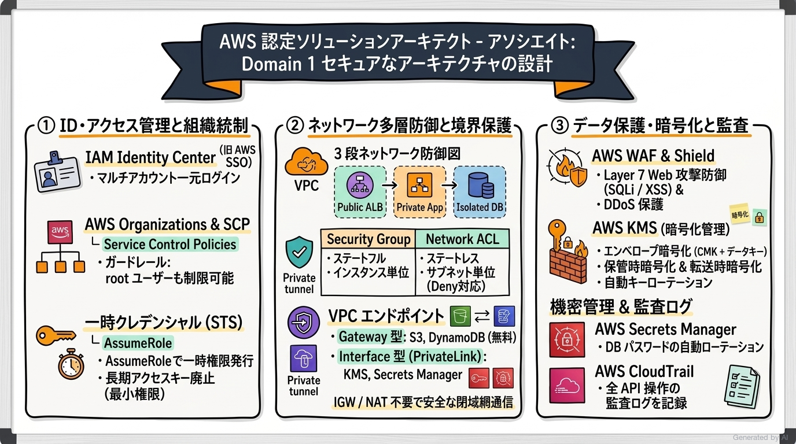
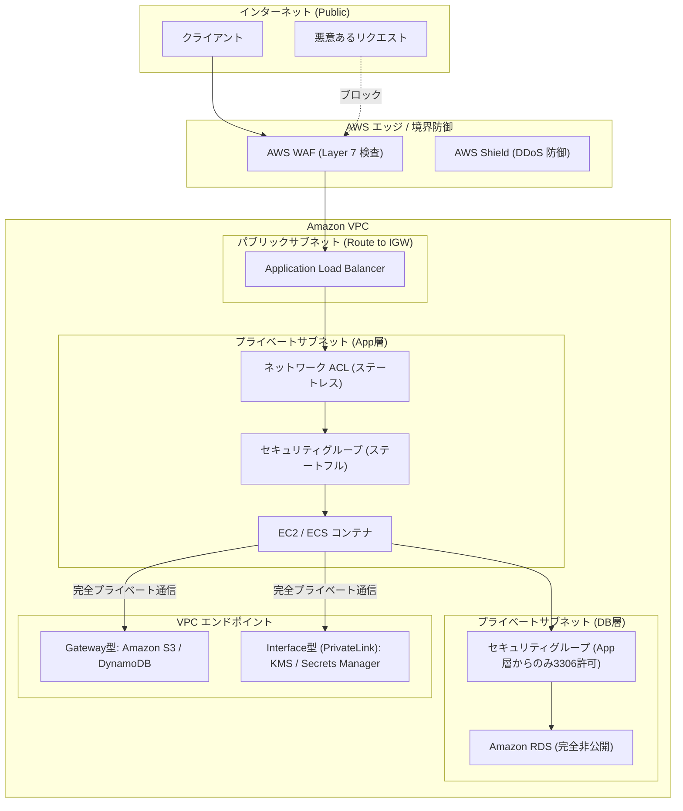
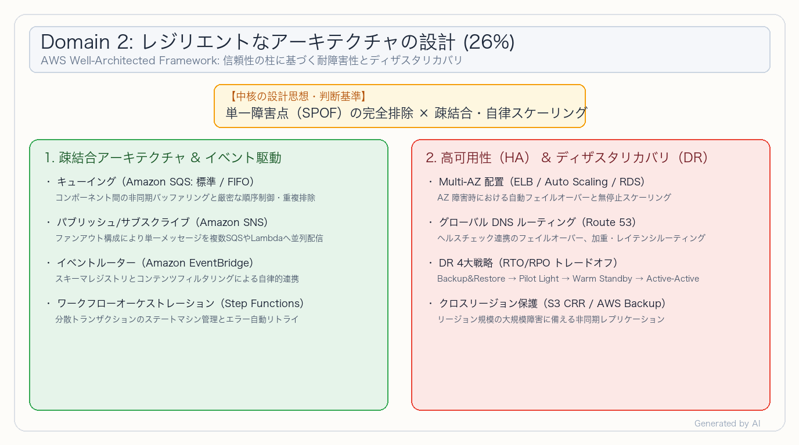
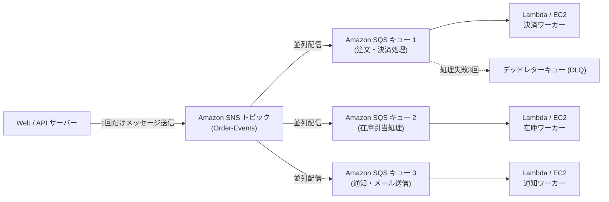
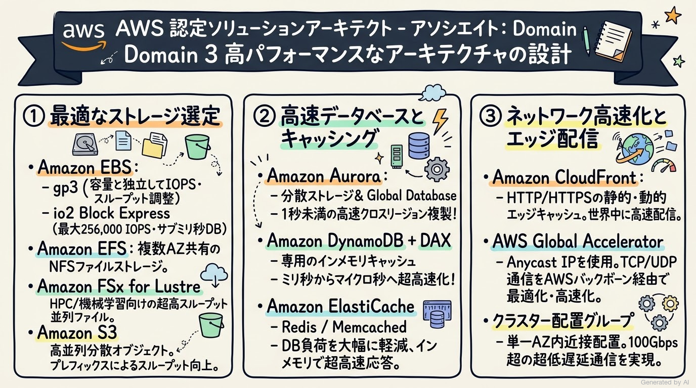
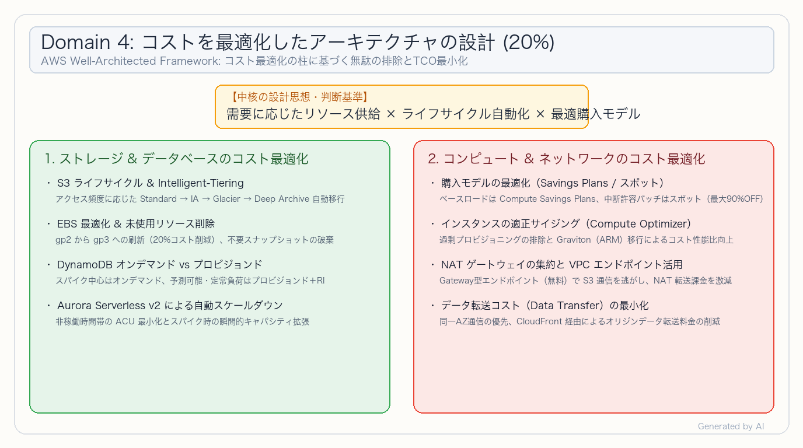
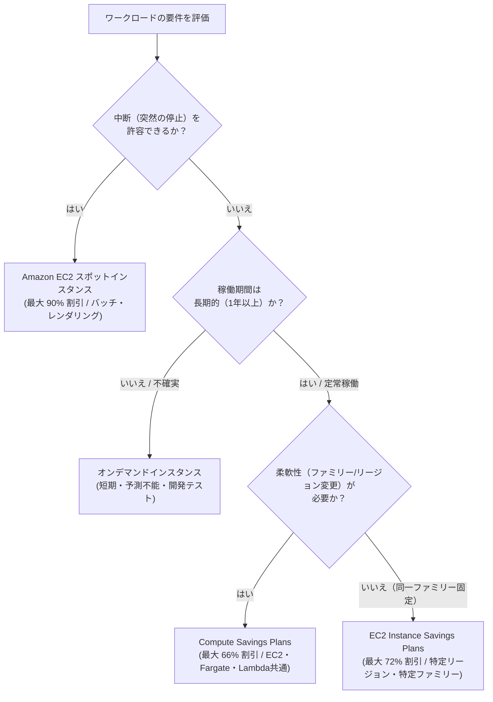

# AWS Certified Solutions Architect - Associate (SAA-C03) 完全対策＆実践学習ガイド

- **対象資格**: AWS Certified Solutions Architect - Associate
- **試験コード**: SAA-C03
- **公式試験ガイド**: [AWS Certified Solutions Architect - Associate (SAA-C03) Exam Guide](https://docs.aws.amazon.com/ja_jp/aws-certification/latest/solutions-architect-associate-03/solutions-architect-associate-03.html)
- **最終更新日**: 2026-10-04

---

## はじめに

近年のクラウドアーキテクチャは、単一のモノリシックな仮想マシン構成から、疎結合・イベント駆動型の分散アーキテクチャ、サーバーレスやコンテナを活用した俊敏な基盤、そしてデータ保護と可用性を多層的に担保するレジリエントな設計へと大きくシフトしています。

AWS Certified Solutions Architect - Associate (SAA-C03) は、AWS Well-Architected フレームワークの設計原則に基づき、セキュア・高可用・高性能・低コストなクラウドソリューションを包括的に設計できる能力を証明する、業界で最も認知された中核認定資格です。

本ガイドは、最新の SAA-C03 試験ガイドに完全準拠し、全4ドメイン（セキュア設計、レジリエンス設計、高パフォーマンス設計、コスト最適化設計）の重要概念、詳細な技術選定比較マトリクス、各出題タスクを完全網羅した 26 本の構造化実践シナリオ、および公式一次ドキュメント・推奨ハンズオンをカプセル化した決定版対策ノートです。

### AWS Certified Solutions Architect - Associate 試験とは

AWS Certified Solutions Architect - Associate は、ビジネス要件および技術要件を正確に理解し、AWS の広範なサービス群を組み合わせて最適なクラウドアーキテクチャを設計・提案する能力を認定する資格です。

- **試験時間**: 130 分
- **出題問題数**: 65 問（採点対象: 50 問 / 未採点テスト設問: 15 問）
- **出題形式**: 択一選択問題（4肢中1つ選択）、複数選択問題（5肢以上中2つ以上選択）
- **合格基準点**: 100〜1,000 点のスケールドスコアで 720 点以上
- **前提知識**: AWS 上での分散システム設計・導入・評価に関する 1 年以上の実務経験、またはクラウドアーキテクチャに関する同等の実践的理解が推奨されます。

### 難易度と求められる思考力

当試験の難易度は **アソシエイト中核（アーキテクチャトレードオフの総合判断力重視）** に位置づけられます。

単なるサービス名や機能仕様の暗記では合格できません。試験問題では具体的なシナリオ（前提、ビジネス制約、セキュリティ要件、RTO/RPO、予算制約）が提示され、「最も費用対効果が高い構成」「最も運用負荷が低いアーキテクチャ」「最小限の遅延で実現する設計」といった **明確な制約条件を満たす最適なトレードオフ判断** が常に問われます。

特に、以下のソリューション設計思想を深く理解しておくことが正答を導く鍵となります：
1. **マネージドサービスの優先（クラウドネイティブ思考）**: 自前でEC2上にソフトウェアを構築・運用するのではなく、フルマネージドサービス（S3, SQS, DynamoDB, Aurora Serverless 等）を活用して運用負荷（Undifferentiated Heavy Lifting）を排除する。
2. **単一障害点（SPOF）の徹底排除と疎結合**: コンポーネント間を同期的なREST APIで直接密結合させず、SQS/SNS/EventBridge 等を介した非同期メッセージングにより耐障害性と弾力性を確保する。
3. **データセキュリティとネットワーク境界の多層防御**: 単一のファイアウォールに依存せず、IAM・SCP によるアイデンティティ統制、セキュリティグループ・NACL・WAF による境界防御、KMS・Object Lock によるデータ保護を組み合わせる。
4. **ワークロード特性に応じたコスト適正化**: 予測不能なスパイクにはオンデマンドやサーバーレス、定常ベースロードには Savings Plans、中断許容バッチにはスポットインスタンス、ストレージにはライフサイクルルールを適用する。

### 推奨の勉強法

1. **AWS Well-Architected Framework 6本の柱の精読**
   「セキュリティ」「信頼性」「パフォーマンス効率」「コスト最適化」「運用上の優秀性」「持続可能性」の各ホワイトペーパーに目を通し、AWS が推奨するベストプラクティスを概念レベルから把握します。
2. **実際に手を動かす実機ハンズオン検証**
   VPC の多層サブネット設計、ALB と Auto Scaling による負荷分散、RDS Multi-AZ フェイルオーバー、SQS + Lambda による非同期処理、S3 ライフサイクル設定などを実際に AWS コンソールや CloudFormation で構築し、リソース連携の流れを体感します。
3. **構造化実践シナリオによる思考プロセスの追体験**
   各セクションに収録した全タスク網羅の実践シナリオにおいて、特に **解説（なぜ他の代替案では不適格なのか）** を熟読し、出題者の意図と消去法のロジックを身につけます。

---

## 目次

1. [はじめに](#はじめに)
2. [学習カリキュラム・出題範囲ロードマップ](#学習カリキュラム出題範囲ロードマップ)
3. [Domain 1: セキュアなアーキテクチャの設計 (30%)](#domain-1-セキュアなアーキテクチャの設計-30)
4. [Domain 2: レジリエントなアーキテクチャの設計 (26%)](#domain-2-レジリエントなアーキテクチャの設計-26)
5. [Domain 3: 高パフォーマンスなアーキテクチャの設計 (24%)](#domain-3-高パフォーマンスなアーキテクチャの設計-24)
6. [Domain 4: コストを最適化したアーキテクチャの設計 (20%)](#domain-4-コストを最適化したアーキテクチャの設計-20)
7. [まとめと推奨学習ステップ](#まとめと推奨学習ステップ)

---

## 学習カリキュラム・出題範囲ロードマップ

### セクション一覧と出題比率

本試験は全4ドメインで構成されており、セキュア設計（Domain 1: 30%）とレジリエンス設計（Domain 2: 26%）の2領域だけで全体の 56% を占めています。

| ドメイン番号 | ドメイン名 / 出題分野 | 出題比率 | 主要対象サービス・ツール |
| :--- | :--- | :--- | :--- |
| **Domain 1** | セキュアなアーキテクチャの設計 | 30% | AWS IAM, IAM Identity Center, AWS Organizations (SCP), AWS KMS, AWS Secrets Manager, Systems Manager Parameter Store, Amazon VPC, セキュリティグループ, ネットワークACL, VPC エンドポイント, AWS WAF, AWS Shield, Amazon GuardDuty, AWS CloudTrail |
| **Domain 2** | レジリエントなアーキテクチャの設計 | 26% | Amazon SQS (標準/FIFO), Amazon SNS, Amazon EventBridge, AWS Step Functions, AWS Auto Scaling, Elastic Load Balancing (ALB/NLB), Amazon Route 53, Amazon RDS (Multi-AZ), Amazon Aurora, AWS Backup, DR 4大戦略 |
| **Domain 3** | 高パフォーマンスなアーキテクチャの設計 | 24% | Amazon S3, Amazon EBS (gp3/io2), Amazon EFS, Amazon FSx, Amazon EC2 インスタンスファミリー, EC2 配置グループ, AWS Lambda, Amazon ECS/EKS, Amazon DynamoDB (DAX), Amazon ElastiCache, Amazon CloudFront, AWS Global Accelerator, Amazon Kinesis |
| **Domain 4** | コストを最適化したアーキテクチャの設計 | 20% | S3 ライフサイクルルール, S3 Intelligent-Tiering, AWS Compute Optimizer, Savings Plans, スポットインスタンス, Aurora Serverless v2, DynamoDB オンデマンド, Gateway型 VPC エンドポイント, AWS Cost Explorer, AWS Budgets |

---

### ドメイン別出題詳細

#### Domain 1: セキュアなアーキテクチャの設計 (30%)
- **出題の狙い**: IAM による厳格なアイデンティティ統制、Organizations によるマルチアカウントガバナンス、ネットワーク境界防御、およびデータの保存時・転送時暗号化と監査を多層的に実装する能力を検証します。
- **主要タスク**:
  - Task 1.1: AWS リソースへのセキュアなアクセスを設計する（IAM Identity Center, クロスアカウント AssumeRole, Organizations SCP, 属性ベースアクセス制御 (ABAC)）
  - Task 1.2: セキュアなワークロードとアプリケーションを設計する（VPC サブネット設計, セキュリティグループ, NACL, AWS WAF, Shield, VPC エンドポイント, Secrets Manager, Parameter Store）
  - Task 1.3: 適切なデータセキュリティ管理を判断する（AWS KMS 暗号化キー管理, S3 バケットポリシー, S3 Object Lock, 転送時 TLS 暗号化, CloudTrail, GuardDuty, Macie）
- **重要キーワード**: IAM Identity Center, AssumeRole, Service Control Policies (SCP), Security Groups vs NACLs, VPC Endpoints (Gateway / Interface), AWS WAF, AWS Secrets Manager, KMS (SSE-KMS / SSE-S3), S3 Object Lock, CloudTrail

#### Domain 2: レジリエントなアーキテクチャの設計 (26%)
- **出題の狙い**: システムの単一障害点（SPOF）を排除し、コンポーネント間を疎結合化して自動スケーリングおよびフェイルオーバーを実現する高可用性・耐障害性環境を設計する能力を検証します。
- **主要タスク**:
  - Task 2.1: スケーラブルな疎結合アーキテクチャを設計する（SQS 標準/FIFO, SNS ファンアウト, EventBridge, Step Functions, API Gateway, サーバーレスマイクロサービス）
  - Task 2.2: 高可用性および/または耐障害性のあるアーキテクチャを設計する（Multi-AZ ALB / ASG, RDS Multi-AZ, Aurora レプリカ, Route 53 フェイルオーバー/レイテンシルーティング, DR 4大戦略, AWS Backup, S3 CRR）
- **重要キーワード**: SQS (Standard / FIFO / DLQ), SNS Fanout, EventBridge Event Bus, Step Functions, Multi-AZ Deployments, Auto Scaling Group, Route 53 Health Checks, Disaster Recovery (Backup & Restore, Pilot Light, Warm Standby, Multi-Region Active-Active)

#### Domain 3: 高パフォーマンスなアーキテクチャの設計 (24%)
- **出題の狙い**: ワークロードの計算・ストレージ・データベース・ネットワークの要求仕様に応じ、スループットとレイテンシを極限まで最適化するサービス選定とアーキテクチャパターンを設計する能力を検証します。
- **主要タスク**:
  - Task 3.1: 高パフォーマンスでスケーラブルなストレージソリューションを選択する（S3 プレフィックス最適化, S3 Transfer Acceleration, EBS gp3 / io2 Block Express, EFS, FSx for Lustre / Windows）
  - Task 3.2: 高パフォーマンスで伸縮自在なコンピューティングソリューションを設計する（EC2 インスタンスタイプ選定, クラスター配置グループ, ENA/EFA, Auto Scaling ターゲット追跡, Lambda, Fargate, ECS/EKS）
  - Task 3.3: 高パフォーマンスなデータベースソリューションを選択する（Amazon Aurora リードレプリカ / Global Database, DynamoDB + DAX, ElastiCache Redis / Memcached）
  - Task 3.4: 高パフォーマンスでスケーラブルなネットワークアーキテクチャを選択する（Amazon CloudFront, AWS Global Accelerator, Direct Connect, Transit Gateway）
  - Task 3.5: 高パフォーマンスなデータ取り込みと変換のソリューションを選択する（Amazon Kinesis Data Streams / Amazon Data Firehose, AWS Glue, Amazon EMR）
- **重要キーワード**: EBS io2 Block Express, FSx for Lustre, Cluster Placement Groups, Graviton, Aurora Global Database, DynamoDB Accelerator (DAX), ElastiCache, CloudFront OAC, Global Accelerator, Kinesis Data Streams

#### Domain 4: コストを最適化したアーキテクチャの設計 (20%)
- **出題の狙い**: パフォーマンスや信頼性を損なうことなく、ストレージ階層化、コンピュート購入オプション、データベースサイジング、ネットワーク転送料金の最適化を通じて総所有コスト（TCO）を最小化する能力を検証します。
- **主要タスク**:
  - Task 4.1: コストを最適化したストレージソリューションを設計する（S3 Intelligent-Tiering, S3 ライフサイクルルール, EBS gp2 から gp3 移行, バックアップ保持期間最適化）
  - Task 4.2: コストを最適化したコンピューティングソリューションを設計する（Compute Savings Plans vs スポットインスタンス vs オンデマンド, AWS Compute Optimizer, EC2 休止状態）
  - Task 4.3: コストを最適化したデータベースソリューションを設計する（Aurora Serverless v2, DynamoDB オンデマンド vs プロビジョンド, RDS 予約インスタンス）
  - Task 4.4: コストを最適化したネットワークアーキテクチャを設計する（S3 Gateway型 VPC エンドポイントによる NAT ゲートウェイトラフィック削減, 同一 AZ 通信, CloudFront キャッシュによるデータ転送量削減）
- **重要キーワード**: S3 Intelligent-Tiering, S3 Glacier Deep Archive, Compute Savings Plans, Spot Instances, AWS Compute Optimizer, Aurora Serverless v2, DynamoDB On-Demand, S3 Gateway Endpoint, Data Transfer Costs

---

## Domain 1: セキュアなアーキテクチャの設計 (30%)

本分野は試験全体の 30% という最大の配点を占める最重要ドメインです。単一のセキュリティ対策に頼るのではなく、ID・認証・認可、ネットワーク境界、アプリケーション層、データ保存・転送時の全レイヤーにわたる「多層防御（Defense in Depth）」の設計能力が問われます。

---

### 1. セクション概要

クラウド環境におけるセキュリティの基本哲学は「最小権限の原則（Least Privilege）」と「責任共有モデル（Shared Responsibility Model）」です。インフラや仮想化層の保護は AWS が担いますが、データの暗号化、アクセス権限の適切な付与、ネットワークの境界分離はユーザー側の設計責任となります。

本ドメインでは、マルチアカウント環境を一元統制する AWS Organizations と IAM Identity Center、一時クレデンシャルによる安全なクロスアカウント委譲、VPC 内の多層ファイアウォール（セキュリティグループとネットワークACL）、そしてマネージドな暗号化（AWS KMS）と機密情報管理（Secrets Manager）の連携が中核トピックとなります。

#### 重要キーワード

- **IAM Identity Center (旧 AWS SSO)**: 組織全体のマルチアカウントおよびクラウドアプリケーションへのシングルサインオン（SSO）と一元的な権限管理を提供するサービス。Active Directory や外部 IdP と連携可能。
- **AWS Organizations & SCP (Service Control Policies)**: 組織内の全 AWS アカウントに対する最大権限のガードレールを定義するポリシー。たとえ各アカウントの root ユーザーであっても SCP の制限を超えることはできない。
- **一時セキュリティ認証情報 (AssumeRole & AWS STS)**: 長期的な IAM アクセスキーを発行せず、一時的なトークンを取得して権限を委譲する仕組み。クロスアカウントアクセスや EC2 / Lambda の IAM ロールで使用。
- **VPC エンドポイント (Gateway型 / Interface型)**: インターネットゲートウェイや NAT ゲートウェイを経由せず、AWS プライベートバックボーンを経由して AWS サービスと通信するエンドポイント。
- **AWS KMS (Key Management Service)**: 保存データの暗号化キーを一元管理・生成するサービス。AWS マネージドキー、カスタマーマネージドキー (CMK)、CloudHSM 等の運用形態がある。
- **AWS Secrets Manager**: データベース認証情報や API キーを安全に暗号化保存し、Lambda を用いた自動ローテーションを提供するサービス。
- **AWS WAF**: CloudFront、ALB、API Gateway の前段に配置し、SQL インジェクションやクロスサイトスクリプティング (XSS) 等のレイヤー7 攻撃を防御する Web アプリケーションファイアウォール。

---

### 2. 重要トピック

#### 1. 多層防御ネットワークアーキテクチャと VPC エンドポイント

VPC 内のセキュリティは、外側から内側へと段階的な防御壁を構築します。パブリックサブネットにはインターネットから直接アクセス可能なリソース（ALB 等）のみを配置し、アプリケーションサーバー（EC2/ECS）やデータベース（RDS）は完全なプライベートサブネットに隔離します。

さらに、プライベートサブネットから S3 や DynamoDB 等の AWS サービスと通信する際、インターネットゲートウェイや NAT ゲートウェイを一切通過させないために VPC エンドポイントを配置します。

#### 2. アクセス制御・セキュリティサービスの比較マトリクス

| 比較項目 / 方式 | セキュリティグループ | ネットワーク ACL (NACL) | AWS WAF | AWS Organizations SCP |
| :--- | :--- | :--- | :--- | :--- |
| **適用レイヤー** | インスタンス / ENI 単位 | サブネット単位 | リソース単位 (ALB, CloudFront, API GW) | アカウント / OU 単位 |
| **ステート管理** | **ステートフル** (戻り通信は自動許可) | **ステートレス** (インバウンド・アウトバウンド個別評価) | アプリケーション層 (L7) | ガバナンス・認可ガードレール |
| **評価ルール** | すべてのルールを評価 (ホワイトリスト方式) | 番号順に評価 (最初にマッチしたルールを適用) | Web ACL ルールセット順に評価 | アカウント全体の最大権限を制限 |
| **拒否 (DENY) 指定** | 不可 (許可ルールのみ記述) | **可能** (特定 IP/CIDR のブロックに最適) | **可能** (SQLi, XSS, レート制限, 地理的ブロック) | **明示的拒否 (Explicit Deny) が最優先** |
| **暗号化・認証との関係** | トランスポート層のポート制御 | トランスポート層のポート・CIDR制御 | HTTP/HTTPS ヘッダー・ボディ検査 | IAM ポリシーの上位ガードレール |

#### 3. VPC エンドポイントの選定基準

- **Gateway型 VPC エンドポイント**:
  - 対応サービス: **Amazon S3** および **Amazon DynamoDB** の 2 サービスのみ。
  - 特徴: **無料（追加コストなし）**。ルートテーブルにプレフィックスリスト（`pl-xxxxxxxx`）をターゲットとして追加する。
  - 選定基準: S3 または DynamoDB とのプライベート通信を行う場合は、コストがゼロである Gateway型を最優先で選定します。
- **Interface型 VPC エンドポイント (AWS PrivateLink)**:
  - 対応サービス: AWS KMS, Secrets Manager, CloudWatch, SQS, SNS, その他多数の AWS サービスおよびサードパーティ SaaS。
  - 特徴: サブネット内にプライベート IP アドレスを持つ Elastic Network Interface (ENI) を作成。時間課金＋データ処理課金が発生。
  - 選定基準: Gateway型が対応していないサービス（KMS, Secrets Manager, SQS等）とのプライベート通信、またはオンプレミスから Direct Connect 経由で AWS サービスにプライベートアクセスする場合に選定します。

---

### 3. 実践シナリオ

#### シナリオ 1-1: 外部IDプロバイダー連携と全社マルチアカウントの一元認可統制

- **状況**: 社内 Active Directory に数千名の従業員が存在し、複数の AWS アカウント群（本番、ステージング、開発）に対して最小権限の原則でアクセスを許可したいが、個別アカウントへの IAM ユーザー発行や長期アクセスキーの発行は運用負荷およびセキュリティリスクの観点から禁止されている場合
- **対応**: AWS IAM Identity Center を導入して社内 Active Directory と SAML 2.0 / SCIM でフェデレーション連携し、各アカウントへのアクセス権限をアクセス権限セット（Permission Sets）として一元定義して割り当てる。
- **結果**: 個別アカウントごとの IAM ユーザー管理が不要となり、ユーザーは社内 ID で AWS アクセスポータルからシングルサインオン可能となり、一時クレデンシャルのみで安全に作業が実行される。
- **解説**: IAM Identity Center を利用することで、ID 管理を単一の信頼できる情報源（IdP）に集約しつつ、各アカウントへのアクセス権限を一元管理できるためです。個別アカウントで IAM ユーザーを作成・管理する方式は、退職時の権限削除漏れやアクセスキー流出のリスクが高く要件に違反します。また、個別の AssumeRole スクリプトを全従業員に配布する方式は運用負荷が高いため不適格です。
- **参考ドキュメント**:
  - [AWS IAM Identity Center ユーザーガイド](https://docs.aws.amazon.com/ja_jp/singlesignon/latest/userguide/what-is.html): マルチアカウント環境での一元的なシングルサインオンとアクセス管理のベストプラクティス。

#### シナリオ 1-2: 外部サードパーティ SaaS によるクロスアカウントリソース読み取り

- **状況**: 外部の監査用 SaaS アプリケーションに対して自社 AWS アカウント内の CloudTrail ログおよび AWS Config 設定を読み取る権限を委譲する必要があるが、第三者による不正委譲攻撃（Confused Deputy 問題）を確実に防ぎたい場合
- **対応**: 自社アカウント内に IAM ロールを作成し、信頼ポリシー（Trust Policy）で相手方 SaaS の AWS アカウント ID を指定した上で、条件節（Condition）に相手方から払い出された固有の「外部 ID（External ID）」を必須として設定する。
- **結果**: SaaS アプリケーションは自社固有の External ID を指定した `sts:AssumeRole` API 呼び出しによってのみ一時クレデンシャルを取得でき、不正アクセスが防止される。
- **解説**: サードパーティ SaaS とのクロスアカウント連携において Confused Deputy 問題を防止するには、条件節で `sts:ExternalId` を検証することが AWS の標準セキュリティベストプラクティスであるためです。自社アカウント内に相手用の IAM ユーザーを作成して長期アクセスキーを払い出す方式はキー流出リスクがあり、また外部 ID を指定しない単純な AssumeRole では他顧客のアカウントを踏み台にした不正呼び出しを防げないため要件を満たせません。
- **参考ドキュメント**:
  - [AWS IAM ユーザーガイド - 外部 ID の使用](https://docs.aws.amazon.com/ja_jp/IAM/latest/UserGuide/id_roles_common-scenarios_third-party.html): 第三者に AWS リソースへのアクセス権を委譲する際の Confused Deputy 対策。

#### シナリオ 1-3: Organizations 全社ガードレールによる特定リージョン利用の強制遮断

- **状況**: 全社のコンプライアンス規程により、データ主権および法規制の理由から東京リージョン（ap-northeast-1）および大阪リージョン（ap-northeast-3）以外のリージョンでリソースを起動することを全社的に禁止したい場合
- **対応**: AWS Organizations のルートまたは該当組織単位（OU）に対して、`aws:RequestedRegion` 条件キーを用いて東京・大阪以外のすべての API リクエストを拒否（Deny）するサービスコントロールポリシー（SCP）を適用する。
- **結果**: 配下の各 AWS アカウントの root ユーザーおよび管理者 IAM ユーザーであっても、指定リージョン外でのリソース作成操作が AWS プラットフォーム全体で物理的に遮断される。
- **解説**: Organizations の SCP は配下の全アカウントに対する絶対的な認可ガードレール（最大権限境界）を定義できるためです。各アカウント内の IAM ポリシーで個別制限をかける方式では、各アカウントの管理者がポリシーを変更・削除するリスクを排除できません。また、AWS Config の修復ルールは事後検知・自動削除にとどまり、リソース起動そのものを予防的に阻止することはできないため要件を満たせません。
- **参考ドキュメント**:
  - [AWS Organizations ユーザーガイド - SCP の例](https://docs.aws.amazon.com/ja_jp/organizations/latest/userguide/orgs_manage_policies_scps_examples.html): リージョン制限ガードレールの実装例。

#### シナリオ 1-4: プライベートサブネットから S3 への完全閉域・高スループット通信

- **状況**: プライベートサブネット内の多数の EC2 インスタンスが、テラバイト規模の分析データを Amazon S3 との間で高頻度に読み書きしているが、セキュリティ要件によりインターネット経由の通信は一切禁止されており、NAT ゲートウェイのデータ転送料金も削減したい場合
- **対応**: VPC 内に Amazon S3 用の「Gateway型 VPC エンドポイント」を作成し、プライベートサブネットのルートテーブルに S3 のプレフィックスリスト宛のルートとして関連付ける。
- **結果**: EC2 と S3 の通信は AWS の内部プライベートネットワーク経由となり、NAT ゲートウェイを経由しないためデータ処理料金および転送料金がゼロとなる。
- **解説**: Amazon S3 への閉域アクセスにおいて、Gateway型 VPC エンドポイントは追加コストなしで利用可能であり、ルートテーブルのルーティングにより透過的に AWS 内部通信に切り替えられるためです。NAT ゲートウェイを経由させる構成はインターネット通信が発生し高額なデータ処理課金（GBあたり）がかかります。また、Interface型エンドポイント（PrivateLink for S3）も利用可能ですが時間課金およびデータ処理課金が発生するため不適格です。
- **参考ドキュメント**:
  - [Amazon VPC ユーザーガイド - Gateway 型 VPC エンドポイント](https://docs.aws.amazon.com/ja_jp/vpc/latest/privatelink/gateway-endpoints.html): S3 および DynamoDB への閉域接続とルートテーブル設定。

#### シナリオ 1-5: 公開 Web サイトに対する SQL インジェクション攻撃の検知と自動ブロック

- **状況**: Application Load Balancer (ALB) 配下の EC2 で稼働する eコマースサイトに対して、悪意あるユーザーから SQL インジェクション攻撃やクロスサイトスクリプティング（XSS）のリクエストが多発しており、アプリケーションサーバーに到達する前に境界で自動遮断したい場合
- **対応**: AWS WAF を導入し、AWS Managed Rules（コアルールセット、SQL データベースルールセット等）を含む Web ACL を作成して ALB に関連付ける。
- **結果**: SQL インジェクション等の不正な HTTP/HTTPS パターンを含むリクエストは、ALB の手前（エッジ/ロードバランサー層）で HTTP 403 Forbidden として自動ブロックされ、バックエンドサーバーの負荷と侵入リスクが排除される。
- **解説**: AWS WAF はレイヤー7（HTTP/HTTPS）のトラフィック内容（URI、クエリ文字列、ヘッダー、ボディ）をディープパケットインスペクションして脅威をリアルタイムで検知・遮断できるためです。セキュリティグループやネットワーク ACL はトランスポート層（レイヤー4: IP/ポート）しか制御できず、正規の 80/443 ポートを通過する SQL インジェクションを識別・遮断できないため要件を満たせません。
- **参考ドキュメント**:
  - [AWS WAF デベロッパーガイド](https://docs.aws.amazon.com/ja_jp/waf/latest/developerguide/what-is-aws-waf.html): Web トラフィックのレイヤー7 フィルタリングとマネージドルールの適用。

#### シナリオ 1-6: データベース認証情報の自動ローテーションとセキュアな参照

- **状況**: アプリケーションが Amazon RDS (PostgreSQL) に接続する際のパスワードをコード内にハードコードせず、企業のセキュリティポリシーに準拠して 30 日ごとにパスワードを自動ローテーションさせたい場合
- **対応**: データベース認証情報を AWS Secrets Manager にシークレットとして登録し、標準の Lambda ローテーション関数を有効化して 30 日ごとの自動ローテーションを設定する。アプリケーションは実行時に AWS SDK 経由でシークレットを取得する。
- **結果**: データベースのパスワードが人間を介さず自動更新され、コードや設定ファイルから平文パスワードが完全に排除される。
- **解説**: AWS Secrets Manager は Amazon RDS 等の主要データベースに対するネイティブな自動ローテーション機能を備えており、暗号化（KMS）とアクセス制御（IAM）が統合されているためです。AWS Systems Manager Parameter Store でも機密情報を SecureString として保持できますが、標準でのシークレット自動ローテーション機能が組み込まれておらず追加のカスタム開発が必要となるため不適格です。
- **参考ドキュメント**:
  - [AWS Secrets Manager ユーザーガイド - シークレットのローテーション](https://docs.aws.amazon.com/ja_jp/secretsmanager/latest/userguide/rotating-secrets.html): RDS 認証情報の安全な保管と自動ローテーションメカニズム。

---

### 4. 参考ドキュメント & 推奨ハンズオン

#### 公式一次ドキュメント
- [AWS Well-Architected Framework - セキュリティの柱](https://docs.aws.amazon.com/ja_jp/wellarchitected/latest/security-pillar/welcome.html): クラウドにおけるアイデンティティ管理、発見的統制、インフラ保護、データ保護の設計原則。
- [AWS IAM のベストプラクティス](https://docs.aws.amazon.com/ja_jp/IAM/latest/UserGuide/best-practices.html): ルートユーザーの保護、一時クレデンシャルの活用、最小権限の実装ガイド。

#### 推奨ハンズオン・ラボ（実機検証）
- [AWS Skill Builder: Security Hub and GuardDuty Implementation](https://skillbuilder.aws/search?searchText=Security+Hub+and+GuardDuty+Implementation):
  - **学習目標**: VPC 内のトラフィックフローログ、CloudTrail イベント、DNS クエリを GuardDuty で継続的モニタリングし、脅威検出アラートを Security Hub に統合する一連の流れを構築・検証する。
- [AWS Skill Builder: Configuring VPC Endpoints and Security Policies](https://skillbuilder.aws/search?searchText=Configuring+VPC+Endpoints+and+Security+Policies):
  - **学習目標**: パブリックアクセスのないプライベートサブネットから、S3 Gateway エンドポイントおよび KMS Interface エンドポイント経由で安全に通信を行い、エンドポイントポリシーによるアクセス制限を検証する。

---

## Domain 2: レジリエントなアーキテクチャの設計 (26%)

本分野は、障害が発生することを前提とし、単一障害点（SPOF）を徹底的に排除した高可用性（High Availability: HA）とディザスタリカバリ（Disaster Recovery: DR）の設計能力を検証するドメインです。

---

### 1. セクション概要

AWS におけるレジリエンスの根幹は「疎結合（Decoupling）」と「マルチ AZ / マルチリージョン冗長化」です。同期的なシステム間通信は、1つのコンポーネントの遅延や障害がシステム全体へと波及するカスケード障害（連鎖障害）を引き起こします。Amazon SQS、SNS、EventBridge を挟み込んだ非同期メッセージングを適用することで、プロデューサーとコンシューマーの依存関係を切り離し、トラフィック急増時のバッファリングと自動回復力を手に入れます。

また、データベースやコンピュート層においては、Multi-AZ 配置による自動フェイルオーバーと、ビジネス目標である **RTO (目標復旧時間)** および **RPO (目標復旧時点)** に合致したディザスタリカバリ戦略（Backup & Restore から Multi-Region Active-Active まで）の正確な選定が合否を分ける決定打となります。

#### 重要キーワード

- **Amazon SQS (Simple Queue Service)**: 分散メッセージキューサービス。標準キュー（無制限スループット、最善の順序、少なくとも1回の配信）と FIFO キュー（厳格な順序、1回のみの正確な処理、重複排除）の2種類がある。
- **DLQ (Dead-Letter Queue / デッドレターキュー)**: 規定回数の処理試行を行っても正常終了しなかった異常メッセージを隔離・蓄積するキュー。後続のデバッグや再処理に使用。
- **Amazon SNS (Simple Notification Service)**: パブリッシュ/サブスクライブ（Pub/Sub）モデルのメッセージングサービス。単一の通知を複数の SQS、Lambda、HTTPS エンドポイントへ同時並列配信する「ファンアウト」に最適。
- **Amazon EventBridge**: スキーマレジストリや高度なルール（コンテンツベースフィルタリング）を備えたサーバーレスイベントバス。AWS サービス、独自アプリ、外部 SaaS からのイベントを統合ルーティングする。
- **AWS Step Functions**: 複数の AWS サービス（Lambda、ECS、SQS、DynamoDB 等）を視覚的なステートマシンとしてオーケストレーションし、分岐・並列処理・例外処理・リトライを宣言的に制御するサービス。
- **RDS Multi-AZ デプロイ**: プライマリ DB インスタンスと、別のアベイラビリティーゾーン（AZ）に配置された同期スタンバイレプリカで構成。AZ 障害やハードウェア障害時に DNS 切り替えにより自動フェイルオーバー（通常 60〜120 秒）を実行。
- **RTO (Recovery Time Objective)**: 障害発生からサービスが復旧するまでに許容される最大停止時間。
- **RPO (Recovery Point Objective)**: 障害発生時に失われても許容される最大データ損失時間（直近のバックアップ時点までの時間間隔）。

---

### 2. 重要トピック

#### 1. 疎結合ファンアウトアーキテクチャ

単一のトランザクションイベント（例: 注文確定）をトリガーとして、注文処理、在庫引き当て、顧客へのメール通知、請求書生成といった複数の独立したマイクロサービスを同時に起動させる場合、SNS トピックと複数の SQS キューを組み合わせた「ファンアウト（Fanout）構成」が最も実績あるベストプラクティスです。

#### 2. ディザスタリカバリ（DR） 4大戦略の比較マトリクス

ビジネス要件（RTO / RPO）とコストは完全なトレードオフの関係にあります。試験では「RTOが数時間で低コスト」「RTO数分でダウンタイムを最小化」といった要件から最適な戦略を判別させます。

| DR 戦略 | RTO (目標復旧時間) | RPO (目標復旧時点) | コスト | アーキテクチャの概要 | 主な適用ユースケース |
| :--- | :--- | :--- | :--- | :--- | :--- |
| **バックアップ＆復元 (Backup & Restore)** | 数時間〜数十時間 | 数時間〜24時間 | **最低** | データを別リージョンの S3 や AWS Backup で保管。被災後に IaC（CloudFormation）で全リソースをゼロから新規プロビジョニング。 | コスト最優先、停止が許容される社内システム・非基幹バッチ。 |
| **パイロットライト (Pilot Light)** | 数十分〜数時間 | 数分〜数十分 | **低〜中** | データ層（RDS/Aurora）のみ別リージョンへ常時レプリケーション。コンピュート（EC2/ASG）は停止（またはAMIのみ保持）させ、被災時に起動・スケール。 | コストを抑えつつ、データ消失を最小限にしたい基幹業務。 |
| **ウォームスタンバイ (Warm Standby)** | **数分〜十数分** | **数秒〜数分** | **中〜高** | セカンダリリージョンで最小構成（小規模フリート）のリソースを常に稼働させておく。被災時は即座にトラフィックを切り替え、フリートをスケールアウト。 | 短い RTO が求められるビジネスクリティカルな EC・SaaS。 |
| **マルチサイト・アクティブ/アクティブ (Active-Active)** | **ゼロに近い (秒未満〜数秒)** | **ゼロに近い** | **最高** | 複数リージョンで本番トラフィックを常時並行処理（Route 53 ルーティング、Aurora Global Database / DynamoDB グローバルテーブル）。 | ダウンタイムやデータ損失が一切許されない金融・決済システム。 |

---

### 3. 実践シナリオ

#### シナリオ 2-1: 突発的スパイクによるバックエンド過負荷とメッセージ消失の防止

- **状況**: フラッシュセール開催時に注文受付 API へのリクエストが平常時の 100 倍に急増し、後続の注文処理 EC2 サーバーが過負荷でクラッシュして HTTP 500 エラーが発生し注文データが消失するリスクがある場合
- **対応**: API サーバーと注文処理サーバーの間に Amazon SQS 標準キューを導入し、API は注文メッセージをキューに投入するだけとし、バックエンドのワーカー EC2 は Auto Scaling を用いてキューの滞留メッセージ数（ApproximateNumberOfMessagesVisible）に基づきスケールアウトさせる。
- **結果**: 突発的なアクセス急増時もキューがリクエストを安全にバッファリングし、メッセージの取りこぼしがなくなり、バックエンドサーバーは自身の処理能力に応じたペースで安全に消費可能となる。
- **解説**: SQS による非同期バッファリングを導入することで、フロントエンドとバックエンドが疎結合となり、負荷の急変を吸収して耐障害性を大幅に向上できるためです。EC2 のインスタンスサイズを事前に垂直スケール（スケールアップ）させておく方法はコストが過大であり、想定以上のスパイクには耐えられません。また、同期的な HTTP 呼び出しのままリトライ回数を増やす構成は、過負荷状態のサーバーにさらなる負荷を集中させカスケード障害を引き起こすため不適格です。
- **参考ドキュメント**:
  - [Amazon SQS デベロッパーガイド](https://docs.aws.amazon.com/ja_jp/AWSSimpleQueueService/latest/SQSDeveloperGuide/welcome.html): キューを用いた疎結合アーキテクチャとバッファリングパターン。

#### シナリオ 2-2: 金融取引処理における厳格な順序保証と重複メッセージの排除

- **状況**: 銀行口座の入出金取引データを処理するシステムにおいて、口座ごとのトランザクションの発生順序が厳密に守られなければならず、ネットワーク再試行等による同一取引の重複実行（多重引き落とし）が絶対に許されない場合
- **対応**: Amazon SQS FIFO キューを採用し、口座 ID を「メッセージグループ ID（MessageGroupId）」に設定し、取引固有のトランザクション ID を「メッセージ重複排除 ID（MessageDeduplicationId）」に設定して送信する。
- **結果**: 同一口座に対する取引は送信順と完全に同一の順序でコンシューマーに配信され、5分以内の同一重複排除 ID を持つメッセージは SQS によって自動破棄される。
- **解説**: SQS FIFO キューは First-In-First-Out の厳格な順序配信と、正確に1回限りの処理（Exactly-once processing）をプラットフォームレベルで保証するためです。標準の SQS キューは「最善の順序」かつ「少なくとも1回の配信（At-least-once delivery）」であるため、順序の入れ替わりや重複配信が発生する可能性があり、金融取引要件を満たせません。また、Kinesis Data Streams も順序制御可能ですが、メッセージ単位の重複排除やキューとしての自動削除機能を備えておらず、自前実装が必要となるため不適格です。
- **参考ドキュメント**:
  - [Amazon SQS デベロッパーガイド - FIFO キュー](https://docs.aws.amazon.com/ja_jp/AWSSimpleQueueService/latest/SQSDeveloperGuide/sqs-fifo-queues.html): FIFO キューのグループ化と重複排除の仕組み。

#### シナリオ 2-3: 注文確定イベントの複数マイクロサービスへの同時並列配信

- **状況**: eコマースシステムにおいて顧客が購入を完了した際、「決済処理」「在庫引き当て」「配送伝票作成」「サンクスメール送信」という4つの独立したマイクロサービスに同時に同一の注文情報を通知したいが、各サービスの処理速度や障害が他サービスに影響を与えてはならない場合
- **対応**: Amazon SNS トピックを作成して各マイクロサービス専用の Amazon SQS キューをサブスクライブさせる「SNS + SQS ファンアウト（Fanout）構成」を構築する。
- **結果**: アプリケーションは SNS トピックに 1 回メッセージを送信するだけで全キューへ自動並列コピーされ、いずれかのマイクロサービスが障害停止していても該当キューにメッセージが保持され、他サービスは無影響で処理を継続できる。
- **解説**: SNS のファンアウトパターンにより、発行側は単一のエンドポイントへの送信で済み、受信側は個別のキューにより完全な耐障害性と自律的スケーリングを獲得できるためです。各サービスに対してプロデューサーが直接 HTTP/REST で順次通信する構成は、1つのサービスの遅延やダウンが全体のトランザクションをブロックします。また、単一の SQS キューを全ワーカーで共有する構成では、メッセージがいずれか1つのワーカーにしか届かないため要件を満たせません。
- **参考ドキュメント**:
  - [Amazon SNS デベロッパーガイド - ファンアウトアーキテクチャ](https://docs.aws.amazon.com/ja_jp/sns/latest/dg/sns-sqs-as-subscriber.html): SNS と SQS を組み合わせた並列メッセージングパターン。

#### シナリオ 2-4: AZ 障害時におけるリレーショナルデータベースの無停止自動復旧

- **状況**: 本番環境の Amazon RDS for MySQL において、データセンター（アベイラビリティーゾーン）規模のハードウェア障害や停電が発生した場合でも、管理者の手動介入なしに数分以内にデータベースの稼働を復旧させ、データ損失をゼロに抑えたい場合
- **対応**: Amazon RDS インスタンスで「Multi-AZ 配置」オプションを有効化する。
- **結果**: 別の AZ にスタンバイレプリカが同期的に維持され、プライマリ AZ で障害が発生した際は、RDS が自動的に DNS レコード（エンドポイント）をスタンバイインスタンスに切り替える（通常 60〜120 秒）。
- **解説**: RDS Multi-AZ は異なる AZ 間で同期レプリケーションを行い、プライマリ障害時に自動フェイルオーバーを完結させる耐障害性機能であるためです。リードレプリカ（非同期レプリケーション）を作成する構成は読み取り性能向上を主目的としており、自動フェイルオーバーは標準では実行されず、手動昇格時のデータ損失（レプリケーションラグ）のリスクがあります。また、定期的なスナップショットからのリストアは長時間のダウンタイム（数十分〜数時間）を伴うため要件を満たせません。
- **参考ドキュメント**:
  - [Amazon RDS ユーザーガイド - 高可用性 (マルチ AZ)](https://docs.aws.amazon.com/ja_jp/AmazonRDS/latest/UserGuide/Concepts.MultiAZ.html): Multi-AZ 配置の動作原理とフェイルオーバープロセス。

#### シナリオ 2-5: RTO 15分・RPO 5分を満たすセカンダリリージョンへのディザスタリカバリ

- **状況**: 金融系 SaaS アプリケーションにおいて、プライマリリージョン全体の大規模障害に備えてセカンダリリージョンへの DR 環境を整備する必要があり、要件として RTO は 15 分以内、RPO は 5 分以内が厳格に定められており、かつ常時フルスペックのインフラを二重稼働させる予算はない場合
- **対応**: 「ウォームスタンバイ（Warm Standby）」戦略を採用し、セカンダリリージョンに最小限のスペックの EC2/Auto Scaling フリートと、クロスリージョンリードレプリカ（Aurora Global Database または RDS リードレプリカ）を常時稼働させておき、被災時は Route 53 でトラフィックをセカンダリへ切り替えた上で ASG のキャパシティをスケールアウトさせる。
- **結果**: データベースのレプリケーション遅延は数秒〜数十秒（RPO 5分以内）に収まり、DNS 切り替えと ASG のスケールアップにより 10 分程度（RTO 15分以内）で全トラフィックの処理が再開される。
- **解説**: ウォームスタンバイは「常に縮小版の環境が稼働している」ため、数分〜十数分の短い RTO と極めて低い RPO を、フルアクティブ構成よりも大幅に低いコストで両立できるためです。パイロットライト戦略では、コンピュートリソースが停止状態にあるため、EC2 インスタンスの新規起動やパッケージ初期化に時間がかかり、15分以内の RTO を安定して達成できないリスクがあります。また、バックアップ＆復元では RTO/RPO 共に数時間単位となるため要件を満たせません。
- **参考ドキュメント**:
  - [AWS ディザスタリカバリホワイトペーパー](https://docs.aws.amazon.com/ja_jp/whitepapers/latest/disaster-recovery-workloads-on-aws/disaster-recovery-options-in-the-cloud.html): DR 4大戦略の比較と RTO/RPO 設計指針。

#### シナリオ 2-6: リージョン障害時における DNS レベルの自動フェイルオーバー

- **状況**: 2つの異なる AWS リージョン（東京と大阪）で同一の Web アプリケーションを運用しており、東京リージョンで障害が発生して ALB が応答しなくなった場合、グローバルユーザーからのアクセスを自動的に大阪リージョンへ迂回させたい場合
- **対応**: Amazon Route 53 でフェイルオーバールーティングポリシーを設定し、プライマリレコード（東京）に Route 53 ヘルスチェックを関連付け、セカンダリレコード（大阪）を設定する。
- **結果**: 東京リージョンの ALB に対するヘルスチェックが連続して失敗すると、Route 53 はプライマリレコードを異常と判定し、DNS クエリに対して自動的に大阪リージョンの IP/エイリアスを返し始める。
- **解説**: Route 53 のフェイルオーバールーティングは、エンドポイントのヘルスチェック状態に連動して DNS 応答を動的に切り替えるマネージドな高可用性ソリューションであるためです。加重ルーティング（Weighted Routing）はトラフィックの割合分散を目的としており、ヘルスチェックと連携しない限り異常なリージョンにもアクセスを送り続けます。また、手動で DNS の A レコードを書き換える方式は、管理者の検知遅れや作業ミスが発生し RTO を達成できないため要件を満たせません。
- **参考ドキュメント**:
  - [Amazon Route 53 デベロッパーガイド - フェイルオーバールーティング](https://docs.aws.amazon.com/ja_jp/Route53/latest/DeveloperGuide/routing-policy-failover.html): ヘルスチェックと連動した自動 DNS 切り替え設定。

---

### 4. 参考ドキュメント & 推奨ハンズオン

#### 公式一次ドキュメント
- [AWS Well-Architected Framework - 信頼性の柱](https://docs.aws.amazon.com/ja_jp/wellarchitected/latest/reliability-pillar/welcome.html): 分散システムの障害耐性、復旧設計、クォータ管理の設計原則。
- [AWS Fault Injection Service (FIS) ドキュメント](https://docs.aws.amazon.com/ja_jp/fis/latest/userguide/what-is.html): カオスエンジニアリングによる回復力検証。

#### 推奨ハンズオン・ラボ（実機検証）
- [AWS Skill Builder: Building Resilient Architectures with Auto Scaling and Multi-AZ](https://skillbuilder.aws/search?searchText=Building+Resilient+Architectures+with+Auto+Scaling+and+Multi-AZ):
  - **学習目標**: ALB 配下の複数 AZ にまたがる Auto Scaling グループを作成し、疑似的に特定の AZ の EC2 を強制終了させた際、トラフィックが健全なインスタンスに継続ルーティングされる挙動を検証する。
- [AWS Skill Builder: Implementing Disaster Recovery with Route 53 and RDS](https://skillbuilder.aws/search?searchText=Implementing+Disaster+Recovery+with+Route+53+and+RDS):
  - **学習目標**: クロスリージョンリードレプリカを作成し、Route 53 ヘルスチェックとフェイルオーバールーティングを構成して、疑似被災時に自動的に別リージョンへ切り替わるプロセスを追体験する。

---

## Domain 3: 高パフォーマンスなアーキテクチャの設計 (24%)

本分野は、ストレージ、コンピュート、データベース、ネットワークの各レイヤーにおいて、スループットの最大化とレイテンシの最小化を達成するための最適構成を選択・設計する能力を検証するドメインです。

---

### 1. セクション概要

高パフォーマンスなアーキテクチャを設計するためには、ボトルネックの発生箇所を正確に特定し、各層で最適なサービスおよびプロビジョニング設定を選択する必要があります。

ストレージ層では、IOPS とスループットが独立調整可能な Amazon EBS（gp3 / io2 Block Express）、高並列分散アクセスに最適化された Amazon S3、共有ファイルシステムの Amazon EFS / FSx の使い分けが問われます。

データベース層では、クラウドネイティブな分散ストレージを持つ Amazon Aurora のリードレプリカ展開、ミリ秒未満の応答速度を実現する Amazon DynamoDB + DAX、そして汎用インメモリキャッシュである Amazon ElastiCache の選定が頻出します。

ネットワーク層では、エッジロケーションを活用する Amazon CloudFront や AWS Global Accelerator によるレイテンシ短縮が不可欠です。

#### 重要キーワード

- **Amazon EBS gp3 / io2 Block Express**: gp3 はベース 3,000 IOPS / 125 MB/s を提供し、容量と無関係に IOPS とスループットを追加可能。io2 Block Express はミッションクリティカルな DB 向けに最大 256,000 IOPS とサブミリ秒レイテンシを提供。
- **Amazon FSx for Lustre**: 高性能コンピューティング（HPC）、機械学習、ビッグデータ処理向けに設計された並列ファイルシステム。テラバイトあたり数百 GB/s のスループットとサブミリ秒レイテンシを提供し、Amazon S3 と双方向シームレス連携。
- **EC2 クラスター配置グループ (Cluster Placement Group)**: 単一のアベイラビリティーゾーン内でインスタンスを物理的に近接配置し、ノード間で低レイテンシかつ最大 100 Gbps の高ネットワークスループットを実現する配置戦略。
- **Amazon Aurora Global Database**: 単一の Aurora データベースが複数の AWS リージョンにまたがって稼働し、通常 1 秒未満のレプリケーション遅延でグローバルな高速読み取りと災害復旧を実現する機能。
- **Amazon DynamoDB Accelerator (DAX)**: DynamoDB 専用の完全マネージド型インメモリキャッシュ。ミリ秒単位の応答時間を「マイクロ秒単位」へと高速化し、読み取りのヘビートラフィックをオフロードする。
- **Amazon ElastiCache (Redis / Memcached)**: 高速なインメモリデータストア。リレーショナルデータベースへのクエリ負荷軽減、セッションストア、Pub/Sub に使用。
- **AWS Global Accelerator**: AWS のグローバルプライベートネットワーク網と Anycast 静的 IP を利用し、クライアントから最も近いエッジロケーション経由でトラフィックを取り込み、TCP/UDP 通信の遅延とパケットロスを削減するサービス。
- **Amazon Kinesis Data Streams**: リアルタイムで大規模なストリーミングデータ（数万〜数十万レコード/秒）を高スループット・低遅延で取り込み、複数のコンシューマーが並行処理できるサービス。

---

### 2. 重要トピック

#### 1. ストレージサービスの性能・特性比較マトリクス

| 比較項目 / サービス | Amazon S3 | Amazon EBS (gp3 / io2) | Amazon EFS | Amazon FSx for Lustre |
| :--- | :--- | :--- | :--- | :--- |
| **ストレージタイプ** | **オブジェクトストレージ** | **ブロックストレージ** | **マネージド NFS ファイル** | **並列共有ファイルシステム** |
| **プロトコル / 接続** | REST API (HTTP/HTTPS) | インスタンスに直接アタッチ | POSIX 準拠 (NFSv4) | POSIX 準拠 (Lustre クライアント) |
| **アクセススコープ** | グローバル (リージョン内冗長) | **単一 AZ 内** (特定 EC2 専用) | **リージョン内複数 AZ 共有** | 単一 AZ または複数 AZ |
| **スループット / IOPS** | プレフィックスあたり 3,500 PUT / 5,500 GET | 最大 256,000 IOPS (io2) | 最大数十 GB/s (Elastic/Provisioned) | **数百 GB/s、数百万 IOPS** |
| **主な用途** | 静的コンテンツ、データレイク、バックアップ | OS ブートディスク、単一 DB のデータ領域 | Web サーバーの共有コンテンツ、ホームディレクトリ | **HPC、機械学習トレーニング、ビッグデータ分析** |

#### 2. エッジ配信最適化の選定基準: CloudFront vs Global Accelerator

- **Amazon CloudFront**:
  - 対象プロトコル: **HTTP / HTTPS**。
  - 主な機能: 静的・動的コンテンツのエッジキャッシング、HTML/画像/動画の配信、OAC (Origin Access Control) による S3 保護、CloudFront Functions / Lambda@Edge によるエッジロジック実行。
  - 選定基準: Web サイト、API、メディア配信など、キャッシュ可能な HTTP/HTTPS コンテンツの高速化に選定。
- **AWS Global Accelerator**:
  - 対象プロトコル: **TCP / UDP 全般**（非 HTTP を含む、VoIP、ゲーム、IoT、MQTT 等）。
  - 主な機能: 2 つの固定 Anycast 静的パブリック IP を提供。エッジから AWS プライベートバックボーン網を通って最寄りのリージョンへルーティング。DNS キャッシュの影響を受けない瞬間的なフェイルオーバー。
  - 選定基準: キャッシュ不可の動的トラフィック、固定 IP アドレスが必要なクライアント、VoIP やゲーム等の UDP/TCP 通信の高速化に選定。

---

### 3. 実践シナリオ

#### シナリオ 3-1: 大規模データレイクにおける S3 の高 TPS リクエスト性能の最大化

- **状況**: アプリケーションが Amazon S3 バケットに対して毎秒 20,000 回の GET リクエストと毎秒 10,000 回の PUT リクエストを同時に実行しており、リクエストの急増時に HTTP 503 Slow Down エラーが頻発している場合
- **対応**: オブジェクトのキー名構造を見直し、異なるプレフィックス（フォルダ構造やハッシュプレフィックス）にファイルを均等に分散配置させる設計に変更する。
- **結果**: S3 のプレフィックスごとに 3,500 PUT/秒、5,500 GET/秒のパーティションスループットが並行して割り当てられ、エラーが解消されて全体で毎秒数万リクエストが安定処理される。
- **解説**: Amazon S3 はバケット全体ではなく「プレフィックス（プレフィックスパス）」ごとにスケーリングパーティションを自動分割・拡張するアーキテクチャを採用しているためです。単一のプレフィックス配下に全ファイルを集中させる設計では、そのパーティションの物理クォータに衝突し 503 エラーが発生します。また、S3 Transfer Acceleration はクライアントとエッジ間の長距離ネットワーク遅延を改善する機能であり、S3 バケット側のリクエスト処理スループット自体を引き上げるものではないため要件を満たせません。
- **参考ドキュメント**:
  - [Amazon S3 ユーザーガイド - パフォーマンスの最適化](https://docs.aws.amazon.com/ja_jp/AmazonS3/latest/userguide/optimizing-performance.html): S3 プレフィックスの自動パーティショニングとスケーリング。

#### シナリオ 3-2: 機械学習トレーニングにおける数百万ファイルの超高速並列読み込み

- **状況**: 数千台のコンピュートノードを用いて Amazon S3 上に格納されたペタバイト規模の画像・動画データセットから機械学習モデルを学習させているが、S3 からの直接読み込みでは I/O ボトルネックが発生し GPU 使用率が著しく低下している場合
- **対応**: Amazon FSx for Lustre ファイルシステムをデプロイし、S3 バケットをデータリポジトリとしてリンクさせて、トレーニング開始時にデータを自動ロード・キャッシュする。
- **結果**: サブミリ秒のレイテンシと毎秒数百ギガバイトの超高スループットでノード群へ並列データ供給が行われ、GPU が 100% 近くフル稼働する。
- **解説**: FSx for Lustre は超高速な並列分散ファイルシステムであり、S3 とシームレスに同期しながら HPC や機械学習ワークロードに対して最高峰の I/O 帯域幅を提供できるためです。Amazon EFS は汎用共有ファイルシステムであり、FSx for Lustre ほどの極限並列スループットを HPC 向けに低コストで提供することは困難です。また、各 EC2 インスタンスに大容量 EBS を個別アタッチして手動コピーする方式は、プロビジョニング時間と運用負荷が膨大となるため不適格です。
- **参考ドキュメント**:
  - [Amazon FSx for Lustre ユーザーガイド](https://docs.aws.amazon.com/ja_jp/fsx/latest/LustreGuide/what-is.html): S3 と連携した高性能並列ストレージのアーキテクチャ。

#### シナリオ 3-3: HPC 分散クラスタにおけるノード間ネットワークレイテンシの最小化

- **状況**: 気象予測シミュレーションの密結合（Tightly-Coupled）並列計算アプリケーションを複数台の EC2 インスタンスで実行しているが、ノード間の MPI 通信遅延により計算スケーラビリティが頭打ちになっている場合
- **対応**: 同一のアベイラビリティーゾーン内に「クラスター配置グループ（Cluster Placement Group）」を設定し、その配下に Elastic Fabric Adapter (EFA) を有効化したインスタンスファミリー（C5n や Hpc6a 等）を起動する。
- **結果**: インスタンス群が同一データセンター内で物理的に近接配置され、最大 100 Gbps 超の広帯域と OS バイパスによる超低遅延ネットワーク通信が実現される。
- **解説**: クラスター配置グループは、同一 AZ 内でインスタンス間の物理的距離を最小化し、最高のスループットと極小のレイテンシを提供する専用機能であるためです。スプレッド配置グループ（Spread Placement Group）はハードウェア障害を避けるためにインスタンスを別ラックに分散させる機能であり、通信遅延が増加するため HPC には逆効果です。また、マルチ AZ 構成に分散させることも AZ 間の伝搬遅延が発生するため不適格です。
- **参考ドキュメント**:
  - [Amazon EC2 ユーザーガイド - 配置グループ](https://docs.aws.amazon.com/ja_jp/AWSEC2/latest/UserGuide/placement-groups.html): クラスター、パーティション、スプレッド配置グループの使い分け。

#### シナリオ 3-4: 読み取り集中型 Web サイトにおけるデータベース負荷のオフロード

- **状況**: ニュース配信 Web サイトにおいて、特定の速報記事へのアクセス集中により Amazon Aurora MySQL のプライマリインスタンスの CPU 使用率が 95% に達し、書き込み処理を含むサイト全体のレスポンスが極端に低下している場合
- **対応**: Aurora リードレプリカを複数台追加し、アプリケーション側の設定で読み取り専用クエリの接続先を Aurora の「リーダーエンドポイント（Reader Endpoint）」に向ける。
- **結果**: 読み取りクエリが複数のリードレプリカに自動的に負荷分散され、プライマリインスタンスの CPU 使用率が平常値に低下して書き込み性能が回復する。
- **解説**: Amazon Aurora は最大 15 台のリードレプリカを同一の共有分散ストレージ上に数ミリ秒未満のレプリケーション遅延で配置でき、リーダーエンドポイント経由で読み取りトラフィックを自動ロードバランシングできるためです。プライマリインスタンスのインスタンスサイズをスケールアップ（垂直スケール）させる方式は、一時的なダウンタイムを伴い、将来のさらなるアクセス増に対してスケール限界があります。また、手動で各レプリカの個別 IP を管理する方式は可用性管理が煩雑になるため不適格です。
- **参考ドキュメント**:
  - [Amazon Aurora ユーザーガイド - Aurora レプリカ](https://docs.aws.amazon.com/ja_jp/AmazonRDS/latest/AuroraUserGuide/Aurora.Replication.html): 共有ストレージモデルとリーダーエンドポイントの負荷分散。

#### シナリオ 3-5: DynamoDB に対するミリ秒未満の超高速 Key-Value 読み取り

- **状況**: オンラインゲームのリアルタイムリーダーボードシステムにおいて、毎秒数十万回の読み取りリクエストが発生しており、ミリ秒（ms）単位の応答時間では遅すぎ、マイクロ秒（μs）単位の超低レイテンシ応答が要求されている場合
- **対応**: Amazon DynamoDB の前段に「Amazon DynamoDB Accelerator (DAX)」クラスタを配置し、アプリケーションから DAX エンドポイント経由でテーブルにアクセスする。
- **結果**: インメモリキャッシュからデータが直接返却され、読み取りレイテンシが最大 10 倍高速化（マイクロ秒単位）されるとともに、DynamoDB テーブルの消費読み取りキャパシティユニット（RCU）が激減する。
- **解説**: DAX は DynamoDB の API と完全な互換性を持つインメモリキャッシュであり、アプリケーションコードのロジックを大幅に変更することなくマイクロ秒の応答性能を実現できるためです。Amazon ElastiCache を導入する方式でもキャッシュは可能ですが、キャッシュミス時の DB 取得やデータ更新時のキャッシュ整合性を維持するための独自コード（Cache-Aside パターン等）を大量に実装する必要があり運用負荷が増加します。また、DynamoDB の RCU を単に増やすだけではミリ秒未満のレイテンシを達成できないため要件を満たせません。
- **参考ドキュメント**:
  - [Amazon DynamoDB デベロッパーガイド - DAX](https://docs.aws.amazon.com/ja_jp/amazondynamodb/latest/developerguide/DAX.html): インメモリキャッシュによるマイクロ秒レイテンシの実現。

#### シナリオ 3-6: グローバルユーザー向け非 HTTP プロトコルの通信遅延とパケットロスの低減

- **状況**: 世界中のユーザーが利用するリアルタイム対戦型モバイルゲームにおいて、バックエンドサーバー群（NLB 配下の EC2）とクライアント端末が独自の UDP プロトコルで常時通信しているが、国際公衆インターネットの経路遅延とパケットロスによりユーザーの接続品質が悪化している場合
- **対応**: AWS Global Accelerator をデプロイし、2つの固定 Anycast パブリック IP をクライアントに提供して、最寄りの AWS エッジロケーションから AWS プライベートバックボーン網経由で NLB にルーティングさせる。
- **結果**: クライアントは最短距離のエッジから AWS の超高速プライベートネットワークに引き込まれるため、ジッターやパケットロスが大幅に低減し、極めて安定した低レイテンシゲームプレイが実現される。
- **解説**: AWS Global Accelerator は Anycast IP を用いて TCP/UDP トラフィックを最寄りのエッジから AWS の高品質な専用グローバルネットワークに乗せて高速ルーティングできるためです。Amazon CloudFront は HTTP/HTTPS プロトコルに特化しており、独自の UDP プロトコルをルーティング・キャッシュすることはできません。また、Route 53 のレイテンシルーティングのみでは、パブリックインターネット網を経由する通信経路自体の品質劣化を解消できないため要件を満たせません。
- **参考ドキュメント**:
  - [AWS Global Accelerator デベロッパーガイド](https://docs.aws.amazon.com/ja_jp/global-accelerator/latest/dg/what-is-global-accelerator.html): Anycast 静的 IP によるネットワークパフォーマンスの向上。

---

### 4. 参考ドキュメント & 推奨ハンズオン

#### 公式一次ドキュメント
- [AWS Well-Architected Framework - パフォーマンス効率の柱](https://docs.aws.amazon.com/ja_jp/wellarchitected/latest/performance-efficiency-pillar/welcome.html): アーキテクチャ選定、データストレージ、インフラの進化に関する設計原則。
- [Amazon CloudFront デベロッパーガイド - パフォーマンス最適化](https://docs.aws.amazon.com/ja_jp/AmazonCloudFront/latest/DeveloperGuide/Introduction.html): キャッシュヒット率の向上とオリジンシールドの構成。

#### 推奨ハンズオン・ラボ（実機検証）
- [AWS Skill Builder: Accelerating Web Content Delivery with CloudFront and S3](https://skillbuilder.aws/search?searchText=Accelerating+Web+Content+Delivery+with+CloudFront+and+S3):
  - **学習目標**: S3 バケットをオリジンとし、OAC (Origin Access Control) を設定した CloudFront ディストリビューションを構築して、エッジキャッシングによるレイテンシ短縮とアクセス制限を実証する。
- [AWS Skill Builder: Amazon Aurora Performance and Scaling](https://skillbuilder.aws/search?searchText=Amazon+Aurora+Performance+and+Scaling):
  - **学習目標**: Aurora クラスターにリードレプリカを追加し、Sysbench 等の負荷テストツールを用いてリーダーエンドポイントへのトラフィック分散とフェイルオーバー動作を観察する。

---

## Domain 4: コストを最適化したアーキテクチャの設計 (20%)

本分野は、システムの機能要件・非機能要件（可用性、セキュリティ、パフォーマンス）を犠牲にすることなく、リソースの過剰プロビジョニングを排除し、最も経済的なサービス選定と購入オプションを設計する能力を検証するドメインです。

---

### 1. セクション概要

クラウドの最大の経済的メリットは「従量課金制（Pay-as-you-go）」と「需要に合わせた動的なスケーリング」です。しかし、適切なコスト管理設計を怠ると、放置された遊休リソースや過大なインスタンスサイズ、高額なデータ転送料金によってオンプレミス以上のコストが発生してしまいます。

本ドメインでは、アクセス頻度の変化に応じて自動的にストレージ階層を下げる Amazon S3 ライフサイクル管理、中断許容ワークロードに対するスポットインスタンスの適用、安定的なベースロードに対する Savings Plans の選定、そして盲点になりやすい **NAT ゲートウェイのデータ処理課金や AZ 間データ転送コストの削減** が合否を左右する頻出論点です。

#### 重要キーワード

- **S3 Intelligent-Tiering**: アクセスパターンが変化する、または予測不能なデータに対して、データを自動的に最も費用対効果の高いアクセス階層（Frequent, Infrequent, Archive Instant, Archive, Deep Archive）へ移動させるストレージクラス。**取り出し手数料（Retrieval Fee）がゼロ** である点が最大の特徴。
- **S3 ライフサイクルルール (Lifecycle Rules)**: オブジェクトの作成日や経過日数に基づいて、低コストなストレージクラス（Standard-IA、Glacier Flexible Retrieval、Glacier Deep Archive）への段階的移行や自動削除（Expire）をスケジュールするルール。
- **Compute Savings Plans**: 1年または3年の期間、特定のコミットメント（例: $10/時間）を約束することで、EC2、Fargate、Lambda の利用料金が大幅（最大 66%）に割引される柔軟な購入オプション。インスタンスファミリー、OS、リージョンを自由に変更可能。
- **Amazon EC2 スポットインスタンス**: AWS の余剰コンピュートキャパシティをオンデマンド価格から最大 90% 割引で利用できる購入モデル。AWS 側から 2 分前の警告で中断（インスタンス回収）される可能性があるため、中断を許容できる耐障害性バッチ処理やステートレスワーカーに最適。
- **AWS Compute Optimizer**: 機械学習を活用して CloudWatch メトリクス（CPU、メモリ、ネットワーク、EBS I/O）を分析し、過剰プロビジョニングされたインスタンスや EBS の適切なダウンサイジング（Right-Sizing）を提案する無料サービス。
- **Amazon Aurora Serverless v2**: アプリケーションの要求負荷に応じて、データベース容量（ACU: Aurora Capacity Unit）を瞬時に 0.5〜数百 ACU の範囲で自動増減させるアーキテクチャ。夜間や週末にアクセスが激減するシステムで大幅なコスト削減を実現。
- **データ転送料金 (Data Transfer Costs)**: インターネットから AWS へのインバウンド転送は無料。AWS からインターネットへのアウトバウンド転送、異なるリージョン間の転送、異なる AZ 間の通信にはデータ転送課金が発生する。

---

### 2. 重要トピック

#### 1. Amazon S3 ストレージクラスの特性とコスト対比

| ストレージクラス | 主なユースケース | 取り出し時間 | 取り出し料金 (GBあたり) | 最低保管期間 | コスト特性 |
| :--- | :--- | :--- | :--- | :--- | :--- |
| **S3 Standard** | 頻繁にアクセスされるアクティブデータ | 即時 (ミリ秒) | **なし** | なし | 保管料金は標準、取り出し料なし |
| **S3 Intelligent-Tiering** | **アクセス頻度が不明または変動するデータ** | 即時 (ミリ秒) | **なし** (モニタリング料のみ) | なし | **取り出しペナルティなしで自動最適化** |
| **S3 Standard-IA** | アクセス頻度は低いが即時アクセスが必要なデータ | 即時 (ミリ秒) | あり | 30 日 | 保管料は低額、取り出し料が発生 |
| **S3 One Zone-IA** | 再作成可能な副次データ、低頻度アクセス | 即時 (ミリ秒) | あり | 30 日 | Standard-IA より 20% 安価 (単一 AZ 保管) |
| **S3 Glacier Flexible Retrieval** | 年に数回しかアクセスしないアーカイブ・バックアップ | 数分〜数時間 (Expedited: 1〜5分) | あり | 90 日 | 極めて低額な保管料 |
| **S3 Glacier Deep Archive** | **法規制遵守・監査ログの長期保管 (7〜10年)** | **12〜48 時間** | あり | 180 日 | **クラウドストレージ界で最安 (約 $0.00099/GB)** |

#### 2. コンピュート購入オプションの選定基準

---

### 3. 実践シナリオ

#### シナリオ 4-1: アクセスパターンが予測不能なビッグデータの S3 ストレージコスト最適化

- **状況**: 社内の様々な部門からデータレイク（Amazon S3）に毎日大量のログや分析ファイルがアップロードされるが、どのデータがいつまで頻繁に参照され、いつからアクセスされなくなるかのパターンが予測不能であり、取り出し手数料のスパイクも避けたい場合
- **対応**: S3 バケットのデフォルトストレージクラスとして「S3 Intelligent-Tiering」を設定する（または既存オブジェクトをライフサイクルルールで移行する）。
- **結果**: 30日間アクセスがないオブジェクトは低頻度アクセス層へ、さらに90日間アクセスがないオブジェクトはアーカイブ層へ自動移動し、万一アクセスが発生した際も追加のデータ取り出し料金なしで即座にミリ秒単位で読み出される。
- **解説**: S3 Intelligent-Tiering はアクセスパターンが未知または変動するワークロード向けに設計されており、データ取り出し料金（Retrieval Fee）が一切かからないため、突発的なアクセスによるコスト急騰を防ぎつつ自動的に最安階層へ落とせるためです。S3 Standard-IA に一律移行させる方式は、頻繁にアクセスされた際に高額なデータ取り出し料金が発生してかえって総コストが増加するリスクがあるため不適格です。
- **参考ドキュメント**:
  - [Amazon S3 ユーザーガイド - S3 Intelligent-Tiering](https://docs.aws.amazon.com/ja_jp/AmazonS3/latest/userguide/intelligent-tiering.html): 自動階層化の動作仕様とモニタリング料金体系。

#### シナリオ 4-2: 法定保存要件を満たす監査ログの極小コスト長期保管

- **状況**: 金融コンプライアンスの規制により、過去 7 年間の全トランザクションログを改ざん不能な状態で保管する必要があるが、過去 1 年を経過したログが参照されることは年 1 回の外部監査時以外ほぼ皆無であり、保管コストを極限まで抑えたい場合
- **対応**: S3 ライフサイクルルールを作成し、オブジェクト作成から 90 日後に S3 Standard-IA へ移行し、365 日（1年）経過後に「S3 Glacier Deep Archive」へ自動移行させ、7年（2,555日）経過後に自動失効（削除）させる。
- **結果**: 1 年以降の膨大なログデータの保管コストが S3 Standard と比較して約 95% 以上削減され、月々のストレージ費用が最小化される。
- **解説**: S3 Glacier Deep Archive は長期保管用としてクラウド上で最も安価なストレージクラスであり、復元までに 12〜48 時間を許容できる監査ログ保管のユースケースに完全に合致するためです。S3 Standard のまま 7 年間維持する構成はストレージコストが極めて高額となり、コスト最適化の原則に反します。また、オンプレミスの磁気テープにバックアップする方式は、ハードウェア調達・運用管理・オフサイト保管の膨大な人的・設備コストが発生するため不適格です。
- **参考ドキュメント**:
  - [Amazon S3 ユーザーガイド - ライフサイクル設定](https://docs.aws.amazon.com/ja_jp/AmazonS3/latest/userguide/how-to-set-lifecycle-configuration-intro.html): 段階的なストレージ移行と有効期限ルール。

#### シナリオ 4-3: 中断耐性のある夜間並列画像処理バッチジョブのコンピュート費用削減

- **状況**: 毎晩 2,000 万枚のユーザー投稿画像のサムネイル生成・リサイズバッチ処理を 5 時間以内に完了させる必要があるが、ジョブは SQS キューから画像を取得するステートレスなワーカーで構成されており、個別のインスタンス障害が発生してもキューのリトライにより再処理が可能である場合
- **対応**: AWS Batch または Amazon EC2 Auto Scaling グループにおいて、「スポットインスタンス（Spot Instances）」を複数インスタンスファミリー混在（Mixed Instances Policy）で構成してワーカーフリートを起動する。
- **結果**: オンデマンドインスタンスと比較して最大 70〜90% のコンピュートコスト削減を達成し、深夜帯の余剰キャパシティを活用して予算内でジョブが完遂される。
- **解説**: スポットインスタンスは、中断を許容できる耐障害性ステートレスバッチ処理に最適な購入オプションであり、圧倒的な割引率を享受できるためです。オンデマンドインスタンスで実行し続ける構成はコストが高すぎます。また、1年または3年の期間拘束が発生するリザーブドインスタンスや Savings Plans は、1日数時間しか稼働しない夜間バッチワークロードに適用すると稼働率が低く投資対効果が悪化するため不適格です。
- **参考ドキュメント**:
  - [Amazon EC2 ユーザーガイド - スポットインスタンス](https://docs.aws.amazon.com/ja_jp/AWSEC2/latest/UserGuide/using-spot-instances.html): スポットフリートおよび混在インスタンスポリシーの設計。

#### シナリオ 4-4: 24時間常時稼働する基幹 Web アプリケーションの長期割引適用

- **状況**: 全社で運用されている複数の Web サービスおよびバックエンド API（EC2、AWS Fargate、AWS Lambda）が 24 時間 365 日安定して稼働しており、今後 3 年間は一定水準以上のコンピュートリソースを継続利用することが確定している場合
- **対応**: 過去の利用実績（Cost Explorer の推奨値）に基づき、ベースラインとなるコンピュート使用量に対して 3 年契約・前払いなし（または全前払い）の「Compute Savings Plans」を購入する。
- **結果**: EC2、Fargate、Lambda にわたって自動的に最大 66% の割引が適用され、将来インスタンスファミリーや OS、稼働リージョンを変更した場合でも割引がシームレスに継続される。
- **解説**: Compute Savings Plans はコンピュート種別（EC2 / Fargate / Lambda）、インスタンスファミリー、OS、リージョンを問わず適用される最も柔軟な割引モデルであり、アーキテクチャの進化に追従しながら長期コストを最小化できるためです。標準の EC2 リザーブドインスタンス（RI）は特定リージョンの特定インスタンスタイプに固定されるため不適格です。
- **参考ドキュメント**:
  - [AWS Savings Plans ユーザーガイド](https://docs.aws.amazon.com/ja_jp/savingsplans/latest/userguide/what-is-savings-plans.html): Compute Savings Plans の仕組みと推奨事項の確認。

#### シナリオ 4-5: プライベートサブネットから S3 へのアクセスに伴う高額な NAT ゲートウェイ課金の排除

- **状況**: プライベートサブネット内の EC2 群が夜間に大量のバックアップファイル（数テラバイト）を Amazon S3 へアップロードしており、AWS の月額請求書において「NAT Gateway - Data Processed」の料金が突出して高騰している場合
- **対応**: VPC 内に Amazon S3 用の「Gateway型 VPC エンドポイント」を作成し、プライベートサブネットのルートテーブルに S3 宛てのルートとして追加する。
- **結果**: S3 へのデータトラフィックが NAT ゲートウェイを完全にバイパスして AWS 内部ネットワークへ流れるようになり、NAT ゲートウェイのデータ処理料金（GBあたり $0.045〜）が即座にゼロになる。
- **解説**: Gateway型 VPC エンドポイントは **無料（追加の時間課金・データ処理課金なし）** で提供されており、S3 へのトラフィックを NAT ゲートウェイから逃がすことが AWS ネットワークコスト最適化の鉄則であるためです。NAT ゲートウェイを単に追加・増設する対応は基本料金がさらに増加し逆効果です。また、Interface型 VPC エンドポイント（PrivateLink）は時間料金およびデータ処理課金が発生するため不適格です。
- **参考ドキュメント**:
  - [AWS ナレッジセンター - NAT ゲートウェイのコストを削減する方法](https://docs.aws.amazon.com/ja_jp/vpc/latest/privatelink/vpc-endpoints-s3.html): Gateway 型エンドポイントによるデータ転送料金の最適化。

#### シナリオ 4-6: 昼夜のトラフィック差が極めて大きい業務システムのデータベースコスト削減

- **状況**: 平日の日中（9:00〜18:00）のみ社員が利用し、夜間や休日にはほぼアクセスがゼロになる社内イントラネット業務システムにおいて、Amazon RDS (MySQL) のプロビジョンドインスタンスが常時稼働しており、アイドル時間帯のコストの無駄が発生している場合
- **対応**: データベースを「Amazon Aurora Serverless v2」へ移行し、最小 ACU（Aurora Capacity Unit）を 0.5、最大 ACU をピーク負荷に応じた値に設定する。
- **結果**: アクセスのない夜間・休日は最小キャパシティ（0.5 ACU）まで自動縮小して課金が激減し、平日の始業時にアクセスが急増した際も数ミリ秒単位でシームレスにキャパシティが自動拡張される。
- **解説**: Aurora Serverless v2 はワークロードの需要に合わせてインプレースで瞬時に細かくスケーリングするため、断続的・変動的なアクセスのシステムにおいてアイドルコストを大幅に削減できるためです。プロビジョンド RDS インスタンスを深夜に停止（Stop）するスクリプトを組む方式もありますが、RDS は 7 日以上停止し続けると自動起動してしまう仕様があり、突発的な業務時間外の利用にも対応できないため要件を満たせません。
- **参考ドキュメント**:
  - [Amazon Aurora ユーザーガイド - Aurora Serverless v2 の使用](https://docs.aws.amazon.com/ja_jp/AmazonRDS/latest/AuroraUserGuide/aurora-serverless-v2.html): 需要に応じた動的スケーリングとコスト削減効果。

---

### 4. 参考ドキュメント & 推奨ハンズオン

#### 公式一次ドキュメント
- [AWS Well-Architected Framework - コスト最適化の柱](https://docs.aws.amazon.com/ja_jp/wellarchitected/latest/cost-optimization-pillar/welcome.html): クラウド財務管理（CFM）、支出と用途の認識、費用対効果の高いリソース選定。
- [AWS 料金見積りツール (AWS Pricing Calculator)](https://calculator.aws/): システム構成に応じた月額費用の事前シミュレーション。

#### 推奨ハンズオン・ラボ（実機検証）
- [AWS Skill Builder: Cost Optimization with S3 Lifecycle Policies and Storage Classes](https://skillbuilder.aws/search?searchText=Cost+Optimization+with+S3+Lifecycle+Policies+and+Storage+Classes):
  - **学習目標**: S3 バケットを作成し、プレフィックスごとに Intelligent-Tiering および Glacier Deep Archive への自動ライフサイクル移行ルールを構成・検証する。
- [AWS Skill Builder: Analyzing AWS Costs with Cost Explorer and Budgets](https://skillbuilder.aws/search?searchText=Analyzing+AWS+Costs+with+Cost+Explorer+and+Budgets):
  - **学習目標**: AWS Budgets で月額予算アラートおよび特定タグごとのコスト配分を設定し、Cost Explorer で不要なデータ転送やインスタンス課金を特定する手法を体験する。

---

## まとめと推奨学習ステップ

### 本認定試験対策の全体要約

AWS Certified Solutions Architect - Associate (SAA-C03) 試験の本質は、「AWS の広範なサービス群の特性と限界を正確に把握し、ビジネス要件・制約条件に合わせた最適なトレードオフ判断を下す能力」の証明です。

合否を分ける重要原則は以下の 4 点に集約されます：
1. **セキュリティは基盤**: 多層防御（IAM/SCP、セキュリティグループ/NACL、WAF、KMS、VPC エンドポイント）を常に意識し、認証情報のハードコードやパブリック直接公開を徹底的に排除する。
2. **疎結合による高可用性**: コンポーネント間を SQS/SNS/EventBridge で切り離し、単一障害点（SPOF）を排除した Multi-AZ 構成と自動復旧パイプラインを標準とする。
3. **適材適所の高パフォーマンス**: ワークロードの I/O 特性に応じてストレージ（S3, EBS gp3/io2, EFS, FSx）および DB（Aurora, DynamoDB, ElastiCache）を正しく選定し、エッジ（CloudFront, Global Accelerator）でネットワークを最適化する。
4. **無駄を許さないコスト意識**: アクセス変動には Intelligent-Tiering や Serverless、定常ベースロードには Savings Plans、バッチにはスポットインスタンス、そして無料の Gateway型エンドポイントで不要な NAT 転送費を削る。

---

### 合格へ向けた 4 週間アクションプラン

| 週 | 学習フォーカス | 具体的な学習タスク | 達成目標 |
| :--- | :--- | :--- | :--- |
| **第 1 週** | **基礎固め & Well-Architected** | ・Well-Architected Framework 6本の柱の精読 ・Domain 1（セキュア設計）の重要トピックとシナリオ 1-1 〜 1-6 の読了 ・VPC、サブネット、IAM、KMS の基本ハンズオン | IAM/SCP による権限境界と VPC 多層防御の仕組みを完全に理解する。 |
| **第 2 週** | **レジリエンス & 疎結合設計** | ・Domain 2（レジリエンス設計）のシナリオ 2-1 〜 2-6 の読了 ・SQS、SNS ファンアウト、Step Functions の連携ハンズオン ・RDS Multi-AZ と DR 4大戦略（RTO/RPO）の整理 | 障害発生時にシステムがどう自動復旧するかを説明できるようになる。 |
| **第 3 週** | **高パフォーマンス & 最適ストレージ/DB** | ・Domain 3（高パフォーマンス設計）のシナリオ 3-1 〜 3-6 の読了 ・EBS/EFS/FSx の性能比較、Aurora リードレプリカの検証 ・DynamoDB + DAX、CloudFront + OAC の構成把握 | ワークロードのボトルネックを特定し、最適なストレージ/DB/エッジを選定できる。 |
| **第 4 週** | **コスト最適化 & 総合問題演習** | ・Domain 4（コスト最適化設計）のシナリオ 4-1 〜 4-6 の読了 ・公式模擬試験・サンプル問題 65 問の実践演習 ・全 26 シナリオの「解説（代替案の棄却理由）」の総復習 | 設問の制約キーワード（最安、最小運用負荷など）から正解を瞬時に判断できる。 |

---

### 試験本番でのタイムマネジメントと解法テクニック

1. **時間配分の厳守**:
   - 試験時間は 130 分、問題数は 65 問です（1問あたり平均 2 分）。
   - 最初の 100 分で全問を一通り解き終え、残り 30 分を見直し（フラグ付けした設問の再考）に充てるペース配分が理想です。
2. **制約条件キーワードの見落としを防ぐ**:
   - 設問文の末尾にある「最も費用対効果が高い（most cost-effective）」「最小限の管理工数（least operational overhead）」「最も耐障害性が高い（most resilient）」「最短の復旧時間（lowest RTO）」という **判定基準キーワード** を必ず確認してください。技術的に動作可能でも、制約に合致しない選択肢はすべて不正解となります。
3. **消去法の徹底（代替案棄却の論理思考）**:
   - 正解をいきなり探すのではなく、「非推奨な構成（アンチパターン）」「高コストな構成」「不要な運用管理が発生する構成」を確実に除外してください。本ガイドの実践シナリオに掲載した棄却理由が、本番の選択肢切り分けにおいて強力な武器となります。
