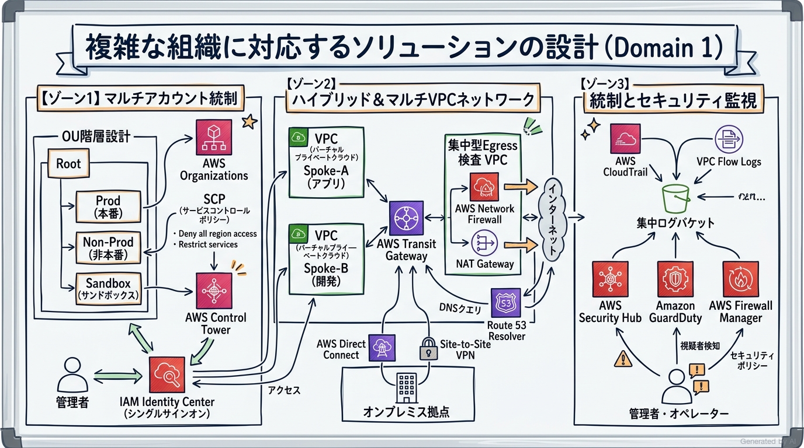
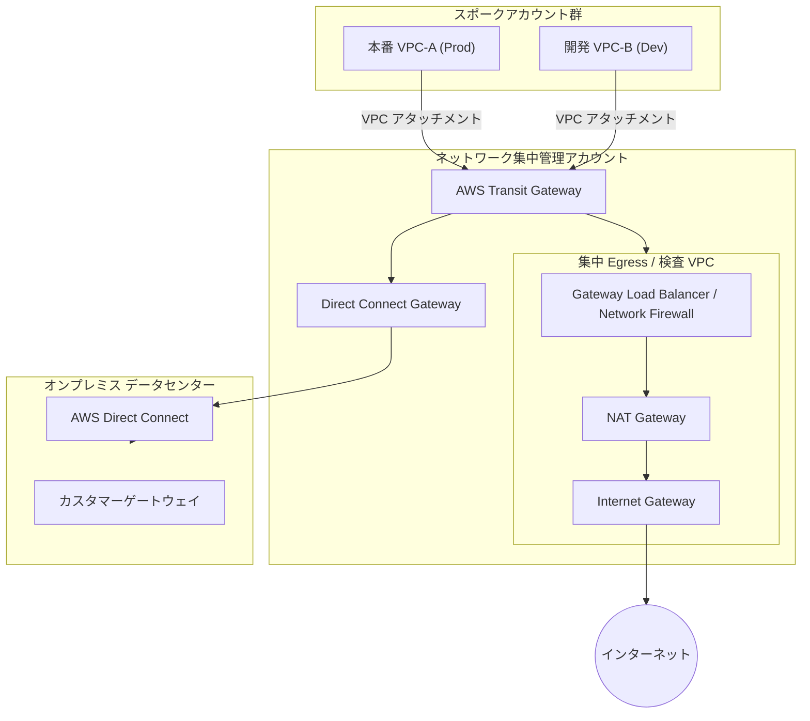
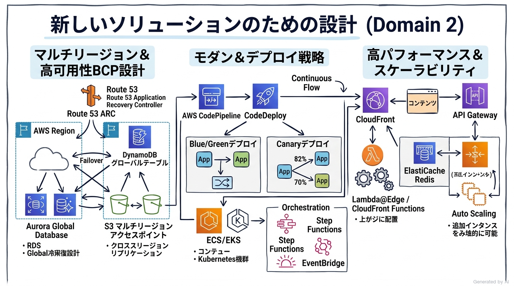
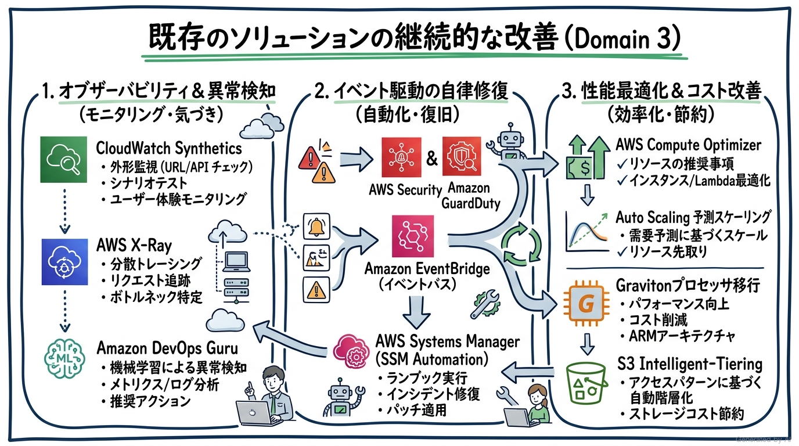
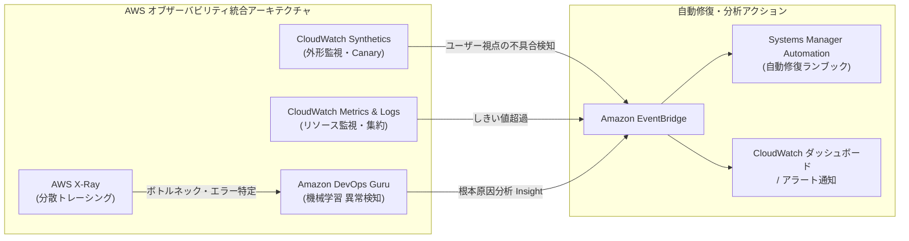
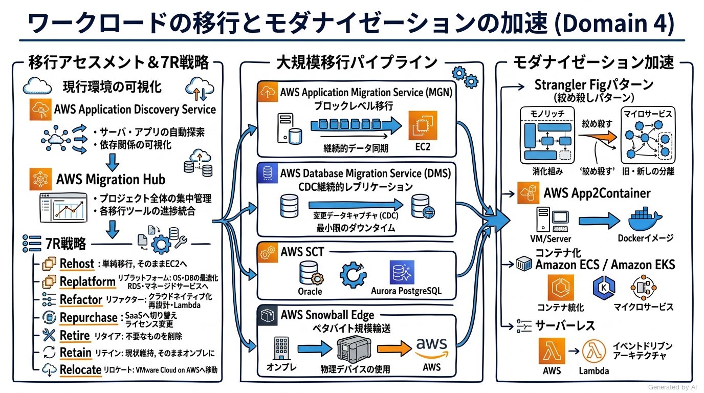
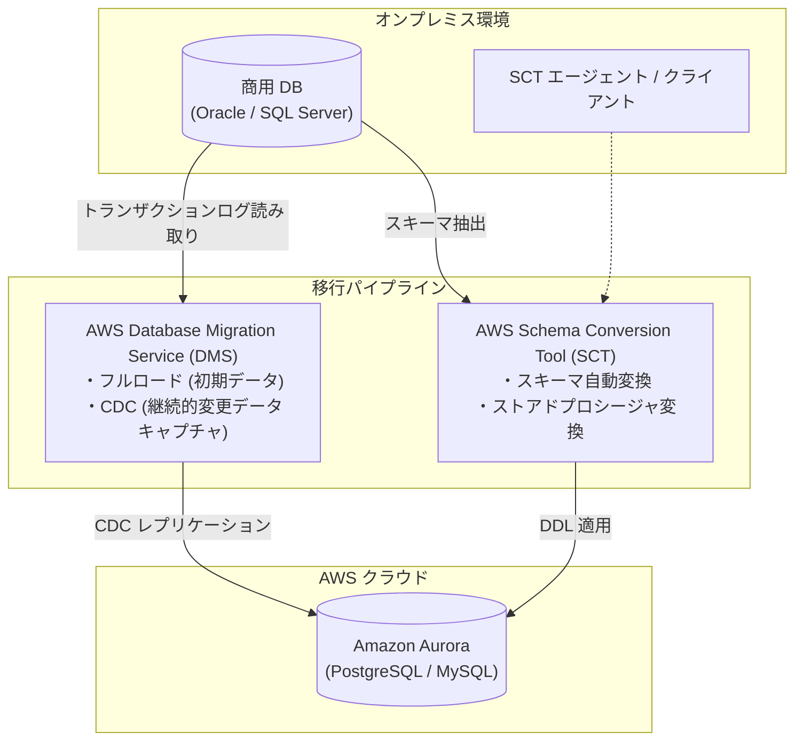

# AWS Certified Solutions Architect - Professional (SAP-C02) 完全対策＆実践学習ガイド

- **対象資格**: AWS Certified Solutions Architect - Professional
- **試験コード**: SAP-C02
- **公式試験ガイド**: [AWS Certified Solutions Architect - Professional (SAP-C02) 試験ガイド](https://docs.aws.amazon.com/ja_jp/aws-certification/latest/solutions-architect-professional-02/solutions-architect-professional-02.html)
- **最終更新日**: 2026-10-06

---

## はじめに

現代のエンタープライズクラウドアーキテクチャは、単一アカウントやシンプルなWeb 3層構造を超え、数千のAWSアカウントにまたがる組織横断のガバナンス統制、マルチリージョン規模での極小RTO/RPOディザスタリカバリ、オンプレミスとクラウドを密結合する広帯域・低遅延のハイブリッドネットワーク、そしてレガシーモノリスからイベント駆動・コンテナ型マイクロサービスへの大規模モダナイゼーションへと急速に高度化しています。

AWS Certified Solutions Architect - Professional (SAP-C02) は、AWS Well-Architected フレームワークの全6本の柱に基づき、複雑・大規模・制約の厳しいビジネス要件に対し、技術的・運用面・コスト面のトレードオフを高度に判断・意思決定できるアーキテクトとしての最高峰の実力を証明する資格です。

本ガイドは、最新の SAP-C02 試験ガイド（全4ドメイン）に完全準拠し、組織統制・新規ソリューション設計・既存システム改善・移行とモダナイゼーションの全領域を網羅しています。各ドメインの重要概念、詳細な技術選定比較マトリクス、全タスクを完全網羅した構造化実践シナリオ（状況 / 対応 / 結果 / 解説）、および公式一次ドキュメント・推奨ハンズオンをカプセル化した決定版対策ノートです。

### AWS Certified Solutions Architect - Professional 試験とは

AWS Certified Solutions Architect - Professional は、組織規模の複雑な要件を評価し、AWSサービス群を戦略的に統合して、可用性、耐障害性、パフォーマンス、セキュリティ、コスト効率を極限まで最適化したソリューションをエンドツーエンドで設計・主導する能力を検証する試験です。

- **試験時間**: 180 分
- **出題問題数**: 75 問（採点対象: 65 問 / 未採点テスト設問: 10 問）
- **出題形式**: 択一選択問題（4肢中1つ選択）、複数選択問題（5肢以上中2つ以上選択）
- **合格基準点**: 100〜1,000 点のスケールドスコアで 750 点以上
- **前提知識**: AWS 上での大規模クラウドソリューション設計・実装・運用における 2 年以上の実務経験、および AWS Certified Solutions Architect - Associate (SAA) 相当の知識が強く推奨されます。

### 難易度と求められる思考力

当試験の難易度は **AWS認定資格における最高峰（プロフェッショナル・アーキテクチャ意思決定の極致）** に位置づけられます。

アソシエイト（SAA）レベルが「個別のサービス仕様や基本的なWell-Architected パターンの理解」を問うのに対し、プロフェッショナル（SAP）レベルでは **「長文かつ複雑な前提制約（既存オンプレミス資産、組織階層、厳格なセキュリティ規制、厳密な目標復旧時間 RTO/RPO、予算上限）が絡み合う中での複合的トレードオフ判断」** が問われます。

特に、以下のアーキテクチャ思考が正答を導く不可欠な軸となります：

1. **マルチアカウント・マルチリージョン前提の統制と回復力**: 単一VPCや単一アカウントでの解法ではなく、AWS Organizations、Control Tower、Transit Gateway、Route 53 Application Recovery Controller (ARC)、DynamoDB グローバルテーブル、Aurora Global Database を組み合わせた全体最適の設計。
2. **ハイブリッド接続と集中型セキュリティインスペクション**: Direct Connect（DX）、DX Gateway、Transit Gateway を用いたグローバルネットワーク構築と、AWS Network Firewall や Gateway Load Balancer (GWLB) によるトラフィックの集中検査設計。
3. **レガシー移行の 7R 戦略とモダナイゼーションの加速**: AWS Application Migration Service (MGN)、Database Migration Service (DMS)、AWS SCT、メインフレームモダナイゼーションを駆使した無停止移行と、ストラングラーイチジク（Strangler Fig）パターンによる段階的マイクロサービス化。
4. **トレードオフの先鋭化と制約キーワードの読解**: 設問文の「ダウンタイムゼロ」「最小の運用オーバーヘッド」「最も費用対効果が高い」「規制遵守（PCI DSS、HIPAA）」といった制約条件を正確に捉え、技術的に動作可能であっても制約を満たさない選択肢を論理的に除外する能力。

### 推奨の勉強法

1. **AWS アーキテクチャセンターおよび公式ホワイトペーパーの精読**
   「AWS マルチアカウント環境のベストプラクティス」「AWS ディザスタリカバリ (DR) アーキテクチャ」「ハイブリッドクラウドネットワーク設計」「AWS Prescriptive Guidance (移行・モダナイゼーション)」の各公式一次情報を読み込み、エンタープライズ設計の定石を把握します。
2. **大規模シナリオを想定した実機ハンズオン検証**
   Transit Gateway によるクロスアカウント・マルチVPCルーティング、Control Tower / SCP のガードレール適用、Aurora Global Database のフェイルオーバー、CodePipeline と CodeDeploy によるカナリアデプロイなどを実際に構築・検証します。
3. **構造化実践シナリオによる思考プロセスの追体験**
   本ガイドに収録された全タスク網羅の実践シナリオにおいて、特に **解説（なぜ他の代替案では要件を満たせないのか）** を熟読し、出題者の意図と消去法のロジックを脳内に定着させます。

---

## 目次

1. [はじめに](#はじめに)
2. [学習カリキュラム・出題範囲ロードマップ](#学習カリキュラム出題範囲ロードマップ)
3. [Domain 1: 複雑な組織に対応するソリューションの設計 (26%)](#domain-1-複雑な組織に対応するソリューションの設計-26)
4. [Domain 2: 新しいソリューションのための設計 (29%)](#domain-2-新しいソリューションのための設計-29)
5. [Domain 3: 既存のソリューションの継続的な改善 (25%)](#domain-3-既存のソリューションの継続的な改善-25)
6. [Domain 4: ワークロードの移行とモダナイゼーションの加速 (20%)](#domain-4-ワークロードの移行とモダナイゼーションの加速-20)
7. [まとめと推奨学習ステップ](#まとめと推奨学習ステップ)

---

## 学習カリキュラム・出題範囲ロードマップ

### セクション一覧と出題比率

本試験は全4ドメインで構成されており、新規設計（Domain 2: 29%）と組織統制（Domain 1: 26%）が全体の過半数を占めますが、既存改善（Domain 3: 25%）と移行・モダナイゼーション（Domain 4: 20%）も非常に高い出題ウェイトを持ち、極めてバランスの取れた総合力が要求されます。

| ドメイン番号 | ドメイン名 / 出題分野 | 出題比率 | 主要対象サービス・ツール |
| :--- | :--- | :--- | :--- |
| **Domain 1** | 複雑な組織に対応するソリューションの設計 | 26% | AWS Organizations, AWS Control Tower, IAM Identity Center, SCP, AWS Transit Gateway, AWS Direct Connect, Route 53 Resolver, AWS Network Firewall, AWS RAM, AWS Security Hub, Amazon GuardDuty, AWS Cost Categories |
| **Domain 2** | 新しいソリューションのための設計 | 29% | Route 53 ARC, Amazon Aurora Global Database, DynamoDB Global Tables, S3 Multi-Region Access Points, AWS Step Functions, Amazon EventBridge, AWS CodePipeline, CodeDeploy, Elastic Load Balancing, AWS WAF, AWS KMS |
| **Domain 3** | 既存のソリューションの継続的な改善 | 25% | AWS Compute Optimizer, Amazon DevOps Guru, AWS X-Ray, Amazon CloudWatch Synthetics, AWS Config, Auto Scaling 予測スケーリング, Amazon OpenSearch Service, ElastiCache, S3 Intelligent-Tiering, Savings Plans |
| **Domain 4** | ワークロードの移行とモダナイゼーションの加速 | 20% | AWS Application Migration Service (MGN), AWS Database Migration Service (DMS), AWS Schema Conversion Tool (SCT), AWS DataSync, AWS Snowball Edge, AWS Transfer Family, AWS App2Container, Amazon EKS, AWS Lambda |

---

### ドメイン別出題詳細

#### Domain 1: 複雑な組織に対応するソリューションの設計 (26%)
- **出題の狙い**: エンタープライズ規模のマルチアカウント構造、集中型ハイブリッドネットワーク、セキュリティ境界の集中管理、および組織横断のコスト配分戦略を包括的に設計する能力を検証します。
- **主要タスク**:
  - Task 1.1: ネットワーク接続戦略の設計（AWS Transit Gateway, Direct Connect, DX Gateway, Route 53 Resolver, 集中型 Egress/Ingress VPC）
  - Task 1.2: セキュリティコントロールの規定（AWS Organizations SCP, サービスリンクロール, AWS IAM Identity Center, AWS KMS クロスアカウントキー共有, AWS RAM）
  - Task 1.3: 信頼性と耐障害性に優れたアーキテクチャの設計（マルチアカウント障害分離、集中ロギング、AWS Backup クロスアカウント・クロスリージョン保護）
  - Task 1.4: マルチアカウント AWS 環境の設計（AWS Control Tower ガードレール、OU 階層設計、アカウント発行ファクトリー (AFT)）
  - Task 1.5: コスト最適化と可視化戦略の決定（AWS Cost Categories, AWS Budgets, コスト配分タグの一元統制、Savings Plans 共有と除外設定）
- **重要キーワード**: AWS Organizations, SCP (Service Control Policies), AWS Control Tower, AWS Transit Gateway, Direct Connect Gateway, Route 53 Resolver Rules / Outbound Endpoints, AWS RAM (Resource Access Manager), 集中型 Egress 検査 VPC, Gateway Load Balancer (GWLB), AWS Network Firewall, 集中ログアカウント

#### Domain 2: 新しいソリューションのための設計 (29%)
- **出題の狙い**: 新規ビジネス要件に基づき、マルチリージョン規模の耐障害性・ディザスタリカバリ、ダウンタイムゼロのデプロイパイプライン、セキュアなデータ保護、極低レイテンシのスケーラブルアーキテクチャをゼロベースで設計する能力を検証します。
- **主要タスク**:
  - Task 2.1: ビジネス要件を満たすデプロイ戦略の設計（Blue/Green デプロイ、カナリアデプロイ、AWS CodePipeline, AWS CodeDeploy, AWS CloudFormation StackSets）
  - Task 2.2: 事業継続性 (BCP) を確保するソリューションの設計（Route 53 ARC, Aurora Global Database, DynamoDB グローバルテーブル, S3 MRAP, アクティブ/アクティブ vs アクティブ/パッシブ DR）
  - Task 2.3: 要件に基づいたセキュリティコントロールの決定（AWS KMS レプリケーション, AWS Secrets Manager クロスリージョン同期, WAF レートベースルール, Cognito フェデレーション）
  - Task 2.4: 信頼性要件を満たす戦略の策定（SQS/SNS ファンアウト, EventBridge イベントバス, Step Functions 分散マップ, 回復力パターン）
  - Task 2.5: パフォーマンス目標を満たすソリューションの設計（CloudFront + Lambda@Edge / CloudFront Functions, Global Accelerator, ElastiCache クラスターモード, EFS / FSx）
  - Task 2.6: コスト最適化戦略の決定（サーバーレスファースト設計、Graviton プロセッサの採用、DynamoDB オンデマンド vs プロビジョンド選定）
- **重要キーワード**: Route 53 ARC (Application Recovery Controller), Amazon Aurora Global Database, DynamoDB Global Tables, S3 Multi-Region Access Points (MRAP), AWS CodeDeploy (Linear / Canary), CloudFormation StackSets, AWS Step Functions Distributed Map, Lambda@Edge vs CloudFront Functions, AWS Global Accelerator

#### Domain 3: 既存のソリューションの継続的な改善 (25%)
- **出題の狙い**: 稼働中システムのオブザーバビリティ、ボトルネック解消、セキュリティポスチャ強化、自動修復、およびプロアクティブなコスト適正化を推進する能力を検証します。
- **主要タスク**:
  - Task 3.1: 全体的な運用上の優秀性を高めるための戦略作成（Amazon DevOps Guru, CloudWatch Synthetics Canaries, EventBridge + Systems Manager オートメーションによる自律修復）
  - Task 3.2: セキュリティを向上させるための戦略決定（AWS Security Hub 検出結果の自動修復, Amazon GuardDuty, Amazon Inspector v2, IAM Access Analyzer, AWS Config ルール）
  - Task 3.3: パフォーマンスを改善するための戦略決定（AWS Compute Optimizer, X-Ray による分散トレーシング, RDS Performance Insights, ElastiCache によるリードキャッシュオフロード）
  - Task 3.4: 信頼性を向上させるための戦略決定（Auto Scaling 予測スケーリング, Route 53 ヘルスチェック最適化, 既存 DB の Multi-AZ / リードレプリカ昇格戦略）
  - Task 3.5: コスト最適化の機会の特定（S3 Intelligent-Tiering, 未使用 EBS ボリューム/古いスナップショット検出, Compute Savings Plans 最適化）
- **重要キーワード**: Amazon DevOps Guru, CloudWatch Synthetics, AWS Systems Manager Automation, AWS Security Hub, Amazon GuardDuty, AWS Config Conformance Packs, IAM Access Analyzer, AWS Compute Optimizer, AWS X-Ray, Auto Scaling Predictive Scaling, S3 Intelligent-Tiering

#### Domain 4: ワークロードの移行とモダナイゼーションの加速 (20%)
- **出題の狙い**: オンプレミス環境からの大規模データ移行、サーバー・DB のリホスト/リプラットフォーム、そしてクラウドネイティブなマイクロサービスへのモダナイゼーション（7R戦略）を計画・実行する能力を検証します。
- **主要タスク**:
  - Task 4.1: 移行可能な既存ワークロードとプロセスの選択（AWS Application Discovery Service, AWS Migration Hub, 7R (Rehost, Replatform, Refactor, Repurchase, Retain, Retire, Relocate) アセスメント）
  - Task 4.2: 既存ワークロードに対する最適な移行アプローチの決定（AWS Application Migration Service (MGN), AWS Database Migration Service (DMS), AWS SCT, AWS DataSync, Snow ファミリー）
  - Task 4.3: 既存ワークロードの新しいアーキテクチャの決定（VMware Cloud on AWS, オンプレミス Active Directory と AWS の連携, AWS Transfer Family）
  - Task 4.4: モダナイゼーションと機能強化の機会の特定（Strangler Fig パターンによる段階的モダナイゼーション, AWS App2Container, Amazon EKS / ECS 移行, イベント駆動型アーキテクチャへのリファクタリング）
- **重要キーワード**: AWS MGN (Application Migration Service), AWS DMS (Database Migration Service), AWS SCT (Schema Conversion Tool), AWS DataSync, AWS Snowball Edge / Snowcone, Strangler Fig (絞め殺し) パターン, 7R 移行戦略, AWS App2Container, VMware Cloud on AWS, AWS Transfer Family

---

## Domain 1: 複雑な組織に対応するソリューションの設計 (26%)

本ドメインは、多数の事業部門やアカウントを抱えるエンタープライズ企業において、セキュリティ・ネットワーク・運用の統制をスケールさせる設計能力を評価します。アカウントの個別管理から脱却し、ポリシーによるガードレール（SCP）の徹底、Transit Gateway によるハブ＆スポーク型ネットワークの集中管理、およびハイブリッド接続の最適化が求められます。

---

### 1. セクション概要

エンタープライズのマルチアカウント設計における基本哲学は、「自律性とガバナンスの両立」です。開発チームには各アカウント内での自由な構築権限（アジリティ）を付与しつつ、組織全体として禁止すべきアクション（リージョン制限、セキュリティログの改ざん防止、暗号化の強制など）を AWS Organizations のサービスコントロールポリシー (SCP) で中央統制します。

ネットワーク設計においては、VPC ピア接続のフルメッシュ化による経路数爆発と運用破綻を回避するため、AWS Transit Gateway を中核としたハブ＆スポーク構造を採用します。オンプレミス拠点との Direct Connect / VPN 接続を集約し、すべてのインターネット向け通信（Egress）や VPC 間トラフィックを集中型インスペクション VPC 内の AWS Network Firewall やサードパーティ仮想アプライアンス（GWLB 経由）にルーティングするアーキテクチャが定石となります。

#### 重要キーワード

- **AWS Organizations & SCP (Service Control Policies)**: 組織単位（OU）やアカウントに対して最大利用可能権限の「ガードレール」を課すポリシー。アカウントのルートユーザーであっても SCP の制限を突破することはできない。
- **AWS Control Tower & アカウント発行ファクトリー (AFT)**: ベストプラクティスに基づいたマルチアカウント環境を自動プロビジョニングし、予防的・発見的ガードレールを適用するサービス。Terraform やパイプラインと連携する AFT によりアカウント発行を自動化。
- **AWS Transit Gateway (TGW)**: 数千の VPC やオンプレミス拠点を相互接続するクラウドルーター。ルートテーブルを分離することで本番（Prod）と開発（Dev）のネットワーク完全分離を実現。
- **Direct Connect Gateway (DXGW)**: 単一の AWS Direct Connect 接続を、異なるリージョン・異なるアカウントに存在する複数の VPC や Transit Gateway にルーティング接続するためのグローバルゲートウェイ。
- **Route 53 Resolver (インバウンド / アウトバウンドエンドポイント)**: オンプレミス DNS サーバーと AWS Route 53 プライベートホストゾーン間のシームレスな双方向 DNS 名前解決を実現するハイブリッド DNS ソリューション。
- **集中型 Egress 検査 VPC & AWS Network Firewall**: 各スポーク VPC からのインターネット向けアウトバウンド通信を Transit Gateway 経由で単一のセキュリティ VPC に誘導し、ステートフルなドメインフィルタリングと侵入検知（IDS/IPS）を一括適用する設計。
- **AWS Resource Access Manager (RAM)**: サブネット、Transit Gateway、ライセンス等の AWS リソースを組織内の別アカウントと安全に共有し、リソースの重複作成とコストを排除するサービス。
- **AWS Cost Categories**: 組織内のアカウント、コスト配分タグ、サービス、チャージバックルールをカスタムルールでグループ化し、事業部門ごとの費用を正確に可視化・按分する機能。

---

### 2. 重要トピック

#### 1. エンタープライズ・ハイブリッドネットワークと集中インスペクション設計

エンタープライズ規模のネットワークでは、すべての VPC に個別の NAT ゲートウェイやインターネットゲートウェイ（IGW）を配置すると、セキュリティポリシーの統一が困難になり、NAT ゲートウェイのアイドル課金も膨らみます。Transit Gateway を中心とし、集中型の Egress/Ingress VPC を設ける設計が推奨されます。

- **通信の分離**: TGW のルートテーブルを「Prod 用」「Dev 用」「共有用」に分割し、Dev から Prod への直接通信をルーティングレベルで遮断。
- **トラフィックの集中検査**: スポーク VPC から外部へのトラフィックのデフォルトルート（`0.0.0.0/0`）を TGW に向け、TGW はそれを検査 VPC 内の AWS Network Firewall に転送。検査を通過したパケットのみが NAT ゲートウェイ経由でインターネットへ送出されます。

#### 2. マルチアカウント接続・共有方式の比較マトリクス

| 比較項目 / 方式 | VPC ピア接続 (VPC Peering) | AWS Transit Gateway (TGW) | AWS PrivateLink / VPC エンドポイント |
| :--- | :--- | :--- | :--- |
| **トポロジー** | ポイント・ツー・ポイント (メッシュ) | ハブ＆スポーク (集中集約) | サービス単位のプライベート公開 |
| **推移的ルーティング (Transitive Routing)** | **不可** (A-B, B-C 間があっても A-C は不可) | **完全サポート** (TGW を経由して通信可能) | 不要 (サービスプロバイダーへ直接接続) |
| **IP アドレス重複 (CIDR 重複)** | 不可 (重複 CIDR 間は接続不可) | サブネット間は不可 (重複時は NAT 必須) | **完全許容** (エンドポイント IP のみで接続可能) |
| **スケーラビリティ** | VPC 数が増えると接続数が爆発 ($N \times (N-1)/2$) | 数千の VPC / VPN / DX を単一ハブで統合 | アカウントや VPC の境界を意識せず疎結合で接続 |
| **運用負荷** | 高い (ルートテーブルの管理が煩雑) | 低い (TGW ルートテーブルの一元管理) | 極めて低い (ネットワーク全体を結合しない) |
| **主な用途** | 2〜3 個の VPC 間で大容量の低遅延通信 | 全社的なマルチアカウント・ハイブリッド接続 | 特定の社内 SaaS や API を安全に他部門へ公開 |

- **アーキテクトの選定基準**:
  - 全社的なハイブリッド接続や数多くの VPC 相互通信が必須な場合は、迷わず **AWS Transit Gateway** を選定します。
  - CIDR が重複している別組織・別会社の VPC から特定サービスのみをセキュアに利用させたい場合は、ネットワーク全体を繋がず **AWS PrivateLink** を選定します。
  - 少数の VPC 間でレイテンシを極小化し、データ転送コストを抑えたい専用ラインの場合は **VPC ピア接続** を選定します。

---

### 3. 実践シナリオ

#### シナリオ 1-1: 集中型 Egress 検査によるセキュリティ統制と NAT コスト最適化

- **状況**: グループ企業全体で 50 以上の AWS アカウントと 100 以上の VPC が稼働しており、各 VPC が個別に NAT ゲートウェイを配置して直接インターネットへアクセスしているため、セキュリティポリシー（特定ドメインへのアクセス制限）の統一適用が不可能であり、月額の NAT ゲートウェイ固定費用も高騰している場合
- **対応**: ネットワーク集中管理アカウントに AWS Transit Gateway と「集中型 Egress VPC」を構築し、AWS Network Firewall と NAT ゲートウェイを配置する。AWS RAM を用いて Transit Gateway を全アカウントに共有し、各スポーク VPC のルートテーブルで `0.0.0.0/0` を Transit Gateway へ向けるルーティングに変更する。
- **結果**: すべての VPC からのインターネット向けアウトバウンドトラフィックが集中検査 VPC を通過し、AWS Network Firewall によるステートフルなドメインホワイトリスト検査が一元適用されるとともに、個別 VPC の NAT ゲートウェイを撤廃して大幅なコスト削減を達成する。
- **解説**: Transit Gateway と集中型 Egress VPC の組み合わせにより、数十〜数百の VPC に対するトラフィック統制を一箇所で集約・監査できるためです。各 VPC に個別の NAT ゲートウェイとサードパーティプロキシ EC2 を運用する代替案は、管理負荷が破綻し、設定ミスによる漏洩リスクが高まります。また、VPC ピア接続では推移的ルーティングがサポートされないため、集中 Egress VPC を経由させることができません。
- **参考ドキュメント**:
  - [AWS Network Firewall 開発者ガイド - AWS Network Firewall のアーキテクチャ](https://docs.aws.amazon.com/ja_jp/network-firewall/latest/developerguide/): 集中型アウトバウンド検査のベストプラクティス構成。

#### シナリオ 1-2: オンプレミスと複数リージョン VPC 間のセキュアかつ低遅延なハイブリッド接続

- **状況**: オンプレミスデータセンターと東京・大阪・シンガポールの 3 リージョンに分散する数十の AWS アカウントの VPC を接続する必要があり、IPsec VPN の暗号化通信を維持しつつ、最大スループットを確保し、運用負荷を最小限に抑えたい場合
- **対応**: オンプレミスデータセンターから AWS への専用線として「AWS Direct Connect」を敷設し、Transit 仮想インターフェイス（Transit VIF）を介して「Direct Connect Gateway (DXGW)」に接続する。各リージョンに構築した AWS Transit Gateway をこの DXGW に関連付け、さらに MACsec（IEEE 802.1AE）暗号化を Direct Connect 接続に適用する。
- **結果**: 単一の Direct Connect 回線から DXGW を経由して複数リージョンの全 Transit Gateway に低遅延かつ大容量でルーティングされ、レイヤー2 のハードウェア暗号化（MACsec）により IPsec オーバーヘッドなしでセキュアなハイブリッド接続が確立される。
- **解説**: Direct Connect Gateway はグローバルリソースであり、単一の DX 接続から複数リージョンの Transit Gateway にトラフィックをルーティングできるためです。各リージョンごとに個別でプライベート VIF を敷設する方式は、回線コストと BGP ピアリング管理が膨大になります。また、IPsec VPN over Direct Connect は CPU 処理によるスループット制約（トンネルあたり 1.25 Gbps）が発生しますが、専用線直結の MACsec を採用することで回線速度（10 Gbps / 100 Gbps）を維持したまま暗号化要件を満たせます。
- **参考ドキュメント**:
  - [AWS Direct Connect ユーザーガイド - Direct Connect ゲートウェイの使用](https://docs.aws.amazon.com/ja_jp/directconnect/latest/UserGuide/direct-connect-gateways-intro.html): マルチリージョンマルチ VPC 接続のアーキテクチャ。

#### シナリオ 1-3: AWS Organizations におけるセキュリティガードレールと権限移譲

- **状況**: 開発部門に AWS アカウント内の自由なリソース作成権限を与えたいが、情報漏洩やコンプライアンス違反を防ぐため、(1) 指定した 2 つの承認リージョン以外でのリソース作成、(2) S3 バケットのパブリック公開、(3) CloudTrail や GuardDuty などのセキュリティ監査設定の無効化を、アカウント管理者の root 権限であっても絶対に実行できないように強制したい場合
- **対応**: AWS Organizations のルートまたは該当組織単位（OU）に対して、上記 3 つの条件を厳格に拒否（`"Effect": "Deny"`）する「サービスコントロールポリシー (SCP)」を作成してアタッチする。さらに、AWS Control Tower のガードレール（予防的コントロール）を有効化し、監査アカウントに CloudTrail ログを集中転送する。
- **結果**: 各アカウント内の管理者や IAM ユーザーがどのような AdministratorAccess 権限を持っていたとしても、承認されていないリージョンの利用やセキュリティ設定の改ざんがプラットフォームレベルでブロックされる。
- **解説**: SCP は AWS Organizations 配下のすべてのアカウント（root ユーザーを含む）に対して最大権限のガードレールを強制できる唯一の仕組みであるためです。各アカウント内の IAM ポリシーやパーミッションバウンダリーのみで制御する代替案は、アカウント管理者が自らポリシーを変更・削除できてしまうため、組織横断の強固なセキュリティ統制要件を満たせません。
- **参考ドキュメント**:
  - [AWS Organizations ユーザーガイド - サービスコントロールポリシー (SCP)](https://docs.aws.amazon.com/ja_jp/organizations/latest/userguide/orgs_manage_policies_scps.html): ガードレール設計の基礎と記述例。

#### シナリオ 1-4: オンプレミス AD とのシームレスなハイブリッド DNS 名前解決

- **状況**: 社内オンプレミスネットワーク上のActive Directory DNS（`corp.example.local`）と、AWS 上の VPC 内に配置された Amazon Route 53 プライベートホストゾーン（`aws.example.internal`）の間で、双方向の完全修飾ドメイン名 (FQDN) 名前解決を自動化したい場合
- **対応**: ネットワーク共通アカウントの VPC に「Route 53 Resolver インバウンドエンドポイント」および「アウトバウンドエンドポイント」を作成する。オンプレミス DNS には `*.aws.example.internal` の問い合わせをインバウンドエンドポイントの IP アドレスに転送する条件付きフォワーダーを設定し、Route 53 Resolver には `*.corp.example.local` の問い合わせをオンプレミス DNS に転送する転送ルール（Resolver Rule）を作成して全 VPC に RAM で共有する。
- **結果**: オンプレミスサーバーおよび AWS 上の EC2/コンテナの双方が、追加のプロキシや hosts ファイル変更なしに、互いの内部ドメインを完全に透過的に名前解決できるようになる。
- **解説**: Route 53 Resolver エンドポイントはフルマネージドで高可用なハイブリッド DNS ブリッジを提供するためです。EC2 上に自前の BIND や Unbound DNS フォワーダーを構築・冗長化する代替案は、OS パッチ適用、スケーリング、Multi-AZ 障害対応などの運用オーバーヘッドが過大になります。
- **参考ドキュメント**:
  - [Amazon Route 53 開発者ガイド - ハイブリッドクラウドの Route 53 Resolver](https://docs.aws.amazon.com/ja_jp/Route53/latest/DeveloperGuide/): インバウンド/アウトバウンドエンドポイントの設定パターン。

#### シナリオ 1-5: 事業部門ごとのコスト配分とチャージバックの自動化

- **状況**: 数百の AWS アカウントを横断して稼働するワークロードにおいて、経理部門から「事業部門コード（CostCenter）および環境（Prod/Dev）ごとに正確な利用コストを集計し、未割り当てコストや共有リソース費用を按分して月次レポートを作成したい」と要求された場合
- **対応**: AWS Organizations の管理アカウントで「コスト配分タグ（ユーザー定義タグ）」を一括アクティブ化し、AWS Control Tower / AWS Config でタグ付与を強制する。さらに「AWS Cost Categories」を設定し、複数のアカウントやタグ条件を論理ルールでマッピングして事業部門を定義し、共有コストの按分（Split Charges）ルールを構成する。
- **結果**: AWS Cost Explorer や AWS Cost and Usage Report (CUR) 上で、定義した Cost Categories ごとに自動分類された精緻なチャージバックデータが生成され、手作業での Excel 集計が不要になる。
- **解説**: AWS Cost Categories を活用することで、アカウント構造やタグの表記揺れを柔軟なルールセットで吸収し、共有リソース費用（Transit Gateway や集中ログ基盤など）を事業部へ按分できるためです。各アカウント管理者に手動で利用額を報告させる方式や、単純なタグフィルターのみに依存する代替案は、共有インフラのコスト漏れや分類不能な請求が発生し、精緻なチャージバック要件を満たせません。
- **参考ドキュメント**:
  - [AWS コスト管理ユーザーガイド - AWS Cost Categories の使用](https://docs.aws.amazon.com/ja_jp/cost-management/latest/userguide/): 組織内の費用分類とコスト按分ルール。

---

### 4. 参考ドキュメント & 推奨ハンズオン

#### 公式一次ドキュメント
- [AWS Control Tower ユーザーガイド - ガードレールとマルチアカウント管理](https://docs.aws.amazon.com/ja_jp/controltower/latest/userguide/what-is-control-tower.html): ランディングゾーン設計原則、セキュリティアカウント分離、共有インフラ管理。
- [AWS Well-Architected ホワイトペーパー - ハイブリッドネットワークアーキテクチャ](https://docs.aws.amazon.com/ja_jp/wellarchitected/latest/reliability-pillar/): Transit Gateway と Direct Connect を用いた冗長化設計。

#### 推奨ハンズオン・ラボ（実機検証）
- **AWS Skill Builder: Configuring AWS Control Tower and Guardrails**
  - **学習目標**: Control Tower ランディングゾーンをデプロイし、組織単位（OU）を作成して、SCP による予防的ガードレールおよび Config による発見的ガードレールの動作を検証する。
- **AWS Skill Builder: Advanced Networking with AWS Transit Gateway**
  - **学習目標**: 3つの VPC と Transit Gateway をプロビジョニングし、ルートテーブルの分離による VPC 間通信制御と、集中型 Egress インスペクション VPC へのトラフィックルーティングを構築する。

---

## Domain 2: 新しいソリューションのための設計 (29%)

本ドメインは試験全体で最大の配点（29%）を占め、ビジネス要件から最適なアーキテクチャを新規に導出する能力を総合的に検証します。マルチリージョン規模での極小 RTO/RPO ディザスタリカバリ、ダウンタイムゼロの Blue/Green・カナリアデプロイ、エッジコンピューティング、および耐障害性に優れたイベント駆動型マイクロサービスの設計が中心となります。

---

### 1. セクション概要

現代のグローバルサービスにおけるアーキテクチャ設計では、「リージョン全体の障害が発生してもビジネスを継続できる回復力（レジリエンス）」が前提となります。従来の単一リージョン Multi-AZ 構成にとどまらず、Amazon Aurora Global Database、DynamoDB グローバルテーブル、S3 マルチリージョンアクセスポイント（MRAP）を組み合わせ、Route 53 Application Recovery Controller (ARC) による秒単位のリージョン間トラフィック切り替えを実現する「アクティブ/アクティブ」または「アクティブ/パッシブ」の設計が求められます。

また、アプリケーションのリリースにおいては、ダウンタイムを一切許容しない無停止デプロイが不可欠です。AWS CodePipeline および AWS CodeDeploy を活用し、ALB や ECS/EKS、Lambda のトラフィックを徐々に移行するカナリア（Canary）や線形（Linear）デプロイを自動化し、CloudWatch アラームと連動した自動ロールバックメカニズムを組み込むことが本質的な評価点となります。

#### 重要キーワード

- **Route 53 Application Recovery Controller (ARC)**: マルチリージョンワークロードの可用性を管理し、高信頼なルーティングコントロール（セルの有効/無効切り替え）とレディネスチェック（復旧準備の継続監査）を提供するサービス。
- **Amazon Aurora Global Database**: ストレージレベルで専用の AWS バックボーンを介して高速レプリケーションを行い、リージョン間のレプリケーションレイテンシを通常 1 秒未満に抑え、リージョン障害時に 1 分未満で昇格可能なデータベース。
- **DynamoDB グローバルテーブル**: 複数リージョンにまたがる完全マネージドなマルチアクティブ（マルチマスター）データベース。各リージョンでローカルの読み書きをミリ秒未満のレイテンシで処理。
- **S3 マルチリージョンアクセスポイント (MRAP)**: 単一のグローバルエンドポイントを提供し、AWS Global Accelerator を介してクライアントから最もレイテンシの低いリージョンの S3 バケットへ自動ルーティングする機能。
- **AWS CodeDeploy (Blue/Green & カナリアデプロイ)**: 既存環境（Blue）とは別に新環境（Green）を構築し、ロードバランサーのトラフィックを段階的にシフト（Canary10Percent5Minutes 等）してエラー検知時に即時ロールバックするデプロイ自動化サービス。
- **AWS Step Functions (Distributed Map)**: 数万件以上の並列処理をサーバーレスでオーケストレーションする分散マップステート。S3 バケット内の大量オブジェクトを高速かつコスト効率良く並列処理。
- **AWS Global Accelerator**: AWS のグローバルプライベートネットワークを活用し、エッジロケーションの静的 Anycast IP アドレスから最も近い健全なリージョンエンドポイントへトラフィックを最適ルーティングするネットワークサービス。
- **Lambda@Edge vs CloudFront Functions**: CloudFront エッジでコードを実行する機能。ミリ秒未満・超軽量なヘッダー操作/URLリライトは CloudFront Functions、ネットワークアクセスやレスポンスボディの改変・認証連携は Lambda@Edge を選定。

---

### 2. 重要トピック

#### 1. マルチリージョン・アクティブ/アクティブ vs パッシブ DR 設計マトリクス

| 比較項目 / アーキテクチャ | パイロットライト (Pilot Light) | ウォームスタンバイ (Warm Standby) | マルチリージョン・アクティブ/アクティブ |
| :--- | :--- | :--- | :--- |
| **RTO (目標復旧時間)** | 数十分（コンピュートの起動待ち） | 数分（キャパシティのスケールアウト） | **ほぼゼロ（秒単位でのトラフィックシフト）** |
| **RPO (目標復旧時点)** | 数分〜数十分（レプリケーション間隔） | 数秒〜数分（非同期レプリケーション） | **ほぼゼロ（DynamoDB グローバルテーブル / Aurora）** |
| **構成要素** | DB レプリカのみ稼働、EC2/ASG は停止 | 縮小構成（最小インスタンス数）で常時稼働 | 全リージョンで本番キャパシティが常時稼働 |
| **平常時のトラフィック** | プライマリリージョンのみ処理 | プライマリリージョンのみ処理 | 全リージョンで最寄りユーザーを並列処理 |
| **コスト** | 低い（ストレージ＋最小 DB 費用のみ） | 中程度（常時最小コンピュートが稼働） | **高い（全リージョンで二重以上のインフラが稼働）** |
| **データ整合性の課題** | なし（単一書き込みマスター） | なし（単一書き込みマスター） | **競合解決（Last Writer Wins）の考慮が必須** |

- **アーキテクトの選定基準**:
  - RTO/RPO が厳密に「ゼロまたは数秒未満」であり、世界規模の超低遅延が求められるミッションクリティカル基盤には **マルチリージョン・アクティブ/アクティブ** を選定します。
  - RTO が数分程度許容され、コストと信頼性のバランスを重視する場合は **Aurora Global Database を用いたウォームスタンバイ** を選定します。

#### 2. デプロイメント戦略の比較マトリクス

| デプロイ戦略 | インプレース (In-Place) | ローリング (Rolling) | Blue/Green (即時切替) | カナリア (Canary) / 線形 (Linear) |
| :--- | :--- | :--- | :--- | :--- |
| **ダウンタイム** | 発生する可能性あり | ゼロ（順次更新） | **完全ゼロ** | **完全ゼロ** |
| **ロールバック速度** | 遅い（旧版の再デプロイが必要） | 遅い（順次ロールバック） | **即時（ALB のリスナーを即座に戻す）** | **即時（CloudWatch アラームで自動復旧）** |
| **インフラコスト** | 最小（追加リソース不要） | 最小〜低（追加バッチ分のみ） | 一時的に 2 倍のリソースが必要 | 一時的に追加リソースが必要 |
| **実ユーザー影響範囲** | 全員に影響するリスクあり | 一部のユーザーに影響 | 新環境の初期バグで全ユーザーに影響 | **極小（例: 最初は 10% のユーザーのみに配信）** |

---

### 3. 実践シナリオ

#### シナリオ 2-1: 極小 RTO/RPO を実現するマルチリージョン・ミッションクリティカル DR 設計

- **状況**: グローバル金融決済システムにおいて、大規模なリージョン障害時にも RTO < 1分、RPO < 1秒を厳格に満たすディザスタリカバリ要件があり、障害発生時のフェイルオーバー判定における「スプリットブレイン」や誤判定を完全に防止したい場合
- **対応**: データベースに「Amazon Aurora Global Database」を採用し、アプリケーション層を 2 つのリージョン（東京・大阪）にデプロイする。DNS ルーティングと制御には「Amazon Route 53 Application Recovery Controller (ARC)」を導入し、複数 AZ の独立したセルからなるルーティングコントロールを設定する。フェイルオーバー時は ARC の API 呼び出しによりセルのトラフィックを瞬時にスタンバイリージョンへ切り替え、Aurora Global Database をインプレース昇格させる。
- **結果**: 通常時のプライマリからセカンダリへのストレージレプリケーション遅延が 1 秒未満（RPO < 1秒）に維持され、リージョン障害発生時も ARC の 5 つの冗長化リージョンエンドポイント経由で極めて安全かつ確実に 1 分未満でトラフィックが切り替わる（RTO < 1分）。
- **解説**: Route 53 ARC は、障害発生時にも制御プレーン自体が高い耐障害性を保つよう 5 つの独立したゾーンから構成されており、単一障害点を持たずに安全なトラフィック切り替えを実行できるためです。単純な Route 53 DNS ヘルスチェック自動フェイルオーバーに頼る代替案は、ネットワークの一時的な揺らぎによる「フラッピング（不要な頻繁切り替え）」やデータ不整合（スプリットブレイン）を引き起こす危険性があり、金融決済基盤の厳格な要件には適しません。
- **参考ドキュメント**:
  - [Amazon Route 53 ARC 開発者ガイド - ルーティングコントロールの仕組み](https://docs.aws.amazon.com/ja_jp/r53recovery/latest/dg/routing-control.html): 信頼性の高いディザスタリカバリトラフィック制御。

#### シナリオ 2-2: ECS マイクロサービスにおけるダウンタイムゼロのカナリアデプロイ

- **状況**: Amazon ECS (AWS Fargate) 上で稼働する顧客向け注文マイクロサービスにおいて、新バージョンのリリース時にダウンタイムを一切発生させず、かつ新バージョンの潜在的な不具合が全ユーザーに影響するのを防ぐため、少数のユーザーで検証した後に自動拡大し、エラー検知時は自動復旧させたい場合
- **対応**: AWS CodePipeline、AWS CodeDeploy、および Application Load Balancer (ALB) を組み合わせたデプロイパイプラインを構築する。CodeDeploy のデプロイ設定に「CodeDeployDefault.ECSCanary10Percent5Minutes」を指定し、本番リスナー（ポート 443）とテスト用リスナー（ポート 8443）を設定する。さらに ALB の 5XX エラー率およびターゲット応答時間を監視する CloudWatch アラームを CodeDeploy のロールバックトリガーに関連付ける。
- **結果**: 新タスクセット起動後、最初の 5 分間はトラフィックの 10% のみが新バージョンへ振り分けられ、メトリクスが健全であれば残りの 90% が自動的にシフトされる。万が一 5XX エラーが急増した場合は、自動的に即座に旧環境へトラフィックが全量ロールバックされる。
- **解説**: CodeDeploy の ECS カナリアデプロイ機能により、トラフィックを段階的にシフトしながらリアルタイムに CloudWatch アラームでヘルス状態を検証できるためです。ローリングアップデート（Rolling Update）を採用する代替案は、新バージョンの欠陥が徐々に全体に浸透してしまい、ロールバックにも新コンテナの再起動時間がかかるため、顧客影響を最小化できません。
- **参考ドキュメント**:
  - [AWS CodeDeploy ユーザーガイド - Amazon ECS デプロイのデプロイタイプ](https://docs.aws.amazon.com/ja_jp/codedeploy/latest/userguide/deployment-steps-ecs.html): Blue/Green およびカナリアリリースの設定。

#### シナリオ 2-3: S3 分散マップを活用した大規模データ並列処理パイプライン

- **状況**: 毎日数百万件の CSV ファイル（合計数十テラバイト）が S3 バケットにアップロードされ、各ファイルを個別にバリデーション・データ変換して DynamoDB に格納する必要があるが、従来の単一 Lambda 処理ではタイムアウトが発生し、EC2 クラスター常時稼働ではコストが過大になる場合
- **対応**: 「AWS Step Functions」の「分散マップ（Distributed Map）」ステートを使用したサーバーレスオーケストレーションを構築する。S3 バケット内のオブジェクト一覧を直接分散マップのインプットとし、最大並列度（例: 1,000）を設定して AWS Lambda 関数を子ワークフローとして並列実行する。失敗した個別アイテムは Step Functions のリトライ設定およびデッドレターキュー（SQS）で捕捉する。
- **結果**: 数百万件のファイル処理が数千の並列 Lambda によって短時間で完了し、インフラのプロビジョニングやワーカーノードの死活監視が一切不要になるとともに、処理実行時間に応じた完全従量課金により大幅なコスト削減を達成する。
- **解説**: Step Functions 分散マップは、S3 内の大量データセットに対して自動的にバッチ分割と数千並列の分散実行をサーバーレスでオーケストレーションできるためです。自前で SQS + Auto Scaling EC2 ワーカーを構築する代替案は、キューの深さに応じた複雑なスケーリングポリシー設計や EC2 のパッチ適用、スケールダウン時の処理中断防止などの運用オーバーヘッドが膨大になります。
- **参考ドキュメント**:
  - [AWS Step Functions 開発者ガイド - 分散マップステートを使用した大規模並列処理](https://docs.aws.amazon.com/ja_jp/step-functions/latest/dg/state-map-distributed.html): S3 データセットに対するサーバーレス分散処理。

#### シナリオ 2-4: CloudFront エッジでの超低遅延リダイレクトと地域別コンテンツ配信

- **状況**: 世界中のユーザーからアクセスされるグローバル Web サイトにおいて、ユーザーのアクセス元国コードに基づいて適切な言語ページへの URL リダイレクトをミリ秒未満で実行したいが、オリジンサーバー（ALB + EC2）への不要な負荷を完全にゼロにし、運用コストを極小化したい場合
- **対応**: Amazon CloudFront ディストリビューションの前段に「CloudFront Functions」を配置し、Viewer Request イベントで実行する JavaScript コードを実装する。CloudFront が付与する地理位置情報ヘッダー（`CloudFront-Viewer-Country`）を読み取り、適切なリダイレクトレスポンス（HTTP 302）をエッジから直接返却する。
- **結果**: オリジンサーバーに一切リクエストが到達することなく、世界数百箇所のエッジロケーションでミリ秒未満の極小遅延で地域別リダイレクトが完了し、オリジンの負荷と転送コストが大幅に削減される。
- **解説**: CloudFront Functions は Viewer Request / Response に特化した超軽量・短時間実行の JavaScript ランタイムであり、スケール性能が極めて高く、Lambda@Edge の約 1/6 のコストで利用できるためです。Lambda@Edge を採用する代替案も技術的には可能ですが、ネットワークアクセスやボディの変更を伴わない単純なヘッダー処理には過剰スペックであり、コストと実行レイテンシの面で CloudFront Functions に劣ります。
- **参考ドキュメント**:
  - [Amazon CloudFront 開発者ガイド - CloudFront Functions と Lambda@Edge の比較](https://docs.aws.amazon.com/ja_jp/AmazonCloudFront/latest/DeveloperGuide/edge-functions-choosing.html): エッジコンピューティングのユースケース別選定。

#### シナリオ 2-5: グローバル Anycast IP を活用したゲームクライアント接続の高速化

- **状況**: 世界中にプレイヤーが存在するリアルタイムマルチプレイヤーゲームにおいて、UDP プロトコルを用いたゲームサーバーが特定リージョン（バージニア北部およびフランクフルト）の EC2 群で稼働している。インターネットルーティングの揺らぎやパケットロスによる遅延スパイクが発生しており、DNS キャッシュの影響を受けずにトラフィックを高速化・健全ノードへ自動誘導したい場合
- **対応**: 「AWS Global Accelerator」をプロビジョニングし、2 つの静的 Anycast IPv4 アドレスをクライアントに払い出す。バックエンドのエンドポイントグループとして、両リージョンの Network Load Balancer (NLB) または EC2 インスタンスを登録する。
- **結果**: プレイヤーのトラフィックは最寄りの AWS エッジロケーションから AWS の最適化された専用バックボーンネットワークに即座に取り込まれ、パケットロスとレイテンシが大幅に改善されるとともに、リージョン障害時もクライアントの DNS 再解決を待たずに数秒で健全なリージョンへ自動フェイルオーバーされる。
- **解説**: Global Accelerator は静的 Anycast IP を使用し、TCP/UDP トラフィックを AWS グローバルプライベートネットワーク経由で高速ルーティングできるためです。Amazon CloudFront は HTTP/HTTPS プロトコルのみをサポートしており UDP に対応していません。また、Route 53 のレイテンシルーティングのみに頼る代替案は、クライアント側の DNS キャッシュ（TTL）により障害時のフェイルオーバーが遅延します。
- **参考ドキュメント**:
  - [AWS Global Accelerator 開発者ガイド - AWS Global Accelerator の仕組み](https://docs.aws.amazon.com/ja_jp/global-accelerator/latest/dg/introduction-how-it-works.html): Anycast IP によるグローバルトラフィック最適化。

---

### 4. 参考ドキュメント & 推奨ハンズオン

#### 公式一次ドキュメント
- [AWS Well-Architected ホワイトペーパー - 信頼性の柱 (ディザスタリカバリ)](https://docs.aws.amazon.com/ja_jp/wellarchitected/latest/reliability-pillar/): RTO/RPO に応じた DR 4大戦略の設計詳細。
- [Amazon Aurora ユーザーガイド - Amazon Aurora Global Database の使用](https://docs.aws.amazon.com/ja_jp/AmazonRDS/latest/AuroraUserGuide/aurora-global-database.html): クロスリージョンレプリケーションと計画的/計画外フェイルオーバー。

#### 推奨ハンズオン・ラボ（実機検証）
- **AWS Skill Builder: Building Multi-Region Disaster Recovery Solutions with Amazon Route 53 ARC**
  - **学習目標**: 2つのリージョンにアプリケーション環境を構築し、Route 53 ARC のレディネスチェックとルーティングコントロールを設定して、フェイルオーバー演習を実践する。
- **AWS Skill Builder: Continuous Delivery with CodePipeline and CodeDeploy for Amazon ECS**
  - **学習目標**: ALB と ECS Fargate をターゲットとする CodeDeploy Blue/Green カナリアデプロイパイプラインを作成し、アラームによる自動ロールバックを検証する。

---

## Domain 3: 既存のソリューションの継続的な改善 (25%)

本ドメインは、すでに AWS 上で稼働している本番ワークロードを対象に、オブザーバビリティの向上、パフォーマンスボトルネックの解消、セキュリティポスチャの継続的評価、およびプロアクティブなコスト適正化を推進するエンジニアリング能力を評価します。

---

### 1. セクション概要

稼働中システムの改善において最も重要な原則は、「データに基づいた客観的な最適化（Data-Driven Optimization）」と「自己修復（Self-Healing）の自動化」です。人間の手作業によるログ確認や場当たり的なキャパシティ増強から脱却し、機械学習を活用した異常検知（Amazon DevOps Guru）、分散トレーシング（AWS X-Ray）、および合成モニタリング（CloudWatch Synthetics）を導入して問題がエンドユーザーに影響を与える前に能動的に検知・対処します。

また、リソースの適正化においては、AWS Compute Optimizer や Cost Explorer を用いて過剰にプロビジョニングされた EC2、EBS、Lambda のサイジングを最適化し、データベース負荷を ElastiCache や DAX のキャッシュオフロードによって劇的に低減させるアプローチが重視されます。さらに、セキュリティ面では AWS Security Hub と Amazon EventBridge、AWS Systems Manager オートメーションを連動させ、非準拠リソースの自律修復パイプラインを確立します。

#### 重要キーワード

- **Amazon DevOps Guru**: 機械学習を利用してアプリケーションの運用上の課題や異常動作（レイテンシ急増、リソース枯渇、設定ミス）を自動検出し、根本原因と推奨改善策を提示するフルマネージド運用サービス。
- **CloudWatch Synthetics Canaries**: ユーザーの操作や API 呼び出しをシミュレートするヘッドレススクリプトを定期実行し、エンドポイントの可用性・レイテンシ・UI 破損を 24 時間 365 日監視する外形監視サービス。
- **AWS Compute Optimizer**: 機械学習を活用して CloudWatch メトリクスの履歴（CPU、メモリ、ディスク I/O、ネットワーク）を分析し、EC2、EBS、Auto Scaling グループ、Lambda の最適なサイズと Graviton への移行を推奨するサービス。
- **AWS X-Ray**: マイクロサービスアーキテクチャ全体にわたるリクエストのエンドツーエンドの追跡（トレース）を行い、レイテンシのボトルネックやエラー発生箇所をサービスマップとして可視化する分散トレーシングツール。
- **AWS Security Hub & 自動修復**: マルチアカウントのセキュリティアラートを一元集約し、CIS AWS Foundations Benchmark や AWS Foundational Security Best Practices への準拠状況を評価。EventBridge と Systems Manager オートメーションを組み合わせて脆弱性を自動修復。
- **Auto Scaling 予測スケーリング (Predictive Scaling)**: 過去のトラフィックパターンを機械学習モデルで分析し、定期的なアクセス急増（毎朝の始業時など）に先立ってインスタンスを事前にスケールアウトする機能。
- **Amazon ElastiCache (Redis / Memcached)**: データベースの手前に配置するインメモリキャッシュ。読み取り集中型ワークロードのクエリレイテンシをマイクロ秒単位に短縮し、RDS や DynamoDB の負荷を劇的に軽減。

---

### 2. 重要トピック

#### 1. オブザーバビリティ（可観測性）ツールの役割マッピング

- **外形監視 (Synthetics)**: サーバーが死んでいなくても、フロントエンドの JavaScript エラーやログインフローの破綻をユーザー視点で検知。
- **分散トレーシング (X-Ray)**: API Gateway -> Lambda -> DynamoDB などのマイクロサービス呼び出しにおける特定のレイテンシボトルネックをミリ秒単位で特定。
- **機械学習分析 (DevOps Guru)**: メトリクス間の相関関係（例: SQS キュー滞留と RDS コネクション数急増の因果関係）を自動特定し、運用チームの調査時間を劇的に短縮。

#### 2. キャッシュ戦略とデータレイヤ最適化マトリクス

| 比較項目 / 方式 | Amazon ElastiCache (Redis) | DynamoDB Accelerator (DAX) | CloudFront オリジンシールド |
| :--- | :--- | :--- | :--- |
| **対象データストア** | リレーショナル DB (RDS/Aurora), 外部 API | Amazon DynamoDB 専用 | S3、カスタムオリジン HTTP サーバー |
| **キャッシュ対象** | 任意の Key-Value、セッション、クエリ結果 | DynamoDB アイテム、クエリ結果 | HTTP レスポンス (静的/動的コンテンツ) |
| **レイテンシ** | サブミリ秒 (マイクロ秒単位) | マイクロ秒単位 | 数十ミリ秒 (エッジ/中間キャッシュ) |
| **アプリケーション改修** | 必要 (キャッシュ読み書きのロジックが必要) | **ほぼ不要 (DAX SDK への差し替えのみ)** | **不要 (CloudFront の設定のみ)** |
| **主な用途** | 複雑な SQL クエリ結果の保持、セッション管理 | DynamoDB の読み取り急増、読み取り集中型 API | 世界中からのオリジン集中アクセス保護 |

---

### 3. 実践シナリオ

#### シナリオ 3-1: Security Hub と Systems Manager による非準拠リソースの自動修復

- **状況**: 複数の開発アカウントにおいて、エンジニアの誤操作により S3 バケットのパブリックアクセスブロックが無効化されたり、セキュリティグループで `0.0.0.0/0` 宛ての SSH (ポート 22) が開放されるインシデントが散発しており、コンプライアンス監査への違反リスクを完全に排除したい場合
- **対応**: 「AWS Security Hub」を全アカウントで有効化し、AWS Foundational Security Best Practices スタンダードを適用する。特定の重大度（CRITICAL / HIGH）の検出結果（例: `S3.1` パブリックアクセスの開放）をトリガーとする「Amazon EventBridge ルール」を作成し、ターゲットとして「AWS Systems Manager Automation ランブック（`AWS-DisableS3BucketPublicReadWrite`）」を実行する自動修復パイプラインを構成する。
- **結果**: 非準拠なリソースが作成または変更された瞬間にミリ秒単位でイベントが発火し、人間の運用者を介さずにパブリックアクセスブロックが即座に再適用され、監査ログが自動記録される。
- **解説**: Security Hub と EventBridge、SSM オートメーションを連携させることで、組織全体のセキュリティコントロールを自律的（自己修復型）に運用できるためです。週次や月次の手動監査レポートに依存する代替案は、検出までにタイムラグが生じ、その間に機密情報が流出する致命的なリスクを排除できません。
- **参考ドキュメント**:
  - [AWS Security Hub ユーザーガイド - 検出結果に対する自動修復の設定](https://docs.aws.amazon.com/ja_jp/securityhub/latest/userguide/): EventBridge と SSM による自律修復アーキテクチャ。

#### シナリオ 3-2: 機械学習を活用した突発的アクセス前の予測スケーリング

- **状況**: 毎朝 8:50 から 9:15 にかけて全国の従業員が一斉に勤怠管理システムへログインするため、Amazon EC2 Auto Scaling グループの CPU 使用率が急上昇するが、従来のターゲット追跡スケーリング（Target Tracking）ではインスタンスの初期化・起動処理が間に合わず、ログイン遅延や 504 タイムアウトが発生している場合
- **対応**: Auto Scaling グループのスケーリングポリシーに「予測スケーリング (Predictive Scaling)」を追加設定する。予測モデルに過去 14 日間のトラフィック履歴を学習させ、ピークトラフィックの 15 分前に必要なキャパシティがプロビジョニング完了するように構成し、日中の突発的なスパイクに備えて既存のターゲット追跡ポリシーも併用する。
- **結果**: 毎朝のログイン集中が始まる前に十分なインスタンス台数がウォームアップ完了した状態で待機し、始業時のログイン遅延が完全に解消されるとともに、アイドル時間帯は自動でスケールインしてコストを最小化する。
- **解説**: 予測スケーリングは過去の反復的なパターンを機械学習で予測し、需要の発生前に事前にインスタンスを起動・準備できるためです。単純なターゲット追跡スケーリングのみに頼る代替案は、メトリクスが閾値を超えてからインスタンス起動とヘルスチェックが始まるため、急峻なスパイクの初期遅延を回避できません。また、毎日手動でスケジュールスケーリングを固定登録する方式は、祝日や季節変動への適応が困難です。
- **参考ドキュメント**:
  - [Amazon EC2 Auto Scaling ユーザーガイド - 予測スケーリング](https://docs.aws.amazon.com/ja_jp/autoscaling/ec2/userguide/ec2-auto-scaling-predictive-scaling.html): トラフィック予測モデルによるプロアクティブなキャパシティ管理。

#### シナリオ 3-3: マイクロサービスアーキテクチャにおけるエンドツーエンドのボトルネック特定

- **状況**: API Gateway、AWS Lambda、Amazon DynamoDB、および外部決済 API を連携させたマイクロサービス群において、特定の決済リクエストで間欠的な 3 秒以上の遅延が発生しているが、個別サービスの CloudWatch Logs を確認してもどのコンポーネントが遅延原因なのか特定できない場合
- **対応**: すべてのサービス（API Gateway、Lambda 関数、ECS タスク）で「AWS X-Ray」のアクティブトレースを有効化し、アプリケーションコード内の AWS SDK 呼び出しおよび外部 HTTP クライアントに X-Ray SDK を組み込む。X-Ray サービスマップおよびトレース詳細画面で「レイテンシ分布」と「サブセグメント」を分析する。
- **結果**: 外部決済 API の通信タイムアウトおよび特定の DynamoDB テーブルへのホットパーティションによるスロットリングが遅延の根本原因であることが即座に可視化され、ピンポイントで改善策を適用できるようになる。
- **解説**: AWS X-Ray は分散システムを横断するリクエストにトレース ID を伝播させ、各呼び出しの所要時間をサブセグメント単位で可視化できるためです。各サービスの個別ログ（CloudWatch Logs）をタイムスタンプで突き合わせる代替案は、大量リクエストが並行処理される環境では相関関係の追跡が極めて困難であり、調査工数が膨大になります。
- **参考ドキュメント**:
  - [AWS X-Ray 開発者ガイド - AWS X-Ray の概念とサービスマップ](https://docs.aws.amazon.com/ja_jp/xray/latest/devguide/xray-concepts.html): 分散トレーシングによるレイテンシ分析。

#### シナリオ 3-4: Compute Optimizer と Graviton 移行によるインフラコストと性能の同時改善

- **状況**: 数百台の EC2 インスタンス（x86 アーキテクチャの c5/m5 ファミリー）が常時稼働しており、インフラ運用コストが予算を超過している。性能低下のリスクを冒さずに、インスタンスサイズの適正化と最新プロセッサへの移行を進めたい場合
- **対応**: 「AWS Compute Optimizer」を Organizations 全体で有効化し、推奨事項レポートをエクスポートする。過剰プロビジョニングされているインスタンスを特定して適正サイズ（Rightsizing）に変更し、さらに AWS Graviton3 プロセッサ（c7g/m7g ファミリー）への移行推奨を適用する。
- **結果**: コンピュートコストが全体で約 20〜30% 削減されると同時に、Graviton プロセッサの優れた電力効率と高い IPC（命令実行効率）により、ワークロードの処理スループットが向上する。
- **解説**: AWS Compute Optimizer は機械学習によって過去の CPU・メモリ・ディスク・ネットワークの履歴を総合分析し、リスクを最小限に抑えた具体的なインスタンスタイプ推奨を提供するためです。人間の経験則や CPU 使用率の瞬間値だけで勘に頼ってダウンサイジングする代替案は、メモリ不足による OOM（Out of Memory）障害を招く危険性があります。
- **参考ドキュメント**:
  - [AWS Compute Optimizer ユーザーガイド - EC2 インスタンスの推奨事項の確認](https://docs.aws.amazon.com/ja_jp/compute-optimizer/latest/ug/view-ec2-recommendations.html): ML に基づくリソース適正化。

#### シナリオ 3-5: CloudWatch Synthetics によるプロアクティブな Web トランザクション監視

- **状況**: 企業の EC サイトにおいて、インフラ（ALB、EC2、RDS）の死活監視は正常（Green）を示しているにもかかわらず、サードパーティ製決済スクリプトの不具合により「商品のカート追加と購入完了ボタンの押下」が失敗し、数時間にわたり売上損失が発生したインシデントを再発防止したい場合
- **対応**: 「Amazon CloudWatch Synthetics」を導入し、ヘッドレスブラウザ（Puppeteer / Playwright）を用いた Canary スクリプトを作成する。5分間隔で EC サイトのトップページからログイン、商品検索、カート投入、決済確認画面の遷移までの一連のユーザー操作を自動実行し、スクリーンショットと応答時間を記録する。Canary が失敗した際に PagerDuty および運用チームへアラートを発報する。
- **結果**: 実際のユーザーからクレームが届く前に、Web サイトの機能的障害や UI レンダリングエラーを数分以内に検知できるようになり、売上機会の損失を最小限に食い止める。
- **解説**: CloudWatch Synthetics はユーザーのブラウザ操作をリアルタイムにエミュレートし、インフラ死活監視では検知できないアプリケーションロジックや外部依存関係の破綻を外形から捕捉できるためです。単純な HTTP GET による ping 監視（ヘルスチェック）のみに頼る代替案は、HTML レスポンスコード 200 が返る限り異常を検知できず、動的トランザクションの失敗を見逃してしまいます。
- **参考ドキュメント**:
  - [Amazon CloudWatch ユーザーガイド - CloudWatch Synthetics の使用](https://docs.aws.amazon.com/ja_jp/AmazonCloudWatch/latest/monitoring/CloudWatch_Synthetics_Canaries.html): ヘッドレススクリプトによるトランザクション監視。

---

### 4. 参考ドキュメント & 推奨ハンズオン

#### 公式一次ドキュメント
- [AWS Well-Architected ホワイトペーパー - 運用上の優秀性の柱](https://docs.aws.amazon.com/ja_jp/wellarchitected/latest/operational-excellence-pillar/welcome.html): 運用の自動化、インサイトの獲得、小規模・頻繁な変更。
- [Amazon DevOps Guru ユーザーガイド - 機械学習による異常動作の検出](https://docs.aws.amazon.com/ja_jp/devops-guru/latest/userguide/): メトリクス相関分析と自律運用。

#### 推奨ハンズオン・ラボ（実機検証）
- **AWS Skill Builder: Automated Security Remediation with AWS Security Hub and Systems Manager**
  - **学習目標**: Security Hub で検出された不審なセキュリティグループルールをトリガーに、EventBridge と SSM オートメーションで自動修復するパイプラインを構築する。
- **AWS Skill Builder: Performance Optimization using AWS Compute Optimizer and AWS X-Ray**
  - **学習目標**: サンプルマイクロサービスに X-Ray を統合して遅延ボトルネックを可視化し、Compute Optimizer の推奨に基づいてインスタンスを適正化する。

---

## Domain 4: ワークロードの移行とモダナイゼーションの加速 (20%)

本ドメインは、オンプレミス環境や他社クラウドから AWS への大規模システム移行、データ移行、およびクラウドネイティブなマイクロサービスへのモダナイゼーション（7R 戦略）を主導する実践能力を評価します。

---

### 1. セクション概要

エンタープライズのクラウド移行を成功させる鍵は、「適切な移行戦略（7R: Rehost, Replatform, Refactor, Repurchase, Retain, Retire, Relocate）の選択」と「ビジネスダウンタイムの極小化」です。すべてのシステムを最初からクラウドネイティブに作り直す（Refactor）のは時間とリスクが過大になるため、まずは AWS Application Migration Service (MGN) や AWS Database Migration Service (DMS) を活用して安全かつ迅速にリホスト/リプラットフォームを実施し、その後に段階的にモダナイゼーションを進めるアプローチが主流となります。

大規模なデータベース移行においては、AWS Schema Conversion Tool (SCT) を用いて商用データベース（Oracle, SQL Server）のスキーマやストアドプロシージャをオープンソース互換 DB（Aurora PostgreSQL/MySQL）に変換し、DMS の継続的レプリケーション（CDC: Change Data Capture）によってダウンタイム数分以内での切り替えを実現します。さらに、モノリスからマイクロサービスへの移行には「ストラングラーイチジク（Strangler Fig）パターン」を採用し、新機能を少しずつサーバーレスやコンテナ（ECS/EKS）へ切り出す戦略が本質的な評価対象となります。

#### 重要キーワード

- **7R 移行戦略**:
  - **Rehost (リホスト / リフト＆シフト)**: アプリケーションを変更せず AWS MGN 等でそのまま移行。
  - **Replatform (リプラットフォーム / リフト＆リシェイプ)**: 基本構造を維持しつつマネージド DB (RDS) 等を採用。
  - **Refactor / Re-architect (リファクタリング)**: クラウドネイティブ（サーバーレス/コンテナ）に完全再設計。
  - **Repurchase (ドロップ＆ショップ)**: SaaS ソリューション等への置き換え。
  - **Relocate (リロケート)**: VMware Cloud on AWS 等へのハイパーバイザーレベルの移行。
  - **Retain (保持)**: 当面オンプレミスに残す。
  - **Retire (廃止)**: 不要になったワークロードの停止。
- **AWS Application Migration Service (MGN)**: オンプレミスの物理/仮想サーバーをブロックレベルの継続的レプリケーションで AWS（EC2）へダウンタイム最小限で移行する推奨サービス（旧 CloudEndure Migration の後継）。
- **AWS Database Migration Service (DMS)**: 同種間（Oracle to Oracle 等）および異種間（Oracle to Aurora 等）のデータベース移行を、継続的データレプリケーション (CDC) を用いてダウンタイム最小限で実現するサービス。
- **AWS Schema Conversion Tool (SCT)**: 異種データベース移行時に、ソース DB のテーブル定義、インデックス、ビュー、ストアドプロシージャをターゲット DB 互換の構文に自動変換・アセスメントするツール。
- **AWS DataSync**: オンプレミスの NAS/SAN (NFS/SMB) やオブジェクトストレージと AWS ストレージ（S3, EFS, FSx）間で大容量データを最大 10 倍高速に転送・同期するマネージドサービス。
- **AWS Snowball Edge / Snowcone**: ネットワーク経由での転送が現実的でないペタバイト規模のデータを物理アプライアンスを用いて安全にオフライン輸送・移行するソリューション。
- **ストラングラーイチジク (Strangler Fig) パターン**: 巨大なモノリスアプリケーションの機能を、API Gateway やリバースプロキシを介して段階的に新しいマイクロサービスへ移行し、最終的に旧モノリスを完全に置き換えるモダナイゼーションパターン。
- **AWS App2Container**: 既存の Java や .NET アプリケーションを分析し、コンテナイメージ（Dockerfile）と ECS/EKS デプロイマニフェストを自動生成してコンテナ化を加速するツール。

---

### 2. 重要トピック

#### 1. データベース移行アーキテクチャ (SCT + DMS による異種 DB 移行フロー)

商用リレーショナルデータベース（Oracle や Microsoft SQL Server）から Amazon Aurora への異種間移行では、スキーマ変換とデータ移行の2段階プロセスを設計します。

- **ステップ 1 (アセスメントとスキーマ変換)**: AWS SCT でソース DB を分析し、変換可能性レポートを生成。自動変換可能な DDL をターゲットの Aurora に適用し、変換困難なストアドプロシージャのみを手動改修。
- **ステップ 2 (初期フルロード & CDC レプリケーション)**: AWS DMS レプリケーションインスタンスが初期データを Aurora にロードしつつ、オンプレミス側の継続的なトランザクションログを読み取って差分を同期し続ける。
- **ステップ 3 (最小ダウンタイムでのカットオーバー)**: レプリケーション遅延がゼロになったタイミングで、アプリケーションの接続先エンドポイントをオンプレミスから Aurora に切り替える（切り替え時間は数分以内）。

#### 2. 大容量データ移行ツールの比較マトリクス

| 比較項目 / ツール | AWS DataSync | AWS Snowball Edge | AWS Transfer Family | AWS S3 Transfer Acceleration |
| :--- | :--- | :--- | :--- | :--- |
| **接続形態** | オンライン (専用線 / インターネット) | **オフライン (物理アプライアンス輸送)** | オンライン (SFTP / FTPS / FTP / AS2) | オンライン (CloudFront エッジ経由) |
| **対象ソース** | NFS, SMB, HDFS, オブジェクトストレージ | ローカルストレージ (大容量データ) | 既存の SFTP クライアントや外部取引先 | クライアント PC、ブラウザ、アプリ |
| **データ規模** | 数十テラバイト〜ペタバイト (帯域依存) | **数十テラバイト〜ペタバイト (帯域不足時)** | 業務ファイル連携 (ギガバイト〜テラバイト) | ギガバイト〜テラバイトの個別ファイル |
| **ネットワーク依存** | 高い (専用回線や十分な帯域が必要) | **完全独立 (ネットワーク帯域が不要)** | 中程度 (インターネットまたは Direct Connect) | 高い (インターネット接続) |
| **主な用途** | 定期的なデータ同期、オンプレミス NAS 移行 | 回線が細い拠点からの初期大容量データ移行 | 既存取引先との B2B ファイル送受信移行 | 世界中からの S3 バケット直接アップロード高速化 |

---

### 3. 実践シナリオ

#### シナリオ 4-1: 商用 Oracle DB から Amazon Aurora への無停止・異種間データベース移行

- **状況**: オンプレミス環境で稼働するミッションクリティカルな Oracle RAC データベース（データ量 15 TB）を、ライセンスコスト削減のために Amazon Aurora PostgreSQL へ移行したいが、24時間365日の業務システムであるため、移行に伴うダウンタイムを最大 15 分以内に抑える必要がある場合
- **対応**: 「AWS Schema Conversion Tool (SCT)」を使用してスキーマおよびストアドプロシージャを Aurora PostgreSQL 互換に事前変換し、Aurora に適用する。次に「AWS Database Migration Service (DMS)」のレプリケーションインスタンスを構築し、「既存データの移行と継続的な変更のレプリケート（フルロード + CDC）」タスクを実行する。データ差分同期の遅延がゼロになったメンテナンス時間帯に、アプリの DB 接続先エンドポイントを Aurora に切り替える。
- **結果**: 15 TB の大量データが業務を停止することなくバックグラウンドで移行され、最後の切り替え作業のみの極小ダウンタイム（約 10 分）で Aurora への安全なカットオーバーを完了する。
- **解説**: AWS SCT によるスキーマ事前変換と、AWS DMS の CDC（変更データキャプチャ）機能を組み合わせることで、稼働中のソース DB への書き込みを追随しながらダウンタイムをカットオーバー時の数分に圧縮できるためです。単純な `pg_dump` や Oracle Data Pump によるオフラインエクスポート/インポートでは、15 TB のデータ転送と復元に数十時間を要し、ビジネス要件を満たせません。
- **参考ドキュメント**:
  - [AWS DMS ユーザーガイド - 異種データベース移行のステップバイステップガイド](https://docs.aws.amazon.com/ja_jp/dms/latest/userguide/CHAP_Validating.html): SCT と DMS を併用した移行手法。

#### シナリオ 4-2: AWS MGN を用いた物理・仮想サーバー群の大規模リホスト移行

- **状況**: データセンターのリース期限が 3 か月後に迫っており、オンプレミスで稼働する Windows および Linux サーバー 200 台を、OS やアプリケーションの構成変更を一切行わずにダウンタイム最小限で迅速に AWS EC2 へ移行（Rehost）したい場合
- **対応**: 各オンプレミスサーバーに「AWS Application Migration Service (MGN)」のレプリケーションエージェントをインストールする。TCP ポート 1500 経由で AWS 上の軽量ステージングエリア VPC に対してブロックレベルの継続的データレプリケーションを開始する。事前のテストカットオーバーを実施して起動動作を検証した後、本番カットオーバーウィンドウで最終差分同期を実行し、ターゲット EC2 インスタンスを本番起動する。
- **結果**: 200 台の多様なサーバー群が、OS 設定やミドルウェアをそのまま維持した状態で予定期日内に AWS へ移行完了し、各サーバーの停止時間はテスト済みの数分程度に抑えられる。
- **解説**: AWS MGN はブロックレベルの継続的非同期レプリケーションを行うため、OS の稼働を一切中断することなくバックグラウンドでデータを同期でき、カットオーバー時のダウンタイムを極小化できるためです。サーバーを一度イメージ化（OVA/VMDK）して S3 経由で VM Import/Export する代替案は、エクスポートとアップロード中にシステム停止が必要となり、200 台の大規模移行ではスケジュールとダウンタイムの要件を満たせません。
- **参考ドキュメント**:
  - [AWS Application Migration Service ユーザーガイド - エージェントベースのレプリケーションとカットオーバー](https://docs.aws.amazon.com/ja_jp/mgn/latest/ug/): リホスト移行の標準手順。

#### シナリオ 4-3: 帯域不足拠点からのペタバイト規模データ移行における Snowball Edge の活用

- **状況**: リモートの研究拠点にあるオンプレミスストレージに蓄積された 800 TB の解析データ（数百万個のファイル）を Amazon S3 に移行したいが、拠点のインターネット回線は 100 Mbps しかなく、回線経由でのアップロードでは完了までに数年以上かかる試算となっている場合
- **対応**: AWS マネジメントコンソールから複数の「AWS Snowball Edge Storage Optimized」デバイス（各 80 TB 使用可能）を発注する。デバイスを現地のローカルネットワークに接続し、オンプレミスストレージから Snowball Edge へローカル高速転送（S3 互換エンドポイントまたは NFS 経由）を実施する。転送完了後、デバイスを AWS データセンターへ返送し、AWS 側で S3 バケットへ直接インポートさせる。
- **結果**: ネットワーク帯域の制約を受けずに、800 TB の膨大なデータが数週間以内に安全（KMS 暗号化保護）に Amazon S3 へ移行完了する。
- **解説**: 100 Mbps の回線で 800 TB を転送する場合、理論上でも約 2 年以上の連続転送が必要となるため、物理輸送を行う AWS Snowball Edge が唯一の現実解となるためです。AWS DataSync を使用する代替案は優れた転送プロトコルを持ちますが、物理的なネットワーク帯域の上限を超えることはできず、要件のスケジュールを満たせません。
- **参考ドキュメント**:
  - [AWS Snowball Edge 開発者ガイド - データのインポートジョブの作成](https://docs.aws.amazon.com/ja_jp/snowball/latest/developer-guide/whatisedge.html): 物理デバイスによる大容量オフライン移行。

#### シナリオ 4-4: Strangler Fig パターンによるレガシーモノリスの段階的マイクロサービス化

- **状況**: 巨大なモノリシック Java Web アプリケーションが EC2 上で稼働しているが、コードが複雑化して新機能のリリース速度が著しく低下している。システム全体を一括で作り直すリスクを避けながら、ビジネス価値の高い「ユーザー通知機能」と「商品検索機能」から段階的にサーバーレスマイクロサービスへモダナイゼーションしたい場合
- **対応**: アプリケーションの前段に「Amazon API Gateway」をリバースプロキシとして配置し、既存の全リクエストをレガシー EC2 モノリスへルーティングする。次に、移行対象の「通知機能」を AWS Lambda + Amazon DynamoDB で新規構築し、API Gateway のパスルーティング（`/notifications/*`）を新しい Lambda へ切り替える。同様のプロセスを「商品検索機能」等へ順次適用していく（Strangler Fig パターン）。
- **結果**: 既存のモノリスの安定稼働を維持したまま、特定機能のみをダウンタイムゼロでモダンなサーバーレスアーキテクチャへ段階的に移行でき、開発チームのアジリティが向上する。
- **解説**: Strangler Fig（絞め殺し）パターンを採用し、API Gateway のルーティング機能によって旧モノリスと新マイクロサービスを背後で透過的に切り替えることで、ビッグバンリライト（一括作り直し）の巨大な失敗リスクを排除できるためです。すべての機能を同時にコンテナやサーバーレスへ完全再構築してから一斉移行する代替案は、開発期間が数年におよび、移行途中の仕様変更やテスト不備によるプロジェクト破綻リスクが極めて高くなります。
- **参考ドキュメント**:
  - [AWS Prescriptive Guidance - クラウドモダナイゼーションパターン](https://docs.aws.amazon.com/ja_jp/prescriptive-guidance/latest/patterns/): 段階的マイクロサービス化の設計原則。

#### シナリオ 4-5: AWS App2Container を用いたレガシー Web アプリケーションのコンテナ化

- **状況**: オンプレミスの Windows Server 上で稼働する複数のレガシー ASP.NET Web アプリケーション群について、インフラ運用コスト削減と CI/CD パイプライン統合のためにコンテナ化（Docker）して AWS 上の Amazon ECS (AWS Fargate) へ移行したいが、社内に Dockerfile の作成経験者がおらず移行作業が難航している場合
- **対応**: オンプレミスサーバーに対象アプリケーションの分析とコンテナ化を自動化する「AWS App2Container (A2C)」CLI ツールを導入する。`app2container inventory` で稼働中アプリを検出し、`app2container containerize` で Dockerfile およびコンテナイメージを自動生成する。さらに A2C から Amazon ECR へのイメージプッシュと、ECS Fargate 向けのタスク定義および CloudFormation デプロイマニフェストを自動生成して移行する。
- **結果**: 開発者が Dockerfile や ECS マニフェストを手動作成することなく、短期間で既存のレガシーアプリケーションがコンテナ化され、AWS Fargate 上でのスケーラブルなサーバーレスコンテナ運用へ移行完了する。
- **解説**: AWS App2Container は Java および .NET アプリケーションの依存関係やネットワークポートを自動分析し、コンテナ化に必要なアーティファクトと AWS デプロイパイプラインを一貫して自動生成できるためです。手動でコンテナ化と Dockerfile 作成を行う代替案は、レガシーアプリの隠れた依存関係の特定に多大な工数と試行錯誤が発生し、移行プロジェクトの遅延原因となります。
- **参考ドキュメント**:
  - [AWS App2Container ユーザーガイド - 既存アプリケーションのコンテナ化ワークフロー](https://docs.aws.amazon.com/ja_jp/app2container/latest/UserGuide/what-is-a2c.html): ASP.NET / Java アプリの自動コンテナ化。

---

### 4. 参考ドキュメント & 推奨ハンズオン

#### 公式一次ドキュメント
- [AWS Prescriptive Guidance - クラウド移行の準備状況と評価](https://docs.aws.amazon.com/ja_jp/prescriptive-guidance/latest/migration-readiness/): ワークロード分類と意思決定フレームワーク。
- [AWS Database Migration サービスガイド - データベース移行のベストプラクティス](https://docs.aws.amazon.com/ja_jp/dms/latest/userguide/CHAP_BestPractices.html): レプリケーションインスタンスのサイジングと CDC パフォーマンス最適化。

#### 推奨ハンズオン・ラボ（実機検証）
- **AWS Skill Builder: Migrating Applications with AWS Application Migration Service (MGN)**
  - **学習目標**: ソース仮想マシンに MGN エージェントをインストールし、ステージング VPC へのレプリケーション、テスト起動、および本番カットオーバーの一連のライフサイクルを実践する。
- **AWS Skill Builder: Database Migration with AWS DMS and SCT**
  - **学習目標**: サンプルリレーショナルデータベースをターゲットに、AWS SCT によるスキーマ変換と、AWS DMS によるフルロード＋CDC 移行を構築・検証する。

---

## まとめと推奨学習ステップ

### 本認定試験対策の全体要約

AWS Certified Solutions Architect - Professional (SAP-C02) 試験の本質は、「単一サービスの知識ではなく、複数の制約条件（組織構造、マルチリージョン、既存オンプレミス、セキュリティ規制、極小 RTO/RPO、予算）が複雑に絡み合うエンタープライズシナリオにおいて、最適なアーキテクチャのトレードオフ判断を下し、論理的な意思決定を下す能力」の証明です。

合否を分ける 4 つのプロフェッショナル設計原則は以下の通りです：

1. **組織全体を捉えたガードレール設計**: 個別の IAM 設定に依存せず、AWS Organizations、SCP、Control Tower、Transit Gateway、集中インスペクション VPC により、数千のアカウント規模でも揺るがない強固なガバナンスとネットワークトポロジーを構築する。
2. **極小 RTO/RPO を支えるマルチリージョン回復力**: Route 53 ARC、Aurora Global Database、DynamoDB グローバルテーブル、S3 MRAP を組み合わせ、リージョン全体の障害が発生しても数秒〜数分でビジネスを継続できる耐障害性を標準とする。
3. **データ駆動のオブザーバビリティと自律修復**: DevOps Guru、CloudWatch Synthetics、AWS X-Ray を統合して潜在的な不具合をプロアクティブに察知し、Security Hub と SSM オートメーションによる自己修復パイプラインを確立する。
4. **ビジネスを止めない移行とモダナイゼーション**: 7R 戦略に基づき、AWS MGN や DMS (SCT) で無停止リホスト/リプラットフォームを実施し、Strangler Fig パターンと App2Container で段階的かつ確実にクラウドネイティブマイクロサービスへと昇華させる。

---

### 合格へ向けた 4 週間アクションプラン

| 週 | 学習フォーカス | 具体的な学習タスク | 達成目標 |
| :--- | :--- | :--- | :--- |
| **第 1 週** | **マルチアカウント統制 & ハイブリッドネットワーキング** | ・Domain 1（複雑な組織統制）の重要トピックとシナリオ 1-1 〜 1-5 の読了 ・Organizations SCP ガードレール設計と Control Tower の仕組み整理 ・Transit Gateway、DXGW、Route 53 Resolver のハンズオン | 組織全体のハブ＆スポークネットワークと集中インスペクション設計を完全に説明できる。 |
| **第 2 週** | **マルチリージョン BCP & デプロイメント自動化** | ・Domain 2（新しいソリューション設計）のシナリオ 2-1 〜 2-5 の読了 ・Route 53 ARC、Aurora Global Database、DynamoDB グローバルテーブルの DR 比較 ・CodeDeploy カナリアデプロイと CloudFront エッジ関数の選定基準整理 | RTO/RPO 要件に応じた最適なマルチリージョン DR と無停止デプロイを即座に選定できる。 |
| **第 3 週** | **オブザーバビリティ & 自律修復・継続改善** | ・Domain 3（既存ソリューション改善）のシナリオ 3-1 〜 3-5 の読了 ・DevOps Guru、CloudWatch Synthetics、X-Ray によるボトルネック特定演習 ・Security Hub + EventBridge + SSM オートメーションによる自律修復設計 | システムの潜在的な障害を未然に防ぎ、非準拠リソースを自動修復する設計を立案できる。 |
| **第 4 週** | **大規模移行 (7R) & モダナイゼーション演習** | ・Domain 4（移行・モダナイゼーション）のシナリオ 4-1 〜 4-5 の読了 ・SCT + DMS (CDC) による異種 DB 移行と MGN リホスト手法の整理 ・全 20 本のシナリオの「解説（他代替案の棄却理由）」の総復習と模擬試験演習 | 設問の制約キーワード（最小ダウンタイム、運用負荷最小など）から正解を瞬時に判断できる。 |

---

### 試験本番でのタイムマネジメントと解法テクニック

1. **時間配分の厳守（1問あたり平均 2分 24秒）**:
   - 試験時間は 180 分、問題数は 75 問です。
   - プロフェッショナル試験の問題文および選択肢は非常に長文です。最初の 140 分で全問を一通り回答し、残り 40 分を見直し（フラグを付けた難問の精査）に充てる時間配分を厳守してください。
2. **設問末尾の「制約条件キーワード」を最初に読む**:
   - 長文のシナリオを先頭から読む前に、設問の最終行にある「最も運用オーバーヘッドが少ない（least operational overhead）」「最も費用対効果が高い（most cost-effective）」「ダウンタイムを最小限に抑える（minimal downtime）」「最も耐障害性が高い（most resilient）」という **評価軸キーワード** を真っ先に確認してください。これにより、何に着目してシナリオを読むべきかが瞬時に定まります。
3. **消去法の徹底（論理的な棄却理由の適用）**:
   - SAP-C02 では、4 つの選択肢のうち「技術的に動作しないもの」だけでなく、「技術的には動作するが要件（コスト、ダウンタイム、運用負荷）を満たさないもの」が巧みに配置されています。本ガイドの実践シナリオの「解説」で学んだ **「なぜ代替案ではダメなのか（Because）」** の思考を適用し、不適格な選択肢を確実に切り捨ててください。
