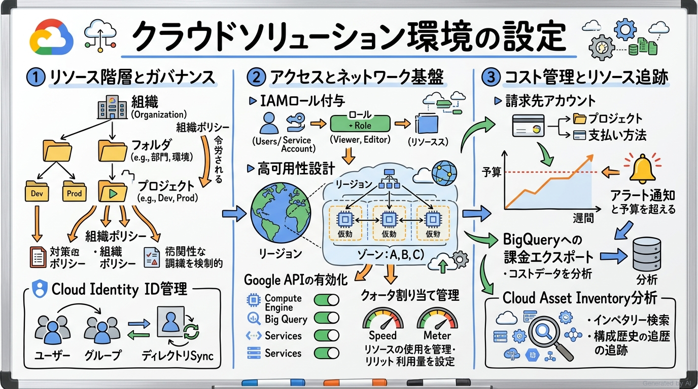
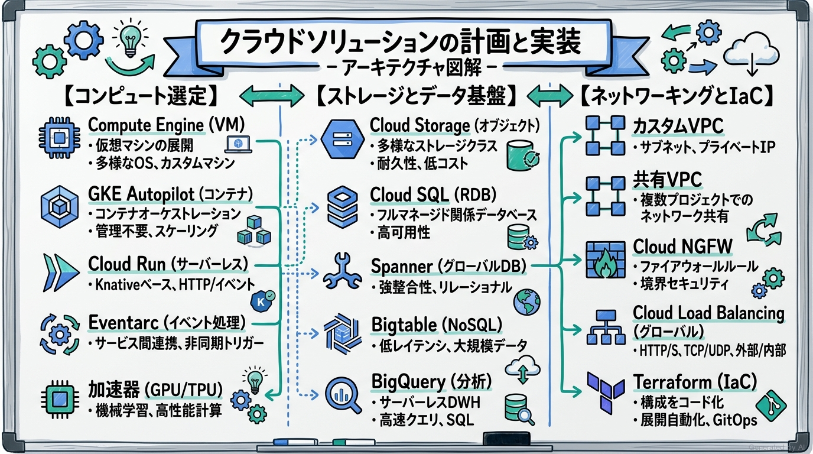
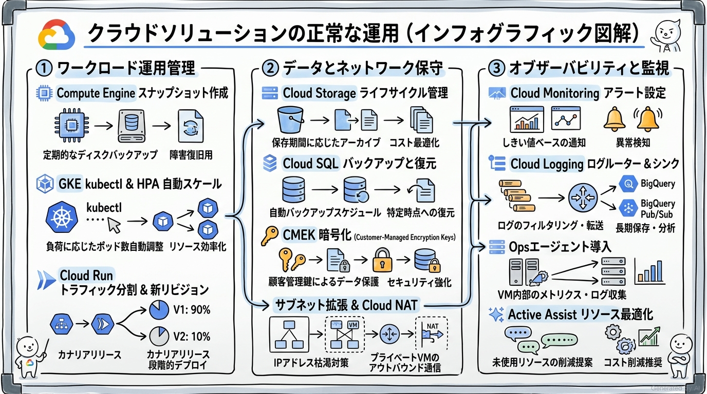
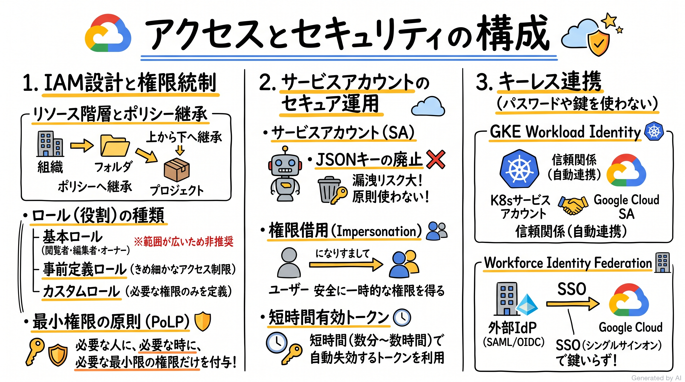

# Google Cloud Certified - Associate Cloud Engineer 完全対策＆実践学習ガイド

- **対象資格**: Google Cloud Certified - Associate Cloud Engineer (ACE)
- **公式試験ガイド**: [Associate Cloud Engineer 認定試験ガイド (日本語版)](https://services.google.com/fh/files/misc/associate_cloud_engineer_exam_guide_japanese.pdf?hl=ja)
- **公式学習パス**: [Google Skills - Associate Cloud Engineer Certification](https://www.skills.google/paths/11?hl=ja)
- **最終更新日**: 2026-10-12

---

## はじめに

企業のクラウド活用がインフラの単純移行（リフト＆シフト）からクラウドネイティブなマイクロサービス、マネージドデータ基盤、そして自律型AIエージェントの統合へと高度化する中で、クラウドエンジニアに求められる役割も劇的に進化しています。インフラの初期構築にとどまらず、セキュリティ統制、コスト最適化、IaC（Infrastructure as Code）による再現性の確保、そして障害時の迅速なトラブルシューティングを実機レベルで遂行できる実践力が不可欠です。

Google Cloud Certified - Associate Cloud Engineer（ACE）は、Google Cloud 上でエンタープライズソリューションのデプロイ、保護、運用、モニタリングを確実に行える実務能力を客観的に認定する資格です。コマンドライン（`gcloud`、`kubectl`、`bq` 等）や Terraform、コンソールを自在に駆使し、要件に合わせた最適なリソース選定と安全な権限管理を設計・実装できるエンジニアを対象としています。

本ガイドは、最新の試験ガイドに準拠し、全4セクションの重要トピック、サービス選定の比較マトリクス、「状況・対応・結果・解説」で構成された実践シナリオ、および Google Skills の厳選ハンズオンラボをセクションごとにカプセル化して記述した完全対策ノートです。

### Associate Cloud Engineer 試験とは

Associate Cloud Engineer は、目標となるパフォーマンス指標を確実に達成するために、アプリケーション、サービス、インフラストラクチャのデプロイと保護、複数プロジェクトの運用のモニタリング、エンタープライズソリューションの管理を行う能力を証明するアソシエイトレベルの認定資格です。

- **試験時間**: 120 分
- **出題問題数**: 50〜60 問
- **出題形式**: 択一選択問題（4肢中1つ選択）、複数選択問題（5肢以上中2つ以上選択）
- **合否判定**: 合格 / 不合格（スケールドスコアや正答率は非開示）
- **前提知識**: Google Cloud コンソールおよびコマンドライン インターフェース（gcloud CLI, gsutil, bq, kubectl）を用いた 6 か月以上の実務経験、またはクラウド全般に関する 1 年以上の実務経験が推奨されます。

### 難易度と求められる思考力

当試験の難易度は **アソシエイト（実務運用・CLI操作・アーキテクチャ実装重視）** に位置づけられます。

クラウドの基本概念やサービス概要を問うファウンデーショナルレベル（Cloud Digital Leader 等）とは異なり、ACE 試験では「具体的な要件・制約が与えられた状況下で、どのコマンドフラグを使用すべきか」「どのマネージドサービスをどのように組み合わせて構成すべきか」「発生した障害に対してどのログやメトリクスを調査すべきか」といった、**実機運用に直結する具体的・技術的な意思決定能力** が厳格に問われます。

特に、以下の思考プロセスを確立しておくことが合格への鍵となります：
1. **最小権限の原則（PoLP）とキーレス認証**: 不要な広範ロール（オーナー/編集者）を付与せず、事前定義ロールや条件付きIAM、サービスアカウントの権限借用（impersonation）、Workload Identity を選定する思考
2. **コンピュートサービスの適材適所な選定**: フルマネージド・ステートレスコンテナであれば Cloud Run、高度なオーケストレーションやマイクロサービスであれば GKE（Autopilot）、レガシーOSやカスタムカーネル要件であれば Compute Engine を選択するトレードオフ判断
3. **安全かつ効率的なネットワーキング**: 外部IPを持たないプライベート構成、共有VPCによる一元管理、Cloud NAT によるアウトバウンド通信確保、Cloud NGFW（セキュアタグ/サービスアカウント）によるきめ細かなファイアウォール制御
4. **コマンドライン（gcloud / kubectl）構文の理解**: コンソール画面だけでなく、頻出リソースの作成・変更・一覧表示・フィルタリングを行う CLI コマンドの構成要素を正しく判別する能力

### 推奨の勉強法

1. **公式一次ドキュメントとアーキテクチャフレームワークの精読**
   各セクションに記載の Google Cloud 公式ドキュメント（Compute Engine、GKE、Cloud Run、IAM、VPC、Cloud Monitoring/Logging）の「ハウツーガイド」「ベストプラクティス」を確認します。特にデフォルト設定や非推奨事項、クォータの制限値に関する記述に注目してください。
2. **Google Skills の厳選ハンズオンラボ（実機検証）の反復**
   本ガイドでピックアップした公式ハンズオンラボ（A Tour of Google Cloud Hands-on Labs、Cloud Load Balancing、Kubernetes Applications、Terraform 等）を実際に受講し、Cloud Shell 上でコマンドを実行してリソースの挙動やエラー出力を体感します。
3. **実践シナリオ（状況・対応・結果・解説）による意思決定トレーニング**
   本ガイドに収録した全30件の実践シナリオを通じ、特に **解説（なぜ他の有力代替案では不適格なのか）** を深く読み込みます。試験で出題される「一見正しそうに見えるが非効率またはセキュリティ基準を満たさない誤答選択肢」を論理的に棄却する目を養います。

---

## 目次

1. [はじめに](#はじめに)
2. [学習カリキュラム・出題範囲ロードマップ](#学習カリキュラム出題範囲ロードマップ)
3. [Section 1: クラウド ソリューション環境の設定 (20% 以下)](#section-1-クラウド-ソリューション環境の設定-20-以下)
4. [Section 2: クラウド ソリューションの計画と実装 (30% 以下)](#section-2-クラウド-ソリューションの計画と実装-30-以下)
5. [Section 3: クラウド ソリューションの正常な運用 (30% 以下)](#section-3-クラウド-ソリューションの正常な運用-30-以下)
6. [Section 4: アクセスとセキュリティの構成 (20% 以下)](#section-4-アクセスとセキュリティの構成-20-以下)
7. [まとめと推奨学習ステップ](#まとめと推奨学習ステップ)

---

## 学習カリキュラム・出題範囲ロードマップ

### セクション一覧と出題比率

本試験は全4セクションで構成されています。リソースの計画・実装（セクション2）と正常な運用（セクション3）で全体の60%を占めるため、コンピュート、ストレージ、ネットワーク、監視の実務コマンドと設計パターンが合否を左右します。加えて、環境設定（セクション1）とアクセス・セキュリティ（セクション4）を確実に得点源とすることが重要です。

| セクション番号 | セクション名 / 出題分野 | 出題比率 | 主要対象サービス・ツール |
| :--- | :--- | :--- | :--- |
| **Section 1** | クラウド ソリューション環境の設定 | 20% 以下 | リソース階層（組織/フォルダ/プロジェクト）、組織ポリシー、Cloud Identity、API有効化、割り当て（クォータ）、地理的ロケーション、Cloud Asset Inventory、Cloud Billing（請求先アカウント、予算アラート、BigQueryエクスポート） |
| **Section 2** | クラウド ソリューションの計画と実装 | 30% 以下 | Compute Engine、GKE（Autopilot/Standard/Private）、Cloud Run、Cloud Run functions、Persistent Disk / Hyperdisk、MIG、OS Login、VM Manager、Spot VM、GPU/TPU、Cloud Storage、Cloud SQL、Spanner、Bigtable、Firestore、カスタムVPC、共有VPC、Cloud NGFW、Cloud Load Balancing、Terraform |
| **Section 3** | クラウド ソリューションの正常な運用 | 30% 以下 | Compute Engine管理（SSH/OS Login、スナップショット）、GKE管理（kubectl、ノードプール、HPA/VPA）、Cloud Run管理（リビジョン更新、トラフィック分割）、ストレージ管理（ライフサイクル、CMEK）、DB運用（バックアップ/復元、Database Center）、ネットワーク保守（CIDR拡張、静的IP、Cloud DNS、Cloud NAT）、Cloud Monitoring（アラート、カスタム指標）、Cloud Logging（ログルーター/シンク）、Ops エージェント、Active Assist |
| **Section 4** | アクセスとセキュリティの構成 | 20% 以下 | IAMポリシー管理（基本/事前定義/カスタムロール）、ポリシー継承と拒否ポリシー、サービス アカウント（Google管理/ユーザー管理、最小権限、権限借用）、短時間有効トークン、GKE Workload Identity、Workforce Identity 連携 |

---

## Section 1: クラウド ソリューション環境の設定 (20% 以下)

クラウドソリューションを安全かつ効率的に展開するためには、エンタープライズの組織構造とガバナンス要件に合致した基盤設計が前提となります。本セクションでは、リソース階層の設計、組織ポリシーによるガードレールの確立、ID管理とAPIの制御、ロケーション設計、および厳密な課金管理とコストエクスポートの設定について学習します。



---

### 1. セクション概要

エンタープライズにおける Google Cloud 環境の構築は、リソース階層（組織、フォルダ、プロジェクト、リソース）の定義から始まります。階層構造を通じて IAM 権限や組織ポリシーが上位から下位へと継承されるため、最小権限の原則と運用の自律性を両立する階層設計が不可欠です。また、予期せぬコスト超過を防止するための請求先アカウントの紐付け、予算アラートの設定、詳細な課金分析を可能にする BigQuery へのエクスポート設定が求められます。

#### 重要キーワード

- **リソース階層（Resource Hierarchy）**: 「組織（Organization）→ フォルダ（Folder）→ プロジェクト（Project）→ リソース（Resources）」からなるツリー構造。IAM 権限と組織ポリシーの継承単位となる。
- **組織ポリシー（Organization Policies）**: リソース階層全体または特定フォルダ/プロジェクトに対して、リソースの利用方法を制限・強制する中央統制ルール（例: 外部IPアドレスの作成禁止、特定のロケーションへのリソース配置制限）。
- **Cloud Identity**: Google Cloud および Google Workspace で利用される Identity as a Service（IDaaS）。社内ディレクトリ（Active Directory 等）と同期し、ユーザーとグループを一元管理する。
- **クォータと上限（Quotas & Limits）**: プロジェクトごとに設定されるリソース使用量の上限。予期せぬ課金の防止やリソース枯渇の防止を目的とし、レートクォータ（API呼び出し数）と割り当てクォータ（CPU数、IPアドレス数等）が存在する。
- **Cloud Asset Inventory**: Google Cloud のリソースメタデータ、IAM ポリシー、ランタイム構成の履歴を検索・エクスポート・分析できるメタデータ管理サービス。Gemini Cloud Assist と連携して設定の妥当性評価が可能。
- **請求先アカウント（Billing Account）**: Google Cloud の利用料金の支払いを管理するアカウント。複数のプロジェクトに紐付けて一括請求を行うことが可能。
- **予算とアラート（Budgets & Alerts）**: 特定のプロジェクトや請求先アカウントに対して月次予算を設定し、支出が閾値（50%、90%、100% など）に達した際にメール通知や Pub/Sub 通知を発行する機能。

---

### 2. 重要トピック

#### 1. リソース階層と組織ポリシーの継承メカニズム

Google Cloud では、権限（IAM）と制約（組織ポリシー）がリソース階層の上位から下位へと伝播します。

```text
┌────────────────────────────────────────────────────────┐
│                   組織 (Organization)                  │
│       最上位ノード。企業ドメイン (example.com) と紐付け  │
└───────────────────────────┬────────────────────────────┘
                            │ 継承
┌───────────────────────────▼────────────────────────────┐
│                    フォルダ (Folder)                   │
│       事業部、部門、環境 (Dev / Staging / Prod) 単位   │
└───────────────────────────┬────────────────────────────┘
                            │ 継承
┌───────────────────────────▼────────────────────────────┐
│                   プロジェクト (Project)                │
│       課金の紐付け境界、API の有効化境界、権限の境界    │
└───────────────────────────┬────────────────────────────┘
                            │
┌───────────────────────────▼────────────────────────────┐
│                      個別リソース                      │
│     Compute Engine VM, Cloud Storage, Cloud SQL 等     │
└────────────────────────────────────────────────────────┘
```

- **IAM の継承特性**: IAM ロールは上位ノードから下位ノードへと**累積的に加算（和集合）**されます。上位で付与された強い権限を下位で剥奪することはできません（IAM Deny ポリシーを使用する場合を除く）。
- **組織ポリシーの継承特性**: 組織ポリシーは上位で設定された制約を継承しますが、子ノード側で「継承をオーバーライド」または「継承とマージ」するように設定可能です。

#### 2. コスト管理と課金アーキテクチャの比較

| 項目 | 予算とアラート (Budgets) | BigQuery 課金エクスポート | コスト配分ラベル (Labels) |
| :--- | :--- | :--- | :--- |
| **主要目的** | コスト超過の早期検知と通知 | 詳細なコスト分析とカスタムレポート | プロジェクト内のリソース別原価把握 |
| **動作方式** | 設定した支出額/予測額に対する割合通知 | 日次/詳細課金データを BigQuery へ自動ストリーミング | リソースにキー/値タグを付与し課金データと結合 |
| **アクション** | メール通知、Cloud Monitoring、Pub/Sub 連携 | SQL クエリ、Looker Studio 可視化 | コストセンター別、環境別の按分分析 |
| **リソース自動停止** | デフォルトでは停止しない（Pub/Sub + Cloud Run で自動化可能） | 不可（分析のみ） | 不可（分類のみ） |

- **アーキテクトの選定基準**:
  - リアルタイムでのコスト警戒・予算超過防止には「予算とアラート（Pub/Sub 連携）」を構成します。
  - 部門ごとの詳細な支出推移分析、長期的な傾向把握、カスタムダッシュボード作成には「BigQuery 課金エクスポート」を選定します。

---

### 3. 実践シナリオ

#### シナリオ 1-1: 組織全体における特定リージョン外へのリソースデプロイ禁止

- **状況**: グローバルに展開する企業において、データ主権および法規制遵守の観点から、開発者が東京リージョン（`asia-northeast1`）および大阪リージョン（`asia-northeast2`）以外のリージョンにリソースを作成することを一元的に禁止したい場合
- **対応**: 組織のルートノードに対して「リソースのロケーション制限（`constraints/gcp.resourceLocations`）」組織ポリシーを適用し、許可リストに `asia-northeast1` と `asia-northeast2` を指定する
- **結果**: 組織配下のすべてのフォルダおよびプロジェクトにおいて、指定外リージョンでのリソースプロビジョニングがAPIレベルで即座にブロックされる
- **解説**: 組織ポリシーはリソース階層を通じて自動的に下位ノードへ継承されるため、組織ルートで一括設定することが最も確実で運用負荷の低いアプローチであるためです。個別のプロジェクトごとに IAM 条件を設定する方法や各エンジニアに運用ルールを遵守させる方法では、設定漏れや人為的ミスを防ぐことができず要件を満たせません。

#### シナリオ 1-2: 予算超過時の即時検知と詳細なコスト分析基盤の構築

- **状況**: 新規プロダクト用のプロジェクトにおいて、月間支出が予算の 80% および 100% に達した際に運用管理者にメールで警告を送信し、さらに日ごとのSKU別支出データを SQL で詳細に分析できるようにしたい場合
- **対応**: Cloud Billing コンソールでプロジェクトを対象とした予算を作成して 80% と 100% のアラート閾値を設定し、同時に「詳細な課金データのエクスポート」を有効にして専用の BigQuery データセットを指定する
- **結果**: 支出が閾値を超過した瞬間にメール通知が配信され、BigQuery 上で SQL クエリや Looker Studio を用いた SKU 単位のコスト要因分析が可能になる
- **解説**: 予算アラートは支出監視と通知に特化しており、BigQuery 課金エクスポートは詳細な生データ分析に特化しているため、両者を組み合わせる構成が Google Cloud のベストプラクティスであるためです。プロジェクトを手動で削除したり請求先アカウントとのリンクを解除したりする対応は、稼働中の本番リソースを意図せず停止させる破壊的行為となるため不適格です。

#### シナリオ 1-3: 新規開発チームへの最小権限プロジェクト管理権限の付与

- **状況**: 新しく参画した開発リーダーに対し、新規プロジェクト内での Compute Engine インスタンスや Cloud Storage バケットのプロビジョニングと管理を許可する一方、他のプロジェクトや組織レベルの課金設定の変更は禁止したい場合
- **対応**: 該当プロジェクトの IAM 設定において、開発リーダーの Google グループに対して「Compute ネットワーク管理者」「Compute インスタンス管理者」「ストレージ管理者」などの事前定義ロールを付与する
- **結果**: 開発リーダーは担当プロジェクト内で必要なインフラ作業を完結でき、組織全体の課金情報や他プロジェクトのリソースにはアクセスできない境界が維持される
- **解説**: 最小権限の原則（PoLP）に従い、必要なリソース操作権限のみを含む事前定義ロールをプロジェクト単位で付与することが最も安全であるためです。「オーナー（`roles/owner`）」や「編集者（`roles/editor`）」などの基本ロールを付与すると、IAM ポリシーの変更や課金先リンクの操作など過剰な権限を与えてしまうため不適格です。

---

### 4. 参考ドキュメント & 推奨ハンズオン

#### 公式一次ドキュメント
- [リソース階層の作成と管理](https://docs.cloud.google.com/resource-manager/docs/creating-managing-organization?hl=ja): 組織、フォルダ、プロジェクトの設計ベストプラクティス
- [組織ポリシーの制約](https://docs.cloud.google.com/resource-manager/docs/organization-policy/org-policy-constraints?hl=ja): 定義済み制約リストと適用手順
- [BigQuery への Cloud Billing データのエクスポート](https://docs.cloud.google.com/billing/docs/how-to/export-data-bigquery?hl=ja): 課金データスキーマとクエリ例

#### 推奨ハンズオン・ラボ（実機検証）
- [A Tour of Google Cloud Hands-on Labs](https://www.skills.google/focuses/2794?parent=catalog&path=11):
  - **学習目標**: Google Cloud コンソールへのアクセス、リソース階層（プロジェクト・リソース）、IAM ユーザー・ロール・権限の設定、API の有効化、Cloud Shell の基本操作を実機で体験・検証する。

---

## Section 2: クラウド ソリューションの計画と実装 (30% 以下)

ビジネス要件に応じた最適なコンピュート、ストレージ、データベース、ネットワークリソースの選定とプロビジョニングは、Cloud Engineer の最も中核的な責務です。本セクションでは、ワークロードの特性に応じた実行環境の選択、高可用性とスケーラビリティを備えたストレージ/DBの設計、堅牢なVPCネットワーキング、および IaC（Terraform）によるインフラのコード化実装を学習します。



---

### 1. セクション概要

適切なクラウドアーキテクチャの実装には、「運用の抽象化レベル」「スケーラビリティ要件」「レイテンシ」「耐障害性」「コスト」の多面的なトレードオフ評価が求められます。OSやカーネルレベルの制御が必要な場合は Compute Engine、大規模なコンテナマイクロサービスには GKE（特にクラスタ管理が不要な GKE Autopilot）、HTTP/イベント駆動型のステートレスアプリには Cloud Run を選定します。また、ネットワーク境界を保護する Cloud NGFW、複数プロジェクト間でCIDR重複を避け通信を統合する共有VPC、そして再現性を担保する Terraform の実践が問われます。

#### 重要キーワード

- **Compute Engine**: 高度なカスタマイズ性を持つ仮想マシン（IaaS）。カスタムマシンタイプ、Spot VM、Persistent Disk / Hyperdisk、MIG（マネージドインスタンスグループ）によるオートスケーリングに対応。
- **GKE Autopilot**: ノードやノードプールの手動管理・サイジングを不要とし、Pod 仕様に基づき Google がインフラをフルマネージド運用・最適化する Kubernetes 実行モード。
- **Cloud Run**: コンテナ化された任意のワークロードを実行できるフルマネージド・サーバーレスプラットフォーム。0 へのスケールイン、リクエスト単位課金、トラフィック分割（カナリアリリース）を標準サポート。
- **Cloud Run functions（旧 Cloud Functions）**: 単一目的のコードをイベント駆動（Eventarc、Pub/Sub、Cloud Storage トリガー等）で実行する FaaS。
- **Cloud Storage**: 99.999999999%（イレブンナイン）の耐久性を持つオブジェクトストレージ。Standard、Nearline、Coldline、Archive の4つのストレージクラスを提供。
- **Cloud SQL vs Cloud Spanner**: Cloud SQL はフルマネージドなオープンソース互換 RDB（MySQL、PostgreSQL、SQL Server）。Cloud Spanner はグローバル強整合性、水平スケーラビリティ、99.999% の SLA を誇る分散リレーショナルデータベース。
- **Bigtable**: 超大規模（ペタバイト級）の低レイテンシ・高スループット NoSQL データベース（時系列データ、IoT、広告データ等に最適）。
- **共有 VPC（Shared VPC）**: 単一のホストプロジェクトで管理される VPC ネットワークのサブネットを、組織内の複数のサービスプロジェクトで共有・利用する機能。
- **Cloud NGFW（次世代ファイアウォール）**: セキュアタグや FQDN オブジェクトを用いたきめ細かなネットワークセキュリティポリシーを提供するファイアウォール。
- **Cloud Load Balancing**: 単一のエニーキャスト IP アドレスでグローバルにトラフィックを分散するフルマネージドロードバランサ（外部アプリケーション/ネットワークロードバランサ）。

---

### 2. 重要トピック

#### 1. コンピュートサービス選定マトリクス

| 比較項目 | Compute Engine (VM) | GKE Autopilot | Cloud Run | Cloud Run functions |
| :--- | :--- | :--- | :--- | :--- |
| **実行単位** | 仮想マシン (OS) | Kubernetes Pod | コンテナイメージ | 単一の関数コード |
| **抽象化レベル** | IaaS（低） | コンテナ基盤（中） | サーバーレス（高） | FaaS（最高） |
| **スケーリング** | 数分（MIG 自動追加） | 数十秒〜数分（ノード自動調達） | 数秒（ミリ秒単位の即応） | 数秒（ミリ秒単位の即応） |
| **課金体系** | 秒単位（起動時間） | Pod リソース（CPU/メモリ/ストレージ） | 実行ミリ秒単位（リクエスト処理時間） | 実行ミリ秒単位＋呼び出し回数 |
| **主な用途** | レガシー移行、ステートフルアプリ | 大規模マイクロサービス、K8s エコシステム | Web API、マイクロサービス、バッチ | 非同期イベント処理、Webhook |

- **アーキテクトの選定基準**:
  - ステートレスな Web アプリケーションやコンテナ化された API であれば、管理オーバーヘッドが最も少なくコスト効率に優れた **Cloud Run** を最優先で検討します。
  - Kubernetes の柔軟な構成（CRD、Istio、ステートフルセット等）が必要な場合は **GKE Autopilot** を選定します。
  - 既存の専用 OS イメージやカーネルパラメータの調整、特定ハードウェア依存があるワークロードには **Compute Engine** を選定します。

#### 2. ストレージおよびデータベース選定マトリクス

| サービス名 | データモデル | 整合性 | トランザクション | 主なスケール特性 | 最適なユースケース |
| :--- | :--- | :--- | :--- | :--- | :--- |
| **Cloud Storage** | 非構造化 (Blob) | 強整合性 | なし（オブジェクト単位） | ペタバイト以上 | 静的アセット、バックアップ、データレイク |
| **Cloud SQL** | リレーショナル (RDB) | 強整合性 | 完全 (ACID) | 垂直スケール＋リードレプリカ | 中小〜大規模 Web システム、ERP、CMS |
| **Cloud Spanner** | 分散リレーショナル | 外部強整合性 | 完全 (ACID) | 水平自動スケール（無制限） | グローバル決済、大規模ゲーム、金融取引 |
| **Bigtable** | ワイドカラム NoSQL | 単一結果整合性 | 行単位アトミック | 水平自動スケール（PB級） | IoT センサー、金融ティッカー、アクセスログ |
| **Firestore** | ドキュメント NoSQL | 強整合性 | 完全 (ACID) | 自動スケール（数百万同時接続） | モバイル/Web バックエンド、リアルタイム同期 |
| **BigQuery** | カラム型 (DWH) | 強整合性 | SQL クエリ実行 | ペタバイト級ペラクエリ | スマートアナリティクス、BI、機械学習 |

#### 3. ネットワーク接続方式の比較

| 方式 | 帯域幅 | レイテンシ | SLA | 主なユースケース |
| :--- | :--- | :--- | :--- | :--- |
| **Cloud VPN (HA VPN)** | 最大 3 Gbps / トンネル | 公衆インターネット依存 | 99.99% | 中小規模のハイブリッド接続、初期導入、暗号化必須要件 |
| **Dedicated Interconnect** | 10 Gbps または 100 Gbps | 極めて低く安定 | 99.99% / 99.999% | 大規模エンタープライズ、大量データ転送、専用物理回線 |
| **Partner Interconnect** | 50 Mbps 〜 50 Gbps | 低く安定 | 99.99% / 99.999% | コロケーション未利用、通信キャリア経由の専用接続 |
| **VPC ピアリング** | Google 内部ネットワーク帯域 | 極小（Google バックボーン） | 高可用性 | 異なる VPC/プロジェクト間の直接通信（推移的ルーティング不可） |

---

### 3. 実践シナリオ

#### シナリオ 2-1: 予測不能なスパイクアクセスに対応する Web アプリケーションのコンピュート選定

- **状況**: キャンペーン時にアクセス数が数千倍に急増するが、平常時はほぼリクエストが発生しないコンテナ化されたステートレス Web サービスを、運用保守コストを最小限に抑えてデプロイしたい場合
- **対応**: コンテナイメージを Artifact Registry にプッシュし、Cloud Run に「最小インスタンス数: 0」でサービスをデプロイする
- **結果**: アクセス集中時は数秒で自動スケールアウトしてリクエストを処理し、アクセス停止時はインスタンス数が自動で 0 に縮小してインフラ費用が完全にゼロになる
- **解説**: Cloud Run はリクエスト駆動でミリ秒単位でスケールし、アイドル時のコストを完全排除できるフルマネージドサービスであるためです。Compute Engine のマネージドインスタンスグループ（MIG）は VM の起動に数分を要し急激なスパイクに追従しづらい点、また GKE Standard は常時ノードのベースコストが発生する点から不適格です。

#### シナリオ 2-2: 高可用性とリージョン障害耐性を備えたリレーショナルデータベースの設計

- **状況**: オンライン決済システムのバックエンドとして、単一ゾーンの障害発生時にも数秒以内に自動フェイルオーバーし、データ損失（RPO=0）を回避できるリレーショナルデータベースを構成したい場合
- **対応**: Cloud SQL インスタンスを作成する際に「高可用性（HA）」構成を選択し、プライマリゾーンとセカンダリゾーン（スタンバイ）を跨ぐ同期レプリケーションを構成する
- **結果**: プライマリゾーンにハードウェア障害が発生した場合でも、DNS レコードの切り替えによりセカンダリゾーンのスタンバイインスタンスへ自動フェイルオーバーされ、サービスが継続する
- **解説**: Cloud SQL の高可用性（HA）機能は、同一リージョン内の別ゾーンに同期レプリカを常時維持し、共有永続ディスクを用いてダウンタイムを極小化するためです。読み取りレプリカ（Read Replica）は非同期レプリケーションであり自動フェイルオーバーのターゲットにはならないため、障害復旧の要件を満たせません。

#### シナリオ 2-3: 複数プロジェクト間におけるネットワーク管理の一元化とセキュリティ統制

- **状況**: 企業内の複数の開発チームが個別の Google Cloud プロジェクトを利用しているが、ネットワークのサブネット設計、ルーティング、ファイアウォールルールは中央のインフラチームが一元管理したい場合
- **対応**: 中央のインフラプロジェクトを「ホストプロジェクト」として共有 VPC を有効化し、各開発チームのプロジェクトを「サービスプロジェクト」として関連付け、許可されたサブネットを共有する
- **結果**: インフラチームは集中管理されたホストプロジェクトでネットワークセキュリティとCIDR設計を統制でき、開発チームは自プロジェクト内で安全に VM や GKE をデプロイできる
- **解説**: 共有 VPC はリソース所有権とネットワーク管理責任を分離し、一元的なガバナンスを実現する Google Cloud の推奨設計であるためです。各プロジェクトで個別に VPC を作成し VPC ピアリングで接続する構成は、サブネットの重複リスクや推移的ルーティングの制約、管理の分散が発生するため要件を満たせません。

#### シナリオ 2-4: Terraform による再現性の高いマルチリソースプロビジョニング

- **状況**: 開発環境、検証環境、本番環境に対して、同一構成の VPC、サブネット、GKE Autopilot クラスタをコード管理し、人為的設定ミスを完全に排除して自動展開したい場合
- **対応**: Terraform の設定ファイル（`.tf`）を作成し、環境ごとのパラメータを変数化（`variables.tf`）したモジュールとして定義し、Cloud Storage バケットをリモートバックエンドとして `terraform apply` を実行する
- **結果**: 複数環境のインフラ構成が完全にコードとしてバージョン管理され、環境間の構成ドリフトが防止される
- **解説**: Terraform は Google Cloud のリソースプロビジョニングにおけるデファクトスタンダードの IaC ツールであり、状態（tfstate）のリモート管理とモジュール化により再現性を担保できるためです。Google Cloud コンソールからの手動構築や ad-hoc なシェルスクリプト実行では、設定の追跡性や整合性を保証できないため不適格です。

---

### 4. 参考ドキュメント & 推奨ハンズオン

#### 公式一次ドキュメント
- [Compute Engine のドキュメント](https://docs.cloud.google.com/compute/docs?hl=ja): インスタンス作成、マシンタイプ、MIG のベストプラクティス
- [GKE Autopilot の概要](https://docs.cloud.google.com/kubernetes-engine/docs/concepts/autopilot-overview?hl=ja): クラスタ管理自動化と設計原則
- [Cloud Run のドキュメント](https://docs.cloud.google.com/run/docs?hl=ja): サーバーレスコンテナのデプロイとスケーリング
- [共有 VPC のプロビジョニング](https://docs.cloud.google.com/vpc/docs/provisioning-shared-vpc?hl=ja): ホストとサービスプロジェクトの設定手順

#### 推奨ハンズオン・ラボ（実機検証）
- [Implementing Cloud Load Balancing for Compute Engine](https://www.skills.google/course_templates/648):
  - **学習目標**: Compute Engine 仮想マシンのデプロイ、マネージド インスタンス グループ（MIG）の作成、および Cloud Load Balancing（外部アプリケーション/ネットワーク ロードバランサ）の構成と動作検証。
- [Deploy Kubernetes Applications on Google Cloud](https://www.skills.google/course_templates/663):
  - **学習目標**: GKE クラスタのプロビジョニング、`kubectl` による Pod / Deployment / Service のデプロイと運用管理、コンテナイメージのビルドと Artifact Registry 管理の実機習得。
- [Build Infrastructure with Terraform on Google Cloud](https://www.skills.google/course_templates/636):
  - **学習目標**: Terraform による Google Cloud リソース（VPC、Compute Engine、Cloud Storage 等）のコード化プロビジョニング、tfstate 管理、モジュール化の実践。

---

## Section 3: クラウド ソリューションの正常な運用 (30% 以下)

ソリューションが本番稼働した後の運用フェーズでは、システムの高可用性、パフォーマンス、耐障害性、およびセキュリティパッチ適用を無停止または最小の影響で維持するエンジニアリング能力が不可欠です。本セクションでは、コンピュート・ストレージ・ネットワークの日常的な管理・変更手順、オブザーバビリティ（Monitoring, Logging, APM）の構築、および障害診断手法を学習します。



---

### 1. セクション概要

正常な運用を維持するためには、Google Cloud のマネージド運用機能と診断ツール群を有機的に組み合わせる必要があります。Compute Engine ではスナップショットスケジュールによる確実なバックアップと OS Login による安全なアクセス管理を行い、GKE では HPA（水平Pod自動スケーラー）とノードプール管理でリソース効率を最大化します。また、Cloud Run のトラフィック分割を用いた安全なカナリアリリース、サブネットのインプレースCIDR拡張、そして Ops エージェントと Cloud Logging/Monitoring によるプロアクティブな異常検知体制を確立します。

#### 重要キーワード

- **OS Login**: Compute Engine インスタンスへの SSH アクセスを IAM ロールと紐付けて管理する機能。個別の SSH 公開鍵を手動登録・管理する不要性を実現。
- **スナップショットスケジュール（Snapshot Schedule）**: Persistent Disk の増分バックアップを自動的・定期的に取得する機能。地理的冗長性を考慮したストレージロケーション指定が可能。
- **kubectl**: Kubernetes クラスタと対話するための標準 CLI。`kubectl get pods`、`kubectl logs`、`kubectl describe`、`kubectl apply` 等を駆使して運用。
- **水平 Pod 自動スケーリング（HPA: Horizontal Pod Autoscaler）**: CPU 使用率やカスタム指標に基づき、Deployment の Pod レプリカ数を自動的に増減させる機能。
- **Cloud Run トラフィック分割（Traffic Splitting）**: 新旧リビジョン間でトラフィックを割合指定（例: 90% vs 10%）でルーティングし、カナリアリリースや A/B テストを実施する機能。
- **オブジェクト ライフサイクル管理（Lifecycle Management）**: 作成日時や経過日数に基づいて、Cloud Storage 内のオブジェクトを安価なストレージクラス（Nearline/Coldline/Archive）へ自動移行または削除するルール。
- **顧客管理の暗号鍵（CMEK: Customer-Managed Encryption Keys）**: Cloud KMS で生成・管理する暗号鍵を用いて、Google Cloud サービス（Cloud Storage, BigQuery, Compute Engine 等）の保存データを暗号化する機能。
- **サブネットの拡張（Subnet Expansion）**: 稼働中のワークロードを停止させることなく、既存サブネットの IPv4 CIDR 範囲を拡大（例: `/24` から `/22` へ）する機能。
- **Cloud NAT**: 外部 IP アドレスを持たないプライベート VM や GKE ノードが、インターネット上のリソース（OS パッチ、外部 API 等）へ安全にアウトバウンド通信を行うためのマネージド NAT サービス。
- **Cloud Monitoring & Ops エージェント**: インフラおよびアプリケーションのメトリクスを収集し、アラート通知を発行するオブザーバビリティ基盤。Ops エージェントにより VM 内部のメモリ使用率やプロセス情報、詳細ログを収集。
- **ログルーターとシンク（Log Router & Sinks）**: Cloud Logging で取り込まれたログをフィルタリングし、長期保管（Cloud Storage）、リアルタイムストリーミング（Pub/Sub）、分析（BigQuery）へ自動転送する仕組み。

---

### 2. 重要トピック

#### 1. ワークロード更新とデプロイ運用のベストプラクティス

```text
【Cloud Run カナリアリリースのトラフィック分割フロー】

クライアント要求
      │
      ▼
┌──────────────┐
│  Cloud Run   │────── 90% ───► [ Revision 1 (安定版) ]
│  Service     │────── 10% ───► [ Revision 2 (新機能検証版) ]
└──────────────┘
      │
      ├─► エラー率・レイテンシを Cloud Monitoring で監視
      │
      └─► 正常確認後: 100% を Revision 2 へ切り替え
```

- **Cloud Run のリビジョン管理**:
  - 新しいコンテナイメージをデプロイすると、自動的にイミュータブル（不変）な新リビジョンが生成されます。
  - `--no-traffic` オプションでデプロイすることで、トラフィックを流さずに事前検証が可能です。
  - `gcloud run services update-traffic` コマンドにより、コマンド一発で安全な比率調整および即時ロールバックが実現します。

#### 2. オブザーバビリティ・ログアーキテクチャ

| ログ転送先 (Sink) | 最適な目的 | コスト・保持期間 | 主な分析・利用手法 |
| :--- | :--- | :--- | :--- |
| **BigQuery** | 高度な SQL 分析、監査ログの統計調査 | BigQuery 保存課金（長期間） | SQL クエリ、Looker Studio 可視化 |
| **Cloud Storage** | コンプライアンス目的の長期アーカイブ | 最安（Coldline / Archive クラス） | 監査証跡保管、バッチ取り出し |
| **Pub/Sub** | 外部 SIEM 連携、リアルタイムイベント駆動 | Pub/Sub メッセージ課金 | Splunk, Datadog 連携、Cloud Run 即時処理 |
| **Log Analytics** | Cloud Logging 内での SQL 分析 | Logging 保持期間内 | ログエクスプローラ上での SQL 検索 |

---

### 3. 実践シナリオ

#### シナリオ 3-1: 稼働中 Compute Engine インスタンスのダウンタイムゼロな IP 枯渇解消

- **状況**: マイクロサービスの拡張に伴い、特定サブネット内の空きプライベート IP アドレスが枯渇し、新規 VM を起動できなくなったが、既存の稼働中インスタンスを停止させることなく IP アドレス範囲を拡大したい場合
- **対応**: Google Cloud コンソールまたは `gcloud compute networks subnets expand-ip-range` コマンドを実行し、サブネットの IPv4 CIDR プレフィックスを拡張（例: `/24` から `/22` へ）する
- **結果**: 既存の VM やネットワークトラフィックに一切影響を与えることなく、利用可能な IP アドレス数が即座に増加し、新規インスタンスのデプロイが可能になる
- **解説**: Google Cloud の VPC サブネットは、ダウンタイムなしにインプレースで CIDR 範囲を拡大（プレフィックス長を小さく）できる仕様を備えているためです。新規サブネットを作成して既存 VM を手動で再配置する方法は、サービス中断と大規模な移行工数を招くため不適格です。

#### シナリオ 3-2: Cloud Run アプリケーションのゼロリスクなカナリアリリースの実施

- **状況**: 本番トラフィックを処理している Cloud Run サービスに対して重大な新機能をリリースするにあたり、全ユーザーに一斉公開するリスクを避け、まず 10% のユーザーのみに新バージョンを提供してエラー発生状況を検証したい場合
- **対応**: 新しいコンテナイメージを `--no-traffic` オプションでデプロイして新リビジョンを作成した後、`gcloud run services update-traffic <SERVICE_NAME> --to-revisions <OLD_REV>=90,<NEW_REV>=10` を実行する
- **結果**: 本番アクセスの 10% のみが新リビジョンへ振り分けられ、Cloud Monitoring でエラーログやレイテンシの悪化がないことを確認した上で段階的に 100% へ昇格できる
- **解説**: Cloud Run はトラフィック分割機能を標準でサポートしており、新旧リビジョン間でパーセンテージ指定のルーティングを瞬時に切り替えられるためです。ロードバランサの背後に別々の Cloud Run サービスを立ち上げて振り分ける方法は、構成が複雑化し不要な管理コストを生むため不適格です。

#### シナリオ 3-3: セキュリティ監査ログの改ざん防止・5年間長期保存と SIEM 連携

- **状況**: 金融コンプライアンス要件に基づき、Google Cloud 環境内の全「データアクセス監査ログ」を改ざん不可能な状態で 5 年間保管し、同時に異常な特権アクセスをオンプレミスの SIEM ツールへリアルタイム転送したい場合
- **対応**: ログルーターで全監査ログを対象とするシンクを 2 つ作成し、1 つは Bucket Lock（保持ポリシー）を設定した Cloud Storage バケットへエクスポートし、もう 1 つは Pub/Sub トピックへ転送して SIEM コネクタ経由でストリーミング受信させる
- **結果**: ログは Cloud Storage 上で暗号化・改ざん防止された状態で低コストに 5 年間保持され、同時にオンプレミス SIEM によるリアルタイム検知が実現する
- **解説**: ログルーターのシンクは複数の宛先に同時にログを分岐配送できるため、長期保存には最も安価で改ざん耐性のある Cloud Storage、リアルタイム外部連携には Pub/Sub を組み合わせる構成が最適解であるためです。Compute Engine 上の独自 syslog サーバーへ集約する方法は、単一障害点（SPOF）となり保守負荷が極めて高いため不適格です。

#### シナリオ 3-4: GKE クラスタにおける急激なアクセス増への自動追従と過剰プロビジョニング防止

- **状況**: GKE 上で稼働するコンテナワークロードにおいて、昼休みの時間帯に CPU 負荷が跳ね上がって応答が遅延する課題に対し、手動介入なしで自動的に Pod 数を増減させ、夜間は最小台数でコストを抑制したい場合
- **対応**: 対象の Deployment に対して Horizontal Pod Autoscaler（HPA）を設定し、ターゲット CPU 使用率（例: 70%）と最小・最大レプリカ数を指定する
- **結果**: CPU 使用率が閾値を超えると自動的に Pod がスケールアウトして負荷が分散され、負荷低下時には自動でスケールインしてクラスタリソースが最適化される
- **解説**: HPA は Kubernetes 標準のリソース制御機能であり、メトリクスサーバーから取得した指標に応じて Pod 数を動的に自動調整するためです。クラスタオートスケーラー（Cluster Autoscaler）のみを導入してもノード数が増えるだけで Pod 数自体は増えないため、アプリケーションの負荷分散要件を満たせません。

---

### 4. 参考ドキュメント & 推奨ハンズオン

#### 公式一次ドキュメント
- [Persistent Disk のスナップショットの作成と管理](https://docs.cloud.google.com/compute/docs/disks/create-snapshots?hl=ja): スナップショットスケジュールと復元
- [Cloud Run のロールアウト、ロールバック、トラフィック移行](https://docs.cloud.google.com/run/docs/rollouts-rollbacks-traffic-migration?hl=ja): リビジョン管理とカナリアリリース
- [Cloud Logging のログルーターとシンク](https://docs.cloud.google.com/logging/docs/routing/overview?hl=ja): ログのエクスポートとフィルタリング
- [Ops エージェントの概要](https://docs.cloud.google.com/stackdriver/docs/solutions/agents/ops-agent?hl=ja): インストールとカスタムメトリクス収集

#### 推奨ハンズオン・ラボ（実機検証）
- [Logging and Monitoring in Google Cloud](https://www.skills.google/course_templates/99):
  - **学習目標**: Ops エージェントの導入、リソース指標に基づく Cloud Monitoring アラート ポリシーの作成、Cloud Logging でのログ フィルタリングおよび外部エクスポート（ログシンク）の実機検証。

---

## Section 4: アクセスとセキュリティの構成 (20% 以下)

クラウドセキュリティの基盤は、厳格な ID 管理と最小権限の原則（PoLP）に基づくアクセス制御です。本セクションでは、組織階層における IAM ポリシーの設計・適用・継承関係、サービスアカウントのセキュアなライフサイクル管理、権限借用（impersonation）、および秘密鍵の漏洩リスクを排除する Workload Identity 連携を学習します。




---

### 1. セクション概要

エンタープライズの Google Cloud 環境を保護する要は、人（ユーザー）とマシン（ワークロード）に対する権限の厳密な統制です。基本ロール（オーナー、編集者、閲覧者）への過度な依存を脱却し、職務に応じた事前定義ロールまたはカスタムロールを付与します。特にサービスアカウントにおいては、永続的なサービスアカウントキー（JSON）のダウンロードと保持を原則廃止し、一時的なアクセストークンを生成する「権限借用（Service Account Impersonation）」や、Kubernetes クラスタ内の Pod がキーレスで Google Cloud API を呼び出せる「GKE Workload Identity」の採用が必須となります。

#### 重要キーワード

- **最小権限の原則（Principle of Least Privilege: PoLP）**: ユーザーやサービスアカウントに対し、業務やタスクの遂行に必要最小限の権限のみを付与するセキュリティ原則。
- **基本ロール（Basic Roles）**: プロジェクト全体に影響を与える広範なレガシーロール（オーナー、編集者、閲覧者）。実務および本番環境では原則として使用を避ける。
- **事前定義ロール（Predefined Roles）**: 特定の Google Cloud サービスに特化したきめ細かな権限セット（例: `roles/storage.objectViewer`、`roles/compute.instanceAdmin.v1`）。
- **カスタムロール（Custom Roles）**: 事前定義ロールでは要件を満たせない場合に、個別の権限（例: `compute.instances.start`）を任意に組み合わせて作成する独自ロール。
- **ポリシー継承（Policy Inheritance）**: リソース階層の上位（組織、フォルダ）で付与された IAM ロールが、下位のプロジェクトやリソースに対して自動的に適用される仕組み。
- **サービスアカウント（Service Account）**: アプリケーションや VM などの非人間（ワークロード）が Google Cloud API を呼び出す際に使用する特別な Google アカウント。
- **サービスアカウントの権限借用（Impersonation）**: `roles/iam.serviceAccountTokenCreator` ロールを持つユーザーが、永続的な鍵ファイルを持たずにサービスアカウントとして短時間有効なアクセストークンを動的取得して操作する技術。
- **GKE Workload Identity**: Kubernetes の ServiceAccount を Google Cloud のサービスアカウントに安全にマッピングし、Pod がキーレスで Google Cloud API へアクセスできるようにする推奨機能。
- **Workforce Identity 連携**: 外部の ID プロバイダ（Okta、Azure AD / Entra ID 等）の認証情報を用いて、Google Cloud コンソールや CLI へのアクセスを直接認可する仕組み。

---

### 2. 重要トピック

#### 1. IAM ロール種別の比較マトリクス

| ロール種別 | 権限の粒度 | メンテナンス性 | 推奨利用シーン | 主なリスク・トレードオフ |
| :--- | :--- | :--- | :--- | :--- |
| **基本ロール (Basic)** | 極めて粗い（プロジェクト全域） | 高（設定が容易） | 個人開発の初期 PoC のみ | 過剰権限による情報漏洩・誤削除のリスク |
| **事前定義ロール (Predefined)** | サービス単位できめ細かい | 高（Google が権限を自動更新） | エンタープライズの標準運用全般 | 業務と完全に一致しない場合がある |
| **カスタムロール (Custom)** | 権限単位で完全カスタマイズ | 低（新機能追加時の手動保守要） | 厳格な監査要件、特定の狭い操作のみ許可 | Google Cloud の API 更新に追従する運用負荷 |

- **アーキテクトの選定基準**:
  - 原則として **事前定義ロール** の組み合わせで権限設計を行います。
  - 事前定義ロールでも権限が過剰であり、特定の単一アクション（例: VM の再起動のみ許可）に限定したい場合に限り **カスタムロール** を作成します。

#### 2. サービスアカウント認証方式のセキュリティ比較

| 認証方式 | 秘密鍵の所在 | 有効期限 | セキュリティリスク | 運用上の推奨度 |
| :--- | :--- | :--- | :--- | :--- |
| **サービスアカウント キー (JSON)** | ローカル端末 / Git / CI環境 | 最長10年（無期限相当） | ソースコード流出による重大な不正アクセス | **非推奨（組織ポリシーで作成禁止推奨）** |
| **権限借用 (Impersonation)** | なし（Google Cloud 内部で動的発行） | 最大1時間（短時間トークン） | 鍵が存在しないため漏洩リスクゼロ | **強く推奨（人間の CLI / スクリプト実行時）** |
| **GKE Workload Identity** | なし（メタデータサーバー経由） | 短時間トークン自動更新 | Pod 内に秘密鍵をマウントする必要なし | **強く推奨（Kubernetes ワークロード実行時）** |

---

### 3. 実践シナリオ

#### シナリオ 4-1: サービスアカウント秘密鍵の漏洩リスクを完全排除する CI/CD パイプラインの認証設計

- **状況**: GitHub Actions などの外部 CI/CD ツールから Google Cloud 上の Artifact Registry へコンテナイメージをデプロイする際、永続的なサービスアカウント JSON キーファイルを外部に保存せず、セキュアに認証を行いたい場合
- **対応**: Google Cloud 上で Workload Identity 連携（Workload Identity Federation）を構成し、GitHub の OIDC トークンを検証して一時的な Google Cloud アクセストークンを動的発行する
- **結果**: 外部システム上に永続的な認証鍵を一切保管することなく、CI/CD パイプラインが安全に Google Cloud リソースを操作できる
- **解説**: Workload Identity 連携はキーレス認証を実現し、秘密鍵の漏洩や定期的なローテーションに伴う運用負荷を完全に排除するためです。サービスアカウントの JSON キーファイルを GitHub の Secrets に保存する方法は、漏洩時の影響が極めて大きく非推奨であるため不適格です。

#### シナリオ 4-2: GKE 上で稼働するマイクロサービスの Cloud Storage アクセス権限統制

- **状況**: GKE クラスタ内で稼働する特定のデータ処理 Pod のみに特定の Cloud Storage バケットへの読み取り権限を付与し、同じノード上で動く他の Pod やノード自体のサービスアカウントには余分な権限を与えたくない場合
- **対応**: クラスタで Workload Identity を有効化し、専用の Google サービスアカウント（GSA）と Kubernetes サービスアカウント（KSA）を作成して両者を紐付け、GSA にのみ `roles/storage.objectViewer` を付与して Pod のマニフェストで KSA を指定する
- **結果**: 該当 Pod のみが Cloud Storage へのアクセス権を行使でき、ノードプール全体のデフォルトサービスアカウントへの過剰な権限付与が防止される
- **解説**: GKE Workload Identity は Pod 単位で最小権限の IAM ロールをキーレスで安全に割り当てられる Google Cloud の標準機能であるためです。ノードの Compute Engine サービスアカウントにストレージ読み取り権限を付与する方法は、ノード上のすべての Pod がストレージにアクセス可能になってしまい最小権限の原則に反するため不適格です。

#### シナリオ 4-3: 管理者による安全なサービスアカウントの一時的利用

- **状況**: クラウドエンジニアが自端末の Cloud SDK（`gcloud`）から特定の自動化スクリプトをテスト実行するにあたり、強力なサービスアカウントの権限を利用したいが、JSON キーのダウンロードはセキュリティポリシーで禁止されている場合
- **対応**: エンジニアのユーザーアカウントに対して、対象サービスアカウントの「サービス アカウント トークン作成者（`roles/iam.serviceAccountTokenCreator`）」ロールを付与し、`gcloud --impersonate-service-account=<SA_EMAIL>` フラグを使用してコマンドを実行する
- **結果**: エンジニアはローカルに秘密鍵を保持することなく、短時間のみ有効な認証トークンを自動借用して安全にスクリプトを実行できる
- **解説**: サービスアカウントの権限借用（impersonation）は、鍵ファイルの生成・管理を一切伴わずにセキュアな一時アクセスを実現する Google Cloud の推奨パターンであるためです。サービスアカウントキーを作成してダウンロードする手法は、組織のセキュリティポリシーに抵触し鍵漏洩リスクを伴うため不適格です。

---

### 4. 参考ドキュメント & 推奨ハンズオン

#### 公式一次ドキュメント
- [IAM の概要とロールの理解](https://docs.cloud.google.com/iam/docs/roles-permissions): 基本、事前定義、カスタムロールの違い
- [サービス アカウントの概要](https://docs.cloud.google.com/iam/docs/service-account-overview?hl=ja): サービスアカウントの種類と安全な管理原則
- [サービス アカウントの権限借用（Impersonation）](https://docs.cloud.google.com/iam/docs/service-account-impersonation?hl=ja): キーレスでの安全な CLI 運用
- [GKE Workload Identity の使用](https://docs.cloud.google.com/kubernetes-engine/docs/how-to/workload-identity?hl=ja): K8s サービスアカウントと Google サービスアカウントのバインド手順

#### 推奨ハンズオン・ラボ（実機検証）
- [A Tour of Google Cloud Hands-on Labs](https://www.skills.google/focuses/2794?parent=catalog&path=11):
  - **学習目標**: IAM コンソールでのユーザーおよびサービスアカウントの作成、事前定義ロールの付与、権限の確認、および Cloud Shell からのアクセス制御の検証。

---

## まとめと推奨学習ステップ

### 本認定試験対策の全体要約

Associate Cloud Engineer 認定試験で合格を勝ち取るための本質は、**「実機での手触り感を持ったトレードオフ判断力」** にあります。単なる用語や製品の暗記にとどまらず、以下の3本柱を確実に押さえておくことが重要です：

1. **インフラの適材適所な選定**: ワークロードの要件（ステートレスかステートフルか、スパイクがあるか、OSカスタマイズが必要か）に応じ、Compute Engine、GKE Autopilot、Cloud Run を論理的根拠を持って選定する。
2. **最小権限とキーレスセキュリティの徹底**: 永続的なサービスアカウントキーの作成を組織ポリシーで排除し、権限借用（Impersonation）や Workload Identity による安全なアクセス制御を設計・実装する。
3. **オブザーバビリティと障害運用の迅速性**: Ops エージェント、Cloud Monitoring アラート、ログルーター＆シンクを活用し、システムの健全性を可視化・維持する。

### 推奨学習・復習ステップ

1. **実践シナリオの「解説」に着目した意思決定トレーニング**
   本ガイドに収録された全実践シナリオの「解説」を熟読してください。正解理由だけでなく「なぜ代替案 A/B/C ではダメなのか」という棄却理由を論理的に説明できるようになることで、本番試験のひっかけ選択肢を瞬時に見抜く力が養われます。
2. **厳選ハンズオンラボによる実機コマンドの体感**
   セクションごとに掲載した Google Skills の公式ハンズオンラボ（A Tour of Google Cloud Hands-on Labs、Implementing Cloud Load Balancing、Deploy Kubernetes Applications、Build Infrastructure with Terraform）を受講し、実際の Cloud Shell 上で `gcloud`、`kubectl`、`terraform` コマンドを実行してリソースの作成・設定変更を体験してください。
3. **公式試験ガイドおよびサンプル問題での総仕上げ**
   試験直前には、Google Cloud 公式の認定模擬試験（サンプル問題）を解き、時間配分（120分で50〜60問）とシチュエーション問題の読解スピードを確認してください。
