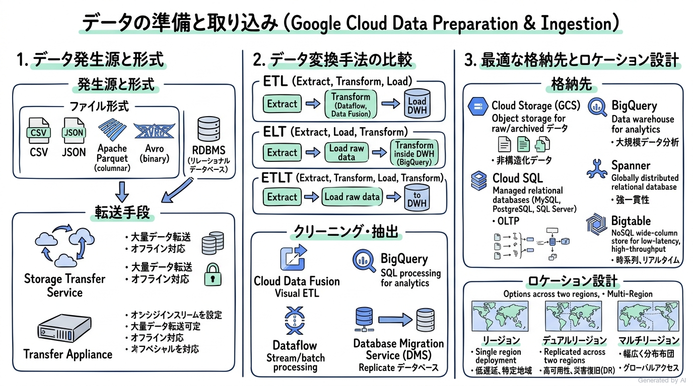
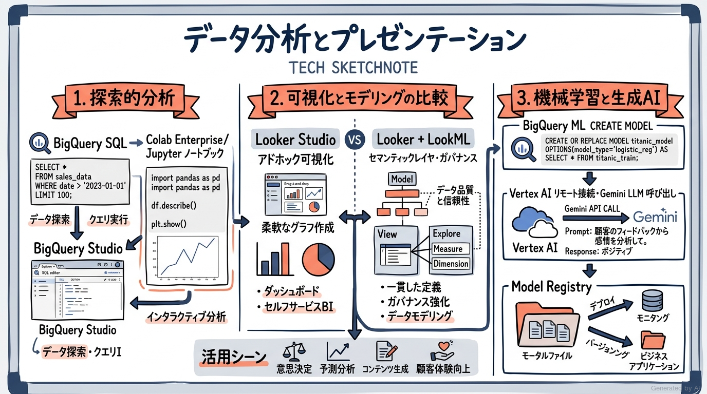
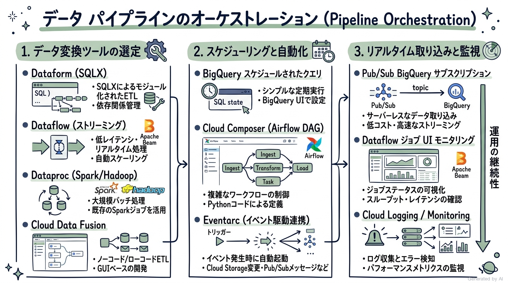
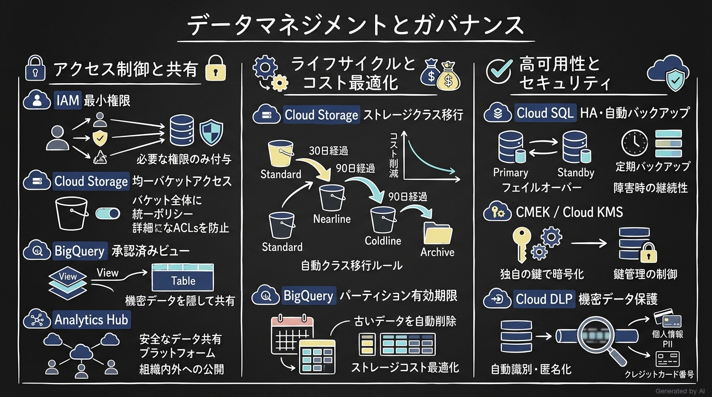

# Google Cloud Certified - Associate Data Practitioner 完全対策＆実践学習ガイド

- **対象資格**: Google Cloud Certified - Associate Data Practitioner (ADP)
- **公式試験ガイド**: [Associate Data Practitioner 認定試験ガイド (日本語版)](https://services.google.com/fh/files/misc/associate_data_practitioner_exam_guide_japanese.pdf?hl=ja)
- **公式試験ページ**: [Associate Data Practitioner | Google Cloud Certification](https://cloud.google.com/learn/certification/associate-data-practitioner)
- **公式学習パス**: [Google Skills - Associate Data Practitioner Certification](https://www.skills.google/paths/1336?hl=ja)
- **最終更新日**: 2026-10-12

---

## はじめに

企業のデジタルトランスフォーメーションおよびデータ活用が加速する中で、ビジネス部門やアナリティクスチームが扱うデータ規模と多様性は爆発的に拡大しています。これに伴い、従来のオンプレミス型データウェアハウスや孤立した表計算ツールによる運用から、スケーラブルかつセキュアなクラウドマネージドデータ基盤への移行が急速に進展しています。データアナリストやビジネスインテリジェンス（BI）エンジニアには、単にSQLクエリを実行してレポートを作成するだけでなく、データの取り込みから変換、パイプラインの自動化、探索的データ分析、基礎的な機械学習モデルの活用、そして厳格なデータガバナンスとアクセス制御に至るデータライフサイクル全体を適切に理解・実践する能力が強く求められています。

Google Cloud Certified - Associate Data Practitioner（ADP）は、Google Cloud 上でデータを安全に保護・管理し、BigQuery、Cloud Storage、Dataflow、Cloud Data Fusion、Looker、BigQuery ML などの主要データサービスを自在に駆使してビジネス価値を創出できる実務能力を客観的に証明する認定資格です。

本ガイドは、最新の日本語版試験ガイドに完全準拠し、全4セクションの出題範囲を網羅しています。各セクション内に「セクション概要」「重要キーワード」「重要トピック＆比較マトリクス」「構造化実践シナリオ（状況・対応・結果・解説）」「参考ドキュメント＆推奨ハンズオン」をすべてカプセル化し、実務における技術選定やアーキテクチャのトレードオフ判断を深く習得できるように構成しています。

### Associate Data Practitioner 試験とは

Associate Data Practitioner 試験は、Google Cloud のデータサービスを利用してデータの取り込み、変換、パイプライン管理、分析、機械学習、可視化などのタスクを遂行し、データを安全に保護・管理するアソシエイトレベルの専門知識と実践スキルを評価する試験です。

- **試験時間**: 120 分（2 時間）
- **出題問題数**: 50〜60 問
- **出題形式**: 択一選択問題（4 肢中 1 つ選択）、複数選択問題（5 肢以上中 2 つ以上選択）
- **受験料**: $125（税別）
- **合否判定**: 合格 / 不合格（スケールドスコアや正答率は非開示）
- **前提知識**: Google Cloud データサービスを用いた 6 か月以上の実務経験、またはクラウドデータ分析に関する基礎知識（IaaS、PaaS、SaaS の概念理解）が推奨されます。

### 難易度と求められる思考力

当試験の難易度は **アソシエイト（実務活用・ツール選定・データ分析重視）** に位置づけられます。高度なプログラミング言語（Python, Java, Go 等）による分散処理コードのフルスクラッチ開発や、複雑なインフラの低レイヤチューニングまでは問われませんが、以下の意思決定能力が厳格に問われます：

1. **データ処理パラダイム（ETL vs ELT vs ETLT）の適材適所な選定**: 事前変換を必要とするユースケースと、BigQuery の強力なコンピュートを活用したロード後変換のトレードオフ判断。
2. **ストレージソリューションの最適な使い分け**: 非構造化データ（Cloud Storage）、大規模分析用構造化データ（BigQuery）、OLTP トランザクション（Cloud SQL, Spanner）、リアルタイムキーバリューストア（Bigtable）の特性比較。
3. **分析・可視化ツールの特性把握**: Looker（一元化されたガバナンスとモデリング）と Looker Studio（俊敏なアドホック可視化）の比較選定、ならびに BigQuery ML による SQL ベースの機械学習パイプラインの構築。
4. **オーケストレーションと自動化の判断**: 単純なスケジュール実行（BigQuery スケジュールされたクエリ、Cloud Scheduler）と、複雑な依存関係を持つパイプライン（Cloud Composer / Airflow、Dataform）の切り分け。
5. **最小権限とセキュリティ統制の徹底**: IAM 事前定義ロールの活用、Cloud Storage の均一バケットアクセス、暗号鍵管理（GMEK vs CMEK vs CSEK）、ならびに機密データの保護（Cloud DLP）。

### 推奨の勉強法

1. **公式一次ドキュメントとベストプラクティスガイドの精読**
   各セクションで紹介する Google Cloud 公式ドキュメント（BigQuery、Cloud Storage、Dataflow、BigQuery ML、Cloud Composer 等）の「概要」「コンセプト」「クイックスタート」を確認し、各サービスの基本アーキテクチャとユースケースを正確にインプットします。
2. **Google Skills の厳選ハンズオンラボによる実機操作**
   Cloud Shell や BigQuery Studio、Colab Enterprise を実際に起動し、SQL の実行、モデルの作成、クエリのスケジュール化、アクセス制御の設定など、コンソール上での手触り感を体得します。
3. **構造化実践シナリオを通じた意思決定プロセスの追体験**
   本ガイドに収録された全実践シナリオの「解説」を深く読み込みます。正解となるアクションの根拠だけでなく、「なぜ他の代替候補（他サービスや設定）では要件を満たせないのか」という棄却理由を理解することで、本番試験のシチュエーション問題に即座に対応できる思考力を身につけます。

---

## 目次

1. [はじめに](#はじめに)
2. [学習カリキュラム・出題範囲ロードマップ](#学習カリキュラム出題範囲ロードマップ)
3. [Section 1: データの準備と取り込み (30% 以下)](#section-1-データの準備と取り込み-30-以下)
4. [Section 2: データ分析とプレゼンテーション (27% 以下)](#section-2-データ分析とプレゼンテーション-27-以下)
5. [Section 3: データ パイプラインのオーケストレーション (18% 以下)](#section-3-データ-パイプラインのオーケストレーション-18-以下)
6. [Section 4: データ マネジメント (25% 以下)](#section-4-データ-マネジメント-25-以下)
7. [まとめと推奨学習ステップ](#まとめと推奨学習ステップ)

---

## 学習カリキュラム・出題範囲ロードマップ

### セクション一覧と出題比率

本試験は全 4 セクションで構成されています。データの準備・取り込み（最大 30%）とデータ分析・プレゼンテーション（最大 27%）が中核をなし、さらにデータマネジメント（最大 25%）とパイプラインのオーケストレーション（最大 18%）がバランスよく出題されます。

| セクション番号 | セクション名 / 出題分野 | 出題比率 | 主要対象サービス・ツール |
| :--- | :--- | :--- | :--- |
| **Section 1** | データの準備と取り込み | 30% 以下 | ETL / ELT / ETLT、Storage Transfer Service、Transfer Appliance、Database Migration Service、BigQuery DTS、データ形式（Parquet, Avro, CSV, JSON）、ストレージ選定（Cloud Storage, BigQuery, Cloud SQL, Spanner, Bigtable）、ロケーション設計（リージョン/デュアル/マルチ） |
| **Section 2** | データ分析とプレゼンテーション | 27% 以下 | BigQuery SQL、Colab Enterprise、Looker vs Looker Studio、LookML、BigQuery ML（CREATE MODEL, EVALUATE, PREDICT）、AutoML、Vertex AI リモート接続（事前学習済み LLM / Gemini）、Model Registry |
| **Section 3** | データ パイプラインのオーケストレーション | 18% 以下 | Dataproc、Dataflow、Cloud Data Fusion、Dataform、Cloud Composer（Apache Airflow）、BigQuery スケジュールされたクエリ、Cloud Scheduler、Workflows、Eventarc、Pub/Sub イベントドリブン取り込み、Cloud Logging / Monitoring |
| **Section 4** | データ マネジメント | 25% 以下 | IAM 最小権限、Cloud Storage 均一バケットアクセス、BigQuery データセット共有 / 承認済みビュー / Analytics Hub、ストレージクラス・ライフサイクル管理、パーティション有効期限、Cloud SQL / Cloud Storage バックアップ・DR、暗号化（GMEK / CMEK / CSEK）、Cloud KMS、Cloud DLP |

---

## Section 1: データの準備と取り込み (30% 以下)

企業のデータ活用における第一歩は、多様なデータソース（オンプレミス、他社クラウド、SaaS、IoT デバイス）からデータを安全かつ効率的に収集し、分析に適した Google Cloud ストレージ基盤へロードすることです。本セクションでは、データ処理パラダイム（ETL、ELT、ETLT）の選定、データ品質の評価とクリーニング手法、ファイル形式の選定、ならびに各種転送ツールとストレージシステムの適材適所なアーキテクチャ設計について学習します。

---

### 1. セクション概要

データの準備と取り込みにおいては、処理アーキテクチャの選定が全体のコストとパフォーマンスを決定づけます。従来の ETL（Extract, Transform, Load）ではデータを保存する前に変換エンジンで加工を行いますが、Google Cloud では BigQuery の膨大な分散コンピュート能力を活用した ELT（Extract, Load, Transform）が主流となっています。また、生データを Cloud Storage や BigQuery に高速ロードした後に軽量な加工を行い、さらに詳細なモデリングを行う ETLT アプローチも広く採用されています。

適切なデータ転送ツールの選択にあたっては、データ量、ネットワーク帯域幅、転送頻度（一回限りか継続的か）を考慮する必要があります。数十テラバイトを超える大規模な初回移行には物理アプライアンスである Transfer Appliance が適しており、クラウド間やオンプレミスからのオンライン転送には Storage Transfer Service が最適です。

#### 重要キーワード

- **ETL（Extract, Transform, Load）**: データを抽出後、ストレージへ格納する前に専用の変換エンジン（Dataflow 等）でクリーニングや加工を実行する手法。機密情報のマスキングや厳格な事前スキーマ検証が必要な場合に適する。
- **ELT（Extract, Load, Transform）**: データを生データのままストレージ（BigQuery や Cloud Storage）にロードし、ロード後に SQL 等を用いて変換を行う手法。ロード時間を短縮し、分析要件の変化に柔軟に対応できる。
- **ETLT（Extract, Transform, Load, Transform）**: ロード前に最低限の機密データ除外やフォーマット統一（軽量な Transform）を行い、ロード後にビジネスロジックに応じた高度な集計・モデリング（第2の Transform）を実行するハイブリッド手法。
- **Storage Transfer Service**: 他のクラウド（AWS S3、Azure Blob）やオンプレミスの POSIX ファイルシステム、公開 URL、あるいは Cloud Storage バケット間から Cloud Storage や BigQuery へ大規模データを安全かつ自動的に転送するマネージドサービス。
- **Transfer Appliance**: ネットワーク帯域が限られている環境において、数百テラバイトからペタバイト規模の大規模データを安全に Google Cloud へ物理的に輸送・移行するための高耐久ストレージアプライアンス。
- **BigQuery Data Transfer Service (DTS)**: SaaS アプリケーション（Google 広告、YouTube、Salesforce 等）や Cloud Storage、他社データウェアハウス（Amazon Redshift、Teradata）から BigQuery への定期的なデータ移行を自動化するフルマネージドサービス。
- **Database Migration Service (DMS)**: MySQL、PostgreSQL、SQL Server、Oracle 等のオンプレミスや他社クラウドのデータベースから、Cloud SQL や AlloyDB、Spanner への移行を最小限のダウンタイムで実現するサーバーレス移行サービス。
- **Apache Parquet / Apache Avro**: ビッグデータ処理における標準的なバイナリ形式。Parquet は列指向（Columnar）で集計・分析クエリの高速化と高圧縮率に優れ、Avro は行指向（Row-based）でスキーマ進化のサポートとストリーミング取り込みに適する。

---

### 2. 重要トピック

#### 1. データ形式の特性と選定基準

| 形式 | 構造種別 | 指向性 | 圧縮率・読み取り性能 | 主な用途・特徴 |
| :--- | :--- | :--- | :--- | :--- |
| **Apache Parquet** | 構造化 | 列指向（Columnar） | 非常に高い（列単位圧縮、高速集計） | 分析クエリ、BigQuery 外部テーブル、大規模データレイク |
| **Apache Avro** | 構造化 | 行指向（Row-based） | 高い（バイナリ形式、高速シリアライズ） | ストリーミング取り込み、Kafka/Pub/Sub メッセージ、スキーマ進化 |
| **JSON** | 半構造化 | テキスト（階層型） | 低い（冗長なキーストリング） | Web API 連携、ログデータ、ネストされた動的属性の保持 |
| **CSV / TSV** | 構造化 | テキスト（行指向） | 低い（プレーンテキスト） | 簡易データ交換、レガシーシステム連携、手動インポート |

#### 2. データ転送および取り込みツールの比較マトリクス

| ツール | 主な転送元 | 主な転送先 | 方式 | 適したユースケース |
| :--- | :--- | :--- | :--- | :--- |
| **Storage Transfer Service** | AWS S3, Azure Blob, オンプレPOSIX, Cloud Storage | Cloud Storage, BigQuery | オンライン（マネージド・スケジューリング） | クラウド間移行、オンプレファイルの大規模定期転送 |
| **Transfer Appliance** | オンプレミス データセンター | Cloud Storage | オフライン（物理ハードウェア配送） | ネットワーク帯域が不十分な環境での 20TB 以上のデータ移行 |
| **BigQuery DTS** | Google 広告, S3, Redshift, Teradata, Cloud Storage | BigQuery | オンライン（定期スケジュール） | SaaS データの定期取り込み、Redshift からの DWH 移行 |
| **Database Migration Service (DMS)** | オンプレミス RDBMS, RDS, Compute Engine | Cloud SQL, AlloyDB, Spanner | オンライン（CDC レプリケーション対応） | データベースの低ダウンタイム移行 |
| **bq CLI (`bq load`)** | ローカルファイル, Cloud Storage | BigQuery | バッチコマンド | 開発・検証、アドホックなファイルインポート（CSV/JSON/Parquet） |

#### 3. Google Cloud ストレージソリューションの選定基準

| サービス | データモデル | トランザクション特性 | スケーラビリティ | 主なユースケース |
| :--- | :--- | :--- | :--- | :--- |
| **Cloud Storage** | オブジェクト（非構造化・半構造化） | 強力な整合性 | 実質無制限 | データレイク、バックアップ、画像/動画、未加工生データ |
| **BigQuery** | リレーショナル（構造化・半構造化） | ACID（テーブル単位） | エクサバイト規模の自動スケール | エンタープライズ DWH、SQL 分析、BI レポート、機械学習 |
| **Cloud SQL** | リレーショナル（MySQL, PostgreSQL, SQL Server） | ACID | 単一インスタンス垂直スケール | Web アプリケーション用 OLTP、基幹業務システム |
| **Cloud Spanner** | リレーショナル（グローバル分散） | 外部一貫性（強整合性） | 水平オートスケール | 大規模ミッションクリティカル OLTP、金融取引 |
| **Cloud Bigtable** | NoSQL（ワイドカラム・キーバリュー） | 行レベルの原子性 | 超高スループット水平スケール | IoT 時系列データ、アドテク、ミリ秒未満の読み書き |
| **Firestore** | NoSQL（ドキュメント指向） | 強整合性 ACID | 自動水平スケール | モバイル/Web アプリバックエンド、ユーザープロファイル |

- **アーキテクトの選定基準**:
  - 分析対象が構造化データであり、SQL による大規模集計や BI ダッシュボード連携を行う場合は **BigQuery** を第一候補とします。
  - テキスト、画像、音声、バックアップファイル、生ログなどの非構造化データや、未加工のデータレイク基盤には **Cloud Storage** を選定します。
  - トランザクション処理（OLTP）が中心で、標準的な RDBMS 機能が必要な場合は **Cloud SQL**、グローバルな水平スケーラビリティとダウンタイムゼロが必須の場合は **Cloud Spanner** を選定します。
  - 1秒あたり数万件以上の読み書きが発生する時系列データや IoT ログには **Cloud Bigtable** を選定します。

---

### 3. 実践シナリオ

#### シナリオ 1-1: オンプレミスからの大規模データ物理移行

- **状況**: オンプレミスデータセンターに蓄積された 80TB の過去ログデータを Google Cloud に移行する計画において、利用可能なインターネットアップロード帯域幅が 20Mbps に制限されており、オンライン転送では数か月以上の期間を要する場合
- **対応**: Transfer Appliance を注文してオンプレミスのデータセンターに設置し、ローカルネットワーク経由でアプライアンスにデータを暗号化コピーした後、Google に返送して指定の Cloud Storage バケットへ取り込ませる
- **結果**: ネットワーク帯域を枯渇させることなく、かつセキュアに数日間のオフライン輸送で 80TB のデータを Cloud Storage へ移行できる
- **解説**: ネットワーク帯域が極端に細い環境下で数十テラバイト以上の大規模データを迅速に移行するには、物理アプライアンスである Transfer Appliance が最適であるためです。Storage Transfer Service や gcloud CLI によるオンライン転送では、ネットワーク遅延や帯域制限により移行完了まで膨大な日数を要するため不適格です。
- **参考ドキュメント**:
  - [Transfer Appliance のドキュメント](https://cloud.google.com/transfer-appliance/docs): 物理アプライアンスを用いた大規模データ移行のアーキテクチャとセキュリティ仕様

#### シナリオ 1-2: AWS S3 から Cloud Storage への定期的な大規模増分転送

- **状況**: マルチクラウド構成を採用しており、AWS S3 バケットに日々蓄積される大量のアクセスログファイルを、追加の仮想マシンやインフラを管理することなく、毎日夜間に自動で Cloud Storage バケットへ同期転送したい場合
- **対応**: Storage Transfer Service を構成し、転送元として AWS S3、転送先として Cloud Storage を指定し、日次の繰り返しスケジュール転送ジョブを作成する
- **結果**: 自前で転送スクリプトや Compute Engine インスタンスを運用することなく、Google マネージドのサーバーレス環境でセキュアかつ信頼性の高い自動同期が実現する
- **解説**: Storage Transfer Service は、クラウドプロバイダ間（S3、Azure Blob）の大規模データ転送に特化したフルマネージドサービスであり、インフラのプロビジョニングや再試行制御を自動で処理するためです。Compute Engine 上で自作の Python スクリプトや AWS CLI / gsutil コマンドを実行する方式は、サーバー運用のオーバーヘッドや転送エラー時の耐障害性管理が発生するため推奨されません。
- **参考ドキュメント**:
  - [Storage Transfer Service の概要](https://cloud.google.com/storage-transfer/docs/overview): クラウド間データ移行およびスケジュール転送のベストプラクティス

#### シナリオ 1-3: 分析クエリの高速化とコスト最適化に向けたファイル形式選定

- **状況**: Cloud Storage 上に蓄積されたテラバイト規模のログデータに対して BigQuery 外部テーブル経由で頻繁に特定の複数列を集計するクエリを実行する際、データスキャン量とクエリ実行時間を最小化したい場合
- **対応**: ログの保存形式として CSV や JSON ではなく、圧縮された Apache Parquet 形式を採用する
- **結果**: 列指向ストレージによる不要な列の読み飛ばし（プロジェクションプルーニング）が機能し、BigQuery がスキャンするデータ量が劇的に削減され、クエリ料金と実行時間が大幅に低減する
- **解説**: Apache Parquet は列指向（Columnar）フォーマットであり、クエリで要求された特定の列のみを効率的に読み取ることができるためです。CSV や JSON は行指向のプレーンテキストであるため、特定の列のみを集計する場合でも行全体のデータを走査する必要があり、スキャンデータ量とコストが増大するため不適格です。
- **参考ドキュメント**:
  - [外部テーブルのクエリ](https://cloud.google.com/bigquery/docs/external-data-cloud-storage): Cloud Storage 内の Parquet データの効率的なクエリ手法

#### シナリオ 1-4: ノーコードによるグラフィカルなデータクリーニングと変換

- **状況**: データアナリストチームが、オンプレミスから取り込んだ売上データに含まれる不要な記号の削除、欠損値の補完、日付フォーマットの標準化を行いたいが、チーム内に Python や Java のプログラミング経験者がおらず、GUI 画面上で直感的にデータパイプラインを構築したい場合
- **対応**: Cloud Data Fusion を利用し、グラフィカルなウェブ UI（Wrangler）上でデータプレビューを確認しながらクリーニングステップを定義し、パイプラインを実行する
- **結果**: 複雑なパイプラインコードをコーディングすることなく、ビジュアルインターフェース上でデータ品質の向上と ETL 処理を完結できる
- **解説**: Cloud Data Fusion はオープンソースの CDAP をベースにしたフルマネージドのノーコード/ローコード統合環境であり、GUI 上でドラッグ＆ドロップによりデータ変換やデータラングリング（Wrangler）を行えるためです。Dataflow は Apache Beam によるプログラミング（Python/Java）が必要となるため、コーディングスキルを持たないチームには適しません。
- **参考ドキュメント**:
  - [Cloud Data Fusion のコンセプト概要](https://cloud.google.com/data-fusion/docs/concepts/overview): ビジュアルパイプライン構築とデータ準備のアーキテクチャ

#### シナリオ 1-5: Cloud Storage から BigQuery へのアドホックなバッチロード

- **状況**: Cloud Storage バケットに配置された日次販売実績の CSV ファイル群を、アドホックに BigQuery の新規テーブルへ高速に読み込み、自動的にスキーマを検出させたい場合
- **対応**: Cloud Shell またはローカル環境から `bq load --autodetect --source_format=CSV <データセット>.<テーブル> gs://<バケット>/<パス>/*.csv` コマンドを実行する
- **結果**: 複雑な ETL サービスを起動することなく、コマンドライン一発でスキーマが自動推定された BigQuery テーブルが即座に生成される
- **解説**: `bq load` コマンドは、Cloud Storage から BigQuery への一括読み込みを行うための最も軽量で標準的なバッチ取り込み手段であり、`--autodetect` フラグによって手動でのスキーマ定義を省略できるためです。このような単発のファイルインポートに対して Dataflow や Cloud Data Fusion をプロビジョニングすることは、環境構築コストと実行時間の観点から過剰であるため不適格です。
- **参考ドキュメント**:
  - [Cloud Storage からのデータの読み込み](https://cloud.google.com/bigquery/docs/loading-data-cloud-storage-csv): bq load コマンドによるデータインポート手順

---

### 4. 参考ドキュメント & 推奨ハンズオン

#### 公式一次ドキュメント
- [Storage Transfer Service の概要](https://cloud.google.com/storage-transfer/docs/overview): クラウド間およびオンプレミスからのマネージドデータ転送仕様
- [BigQuery Data Transfer Service の概要](https://cloud.google.com/bigquery/docs/dts-introduction): SaaS アプリケーションおよびデータレイクからの定期自動取り込み
- [Cloud Data Fusion のコンセプト概要](https://cloud.google.com/data-fusion/docs/concepts/overview): ビジュアルな ETL パイプライン設計とデータクリーニング
- [Cloud Storage からのデータ読み込み](https://cloud.google.com/bigquery/docs/loading-data-cloud-storage): BigQuery への各種ファイル形式のバッチ取り込みベストプラクティス

#### 推奨ハンズオン・ラボ（実機検証）
- [Insights from Data with BigQuery (Course Template 625)](https://www.skills.google/course_templates/625):
  - **学習目標**: BigQuery への各種形式（CSV, JSON, Parquet）のデータロード、スキーマ定義、および基本的な集計クエリの実行手法を実機で検証します。
- [Build a Data Warehouse with BigQuery (Course Template 626)](https://www.skills.google/course_templates/626):
  - **学習目標**: Cloud Storage からのデータ取り込み、外部テーブルの構成、およびデータ品質を考慮したテーブル設計をハンズオンで体感します。

---

## Section 2: データ分析とプレゼンテーション (27% 以下)

データが基盤に集約された後、ビジネスの意思決定を支援するために不可欠となるのが、探索的データ分析、BI ツールによるダッシュボード可視化、そして機械学習モデルを活用した予測分析です。本セクションでは、BigQuery と Colab Enterprise を用いた傾向・パターンの特定、Looker と Looker Studio の特性比較と LookML の基礎、ならびに BigQuery ML や Vertex AI 事前学習済み LLM を用いたモデル構築・評価・推論について学習します。

---

### 1. セクション概要

現代のクラウドデータ分析では、分析対象のデータが存在する場所で直接コンピューティングを実行する「インデータベース分析」が基本方針となります。BigQuery では標準 SQL を用いた大規模集計に加え、地理空間データ分析（GIS）、時系列分析、そして SQL のみで機械学習モデルをトレーニング・予測できる BigQuery ML がネイティブに提供されています。また、データサイエンティストやアナリスト向けのコラボレーション環境として、BigQuery Studio に統合された Colab Enterprise（マネージド Jupyter ノートブック）を利用することで、Python ライブラリを用いた高度な統計解析やグラフ描画が容易に行えます。

ビジネスユーザーへのデータ還元においては、エンタープライズ規模のガバナンスとセマンティックレイヤ（LookML）を提供する Looker と、手軽にアドホックなレポートを作成・共有できる Looker Studio の役割分担を理解することが極めて重要です。さらに、近年急速に需要が高まっている生成 AI の活用として、BigQuery のリモートモデル機能を通じた事前トレーニング済み LLM（Gemini）の呼び出しも本試験の重要テーマです。

#### 重要キーワード

- **Colab Enterprise**: Google Cloud の Vertex AI および BigQuery Studio にネイティブ統合された、エンタープライズ向けのフルマネージド Jupyter ノートブック環境。IAM 統制下で安全に Python コードを実行し、データの可視化や分析を行える。
- **Looker**: セマンティックモデリング言語「LookML」を備えたエンタープライズ向け BI プラットフォーム。全社で統一されたビジネスロジックや指標の定義（Single Source of Truth）を保証し、厳格なデータガバナンスを実現する。
- **Looker Studio（旧 Data Studio）**: ウェブブラウザ上で直感的にグラフやダッシュボードを作成・共有できるセルフサービス型の無料/低コスト BI ツール。多種多様なコネクタをサポートし、迅速なプロトタイピングに適する。
- **LookML**: Looker で使用されるモデリング言語。データベースのスキーマ、リレーション（Join）、ディメンション（属性）、メジャー（集計指標）をコードとしてバージョン管理（Git）する。
  - **view**: データベースのテーブルまたは派生テーブルに対応する抽象化単位。
  - **explore**: ユーザーがレポート作成時に選択するクエリの開始点。複数の view の結合関係を定義する。
  - **dimension**: データの属性や列（例: ユーザー名、注文日、商品カテゴリ）。
  - **measure**: 集計計算を行う指標（例: 合計売上 `type: sum`、注文件数 `type: count`）。
- **BigQuery ML**: データを BigQuery から外部へエクスポートすることなく、標準 SQL クエリ（`CREATE MODEL`）のみで機械学習モデルを構築・トレーニング・評価・推論できる機能。線形回帰、ロジスティック回帰、k-means クラスタリング、時系列予測（ARIMA+）などをサポートする。
- **リモートモデル（Remote Model）**: BigQuery から Cloud Resource 接続を介して Vertex AI の事前トレーニング済み基底モデル（Gemini 等）を直接呼び出し、SQL 内でテキスト生成や感情分析を実行する機能。
- **Vertex AI Model Registry**: 機械学習モデルのバージョン管理、メタデータ追跡、デプロイメントパイプラインを一元管理するリポジトリ。BigQuery ML で作成したモデルも自動的または手動で登録可能。

---

### 2. 重要トピック

#### 1. BI ツール比較マトリクス: Looker vs Looker Studio

| 比較項目 | Looker | Looker Studio (旧 Data Studio) |
| :--- | :--- | :--- |
| **主な位置づけ** | エンタープライズ向け BI & データアプリケーション | セルフサービス型・アドホック レポーティング |
| **データモデリング** | **LookML**（セマンティックモデリング層で一元管理） | 各レポート内での計算フィールドや簡易結合 |
| **Single Source of Truth** | **極めて強固**（指標の定義が集中管理されブレない） | 各アナリストが個別に計算式を定義するためブレやすい |
| **バージョン管理** | Git 連携（ブランチ、PR、CI/CD によるコード管理） | レポートの履歴管理のみ（Git 連携なし） |
| **ガバナンスとアクセス統制** | 行レベル・列レベルのきめ細かなデータ制御 | レポート単位またはデータソース単位の権限付与 |
| **主な用途** | 全社共通の経営ダッシュボード、組み込み分析 | 部門内クイックレポート、マーケティング成果の共有 |

#### 2. 機械学習アプローチの選定マトリクス

| アプローチ | 実装手段 | 必要なスキルセット | 適したユースケース |
| :--- | :--- | :--- | :--- |
| **BigQuery ML** | SQL (`CREATE OR REPLACE MODEL ...`) | SQL のみ（Python コード不要） | 顧客離反予測、売上予測、クラスタリング、レコメンデーション |
| **AutoML** | Vertex AI GUI コンソール | GUI 操作（ノーコード / ローコード） | 画像分類、自然言語テキスト分類、表形式データの高度な自動学習 |
| **Vertex AI リモートモデル** | SQL (`ML.GENERATE_TEXT` 等) | SQL + プロンプト設計 | レビューの感情分析、商品説明の自動要約、テキスト分類 |
| **カスタム ML (Vertex AI)** | Python (TensorFlow, PyTorch, scikit-learn) | 高度なデータサイエンス・コーディング | 独自アルゴリズム、最先端ディープラーニングモデルの開発 |

- **アーキテクトの選定基準**:
  - データがすでに BigQuery に存在し、データサイエンティストをアサインせずに SQL だけで迅速に予測モデルを構築したい場合は **BigQuery ML** を最優先します。
  - 全社で共通の売上指標や KPI を定義し、誰がクエリを引いても同一の結果が得られるガバナンスの効いたダッシュボードを構築する場合は **Looker（LookML）** を採用します。
  - マーケティング担当者などが手軽に Google スプレッドシートや BigQuery のデータを可視化してクイックにチーム共有したい場合は **Looker Studio** を選定します。
  - テキストデータの要約や感情分析を BigQuery 内の大量レコードに対して一括処理したい場合は、**BigQuery リモート接続を用いた Gemini モデル** を呼び出します。

---

### 3. 実践シナリオ

#### シナリオ 2-1: BigQuery ML による SQL ベースの顧客離反予測

- **状況**: E コマース企業のデータアナリストが、BigQuery に蓄積された過去の購買履歴データを用いて翌月の顧客離反（チャーン）を予測したいが、Python によるモデル開発環境を別途構築する工数やデータを外部へエクスポートするセキュリティリスクを避けたい場合
- **対応**: BigQuery 内で `CREATE OR REPLACE MODEL \`ecommerce.churn_model\` OPTIONS(model_type='logistic_reg', input_label_cols=['is_churn']) AS SELECT ...` を実行し、ロジスティック回帰モデルを直接トレーニングする
- **結果**: データを BigQuery 外部へ移動させることなく、SQL 構文のみでモデルの学習、評価（`ML.EVALUATE`）、推論（`ML.PREDICT`）が一貫して完了する
- **解説**: BigQuery ML は BigQuery の分散コンピューティングリソースを利用して直接モデルをトレーニングできるため、データ移動に伴うネットワーク遅延やセキュリティリスクを排除し、SQL スキルのみで迅速に ML ライフサイクルを完結できるためです。Vertex AI のカスタムコンテナ環境で Python スクリプトを実行する方式は、インフラのプロビジョニングやデータエクスポートのオーバーヘッドが発生するため不適格です。
- **参考ドキュメント**:
  - [BigQuery ML の概要](https://cloud.google.com/bigquery/docs/bqml-introduction): サポートされているモデルタイプと SQL 構文仕様

#### シナリオ 2-2: 全社共通 KPI のブレを防止するセマンティックモデリング

- **状況**: 企業内の複数の事業部門でそれぞれ独自に売上ダッシュボードを作成した結果、「粗利益」の計算式（送料や割引の扱い）が部門ごとに異なり、経営会議で数値の不整合が発生している場合
- **対応**: Looker を導入し、LookML の view ファイル内で `measure: total_gross_profit { type: sum ... }` として全社共通の指標ロジックを単一のコードで定義し、Git でバージョン管理する
- **結果**: 全ユーザーが Looker 経由で探索・レポート作成を行う際に同一の計算式が強制適用され、Single Source of Truth（信頼できる唯一の情報源）が確立する
- **解説**: Looker は LookML という集中管理型のセマンティックレイヤを提供し、ビジネス指標の定義を一元化して全社的なガバナンスを担保できるためです。Looker Studio やスプレッドシート上で各ユーザーが個別に計算フィールドを作成する運用では、計算ロジックの属人化と数値の不整合が再発するため不適格です。
- **参考ドキュメント**:
  - [LookML のコンセプト](https://cloud.google.com/looker/docs/what-is-lookml): ディメンション、メジャー、およびセマンティックレイヤの基礎

#### シナリオ 2-3: BigQuery 内の大量テキストデータに対する LLM 感情分析

- **状況**: ホテル予約サイトのデータベースに蓄積された数十万件の宿泊者レビューテキストに対して、最新の大規模言語モデルを用いて一括で「Positive / Neutral / Negative」の感情分類を付与したい場合
- **対応**: BigQuery の Cloud Resource 接続を設定して Vertex AI の基底モデル（Gemini）と紐付けるリモートモデルを作成し、SQL クエリから `ML.GENERATE_TEXT` 関数を実行して感情分類プロンプトを渡す
- **結果**: 外部の API 呼び出しプログラムを自前で実装・並列実行することなく、SQL クエリ一発で大量のレビューに対する LLM 推論結果をテーブルに格納できる
- **解説**: BigQuery のリモートモデル機能を使用することで、Vertex AI の事前トレーニング済み LLM を SQL 関数として直接呼び出し、BigQuery のスケーラブルな処理能力の恩恵を受けながら安全にテキスト推論を実行できるためです。外部の Python アプリケーションから 1 行ずつ Vertex AI API を同期呼び出しする構成は、スループットが低く実装運用の負荷が高いため不適格です。
- **参考ドキュメント**:
  - [BigQuery リモートモデルによるテキスト生成](https://cloud.google.com/bigquery/docs/generate-text): Cloud Resource 接続と Gemini モデル連携の手順

#### シナリオ 2-4: Colab Enterprise を用いたセキュアな探索的データ分析

- **状況**: データアナリストが、BigQuery の売上データに対して Python の Seaborn や Matplotlib を用いた相関分析グラフを作成したいが、ローカル PC に認証情報をダウンロードすることは会社のセキュリティポリシーで禁止されている場合
- **対応**: Google Cloud コンソールの BigQuery Studio から直接 Colab Enterprise ノートブックを開き、IAM 認証されたマネージドランタイム上で BigQuery DataFrames（bigframes）を用いてデータを読み込み分析する
- **結果**: サービスアカウントキーや機密データをローカル端末に一切ダウンロードすることなく、エンタープライズのセキュリティ基準に準拠した状態で Jupyter ノートブックによる高度な可視化が完了する
- **解説**: Colab Enterprise は Google Cloud 内でホストされるフルマネージドノートブックであり、プロジェクトの IAM 権限をそのまま継承して安全に BigQuery データを操作できるためです。ローカル端末の JupyterLab から JSON サービスアカウントキーを用いて接続する方式は、クレデンシャル漏洩のリスクがありセキュリティポリシーに違反するため不適格です。
- **参考ドキュメント**:
  - [Colab Enterprise の概要](https://cloud.google.com/colab/docs/introduction): セキュアなマネージドノートブック環境の活用法

#### シナリオ 2-5: 開発した ML モデルのライフサイクル管理とガバナンス

- **状況**: データサイエンスチームが BigQuery ML でトレーニングした複数の予測モデルについて、本番環境へのデプロイ状況やバージョン履歴、評価指標を ML エンジニアチームと共有・一元管理したい場合
- **対応**: モデル作成時に Vertex AI Model Registry との連携オプションを有効化（または `ML.REGISTER_MODEL` を実行）し、Vertex AI Model Registry にモデルを登録する
- **結果**: BigQuery ML で構築したモデルが Vertex AI の統合レジストリに登録され、モデルのバージョン管理やオンラインエンドポイントへのデプロイ連携が単一の画面で可視化される
- **解説**: Vertex AI Model Registry は、Google Cloud 上のあらゆる ML モデル（BigQuery ML、AutoML、カスタムモデル）のメタデータとバージョンを一元管理する中央リポジトリとして機能するためです。単に BigQuery のデータセット内にモデルを放置する運用では、バージョン管理や他システムとの連携が困難となるため推奨されません。
- **参考ドキュメント**:
  - [Vertex AI Model Registry のドキュメント](https://cloud.google.com/vertex-ai/docs/model-registry/introduction): モデルのバージョン管理と統合パイプライン

---

### 4. 参考ドキュメント & 推奨ハンズオン

#### 公式一次ドキュメント
- [BigQuery ML のドキュメント](https://cloud.google.com/bigquery/docs/bqml-introduction): 機械学習モデルの作成・評価・推論構文ガイド
- [LookML のコンセプト概要](https://cloud.google.com/looker/docs/what-is-lookml): view, explore, dimension, measure の定義
- [Looker Studio のスタートガイド](https://cloud.google.com/looker-studio/docs): セルフサービスレポートの作成と共有
- [Colab Enterprise の概要](https://cloud.google.com/colab/docs/introduction): BigQuery と連携したマネージド Python ノートブック

#### 推奨ハンズオン・ラボ（実機検証）
- [Create ML Models with BigQuery ML (Course Template 624)](https://www.skills.google/course_templates/624):
  - **学習目標**: BigQuery Studio 上で SQL を用いて回帰モデルや分類モデルを作成（`CREATE MODEL`）し、評価と予測を実行する実務フローを検証します。
- [Build LookML Objects in Looker (Course Template 628)](https://www.skills.google/course_templates/628):
  - **学習目標**: LookML を用いたディメンションやメジャーの定義、Explore の結合設定、およびダッシュボードの構築プロセスをハンズオンで習得します。

---

## Section 3: データ パイプラインのオーケストレーション (18% 以下)

単発のクエリやデータ抽出作業を、日常的なビジネス運用を支える安定的で耐障害性の高い自動化基盤へと昇華させるのが「オーケストレーション」です。本セクションでは、データ変換ツール（Dataproc、Dataflow、Cloud Data Fusion、Dataform、Cloud Composer）の適切な選定、ELT と ETL のユースケース評価、スケジューリングと自動化手法、リアルタイムイベント駆動アーキテクチャ、ならびにジョブのモニタリングとログ監視について学習します。

---

### 1. セクション概要

データパイプラインのオーケストレーションにおける中核は、「どのサービスにデータ変換そのものを実行させ（Compute/Execution）」、「どのサービスに実行順序や依存関係を制御させるか（Orchestration/Scheduling）」という役割の分離です。

Google Cloud では、データウェアハウス内の SQL ベースの ELT 変換をオーケストレーションする専用ツールとして **Dataform** が提供されており、SQLX を用いてテーブルの依存関係管理、テスト、ドキュメント化をコードとして自動化できます。一方、ストリーミングデータや複雑な非リレーショナル変換には Apache Beam ベースの **Dataflow**、レガシーな Hadoop/Spark エコシステムの移行には **Dataproc** が選定されます。

これら多種多様なシステム（ストレージ、コンピュート、DWH、通知）を横断し、複雑な有向非巡回グラフ（DAG: Directed Acyclic Graph）に基づいてタスクの順序制御、再試行、エラーハンドリングを一元管理するオーケストレーターが **Cloud Composer（Managed Apache Airflow）** です。シンプルな定期クエリ実行であれば BigQuery のスケジュールされたクエリや Cloud Scheduler で十分ですが、障害検知や分岐を伴うワークフローには Cloud Composer や Workflows が不可欠となります。

#### 重要キーワード

- **Cloud Composer**: Apache Airflow をベースにしたフルマネージドのワークフローオーケストレーションサービス。Python コードで DAG を定義し、マルチクラウドやハイブリッドクラウドにまたがる複雑なデータパイプラインの依存関係を制御する。
- **Dataform**: BigQuery 内で ELT パイプラインを開発、バージョン管理（Git）、テスト、スケジュール実行するためのマネージドサービス。SQLX を用いてデータモデルの依存関係（`ref()` 関数）を自動解決する。
- **Dataflow**: Apache Beam パイプラインを実行するためのフルマネージド・サーバーレスデータ処理サービス。バッチ処理と低レイテンシのストリーミング処理を同一のプログラミングモデルで統合処理し、自動水平スケールを提供する。
- **Dataproc**: Apache Spark、Apache Hadoop、Hive、Presto などのオープンソースのビッグデータエコシステムを実行するための高速・マネージドクラスターサービス。既存のオンプレミス Spark 資産のリフト＆シフトに最適。
- **スケジュールされたクエリ（Scheduled Queries）**: BigQuery に組み込まれた定期実行機能。日次や時間単位で SQL クエリを自動実行し、結果を指定テーブルに追記または上書きする。
- **Cloud Scheduler**: フルマネージドの cron ジョブスケジューラー。HTTP/S エンドポイント、Pub/Sub トピック、Cloud Run functions などを定期的にトリガーする。
- **Pub/Sub BigQuery サブスクリプション**: Pub/Sub トピックに届いたストリーミングメッセージを、Dataflow などの追加コンピュートを介さずに直接 BigQuery テーブルへ直接ストリーミング書き込みするサーバーレス機能。
- **Eventarc**: Cloud Storage へのファイル配置や Cloud Audit Logs のイベントを検知し、Cloud Run、Cloud Run functions、Workflows などの宛先へルーティングするイベントドリブン連携基盤。

---

### 2. 重要トピック

#### 1. データ変換エンジンの比較マトリクス

| サービス | 処理モデル | 実装言語 / インターフェース | オートスケール | 主な適正ユースケース |
| :--- | :--- | :--- | :--- | :--- |
| **Dataform** | ELT (DWH 内変換) | SQL, SQLX, JavaScript | BigQuery 依存 | BigQuery 内のデータモデリング、依存関係管理、データ品質テスト |
| **Dataflow** | ETL / ストリーミング | Apache Beam (Python, Java) | 完全自動（サーバーレス） | リアルタイムストリーミング、複雑なデータ変換、ウィンドウ処理 |
| **Dataproc** | バッチ / 分析 | Apache Spark, PySpark, Hadoop | クラスターベース（高速起動） | 既存のオンプレミス Spark/Hadoop ジョブの移行、機械学習前処理 |
| **Cloud Data Fusion** | ETL (ビジュアル) | GUI (Wrangler / CDAP) | Dataproc 基盤 | ノーコードでのパイプライン構築、多種多様なコネクタ連携 |

#### 2. スケジューリングおよびオーケストレーションツールの比較

| ツール | 制御モデル | 依存関係の管理 | 複雑度 | 主な適正ユースケース |
| :--- | :--- | :--- | :--- | :--- |
| **Cloud Composer** | ワークフロー DAG (Airflow) | **極めて高度**（タスク間の分岐・依存・再試行） | 高（Python による DAG 開発） | 異種サービス横断の複雑なエンタープライズパイプライン |
| **Workflows** | ステートマシン (YAML / JSON) | 中（HTTP/API 呼び出しの連鎖） | 低〜中（サーバーレス） | マイクロサービス連携、イベント駆動の軽量バッチ処理 |
| **BigQuery スケジュールされたクエリ** | 単一クエリの定期実行 | **なし**（単発の定期実行のみ） | 非常に低（SQL コンソールで完結） | 単一テーブルの定期集計、日次マテリアライズドビュー更新 |
| **Cloud Scheduler** | cron スケジューラー | なし（単一エンドポイントのキック） | 非常に低 | Pub/Sub や Cloud Run を定期トリガーする単純タイマー |

- **アーキテクトの選定基準**:
  - パイプラインのすべての変換が BigQuery 内の SQL で完結し、テーブル同士の依存関係やテストをコード管理したい場合は **Dataform** を選定します。
  - Cloud Storage へのファイル到着やオンプレミス DB からの抽出、BigQuery へのロード、機械学習モデルのトリガーなど、**複数の異なるサービスが絡み合う複雑な依存関係やエラーハンドリング** が必要な場合は **Cloud Composer** を選定します。
  - IoT デバイスや Web サイトからのミリ秒単位のストリーミングメッセージを継続的に BigQuery に書き込む場合、追加のデータ加工が不要であれば **Pub/Sub BigQuery サブスクリプション**、集計やウィンドウ処理が必要であれば **Dataflow** を選定します。
  - 単に「毎晩午前2時に昨日の売上を集計して集計テーブルに書き込む」だけであれば、**BigQuery のスケジュールされたクエリ** を選択するのが最もシンプルでコスト効率に優れます。

---

### 3. 実践シナリオ

#### シナリオ 3-1: BigQuery 内の依存関係を持つ複数テーブルの自動変換とテスト

- **状況**: データアナリストが BigQuery 内で生データ（Raw）からステージング（Staging）、さらにデータマート（Mart）へと段階的に SQL 変換を行う複数のテーブル群を管理しており、上流テーブルの更新完了を待ってから下流テーブルを更新し、同時に主キーのユニーク性テストを自動実行したい場合
- **対応**: Dataform を導入し、SQLX ファイル内で `ref()` 関数を用いてテーブル間の依存関係を宣言し、アサーション（assertion）を定義してスケジュール実行を構成する
- **結果**: テーブルの依存関係が自動解決された DAG に基づいて正しい順序でクエリが実行され、データの品質アサーションに違反した場合はパイプラインが停止して不整合データの伝播を防止できる
- **解説**: Dataform は BigQuery 向けの専用 ELT ツールであり、SQLX を用いて依存関係（DAG）の自動構築やデータ品質アサーションをコードとして容易に記述・自動化できるためです。BigQuery の標準スケジュールされたクエリでは、複数クエリ間の依存関係の制御やテストによる停止処理が行えないため不適格です。
- **参考ドキュメント**:
  - [Dataform の概要](https://cloud.google.com/dataform/docs/overview): SQLX による依存関係管理とデータモデリング

#### シナリオ 3-2: 異種クラウドおよび複数サービスにまたがる複雑なパイプライン管理

- **状況**: 毎朝のデータ処理において、「AWS S3 から Cloud Storage へのファイル転送完了を確認」→「Dataflow バッチジョブを起動してクレンジング」→「BigQuery へのロードと集計」→「処理完了を Slack およびメールで通知」という一連の処理を、途中でエラーが発生した際の自動再試行を含めて一元管理したい場合
- **対応**: Cloud Composer（Apache Airflow）を採用し、各タスクを Python の Airflow DAG として定義してオーケストレーションを行う
- **結果**: 複数の異なるクラウドやサービスにまたがる処理の依存関係、ステータス、再試行回数、ログが単一の Web UI 上で可視化・制御される
- **解説**: Cloud Composer は Apache Airflow をベースとしており、異種システム間の複雑なタスク依存関係、条件分岐、再試行ロジック、アラート通知を柔軟に記述・管理するのに最も適しているためです。Workflows でも一部可能ですが、大規模データパイプライン向けの豊富な Airflow オペレーター（BigQuery、Dataflow、S3 等）やエコシステムの恩恵を受けられないため Composer が最適です。
- **参考ドキュメント**:
  - [Cloud Composer の概要](https://cloud.google.com/composer/docs/concepts/overview): Apache Airflow によるワークフロー自動化

#### シナリオ 3-3: サーバーレスによるリアルタイムストリーミングデータの BigQuery 直接取り込み

- **状況**: Web アプリケーションから毎秒数千件送信されるクリックストリーム イベントを Pub/Sub トピックで受信し、変換処理を挟むことなく最短レイテンシで BigQuery テーブルへ直接保存したいが、コンピュートサーバーやコードの保守を一切行いたくない場合
- **対応**: Pub/Sub トピックに対して、サブスクリプションタイプとして「BigQuery への書き込み（BigQuery サブスクリプション）」を選択し、宛先テーブルとスキーマを指定する
- **結果**: Dataflow パイプラインをコーディング・起動することなく、Pub/Sub の完全マネージド機能のみでメッセージがリアルタイムに BigQuery テーブルへ自動投入される
- **解説**: Pub/Sub BigQuery サブスクリプションは、Pub/Sub から直接 BigQuery へストリーミング書き込みを行うネイティブなサーバーレス機能であり、中間のコンピュートリソースを完全に排除して運用負荷とコストを最小化できるためです。Dataflow ジョブを常時起動する構成は、変換処理が不要な単純取り込みにおいては過剰なインフラコストと管理負荷が発生するため不適格です。
- **参考ドキュメント**:
  - [Pub/Sub BigQuery サブスクリプション](https://cloud.google.com/pubsub/docs/bigquery): 直接ストリーミング書き込みの構成

#### シナリオ 3-4: Cloud Storage へのファイルアップロードを契機とするイベント駆動型処理

- **状況**: パートナー企業から Cloud Storage バケットに不定期にアップロードされる CSV ファイルを検知し、ファイルが配置された瞬間に即座に Cloud Run 関数（旧 Cloud Functions）をトリガーしてバリデーションを実行したい場合
- **対応**: Eventarc を利用し、Cloud Storage バケットの `google.cloud.storage.object.v1.finalized` イベントをリッスンするトリガーを作成して Cloud Run 関数を呼び出す
- **結果**: ポーリング（定期確認）を行うことなく、ファイル到着と同時にマイクロ秒単位でイベントが発行され、効率的に後続の処理が実行される
- **解説**: Eventarc は Google Cloud の標準的なイベントルーティング基盤であり、Cloud Storage のイベント（ファイルの新規作成）を検知してサーバーレスコンピュートへ確実に配信できるためです。Cloud Scheduler を用いて毎分バケットをポーリングする構成は、不要な API 呼び出しコストが発生し、ファイル到着からの遅延も生じるため不適格です。
- **参考ドキュメント**:
  - [Eventarc の概要](https://cloud.google.com/eventarc/docs/overview): イベント駆動アーキテクチャの構築

#### シナリオ 3-5: Dataflow ジョブのレイテンシ増加とバックログのトラブルシューティング

- **状況**: 稼働中の Dataflow ストリーミングパイプラインにおいて、Pub/Sub からのメッセージ消費が追いつかずバックログ（未処理データ）が急増し、処理遅延が発生している場合
- **対応**: Google Cloud コンソールの Dataflow ジョブ詳細 UI を開き、パイプラインの実行グラフから「システム遅延（System Lag）」と各ステップの「スループット」および「CPU 使用率」を確認し、ボトルネックとなっている変換ステージを特定する
- **結果**: どの処理ステップでデータが滞留しているかが視覚的に判明し、該当処理の並列度調整やワーカーマシンの最大スケーリング上限の引き上げなどの的確なチューニングを実施できる
- **解説**: Dataflow のジョブ監視 UI は、ステップごとの実行グラフ、システム遅延（現在処理中のデータと最新データとの時間差）、データ鮮度（Data Freshness）をリアルタイムに可視化する専用ツールであり、ストリーミングパイプラインのボトルネック特定に最も直接的であるためです。単に Cloud Logging のテキストログを漫然と検索するだけでは、ストリーミング処理全体の滞留箇所やパフォーマンスの傾向を把握できないため不適格です。
- **参考ドキュメント**:
  - [Dataflow モニタリング インターフェースの使用](https://cloud.google.com/dataflow/docs/guides/using-monitoring-intf): パイプラインメトリクスと障害調査

---

### 4. 参考ドキュメント & 推奨ハンズオン

#### 公式一次ドキュメント
- [Dataform のドキュメント](https://cloud.google.com/dataform/docs/overview): SQLX によるデータモデリングとワークフロー管理
- [Cloud Composer のコンセプト概要](https://cloud.google.com/composer/docs/concepts/overview): Airflow を用いたエンタープライズオーケストレーション
- [Dataflow の概要](https://cloud.google.com/dataflow/docs/overview): サーバーレスストリーミングおよびバッチ処理基盤
- [Pub/Sub BigQuery サブスクリプション](https://cloud.google.com/pubsub/docs/bigquery): コードレスなリアルタイムインジェスト

#### 推奨ハンズオン・ラボ（実機検証）
- [Build and Deploy Machine Learning Solutions on Vertex AI (Course Template 630)](https://www.skills.google/course_templates/630):
  - **学習目標**: パイプラインを自動化し、データ前処理から推論までのステップをオーケストレーションする一連のワークフローを実機検証します。
- [Insights from Data with BigQuery (Course Template 625)](https://www.skills.google/course_templates/625):
  - **学習目標**: BigQuery Studio 内でのスケジュールされたクエリの作成と自動更新の挙動を検証します。

---

## Section 4: データ マネジメント (25% 以下)

組織のデータ資産を価値あるものとして維持し続けるためには、セキュリティ、プライバシー、コンプライアンス、コスト最適化、そして事業継続性を担保する「データマネジメント」が不可欠です。本セクションでは、IAM による最小権限アクセス制御、Cloud Storage および BigQuery のデータ共有・ガバナンス手法、ストレージクラスとライフサイクル管理、高可用性（HA）と障害復旧（DR）戦略、ならびに暗号化（CMEK 等）とプライバシー保護について学習します。

---

### 1. セクション概要

データマネジメントの基本原則は「セキュリティ（Security）」「可用性（Availability）」「コスト（Cost）」の 3 つのバランスを最適化することです。

アクセス制御においては、Google Cloud の IAM（Identity and Access Management）を活用し、過剰な権限（基本ロール: 編集者/オーナー）を避け、職務に応じた「事前定義ロール」（例: `roles/bigquery.dataViewer`、`roles/storage.objectViewer`）を割り当てます。Cloud Storage では、レガシーな個別 ACL を無効化してバケット単位で一元的に IAM ポリシーを管理する「均一なバケットレベルのアクセス（Uniform bucket-level access）」の有効化が強く推奨されます。また、BigQuery で外部組織や他部門と安全にデータを共有する手段として、元テーブルを直接見せずに特定の列や集計結果のみを公開する「承認済みビュー（Authorized Views）」や、企業間データエクスチェンジを実現する「Analytics Hub」の活用が問われます。

コスト最適化とコンプライアンス維持のためには、データのアクセス頻度に応じたライフサイクルルールの設定が不可欠です。Cloud Storage では日数の経過に応じて Standard から Nearline、Coldline、Archive クラスへの自動降格や自動削除を構成し、BigQuery ではテーブルやパーティションの有効期限を設定して不要なストレージ課金を抑止します。さらに、データの暗号化（デフォルトの GMEK、顧客管理の CMEK、顧客指定の CSEK）の使い分けや、Cloud SQL の HA 構成および自動バックアップによる事業継続性確保を網羅します。

#### 重要キーワード

- **最小権限の原則（PoLP: Principle of Least Privilege）**: ユーザーやサービスアカウントに対して、業務を遂行するために必要最低限の権限のみを付与するセキュリティ設計原則。
- **均一なバケットレベルのアクセス（Uniform bucket-level access）**: Cloud Storage の個別オブジェクト ACL を無効化し、バケット単位の IAM ポリシーのみで全オブジェクトのアクセス制御を一元管理する推奨セキュリティ設定。
- **承認済みビュー（Authorized Views）**: 参照元のベーステーブルに対する読み取り権限をユーザーに直接与えることなく、特定のクエリ結果（フィルタリング済みの行や集計列）のみを安全に閲覧させる BigQuery の共有機能。
- **Analytics Hub**: 組織内外で BigQuery データセットや共有データ（リスティング）を安全にパブリッシュおよびサブスクライブできるデータエクスチェンジプラットフォーム。
- **Cloud Storage ストレージクラス**:
  - **Standard**: 頻繁にアクセスされるホットデータ向け。
  - **Nearline**: 30 日に 1 回未満のアクセスを想定したデータ向け（バックアップ等）。
  - **Coldline**: 90 日に 1 回未満のアクセスを想定したデータ向け（四半期監査等）。
  - **Archive**: 365 日に 1 回未満のアクセスを想定した長期保存向け（規制遵守アーカイブ）。
- **オブジェクト ライフサイクル管理（Object Lifecycle Management）**: 作成からの日数（Age）や作成日などの条件に基づき、Cloud Storage オブジェクトのストレージクラス降格や自動削除を自動実行するルール。
- **GMEK（Google-managed encryption keys）**: Google が鍵の作成、保管、ローテーションを完全に自動管理するデフォルトの保存時暗号化。
- **CMEK（Customer-managed encryption keys）**: 顧客が Google Cloud Key Management Service（Cloud KMS）上で暗号鍵を作成・管理し、データの暗号化・復号権限を制御する方式。コンプライアンス要件で自社管理の鍵が必要な場合に選定。
- **CSEK（Customer-supplied encryption keys）**: 顧客自身が鍵を生成・保管し、API リクエストごとに鍵文字列を Google Cloud へ渡してオンザフライで暗号化・復号させる方式。Google 側に鍵が保存されない。
- **Cloud SQL 高可用性（HA: High Availability）**: プライマリゾーンとスタンバイゾーンに同期レプリケーションを行い、障害発生時に自動フェイルオーバーを実現する構成。

---

### 2. 重要トピック

#### 1. Cloud Storage ストレージクラスの比較マトリクス

| クラス | 最小保持期間 | 想定アクセス頻度 | ストレージ費用 | データ取り出し（リトリーブ）費用 | 主な用途 |
| :--- | :--- | :--- | :--- | :--- | :--- |
| **Standard** | なし | 頻繁（月複数回以上） | 最も高い | **無料** | Web 配信、頻繁に参照される分析生データ |
| **Nearline** | 30 日 | 低頻度（月 1 回程度） | 低い | 発生 | 月次レポート、日次バックアップ |
| **Coldline** | 90 日 | 極めて低頻度（四半期 1 回程度） | 非常に低い | やや高い | 年次バックアップ、ディザスタリカバリ用データ |
| **Archive** | 365 日 | ほぼアクセスなし（年 1 回未満） | **最も安価** | 最も高い | 長期法令遵守アーカイブ、コールドバックアップ |

#### 2. 暗号化方式の比較マトリクス

| 暗号化方式 | 鍵の生成・管理場所 | 鍵のローテーション責任 | 管理オーバーヘッド | 主な採用基準 |
| :--- | :--- | :--- | :--- | :--- |
| **GMEK (Google 管理)** | Google 社内システム | Google が完全自動化 | **ゼロ** | 特別な規制要件がない場合の全サービスのデフォルト |
| **CMEK (顧客管理)** | **Cloud KMS**（Google Cloud 内） | ユーザー（自動ローテーション設定可） | 低〜中 | 鍵の破棄権限や監査ログを自社で保持する規制要件 |
| **CSEK (顧客指定)** | オンプレミス / 外部 HSM | ユーザーが完全手動管理 | 高（鍵紛失時はデータ永久消失） | クラウド上に暗号鍵を一切残せない極めて厳格なセキュリティ要件 |

#### 3. BigQuery データ共有方式の選定基準

| 共有方式 | 制御粒度 | 元テーブルの権限必要性 | 主なユースケース |
| :--- | :--- | :--- | :--- |
| **データセット単位の IAM 共有** | データセット全体 | 必要 | チームメンバー全員にデータセット内の全テーブル閲覧を許可 |
| **承認済みビュー (Authorized View)** | 行レベル・列レベル・集計値 | **不要**（ビューの権限のみで元データを参照可能） | 機密列（個人情報等）を除外して特定部門にデータを提供 |
| **Analytics Hub** | データセット単位（エクスチェンジ経由） | 不要（サブスクライバーは読み取り専用コピーを参照） | 企業間でのセキュアなデータ共有、外部顧客へのデータ提供 |

---

### 3. 実践シナリオ

#### シナリオ 4-1: 承認済みビューによる個人情報マスキングと安全なデータ共有

- **状況**: 人事部門のデータベースに格納された全従業員の詳細テーブル（氏名、部署、基本給、評価、マイナンバー）から、社内アナリストに対して「部署」と「平均給与」のみを集計したデータを分析させたいが、個人の給与やマイナンバーなどの生データは一切見せたくない場合
- **対応**: アナリスト向けデータセットを作成し、集計ロジックを記述したビューを作成した上で、元テーブルが存在する人事データセット側でそのビューを「承認済みビュー」として登録し、アナリストにはビューの読み取り権限（`roles/bigquery.dataViewer`）のみを付与する
- **結果**: アナリストは元テーブルに対する閲覧権限を一切持たない状態のまま、承認済みビューを通じて集計結果のみを安全にクエリできる
- **解説**: BigQuery の承認済みビューを使用すると、ビュー自体に元データへのアクセス権限を委託できるため、クエリを実行するエンドユーザーに対して元の機密テーブルへのアクセス権限を付与せずに済むためです。アナリストに元テーブルへの `dataViewer` ロールを付与して「不要な列を見ないように指示する」運用は、情報漏洩リスクがありセキュリティ原則に反するため不適格です。
- **参考ドキュメント**:
  - [BigQuery 承認済みビューの作成](https://cloud.google.com/bigquery/docs/authorized-views): 行・列レベルの安全なアクセス制御手法

#### シナリオ 4-2: 均一なバケットレベルのアクセスによるアクセス権限の一元統制

- **状況**: 社内の Cloud Storage バケットにおいて、一部のオブジェクトに過去の担当者が個別の ACL（アクセスコントロールリスト）を設定していたため意図しない公開アクセスが発生する恐れがあり、組織ポリシーに準拠してすべてのアクセス権限を IAM のみで一元管理したい場合
- **対応**: 該当の Cloud Storage バケットの設定で「均一なバケットレベルのアクセス（Uniform bucket-level access）」を有効化する
- **結果**: 個々のオブジェクトに設定されていた ACL が完全に無効化され、バケット単位の IAM ポリシーのみによってシンプルかつ確実にアクセス権が統制される
- **解説**: 均一なバケットレベルのアクセスを有効にすると、きめ細かなオブジェクト ACL が無視され、バケットレベルの IAM ロールのみでアクセス権限が評価されるため、権限設定の見落としや設定ミスを防止できるためです。オブジェクトごとに手動で ACL を点検・修正する手法は、新規アップロード時に再発する可能性があり非効率であるため不適格です。
- **参考ドキュメント**:
  - [均一なバケットレベルのアクセスの使用](https://cloud.google.com/storage/docs/uniform-bucket-level-access): バケットアクセスの一元管理

#### シナリオ 4-3: 法令遵守とストレージ費用削減を両立するライフサイクルルール

- **状況**: 法的要件により過去 7 年間保存することが義務付けられている財務データについて、作成後 30 日間は頻繁に参照されるが、その後はほぼ参照されないため、ストレージコストを極限まで削減したい場合
- **対応**: Cloud Storage バケットのライフサイクルルールを設定し、「Age: 30 日」でストレージクラスを Standard から Archive に自動移行させ、「Age: 2555 日（7 年）」でオブジェクトを自動削除するルールを構成する
- **結果**: 人手による手動操作を一切行うことなく、最初の 1 か月は快適に高速参照でき、その後は最も安価な Archive クラス（Standard の数分の一の費用）で安全に長期保持され、7 年経過時に自動削除される
- **解説**: Cloud Storage のライフサイクル管理機能を利用することで、作成からの経過日数（Age）に応じてオブジェクトを低コストなストレージクラス（Archive）へ自動降格させ、保持期間終了後に自動削除できるためです。Compute Engine インスタンスで毎日 cron スクリプトを動かして手動でクラス変更コマンドを実行する方式は、不要なコンピュート費用と運用保守が発生するため不適格です。
- **参考ドキュメント**:
  - [オブジェクトのライフサイクル管理](https://cloud.google.com/storage/docs/lifecycle): 自動クラス移行と有効期限ルール

#### シナリオ 4-4: 顧客管理の暗号鍵（CMEK）による厳格なセキュリティ要件への適合

- **状況**: 金融業界の厳しいコンプライアンス基準により、BigQuery に保存するすべてのクレジットカード取引データについて、「暗号鍵のライフサイクル管理、定期ローテーション、および緊急時の鍵無効化権限を自社で完全に保持しなければならない」と定められている場合
- **対応**: Cloud Key Management Service（Cloud KMS）で対称暗号鍵を作成し、BigQuery データセットの作成時またはテーブル作成時に「顧客管理の暗号鍵（CMEK）」として当該 KMS 鍵を指定する
- **結果**: Google デフォルトの GMEK ではなく自社が管理する KMS 鍵によってデータが暗号化され、自社の判断でいつでも鍵を無効化（暗号化データの即時アクセス不能化）できる状態が確立する
- **解説**: CMEK を採用することで、暗号鍵の生成・保管・ローテーション・無効化の権限を Cloud KMS 経由で顧客側が完全に掌握でき、厳格な監査要件やコンプライアンス基準を達成できるためです。Google 管理の暗号鍵（GMEK）では鍵のローテーションや無効化を自社の裁量で制御できないため要件を満たせません。また、CSEK は BigQuery で直接サポートされていないため不適格です。
- **参考ドキュメント**:
  - [顧客管理の暗号鍵（CMEK）](https://cloud.google.com/kms/docs/cmek): Cloud KMS を用いたデータ暗号化

#### シナリオ 4-5: Cloud SQL のゾーン障害に備えた高可用性（HA）とバックアップ戦略

- **状況**: 本番環境の基幹業務システムで使用している Cloud SQL（PostgreSQL）インスタンスについて、万が一データセンター（ゾーン）全体でハードウェア障害が発生した場合でも、データの損失を防ぎ数分以内に自動でサービスを復旧させたい場合
- **対応**: Cloud SQL インスタンスの高可用性（HA）構成を有効化し、別ゾーンにスタンバイインスタンスを配置して同期レプリケーションを行わせるとともに、自動日次バックアップとトランザクションログ（Point-in-Time Recovery: PITR）を有効化する
- **結果**: プライマリゾーンに障害が発生した際、人間の介入なしにスタンバイゾーンへの自動フェイルオーバーが実行され、さらに任意の過去時点へのデータ復元能力も確保される
- **解説**: Cloud SQL の高可用性（HA）構成は、プライマリゾーンと別ゾーンのスタンバイインスタンス間で同期レプリケーションを行い、障害検知時に自動でフェイルオーバーするマネージド機能であるためです。単にリードレプリカを作成するだけの構成では、手動での昇格作業が必要となり自動フェイルオーバーが行われないため要件を満たせません。
- **参考ドキュメント**:
  - [高可用性（HA）の概要](https://cloud.google.com/sql/docs/mysql/high-availability): Cloud SQL の自動フェイルオーバーアーキテクチャ

---

### 4. 参考ドキュメント & 推奨ハンズオン

#### 公式一次ドキュメント
- [均一なバケットレベルのアクセスの概要](https://cloud.google.com/storage/docs/uniform-bucket-level-access): バケット単位のセキュリティ統合
- [BigQuery 承認済みビュー](https://cloud.google.com/bigquery/docs/authorized-views): 行・列レベルの機密データ保護
- [オブジェクトのライフサイクル管理](https://cloud.google.com/storage/docs/lifecycle): Cloud Storage コスト最適化ルール
- [顧客管理の暗号鍵（CMEK）](https://cloud.google.com/kms/docs/cmek): Cloud KMS による暗号鍵統制
- [Sensitive Data Protection (Cloud DLP) のドキュメント](https://cloud.google.com/dlp/docs): 個人情報（PII）の検出とマスキング

#### 推奨ハンズオン・ラボ（実機検証）
- [Ensure Access & Security in Google Cloud (Course Template 648)](https://www.skills.google/course_templates/648):
  - **学習目標**: IAM の最小権限ロール割り当て、サービスアカウントの適切な統制、およびデータアクセスの保護設定を実機で体感します。
- [Build a Data Warehouse with BigQuery (Course Template 626)](https://www.skills.google/course_templates/626):
  - **学習目標**: BigQuery における承認済みビューの作成、データセットの共有設定、およびアクセス制御をハンズオンで検証します。

---

## まとめと推奨学習ステップ

### 本認定試験対策の全体要約

Google Cloud Certified - Associate Data Practitioner（ADP）の合格、および実務における自律的なデータエンジニアリング・アナリティクスの実践において、最も重要な核となるテーマは以下の 4 点に集約されます：

1. **データ処理パラダイムの適材適所な選定**:
   事前変換（ETL）が必要な機密マスキングと、BigQuery のパワーを活かしたロード後変換（ELT/Dataform）の境界線を正しく見極めること。
2. **インデータベース分析とマネージド ML の推進**:
   データを外部へ移動させずに、BigQuery 内で SQL を駆使して探索的分析、BigQuery ML による予測モデル構築、Vertex AI リモートモデルによる LLM 呼び出しを完結させるクラウドネイティブな思考法。
3. **ガバナンスと可視化の二層アプローチ**:
   全社共通の指標・ロジックを LookML（Looker）で中央統制しつつ、現場のアドホックな分析需要には Looker Studio や Colab Enterprise を柔軟に提供するバランス感覚。
4. **最小権限とデータライフサイクルの徹底**:
   IAM 事前定義ロール、均一バケットアクセス、承認済みビューによる厳格なセキュリティを維持し、ライフサイクルルール（Archive への移行やパーティション有効期限）によって継続的なコスト最適化を自律的に維持すること。

### 合格に向けたロードマップ

1. **ステップ 1: カリキュラムの把握と基本概念の整理**
   [学習カリキュラム・出題範囲ロードマップ](./curriculum.md) を通読し、自身の得意分野と未経験分野を明確に分類します。
2. **ステップ 2: 各セクションの解説とシナリオの精読**
   本ガイドの Section 1 から Section 4 までの要点解説を読み込み、各実践シナリオにおける「解説（なぜ代替案では要件を満たせないのか）」の論理展開を深くインプットします。
3. **ステップ 3: Google Skills 実機ハンズオンでの手触り感獲得**
   紹介したハンズオンラボ（Course Template 625, 626, 624, 628, 648 等）を活用し、BigQuery、Cloud Storage、Dataform、Looker のコンソール操作と SQL 実行を実際に体験します。
4. **ステップ 4: 公式模擬問題による最終チェック**
   Google Cloud 公式認定ページで提供されているサンプル問題を解き、問題文のキーワード（「最小の管理オーバーヘッド」「最も費用対効果が高い」「セキュアに」など）に応じた即時判断力を完成させます。
