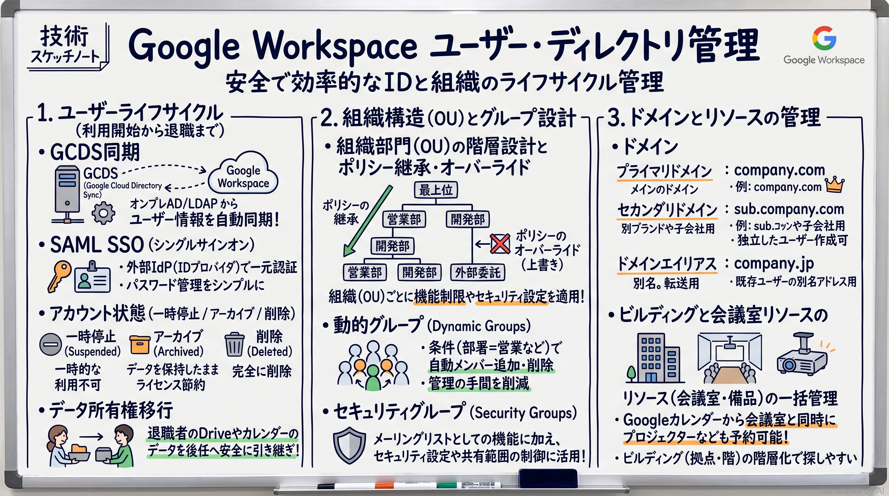
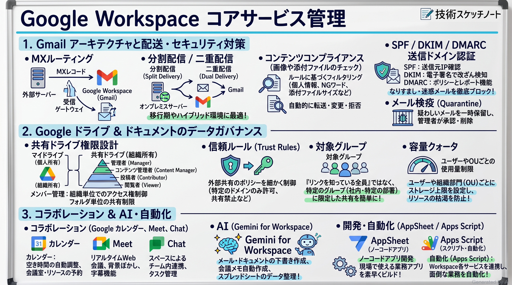
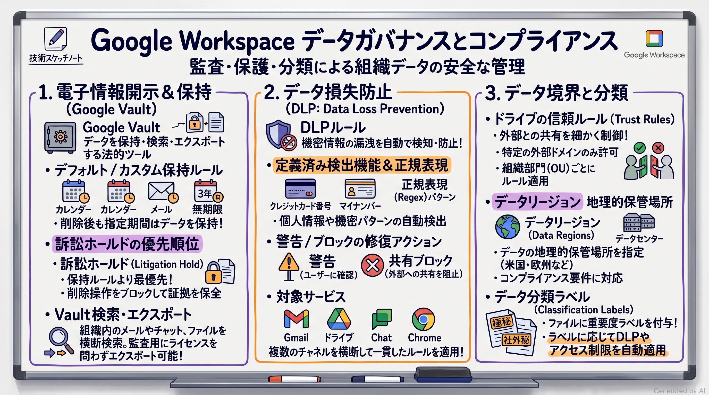
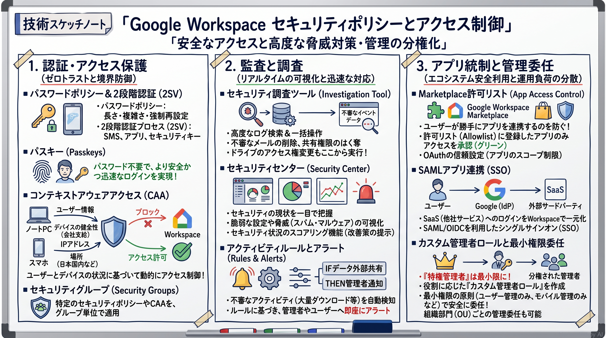
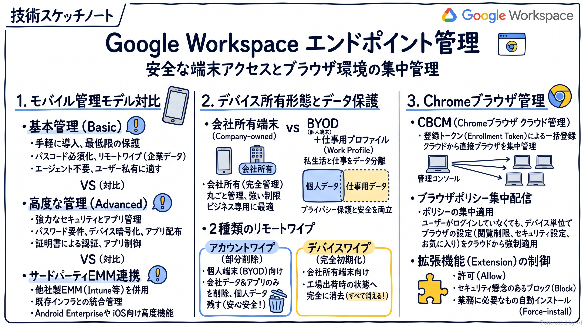
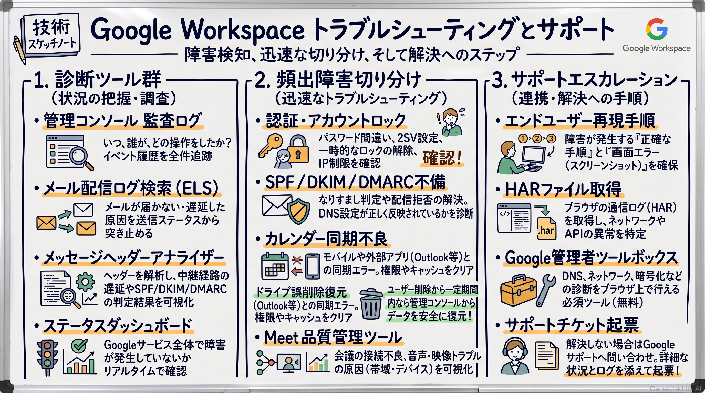

# Associate Google Workspace Administrator 完全対策＆実践学習ガイド

- **対象資格**: Google Cloud Certified - Associate Google Workspace Administrator
- **試験コード**: AGWA / Associate Google Workspace Administrator
- **公式試験ガイド**: [Associate Google Workspace Administrator 認定試験ガイド (日本語版)](https://services.google.com/fh/files/misc/associate_google_workspace_administrator_exam_guide_japanese.pdf?hl=ja)
- **公式試験ページ**: [Associate Google Workspace Administrator | Google Cloud Certification](https://cloud.google.com/certification/google-workspace-administrator)
- **公式学習パス**: [Google Skills - Associate Google Workspace Administrator](https://www.skills.google/paths/24?hl=ja)
- **最終更新日**: 2026-10-12

---

## はじめに

クラウドを活用したワークプレイスの変革が進む現代において、セキュアで円滑なコラボレーション基盤の構築と安定運用は、あらゆる組織の開発生産性とガバナンスを左右する極めて重要なミッションです。Google Workspace は、Gmail、Google ドライブ、Google Meet、Google カレンダーなどのコアコラボレーションツールに加え、Gemini による生成 AI 支援や堅牢なゼロトラストセキュリティモデルを統合したクラウドネイティブなオフィス基盤です。

本ガイドは、Google Cloud が認定する「Associate Google Workspace Administrator」試験の合格を目指すエンジニアおよびシステム管理者に向けて、試験範囲の完全網羅と実務におけるアーキテクチャ判断基準の習得を目的として体系化した実践的学習ノートです。

単なる管理コンソールの設定手順や用語の暗記にとどまらず、「どのようなビジネス要件やセキュリティ制約のもとで、どの設定方式を選択すべきか」「なぜ他の代替案では要件を満たせないのか」というトレードオフ判断の本質を、構造化された実践シナリオとともに徹底解説します。

### Associate Google Workspace Administrator 試験とは

Associate Google Workspace Administrator 認定試験は、組織における Google Workspace 環境の日常的な管理・運用を安全かつ効率的に遂行する能力を客観的に評価する認定資格です。

- **試験時間**: 120 分（2 時間）
- **出題問題数**: 50〜60 問
- **出題形式**: 択一選択問題、複数選択問題
- **受験料**: $125
- **合格基準点**: 合否のみ通知（スケールドスコア・正答率は非開示）
- **前提知識**: Google Workspace 管理コンソールを使用した日常的な管理業務の実務経験（推奨 6 か月以上の管理者経験）

### 難易度と求められる思考力

本試験の難易度は「アソシエイト」と冠されているものの、実務における深い洞察と論理的思考力が強く問われます。具体的には以下のような観点での出題が頻出します。

1. **ビジネス制約とポリシー適用のトレードオフ**:
   人事異動や組織再編、委託先企業の参画など、動的に変化する環境に対して「組織部門（OU）」と「Google グループ」のどちらをポリシー適用の基軸とすべきかの見極めが問われます。
2. **多層防御とゼロトラスト思考**:
   静的なパスワード認証から、2 段階認証プロセス（2SV）、FIDO2 準拠のパスキー、コンテキストアウェア アクセス（CAA）に至るまで、利便性を損なわずにセキュリティ境界を確立する設計能力が求められます。
3. **トラブルシューティングの論理的切り分け**:
   メールの不達やスパム判定、シングルサインオン（SSO）のエラー、カレンダー同期不良などが発生した際に、ログやメッセージヘッダー（SPF / DKIM / DMARC）から障害箇所の根本原因を特定するトラブルシューティング思考が要求されます。

### 推奨の勉強法

1. **公式一次ドキュメントとアーキテクチャガイドの精読**:
   Google Workspace 管理者ヘルプの概念説明、機能仕様、ベストプラクティスを正確にインプットします。
2. **管理コンソールでの実機検証・ハンズオン体験**:
   Google Skills Boost のハンズオン環境や検証用 Workspace テナントを活用し、ユーザー登録、OU 階層作成、ルール設定、ログ検索を実際に手作業で動かして体感します。
3. **実践シナリオ（状況・対応・結果・解説）による意思決定プロセスの追体験**:
   各出題セクションに収録された実践シナリオの「解説」を熟読し、「なぜその方式を採用し、なぜ他の有力な代替案を退けるのか」というトレードオフの論理を自分の言葉で説明できるように反復学習します。

---

## 目次

1. [はじめに](#はじめに)
2. [学習カリキュラム・出題範囲ロードマップ](#学習カリキュラム出題範囲ロードマップ)
3. [Section 1: ユーザー アカウント、ドメイン、ディレクトリの管理 (約 22%)](#section-1-ユーザー-アカウントドメインディレクトリの管理-約-22)
4. [Section 2: Workspace コアサービスの管理 (約 20%)](#section-2-workspace-コアサービスの管理-約-20)
5. [Section 3: データ ガバナンスとコンプライアンスの管理 (約 14%)](#section-3-データ-ガバナンスとコンプライアンスの管理-約-14)
6. [Section 4: セキュリティ ポリシーとアクセス制御の管理 (約 20%)](#section-4-セキュリティ-ポリシーとアクセス制御の管理-約-20)
7. [Section 5: エンドポイントの管理 (約 10%)](#section-5-エンドポイントの管理-約-10)
8. [Section 6: 一般的な問題のトラブルシューティング (約 14%)](#section-6-一般的な問題のトラブルシューティング-約-14)
9. [まとめと推奨学習ステップ](#まとめと推奨学習ステップ)

---

## 学習カリキュラム・出題範囲ロードマップ

### セクション一覧と出題比率

| セクション番号 | セクション名 / 出題分野 | 出題比率 | 主要対象サービス・ツール |
| :--- | :--- | :--- | :--- |
| **Section 1** | ユーザー アカウント、ドメイン、ディレクトリの管理 | 約 22% | ユーザー ライフサイクル、GCDS、SAML SSO、組織部門 (OU)、Google グループ、動的グループ、セキュリティ グループ、プライマリ/セカンダリ ドメイン、ドメイン エイリアス、ビルディングと会議室リソース |
| **Section 2** | Workspace コアサービスの管理 | 約 20% | Gmail (MX、分割/二重配信、コンテンツ コンプライアンス、SPF/DKIM/DMARC、検疫)、Google ドライブ (共有ドライブ、信頼ルール、対象グループ、容量割り当て)、カレンダー、Meet、Chat、Gemini for Workspace、AppSheet / Apps Script |
| **Section 3** | データ ガバナンスとコンプライアンスの管理 | 約 14% | Google Vault (保持ルール、訴訟ホールド、エクスポート)、データ損失防止 (DLP)、ドライブの信頼ルール、データ リージョン (地理的保管場所)、Google データ エクスポート、データ分類ラベル |
| **Section 4** | セキュリティ ポリシーとアクセス制御の管理 | 約 20% | パスワード ポリシー、2 段階認証プロセス (2SV / パスキー)、コンテキストアウェア アクセス (CAA)、管理者ロール・権限委任、セキュリティ調査ツール、セキュリティ センター、Marketplace 許可リスト、SAML アプリ統合 |
| **Section 5** | エンドポイントの管理 | 約 10% | モバイル管理 (基本管理 vs 高度な管理 vs サードパーティ EMM)、BYOD (仕事用プロファイル) vs 会社所有、リモートワイプ (アカウント vs デバイス)、Chrome ブラウザ クラウド管理 (CBCM)、ブラウザ ポリシー、拡張機能管理 |
| **Section 6** | 一般的な問題のトラブルシューティング | 約 14% | 監査ログ、Workspace ステータス ダッシュボード、メール配信ログ検索 (ELS)、SPF/DKIM/DMARC ヘッダー解析、カレンダー同期トラブル、ドライブ誤削除復元、Meet 品質管理ツール、HAR ファイル、管理者ツールボックス |

---

### セクション別出題詳細

#### Section 1: ユーザー アカウント、ドメイン、ディレクトリの管理 (約 22%)
- **出題の狙い**: 組織のアイデンティティ基盤を安全かつ効率的に構築・運用する能力を検証します。オンプレミス Active Directory や既存 IdP との連携、組織部門（OU）による階層的ポリシー設計、グループを活用した権限管理、および複数ドメイン・会議室リソースの集中管理を評価します。
- **主要タスク**:
  - Task 1.1: ユーザー ライフサイクルの管理（手動作成、CSV 一括登録、GCDS による AD 連携同期、サードパーティ IdP 連携、SAML SSO 設定、ユーザー属性変更、一時停止・削除・復元・アーカイブ、データ所有権移行、ライセンス割り当て、パスワード管理）
  - Task 1.2: 組織部門（OU）の設計と作成（業務組織ではなくポリシー適用単位に基づく階層設計、OU の作成・移動・継承・オーバーライド管理）
  - Task 1.3: グループの管理（メーリング リスト、共同トレイ、動的グループによる属性ベース自動所属、セキュリティ グループによるアクセス制限）
  - Task 1.4: ドメインの管理（TXT レコードによるドメイン所有権証明、プライマリ ドメインとセカンダリ ドメインの使い分け、ドメイン エイリアス、MX レコード構成）
  - Task 1.5: ビルディングとリソースの管理（ビルディングと会議室の一括登録、定員・設備属性の設定、カレンダー自動予約ポリシーと権限設定）
- **重要キーワード**: GCDS (Google Cloud Directory Sync), SAML SSO, OU Hierarchy, Policy Inheritance & Override, Dynamic Groups, Security Groups, Primary vs Secondary Domain, Domain Alias, Buildings and Resources, Archived User (AU) License

#### Section 2: Workspace コアサービスの管理 (約 20%)
- **出題の狙い**: 日常業務の中心となるコラボレーション ツールの動作仕様を深く理解し、ビジネス要件に合わせて安全かつ最適に構成する能力を検証します。メール ルーティングの高度な制御、共有ドライブのガバナンス、生成 AI（Gemini）の組織展開などを評価します。
- **主要タスク**:
  - Task 2.1: Gmail の構成（MX レコード、分割配信・二重配信ルーティング、コンテンツ コンプライアンス ルール、迷惑メール・フィッシング対策、SPF / DKIM / DMARC、メール検疫、コンプライアンス フッター、メールボックス委任、データ移行）
  - Task 2.2: Google ドライブとドキュメントの構成（外部共有制限、信頼ルール、対象グループ、共有ドライブの権限設計、ユーザー/OU 別ストレージ割り当て、パソコン版 Google ドライブ、ファイル オーナー権限移行、ドライブ ラベル、オフライン アクセス）
  - Task 2.3: Google カレンダーの構成（リソース カレンダー、外部共有オプション、予約ポリシー、サードパーティ会議ツール連携、不明な送信者からの招待ブロック）
  - Task 2.4: Google Meet の構成（OU 別有効化、主催者安全設定、録画・文字起こし設定、ライブ ストリーミング制御）
  - Task 2.5: Google Chat の構成（OU 別有効化、チャット履歴の保存設定、外部スペース参加制限、Chat アプリ制御）
  - Task 2.6: Gemini for Google Workspace の構成（Gemini ライセンス割り当て、OU 別有効化、アルファ機能の制御、利用状況モニタリング）
  - Task 2.7: Workspace 開発のサポート（AppSheet および Apps Script のユースケース特定、OU 別アクセス有効化）
- **重要キーワード**: Split Delivery vs Dual Delivery, Content Compliance Rules, SPF / DKIM / DMARC, Shared Drives, Target Audiences, Google Workspace Storage Limits, Drive Labels, Google Meet Safety Controls, Gemini for Google Workspace, AppSheet

#### Section 3: データ ガバナンスとコンプライアンスの管理 (約 14%)
- **出題の狙い**: 企業のコンプライアンス要件、法的規制、知的財産保護を満たすデータ管理ポリシーを設計・運用する能力を検証します。Google Vault による証拠保全、DLP ルールによる情報漏洩防止、データの地理的保管場所の制御を評価します。
- **主要タスク**:
  - Task 3.1: Google Vault を使用した電子情報開示とデータ保持（デフォルト保持ルールとカスタム保持ルール、訴訟ホールドの適用、Vault 検索・エクスポート、監査レポート、アーカイブ ユーザー ライセンスの適用）
  - Task 3.2: データ損失防止（DLP）ルールの作成と管理（コンテンツ コンプライアンス ルールとの差異、機密データ検出機能 [クレジット カード、個人情報、正規表現]、警告・ブロック等の修復アクション、Gmail / ドライブ / Chat への適用）
  - Task 3.3: ドライブの信頼ルールの作成と管理（OU・グループ・外部ドメイン単位の共有許可/ブロック制御、ビジター共有の制限）
  - Task 3.4: 環境データの保存方法およびエクスポート方法（Google データ エクスポート ツールの運用、データ リージョン [地理的保管場所] の指定、コンプライアンス設定）
  - Task 3.5: データの分類（ドライブ ラベルと Gmail ラベルのユースケース、ユーザー手動分類、DLP 自動分類、AI 分類）
- **重要キーワード**: Google Vault, Retention Rules vs Litigation Holds, DLP (Data Loss Prevention), Predefined Detectors & Regex, Trust Rules, Data Regions (Geographic Storage), Google Takeout / Data Export Tool, Drive Labels

#### Section 4: セキュリティ ポリシーとアクセス制御の管理 (約 20%)
- **出題の狙い**: ゼロトラスト セキュリティ原則に基づき、アカウント認証の堅牢化、コンテキストに応じたアクセス制御、最小権限の管理委任、およびセキュリティ インシデントの迅速な検知・調査を行う能力を検証します。
- **主要タスク**:
  - Task 4.1: ユーザー アクセスの保護（パスワード ポリシー、2 段階認証プロセス [2SV / パスキー / 物理キー] の強制、コンテキストアウェア アクセス [CAA: IP / デバイス状態 / 地理条件]、セキュリティ グループによる保護、カスタム管理者ロールの作成と権限委任）
  - Task 4.2: セキュリティ リスクの報告、監査、調査（セキュリティ調査ツールによるログ検索・修復アクション、セキュリティ センターの脅威分析、セキュリティの状況ページ、アクティビティ ルールとアラート）
  - Task 4.3: アプリケーションの有効化（Marketplace 許可リスト、Google Play アプリの配布制御、SAML / OIDC アプリ統合、追加 Google サービス [YouTube 等] の OU 制御、サードパーティ アプリのトークン失効、Chrome 拡張機能の集中配信）
- **重要キーワード**: 2-Step Verification (2SV), Passkeys, Context-Aware Access (CAA), Security Groups, Delegated Administration & Custom Admin Roles, Security Investigation Tool, Security Center, Marketplace Allowlist, SAML Application Integration

#### Section 5: エンドポイントの管理 (約 10%)
- **出題の狙い**: 業務利用される多種多様な端末（スマートフォン、PC、Chrome ブラウザ）に対して、セキュリティと利便性を両立させたガバナンスを確立する能力を検証します。
- **主要タスク**:
  - Task 5.1: モバイル デバイスの管理（基本管理 vs 高度な管理 vs サードパーティ EMM の選定基準、画面ロック強制・暗号化、会社所有端末 vs BYOD [仕事用プロファイル]、アカウント ワイプ [企業データのみ削除] とデバイス ワイプ [完全初期化] の使い分け）
  - Task 5.2: Chrome ブラウザの管理（Chrome ブラウザ クラウド管理 [CBCM] への登録トークン配布、更新ポリシーとバージョン固定、拡張機能の許可・ブロック・自動インストール、オフライン ポリシー）
- **重要キーワード**: Basic Mobile Management vs Advanced Mobile Management, Work Profile (BYOD), Account Wipe vs Device Wipe, Chrome Browser Cloud Management (CBCM), Chrome Extension Policies

#### Section 6: 一般的な問題のトラブルシューティング (約 14%)
- **出題の狙い**: 現場で頻発するシステムトラブルに対して、体系的な切り分けアプローチと管理者ツールを駆使して迅速に原因を特定・解決する実践力を検証します。
- **主要タスク**:
  - Task 6.1: 問題の特定と診断（管理コンソール監査ログ、Workspace ステータス ダッシュボードでの障害確認、メール配信ログ検索）
  - Task 6.2: 一般的な問題の解決（アカウント ロック解除、SPF / DKIM / DMARC 設定不備によるメール不達や迷惑メール誤判定の解消、カレンダー同期不良、ドライブ共有権限トラブル、誤削除ファイルの復元 [ゴミ箱・Vault]、パソコン版ドライブのキャッシュ障害、Meet 品質管理ツールによるネットワーク遅延診断）
  - Task 6.3: サポート リソースの使用（再現手順の文書化、HAR ファイルの取得・解析、管理者ツールボックスの活用、Google サポートへのケース起票）
- **重要キーワード**: Audit Logs, Email Log Search (ELS), Message Header Analyzer, SPF / DKIM / DMARC Alignment, Calendar Sync Troubleshooting, Restore Deleted Drive Files, Meet Quality Tool, HAR File, Google Admin Toolbox


## Section 1: ユーザー アカウント、ドメイン、ディレクトリの管理 (約 22%)

本セクションは、Google Workspace 環境の基礎となるアイデンティティ管理基盤、組織階層（OU）、アクセス統制グループ、複数ドメインの管理、および設備リソースの設計・運用を扱います。エンタープライズ規模のユーザー管理において、手作業による運用負荷を排除し、セキュリティとガバナンスを両立させたディレクトリ構造を構築する能力が評価されます。



---

### 1. セクション概要

ユーザー アカウント、ドメイン、ディレクトリの管理は、Google Workspace のすべてのセキュリティ ポリシーやサービス設定が適用される土台です。管理者は、オンプレミス Active Directory やクラウド IdP と連携したユーザー プロビジョニングを自動化し、ポリシー適用を目的とした階層的な組織部門（OU）を設計する必要があります。また、業務上のコミュニケーションを円滑にする Google グループや会議室リソースを効率的に管理するスキルが求められます。

#### 重要キーワード

- **GCDS (Google Cloud Directory Sync)**: オンプレミスの Active Directory や LDAP ディレクトリから Google Workspace へユーザー、グループ、連絡先を一方向で同期するツールです。オンプレミス側のデータは変更せず、Workspace 側を自動更新します。
- **SAML SSO (Single Sign-On)**: サードパーティの ID プロバイダ（Okta、Azure AD 等）を認証基盤とし、SAML 2.0 プロトコルを用いて Google Workspace へのシングルサインオンを実現する仕組みです。
- **組織部門 (OU: Organizational Unit)**: 設定やサービス利用可否などの「ポリシーを適用する単位」として階層構造を形成する論理グループです。業務組織図とは独立して設計することがベストプラクティスとされます。
- **動的グループ (Dynamic Groups)**: 役職、部署、拠点などのユーザー属性に基づき、メンバーシップが自動的に更新される Google グループです。異動や入社に伴う手動追加・削除の手間をゼロにします。
- **セキュリティ グループ (Security Groups)**: 通常のメーリング リストとは異なり、機密ドキュメントや共有ドライブへのアクセス権限を安全に集中制御するために特別に指定された Google グループです。外部ユーザーの参加や不正な権限昇格を防ぎます。
- **プライマリ ドメイン / セカンダリ ドメイン / ドメイン エイリアス**: Google Workspace 契約の基軸となるプライマリ ドメインに対し、独立したユーザー アカウントや個別ブランディングを持つセカンダリ ドメイン、および既存ドメイン宛ての別名アドレスとして機能するドメイン エイリアスを適切に使い分けます。
- **アーカイブ ユーザー (AU) ライセンス**: 退職した従業員のアカウントを削除せず、Google Vault による電子情報開示や保持ポリシーを維持したまま、通常ライセンスよりも安価に保管するためのライセンス形態です。

---

### 2. 重要トピック

#### 1. ユーザー ライフサイクル管理とプロビジョニング アーキテクチャ

組織におけるユーザー アカウントのライフサイクルは、「作成（プロビジョニング）」「変更（属性・ライセンス更新）」「停止・退職（オフボーディング）」の各フェーズで統制されます。

- **プロビジョニングの自動化**:
  - オンプレミス AD 環境が存在する場合は、DMZ または社内サーバー上に GCDS を配置し、スケジュール同期を実行します。GCDS は一方向同期（AD → Google Workspace）であり、Workspace 側で直接行われた変更は次回同期時に AD の内容で上書きされる点に留意が必要です。
  - クラウド IdP を利用する場合は、SCIM（System for Cross-domain Identity Management）プロトコルを用いた自動プロビジョニングを構成します。
- **アカウント ステータスの遷移**:
  - **アクティブ**: 通常稼働状態。ライセンスを消費します。
  - **一時停止 (Suspended)**: アカウントへのログインおよびサービス利用が即座にブロックされますが、データは保持され、ライセンスは引き続き消費されます。不正アクセス検知時や休職時に適用します。
  - **アーカイブ (Archived)**: 退職者のデータを法的に保持しつつ、通常ライセンスを解放してコストを最適化するために使用します。
  - **削除 (Deleted)**: アカウントおよび全データが完全削除されます。削除後 20 日以内であれば管理者による復元が可能ですが、それを過ぎると恒久的に消去されます。

#### 2. 組織部門 (OU) の階層設計とポリシー継承モデル

組織部門（OU）は、Google Workspace において「誰にどのようなポリシー（サービス有効化、セーフブラウジング、拡張機能、パスワード長など）を適用するか」を決定する最重要単位です。

- **ポリシー継承の原則**:
  - 親 OU で設定されたポリシーは、下位の子 OU に自動的に継承されます。
  - 子 OU で特定の設定を変更すると「オーバーライド（オーバーライド済み）」となり、子 OU 独自の設定が優先されます。
- **設計のベストプラクティス**:
  - 人事異動のたびに OU を移動させなければならないような「実際の会社組織図（営業部、経理部、総務部など）」をそのまま OU 階層に反映させることは推奨されません。
  - 「正社員」「契約社員」「外部委託パートナー」「幹部役員」「キオスク端末」など、**セキュリティ要件や利用可能サービスのポリシーが共通するグループ**を基軸として OU 階層を設計することが推奨されます。

#### 3. グループ機能・ドメイン・リソースの方式比較

| 比較項目 / 方式 | GCDS (Directory Sync) | サードパーティ SAML SSO | 手動 / CSV 一括登録 |
| :--- | :--- | :--- | :--- |
| **主要用途** | オンプレミス AD / LDAP との属性・ユーザー同期 | 認証（ログイン）の一元化とパスワード統合 | 小規模環境、テスト環境、不定期の一括更新 |
| **同期方向** | AD/LDAP から Workspace への一方向同期 | 認証要求の SAML リダイレクト（属性同期は別） | 管理コンソールへのアップロード |
| **運用負荷** | 低（初期設定後は自動スケジュール実行） | 低（パスワード管理を既存 IdP に集約） | 高（人事異動・入退社の都度手動作業が発生） |
| **コスト特性** | 無料（無償の Google 提供ツール） | 既存 IdP ライセンスに依存 | 追加費用なし |
| **主なトレードオフ** | 同期ルールの綿密な正規表現設計が必要 | IdP 障害時に Workspace へのログインが停止 | 人的オペレーションミスや登録遅延のリスク |

- **ドメイン種別の選定基準**:
  - **セカンダリ ドメイン**: 別会社、別ブランド、買収先企業など、ユーザーごとに独立したメールアドレス（`user@brand-b.com`）をプライマリとして持たせる場合に選定します。
  - **ドメイン エイリアス**: 既存ユーザー全員に対して、別ドメイン宛てのメールも同一受信トレイで受け取らせたい場合（例: 社名変更に伴う旧ドメインの受信継続）に選定します。追加ライセンスは不要です。

---

### 3. 実践シナリオ

#### シナリオ 1-1: オンプレミス AD からのユーザー自動同期とグループ連携

- **状況**: オンプレミス Active Directory を全社のマスターディレクトリとして運用しており、人事情報システムと連携して AD 上で入退社や部署変更が日々自動更新されている環境で、管理者の手動介入なしに Google Workspace のアカウントおよびメーリング リストを AD と完全に同期させたい場合
- **対応**: 社内ネットワークのサーバーに Google Cloud Directory Sync (GCDS) を導入し、LDAP クエリによる同期マッピング ルールを構成して、AD から Google Workspace への一方向スケジュール同期を設定する。
- **結果**: 人事異動や新入社員のアカウント作成、退職者のアカウント一時停止、グループのメンバーシップ更新が自動化され、ディレクトリ管理の人的ミスとタイムラグが解消される。
- **解説**: GCDS はオンプレミス AD / LDAP のユーザーやセキュリティ グループ情報を読み取り、Google Workspace に一方向で安全に反映するための公式推奨ツールであるためです。Google Workspace 側で手動変更を行うと次回の GCDS 同期時に AD の状態で上書きされてしまうため、AD を単一の真実のソース（SSOT）として運用する要件に合致しています。なお、サードパーティ IdP の SAML SSO は認証プロトコルでありアカウントやグループの自動同期機能自体は提供しないため不適格です。
- **参考ドキュメント**:
  - [Google Cloud Directory Sync の概要](https://support.google.com/a/answer/106368?hl=ja): GCDS の仕組み、システム要件、同期ルールのベストプラクティスが記載されています。

#### シナリオ 1-2: 退職者アカウントの安全なオフボーディングと法的保持

- **状況**: 従業員が退職するにあたり、企業のコンプライアンス規程に従って過去の送受信メールや Google ドライブ内のファイルを Google Vault で検索・保持可能な状態に維持しつつ、退職者の不正ログインを遮断し、通常ライセンス費用を最適化したい場合
- **対応**: 退職者のアカウントを一時停止して直ちにセッショントークンを取り消し、Google ドライブの主要ファイルのオーナー権限を後任者に移行した上で、アカウントにアーカイブ ユーザー (AU) ライセンスを割り当てて通常ライセンスを再利用可能にする。
- **結果**: 元従業員のアクセスは完全に遮断され、Google Vault による過去データの検索・保持能力を低コストで維持しながら、高額な通常ライセンスが回収される。
- **解説**: アーカイブ ユーザー (AU) ライセンスを利用することで、通常ライセンスよりも安価に Vault の保持・検索機能を維持できるためです。アカウントを完全に削除してしまうと、20 日間の猶予期間を過ぎた時点で Vault 内のデータを含めすべて恒久的に消去されてしまうため法的保持要件を満たせません。また、アカウントを単に一時停止したまま放置すると、通常の高額ライセンスを消費し続けるためコスト最適化の観点から不適格です。
- **参考ドキュメント**:
  - [元社員のアカウントをアーカイブする](https://support.google.com/a/answer/9049155?hl=ja): AU ライセンスの適用条件、データ保持、ライセンスの割り当て手順が解説されています。

#### シナリオ 1-3: セキュリティ要件と業務組織の乖離を吸収する組織部門 (OU) 階層設計

- **状況**: 営業部、開発部、総務部など複数の部署が存在するが、正社員には Google ドライブの外部共有を許可し、短期常駐の業務委託パートナーには情報漏洩防止のため Google ドライブの外部共有およびオフライン アクセスを厳格に禁止するセキュリティ ポリシーを設計・適用したい場合
- **対応**: 会社組織図に基づく部署別の OU 階層ではなく、「正社員 (Employees)」と「業務委託 (Contractors)」というセキュリティ ポリシーの適用境界に基づいた最上位 OU を作成し、業務委託 OU に対してのみドライブの外部共有オフおよびオフライン アクセス無効化のポリシーをオーバーライド適用する。
- **結果**: 部署の異動や組織再編が発生しても OU の大規模な再設計が不要となり、雇用形態別の厳格なセキュリティ ガバナンスが恒常的に維持される。
- **解説**: Google Workspace の組織部門 (OU) は「ポリシーを適用するための論理コンテナ」であり、業務組織図をそのまま模倣すると同一部署内の異なる契約形態（正社員と派遣・委託）に対して異なるサービス制限を課すことが困難になるためです。Google のベストプラクティスでは、ポリシーの共通性に基づいて OU を設計することが推奨されています。なお、Google グループでもサービス利用可否を一部制御できますが、オフライン アクセスなどのクライアント端末ポリシーは OU 単位でしか適用できないため、グループ単独の制御では要件を満たせません。
- **参考ドキュメント**:
  - [組織部門の仕組み](https://support.google.com/a/answer/182433?hl=ja): OU の階層設計、設定の継承とオーバーライドの基本仕様が記載されています。

#### シナリオ 1-4: 人事異動に伴う部署メーリング リストの動的メンバーシップ管理

- **状況**: 社員数が数千名規模に拡大し、毎月発生する人事異動のたびに管理者が各部門の全社連絡用メーリング リスト（例: `sales-all@example.com`）の追加・削除作業に追われ、メンバーの登録漏れや削除漏れによる機密情報漏洩リスクが発生している場合
- **対応**: 各部門のメーリング リストを「動的グループ (Dynamic Groups)」として構成し、ユーザー プロファイルの「部署 (Department)」属性が特定の値に一致するユーザーを自動的にメンバーとして登録するルールを定義する。
- **結果**: 人事システムやディレクトリ同期（GCDS）によってユーザー属性が更新された時点で、管理者の手作業なしにグループ メンバーシップがリアルタイムで自動更新される。
- **解説**: 動的グループはユーザー属性（部署、役職、勤務地など）に基づく条件式によってメンバーシップを自動管理するため、手作業の介入を排除しヒューマンエラーを防ぐことができるためです。通常の Google グループでは手動での追加・削除やスクリプトによる定期バッチ更新が必要となり、タイムラグや管理負荷が生じるため要件を満たせません。また、組織部門 (OU) はメール配信リスト（メーリング リスト）としては機能しないため不適格です。
- **参考ドキュメント**:
  - [動的グループのメンバーシップを管理する](https://support.google.com/a/answer/9923418?hl=ja): 動的グループの作成手順、属性ルールの書き方、サポートされる属性一覧が解説されています。

#### シナリオ 1-5: 企業買収に伴うマルチドメイン統合とブランド分離

- **状況**: 自社（`corp-a.com`）が別会社（`brand-b.com`）を買収し、管理基盤を自社の Google Workspace テナントに一元化するが、買収先企業の社員は対外的な信用を維持するために引き続き `user@brand-b.com` をメインの送信元・表示名アドレスとして使用したい場合
- **対応**: 自社テナントの管理コンソールで `brand-b.com` を「セカンダリ ドメイン」として追加し、DNS で TXT レコードを登録してドメイン所有権を証明した上で、買収先社員のアカウント作成時にプライマリ メールアドレスとして `@brand-b.com` を割り当てる。
- **結果**: 単一の Workspace テナントと管理コンソール配下で両社のガバナンスとセキュリティ ポリシーを一括管理しながら、買収先社員は独自のドメイン名で業務を継続できる。
- **解説**: 「セカンダリ ドメイン」として登録することで、そのドメイン固有のプライマリ メールアドレスを持つユーザー アカウントを独立して作成できるためです。「ドメイン エイリアス」として追加した場合は、既存ドメイン（`corp-a.com`）のユーザーに対する別名アドレスとしてのみ機能し、`brand-b.com` 単独の独立したアカウントを作成することはできないため要件を満たせません。
- **参考ドキュメント**:
  - [複数のドメインまたはドメイン エイリアスを追加する](https://support.google.com/a/answer/7502379?hl=ja): セカンダリ ドメインとドメイン エイリアスの機能的相違点、追加手順が記載されています。

#### シナリオ 1-6: ハイブリッドワーク環境における会議室リソースの一括展開と予約制御

- **状況**: 本社オフィス移転に伴い、50 室以上の新しい会議室およびビデオ会議設備（プロジェクター、定員、フロア情報）を Google カレンダーの予約対象として一括登録し、役員専用会議室については一般社員による勝手な予約を制限したい場合
- **対応**: 管理コンソールの「ビルディングとリソース」からビルディング（拠点・フロア）を定義し、CSV テンプレートを用いて会議室名・定員・設備属性を一括アップロードした上で、役員専用会議室のリソース カレンダーに対して権限設定を行い、役員グループ以外には「空き情報の表示」のみを許可する共有設定を適用する。
- **結果**: 社員が Google カレンダーで定員や設備に応じた会議室を容易に検索・自動予約できるようになり、役員専用リソースの不正利用も確実に防止される。
- **解説**: ビルディングとリソースの機能を用いて属性（定員、設備など）を構造化登録することで、Google カレンダーのインテリジェントな部屋推薦機能が有効化され、さらにリソース カレンダーの個別共有権限によって予約可能ユーザーを制御できるためです。通常の手動ユーザー カレンダーとして会議室を作成した場合、設備の自動フィルタリング機能が動作せず、二重予約の防止や権限統制が極めて煩雑になるため不適格です。
- **参考ドキュメント**:
  - [建物、設備、リソースを管理する](https://support.google.com/a/answer/168646?hl=ja): ビルディングの作成、リソースの一括アップロード形式、アクセス権限の委任手順が網羅されています。

---

### 4. 参考ドキュメント & 推奨ハンズオン

#### 公式一次ドキュメント
- [組織部門の仕組み](https://support.google.com/a/answer/182433?hl=ja): 階層設計、設定の継承とオーバーライドの原則
- [Google Cloud Directory Sync (GCDS) スタートガイド](https://support.google.com/a/answer/106368?hl=ja): オンプレミス AD / LDAP からの同期アーキテクチャ
- [複数のドメインまたはドメイン エイリアスを追加する](https://support.google.com/a/answer/7502379?hl=ja): セカンダリ ドメインとエイリアスの使い分け
- [ビルディングと設備リソースの管理](https://support.google.com/a/answer/168646?hl=ja): 会議室の一括インポートと予約権限

#### 推奨ハンズオン・ラボ（実機検証）
- [Google Skills - Associate Google Workspace Administrator Certification Path](https://www.skills.google/paths/24?hl=ja):
  - **学習目標**: 管理コンソール上での組織部門（OU）の作成、設定のオーバーライド、Google グループの作成とアクセス権限設定、ビルディングと会議室リソースの登録実務を体験します。


## Section 2: Workspace コアサービスの管理 (約 20%)

本セクションは、組織のコミュニケーションとコラボレーションの中核を担う主要サービス（Gmail、Google ドライブ、Google ドキュメント、Google カレンダー、Google Meet、Google Chat、Gemini for Google Workspace、AppSheet）の高度な構成とガバナンスを扱います。



---

### 1. セクション概要

Workspace コアサービスの管理では、単にサービスをオンにするだけでなく、企業のコンプライアンス規程や業務フローに応じたきめ細かな設定が不可欠です。Gmail ではメール ルーティング（分割配信・二重配信）や送信ドメイン認証（SPF / DKIM / DMARC）によるスプーフィング防止、Google ドライブでは共有ドライブのガバナンスと信頼ルール、カレンダーや Meet では安全設定や外部共有境界の確立が求められます。さらに、生成 AI である Gemini やローコード開発 AppSheet のセキュアな全社展開能力が問われます。

#### 重要キーワード

- **分割配信 (Split Delivery)**: 同一ドメイン宛てのメールを受信した際、Google Workspace にアカウントが存在するユーザーには Gmail へ配信し、存在しないユーザー（オンプレミス等に残っているユーザー）には別のメール サーバーへ転送するルーティング方式です。移行期間中によく用いられます。
- **二重配信 (Dual Delivery)**: 受信したメールの完全なコピーを、Gmail と既存のレガシー メール サーバー（Exchange 等）の双方へ同時に配信する構成です。段階的移行の検証フェーズで利用されます。
- **SPF / DKIM / DMARC**: メール送信元の正当性を証明する 3 大認証技術です。SPF で送信元 IP を制限し、DKIM で電子署名による改ざんを検知し、DMARC で認証失敗時のアクション（受信拒否・隔離）とレポート収集を指示します。
- **コンテンツ コンプライアンス ルール**: 送受信されるメールの件名、本文、添付ファイル、送信者/受信者を正規表現や事前定義条件で検査し、条件に合致した場合に変更、転送、検疫、暗号化などのアクションを実行するルールです。
- **共有ドライブ (Shared Drives)**: ファイルの所有権が個人アカウントではなく「組織（チーム）」に帰属するドライブ領域です。メンバーが退職・削除されてもファイルはそのまま保持され、業務継続性が保たれます。
- **対象グループ (Target Audiences)**: Google ドライブでファイルを共有する際、リンクを知っている全社員に共有するのではなく、特定の部署や役職などの指定グループを共有候補として管理者が推薦・固定できる機能です。
- **Gemini for Google Workspace**: Gmail やドキュメント、Meet 等に統合された生成 AI 支援機能です。ライセンスの割り当て、OU 単位での機能有効化、および社内データのプライバシー保護設定を管理します。

---

### 2. 重要トピック

#### 1. Gmail ルーティングと送信ドメイン認証アーキテクチャ

メール システムのクラウド移行や運用において、確実なメール到達性と強固ななりすまし対策が最重要課題となります。

- **メール ルーティングの使い分け**:
  - **インバウンド ルーティング**: ドメインの MX レコードを Google（`ASPMX.L.GOOGLE.COM` 等）に向け、Google を入口とします。アカウントが存在しない宛先をレガシー サーバーへルーティングする場合は「分割配信」を選択します。
  - **受信ゲートウェイ**: サードパーティのメール セキュリティ製品（Proofpoint や Trend Micro 等）を前段に置く場合、Google 側で「受信ゲートウェイ」を設定し、ゲートウェイの IP アドレスからの接続のみを信頼するように構成します。
- **SPF / DKIM / DMARC の統合的防御**:
  - **SPF (Sender Policy Framework)**: DNS の TXT レコードに `v=spf1 include:_spf.google.com ~all` を登録し、自社ドメインからメールを送信できるサーバーを明示します。
  - **DKIM (DomainKeys Identified Mail)**: 管理コンソールで 2048 ビットの暗号鍵を生成し、DNS に公開鍵を登録して送信メールに電子署名を付与します。
  - **DMARC**: SPF と DKIM の認証結果をドメイン名とアライメント（整合）させ、不一致時のポリシー（`p=none` 監視 → `p=quarantine` 検疫 → `p=reject` 拒否）を DNS レコードで宣言します。

#### 2. Google ドライブと共有ドライブのガバナンス

個人のマイドライブと組織の共有ドライブは、アクセス権限と所有権のモデルが根本的に異なります。

- **共有ドライブの 5 段階のアクセス権限**:
  - **管理者 (Manager)**: メンバーの追加・削除、共有ドライブ設定の変更、コンテンツの完全削除が可能。
  - **コンテンツ管理者 (Content Manager)**: ファイルの追加、編集、移動、ゴミ箱への移動が可能（デフォルト権限）。
  - **投稿者 (Contributor)**: ファイルの追加、編集が可能（ファイルの移動や削除は不可）。
  - **閲覧者（コメント可）(Commenter)**: ファイルの閲覧とコメントの追加が可能。
  - **閲覧者 (Viewer)**: ファイルの閲覧とダウンロードのみが可能。
- **共有ドライブのセキュリティ設定**:
  - 管理者は共有ドライブごとに「組織外のユーザーとのファイル共有を許可するか」「共有ドライブの非メンバーとのファイル共有を許可するか」「閲覧者・コメント作成者によるダウンロード・印刷・コピーを禁止するか」を制御できます。

#### 3. コアサービスの機能・方式比較マトリクス

| 比較項目 / 方式 | 分割配信 (Split Delivery) | 二重配信 (Dual Delivery) | コンテンツ コンプライアンス ルール |
| :--- | :--- | :--- | :--- |
| **主要用途** | ユーザーの一部が Workspace、一部がオンプレミスに残る移行期間 | 全社員が双方の受信トレイで同一メールを並行検証する期間 | 機密情報の送受信検知、自動フッター付与、メール検疫 |
| **ルーティング先** | 宛先ユーザーの存在場所に応じてどちらか一方へ配信 | 同一メッセージを複製し双方のサーバーへ配信 | 条件一致時に管理者検疫、暗号化ルート、追加受信者へ転送 |
| **エンドユーザー体験** | 各ユーザーは指定された 1 つのクライアントで利用 | ユーザーは両方のメールボックスで同じメールを受信 | ルール違反時にバウンス通知や警告メッセージを表示 |
| **設定のポイント** | MX レコードは Google、不明宛先をオンプレミスへフォワード | 受信側サーバーで複製設定、または Google で追加配信設定 | 正規表現や事前定義の機密データ（PII）検出器を活用 |

---

### 3. 実践シナリオ

#### シナリオ 2-1: オンプレミス Exchange から Gmail への段階的移行に伴うメール ルーティング

- **状況**: オンプレミスの Microsoft Exchange から Google Workspace へのメール移行プロジェクトにおいて、全社員を一括移行するのではなく、部署ごとに数か月かけて段階的に Gmail へ切り替える計画であり、MX レコードを Google に切り替えた後、移行済みユーザー宛てのメールは Gmail に配信し、未移行ユーザー宛てのメールは自動的に既存 Exchange サーバーへ中継したい場合
- **対応**: ドメインの MX レコードを Google に変更した上で、Gmail の「ルーティング」設定で「分割配信 (Split Delivery)」を構成し、Workspace 上に受信トレイが存在しない宛先については既存 Exchange サーバーのホスト宛てにメールを転送するルールを設定する。
- **結果**: 送信元が意識することなく、移行済み社員は Gmail で、未移行社員は既存の Exchange で遅延なくメールを受信でき、スムーズな段階移行が実現する。
- **解説**: 分割配信はドメインの MX レコードを Google に向け、Workspace にアカウントが存在しない受信者へのメールのみを別のメール システムへインテリジェントに中継する標準的なアーキテクチャであるためです。二重配信は全メールのコピーを双方に届けるため、未移行ユーザーの容量圧迫や既読状態の不整合を引き起こし段階移行の目的に合いません。また、Exchange 側を MX の入口にした場合は Google 側の高度なスパム対策や配信インフラを活用できないため不適格です。
- **参考ドキュメント**:
  - [Google Workspace でメール ルーティングを設定する](https://support.google.com/a/answer/2684332?hl=ja): 分割配信と二重配信の選定基準、前提条件、ホストの設定手順が解説されています。

#### シナリオ 2-2: 送信ドメイン認証 (SPF / DKIM / DMARC) の厳格化によるなりすまし防止

- **状況**: 自社ブランドのドメイン名を騙ったフィッシング メールが社内外にばらまかれる被害が発生しており、第三者による自社ドメインのなりすましメールを世界中の受信サーバーで確実に拒否させるとともに、自社が Gmail から送信する正当なメールの到達率を最大化したい場合
- **対応**: DNS レコードに Google の SPF レコード（`include:_spf.google.com`）を追加し、管理コンソールで 2048 ビットの DKIM 鍵を生成して DNS に TXT レコードとして公開し署名を開始した上で、DMARC ポリシーを `v=DMARC1; p=reject; rua=mailto:dmarc-reports@example.com` として登録する。
- **結果**: 自社の認証済みサーバー以外から送信されたなりすましメールは世界各国のメール サーバーで自動的に受信拒否（Reject）され、自社ブランドの毀損が防止されるとともに、DMARC 集計レポートによって不正送信の状況を監視できるようになる。
- **解説**: DMARC ポリシーで `p=reject` を指定することで、SPF および DKIM の双方の認証とアライメントに失敗した不正メールを受信側サーバーで破棄させることができるためです。SPF だけの設定では envelope-from の偽装しか防げず、ヘッダー From の偽装を防げないため不十分です。また、DMARC ポリシーが `p=none` のままでは監視レポートが届くだけで不正メールの配信自体は阻止できないため要件を満たせません。
- **参考ドキュメント**:
  - [なりすまし、スプーフィング、迷惑メールへの対策](https://support.google.com/a/answer/2466565?hl=ja): SPF、DKIM、DMARC を連携させた多層メール認証の導入フローが記載されています。

#### シナリオ 2-3: 個人所有ドライブから組織管理の「共有ドライブ」への移行とアクセス統制

- **状況**: 各プロジェクトの重要設計書が特定のエンジニアの「マイドライブ」に保存されているため、担当者の突然の退職やアカウント削除に伴って重要ファイルが消失するリスクを排除し、チーム全体でファイルを組織所有として管理したい場合
- **対応**: プロジェクトごとに「共有ドライブ」を作成し、既存のマイドライブ内のファイル・フォルダを共有ドライブへ移動させた上で、プロジェクト メンバーには役割に応じて「コンテンツ管理者」または「投稿者」権限を付与し、退職時にもファイルが共有ドライブ内に残るように構成する。
- **結果**: ドキュメントの所有権が個人から組織に移行し、担当者の退職やアカウント停止が発生してもプロジェクトのドキュメントが完全に保持され、業務継続性が担保される。
- **解説**: 共有ドライブ内のすべてのファイルは個人ではなく組織が所有するため、個々のメンバーのアカウントが削除されてもファイルが消失しないためです。マイドライブでフォルダを共有しているだけでは所有権は元の作成者に残るため、アカウント削除時にデータが道連れで消去されるリスクを回避できません。また、全員に「管理者」権限を与えると共有ドライブ自体の削除や設定変更のリスクが生じるため、通常メンバーには「コンテンツ管理者」以下を付与するのが適切です。
- **参考ドキュメント**:
  - [組織で共有ドライブを設定する](https://support.google.com/a/answer/7337554?hl=ja): 共有ドライブの作成、権限レベルの割り当て、マイドライブからの移行手順が解説されています。

#### シナリオ 2-4: 外部委託パートナーとの安全なファイル共有境界の確立

- **状況**: 特定の共同開発プロジェクトにおいて、外部の業務委託パートナーと Google ドライブでファイルを共有する必要があるが、委託先以外の無関係な第三者へのリンク漏洩を防止しつつ、社内メンバーが迷わずに適切な共有範囲を選択できるようにしたい場合
- **対応**: 管理コンソールで委託先パートナー企業のメーリング リストを含む「対象グループ (Target Audiences)」を定義し、プロジェクト用 OU のデフォルト共有オプションに対象グループを設定した上で、ドライブの信頼ルールにより共有相手先ドメインを委託先企業の特定ドメインのみに制限する。
- **結果**: 社員が共有メニューを開いた際に安全な対象グループがワンクリックで選択可能となり、誤って「リンクを知っている全員」に公開するインシデントが防止される。
- **解説**: 「対象グループ」を使用することで、管理者が承認した安全な共有範囲をユーザーの共有ダイアログに提示でき、「信頼ルール」と組み合わせることで許可されたドメイン以外への外部流出を技術的に遮断できるためです。ドライブの外部共有をテナント全体で無制限に許可すると誤送信リスクが高まり、逆に外部共有を一律で全面禁止すると業務が完全に停止してしまうため要件を満たせません。
- **参考ドキュメント**:
  - [対象グループについて](https://support.google.com/a/answer/9979663?hl=ja): 対象グループの作成、共有オプションへのリンク付け、ベストプラクティスが記載されています。

#### シナリオ 2-5: 全社タウンホール ミーティングにおける Google Meet 配信と安全設定

- **状況**: 経営陣による数千名規模の全社タウンホール（キックオフ）ミーティングを Google Meet で実施するにあたり、一般社員による誤った画面共有やミュート解除による進行妨害を防ぎ、社外の部外者による無断参加を遮断したい場合
- **対応**: 会議の主催者設定で「主催者向け管理機能」を有効化し、「参加者の画面共有」および「マイクのミュート解除」を制限した上で、「クイック アクセス」を無効化し、社内ドメインのライブ ストリーミング配信として全社に公開する。
- **結果**: 発表者以外の不要な音声や画面の割り込みが完全に防止され、社外からの不正アクセスも遮断された状態で円滑な全社配信が実現する。
- **解説**: 主催者向け管理機能（Host Controls）を使用することで、参加者の画面共有権限やマイク使用権限を一括制御でき、クイック アクセスを無効化することで主催者の明示的な承認なしに参加できないように保護できるためです。また、大規模配信には Google Meet のドメイン内ライブ ストリーミング機能を利用するのがスケーラビリティとセキュリティの観点から最適です。通常の一対一ミーティング設定のまま全社を招待すると、参加者の誤操作による進行混乱を防止できません。
- **参考ドキュメント**:
  - [Google Meet の安全設定を管理する](https://support.google.com/a/answer/9784550?hl=ja): 会議の主催者向け機能、参加制御、外部アクセスの制限設定が記載されています。

#### シナリオ 2-6: 部門別 Gemini for Google Workspace ライセンスの展開と機能統制

- **状況**: 業務効率化のために全社の中で企画部と開発部のみに先行して生成 AI 機能（Gemini for Google Workspace）を導入したいが、未承認の部門による利用を制限し、かつアルファ版などの実験的機能へのデータ提供を遮断してエンタープライズのデータ プライバシーを保護したい場合
- **対応**: 管理コンソールで企画部と開発部の OU（またはグループ）に対してのみ Gemini ライセンスを割り当て、Gemini サービスのアクセスを有効化した上で、「早期アクセス アプリ」およびアルファ機能の全社設定を無効に維持する。
- **結果**: 対象部門のみが安全に Gmail やドキュメントで Gemini の支援を受けられるようになり、未契約部門への意図しないライセンス課金や、機密データが実験的機能へ流出するリスクが防止される。
- **解説**: Gemini for Google Workspace は OU またはライセンス割り当てグループ単位できめ細かく有効化を制御でき、早期アクセス機能を個別に無効化することで商用 GA 水準のセキュリティ基準を担保できるためです。テナント最上位 OU で Gemini サービスを一括有効化してしまうと、ライセンスが不足しているユーザーへのエラー表示や意図しない権限の混乱が生じるため不適格です。
- **参考ドキュメント**:
  - [Gemini for Google Workspace を有効または無効にする](https://support.google.com/a/answer/13623623?hl=ja): ライセンスのプロビジョニング、OU 別の有効化、プライバシー保護ポリシーが解説されています。

#### シナリオ 2-7: ノーコード開発プラットフォーム (AppSheet) の組織ガバナンス

- **状況**: 社内の業務改善のために現場主導で AppSheet を利用したアプリ開発を許可したいが、一般社員が機密顧客データを含むスプレッドシートを外部公開アプリに誤って接続することを防止するため、社内認証を必須とするアプリのみの作成に制限したい場合
- **対応**: 管理コンソールの AppSheet ガバナンス ポリシーにおいて、作成可能なアプリの要件として「ユーザー認証の必須化（Require User Authentication）」を強制し、組織外ユーザーへのアプリ共有をブロックするポリシーを適用する。
- **結果**: 現場の迅速なノーコード開発による開発生産性を維持しながら、認証なしのパブリック公開による情報漏洩事故が構造的に防止される。
- **解説**: AppSheet の組織ガバナンス設定により、テナント内で作成されるすべてのアプリに対して認証の強制や共有制限を一括適用できるためです。AppSheet の利用自体を全社で一律無効化してしまうと業務効率化の機会を完全に損ない、逆に無制限に許可すると外部公開アプリによる重大な情報漏洩リスクが生じるため、ガバナンス ポリシーによる統制が最適です。
- **参考ドキュメント**:
  - [Google Workspace での AppSheet の管理](https://support.google.com/a/answer/9980598?hl=ja): AppSheet の組織ポリシー、セキュリティ ガバナンス、チーム管理が記載されています。

---

### 4. 参考ドキュメント & 推奨ハンズオン

#### 公式一次ドキュメント
- [Google Workspace でメール ルーティングを設定する](https://support.google.com/a/answer/2684332?hl=ja): 分割配信・二重配信の完全ガイド
- [なりすまし、スプーフィング、迷惑メールへの対策](https://support.google.com/a/answer/2466565?hl=ja): SPF、DKIM、DMARC の段階的導入
- [組織で共有ドライブを設定する](https://support.google.com/a/answer/7337554?hl=ja): 共有ドライブの権限とライフサイクル管理
- [Gemini for Google Workspace 管理者ガイド](https://support.google.com/a/answer/13623623?hl=ja): 生成 AI 機能の組織展開とデータ ガバナンス

#### 推奨ハンズオン・ラボ（実機検証）
- [Google Skills - Associate Google Workspace Administrator Certification Path](https://www.skills.google/paths/24?hl=ja):
  - **学習目標**: Gmail のコンテンツ コンプライアンス ルール作成、共有ドライブの権限設定、Google Meet の安全機能設定、Gemini ライセンス割り当ての実機操作を検証します。


## Section 3: データ ガバナンスとコンプライアンスの管理 (約 14%)

本セクションは、組織内のデータを法規制や業界標準、社内コンプライアンス規程に従って安全に管理・保全・保護するための仕組みを扱います。Google Vault による情報開示（eDiscovery）と長期保持、DLP（データ損失防止）による機密情報の漏洩検知、ドライブの信頼ルールによる境界制御、およびデータの地理的保管場所（データ リージョン）のガバナンスが問われます。



---

### 1. セクション概要

データ ガバナンスは、企業の社会的信用と法的責任を守るための防壁です。管理者は、訴訟や監査に備えて証拠データを確実に保全する「Google Vault」の保持ルールと訴訟ホールドの仕組みを理解する必要があります。また、マイナンバーやクレジット カード番号などの機密情報が外部へ誤送信されるのを未然に防ぐ「DLP ルール」の設計や、GDPR などの地域規制に対応するための「データ リージョン」設定を適切に実施する能力が評価されます。

#### 重要キーワード

- **Google Vault**: Google Workspace に保存されたデータ（Gmail、ドライブ、Chat、Meet 録画等）の保持（リテンション）、訴訟ホールド、検索、エクスポートを行うための電子情報開示（eDiscovery）ツールです。
- **デフォルト保持ルール vs カスタム保持ルール**: デフォルト保持ルールはテナント全体または特定サービス全体に一律適用される基本ルールです。カスタム保持ルールは特定の OU、日付範囲、検索キーワードなどの条件に基づいて柔軟に適用される優先度の高い保持ルールです。
- **訴訟ホールド (Litigation Hold)**: 法的紛争や内部調査の際に、特定のユーザーや OU のデータを削除から即座に保護・凍結する機能です。いかなる保持ルール（自動削除ルールを含む）やユーザーによる手動削除操作よりも最優先されます。
- **データ損失防止 (DLP: Data Loss Prevention)**: Gmail、Google ドライブ、Google Chat 内の通信やコンテンツをスキャンし、クレジット カード番号や社会保障番号などの機密情報を自動検知して、警告表示、外部共有のブロック、管理者へのアラート通知を実行する機能です。
- **ドライブの信頼ルール (Trust Rules)**: 従来の「ドメイン外との共有を許可/拒否」という大雑把な設定を発展させ、「誰が（特定の OU やグループ）」「誰と（特定の外部ドメインやユーザー）」「どのような権限で」ファイルを共有できるかをきめ細かく制御する高度な共有ルールです。
- **データ リージョン (Data Regions)**: 組織のデータを保存する地理的な場所（「米国」「欧州」「指定なし」など）を指定する機能です。特定の国や地域のデータ主権規制に準拠するために使用されます。

---

### 2. 重要トピック

#### 1. Google Vault の保持メカニズムと訴訟ホールドの優先度モデル

Google Vault におけるデータ保護は、明確な優先順位ルールに基づいて動作します。

- **優先順位の階層**:
  1. **訴訟ホールド (最優先)**: 訴訟ホールドが適用されている間は、ユーザーがファイルをゴミ箱から完全削除しても、保持ルールの期限が切れても、データは Vault 内に恒久的に保全され、決して消去されません。
  2. **カスタム保持ルール (中優先)**: 条件（OU、日付、キーワード等）が合致するデータに対して適用されます。
  3. **デフォルト保持ルール (低優先)**: 他のルールが適用されない全データに適用されます。
  4. **保持ルールなし**: 保持ルールが一切設定されていない場合、ユーザーが削除したデータは通常のゴミ箱保持期間（30 日間）経過後に完全消去されます。
- **期限切れデータの自動パージ**:
  - 保持ルールで「XX 日経過後にデータを削除する」と設定した場合、期限を過ぎたデータは Vault 内からも本番環境からも自動的かつ不可逆的に完全削除されます。

#### 2. DLP (データ損失防止) とコンテンツ コンプライアンスの設計比較

機密情報の検知と保護には、DLP ルールと Gmail コンテンツ コンプライアンス ルールの 2 つのアプローチが存在します。

- **DLP の強み**:
  - 機械学習や事前定義された正規表現（100 種類以上の世界各国の PII、クレジット カード、マイナンバー等）が高精度に組み込まれています。
  - Gmail だけでなく、**Google ドライブのファイル内部スキャン**や **Google Chat のメッセージ**にも横断的に同一ポリシーを適用可能です。
- **コンテンツ コンプライアンスの強み**:
  - Gmail 専用であり、メッセージのヘッダー書き換え、ルーティング変更、暗号化の強制、特定のゲートウェイへの配送など、メール プロトコル固有の高度なアクションが実行可能です。

#### 3. データ ガバナンス方式比較マトリクス

| 比較項目 / 方式 | Google Vault 訴訟ホールド | Google Vault 保持ルール | DLP (データ損失防止) | ドライブの信頼ルール |
| :--- | :--- | :--- | :--- | :--- |
| **主要目的** | 法的調査・訴訟時の確実な証拠保全 | コンプライアンスに基づくデータ保管期間の義務付け | リアルタイムの情報漏洩防止 | 組織間・部門間のファイル共有境界の制御 |
| **対象データ** | 過去の履歴データ（削除済み含む） | 過去から現在までの蓄積データ | リアルタイムに作成・共有・送信されるデータ | ドライブ内のファイルおよびフォルダの共有操作 |
| **ユーザーへの影響** | ユーザーには不可視（通常通り操作可能） | 期限切れデータの自動パージ | 共有ブロック、警告ダイアログ表示 | 共有権限の拒否、ドメイン外共有のブロック |
| **優先度関係** | 最優先（あらゆる削除を阻止） | 訴訟ホールドの次に優先 | 通信・共有の発生時にインライン評価 | 共有権限付与の発生時にインライン評価 |

---

### 3. 実践シナリオ

#### シナリオ 3-1: 法的紛争発生に伴う特定ユーザー データの保全命令対応

- **状況**: 社内の特定プロジェクトに関与した複数名の幹部および社員に対して法的な訴訟提起があり、裁判所の保全命令に従って対象者の送受信メール、Chat 履歴、および Google ドライブ内の全ドキュメントを、ユーザーによる削除操作や既存の自動パージ ルールから直ちに保護・隔離したい場合
- **対応**: Google Vault にアクセスし、該当の訴訟事案に対応する「案件 (Matter)」を作成した上で、調査対象となるユーザー アカウントを指定して Gmail、ドライブ、Chat の「訴訟ホールド (Litigation Hold)」を直ちに発効する。
- **結果**: 対象ユーザーが証拠隠滅のためにメールやドキュメントをゴミ箱から完全削除した場合や、社内の 1 年自動削除ポリシーの期限が到来した場合でも、データは Vault 内に確実に保全され、法廷提出用のエクスポートが可能となる。
- **解説**: 訴訟ホールドはいかなる保持ルール（自動削除設定を含む）やユーザーの手動削除操作よりも優先してデータを保護する最上位の保全機能であるためです。通常の「保持ルール」を新規作成した場合、訴訟ホールドのような緊急の凍結性が保証されず、既存の削除ルールとの競合により意図しないデータ破棄が生じるリスクがあるため不適格です。また、アカウントを単に一時停止するだけでは、バックグラウンドで動作する既存の自動削除保持ルールによるデータ消去を阻止できないため要件を満たせません。
- **参考ドキュメント**:
  - [Google Vault での訴訟ホールドの仕組み](https://support.google.com/vault/answer/2466580?hl=ja): 訴訟ホールドの優先順位、作成手順、保持ルールとの相互作用が解説されています。

#### シナリオ 3-2: 退職に伴う監査データの長期保存とライセンス コストの最適化

- **状況**: 会計監査および税法上の義務により、経理部門の退職者のメールおよび財務ドキュメントを退職後 7 年間 Vault で検索可能な状態で保持する必要があるが、退職者の通常 Workspace Enterprise ライセンスを回収して IT コストを削減したい場合
- **対応**: 退職者のアカウントを削除するのではなく、管理コンソールで「アーカイブ ユーザー (Archived User: AU)」ライセンスを割り当てた上で、経理部 OU を対象とする Google Vault のカスタム保持ルールを「7 年間保持」として構成する。
- **結果**: 通常ライセンスが解放されて現役社員に再利用可能となりコストが大幅に抑制されるとともに、7 年間の法定データ保管義務が Vault 上で確実に遵守される。
- **解説**: アーカイブ ユーザー (AU) ライセンスは、通常ライセンスの半額以下の低コストで Vault による保持・検索・エクスポート機能を完全維持できる公式ソリューションであるためです。アカウントを完全に削除してしまうと、20 日間の猶予期間経過後に Vault 内のデータも恒久的に失われるため法的保管義務に違反します。また、通常ライセンスを付与したまま放置すると無駄なライセンス費用が継続発生するためコスト最適化の要件を満たせません。
- **参考ドキュメント**:
  - [アーカイブ ユーザー ライセンスの管理](https://support.google.com/a/answer/9049155?hl=ja): AU ライセンスの購入、機能範囲、Vault でのデータ保持仕様が記載されています。

#### シナリオ 3-3: マイナンバーおよびクレジット カード番号の外部共有防止 (DLP)

- **状況**: 顧客サポート部門のスタッフが Google ドライブ上で管理している顧客データ（日本の個人番号 / マイナンバー、クレジット カード番号）を、誤って外部の業務委託先や第三者に共有リンクで公開してしまうセキュリティ インシデントを自動的に検知・阻止したい場合
- **対応**: 管理コンソールの「データ損失防止 (DLP)」において、Google ドライブを対象とする新ルールを作成し、事前定義された検出機能（「日本の個人番号 (My Number)」および「クレジット カード番号」）を指定して、組織外のユーザーとの共有が試みられた際に「外部共有をブロック」し、ユーザーに警告メッセージを表示するアクションを適用する。
- **結果**: 機密データを含むドキュメントの外部共有操作がインラインで即座に遮断され、誤送信インシデントが未然に防止されるとともに、管理コンソールのアラート センターにイベントが記録される。
- **解説**: Google ドライブの DLP ルールは、ドキュメント内部のテキストを自動スキャンして事前定義された高精度の機密データ パターンを検知し、外部共有をリアルタイムでブロックできるためです。ドライブの信頼ルールでは特定のドメインとのファイル共有を一括許可/禁止することはできますが、ファイル内の機密コンテンツの有無を判別することはできないため不適格です。また、Gmail コンテンツ コンプライアンス ルールはメール専用であり、ドライブのファイル共有操作を保護することはできません。
- **参考ドキュメント**:
  - [ドライブのデータ損失防止機能を使用する](https://support.google.com/a/answer/2839090?hl=ja): ドライブ DLP のルール作成、事前定義検出器、修復アクションの設定が網羅されています。

#### シナリオ 3-4: グループ企業間共有を許可しつつ競合企業を遮断するドライブ信頼ルール

- **状況**: 親会社（`holding.com`）と子会社（`subsidiary.com`）の間で Google ドライブのファイル共有を制限なく円滑に行わせたいが、競合企業（`rival.com`）や一般のフリーメール ドメイン（`gmail.com` 等）への社内ドキュメントの共有は組織部門全体で確実にブロックしたい場合
- **対応**: 管理コンソールの「信頼ルール (Trust Rules)」を有効化し、社内 OU から子会社ドメイン（`subsidiary.com`）宛ての双方向ファイル共有を明示的に「許可」するルールを作成した上で、その他の外部ドメイン宛ての共有をすべて「ブロック」する信頼ルールを適用する。
- **結果**: 承認されたグループ企業との緊密なコラボレーションを維持しながら、競合ドメインや一般外部ユーザーへのファイル流出が完全に防止される。
- **解説**: ドライブの信頼ルールは、従来の二元論的な「ドメイン外共有の許可/拒否」を超えて、特定の外部ドメインや組織部門、共有権限（閲覧/編集/移動）を細かく指定したきめ細かなアクセス制御ポリシーを定義できるためです。従来の「ドメイン外共有」を一括でオンにすると無関係なドメインへの漏洩リスクを制御できず、オフにすると子会社との業務共有も遮断されてしまうため要件を満たせません。
- **参考ドキュメント**:
  - [ドライブの信頼ルールの作成と管理](https://support.google.com/a/answer/9924143?hl=ja): 信頼ルールの概念、従来の共有設定との違い、ルール適用の優先順位が解説されています。

#### シナリオ 3-5: 金融規制に対応するためのデータの地理的保管場所の指定

- **状況**: 欧州連合（EU）内の拠点で活動する金融子会社において、GDPR および地域のデータ主権法規に準拠するため、社員が作成・送受信する Gmail、Google ドライブ、カレンダーの主要データを欧州（EU）のデータセンター内に限定して物理的に保存したい場合
- **対応**: 管理コンソールで欧州子会社の OU を選択し、「データ リージョン (Data Regions)」ポリシーを「ヨーロッパ (Europe)」に指定して設定を保存する。
- **結果**: 対象 OU のユーザーに属する Gmail、ドライブ、カレンダー等の保管データ（Data at Rest）が自動的に欧州リージョン内の Google データセンターに物理的に移行・保持され、法規制への準拠が達成される。
- **解説**: データ リージョン機能を使用することで、指定された OU のコア サービス データを特定の地域（ヨーロッパまたは米国）に固定して保存できるためです。データ リージョンを指定しない場合、Google のグローバル インフラストラクチャ上で最適化された地域に分散配置されるため、厳格な地域データ主権要件を満たせません。なお、Google Cloud の VPC サービス コントロール等は Google Cloud プラットフォーム用であり、Workspace コアサービスの地理的保管場所の指定にはデータ リージョンを使用する必要があります。
- **参考ドキュメント**:
  - [データの地理的保管場所を選択する](https://support.google.com/a/answer/9223653?hl=ja): データ リージョンの対象サービス、適用範囲、データの移動スケジュールが記載されています。

#### シナリオ 3-6: 機密度に応じた Google ドライブ ファイルの自動ラベリング

- **状況**: 全社で取り扱うドキュメントに対してセキュリティ分類（「極秘」「社外秘」「一般公開」など）を徹底したいが、社員の手動による分類作業に依存するとラベル付けの漏れが発生するため、機密性の高い財務データや個人情報を含むファイルを自動的に検知してラベルを付与したい場合
- **対応**: 管理コンソールで「ドライブのラベル」を定義（「機密度: 極秘 / 社外秘 / パブリック」）し、DLP ルールと連携させて「特定の正規表現や機密データ検出機能に合致するファイルを検知した際に、自動的に『機密度: 極秘』ラベルを適用する」自動分類ルールを構成する。
- **結果**: ユーザーの操作や意識に依存することなく、機密ファイルが作成または編集された瞬間に自動で分類ラベルが付与され、ラベルに基づく後続の保護ポリシー（印刷・ダウンロード制限等）が連動して発効する。
- **解説**: Google Workspace では、ドライブ ラベルを DLP ルールおよび AI 自動分類と連携させることで、コンテンツのスキャン結果に基づいて自動的にラベルを適用できるためです。手動ラベリングのみに依存する運用ではヒューマンエラーやラベリングの抜け漏れを防止できず要件を満たせません。また、ファイル名に対する単純な検索ではドキュメントの中身に含まれる機密データを検出できないため不適格です。
- **参考ドキュメント**:
  - [組織でドライブのラベルを管理する](https://support.google.com/a/answer/9292382?hl=ja): ラベルの作成、フィールド定義、DLP を使用した自動ラベル付けの手順が記載されています。

---

### 4. 参考ドキュメント & 推奨ハンズオン

#### 公式一次ドキュメント
- [Google Vault スタートガイド](https://support.google.com/vault/answer/2466580?hl=ja): 保持ルール、訴訟ホールド、電子情報開示
- [ドライブのデータ損失防止 (DLP) 機能](https://support.google.com/a/answer/2839090?hl=ja): 機密データ検出器と修復アクション
- [ドライブの信頼ルールの作成と管理](https://support.google.com/a/answer/9924143?hl=ja): 高度な外部共有制御
- [データの地理的保管場所 (データ リージョン)](https://support.google.com/a/answer/9223653?hl=ja): リージョン固定のコンプライアンス設計

#### 推奨ハンズオン・ラボ（実機検証）
- [Google Skills - Associate Google Workspace Administrator Certification Path](https://www.skills.google/paths/24?hl=ja):
  - **学習目標**: Google Vault での訴訟ホールドの作成とエクスポート、Google ドライブでの DLP ルール構築、信頼ルールのポリシー検証を体験します。


## Section 4: セキュリティ ポリシーとアクセス制御の管理 (約 20%)

本セクションは、Google Workspace 環境におけるゼロトラスト セキュリティの確立、アイデンティティ認証の強化、コンテキストに基づくアクセス制御、最小権限の管理委任、およびセキュリティ インシデントの検知・調査・修復を扱います。



---

### 1. セクション概要

現代のワークプレイスにおいて、境界防御型のセキュリティモデルは破綻し、アイデンティティを中心とした「決して信頼せず、常に検証する（Zero Trust）」アプローチが必須となっています。管理者は、強固なパスワード ポリシーとフィッシング耐性のある 2 段階認証プロセス（2SV / パスキー）を組織全体に徹底し、端末状態やネットワーク環境に基づく「コンテキストアウェア アクセス (CAA)」を設計する責任を負います。また、特権管理者アカウントの濫用を防ぐカスタム管理者ロールの設計や、「セキュリティ調査ツール」を駆使した迅速なインシデント レスポンス能力が厳格に問われます。

#### 重要キーワード

- **2 段階認証プロセス (2SV: 2-Step Verification)**: パスワード入力に加え、所持情報（セキュリティ キー、パスキー、Google 認証システム アプリ、SMS 等）による追加検証を要求する仕組みです。フィッシング耐性を持たせるには FIDO 準拠の物理キーまたはパスキーの強制が推奨されます。
- **パスキー (Passkeys)**: 指紋認証、顔認証、端末の画面ロック等を利用した FIDO2 / WebAuthn 規格に基づくパスワードレス認証方式です。フィッシング攻撃に対して完全な耐性を持ち、利便性とセキュリティを同時に向上させます。
- **コンテキストアウェア アクセス (CAA: Context-Aware Access)**: ユーザーのアイデンティティだけでなく、アクセス元のコンテキスト（端末が会社所有か、OS バージョンが最新か、特定の IP アドレス帯か、地理的位置が国内かなど）をリアルタイムに評価してアクセスを許可・拒否するゼロトラスト アクセス制御機能です。
- **セキュリティ グループ (Security Groups)**: 権限昇格攻撃を防ぐため、通常のユーザーが勝手にメンバーを追加したり自身を参加させたりできないように保護された特別な Google グループです。共有ドライブや機密リソースのアクセス制御リスト（ACL）として使用されます。
- **カスタム管理者ロール (Custom Admin Roles)**: すべての権限を持つ「特権管理者 (Super Admin)」の乱用を避け、最小権限の原則（PoLP）に従って「パスワード再設定のみ」「特定 OU のユーザー作成のみ」といった限定的な権限を委任するために作成する管理者ロールです。
- **セキュリティ調査ツール (Security Investigation Tool)**: Gmail、ドライブ、デバイス、ログイン、OAuth トークンなどの監査ログを横断検索し、不審なアクティビティを特定して、一括でメールを削除したりアカウントを停止したりできる強力なインシデント レスポンス ツールです。
- **Marketplace 許可リスト (Marketplace Allowlist)**: 社員が無秩序にサードパーティの Google Workspace Marketplace アドオンをインストールするのを禁止し、管理者がセキュリティ審査・承認したアプリのみのインストールを許可する機能です。

---

### 2. 重要トピック

#### 1. ゼロトラスト認証アーキテクチャと 2 段階認証 (2SV) の強制設計

アカウント侵害の 99% 以上は多要素認証の導入によって阻止できますが、導入方法を誤ると社員のロックアウトや業務停止を引き起こします。

- **2SV 強制の段階的展開ベストプラクティス**:
  1. **猶予期間 (Grace Period) の設定**: 新入社員や既存社員が 2SV を登録するための猶予期間（例: 1〜2 週間）を設けます。猶予期間中は 2SV なしでもログインできますが、ログインのたびに登録を促されます。
  2. **復元方法の構成**: 管理者がバックアップ確認コードを生成できるようにし、万一の端末紛失時にヘルプデスクが安全に復旧できるように手順を整備します。
  3. **フィッシング耐性のある認証方法の限定**: セキュリティ要件が高い部門（役員、財務、システム管理者）に対しては、フィッシング攻撃に脆弱な SMS や音声通話を禁止し、「セキュリティ キーのみ」または「パスキー」に限定します。

#### 2. コンテキストアウェア アクセス (CAA) の評価モデル

CAA は BeyondCorp アーキテクチャをベースとしており、Google Workspace の各アプリ（Gmail、ドライブ、Meet 等）へのアクセス時にインラインで動的評価を実行します。

- **評価パラメータ**:
  - **IP サブネット**: 社内ネットワーク（VPN や固定グローバル IP）からのアクセスか。
  - **デバイス ポリシー**: エンドポイント検証 (Endpoint Verification) 拡張機能により収集された端末情報（暗号化の有無、画面ロックの有無、会社所有端末タグ、OS バージョン）。
  - **地理的場所**: 特定の国や地域からのアクセスか。
- **ポリシーの組み合わせ**:
  - アクセス レベルを論理式（`IP == 社内ネットワーク AND デバイス暗号化 == true`）で定義し、特定の OU やユーザー グループに対してアプリ単位でバインドします。

#### 3. セキュリティ制御とアクセス管理の方式比較

| 比較項目 / 方式 | パスワード + 2SV (SMS/アプリ) | FIDO2 パスキー / セキュリティ キー | コンテキストアウェア アクセス (CAA) |
| :--- | :--- | :--- | :--- |
| **防御対象** | リモートからの単純なパスワード推測・辞書攻撃 | リバース プロキシ型の中間者 (MitM) フィッシング攻撃 | 不正端末・私物端末・不審な国からの侵入 |
| **フィッシング耐性** | なし（偽サイトに確認コードを入力されると突破される） | 完全耐性（オリジン ドメインが暗号的に検証される） | 端末およびネットワーク レベルでのアクセス制限 |
| **ハードウェア要件** | スマートフォン等（一般的な認証アプリ） | FIDO2 準拠の物理キー、または Touch ID/Windows Hello | エンドポイント検証 (Endpoint Verification) の導入 |
| **運用・導入難易度** | 低〜中（直感的に登録可能） | 中（紛失時の予備キー運用が必要） | 高（事前ポリシー設計と除外ルールの精査が必要） |

---

### 3. 実践シナリオ

#### シナリオ 4-1: フィッシング耐性のある 2 段階認証プロセスの段階的強制

- **状況**: 全社的に標的型フィッシング メールの攻撃が多発しており、SMS やワンタイム パスワード（OTP）を入力させて突破する中間者攻撃の被害を防ぐため、全社員に対してフィッシング耐性のある認証（パスキー / セキュリティ キー）を必須化したいが、導入初日の社員一斉ロックアウトを回避したい場合
- **対応**: 2 段階認証プロセスの設定で全社向けに「2 週間の登録猶予期間 (Grace Period)」を設定した上で、許可する 2 段階認証方法を「セキュリティ キーのみ」に限定し、社員がパスキーまたは FIDO 物理キーを事前登録できる期間を設けた後に強制適用へ切り替える。
- **結果**: 業務の中断やヘルプデスクへの問い合わせ殺到を招くことなく、全社のアカウントがフィッシング耐性のある強固な認証モデルへ安全に移行する。
- **解説**: 猶予期間を設けることで、社員がログイン不能になる事態を防ぎつつスムーズに新認証方式を登録させることができ、さらに認証方法をセキュリティ キー / パスキーに制限することでリバース プロキシ型フィッシング攻撃を根本的に無力化できるためです。猶予期間なしで即時強制すると未登録の社員全員が即座にロックアウトされて業務が停止するため不適格です。また、SMS 認証を許可したままにするとフィッシング サイト経由で突破されるリスクが残るため要件を満たせません。
- **参考ドキュメント**:
  - [2 段階認証プロセスを導入する](https://support.google.com/a/answer/175197?hl=ja): 2SV の強制手順、登録猶予期間の設定、セキュリティ キーのポリシーが記載されています。

#### シナリオ 4-2: 会社支給 PC および指定 IP からのアクセスのみを許可するコンテキストアウェア アクセス

- **状況**: 機密データを扱う研究開発部門の社員が、自宅の私物 PC や公共 Wi-Fi から Google ドライブにアクセスして技術情報をダウンロードすることを防ぐため、会社の固定グローバル IP アドレスまたは「会社所有として登録され暗号化された端末」からのみ Google Workspace へのアクセスを許可したい場合
- **対応**: エンドポイント検証 (Endpoint Verification) を社内 PC に配布した上で、管理コンソールで「指定 IP サブネット、または（会社所有端末 かつ OS 暗号化有効）」というアクセス レベルを定義し、研究開発部 OU のコア サービス（Gmail、ドライブ等）にコンテキストアウェア アクセス (CAA) ポリシーとして割り当てる。
- **結果**: 条件を満たさない私物端末や社外ネットワークからのアクセスはインラインで即座に遮断され、ゼロトラスト境界によるセキュアなデータ保護が実現する。
- **解説**: コンテキストアウェア アクセス (CAA) は、ユーザーの認証状態に加えて端末の管理状態（会社所有・暗号化）やネットワーク（IP）をリアルタイムに評価してアクセスを制御できるためです。IP アドレス制限のみを行うと、社外からの正当な会社支給 PC によるテレワークまで一律遮断されてしまいます。また、組織部門 (OU) でサービスを無効化すると場所や端末を問わず業務が一切行えなくなるため要件を満たせません。
- **参考ドキュメント**:
  - [コンテキストアウェア アクセスの概要](https://support.google.com/a/answer/9275380?hl=ja): CAA の前提条件、アクセス レベルの構文、アプリへのバインド手順が解説されています。

#### シナリオ 4-3: ヘルプデスク担当者への最小権限ユーザー管理ロールの委任

- **状況**: 社内の情報システム部門において、一次受けヘルプデスクの委託スタッフに対して「社員のパスワード再設定」と「一時停止されたアカウントの復元」の操作のみを許可したいが、特権管理者権限を付与することによる意図しない設定変更やセキュリティ リスクを完全に排除したい場合
- **対応**: 管理コンソールの「管理者ロール」で新規の「カスタム管理者ロール」を作成し、権限として「ユーザー: パスワードの再設定」「ユーザー: 読み取り」「ユーザー: アカウントの停止と復元」のみにチェックを入れた上で、ヘルプデスク スタッフのユーザー アカウントに当該カスタム ロールを割り当てる。
- **結果**: ヘルプデスク スタッフは日常的な問い合わせ対応に必要な操作のみを実行できるようになり、組織全体のセキュリティ設定やドメイン設定へのアクセスが制限され、最小権限の原則が達成される。
- **解説**: Google Workspace ではカスタム管理者ロールを作成することで、特定の管理特権（パスワード再設定等）のみをピンポイントで切り出して委任できるためです。事前定義された「特権管理者」や「ユーザー管理者」をそのまま付与すると、不要なユーザー削除権限やグループ管理権限まで渡してしまい、重大な誤操作や内部不正のリスクが高まるため不適格です。
- **参考ドキュメント**:
  - [カスタム管理者ロールを作成する](https://support.google.com/a/answer/2405986?hl=ja): カスタム ロールの作成手順、付与可能な管理権限の一覧、組織部門別の委任範囲が解説されています。

#### シナリオ 4-4: アカウント侵害の疑いに対するセキュリティ調査ツールを用いた迅速な隔離

- **状況**: 深夜に特定の営業担当者アカウントから通常とは異なる不審な海外 IP アドレス経由でのログインが成功し、短時間に大量の機密ファイルが外部に共有された痕跡が検知されたため、侵害の影響範囲を特定して被害の拡大を直ちに阻止したい場合
- **対応**: 「セキュリティ調査ツール」を起動し、「ログイン ログ」および「ドライブの監査ログ」を対象に当該ユーザーのアクティビティを検索して影響を受けたファイルを特定した上で、調査ツールのアクション メニューから当該ユーザーのアカウントを即座に「一時停止」し、外部共有された全ファイルの共有権限を一括で取り消す。
- **結果**: 攻撃者のセッションが直ちに強制切断され、流出の危険があったファイルへの外部アクセス権が一括で剥奪され、インシデントの封じ込めが完了する。
- **解説**: セキュリティ調査ツールは複数ソースの監査ログを横断検索・ピボット分析できるだけでなく、検索結果に対してその場で直接「アカウント一時停止」「パスワード強制変更」「共有権限の一括削除」などの修復アクションを実行できるためです。管理コンソールの通常画面から手動で 1 ファイルずつ共有設定を直す運用では対応が間に合わず、被害が拡大するため不適格です。また、単にパスワードを変更するだけでは既存の OAuth セッションや外部共有リンクが有効なまま残るリスクがあります。
- **参考ドキュメント**:
  - [セキュリティ調査ツールについて](https://support.google.com/a/answer/7575955?hl=ja): 調査ツールのデータソース、クエリの構築方法、修復アクションの実行が記載されています。

#### シナリオ 4-5: Google Workspace Marketplace アプリの許可リスト化と不要な OAuth トークンの失効

- **状況**: 社員が業務効率化のために Google ドキュメントやスプレッドシート用のアドオンを自由にインストールした結果、安全性が確認されていないサードパーティ製アプリに社内データへのアクセス権限（OAuth スコープ）が過剰に付与されていることが判明したため、無許可アプリの新規利用を禁止し既存の不要な接続を遮断したい場合
- **対応**: 管理コンソールの「Marketplace アプリのアクセス設定」で「ユーザーによるアプリのインストールを許可しない（管理者の許可リストにあるアプリのみ許可）」に変更し、セキュリティ審査を通過した業務必須アプリのみを許可リストに追加した上で、接続済みアプリ一覧から不要なアプリの OAuth アクセス トークンを一括で取り消す。
- **結果**: 未承認の怪しいアドオンやサードパーティ アプリの新規導入が完全にブロックされ、過去に付与された危険なデータ アクセス権限も確実に失効する。
- **解説**: Marketplace の許可リスト設定により管理者の承認プロセスを強制でき、API 制御画面から接続済みアプリの OAuth クレデンシャルを取り消すことで既存のデータ侵害ルートを断絶できるためです。社員への注意喚起や運用ルールのみに頼る対応では技術的な強制力がなく再発を防げません。また、全アドオンを一律禁止してしまうと承認済みの重要業務ツールまで利用できなくなり業務が麻痺するため、許可リスト方式が最適です。
- **参考ドキュメント**:
  - [Marketplace アプリのインストールを管理する](https://support.google.com/a/answer/172486?hl=ja): 許可リストの設定、アプリのインストール権限、OAuth 2.0 アクセスの管理手順が記載されています。

---

### 4. 参考ドキュメント & 推奨ハンズオン

#### 公式一次ドキュメント
- [2 段階認証プロセスを導入する](https://support.google.com/a/answer/175197?hl=ja): 2SV 強制とフィッシング耐性のある認証
- [コンテキストアウェア アクセスの概要](https://support.google.com/a/answer/9275380?hl=ja): ゼロトラスト アクセス制御の構築
- [カスタム管理者ロールを作成する](https://support.google.com/a/answer/2405986?hl=ja): 最小権限の管理委任
- [セキュリティ調査ツールの使用](https://support.google.com/a/answer/7575955?hl=ja): インシデント分析と修復アクション

#### 推奨ハンズオン・ラボ（実機検証）
- [Google Skills - Associate Google Workspace Administrator Certification Path](https://www.skills.google/paths/24?hl=ja):
  - **学習目標**: 管理コンソールでの 2SV 強制設定、カスタム管理者ロールの作成とユーザー割り当て、セキュリティ調査ツールでのクエリ実行と修復アクションを検証します。


## Section 5: エンドポイントの管理 (約 10%)

本セクションは、従業員が業務に利用するモバイル デバイス（スマートフォン、タブレット）およびデスクトップ上の Chrome ブラウザのセキュリティとポリシーの集中管理を扱います。組織のセキュリティ要件と従業員のプライバシー・利便性を調和させながら、端末紛失や情報漏洩のリスクを最小化する運用能力が問われます。



---

### 1. セクション概要

リモートワークやハイブリッドワークが標準化した現代において、境界外のエンドポイント端末は最も侵害を受けやすい攻撃対象です。Google Workspace のエンドポイント管理では、「基本のモバイル管理」と「高度なモバイル管理」の機能的相違を深く理解し、会社所有端末と私物端末（BYOD）のそれぞれに最適な管理アプローチを適用する必要があります。また、「Chrome ブラウザ クラウド管理 (CBCM)」を活用して、OS を問わずセキュアなブラウジング環境と拡張機能の統制を確立するスキルが求められます。

#### 重要キーワード

- **基本のモバイル管理 (Basic Mobile Management)**: クライアント アプリのインストール不要で、画面ロックの強制、端末の暗号化の要求、および紛失時の企業アカウントのリモート ワイプ（アカウント ワイプ）を実行できる軽量な管理方式です。
- **高度なモバイル管理 (Advanced Mobile Management)**: デバイス管理アプリ（Google Device Policy 等）をインストールし、会社所有端末のキオスク化、仕事用プロファイル（Work Profile）による私物データと企業データの完全分離、業務アプリの強制配布、端末全体の完全初期化（デバイス ワイプ）を実行できるエンタープライズ管理方式です。
- **BYOD (Bring Your Own Device)**: 従業員の個人所有スマートフォンを業務に利用する形態です。プライバシーを保護しつつ企業データを隔離するために、Android の「仕事用プロファイル」や iOS の管理対象アプリが活用されます。
- **アカウント ワイプ (Account Wipe) vs デバイス ワイプ (Device Wipe)**: アカウント ワイプは端末から Google Workspace の企業データ（メール、ファイル、カレンダー等）のみを遠隔消去し、個人の写真やプライベート データはそのまま保持します。デバイス ワイプは端末を工場出荷時の初期状態に完全消去します。
- **Chrome ブラウザ クラウド管理 (CBCM: Chrome Browser Cloud Management)**: Windows、macOS、Linux 上で動作する Chrome ブラウザを登録トークンによって管理コンソールに一元登録し、更新ポリシーやセキュリティ設定、拡張機能の配布をクラウドから集中制御する機能です。
- **拡張機能の管理ポリシー**: 悪意ある拡張機能によるデータ窃取を防ぐため、「自動インストール（強制配信）」「許可リストによる許可」「特定拡張機能のブロック」「すべての拡張機能の一括ブロック」をポリシー制御します。

---

### 2. 重要トピック

#### 1. モバイル管理ソリューションの選定基準と機能比較

端末の所有形態やセキュリティ要求レベルに応じて、適切な管理レベルを選定します。

- **基本管理を選ぶケース**:
  - 主に私物端末（BYOD）を許可しており、従業員に専用のエージェント アプリをインストールさせずに、最小限の画面ロックと紛失時のアカウント データ消去のみを担保したい場合。
- **高度な管理を選ぶケース**:
  - 会社支給端末であり、端末全体の完全制御、指定アプリの自動配布、カメラの無効化、Wi-Fi 証明書のプッシュ配信、端末全体の完全初期化が必要な場合。
  - BYOD において、私物領域と仕事用領域を暗号的に厳格に分離する「仕事用プロファイル」を必須としたい場合。

#### 2. Chrome ブラウザ クラウド管理 (CBCM) の展開フロー

OS の種類に依存せず、ブラウザ レベルでのデータ保護を確立します。

1. **登録トークンの生成**: 管理コンソールで対象の組織部門（OU）に応じた「登録トークン」を生成します。
2. **トークンの端末配布**: レジストリ（Windows）や構成プロファイル（macOS）を用いて、クライアント PC の Chrome ブラウザにトークンを適用します。
3. **ポリシーの集中適用**: 管理コンソール側で設定を変更すると、クラウド経由でリアルタイムまたは次回ブラウザ起動時に設定（セーフブラウジング、パスワードマネージャー無効化、更新ポリシーなど）が自動反映されます。

#### 3. エンドポイント管理の方式比較マトリクス

| 比較項目 / 方式 | 基本のモバイル管理 | 高度なモバイル管理 (BYOD) | 高度なモバイル管理 (会社所有) |
| :--- | :--- | :--- | :--- |
| **主な対象端末** | 私物端末 (BYOD) のライト運用 | 私物端末 (Android / iOS) | 会社支給・貸与スマートフォン |
| **エージェント アプリ** | 不要（OS 標準機能で制御） | 必要（Google Device Policy 等） | 必要（ゼロタッチ登録や Apple DEP 等） |
| **データ分離モデル** | なし（同一領域に共存） | 仕事用プロファイルによる完全隔離 | 端末全体が企業管理対象 |
| **利用可能なワイプ** | アカウント ワイプのみ | アカウント ワイプ（仕事用プロファイル削除） | デバイス ワイプ（完全初期化）＆アカウント ワイプ |
| **端末インベントリ情報** | 基本情報（OS、シリアル等） | 詳細情報（アプリ一覧、証明書状態等） | 完全なインベントリと位置情報追跡 |

---

### 3. 実践シナリオ

#### シナリオ 5-1: BYOD 環境における私物端末プライバシー保護と企業データ保護の両立

- **状況**: 営業社員が私物の Android スマートフォンから業務メールやスケジュールを確認することを許可したいが、個人の写真やプライベート アプリへの管理者の介入（プライバシー侵害）を避けつつ、万一の際に私物データを消さずに企業データのみを安全に隔離・消去できるようにしたい場合
- **対応**: 管理コンソールで「高度なモバイル管理」を有効化し、Android 端末に対して「仕事用プロファイル (Work Profile) の必須化」を構成した上で、退職や紛失時には「アカウント ワイプ」を実行する運用フローを確立する。
- **結果**: 端末内でプライベート領域と業務領域が暗号的に完全に分離され、会社支給アプリのみが仕事用プロファイル内で動作し、個人データを一切侵害することなく企業データの安全性が確保される。
- **解説**: Android の「仕事用プロファイル」を利用することで、単一の端末上で個人領域と仕事用領域を厳格に分離でき、管理者は仕事用プロファイル内の企業データのみを安全にワイプできるためです。「基本のモバイル管理」ではプロファイルの分離が行われずデータ混在のリスクが生じます。また、「デバイス ワイプ（端末全体の初期化）」を実行してしまうと私物の写真や個人データまで消去され、重大な法的・倫理的トラブルを招くため BYOD では不適格です。
- **参考ドキュメント**:
  - [Android 搭載端末での仕事用プロファイルの設定](https://support.google.com/a/answer/7514107?hl=ja): 仕事用プロファイルの仕組み、ユーザー側のセットアップ手順、管理機能が記載されています。

#### シナリオ 5-2: 従業員の端末紛失時における迅速な企業データ漏洩防止

- **状況**: 外出中の社員が、基本のモバイル管理が適用された業務用スマートフォンを電車内に置き忘れて紛失したとの緊急連絡があり、第三者による不正アクセスを防ぐために直ちに当該端末上の社内データへのアクセスを遮断したい場合
- **対応**: 管理コンソールの「デバイス」リストから該当ユーザーの紛失端末を検索し、直ちに「アカウント ワイプ (Wipe Account)」を実行して、ユーザーのアカウント パスワードを強制リセットする。
- **結果**: 端末が次回ネットワークに接続された瞬間に Google Workspace の企業データ（メール、連絡先、マイドライブのキャッシュ等）が遠隔消去され、企業リソースへのアクセスが完全に遮断される。
- **解説**: アカウント ワイプを実行することで、基本管理下にある端末から Google Workspace に紐づく企業アカウントと同期データを安全に消去できるためです。パスワードの変更だけでは、端末にキャッシュされた既存データやオフライン ファイルを閲覧されるリスクを防げません。また、基本管理では端末全体の完全初期化（デバイス ワイプ）はサポートされていないため、アカウント ワイプを選択するのが技術的に正確です。
- **参考ドキュメント**:
  - [デバイスから企業データを削除する](https://support.google.com/a/answer/173390?hl=ja): アカウント ワイプとデバイス ワイプの動作の違い、実行手順が解説されています。

#### シナリオ 5-3: 会社所有 iOS / Android 端末に対する厳格なキオスク・暗号化ポリシー適用

- **状況**: 店頭接客用に会社が購入した 100 台の専用タブレット端末において、一般ユーザーによる勝手な個人アプリのダウンロードや設定変更を完全に禁止し、業務専用アプリのみを表示するキオスク モードで運用したい場合
- **対応**: 管理コンソールで「高度なモバイル管理」を構成し、会社所有端末としてシリアル番号を一括登録（ゼロタッチ登録または Apple Business Manager 連携）した上で、対象 OU に対して「専用端末（キオスク）モード」および「特定業務アプリの自動インストール」「OS 暗号化強制」ポリシーを適用する。
- **結果**: 端末の電源を入れると自動的に管理ポリシーが適用され、指定された業務アプリ以外の操作や私的利用が構造的にブロックされた安全な専用端末環境が実現する。
- **解説**: 会社所有端末のキオスク化や特定アプリへの固定化は、「高度なモバイル管理」とゼロタッチ/DEP 登録を組み合わせることで初めて実現できるためです。基本のモバイル管理ではアプリの強制インストールや端末の機能制限（キオスク化）を行うことはできないため要件を満たせません。また、手作業で 1 台ずつ設定を行う運用は人的ミスと莫大な工数を招くため不適格です。
- **参考ドキュメント**:
  - [会社所有の Android 端末を管理する](https://support.google.com/a/answer/7396904?hl=ja): 会社所有端末の登録、ゼロタッチ登録、キオスク端末のポリシー設定が記載されています。

#### シナリオ 5-4: Chrome ブラウザ クラウド管理による拡張機能の集中ガバナンス

- **状況**: 社員の PC 上の Chrome ブラウザにおいて、マルウェアや個人情報窃取のリスクがある不正な拡張機能がインストールされるのを防止しつつ、社内システムで利用が必須となっている 2 つのセキュリティ拡張機能を全社員のブラウザに自動配布したい場合
- **対応**: Chrome ブラウザ クラウド管理 (CBCM) の登録トークンを社内 PC に配布してブラウザを一括登録した上で、管理コンソールで「拡張機能のインストールをブロック」ポリシーを適用し、必須の 2 つの拡張機能についてのみ「自動インストールしてツールバーに固定」として構成する。
- **結果**: 未承認の不正な拡張機能の追加が全社的に完全にブロックされ、業務必須の拡張機能が社員の操作なしにブラウザ起動時に自動展開される。
- **解説**: Chrome ブラウザ クラウド管理 (CBCM) を使用することで、OS（Windows / macOS / ChromeOS）を問わずクラウドから拡張機能のインストール ポリシーと自動配布を一元管理できるためです。各社員に手動でのインストールを促す運用では適用漏れや不正アドオンの追加を防止できず要件を満たせません。また、ネットワークのファイアウォールでブロックしようとしても暗号化された Chrome ウェブストアの通信を細かく制御することは困難です。
- **参考ドキュメント**:
  - [Chrome ブラウザ クラウド管理を設定する](https://support.google.com/chrome/a/answer/9116814?hl=ja): 登録トークンの生成、登録方法、拡張機能のポリシー管理手順が解説されています。

#### シナリオ 5-5: 企業セキュリティ基準を満たす Chrome ブラウザの自動バージョン更新ポリシー

- **状況**: ゼロデイ脆弱性を突いた標的型攻撃から社内 PC を守るため、全社員の Chrome ブラウザを常に最新の安定版バージョンに保ち、アップデートがリリースされたら数日以内に強制的にブラウザの再起動と更新を完了させたい場合
- **対応**: CBCM のポリシー設定において、「更新の自動確認と適用」を有効化し、更新通知が表示されてからユーザーに再起動を猶予する期間（例: 3 日間）を設定した上で、「猶予期間経過後のブラウザ強制再起動」をポリシーとして構成する。
- **結果**: 業務中の突然の強制終了を避けつつ、一定期間内に確実にすべてのクライアント PC の Chrome ブラウザが最新セキュリティ パッチ適用済み状態へ更新される。
- **解説**: Chrome の更新ポリシーで猶予期間と自動再起動を組み合わせることで、ユーザーの利便性と最新パッチ適用の確実性を両立できるためです。更新ポリシーを「無効」にしたり手動更新に依存したりすると、古い脆弱性を抱えたまま長期間放置される重大なリスクが生じるため不適格です。
- **参考ドキュメント**:
  - [Chrome ブラウザの更新を管理する](https://support.google.com/chrome/a/answer/6350036?hl=ja): バージョン更新ポリシー、再起動の猶予期間、ロールバックの制御が記載されています。

---

### 4. 参考ドキュメント & 推奨ハンズオン

#### 公式一次ドキュメント
- [モバイル デバイス管理の概要](https://support.google.com/a/answer/6328708?hl=ja): 基本管理と高度な管理の比較
- [デバイスから企業データを削除する](https://support.google.com/a/answer/173390?hl=ja): アカウント ワイプとデバイス ワイプの実行
- [Chrome ブラウザ クラウド管理 (CBCM)](https://support.google.com/chrome/a/answer/9116814?hl=ja): クラウド登録とポリシー適用
- [Chrome アプリと拡張機能の管理](https://support.google.com/chrome/a/answer/6304824?hl=ja): 拡張機能の許可リストと自動インストール

#### 推奨ハンズオン・ラボ（実機検証）
- [Google Skills - Associate Google Workspace Administrator Certification Path](https://www.skills.google/paths/24?hl=ja):
  - **学習目標**: モバイル管理ポリシーの作成、パスコード要件の設定、Chrome 登録トークンの発行と拡張機能ポリシーの構成を検証します。


## Section 6: 一般的な問題のトラブルシューティング (約 14%)

本セクションは、Google Workspace 環境の日常運用において発生するメール配信障害、認証・アクセス不全、カレンダー同期不良、ドライブ ファイル消失、およびネットワーク品質トラブルに対して、体系的な診断思考と専用ツールを駆使して根本原因を迅速に特定・解決する実践力を扱います。



---

### 1. セクション概要

障害対応において最も重要なのは、当てずっぽうの設定変更ではなく、「客観的なログとステータスに基づいた論理的切り分け」です。管理者は、Google 全体の大規模障害の有無を確認する「Google Workspace ステータス ダッシュボード」の確認から、個々のトランザクションを追跡する「メール配信ログ検索 (ELS)」や「メッセージ ヘッダー アナライザー」、ビデオ会議のパケット ロスを可視化する「Meet 品質管理ツール」、およびブラウザ側の通信を記録する「HAR ファイル」の採取に至るまで、状況に応じた最適なツールを選択・行使する能力が求められます。

#### 重要キーワード

- **Google Workspace ステータス ダッシュボード (Status Dashboard)**: Google Workspace の全サービス（Gmail、ドライブ、Meet 等）の現在の稼働状況および過去の障害履歴を公開している公式ステータス ページです。社内調査を開始する前の一次切り分けとして確認します。
- **メール配信ログ検索 (ELS: Email Log Search)**: 過去 30 日間に Google Workspace を通過したメールの配信ステータス（配信完了、拒否、遅延、検疫、スパム判定など）を受信者・送信者・メッセージ ID で検索できる管理者専用の調査ツールです。
- **Google 管理者ツールボックス (Admin Toolbox)**: メッセージ ヘッダーの解析（Messageheader）、DNS レコードの診断（Check MX）、HAR ファイルの分析（HAR Analyzer）、ブラウザ ログの解析ツールを無償で提供している Web 診断スイートです。
- **メッセージ ヘッダー アナライザー (Messageheader)**: メール ヘッダー（`Received` 行や `Authentication-Results`）を解析し、経由したサーバーごとのホップ遅延時間や、SPF / DKIM / DMARC の認証成否をグラフィカルに可視化するツールです。
- **Meet 品質管理ツール (Meet Quality Tool)**: 実施された Google Meet 会議の通話品質データ（ビットレート、パケット ロス率、ジッター、画面共有解像度、CPU 使用率など）をタイムラインで可視化し、ネットワーク障害やクライアント環境の問題を特定するツールです。
- **HAR ファイル (HTTP Archive)**: Web ブラウザと Google Workspace サーバーの間でやり取りされたすべての HTTP/HTTPS リクエストとレスポンス（ヘッダー、ステータス コード、タイミング）を記録した JSON 形式のログ ファイルです。Google サポートへの障害エスカレーション時に必須となります。

---

### 2. 重要トピック

#### 1. トラブルシューティングの体系的切り分けフロー

インシデント発生時は、以下のトップダウン アプローチで原因を絞り込みます。

```text
┌─────────────────────────────────────────────────────────────┐
│ ステップ 1: 全体状況の把握                                  │
│   ・Google Workspace ステータス ダッシュボードを確認        │
│   ・影響範囲の特定（全社障害 vs 特定 OU vs 単一ユーザー）   │
└──────────────────────────────┬──────────────────────────────┘
                               │
                               ▼
┌─────────────────────────────────────────────────────────────┐
│ ステップ 2: ログとトランザクションの客観的検証              │
│   ・メール障害: メール配信ログ検索 (ELS) でステータス特定    │
│   ・ヘッダー障害: Messageheader ツールで SPF/DKIM/DMARC 検証 │
│   ・認証障害: ログイン監査ログ、SAML エラーコードの確認     │
│   ・通信品質: Meet 品質管理ツールでパケットロスと遅延を特定 │
└──────────────────────────────┬──────────────────────────────┘
                               │
                               ▼
┌─────────────────────────────────────────────────────────────┐
│ ステップ 3: 根本原因の修復とエスカレーション                │
│   ・自社側設定の修正（DNS レコード、ルーティング、ルール）  │
│   ・クライアント側対処（キャッシュ消去、同期再設定）        │
│   ・Google サポート連携（HAR ファイル・ログ収集と起票）     │
└─────────────────────────────────────────────────────────────┘
```

#### 2. 送信ドメイン認証エラーの切り分けマトリクス

| エラー現象 | 主な原因 | 診断ツール | 解決策 |
| :--- | :--- | :--- | :--- |
| **SPF `fail` / `softfail`** | 送信元サーバーの IP が SPF レコード（`v=spf1`）に含まれていない | Admin Toolbox (Check MX) / メッセージ ヘッダー | DNS の TXT レコードに送信元 IP または `include:` を追記 |
| **DKIM `fail`** | 鍵の長さの不整合、DNS 公開鍵の入力ミス、転送サーバーによる改ざん | Admin Toolbox (Messageheader) | 管理コンソールで鍵を再生成し、DNS TXT レコードを正確に更新 |
| **DMARC `fail`** | SPF または DKIM の認証成否とヘッダー From ドメインのアライメント不一致 | ELS / メッセージ ヘッダー | 送信元システムの From アドレスと認証ドメインを完全一致させる |

---

### 3. 実践シナリオ

#### シナリオ 6-1: 特定外部ドメインからの重要メールが迷惑メールに振り分けられる問題の診断

- **状況**: 主要な取引先企業から送信された契約関連メールが、社内の複数ユーザーの Gmail 受信トレイに届かず「迷惑メール」フォルダに自動分類されてしまい、業務遅延が発生しているため、原因を特定して恒久的に解消したい場合
- **対応**: 該当メールのソースからメッセージ ヘッダーをコピーして Google 管理者ツールボックスの「Messageheader」に投入し、`Authentication-Results` の結果を解析した上で、取引先ドメインの SPF または DKIM の設定不備を特定し、緊急避難措置として自社管理コンソールの「迷惑メール」設定で取引先の送信元 IP を「受信ゲートウェイ」または「IP 許可リスト」に追加する。
- **結果**: 取引先からのメールが迷惑メール フィルタをバイパスして受信トレイに正常到達するようになり、並行して取引先管理者へ SPF / DKIM の恒久修正を要請できる。
- **解説**: メッセージ ヘッダー アナライザーを使用することで、SPF / DKIM / DMARC の認証失敗や迷惑メール スコアの判定理由を客観的に特定できるためです。原因を特定せずに Gmail の迷惑メール フィルタ全体を一律無効化してしまうと、社内全体が大量のスパムやフィッシング攻撃に晒されるため不適格です。また、ユーザーに「迷惑メールではない」ボタンを押させるだけの運用では新規送信者からのメールが再びスパム判定されるため組織的な解決になりません。
- **参考ドキュメント**:
  - [Google 管理者ツールボックス (Check MX / Messageheader)](https://toolbox.googleapps.com/apps/main/?hl=ja): ヘッダー解析、DNS レコード診断ツールの公式スイートです。

#### シナリオ 6-2: 共有ドライブ内の重要プロジェクト フォルダが誤削除された際のデータ復元

- **状況**: プロジェクト メンバーの 1 人が誤って共有ドライブ内の重要ドキュメント フォルダをゴミ箱に移動し、さらにゴミ箱を空にして完全削除してしまったため、業務復旧のために早急にファイルを復元したい場合
- **対応**: 管理コンソールにアクセスし、「アプリ」>「Google Workspace」>「ドライブとドキュメント」>「共有ドライブの管理」から該当の共有ドライブを検索し、「データを復元」オプションを選択して削除が発生した日付範囲を指定して復元処理を実行する。
- **結果**: ゴミ箱から消去されたフォルダおよび配下のファイルが元の共有ドライブ内に即座に復元され、プロジェクトの業務が再開される。
- **解説**: 管理コンソールの共有ドライブ管理機能から、ゴミ箱を空にしてから 25 日以内であれば管理者が直接データを復元できる公式機能が提供されているためです。個人のゴミ箱と異なり、共有ドライブのコンテンツは組織所有であるため管理コンソールの共有ドライブ メニューから復元する必要があります。なお、Google サポートへの問い合わせを待たずとも管理コンソールから即座にセルフサービス復元が可能です。25 日を経過している場合は Google Vault からの検索・エクスポートが必要となります。
- **参考ドキュメント**:
  - [削除されたファイルや共有ドライブを復元する](https://support.google.com/a/answer/7374043?hl=ja): 共有ドライブおよびマイドライブのデータ復元可能期間と手順が記載されています。

#### シナリオ 6-3: サードパーティ製メーラー (Outlook) とのカレンダー同期不全の解消

- **状況**: 一部の役員が PC 上で Microsoft Outlook を使用しており、Google Workspace Sync for Microsoft Outlook (GWSMO) を経由して Google カレンダーと同期させているが、最新の予定変更が Outlook 側に反映されず同期エラーが発生している場合
- **対応**: 該当端末のタスクトレイにある GWSMO アイコンから「同期ステータス」を確認し、カレンダーのステータスが停止していることを特定した上で、GWSMO のトラブルシューティング機能を用いて「同期の再同期（上書き）」を実行し、解決しない場合は Outlook のプロファイルを再作成する。
- **結果**: ローカルの PST / OST キャッシュの破損が解消され、Google カレンダー クラウド上の最新予定データと Outlook が完全に再同期される。
- **解説**: GWSMO における同期不全の多くはローカル キャッシュの破損に起因するため、GWSMO ツールからカレンダーの再同期を実行するかプロファイルを再生成することが標準的な解決手順であるためです。Google カレンダーの Web 側設定をむやみに変更してもローカル クライアントの同期問題は解決しません。また、アカウントを再作成してしまうと過去データや他サービスの設定に悪影響が及ぶため不適格です。
- **参考ドキュメント**:
  - [GWSMO のトラブルシューティング](https://support.google.com/a/answer/163654?hl=ja): Outlook との同期エラー コード、プロファイルの修復手順が解説されています。

#### シナリオ 6-4: Google Meet における特定拠点の映像途切れ・遅延のネットワーク切り分け

- **状況**: 本社と支社間で開催された全社役員会議において、特定の支社会議室からの参加者のみ映像が激しくカクつき、音声の途切れが頻発したため、原因が Google のサービス障害なのか、支社のローカル ネットワーク環境にあるのかを明確に特定したい場合
- **対応**: 管理コンソールの「Meet 品質管理ツール」を開き、当該会議のコードまたは参加者名で検索してタイムラインを表示し、支社端末の「パケット ロス率 (Packet Loss)」「往復時間 (RTT)」「CPU 使用率」を時系列グラフで確認する。
- **結果**: 支社端末において会議中盤からパケット ロス率が 15% 以上に急増し RTT が跳ね上がっていた客観的データが確認され、Google 側の障害ではなく支社オフィスのルーターまたは回線帯域の逼迫が根本原因であると特定される。
- **解説**: Meet 品質管理ツールは、通話中の各クライアントのネットワーク指標（パケット ロス、ジッター、遅延、ビットレート）および端末負荷を秒単位で可視化できるため、客観的なエビデンスに基づいて問題を切り分けられるためです。Google Workspace ステータス ダッシュボードを確認するだけでは個々のローカル ネットワークの問題を検知できません。また、単に参加者の端末を再起動させるだけでは根本原因の特定に至らないため不適格です。
- **参考ドキュメント**:
  - [Meet 品質管理ツールで会議の品質を追跡する](https://support.google.com/a/answer/9204857?hl=ja): 品質メトリクスの見方、パケット ロスや遅延のしきい値が解説されています。

#### シナリオ 6-5: パソコン版 Google ドライブのファイル同期停止とローカル キャッシュ破損の修復

- **状況**: 設計担当者の Windows PC において、「パソコン版 Google ドライブ (Google Drive for Desktop)」で仮想ドライブにマウントされた特定の大容量 CAD ファイルの同期が途中で停止し、「同期エラー」の警告が消えない状態になっている場合
- **対応**: パソコン版 Google ドライブの設定からアカウントのリンクを一時的に切断し、ローカルのキャッシュ フォルダを退避・クリアした上で、再度ログインして仮想ドライブを再マウントし直す。
- **結果**: 破損していたローカル キャッシュ ファイルが初期化され、クラウド上のマスター データから正常に仮想同期が再開される。
- **解説**: パソコン版ドライブの同期停止の主な原因はローカル キャッシュの不整合や破損であるため、キャッシュのリセットと再認証を行うことが最も効果的な修復手順であるためです。PC 全体を再起動したり、ファイルを無理にローカルにコピーし続けたりしても破損した同期キューは修復されません。また、管理コンソール側から特定クライアントのキャッシュをクリアすることはできないため、端末側での操作が必要です。
- **参考ドキュメント**:
  - [パソコン版 Google ドライブのエラーを修正する](https://support.google.com/drive/answer/2565956?hl=ja): キャッシュの場所、同期エラーの解消手順が記載されています。

#### シナリオ 6-6: 管理コンソールの表示異常に対する HAR ファイル収集と Google サポート連携

- **状況**: 管理コンソールの特定のユーザー設定画面を開こうとすると「サーバー エラーが発生しました」というメッセージが表示されて設定が保存できず、社内での設定変更では解決しないため、Google Cloud サポートへ障害チケットを起票して迅速な調査を依頼したい場合
- **対応**: Chrome のデベロッパー ツール（F12）を開き、「Network（ネットワーク）」タブでログの記録を開始した状態でエラー画面の操作を再現し、すべてのネットワーク通信を「HAR ファイルとして保存 (Save all as HAR with content)」した上で、エラー発生時刻と再現手順を添えて Google サポートにファイルを添付して問い合わせる。
- **結果**: ブラウザと Google サーバー間で発生した詳細な HTTP ステータス コード（500 エラー等）やリクエスト ペイロードがサポート エンジニアに正確に共有され、迅速なバックエンド調査と修正対応が開始される。
- **解説**: HAR ファイルはブラウザとサーバー間のすべての HTTP 通信ログを記録するため、Web アプリケーション側の内部エラーを Google サポートが再現・解析する上で不可欠な一次情報であるためです。単にエラー メッセージのスクリーンショットを送るだけではサーバー内部のリクエスト ID や通信ヘッダーが分からず、調査が長期化するため不適格です。また、自社のメール ログ等を送っても管理コンソールの Web UI エラーの調査には役立ちません。
- **参考ドキュメント**:
  - [HAR ファイルを記録して問題をトラブルシューティングする](https://support.google.com/admanager/answer/10358597?hl=ja): ブラウザでの HAR ファイルの採取手順、サニタイズ、サポートへの提出方法が記載されています。

---

### 4. 参考ドキュメント & 推奨ハンズオン

#### 公式一次ドキュメント
- [Google Workspace ステータス ダッシュボード](https://www.google.com/appsstatus/dashboard/): サービスのリアルタイム稼働状況
- [メール配信ログ検索 (ELS)](https://support.google.com/a/answer/2618874?hl=ja): メールの追跡と配送ステータス調査
- [Google 管理者ツールボックス](https://toolbox.googleapps.com/apps/main/?hl=ja): MX、ヘッダー、HAR の診断ツール
- [Meet 品質管理ツール](https://support.google.com/a/answer/9204857?hl=ja): ビデオ会議のネットワーク品質モニタリング

#### 推奨ハンズオン・ラボ（実機検証）
- [Google Skills - Associate Google Workspace Administrator Certification Path](https://www.skills.google/paths/24?hl=ja):
  - **学習目標**: メール配信ログ検索（ELS）でのクエリ実行、管理者ツールボックスでのヘッダー解析、Meet 品質管理ツールでの会議ログ診断を体験します。


## まとめと推奨学習ステップ

### 本認定試験対策の全体要約

Associate Google Workspace Administrator 認定試験は、単なる管理コンソールの操作マニュアルの暗記ではなく、「企業のガバナンス、セキュリティ、業務生産性を両立させるためのアーキテクチャの意思決定力」を評価する試験です。

全セクションを通じて問われる共通の意思決定軸は以下の通りです。

1. **ポリシー適用の境界設計（OU vs グループ）**:
   設定を階層的に継承・オーバーライドさせる場合は「組織部門 (OU)」、動的なメンバーシップやアクセス権限の付与には「Google グループ（動的グループ / セキュリティ グループ）」を選択するという設計思想を徹底してください。
2. **多層防御と最小権限の原則**:
   静的な認証から「パスキー」「2SV」「コンテキストアウェア アクセス (CAA)」への昇華、そして特権管理者の乱用を防ぐ「カスタム管理者ロール」の委任を基本としてください。
3. **データ ガバナンスとコンプライアンス（Vault / DLP / 信頼ルール）**:
   法的証拠保全には最優先で「訴訟ホールド」、日常の漏洩防止には「DLP」、社外との安全なファイル共有境界には「信頼ルール」を使い分けてください。
4. **客観的エビデンスに基づくトラブルシューティング**:
   感覚的な設定変更を排し、ステータス ダッシュボード、ELS、メッセージ ヘッダー アナライザー、Meet 品質管理ツール、HAR ファイルなどの公式ツールを活用して根本原因を論理的に切り分けてください。

### 推奨学習・復習ステップ

1. **実践シナリオの「解説」に着目した意思決定トレーニング**:
   本ガイドに収録された全 35 件以上の実践シナリオについて、「なぜその方式を採用するのか」「なぜ他の代替案（選択肢）ではダメなのか」という棄却理由を自分の言葉で説明できるように復習してください。
2. **公式模擬試験およびサンプル問題での実力測定**:
   公式の認定ページに掲載されているサンプル問題を解き、時間配分（1 問あたり約 2 分）と問題文の前提条件（「最も費用を抑えて」「ユーザーの操作なしに」「法的に安全に」など）を素早く読み解く練習を重ねてください。
3. **管理コンソールでの実機検証・ハンズオン体験**:
   Google Skills Boost のハンズオン ラボや検証用環境を活用し、実際に OU の作成、DLP ルールの構成、メール ルーティングの設定、ログの検索を一度は手で触って体験しておくことで、試験本番での選択肢の判断が確固たるものになります。
