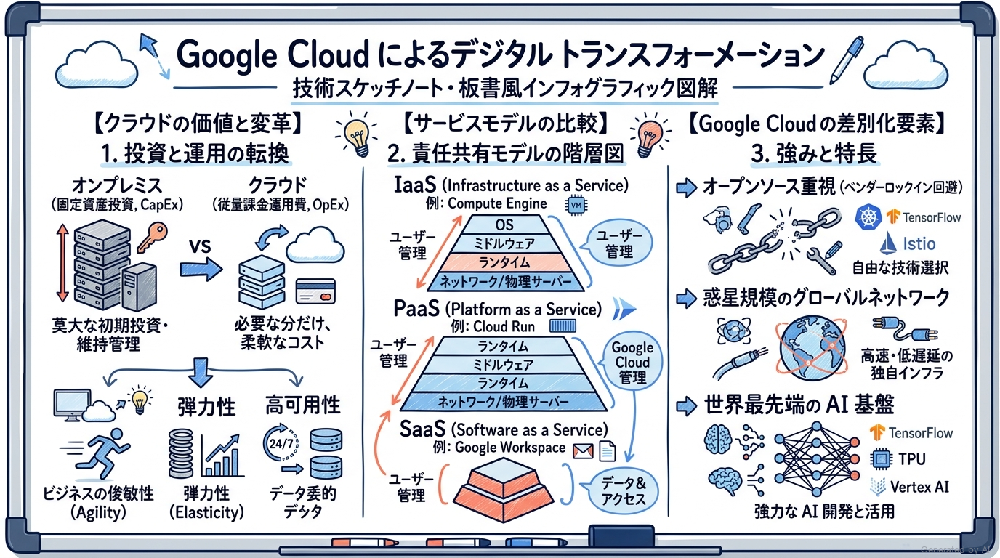
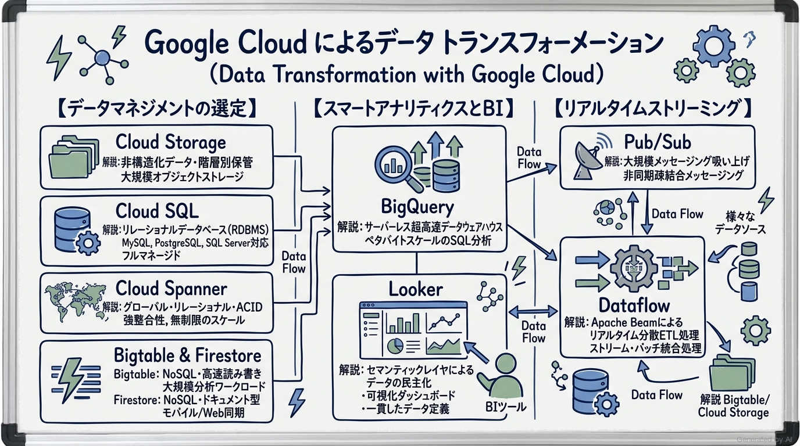
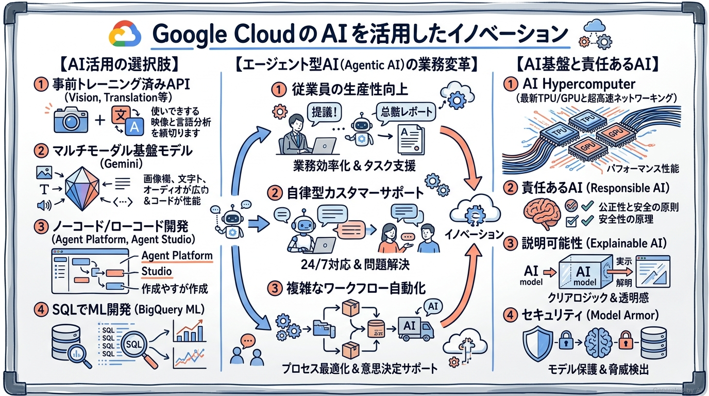
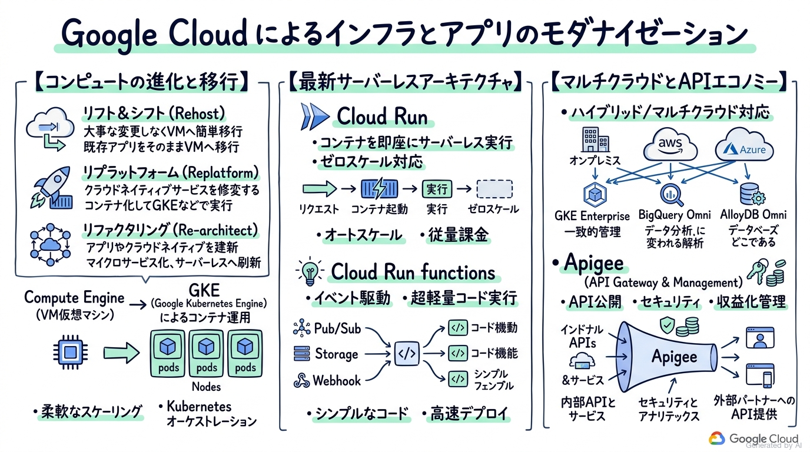
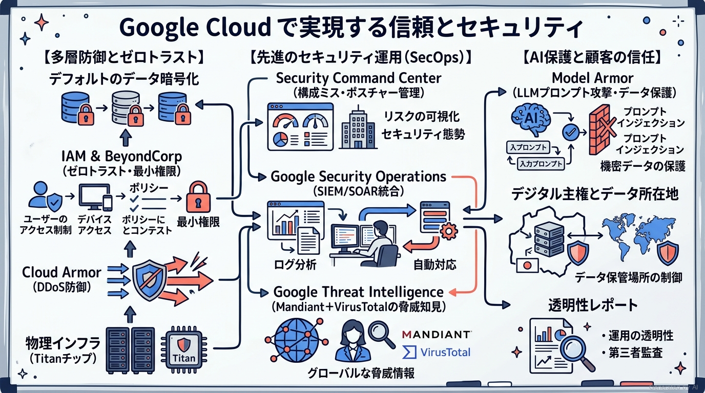
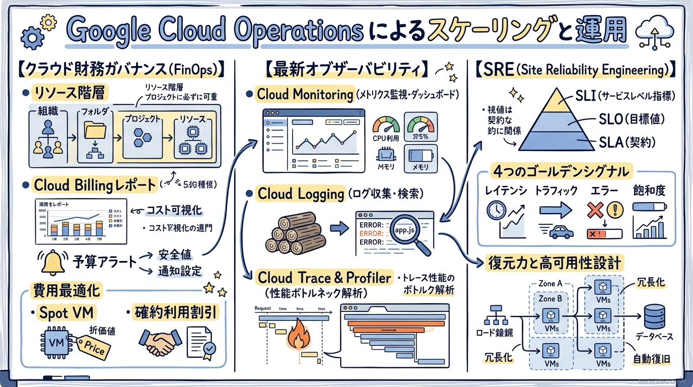

# Google Cloud Certified - Cloud Digital Leader 完全対策＆実践学習ガイド

- **対象資格**: Google Cloud Certified - Cloud Digital Leader
- **公式試験ガイド**: [Cloud Digital Leader 認定試験ガイド (日本語版)](https://services.google.com/fh/files/misc/102926_cloud_digital_leader_exam_guide_japanese.pdf?hl=ja)
- **最終更新日**: 2026-10-12

---

## はじめに

現代のビジネス環境において、デジタルトランスフォーメーション（DX）とクラウドテクノロジーの導入は、単なるITコストの削減にとどまらず、企業の競争優位性とイノベーション創出の命運を分けるコア戦略となっています。特に生成AI（Generative AI）や自律型エージェント（Agentic AI）の急速な台頭に伴い、ビジネスリーダーや技術推進者には「最新のクラウドとAIが自社のビジネスプロセスや価値提供モデルをどのように変革できるか」を正確に理解し、戦略的な意思決定を主導する能力が求められています。

Google Cloud Certified - Cloud Digital Leader は、技術職・非技術職を問わず、クラウドコンピューティングの本質的な価値提案、Google Cloud の中核的なプロダクト群（データ・AI・インフラ・セキュリティ・運用）のビジネスユースケース、およびデジタル変革を成功に導くための組織・財務・ガバナンス戦略に関する包括的な理解を認定する基礎資格です。

本ガイドは、最新の試験出題範囲に含まれる全6セクションの重要トピック、サービス選定のトレードオフ、「状況・対応・結果・解説」で構成された実践シナリオ、および公式一次ドキュメント・推奨ハンズオン（Google Skills）をセクションごとにカプセル化して記述した完全対策ノートです。

### Cloud Digital Leader 試験とは

Cloud Digital Leader は、Google Cloud に関する基礎知識と、組織のビジネス目標を達成するためにクラウドソリューションをどう選定・適用すべきかを実証するファウンデーショナルレベルの認定資格です。エンジニアやアーキテクトのみならず、経営企画、プロダクトマネージャー、営業、財務、法務、調達担当者など、クラウドを活用したビジネス変革に関わるすべてのビジネスパーソンに推奨されます。

- **試験時間**: 90 分
- **出題問題数**: 50〜60 問
- **出題形式**: 択一選択問題（4肢中1つ選択）、複数選択問題（5肢以上中2つ以上選択）
- **合否判定**: 合格 / 不合格（スケールドスコアや正答率は非開示）
- **前提知識**: クラウドコンピューティングの基本概念、企業のデジタルトランスフォーメーションの課題と動機、Google Cloud プロダクトの基本的なユースケースに関する理解が推奨されます。コーディング、詳細なコマンドライン操作、複雑なネットワークパラメータ設計などは試験範囲外です。

### 難易度と求められる思考力

当試験の難易度は **ファウンデーショナル（基礎レベル・概念理解とビジネス適合性判断重視）** に位置づけられます。

アソシエイトやプロフェッショナル試験のような詳細な `gcloud` コマンド構文や障害解析手順は問われませんが、単なるサービス名称や略語の丸暗記では合格できません。「なぜ固定資産投資（CapEx）から変動運用費（OpEx）への転換がアジリティをもたらすのか」「非構造化データの大規模保管に Cloud Storage を選び、グローバル強整合性が必要な決済データに Cloud Spanner を選ぶ理由は何か」「自社独自データを活用してローコードでエージェントを構築する際に Agent Studio がなぜ最適なのか」「Google の多層防御やゼロトラスト（BeyondCorp）がランサムウェア対策にどう寄与するのか」といった、**具体的なビジネス課題に対して最適なクラウド/AIサービスを論理的に選定できる判断力** が問われます。

特に、以下の基本思想を深く腹落ちさせておくことが極めて重要です：
1. **クラウドらしさ（Cloud Native）とアジリティの追求**: ハードウェア調達やキャパシティ予測の制約を排し、従量課金とオートスケーリングでビジネスの検証サイクルを極小化する発想
2. **オープン性と相互運用性の尊重**: オープンソース（Kubernetes, Apache Spark, TensorFlow 等）やオープンAPI（Apigee）を基盤とすることで、ベンダーロックインを回避しハイブリッド/マルチクラウド展開を可能にする哲学
3. **データドリブンと AI ファーストの融合**: 単なるデータ蓄積にとどまらず、BigQuery や Agent Platform（Gemini）を連携させて全社的なデータ民主化と自律型業務自動化を実現する思想
4. **Google 責任共有モデルとデフォルトセキュリティ**: インフラの物理層からハードウェア（Titan）、通信暗号化、AIモデル防御（Model Armor）までを Google が堅牢に保護し、利用者がアクセス権やデータ管理に集中できる多層防御の構造

### 推奨の勉強法

1. **公式一次ドキュメントと基本概念の精読**
   各セクション末尾に掲載している Google Cloud 公式ドキュメントの「概要」「ソリューションガイド」「アーキテクチャフレームワーク」に目を通します。特に「IaaS / PaaS / SaaS の責任分担」「Cloud Storage のストレージクラス」「BigQuery と Looker の役割」「責任共有モデル」「リソース階層（組織・フォルダ・プロジェクト）」は頻出です。
2. **Google Skills による実機ハンズオン体験**
   [Google Skills 公式学習ポータル](https://www.skills.google/?locale=ja) の学習パス（Cloud Digital Leader ラーニングパス）を活用し、コンソール画面でのプロジェクト作成、Cloud Storage バケット作成、Compute Engine インスタンスの起動、BigQuery での公開データセットクエリ実行などを実際に体験します。実機を一度触ることで、抽象的な概念が一気に具体化します。
3. **実践シナリオ（状況・対応・結果・解説）による意思決定プロセスの追体験**
   本ガイドに収録した全36件の実践シナリオにおいて、特に **解説（なぜ他の有力代替案では不適格なのか）** を熟読してください。試験で出題される「もっともらしい誤答選択肢」を瞬時に見抜き、正解を導くための論理的思考力が身につきます。

---

## 目次

1. [はじめに](#はじめに)
2. [学習カリキュラム・出題範囲ロードマップ](#学習カリキュラム出題範囲ロードマップ)
3. [Section 1: Google Cloud によるデジタル トランスフォーメーション (約18%)](#section-1-google-cloud-によるデジタル-トランスフォーメーション-約18)
4. [Section 2: Google Cloud によるデータ トランスフォーメーションの探求 (約18%)](#section-2-google-cloud-によるデータ-トランスフォーメーションの探求-約18)
5. [Section 3: Google Cloud の AI を活用したイノベーション (約18%)](#section-3-google-cloud-の-ai-を活用したイノベーション-約18)
6. [Section 4: Google Cloud によるインフラストラクチャとアプリケーションのモダナイゼーション (約18%)](#section-4-google-cloud-によるインフラストラクチャとアプリケーションのモダナイゼーション-約18)
7. [Section 5: Google Cloud で実現する信頼とセキュリティ (約18%)](#section-5-google-cloud-で実現する信頼とセキュリティ-約18)
8. [Section 6: Google Cloud Operations を使用したスケーリング (約10%)](#section-6-google-cloud-operations-を使用したスケーリング-約10)
9. [まとめと推奨学習ステップ](#まとめと推奨学習ステップ)

---

## 学習カリキュラム・出題範囲ロードマップ

### セクション一覧と出題比率

本試験は全6セクションで構成されています。データ、AI、インフラ、セキュリティの主要領域が各約18%と均等に出題され、運用・ガバナンスが約10%を占めます。偏った学習を避け、ビジネス視点と技術選定の双方を網羅することが合格への最短ルートです。

| セクション番号 | セクション名 / 出題分野 | 出題比率 | 主要対象サービス・コンセプト |
| :--- | :--- | :--- | :--- |
| **Section 1** | Google Cloud によるデジタル トランスフォーメーション | 約 18% | クラウドの価値（CapEx to OpEx、Agility、Elasticity）、IaaS/PaaS/SaaS、オープン標準、AI Hypercomputer、グローバルネットワーク |
| **Section 2** | Google Cloud によるデータ トランスフォーメーションの探求 | 約 18% | Cloud Storage（階層）、Cloud SQL、Cloud Spanner、Bigtable、Firestore、BigQuery、Looker、Pub/Sub、Dataflow |
| **Section 3** | Google Cloud の AI を活用したイノベーション | 約 18% | Gemini、Agent Platform（Agent Studio）、事前トレーニング済みAPI、BigQuery ML、AI Hypercomputer、責任あるAI |
| **Section 4** | Google Cloud によるインフラストラクチャとアプリケーションのモダナイゼーション | 約 18% | 移行戦略（7R: Rehost/Replatform/Refactor）、Compute Engine、GKE、Cloud Run、Cloud Run functions、Apigee、マルチクラウド |
| **Section 5** | Google Cloud で実現する信頼とセキュリティ | 約 18% | 責任共有モデル、多層防御、ゼロトラスト、IAM、Cloud Armor、Security Command Center、Google Security Operations、Google Threat Intelligence、Model Armor |
| **Section 6** | Google Cloud Operations を使用したスケーリング | 約 10% | リソース階層、Cloud Billing レポート、予算アラート、Spot VM、Cloud Monitoring、Cloud Logging、SRE（SLI/SLO/SLA） |

---

## Section 1: Google Cloud によるデジタル トランスフォーメーション (約18%)

企業のデジタルトランスフォーメーション（DX）は、既存プロセスの単なるデジタル化（Digitization）にとどまらず、クラウドの俊敏性とデータ/AIを活用してビジネスモデルそのものを再創造する取り組みです。本セクションでは、オンプレミスとクラウドの根本的な価値の違い、クラウドアーキテクチャの種別、サービスモデル（IaaS/PaaS/SaaS）の責任境界、および Google Cloud の核となる差別化要因について学習します。



---

### 1. セクション概要

クラウドコンピューティングの本質は、「ITリソースの調達と運用の制約からビジネスを解放すること」にあります。オンプレミス環境では、数ヶ月前からのハードウェア発注、データセンターの電源・空調確保、ピーク需要を想定した過剰プロビジョニングが必要でした。クラウドへの移行により、組織は数分で世界中のインフラを調達し、ビジネスの需要に合わせて弾力的に増減させることが可能になります。

#### 重要キーワード

- **固定資産投資（CapEx）から運用費用（OpEx）への転換**: 事前の大規模なデータセンター建設やサーバー購入（Capital Expenditure）を不要とし、実際に利用した分だけを月々の運用費用（Operational Expenditure）として計上する財務モデル。
- **ビジネスのアジリティ（俊敏性: Agility）**: 新しいアイデアのPoC（概念実証）や新機能のリリースを数ヶ月単位から数日・数時間単位へと短縮し、市場変化や顧客フィードバックに迅速に適応する組織能力。
- **伸縮性（弾力性: Elasticity）**: 需要の急増（セール、バズ等）に合わせて自動でスケールアウトし、需要低下時には自動でスケールインして無駄な費用発生を防ぐ動的なリソース調整力。
- **高可用性（High Availability: HA）**: ハードウェア障害やネットワーク断が発生しても、冗長構成と自動フェイルオーバーによりサービスの中断を最小化して稼働を継続する能力。
- **オープンソースとオープン標準**: Kubernetes、TensorFlow、Apache Beam などオープンソース技術を中核に据え、特定のクラウドベンダーへの囲い込み（ベンダーロックイン）を防止する思想。
- **IaaS（Infrastructure as a Service）**: 仮想マシン（Compute Engine）、ストレージ、仮想ネットワークなどの基本インフラを提供するモデル。OSやミドルウェアの運用責任はユーザーが負う。
- **PaaS（Platform as a Service）**: アプリケーション実行環境（Cloud Run、App Engine）を提供するモデル。OSやインフラ管理はクラウドベンダーが担当し、ユーザーはコードとデータのみに集中する。
- **SaaS（Software as a Service）**: 完成されたソフトウェアアプリケーション（Google Workspace 等）をインターネット経由で提供するモデル。ユーザーはインフラやコードを一切管理せず設定とデータのみを管理する。
- **Google グローバルプライベートネットワーク**: Google が全世界に独自敷設した海底ケーブルと光ファイバー網により、パブリックインターネットを経由せず超低レイテンシ・高セキュリティでデータを通信する専用ネットワークインフラ。
- **リージョン（Region）とゾーン（Zone）**: リージョンは独立した地理的エリア（例: 東京、大阪）。各リージョン内に複数の独立した障害分離区画であるゾーン（Zone）が存在し、マルチゾーン構成によって局所的な障害からシステムを保護する。

---

### 2. 重要トピック

#### 1. オンプレミスとクラウドの比較：なぜクラウドが選ばれるのか

従来のオンプレミスインフラにおける最大の課題は、「将来のピーク需要を予測して事前に巨額の設備投資を行わなければならない（キャパシティプランニングのジレンマ）」点にありました。過大投資は資金の固定化と遊休リソースの浪費を生み、過小投資はサービスダウンによる機会損失と顧客離れを招きます。

クラウドへの移行は、このジレンマを完全に解消します：
- **従量課金（Pay-as-you-go）**: 使った分だけ支払うため、小規模な実験が極めて低リスクで開始可能。
- **グローバル展開の即時性**: 世界中のリージョンに数分でアプリケーションを展開し、世界中のエンドユーザーに低レイテンシでサービスを提供。
- **イノベーションへの集中**: 物理サーバーの保守、故障ディスクの交換、空調管理などの「差別化につながらない重労働（Undifferentiated Heavy Lifting）」を Google に委託し、自社のコアビジネス開発に人的リソースを集中。

#### 2. クラウドサービスモデル（IaaS / PaaS / SaaS）の選択基準

クラウドの導入にあたっては、自社の要件や保有スキルに応じた適切なサービスモデルの選定が不可欠です。

| サービスモデル | 概要 | Google Cloud の代表例 | ユーザーの管理範囲 | 最適なユースケース |
| :--- | :--- | :--- | :--- | :--- |
| **IaaS** | 仮想マシンや仮想ネットワークの提供 | Compute Engine, Cloud Storage, VPC | OS、パッチ適用、ミドルウェア、アプリ、データ | レガシーOSの互換性が必要なシステム、既存VMのリフト＆シフト |
| **PaaS** | アプリ実行環境と自動運用の提供 | Cloud Run, App Engine | アプリケーションコード、データ、設定 | Webアプリ開発、APIバックエンド、開発速度を最優先する新規開発 |
| **SaaS** | 完成したビジネスアプリの提供 | Google Workspace (Gmail, Drive 等) | ユーザー設定、アクセス権、入力データ | 社内コミュニケーション、ドキュメント共同編集、業務標準化 |

> **自分の言葉で説明できるか？**:
> 「IaaS から PaaS、SaaS に進むにつれて、自社の自由度（カスタマイズ性）は下がる一方で、運用保守の手間が削減され、ビジネス価値の創出速度が上がる」というトレードオフを説明できるでしょうか？

#### 3. Google Cloud の核となる差別化要因

試験において、Google Cloud が他社パブリッククラウドと一線を画す強みとして以下の3点が頻出します：
1. **世界をリードする AI 基盤（AI-First）**: 検索やYouTubeを支えてきた深層学習基盤、自社製プロセッサ TPU（Tensor Processing Unit）と GPU を統合した **AI Hypercomputer**、最新のマルチモーダル基盤モデル **Gemini** を提供。
2. **オープン性と相互運用性（Open Cloud）**: Kubernetes、Istio、Apache Beam などのエコシステムをGoogleが主導・寄贈した歴史があり、特定のベンダーに縛られずオンプレミスや他社クラウドと自由に連携可能（マルチクラウド対応）。
3. **惑星規模の専用グローバルネットワーク**: 世界最先端の専用光ファイバーネットワーク網を保有。ユーザーのリクエストは最寄りのエッジロケーション（Point of Presence）からGoogleの高速プライベート網に入り、パブリックインターネットの混雑や盗聴リスクを回避して処理される。

---

### 3. 実践シナリオ

#### シナリオ 1: 新規Webサービスのインフラ投資における財務最適化
- **状況**: スタートアップ企業が新規ECサイトを立ち上げるにあたり、将来のトラフィック予測が困難であり、初期の資金調達額も限られているため、多額のハードウェア事前購入を回避したい場合
- **対応**: Google Cloud の従量課金制（OpExモデル）を採用し、オートスケーリングが組み込まれたマネージドサービスを用いて最小構成でサービスを開始する。
- **結果**: 初期設備投資（CapEx）をゼロに抑え、実際の売上やアクセス数の増加に連動してインフラ費用を支払う柔軟な財務構造が実現される。
- **解説**: オンプレミス環境で物理サーバーを購入すると多額のCapExが発生し、需要予測が外れた場合の財務リスクが極めて高くなります。クラウドのOpExモデルを採用することで、使った分だけ支払う従量課金により資本効率を最大化できるためです。
- **参考ドキュメント**:
  - [Google Cloud の料金の仕組み](https://cloud.google.com/pricing): 従量課金とコスト削減の基本原則

#### シナリオ 2: レガシー業務システムのクラウド移行モデル選定
- **状況**: 企業が社内で稼働中の業務基盤をクラウドへ移行する際、特定のOSバージョンおよびカスタムドライバに強く依存しており、アプリケーションコードの修正が即座には行えない場合
- **対応**: IaaS モデルである Compute Engine を選定し、既存の仮想マシン構成をそのままクラウド上の仮想マシンへリフト＆シフトする。
- **結果**: アプリケーションコードの再改修を行うことなく、オンプレミスと同等のOS制御権とカスタマイズ性を維持したまま移行が完了する。
- **解説**: PaaS（Cloud Run等）やSaaSはOSやインフラ層が抽象化されているためレガシーOS固有の依存関係を直接動かすことは困難ですが、IaaSであればOS以上のレイヤを組織が完全に制御できるためです。
- **参考ドキュメント**:
  - [Compute Engine の概要](https://docs.cloud.google.com/compute/docs): IaaS による仮想マシンの展開と柔軟な構成

#### シナリオ 3: 開発部門の運用負荷軽減とタイムトゥマーケット短縮
- **状況**: Webサービス企業において、開発チームがサーバーのOSパッチ適用やキャパシティ増強などのインフラ保守作業に追われ、新機能のリリース速度が著しく低下している場合
- **対応**: アプリケーションの実行環境を PaaS（Cloud Run）へ移行し、コンテナイメージをデプロイするだけで自動スケーリングとインフラ管理がGoogleにより行われる構成にする。
- **結果**: 開発者はサーバー管理業務から完全に解放され、新機能の開発とビジネスロジックの改善に専念できるようになる。
- **解説**: IaaS では仮想マシンのOS更新やスケーリング設計を自社で運用し続ける必要がありますが、PaaS を採用すればインフラのプロビジョニングや自動復旧が完全に抽象化され、ビジネス価値の提供スピード（Time-to-Market）を最大化できるためです。
- **参考ドキュメント**:
  - [Cloud Run の概要](https://docs.cloud.google.com/run/docs): フルマネージドなサーバーレス実行環境のメリット

#### シナリオ 4: ベンダーロックイン回避とマルチクラウド戦略の推進
- **状況**: 金融機関がクラウド導入を検討するにあたり、特定のクラウドベンダーへの過度な依存によるロックインリスクを回避し、将来的に他社クラウドやオンプレミスへのワークロード移行余地を確保したい場合
- **対応**: Kubernetes やオープンコンテナ標準に準拠した Google Kubernetes Engine (GKE) を採用し、オープンソース技術を中心としたポータブルなシステム構成を設計する。
- **結果**: クラウド固有のプロプライエタリな仕様に縛られず、同一のコンテナ定義を用いてマルチクラウドやハイブリッドクラウド間でワークロードを柔軟に移動できる柔軟性が確保される。
- **解説**: Google Cloud はオープンソースとオープン標準への深いコミットメントを持っており、Kubernetes や Apache Spark 等のオープン技術を基盤としたマネージドサービスを提供しているため、他環境への可搬性を維持しながら最新クラウドの恩恵を享受できるためです。
- **参考ドキュメント**:
  - [オープンクラウドへの取り組み](https://cloud.google.com/solutions/modern-infrastructure): オープンソースと相互運用性のビジネス価値

#### シナリオ 5: グローバル展開におけるレイテンシ短縮とネットワーク信頼性確保
- **状況**: 海外展開を進めるメディア企業が、世界各地のエンドユーザーに対して動画やリッチコンテンツを配信する際、パブリックインターネットの混雑による遅延やパケットロスを抑制したい場合
- **対応**: Google Cloud のグローバルプライベートネットワークと Cloud CDN を活用し、最寄りのエッジロケーションからGoogle専用網へトラフィックを引き込む構成を採用する。
- **結果**: エンドユーザーの通信が混雑したパブリックインターネットを通る距離が最小化され、高品質・低レイテンシで安定したグローバル通信が実現される。
- **解説**: 一般的なパブリックインターネット通信は多数のISPを経由するため遅延やルーティングの不安定性が生じますが、Google Cloud は世界中に張り巡らされた独自の海底ケーブル・専用光ファイバー網により、トラフィックをプライベートかつ高速に自社インフラ内へルーティングできるためです。
- **参考ドキュメント**:
  - [Google のグローバル ネットワークの概要](https://cloud.google.com/about/locations): 高速・高信頼な専用インフラ構造

---

### 4. 参考ドキュメント & 推奨ハンズオン

#### 公式一次ドキュメント
- [Google Cloud の概要と基本原則](https://docs.cloud.google.com/docs/overview)
- [クラウド導入フレームワーク (Cloud Adoption Framework)](https://cloud.google.com/adoption-framework)
- [Google Cloud のインフラストラクチャ拠点 (Regions & Zones)](https://cloud.google.com/about/locations)

#### 推奨ハンズオン・ラボ（実機検証）
- [Google Skills 公式学習ポータル](https://www.skills.google/?locale=ja)
- [Cloud Digital Leader ラーニングパス](https://www.skills.google/paths/9)
- [Google Cloud コンソールのツアー](https://www.skills.google/focuses/2794?parent=catalog)
- [Compute Engine による最初の仮想マシンの作成](https://www.skills.google/focuses/3563?parent=catalog)

---

## Section 2: Google Cloud によるデータ トランスフォーメーションの探求 (約18%)

データは、デジタルトランスフォーメーションおよびAIイノベーションを成功させるための「燃料」です。本セクションでは、組織におけるデータライフサイクル、データベース/データウェアハウス/データレイクの違い、構造化・非構造化データに応じた最適なデータマネジメントサービスの選定、ならびに BigQuery と Looker を活用したリアルタイム分析とデータの民主化について学習します。



---

### 1. セクション概要

現代の企業が直面する最大の課題の一つが「データサイロ（部門ごとにデータが分断され統合活用できない状態）」です。Google Cloud のデータプラットフォームは、非構造化ファイルから構造化トランザクションデータ、さらにはペタバイト規模の分析ログまでをシームレスに統合し、組織全体の意思決定をリアルタイムに加速します。

#### 重要キーワード

- **データサプライチェーン**: データの生成（IoT、アプリ）→ 収集（Pub/Sub）→ 処理・変換（Dataflow）→ 保存（Cloud Storage、BigQuery）→ 分析・可視化（Looker）→ アクションへの展開という一連のエンドツーエンドの流れ。
- **構造化データ / 半構造化データ / 非構造化データ**:
  - **構造化**: 表形式（行と列）で厳密にスキーマが定義されたデータ（RDBMSデータ等）。
  - **半構造化**: JSON、XML のように柔軟な階層構造を持つデータ。
  - **非構造化**: スキーマを持たない画像、動画、音声、PDF、テキスト文書などのデータ。
- **データベース vs データウェアハウス vs データレイク**:
  - **データベース（OLTP）**: 日常の業務トランザクション（受発注、残高更新）を高速かつ高頻度に読み書きするシステム。
  - **データウェアハウス（OLAP）**: 意思決定支援のために、複数システムの構造化データを統合し、大規模な集計・分析クエリを高速実行するシステム（BigQuery）。
  - **データレイク**: 生のデータ（非構造化データを含む）を変換せずにそのまま安価に蓄積する大容量ストレージ基盤（Cloud Storage）。
- **Cloud Storage**: ペタバイト規模の非構造化オブジェクトデータを安全かつ高い耐久性（99.999999999% = 11本の9）で保管するフルマネージドストレージ。
- **ストレージクラス（Storage Classes）**: アクセス頻度に応じてコストを最適化する保管階層。Standard（高頻度）、Nearline（月1回未満）、Coldline（四半期1回未満）、Archive（年1回未満・長期保管）、Autoclass（アクセス頻度に応じた自動階層移動）。
- **Cloud SQL**: MySQL、PostgreSQL、SQL Server に対応したフルマネージドリレーショナルデータベース。パッチ適用、自動バックアップ、フェイルオーバーを提供。
- **Cloud Spanner**: リレーショナルデータベースの厳格なACIDトランザクション整合性と、NoSQLのグローバルな水平スケーラビリティを世界で初めて両立したエンタープライズ向けDB。
- **Cloud Bigtable**: ペタバイト規模の超低レイテンシ（数ミリ秒未満）な書き込み・読み込みに最適化された、NoSQLワイドカラム型データベース（IoT、金融取引履歴、時系列データ等）。
- **Firestore**: Webおよびモバイルアプリケーション向けにリアルタイムデータ同期とオフラインアクセス機能を提供する、サーバーレスNoSQLドキュメントデータベース。
- **BigQuery**: インフラ管理不要のサーバーレス型エンタープライズデータウェアハウス。ペタバイト規模のデータを標準SQLで数秒〜数十秒でスキャン・分析可能。
- **Looker**: セマンティックレイヤ（LookML）によって組織全体で一貫したデータ定義（ビジネス指標）を共有し、誰もが信頼できるダッシュボードを作成できる次世代BIプラットフォーム。
- **Pub/Sub と Dataflow**:
  - **Pub/Sub**: 世界規模で秒間数億件のイベントメッセージを非同期に疎結合で取り込むグローバルメッセージングサービス。
  - **Dataflow**: Apache Beam をベースとし、ストリーミングデータとバッチデータを統合パイプラインで自動スケーリングしながら処理するマネージドサービス。

---

### 2. 重要トピック

#### 1. データストアの選定基準マトリクス

試験では「ある業務要件に対して、どの Google Cloud ストレージ/データベースを選択すべきか」が頻出します。

| サービス名 | データモデル | 主な特性と強み | 最適なビジネスユースケース |
| :--- | :--- | :--- | :--- |
| **Cloud Storage** | オブジェクト（非構造化） | 11本の9の耐久性、無制限の容量、安価な保管コスト | 画像・動画・バックアップ・データレイク基盤 |
| **Cloud SQL** | リレーショナル（SQL） | MySQL/Postgres/SQL Server 互換、フルマネージド | 一般的な業務アプリ、CMS、単一リージョン規模のRDB |
| **Cloud Spanner** | グローバルリレーショナル | グローバル強整合性、無停止スケール、99.999%のSLA | 世界規模の決済システム、在庫管理、高可用幹幹システム |
| **Cloud Bigtable** | NoSQL（ワイドカラム） | 一貫した一桁ミリ秒の応答性、ペタバイト規模 | IoTセンサーデータ、広告インプレッション、金融時系列 |
| **Firestore** | NoSQL（ドキュメント） | リアルタイム同期、オフラインサポート、サーバーレス | モバイルアプリバックエンド、Webアプリのユーザープロファイル |
| **BigQuery** | データウェアハウス（SQL） | サーバーレス、ペタバイト規模の分析、BigQuery ML | 全社データ分析、BIレポート基盤、アドホッククエリ |

#### 2. Cloud Storage のストレージクラスと Autoclass によるコスト最適化

Cloud Storage はデータのアクセス頻度に応じた階層化が可能です：
- **Standard**: Webサイトの画像配信や頻繁に読み書きされるアクティブデータ。取り出し費用なし。
- **Nearline**: 少なくとも30日以上保管し、月に1回程度アクセスするデータ（月次レポートなど）。
- **Coldline**: 少なくとも90日以上保管し、四半期に1回程度アクセスするデータ（四半期監査バックアップなど）。
- **Archive**: 少なくとも365日以上保管し、滅多にアクセスしない長期保管データ（法的コンプライアンス保管）。保管単価が極めて安価だが取り出しコストが高額。
- **Autoclass**: アクセス頻度の変動を自動検知し、ライフサイクルルールを手動で設定することなくデータを最適なクラスへ自動移行させて保管コストを最小化する機能。

#### 3. BigQuery と Looker による「データの民主化」

従来のBI環境では、部門ごとに異なるスプレッドシートや集計ルールで売上を計算していたため、「経営会議で部門ごとに売上数値が食い違う」という問題が発生していました。
- **Looker のセマンティックモデリング（LookML）**: 「売上高」「アクティブユーザー数」などのビジネス指標の計算ロジックを一元定義。
- **データの民主化**: 専門のデータアナリストでなくても、現場の営業やマーケターが信頼できる同一の定義に基づいてセルフサービスでダッシュボードを作成・探索可能。

---

### 3. 実践シナリオ

#### シナリオ 1: 世界規模のECプラットフォームにおける決済トランザクション基盤
- **状況**: グローバル展開するEC企業が、世界各地のユーザーから毎秒数十万件の決済を受け付け、在庫の二重引き当てを許容せず、厳格なACID特性とダウンタイムなしの水平スケーラビリティが求められる場合
- **対応**: リレーショナルデータベースとして Cloud Spanner を選定し、マルチリージョン構成でインスタンスをプロビジョニングする。
- **結果**: 世界中の拠点から高スループットでトランザクションが処理され、強整合性を維持したまま自動フェイルオーバーと無停止スケールが達成される。
- **解説**: 従来の Cloud SQL では単一リージョンが基本となりグローバル規模の水平スケールと即時同期書き込みに限界があり、NoSQL（BigtableやFirestore）ではリレーショナルな厳格な外部整合性やACID保証を容易に担保できないのに対し、Cloud Spanner は TrueTime API によりグローバル強整合性と無制限の拡張性を両立できるためです。
- **参考ドキュメント**:
  - [Cloud Spanner の概要](https://cloud.google.com/spanner): グローバル強整合性と水平スケーラビリティの仕様

#### シナリオ 2: IoTセンサーから届く毎秒数百万件のログ高速書き込み
- **状況**: 製造業のスマート工場において、世界中の工場に設置された数万台のセンサーから毎秒数百メガバイトの時系列メトリクスが送信され、一桁ミリ秒未満の超低レイテンシで書き込み続ける必要がある場合
- **対応**: データストアとして Cloud Bigtable を選定し、時系列データに最適化した行キー設計でデータをストリーミング取り込みする。
- **結果**: システムがボトルネックを起こすことなくペタバイト規模のデータを安定して受け付け、下流のリアルタイム監視にデータが即座に供給される。
- **解説**: Cloud SQL や Cloud Spanner などのリレーショナルDBでは超大量の単純書き込みに対してコストと接続オーバーヘッドが過大になり、Firestore はドキュメント構造向けで大規模な時系列書き込みには適さないのに対し、Bigtable は大容量NoSQLとして極めて高い書き込みスループットと超低レイテンシを提供する設計になっているためです。
- **参考ドキュメント**:
  - [Cloud Bigtable の概要](https://docs.cloud.google.com/bigtable/docs/overview): 大規模スループットと低レイテンシのユースケース

#### シナリオ 3: ペタバイト規模の全社マーケティング分析とSQL活用
- **状況**: 小売チェーンが数年間蓄積された過去の購買履歴やWebアクセスログ（合計数ペタバイト）を統合し、データアナリストが標準SQLを用いて数秒から数十秒でアドホックな集計クエリを実行したい場合
- **対応**: サーバーレスデータウェアハウスとして BigQuery を採用し、全社のデータを統合して集計・分析を実行する。
- **結果**: サーバーのプロビジョニングやクラスタ管理を一切行うことなく、ペタバイト規模の集計クエリが超高速に完了し、マーケティング施策の意思決定が加速する。
- **解説**: 従来のオンプレミスDWHやRDBでは数ペタバイトの集計時にハードウェアの限界や長時間のバッチ処理待ちが発生しますが、BigQuery はコンピュートとストレージが完全に分離されたサーバーレス構成であり、クエリ実行時に数千台のノードを瞬時に割り当てて超並列分散処理を実行するためです。
- **参考ドキュメント**:
  - [BigQuery の概要](https://docs.cloud.google.com/bigquery/docs/introduction): サーバーレスエンタープライズDWHのアーキテクチャ

#### シナリオ 4: 長期コンプライアンス監査ログの超低コスト保管
- **状況**: 金融機関において、法律上の要件により過去7年分の監査ログファイルを安全に保管する必要があるが、日常的な検索はほぼ発生せず、保管コストを極限まで削減したい場合
- **対応**: Cloud Storage の Archive クラスを選定し、オブジェクトライフサイクル管理を用いて古いログを自動的にアーカイブ保管へ移行する。
- **結果**: 99.999999999% のデータ耐久性を確保しながら、最も安価なGB単価でコンプライアンス要件を満たした長期データ保管が実現される。
- **解説**: Standard や Nearline クラスは頻繁な読み取りを前提として保管単価が高めに設定されていますが、Archive クラスは年1回未満のアクセスを想定した最低料金の保管単価を提供しており、滅多に取り出さない法定保管用途に最も費用対効果が高いためです。
- **参考ドキュメント**:
  - [Cloud Storage ストレージ クラス](https://docs.cloud.google.com/storage/docs/storage-classes): コストとアクセス頻度の比較

#### シナリオ 5: モバイルアプリのオフライン利用とリアルタイム通知同期
- **状況**: フィールドワーク従事者向けのモバイル業務アプリにおいて、通信が途切れる現場でも端末内でデータ入力を継続でき、電波が復旧した際にクラウドおよび他の作業員端末へ自動同期させたい場合
- **対応**: アプリケーションのバックエンドデータベースとして Firestore を採用し、クライアントSDKのオフラインデータ永続化とリアルタイムリスナー機能を有効化する。
- **結果**: オフライン時でも端末ローカルでデータ操作が完結し、オンライン復旧時に競合なくクラウドと全端末間でリアルタイム同期が実行される。
- **解説**: Cloud SQL や BigQuery などの一般的なDBではクライアント端末との直接的なリアルタイムリスナーやオフラインローカルキャッシュ同期機構が組み込まれていませんが、Firestore はモバイル/Web特化のSDKによりオフライン永続化と自動同期を標準でマネージド提供するためです。
- **参考ドキュメント**:
  - [Firestore の概要](https://cloud.google.com/products/firestore): リアルタイム同期とオフライン機能

#### シナリオ 6: 全社統一の重要ビジネス指標定義とダッシュボード共有
- **状況**: 企業内で営業部門と財務部門がそれぞれ独自のスプレッドシートで「売上高」を集計しており、会議ごとに数値が不一致となって意思決定が混乱している場合
- **対応**: Looker を導入し、LookML セマンティックレイヤを用いて「売上高」「顧客獲得単価」などの計算モデルを一元定義した上で全社ダッシュボードを配信する。
- **結果**: どの部門の担当者がダッシュボードを参照・集計しても同一の定義に基づく正確な数値が導き出され、全社で一貫したデータに基づく意思決定が実現される。
- **解説**: 従来型の単なるビジュアライゼーションツールでは各利用者が独自のクエリや計算式を書くため指標の不一致が生じやすいのに対し、Looker はセマンティックモデリング層によりビジネス定義を一元管理し、信頼できる単一の情報源（Single Source of Truth）を担保できるためです。
- **参考ドキュメント**:
  - [Looker の概要](https://docs.cloud.google.com/looker/docs/intro): セマンティックレイヤによるデータの民主化

---

### 4. 参考ドキュメント & 推奨ハンズオン

#### 公式一次ドキュメント
- [Google Cloud データベースの選択ガイド](https://cloud.google.com/products/databases)
- [BigQuery の仕組みと機能](https://docs.cloud.google.com/bigquery/docs)
- [Looker によるビジネスインテリジェンス](https://cloud.google.com/looker)

#### 推奨ハンズオン・ラボ（実機検証）
- [Google Skills 公式学習ポータル](https://www.skills.google/?locale=ja)
- [Cloud Storage の基礎: バケットとオブジェクトの作成](https://www.skills.google/focuses/1760?parent=catalog)
- [BigQuery の基礎: 初めての SQL クエリ実行](https://www.skills.google/focuses/3692?parent=catalog)
- [Cloud SQL for PostgreSQL の起動と接続](https://www.skills.google/)

---

## Section 3: Google Cloud の AI を活用したイノベーション (約18%)

人工知能（AI）と機械学習（ML）、とりわけ生成AI（Generative AI）とエージェント型AI（Agentic AI）は、ビジネスの生産性と顧客体験を抜本的に変革しています。本セクションでは、AI/MLの基本概念とビジネス価値、Google Cloud のAIソリューション階層（事前学習API、基盤モデルGemini、Agent Platform、カスタムML）、AI Hypercomputer によるインフラ基盤、および責任あるAIとAIセキュリティ（Model Armor）について学習します。



---

### 1. セクション概要

現代のAI変革における最大の潮流は、「単なる予測・分類モデル」から「自然言語やマルチモーダル入力を理解し、自律的に判断・行動するエージェント型AI（Agentic AI）」への進化です。Google Cloud は、最先端の自社製基盤モデル（Gemini）、ノーコード/ローコードでAIエージェントを構築できるプラットフォーム（Agent Platform）、そして世界最高峰の計算基盤（AI Hypercomputer）を包括的に提供しています。

#### 重要キーワード

- **AI（人工知能） / ML（機械学習） / 生成AI（Generative AI） / エージェント型AI（Agentic AI）**:
  - **AI**: 人間の知能を模倣する技術全般。
  - **ML**: データからパターンを自動学習し、予測や判断を行う技術。
  - **生成AI**: テキスト、画像、音声、コードなどの新しいコンテンツを自律的に生成する深層学習技術（Gemini等）。
  - **エージェント型AI**: 目標を与えられると、外部ツールやAPIを呼び出し、複数ステップの計画を立てて自律的にタスクを完了する高度なAIシステム。
- **Gemini**: テキスト、コード、画像、音声、動画をネイティブに統合処理できる Google の最先端マルチモーダル基盤モデル。
- **Gemini Enterprise Agent Platform**: 組織が社内データやエンタープライズシステムと連携した自律型AIエージェントを構築・運用・管理するための包括的プラットフォーム。
- **Agent Studio**: Agent Platform 上で、ローコード/ノーコードの直感的なUIを用いて、業務フローに沿ったAIエージェントを設計・テスト・デプロイできる開発ツール。
- **事前トレーニング済みAPI（Pre-trained APIs）**: 自前でモデルを訓練することなく、APIを呼び出すだけで即座に高度なAI機能を利用できるサービス群（Cloud Vision API、Cloud Translation API、Speech-to-Text API 等）。
- **BigQuery ML**: データを外部のML環境に移動することなく、使い慣れた標準SQLクエリだけで機械学習モデルの構築、トレーニング、評価、予測を実行できる機能。
- **AI Hypercomputer**: 高性能プロセッサ（Google TPU、NVIDIA GPU）、超高速ネットワーキング、オープンソフトウェアを統合した、AIの大規模学習・推論に特化したGoogleのスーパーコンピューティングアーキテクチャ。
- **データ品質の 6 大側面**: 高品質なAIの前提となるデータの健全性指標（完全性、一意性、適時性、有効性、精度、整合性）。
- **責任あるAI（Responsible AI）と説明可能なAI（Explainable AI）**:
  - **責任あるAI**: 公平性、プライバシー、安全性、説明責任に関するGoogleのAI原則に基づく倫理的なAI運用方針。
  - **説明可能なAI**: モデルが「なぜその予測・判断を下したのか」の要因や根拠を人間が理解できるように可視化・監査可能にする技術。
- **Model Armor**: 生成AIモデルに対するプロンプトインジェクション攻撃や有害コンテンツの混入、機密データの漏洩をリアルタイムに検知・防御するAI特化型セキュリティ機能。

---

### 2. 重要トピック

#### 1. Google Cloud AI ソリューションの選定階層：開発労力と差別化のトレードオフ

AIソリューションを導入する際、企業は「実装スピード・コスト」と「業務固有の独自性・カスタマイズ度」のバランスを考慮して適切なアプローチを選択します。

```text
┌─────────────────────────────────────────────────────────────┐
│ 【事前トレーニング済み API】（Vision, Translation, Speech 等）  │
│  ・開発労力: 最低（APIコールのみ） / 専門知識: 不要           │
│  ・ユースケース: レシートOCR、多言語翻訳、音声テキスト化       │
├─────────────────────────────────────────────────────────────┤
│ 【基盤モデル ＆ エージェント開発】（Gemini, Agent Studio）   │
│  ・開発労力: 低〜中（プロンプト設計、社内データグラウンディング）│
│  ・ユースケース: 社内ナレッジ検索、カスタマーサポートエージェント│
├─────────────────────────────────────────────────────────────┤
│ 【SQL で完結する機械学習】（BigQuery ML）                     │
│  ・開発労力: 中（SQL構文でモデル定義） / 専門知識: SQLスキル │
│  ・ユースケース: 顧客離脱予測、売上予測、レコメンデーション   │
├─────────────────────────────────────────────────────────────┤
│ 【フルカスタム機械学習】（Vertex AI Custom Training / TPU）   │
│  ・開発労力: 高（Python/TensorFlow/PyTorch） / 専門知識: 必須 │
│  ・ユースケース: 独自アルゴリズム開発、自社専用深層学習モデル │
└─────────────────────────────────────────────────────────────┘
```

#### 2. エージェント型AI（Agentic AI）が変革するビジネスプロセス

従来のチャットボットは「質問に対して事前に登録された定型文や要約を返す（受動的な応答）」にとどまっていました。
対してエージェント型AIは、以下のように「自律的なアクション実行」を行います：
- **社内業務の自動化**: 「明日の出張旅費の精算書を作成して経理システムに申請して」という指示に対し、領収書画像を読み取り（Vision API）、社内規程を確認し（社内データ検索）、ワークフローAPIを呼び出して申請を完了。
- **カスタマーサポートの高度化**: 顧客からの返品要望に対し、注文履歴を確認し、配送業者への集荷依頼を発行し、返金処理まで自律的に完遂。

#### 3. 責任あるAIと Model Armor によるエンタープライズ保護

企業が生成AIを導入する際の最大の懸念は、「幻覚（ハルシネーション）」「機密情報の漏洩」「プロンプトインジェクション攻撃（AIを騙して不正な動作をさせる攻撃）」です。
- **Model Armor**: ユーザーからの入力プロンプトおよびAIからの出力レスポンスをミリ秒単位で検査し、有害表現、個人情報（PII）、敵対的インジェクションをブロック。
- **グラウンディング（Grounding）**: Vertex AI Search や社内データストアと連携し、AIの回答を「自社の検証済み一次情報」に根拠付けることでハルシネーションを大幅に抑制。

---

### 3. 実践シナリオ

#### シナリオ 1: 開発リソースがない状態での多言語OCR自動化
- **状況**: グローバル展開する保険会社が、海外ユーザーから提出される多言語の医療費領収書（画像・PDF）からテキストを抽出し、自社言語へ翻訳したいが、社内に機械学習エンジニアがおらず即座に導入したい場合
- **対応**: 事前トレーニング済みAPIである Cloud Vision API（OCR機能）と Cloud Translation API を組み合わせてシステムを構築する。
- **結果**: モデルの訓練やアルゴリズム設計を一切行うことなく、APIの呼び出しのみで高精度な領収書読み取りと翻訳処理が即座に本番稼働する。
- **解説**: 自前でカスタムモデルを一から開発するには大量の教師データ収集と専門データサイエンティストが必要ですが、Google が数百万枚規模のデータで事前学習済みの Vision / Translation API を利用すれば、最小の開発労力と最短の期間で高品質な機能を実現できるためです。
- **参考ドキュメント**:
  - [Cloud Vision API の概要](https://docs.cloud.google.com/vision/docs): 事前トレーニング済み画像分析機能

#### シナリオ 2: 社内規定やマニュアルに基づく自律型問い合わせエージェントの構築
- **状況**: 大手企業の総務・人事部門において、毎日数百件寄せられる社内手続きや就業規則に関する従業員の問い合わせに対し、社内ドキュメントに基づき自律的に対応・チケット起票を行うAIエージェントを構築したい場合
- **対応**: Gemini Enterprise Agent Platform の Agent Studio を利用し、社内ポータルのドキュメントと連携させたエージェントをノーコード/ローコードで設計する。
- **結果**: 社内規定に忠実にグラウンディングされた正確な回答が24時間提供され、複雑な申請についてはエージェントが自動で社内ワークフローを起票する。
- **解説**: 単なる汎用AIチャットボットでは社内固有のルールに対応できずハルシネーションのリスクがありますが、Agent Studio を用いることで社内ドキュメントへのグラウンディングと外部システム（API）呼び出しを直感的に設定でき、安全かつ実用的な業務エージェントを迅速に構築できるためです。
- **参考ドキュメント**:
  - [Vertex AI Agent Builder の概要](https://docs.cloud.google.com/generative-ai-app-builder/docs): 生成AIエージェントの迅速な構築

#### シナリオ 3: データアナリストによるSQLのみを用いた売上予測モデル開発
- **状況**: 小売企業のデータ分析チームが、BigQuery 内に蓄積された過去の購買データから来月の売上予測モデルを作成したいが、Python や TensorFlow のプログラミングスキルを持つメンバーがいない場合
- **対応**: BigQuery ML を活用し、普段使用している標準 SQL の `CREATE MODEL` 構文を用いて機械学習モデルの訓練と予測を実行する。
- **結果**: データを外部ツールへエクスポートすることなく、SQLクエリのみで高精度な予測モデルが構築され、分析結果が即座にレポートへ反映される。
- **解説**: 通常のML開発ではデータのエクスポート、Python環境の構築、GPUサーバーの手配が必要となりますが、BigQuery ML を用いればデータが保存されているBigQuery内でSQLのみでモデルを完結して訓練・評価できるためです。
- **参考ドキュメント**:
  - [BigQuery ML の概要](https://docs.cloud.google.com/bigquery/docs/bqml-introduction): SQLによる機械学習の民主化

#### シナリオ 4: 大規模生成AIモデルの学習における計算リソースと費用効率最適化
- **状況**: テック企業が独自の超大規模言語モデル（LLM）の事前学習を実施するにあたり、数千基規模のアクセラレータクラスタを必要とし、ネットワークボトルネックによる学習遅延や過大なインフラ費用を防止したい場合
- **対応**: Google Cloud の AI Hypercomputer アーキテクチャを採用し、最新の Google TPU または NVIDIA GPU クラスタと専用の超高速光スイッチネットワークを活用する。
- **結果**: ノード間の通信遅延が極小化されて大規模並列学習が最大のパフォーマンスで実行され、学習完了までの時間と総インフラコストが大幅に圧縮される。
- **解説**: 汎用の仮想マシンクラスタではノード間通信の帯域不足がボトルネックとなりGPU/TPUの稼働率が低下しますが、AI Hypercomputer はハードウェア（TPU/GPU）、最適化された通信ファブリック、クラスタ管理ソフトウェアがAI専用に統合設計されているためです。
- **参考ドキュメント**:
  - [AI Hypercomputer の概要](https://cloud.google.com/ai-hypercomputer): 次世代AIワークロード向け最適化インフラ

#### シナリオ 5: 生成AIアプリケーションにおける敵対的プロンプト攻撃と情報漏洩の防御
- **状況**: 金融機関が一般顧客向けに公開する生成AIアシスタントにおいて、悪意のあるユーザーによるプロンプトインジェクション（制限迂回攻撃）や、個人情報（クレジットカード番号等）の意図しない漏洩を確実に防止したい場合
- **対応**: 生成AIの入力および出力パイプラインに Model Armor を適用し、リアルタイムでのプロンプト検査と機密データフィルタリングを実施する。
- **結果**: 悪意のある攻撃入力や機密情報を含むレスポンスがモデル到達前およびユーザー返却前にミリ秒単位で自動遮断・マスキングされる。
- **解説**: LLM自体のシステムプロンプトによる指示だけでは巧妙な敵対的攻撃を100%防ぐことは困難ですが、Model Armor は専用のセキュリティガードレールとして動作し、入出力を独立して検査・サニタイズすることでエンタープライズグレードの安全性を担保できるためです。
- **参考ドキュメント**:
  - [Model Armor によるモデル保護](https://cloud.google.com/security/products/model-armor): 生成AIの脅威防御と安全性向上

#### シナリオ 6: クレジットカード審査AIにおける判断根拠の透明性担保
- **状況**: 銀行がローンやクレジットカードの審査に機械学習モデルを導入するにあたり、規制当局から「なぜ審査が否決されたのか」の客観的な理由説明（説明責任）を求められている場合
- **対応**: Explainable AI（説明可能なAI）の機能を採用し、各特徴量（年収、勤続年数、過去の支払い実績等）がモデルの予測結果にどれだけ寄与したかを特徴量アトリビューションとして算出・可視化する。
- **結果**: AIのブラックボックス化が解消され、顧客および監査当局に対して法的に妥当な判断理由を開示できるようになる。
- **解説**: 一般的な深層学習モデルは入力から出力までの計算が複雑でブラックボックスになりやすいですが、Explainable AI を用いることで各特徴量の貢献度を定量的に特定でき、コンプライアンス要件と倫理的公正性を満たせるためです。
- **参考ドキュメント**:
  - [Explainable AI の概要](https://docs.cloud.google.com/vertex-ai/docs/explainable-ai/overview): 機械学習モデルの透明性と説明責任

---

### 4. 参考ドキュメント & 推奨ハンズオン

#### 公式一次ドキュメント
- [Google Cloud の AI ソリューション概要](https://cloud.google.com/ai)
- [Google の AI 原則 (Responsible AI)](https://cloud.google.com/responsible-ai)
- [Vertex AI の製品ドキュメント](https://docs.cloud.google.com/gemini-enterprise-agent-platform)

#### 推奨ハンズオン・ラボ（実機検証）
- [Google Skills 公式学習ポータル](https://www.skills.google/?locale=ja)
- [Cloud Vision API: Qwik Start](https://www.skills.google/focuses/1841?parent=catalog)
- [BigQuery ML での機械学習モデルの作成](https://www.skills.google/focuses/2157?parent=catalog)
- [Vertex AI Studio を使ったプロンプトデザイン体験](https://www.skills.google/)

---

## Section 4: Google Cloud によるインフラストラクチャとアプリケーションのモダナイゼーション (約18%)

レガシーなモノリシック（モノリス）システムをクラウド上でモダナイズすることは、開発速度の向上、障害の局所化、およびコスト最適化を実現する鍵です。本セクションでは、クラウド移行戦略（リフト＆シフト、リプラットフォーム、リファクタリング）、仮想マシンからコンテナ・サーバーレスへの進化、ハイブリッド/マルチクラウド展開、および API マネジメント（Apigee）によるビジネスエコノミーの創出について学習します。



---

### 1. セクション概要

インフラとアプリケーションのモダナイゼーションとは、単に物理サーバーをクラウドの仮想マシンに置き換える（リフト＆シフト）だけではありません。アプリケーションを疎結合な「マイクロサービス」へと分解し、コンテナ（GKE）やサーバーレス（Cloud Run）を活用して、必要な時に必要な分だけリソースを消費するクラウドネイティブな構造へ進化させることを意味します。

#### 重要キーワード

- **クラウド移行の 6R / 7R 戦略**:
  - **Rehost（リフト＆シフト）**: アプリケーションを変更せず、既存のVMや物理サーバーをそのままクラウドのVM（Compute Engine）へ移行する手法。最も迅速かつ低リスク。
  - **Replatform（移行と改良）**: コアアーキテクチャは変えずに、一部のコンポーネントのみをクラウドマネージドサービス（例: 自前DBを Cloud SQL へ、VMアプリをコンテナ化して GKE へ）に置き換える手法。
  - **Refactor / Rearchitect（再設計）**: クラウドの利点を最大限に引き出すため、アプリケーションコードやアーキテクチャをマイクロサービスやサーバーレス（Cloud Run）へと全面的に書き換える手法。
  - **Retain（維持）**: 減価償却中や規制上の理由でオンプレミスに残す手法。
  - **Retire（廃止）**: 移行を機に不要なシステムを廃棄する手法。
- **Compute Engine**: 安全でスケーラブルな仮想マシン（VM）をオンデマンドで作成・実行できる Google Cloud の IaaS コアサービス。
- **コンテナ（Containers）とコンテナ化**: アプリケーションコードとそれが動作するために必要なライブラリやランタイムを1つの軽量なパッケージ（Docker等）にまとめる技術。環境の違いによる「開発環境では動いたが本番で動かない」問題を解決する。
- **Google Kubernetes Engine (GKE)**: Google が開発したオープンソースのオーケストレーションツール Kubernetes をエンタープライズ向けにフルマネージドで提供するサービス。多数のコンテナのデプロイ、スケーリング、自動修復を自動化。
- **Cloud Run**: コンテナ化されたアプリケーションをサーバーレスで即座に実行できるフルマネージドコンピューティングプラットフォーム。リクエストが来ない時は「ゼロ」までスケールインし、アクセス急増時には瞬時にスケールアウト。
- **Cloud Run functions (旧 Cloud Functions)**: 特定のイベント（Cloud Storage へのファイル保存、Pub/Sub メッセージ受信、HTTPリクエスト）をトリガーにして、軽量なコードスニペットをサーバーレスで実行するイベント駆動型コンピューティングサービス。
- **Spot VM**: Google Cloud の余剰コンピュートキャパシティを最大91%割引という破格の低価格で利用できる仮想マシン。Googleが必要とした際に最大30秒の通知で停止される可能性があるため、中断耐性のあるバッチ処理や分散学習に最適。
- **マルチクラウドとハイブリッドクラウド**: 複数のクラウド事業者（Google Cloud、AWS、Azure）やオンプレミス環境を併用する形態。ベンダーロックインを回避し、システムの可用性とデータ所在地要件を満たす。
- **GKE Enterprise / BigQuery Omni / AlloyDB Omni**:
  - **GKE Enterprise**: オンプレミスや他社クラウド上のKubernetesクラスタを一元管理する統合プラットフォーム。
  - **BigQuery Omni**: AWS や Azure 上に保存されたデータを移動させることなく、BigQuery のインターフェースからクロス分析を実行できるマルチクラウド分析ツール。
  - **AlloyDB Omni**: 高性能な AlloyDB のデータベースエンジンをオンプレミスや他社クラウドの自前ハードウェア上で実行できるソフトウェアパッケージ。
- **API（Application Programming Interface）**: 異なるソフトウェア同士がデータや機能を安全かつ標準化されたルールで連携・交換するための窓口。
- **Apigee API Management**: APIの設計、セキュリティ保護、トラフィック制御（レート制限）、アナリティクス、およびAPIの収益化（課金機能）を一元管理するエンタープライズ向けAPIマネジメントプラットフォーム。

---

### 2. 重要トピック

#### 1. コンピューティング選択肢の比較：VM vs コンテナ vs サーバーレス

Google Cloud では、運用の抽象度と柔軟性に応じて最適なコンピューティングを選択できます。

| コンピューティング | 代表サービス | 管理の責任範囲 | スケーリング特性 | 最適なユースケース |
| :--- | :--- | :--- | :--- | :--- |
| **仮想マシン (IaaS)** | Compute Engine | OS、ミドルウェア、パッチ、リソースサイジング | 分単位のスケーリング（MIG: マネージドインスタンスグループ） | レガシーアプリ、OSレベルのカスタマイズ、既存VMの移行 |
| **コンテナオーケストレーション** | GKE | クラスタ設定、Pod定義（Autopilotモードならノード管理不要） | 秒〜分単位のスケーリング（Podとノードの自動増減） | 大規模マイクロサービス、複雑なコンテナネットワーク、業界標準K8s |
| **サーバーレスコンテナ** | Cloud Run | アプリケーションコードとコンテナイメージのみ | 秒単位で瞬時にスケール（ゼロスケール対応） | Webアプリ、REST API、マイクロサービス、イベント処理 |
| **イベント駆動サーバーレス** | Cloud Run functions | 関数コードのみ | リクエストごとに瞬時起動 | ファイルアップロード時の画像加工、Webhook受信、軽量自動化 |

#### 2. モダナイゼーションへのステップ（リフト＆シフトからクラウドネイティブへ）

多くの企業は一度にすべてを書き換えるのではなく、段階的なモダナイゼーションを進めます：
1. **ステップ 1（迅速な移行）**: まずは Compute Engine 上へそのまま移行（Rehost: リフト＆シフト）してデータセンターの賃貸契約満了に対応。
2. **ステップ 2（コンテナ化）**: アプリケーションをコンテナ化して GKE や Cloud Run へ移行（Replatform）し、OSパッチやハードウェア管理の負担を削減。
3. **ステップ 3（疎結合化・マイクロサービス）**: 巨大なモノリスアプリを独立した小さなサービス群に分割し、Cloud Run や Pub/Sub で非同期に連携（Refactor）。障害が全体に波及しない回復力の高い構造へ。

#### 3. API のビジネス価値と Apigee による「APIエコノミー」

APIは単なるシステム間連携の技術仕様を超え、**「自社のデータやビジネス資産を社外のパートナーや開発者に提供して新たな収益源を生み出すビジネスチャネル」**へと進化しています。
- **APIの収益化（Monetization）**: 天気情報、決済機能、地図情報、物流APIなどを外部に公開し、呼び出し回数に応じたサブスクリプション課金を実現。
- **Apigee の役割**: 外部からのサイバー攻撃（DDoSや不正アクセス）を防ぎ、開発者向けポータルを提供してAPIの利用状況を可視化。

---

### 3. 実践シナリオ

#### シナリオ 1: データセンター退去期限に合わせた迅速な既存システム移行
- **状況**: 企業が自社データセンターの契約満了まで残り3ヶ月しかなく、稼働中の数百台の仮想マシンをアプリケーションの改修なしに最も迅速かつ安全にクラウドへ移送したい場合
- **対応**: リホスト（リフト＆シフト）戦略を採用し、Compute Engine の仮想マシンインスタンスへ既存VMをそのまま移行する。
- **結果**: アプリケーションの仕様変更や複雑なテスト期間を挟むことなく、契約満了期限内にデータセンターの撤退とクラウド移行が完了する。
- **解説**: リファクタリングやコンテナ化にはコードの修正や十分な検証期間が必要であり期限に間に合わないリスクが高いですが、Compute Engine へのリホストであればOSや構成をそのまま持ち込めるため最短期間・最小リスクで移行できるためです。
- **参考ドキュメント**:
  - [Google Cloud への移行戦略](https://docs.cloud.google.com/architecture/migration-to-gcp-getting-started): リホスト、リプラットフォーム、リファクタリングの判断基準

#### シナリオ 2: アクセス変動が激しいキャンペーン特設サイトのコスト最適化
- **状況**: マーケティング部門が新商品の告知サイトを公開するにあたり、テレビCM放送時には瞬間的に数十万アクセスのスパイクが発生する一方で、夜間や通常時はアクセスがほぼゼロになる場合
- **対応**: アプリケーションをコンテナ化して Cloud Run にデプロイし、自動スケーリングとゼロスケールを有効化する。
- **結果**: アクセス集中時には瞬時にコンテナが増加してリクエストを捌き、アクセスがない時間帯はインスタンス数がゼロに縮小して費用が一切発生しない構成が実現される。
- **解説**: Compute Engine で常時VMを起動しておくとアイドル時にも課金が発生し、GKE の標準クラスタでもノードの最低維持費がかかりますが、Cloud Run はサーバーレスアーキテクチャでありリクエスト処理時間のみの100ミリ秒単位課金と完全なゼロスケールを提供するためです。
- **参考ドキュメント**:
  - [Cloud Run のスケーリング動作](https://docs.cloud.google.com/run/docs/about-instance-autoscaling): ゼロから数千インスタンスへの高速スケール

#### シナリオ 3: 複雑なマイクロサービス群の大規模コンテナオーケストレーション
- **状況**: 大規模オンラインゲーム企業が、50種類以上の独立したマイクロサービス（認証、マッチング、課金、チャット等）で構成されるシステムを運用し、業界標準の Kubernetes ツールチェーンを用いて統合管理したい場合
- **対応**: Google Kubernetes Engine (GKE) を採用し、マルチクラスタおよびネームスペースによるリソース分離と自動修復・自動アップグレードを活用する。
- **結果**: 数百のコンテナポッドが自動的に最適なノードへ配置され、障害発生時にも自動再起動やローリングアップデートが無停止で運用される。
- **解説**: 単一のWebアプリであれば Cloud Run がシンプルですが、複雑なPod間通信、ステートフルセット、高度なネットワークポリシーを伴うエンタープライズ規模のマイクロサービス運用には、Kubernetes のフル機能とGoogleの自動運用が融合した GKE が最も適格であるためです。
- **参考ドキュメント**:
  - [Google Kubernetes Engine の概要](https://docs.cloud.google.com/kubernetes-engine/docs/concepts/kubernetes-engine-overview): エンタープライズK8sの運用管理

#### シナリオ 4: 大規模バッチ画像変換処理における劇的なインフラ費用削減
- **状況**: メディア企業が夜間に毎日数百テラバイトのアーカイブ動画のエンコード処理を実行するにあたり、処理に数時間かかってもよく、途中でインスタンスが中断されても再試行可能な仕組みがあるため、コンピュート費用を極限まで圧縮したい場合
- **対応**: Compute Engine の Spot VM をバッチ処理用クラスタのワーカーノードとして活用する。
- **結果**: 通常のオンデマンド仮想マシンと比較して最大91%の大幅な割引価格でコンピュートリソースを調達し、処理コストを最小化できる。
- **解説**: 通常のオンデマンドVMは可用性が保証される反面定価課金となりますが、Spot VM はGoogle Cloud の余剰リソースを活用する仕組みであり、中断のリスクを受け入れられる耐障害性のあるバッチワークロードにおいて圧倒的な費用削減効果を発揮するためです。
- **参考ドキュメント**:
  - [Spot VM の概要](https://docs.cloud.google.com/compute/docs/instances/spot): 割引率と中断時の動作仕様

#### シナリオ 5: 自社保有データの外部公開とパートナー向けAPI収益化
- **状況**: 物流企業が自社の配送追跡機能やリアルタイム在庫データを外部のEC事業者や配送パートナー向けに安全に公開し、API呼び出し数に応じた課金システムを導入したい場合
- **対応**: Apigee API Management プラットフォームをフロントエンドに導入し、APIプロキシ、セキュリティ認証（OAuth）、レート制限、および収益化（Monetization）ポリシーを設定する。
- **結果**: 内部のバックエンドシステムを直接公開することなく安全に保護しながら、外部パートナー向けの開発者ポータルと従量課金ビジネスが即座に構築される。
- **解説**: 単なるロードバランサやCloud Endpointsでは基本的なルーティングや認証しか行えませんが、Apigee はAPIのライフサイクル管理、高度なアナリティクス、不正利用防止、およびAPIエコノミーを実現するための収益化パッケージを統合して提供するためです。
- **参考ドキュメント**:
  - [Apigee の概要](https://docs.cloud.google.com/apigee/docs/api-platform/get-started/what-apigee): API管理とビジネスエコノミーの創出

#### シナリオ 6: 他社クラウドに保管されたデータのデータ移動なしでのクロス分析
- **状況**: 企業がAWSのS3バケット内に大量の業務ログを保有しており、データのクラウド間転送料金（エグレスコスト）や移行リスクを避けたまま、Google Cloud の BigQuery から直接SQLで横断分析したい場合
- **対応**: BigQuery Omni を導入し、AWS 上に配置されたデータに対して直接 BigQuery の分析エンジンを実行する。
- **結果**: ペタバイト規模のデータを Google Cloud へ物理的にコピー・転送することなく、使い慣れた BigQuery のクエリ操作で安全にマルチクラウド分析が完了する。
- **解説**: 通常の分析では他社クラウドから Google Cloud へデータを転送する必要があり莫大なネットワーク転送料金と時間がかかりますが、BigQuery Omni はBigQueryのクエリ実行エンジン（Borg）を他社クラウドのローカル環境で直接稼働させるため、データ移動なしに分析できるためです。
- **参考ドキュメント**:
  - [BigQuery Omni の概要](https://docs.cloud.google.com/bigquery/docs/omni-introduction): クロスクラウド分析のアーキテクチャ

---

### 4. 参考ドキュメント & 推奨ハンズオン

#### 公式一次ドキュメント
- [Google Cloud のコンピューティング オプションの選択](https://docs.cloud.google.com/compute/docs/overview)
- [GKE (Google Kubernetes Engine) 入門](https://cloud.google.com/kubernetes-engine)
- [Apigee による API ファースト戦略](https://cloud.google.com/apigee)

#### 推奨ハンズオン・ラボ（実機検証）
- [Google Skills 公式学習ポータル](https://www.skills.google/?locale=ja)
- [Cloud Run による初めてのコンテナデプロイ](https://www.skills.google/)
- [Google Kubernetes Engine の基礎: クラスタのデプロイ](https://www.skills.google/focuses/878?parent=catalog)
- [Cloud Run functions: イベント駆動型コードの実行](https://www.skills.google/focuses/916?parent=catalog)

---

## Section 5: Google Cloud で実現する信頼とセキュリティ (約18%)

クラウド導入における最大の意思決定要因であり、同時に最大の懸念事項となるのが「セキュリティ、コンプライアンス、および信頼」です。本セクションでは、サイバーセキュリティの脅威とビジネス影響、責任共有モデル、ゼロトラスト（BeyondCorp）、Googleのカスタムハードウェアからなる多層防御、統合セキュリティ運用（SecOps: Security Command Center、Google Security Operations、Google Threat Intelligence）、AIモデル保護（Model Armor）、およびデジタル主権について学習します。



---

### 1. セクション概要

従来のオンプレミス環境のセキュリティは「境界防御（社内ネットワークと社外インターネットの境界にファイアウォールを置き、内側を無条件に信頼する社内LANモデル）」でした。しかし、リモートワークの普及や高度な標的型攻撃により、境界防御は限界を迎えました。Google Cloud は、社内ネットワークであっても決して暗黙の信頼を置かない「ゼロトラスト」と、ハードウェアからデータまで幾重にも保護する「多層防御（Defense-in-Depth）」により、エンタープライズの信頼を確立しています。

#### 重要キーワード

- **サイバーセキュリティの脅威**:
  - **DDoS（分散型サービス妨害攻撃）**: 大量のトラフィックを浴びせてサービスを停止させる攻撃。
  - **ランサムウェア**: データを勝手に暗号化して身代金を要求する悪意あるソフトウェア。
  - **クリプトマイニング**: 不正アクセスしたクラウドVMを無断で暗号資産の発掘に利用し、多額の請求を発生させる攻撃。
  - **構成ミス（Misconfiguration）**: S3/GCS バケットの公開設定や権限の過剰付与など、人的ミスによる情報漏洩（クラウドインシデントの最大原因）。
  - **LLM攻撃 / プロンプトインジェクション**: 生成AIの入力プロンプトを悪用して内部データやシステム制限を突破する新たなサイバー脅威。
- **責任共有モデル（Shared Responsibility Model）**: クラウドにおけるセキュリティ責任の分担ルール。Google は「クラウド自体のセキュリティ（物理データセンター、ハードウェア、基盤ネットワーク、ハイパーバイザ）」に責任を負い、顧客は「クラウド内のセキュリティ（IAM設定、データ暗号化キー、OSパッチ[IaaSの場合]、アプリケーション）」に責任を負う。
- **CIA の三要素**: 情報セキュリティの基本原則。機密性（Confidentiality: 認可された者だけがアクセス）、完全性（Integrity: 改ざんされない正確性）、可用性（Availability: 必要な時にいつでもアクセス可能）。
- **ゼロトラストアーキテクチャ（Zero Trust / BeyondCorp）**: 「決して信頼せず、常に検証する（Never Trust, Always Verify）」設計思想。ネットワークの場所（社内LANか社外か）に依存せず、ユーザーの本人確認、デバイスの健全性、コンテキストに基づいて都度アクセスを認可する。
- **最小権限の原則（Principle of Least Privilege）**: ユーザーやサービスアカウントに対して、業務遂行に必要な最小限の権限のみを付与し、過剰な権限による事故や侵害被害を最小化する原則。
- **暗号化の 3 つの状態**:
  - **保存時の暗号化（At-rest）**: ディスクやストレージに保存されている状態。Google Cloud ではデフォルトで AES-256 により自動暗号化。
  - **転送中の暗号化（In-transit）**: ネットワークを移動している状態。TLS により通信路上で自動暗号化。
  - **使用中の暗号化（In-use / Confidential Computing）**: CPUやメモリ上で処理されている状態。AMD SEV 等の専用ハードウェアにより、メモリ内のデータすら暗号化したまま演算を実行。
- **Titan セキュリティチップ**: Google がデータセンターのサーバーやストレージ機器向けに自社設計したカスタムハードウェア。起動時のファームウェア改ざんをハードウェアレベルで検証（Secure Boot）。
- **Cloud Armor**: Google のグローバルインフラ上で動作し、DDoS 攻撃の緩和や Web アプリケーションへの攻撃（SQLインジェクション、XSS等）を防ぐ WAF / DDoS 防御サービス。
- **Cloud IAM (Identity and Access Management)**: 「誰（Who）が」「どのリソース（Which Resource）に対して」「どのような操作（What Role）」を行えるかをきめ細かく制御するアクセス管理基盤。
- **Security Command Center (SCC)**: Google Cloud 環境全体のセキュリティリスク、脆弱性、コンプライアンス違反、および設定ミスを一元的に可視化・検出・修復するクラウドセキュリティポスチャー管理（CSPM）プラットフォーム。
- **Google Security Operations (旧 Chronicle)**: ペタバイト規模のセキュリティテレメトリー（ログ）を数秒で検索・分析し、脅威の検出・調査・自動対応（SIEM/SOAR）を一体化してSecOpsを高速化する統合基盤。
- **Google Threat Intelligence**: Google のグローバルな脅威可視性、最前線のインシデント対応専門集団 **Mandiant** のインテリジェンス、および **VirusTotal** のクラウドソース脅威データを統合したプロアクティブな脅威インテリジェンスサービス。
- **デジタル主権（Digital Sovereignty）とデータ所在地（Data Residency）**: 顧客が自社のデータがどの国・地域のデータセンターに保管され、誰がアクセスできるかを法的に制御・検証できる権利。

---

### 2. 重要トピック

#### 1. 責任共有モデルの境界：IaaS / PaaS / SaaS でどう変化するか

試験で最も問われるのが「サービスモデルごとに、ユーザーと Google の責任境界がどこにあるか」です。

```text
┌─────────────────┬─────────────────┬─────────────────┐
│   IaaS の場合   │   PaaS の場合   │   SaaS の場合   │
│ (Compute Engine)│   (Cloud Run)   │(Google Workspace│
├─────────────────┼─────────────────┼─────────────────┤
│ お客様の責任:    │ お客様の責任:    │ お客様の責任:    │
│ ・データ ＆ IAM │ ・データ ＆ IAM │ ・データ ＆ IAM │
│ ・アプリロジック│ ・アプリロジック│ ・アクセス設定  │
│ ・OS / パッチ   │ ────────────────┼─────────────────┤
│ ・ネットワーク設定│ Google の責任:  │ Google の責任:  │
├─────────────────┤ ・OS / パッチ   │ ・OS / パッチ   │
│ Google の責任:  │ ・ランタイム管理│ ・ランタイム管理│
│ ・物理サーバー  │ ・物理サーバー  │ ・アプリケーション│
│ ・データセンター│ ・データセンター│ ・物理サーバー  │
│ ・ハイパーバイザ│ ・ハイパーバイザ│ ・データセンター│
└─────────────────┴─────────────────┴─────────────────┘
```
どのサービスモデルであっても、**「データ自体の所有権・分類、および誰にアクセスを許可するか（IAMとアクセス制御）」はお客様の責任**となります。

#### 2. Google の多層防御（Defense-in-Depth）：Google をセキュリティチームの一員に迎える価値

自社単独で最先端のサイバー攻撃（世界規模のDDoSや国家規模の標的型攻撃）に対抗することは困難です。Google Cloud を採用することは、「数千人の最高峰セキュリティ専門家と数十億ドル規模のインフラ防御を自社のセキュリティチームに迎え入れること」を意味します：
1. **物理層**: 生体認証、監視カメラ、物理破砕によるディスク廃棄、自社製 Titan チップ。
2. **ハードウェア・OS層**: 最小化された独自Linux OS、安全な暗号化ブート。
3. **ネットワーク層**: 専用プライベート網、Cloud Armor によるテラビット規模のDDoS自動吸収。
4. **データ層**: デフォルトの自動暗号化、顧客管理暗号化キー（CMEK）、Confidential VM による使用中暗号化。
5. **運用層**: Mandiant の最前線知見と VirusTotal を統合した Google Threat Intelligence による先回りの脅威検知。

#### 3. ゼロトラスト（BeyondCorp）による境界防御の脱却

社内LANにVPNで接続しているからといって安全と見なす従来の方式では、一度マルウェアがVPN経由で侵入すると社内全体が横展開（ラテラルムーブメント）で侵害されます。
BeyondCorp では：
- 社内・社外を区別せず、すべてのリクエストをインターネット経由として扱う。
- 「ユーザーの本人認証（MFA）」＋「会社支給端末のパッチ適用状態・暗号化状態」＋「アクセス元のコンテキスト」を総合判定して初めてアクセスを認可（Context-Aware Access）。

---

### 3. 実践シナリオ

#### シナリオ 1: クラウドストレージの誤公開による情報漏洩防止と設定ミス検出
- **状況**: エンタープライズ企業において、開発者の誤操作により個人情報を含む Cloud Storage バケットがインターネット全体へ公開設定される事故を未然に検出し、即座に是正したい場合
- **対応**: Security Command Center (SCC) を組織レベルで有効化し、公開バケットの構成ミスアラートおよび自動修復ルールを設定する。
- **結果**: バケットのアクセス権がパブリックに変更された瞬間にリスクとして検知され、セキュリティ管理者に通知されるとともに自動で非公開化される。
- **解説**: クラウド上のインシデントの9割以上はクラウド自体の欠陥ではなくユーザー側の構成ミスに起因するため、SCC のような CSPM（クラウドセキュリティポスチャー管理）ツールを用いて環境全体の不適切な権限付与や脆弱性を継続的に可視化・自動是正することが極めて重要であるためです。
- **参考ドキュメント**:
  - [Security Command Center の概要](https://docs.cloud.google.com/security-command-center/docs/security-command-center-overview): クラウドのポスチャー管理と脅威検出

#### シナリオ 2: 大規模DDoS攻撃およびWeb脆弱性（SQLi/XSS）からのサービス保護
- **状況**: グローバルな金融サービスサイトにおいて、敵対者からの大規模な分散型サービス妨害（DDoS）攻撃や、Webアプリケーションへの不正なSQLインジェクション攻撃からサービスを停止させずに防御したい場合
- **対応**: Cloud Load Balancing の前段に Cloud Armor を配置し、事前定義された WAF ルールセットおよびレート制限ポリシーを適用する。
- **結果**: 悪意のある攻撃トラフィックが Google のグローバルエッジで即座に検知・破棄され、正規のユーザー通信のみがバックエンドサーバーへ安全に到達する。
- **解説**: 自社のバックエンドサーバーやファイアウォールだけでは数十〜数百Gbps規模のDDoS攻撃に耐えきれずダウンしますが、Cloud Armor は Google の巨大なグローバルエッジネットワークのキャパシティを活用してエッジ上で攻撃を吸収・遮断できるためです。
- **参考ドキュメント**:
  - [Cloud Armor の概要](https://docs.cloud.google.com/armor/docs/cloud-armor-overview): DDoS 防御と WAF 機能

#### シナリオ 3: 機密データをメモリ展開した状態（使用中）での計算処理保護
- **状況**: 医療機関が高度な個人ゲノムデータや患者カルテの分析処理をクラウド上で実行するにあたり、厳格な法規制により、保存時や転送時だけでなくメモリ（RAM）上で演算処理されている最中のデータも暗号化したい場合
- **対応**: Compute Engine または GKE において Confidential Computing（Confidential VM）を有効化してワークロードを実行する。
- **結果**: ハードウェアベースの暗号化プロセッサにより、CPUやメモリ上で実行中のデータがリアルタイムに暗号化され、クラウド事業者やハイパーバイザからも閲覧できない状態で演算が完了する。
- **解説**: 通常のクラウド暗号化は保存時（At-rest）と転送時（In-transit）をカバーしますが、Confidential Computing はハードウェア分離技術（AMD SEV等）を用いて「使用中（In-use）」のメモリ空間すら暗号化するため、最高レベルの機密性を担保できるためです。
- **参考ドキュメント**:
  - [Confidential Computing の概要](https://docs.cloud.google.com/confidential-computing/confidential-vm/docs/confidential-vm-overview): 使用中データの暗号化保護

#### シナリオ 4: 社内LANとリモートワークの境界を撤廃したゼロトラストアクセス制御
- **状況**: テレワークを推進する企業において、従来のVPN接続がボトルネックとなって通信速度が低下しており、かつVPN侵入による社内ネットワーク全体の侵害リスクを排除したい場合
- **対応**: BeyondCorp（Identity-Aware Proxy: IAP および Context-Aware Access）を導入し、VPN不要のゼロトラストアクセス環境へ移行する。
- **結果**: 従業員は社内・社外を問わず、本人の認証情報と社用端末のセキュリティ状態が検証された場合にのみ、ブラウザ経由で個別の社内Webアプリへ安全にアクセスできる。
- **解説**: VPNは「一度境界を突破されれば社内の全システムへアクセスできてしまう」という境界防御の根本的リスクを抱えていますが、BeyondCorp によるゼロトラストモデルはアプリケーション単位でコンテキストに応じた厳格な都度認可を行うため、安全で快適なアクセスを実現できるためです。
- **参考ドキュメント**:
  - [BeyondCorp Enterprise の概要](https://docs.cloud.google.com/chrome-enterprise-premium/docs/overview): ゼロトラストセキュリティモデルの実現

#### シナリオ 5: ペタバイト規模のセキュリティログの高速検索と自動対処（SecOps）
- **状況**: エンタープライズ企業のセキュリティ運用センター（SOC）において、全社のサーバー、ファイアウォール、認証ログが膨大すぎて検索に数時間かかり、サイバー攻撃の兆候を見逃すリスクがある場合
- **対応**: Google Security Operations プラットフォームを導入し、全社ログを取り込んで脅威の自動相関分析と自動対応プレイブックを実行する。
- **結果**: 数ペタバイトにおよぶセキュリティログが数秒で検索可能となり、Mandiant の脅威インテリジェンスと照合して攻撃インシデントの検知から隔離対応までの時間が数時間から数分へ短縮される。
- **解説**: 従来のSIEMツールではログ量の増大に伴いライセンス費用が高騰し検索性能が極端に劣化しますが、Google Security Operations はGoogleの検索インフラ技術を活用して超大容量ログを定額で高速分析し、SOARによる自動対処まで統合提供するためです。
- **参考ドキュメント**:
  - [Google Security Operations の概要](https://cloud.google.com/security/products/security-operations): クラウドネイティブな SIEM / SOAR

#### シナリオ 6: 国家規制に基づくデータの物理的保管場所と主権の完全制御
- **状況**: 欧州または日本の公共機関がクラウドを採用するにあたり、法律により「すべてのデータおよび暗号化キーは指定された国内リージョン外へ絶対に移送されてはならない」という要件がある場合
- **対応**: リソースのリージョン制限ポリシー（Organization Policy）を適用し、指定した国内リージョンのみへのリソース作成を強制するとともに、Cloud KMS の外部キーマネジメント（Cloud EKM）を活用する。
- **結果**: データが指定された地理的境界内に厳格に留まり、暗号化キーの完全な所有権を顧客自身が保持することで、各国のデジタル主権および法規制要件が完全に遵守される。
- **解説**: パブリッククラウドの利便性を享受しつつ、組織ポリシーのガードレールとデジタル主権ソリューションを組み合わせることで、法令に反するリージョン外へのデータ複製や第三者アクセスを技術的・法的に完全に遮断できるためです。
- **参考ドキュメント**:
  - [Google Cloud のデジタル主権](https://cloud.google.com/solutions/digital-sovereignty): データ所在地と主権の保護

---

### 4. 参考ドキュメント & 推奨ハンズオン

#### 公式一次ドキュメント
- [Google Cloud セキュリティの概要](https://cloud.google.com/security)
- [Google の責任共有モデル](https://docs.cloud.google.com/architecture/framework/security/shared-responsibility-shared-fate)
- [Google Threat Intelligence の概要](https://cloud.google.com/security/products/threat-intelligence)

#### 推奨ハンズオン・ラボ（実機検証）
- [Google Skills 公式学習ポータル](https://www.skills.google/?locale=ja)
- [Cloud IAM の基礎: ユーザーロールと権限の管理](https://www.skills.google/)
- [Cloud Armor による DDoS 防御とレート制限の構成](https://www.skills.google/focuses/1231?parent=catalog)
- [Security Command Center によるリスク検出体験](https://www.skills.google/)

---

## Section 6: Google Cloud Operations を使用したスケーリング (約10%)

クラウドの導入を成功させ、長期的なビジネス価値を持続させるためには、「財務管理（FinOps）」と「システムの信頼性・運用性（SRE / オブザーバビリティ）」の両輪が不可欠です。本セクションでは、クラウド財務ガバナンス（CapEx から OpEx、TCO、リソース階層、請求レポート、予算アラート、Spot VM）、フルスタックオブザーバビリティ（Cloud Monitoring、Logging、Trace、Profiler）、およびサイト信頼性エンジニアリング（SRE: SLI/SLO/SLA、エラーバジェット、ゴールデンシグナル）について学習します。



---

### 1. セクション概要

クラウド移行後に多くの企業が直面するのが「予期せぬ費用の急増（請求ショック）」と「運用のブラックボックス化」です。Google Cloud Operations は、リソース階層によるアクセスと費用の明確な分離、リアルタイムな費用監視ツール、そして Google が自ら実践してきた信頼性工学（Site Reliability Engineering: SRE）のメソドロジーを提供し、組織が持続可能かつ健全にスケールすることを支援します。

#### 重要キーワード

- **クラウドエコノミクスと総所有コスト（TCO）**: クラウドのコストは単なるサーバー利用料の比較ではなく、物理設備、電気代、冷却設備、ハードウェア保守要員、調達の機会損失などを含めた総所有コスト（Total Cost of Ownership）全体で評価・最適化する必要があるという考え方。
- **Google Cloud のリソース階層（Resource Hierarchy）**:
  - **組織ノード（Organization）**: 会社全体の最上位ルート。ドメインと紐付き、全社共通のポリシーを統制。
  - **フォルダ（Folder）**: 部門（開発部、営業部等）や環境（本番、ステージング、開発）ごとにリソースをグルーピングする単位。
  - **プロジェクト（Project）**: すべてのリソース（VM、DB、バケット等）が必ず所属する基本単位。課金とアクセスの境界。
  - **リソース（Resource）**: 実際に作成された個別のコンポーネント（Compute Engine インスタンス等）。
- **ポリシーの継承と伝播**: 上位階層（組織・フォルダ）で設定された IAM 権限や組織ポリシー（例: 「特定リージョン以外でのリソース作成禁止」）は、下位階層（子フォルダ・プロジェクト）へ自動的に継承され、下位でこれを緩めることはできない。
- **Cloud Billing レポートと予算アラート**:
  - **Cloud Billing レポート**: プロジェクト別、サービス別、ラベル（タグ）別に日次・月次の利用額の推移をグラフィカルに可視化・分析するツール。
  - **予算アラート（Budget Alerts）**: 設定した予算額（または予測額）に対して、一定のしきい値（50%、90%、100%等）に達した際にメールやチャットへ自動通知を送信する機能（デフォルトではリソースの自動停止は行われない点に注意）。
- **確約利用割引（Committed Use Discounts: CUD）**: 1年または3年の継続利用をコミットすることで、オンデマンド料金から大幅な割引（最大70%程度）を受けられる割引制度。
- **Dynamic Workload Scheduler**: AI学習などの大規模バッチワークロードにおいて、GPUなどのリソースを必要な期間だけ経済的にスケジュール確保して実行する機能。
- **オブザーバビリティ（Observability: 可観測性）**:
  - **Cloud Monitoring**: クラウドおよびアプリケーションのメトリクス（CPU使用率、メモリ、レイテンシ等）を収集し、リアルタイムダッシュボードやアラート通知を提供。
  - **Cloud Logging**: アプリケーションログ、システムログ、監査ログを一元的に収集・検索・長期保管するフルマネージドログ基盤。
  - **Cloud Trace**: 分散マイクロサービス環境において、各リクエストがどのサービスを通過しどこで遅延しているかを追跡する分散トレーシングツール。
  - **Cloud Profiler**: 本番環境のアプリケーションコードのCPUやメモリ消費を常時プロファイリングし、ボトルネックとなっているコード行を特定するツール。
- **SRE（Site Reliability Engineering: サイト信頼性エンジニアリング）**: Google が生み出した「ソフトウェアエンジニアリングの手法を用いてシステム運用の信頼性と自動化を極大化する」運用規律。
- **SLI / SLO / SLA**:
  - **SLI（Service Level Indicator: サービスレベル指標）**: 実際に提供されているサービスの信頼性を測る数値（例: 「成功したHTTPリクエストの割合」「99パーセンタイルのレイテンシ」）。
  - **SLO（Service Level Objective: サービスレベル目標）**: チームが社内目標として合意した信頼性の水準（例: 「月間稼働率 99.9%」）。
  - **SLA（Service Level Agreement: サービスレベル契約）**: 顧客に対して公式に約束した信頼性基準。未達の場合は返金やクレジット補償が発生（通常 SLO よりも緩やかに設定）。
- **エラーバジェット（Error Budget）**: 100% - SLO で算出される「許容される不稼働時間やエラーの枠」。エラーバジェットが残っている間は新機能の積極的なリリースを行い、バジェットを使い果たした場合は新機能リリースを一時停止してシステムの安定化とリファクタリングに集中するという開発・運用間の意思決定基準。
- **4 つのゴールデンシグナル（Four Golden Signals）**: SRE においてユーザー体験を監視するための4大主要メトリクス（**レイテンシ**、**トラフィック**、**エラー**、**飽和度**）。

---

### 2. 重要トピック

#### 1. リソース階層による組織ガバナンスとアクセス統制

リソース階層の設計は、エンタープライズのセキュリティとコスト管理の基盤です。

```text
       ┌────────────────────────┐
       │     組織（Organization） │  ← 全社セキュリティポリシー統制
       └───────────┬────────────┘
                   │
         ┌─────────┴─────────┐
         ▼                   ▼
  ┌───────────────┐   ┌───────────────┐
  │ フォルダ（開発部） │   │ フォルダ（本番部） │  ← 部門別・環境別の分離
  └───────┬───────┘   └───────┬───────┘
          │                   │
     ┌────┴────┐              ▼
     ▼         ▼      ┌───────────────┐
  ┌──────┐ ┌──────┐   │ プロジェクトC   │  ← 課金・IAM の最小単位
  │プロジェ│ │プロジェ│   └───────────────┘
  │クトA │ │クトB │           │
  └──────┘ └──────┘           ▼
                          [ リソース群 ]   ← VM, BigQuery, GCS 等
```
- **メリット**:
  1. **ポリシーの集中管理**: 組織レベルで一度「すべてのストレージバケットの一般公開を禁止」と定義すれば、全社内のすべてのプロジェクトに即座に強制。
  2. **環境の分離**: 本番プロジェクトと開発プロジェクトを分けることで、開発者の検証ミスが本番環境へ影響することを防止。
  3. **請求の紐付け**: プロジェクトごとにどの請求先アカウント（Cloud Billing Account）に紐づけるかを柔軟に管理可能。

#### 2. クラウド費用の管理における「人材・プロセス・テクノロジー」（FinOps）

クラウドの費用最適化は、ツール（テクノロジー）の導入だけでは達成できません。Google は以下の3要素の調和を推奨しています：
- **人材（People）**: 各開発チームに「クラウド費用の説明責任（Cost Ownership）」を持たせる。財務部門とエンジニアリング部門が協力するFinOps文化の醸成。
- **プロセス（Process）**: 定期的な請求レビュー会議、不要な開発用リソースの削除ルール、リソースサイズの見直し（ライトサイジング）のルーチン化。
- **テクノロジー（Technology）**: Cloud Billing レポート、予算アラート、コスト配分ラベル（タグ）、Spot VM、確約利用割引（CUD）の活用。

#### 3. SRE の核心：100% の信頼性は間違った目標である

Google の SRE 哲学において最も象徴的な概念が「100% の可用性を目指してはならない」という原則です。
- なぜか？: 99.9% の可用性を 99.999% に引き上げるには、インフラ費用と運用の労力が指数関数的に増大する一方で、エンドユーザーが利用しているスマートフォンや家庭用Wi-Fi回線の信頼性自体が 99% 程度であるため、ユーザーは差を体感できません。
- **エラーバジェットの効能**: 完璧を目指す過剰投資をやめ、適度な不稼働の枠（エラーバジェット）を「新機能を素早く市場に投入するための挑戦の原資」として前向きに活用します。

---

### 3. 実践シナリオ

#### シナリオ 1: クラウド費用の急増防止とプロジェクト別予算アラート通知
- **状況**: 企業において、複数の開発プロジェクトが同時に進行する中、特定のプロジェクトで意図しないリソース増殖や過大請求が発生する事故を早期に検知したい場合
- **対応**: プロジェクトごとに Cloud Billing 予算を設定し、予測額および実績額の50%、80%、100%に達した際にSlackやメールへ通知するアラートを設定する。
- **結果**: 月末の請求書が届くまで費用超過に気づけないリスクが排除され、想定外の支出が発生した段階で即座に担当チームがリソースを調査・対処できるようになる。
- **解説**: クラウドは従量課金であるため放置すると高額請求が発生するリスクがありますが、標準の予算アラートはサービスを強制停止させることなく支出の進捗をリアルタイムに把握でき、事後対応ではなくプロアクティブな費用管理を実現できるためです。
- **参考ドキュメント**:
  - [予算と予算アラートの設定](https://docs.cloud.google.com/billing/docs/how-to/budgets): クラウド費用の早期警告設計

#### シナリオ 2: リソース階層を用いた開発環境と本番環境の厳格な分離統制
- **状況**: 金融システムにおいて、開発者がテスト目的で本番用データベースや個人情報を含むリソースを誤って操作・削除することを物理的・論理的に完全に防ぎたい場合
- **対応**: Google Cloud のリソース階層において「本番用フォルダ」と「開発用フォルダ」を独立して作成し、プロジェクトを明確に分離した上で、本番プロジェクトへのアクセス権を運用チームのみに制限する。
- **結果**: 開発者がどれだけ自由な権限でテストを行っても本番環境のリソースには一切アクセスできない堅牢な分離構造が実現される。
- **解説**: 単一のプロジェクト内でリソース名やラベルだけで権限を分けようとすると設定ミスや漏れが生じやすいのに対し、リソース階層におけるプロジェクトおよびフォルダによる分離は、IAM権限および課金境界を完全に独立させるための最も強固なベストプラクティスであるためです。
- **参考ドキュメント**:
  - [リソース階層の管理](https://docs.cloud.google.com/resource-manager/docs/cloud-platform-resource-hierarchy): 組織、フォルダ、プロジェクトのベストプラクティス

#### シナリオ 3: 安定したベースライン負荷に対する確約利用割引の適用
- **状況**: Webサービス企業において、過去1年間の実績から Compute Engine および Cloud SQL の特定台数のインスタンスが常時24時間365日安定して稼働し続けていることが分かっている場合
- **対応**: 該当の定常リソースに対して 1年または3年間の確約利用割引（Committed Use Discounts: CUD）を購入する。
- **結果**: 稼働させる仮想マシンや構成を変更することなく、オンデマンド定価と比較して最大数十パーセントの大幅な月額コスト削減が達成される。
- **解説**: 変動が激しいワークロードにはオンデマンドやSpot VMが適していますが、今後数年間にわたり継続利用が確実なベースラインインフラに対しては、利用コミットメントを行うことでGoogleから最大の割引率を引き出すことができるためです。
- **参考ドキュメント**:
  - [確約利用割引 (CUD) の概要](https://docs.cloud.google.com/docs/cuds): 継続利用コミットメントによるコスト最適化

#### シナリオ 4: マイクロサービス群におけるボトルネックAPIの分散追跡
- **状況**: Eコマースアプリにおいて、ユーザーの購入ボタン押下から完了画面表示までに時折数秒以上の重い遅延が発生しているが、10以上のマイクロサービスが連携しているためどのサービスが原因か特定できない場合
- **対応**: Cloud Trace を導入し、リクエストにトレードコンテキストを付与して各マイクロサービス間のレイテンシを可視化する。
- **結果**: 各サービスの処理所要時間がウォーターフォールチャートで一目で把握でき、特定の在庫確認APIの外部通信で遅延が発生していることが即座に特定される。
- **解説**: 単一サーバーのログやCPU監視（Cloud Monitoring）だけでは複数の分散サービスを跨ぐリクエストの因果関係や滞留箇所を特定できませんが、Cloud Trace はリクエスト単位で各サービスの呼び出し時間をエンドツーエンドで追跡・可視化できるためです。
- **参考ドキュメント**:
  - [Cloud Trace の概要](https://docs.cloud.google.com/trace/docs/overview): 分散システムのパフォーマンスボトルネック解析

#### シナリオ 5: SRE におけるエラーバジェットを活用したリリース速度と安定性の両立
- **状況**: 開発チームは新機能を素早く頻繁にリリースしたいと考えているが、運用チームは障害を恐れてリリースを抑制しようとし、組織内で対立が生じている場合
- **対応**: サービスに対して SLO（例: 可用性 99.9%）とエラーバジェットを定義し、エラーバジェットが残っている間は開発チームが自由に新機能をデプロイでき、バジェットが枯渇した際には新機能リリースを止めて安定化に専念する運用ルールを合意する。
- **結果**: 開発と運用の感情的な対立が解消され、客観的なデータに基づきビジネスの俊敏性（リリース頻度）とユーザーの信頼性（安定性）が両立される。
- **解説**: 可用性100%を盲目的に目指すとリリースが停滞しビジネス競争力が失われますが、SRE のエラーバジェット概念を導入することで「許容されるリスクの範囲内での迅速なイノベーション」をデータドリブンに意思決定できるためです。
- **参考ドキュメント**:
  - [Google の SRE ブック (Site Reliability Engineering)](https://sre.google/sre-book/table-of-contents/): サービスレベル目標とエラーバジェットの原則

#### シナリオ 6: ゴールデンシグナルに基づくWebサイトの予兆検知とアラート通知
- **状況**: Webサービスにおいて、サーバーが完全にクラッシュする前にリクエストの遅延増加やエラー率の上昇をいち早く捉え、ユーザーからの問い合わせ前に運用者が対応できるようにしたい場合
- **対応**: SRE の4大ゴールデンシグナル（レイテンシ、トラフィック、エラー、飽和度）を Cloud Monitoring でモニタリングし、エラー率や95パーセンタイルレイテンシがしきい値を超えた場合に即座に通知するアラートポリシーを設定する。
- **結果**: ユーザー体験が悪化し始めた段階で早期に問題が検知され、大規模なサービスダウンに至る前に自動修復やキャパシティ増強が実施される。
- **解説**: 単に「サーバーが生きているか（Ping死活監視）」や「CPU使用率」を見るだけでは、アプリケーション層でのスローダウンやロジックエラー（HTTP 500等）を見逃す危険がありますが、ゴールデンシグナルを監視することでエンドユーザーから見た実際のサービス健全性をダイレクトに評価できるためです。
- **参考ドキュメント**:
  - [Cloud Monitoring の概要](https://docs.cloud.google.com/monitoring/docs): メトリクス収集とプロアクティブアラート

---

### 4. 参考ドキュメント & 推奨ハンズオン

#### 公式一次ドキュメント
- [Google Cloud の請求と費用管理](https://docs.cloud.google.com/billing/docs)
- [Google Cloud オペレーション スイート (旧 Stackdriver)](https://cloud.google.com/products/observability)
- [Google の SRE プラクティス](https://sre.google)

#### 推奨ハンズオン・ラボ（実機検証）
- [Google Skills 公式学習ポータル](https://www.skills.google/?locale=ja)
- [Cloud Monitoring によるダッシュボードとアラートの作成](https://www.skills.google/)
- [Cloud Logging によるログ分析とエクスポート](https://www.skills.google/focuses/967?parent=catalog)
- [Google Cloud の課金レポートと予算の設定体験](https://www.skills.google/focuses/2794?parent=catalog)

---

## まとめと推奨学習ステップ

### 試験突破に向けた 3 段階ロードマップ

1. **ステップ 1: 概念のインプットと「クラウドらしさ」の腹落ち（1〜2週間）**
   - 本ガイドの各セクションの解説を精読し、「なぜオンプレミスではなくクラウドなのか」「なぜIaaSではなくPaaS/サーバーレスなのか」という設計思想の軸を確立してください。
   - 各セクション冒頭の板書風グラフィックレコーディング図解を頭に焼き付け、主要サービスの役割分担を視覚的に整理してください。
2. **ステップ 2: Google Skills による実機体感（1週間）**
   - コンソール画面を実際に開き、プロジェクト作成、Cloud Storage のバケット作成、Compute Engine の起動、BigQuery でのクエリ実行を一度体験してください。コンソールを触った経験は試験問題の状況把握速度を飛躍的に高めます。
3. **ステップ 3: 実践シナリオの追体験と消去法の習得（直前1週間）**
   - 本ガイドに収録した全36件の実践シナリオの **解説（なぜ他の代替案では不適格なのか）** を重点的に復習してください。
   - 試験では一見正解に見える紛らわしい選択肢（例: 「単純なファイル保管に Cloud SQL を選ぶ」「非同期メッセージングに Cloud Run を直接呼ぶ」など）が登場しますが、トレードオフの観点から即座に誤答を消去できるようになります。

ビジネスとテクノロジーの架け橋となり、Google Cloud を活用した組織のデジタルトランスフォーメーションを牽引する第一歩として、Cloud Digital Leader の合格を心より応援しています。
