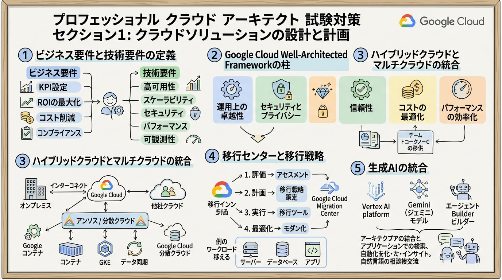
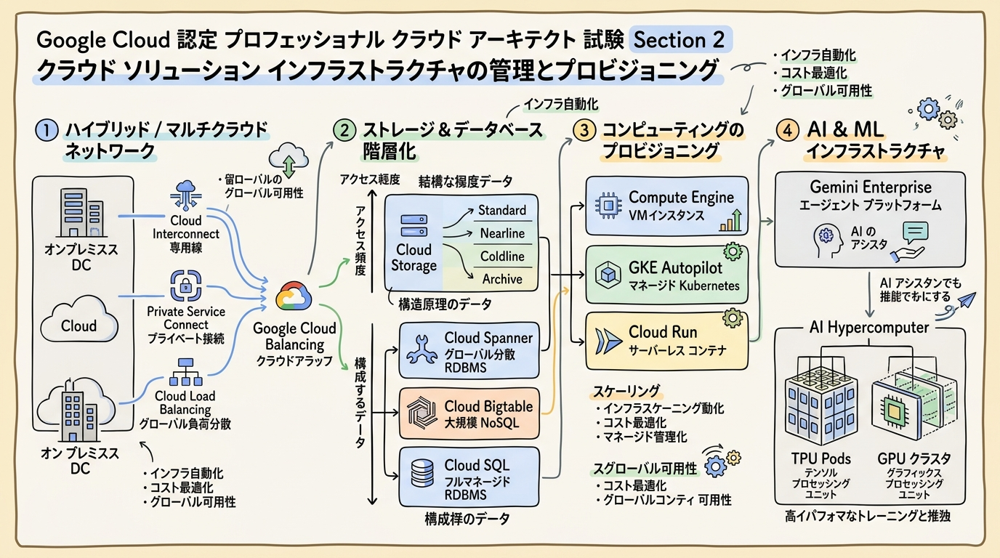
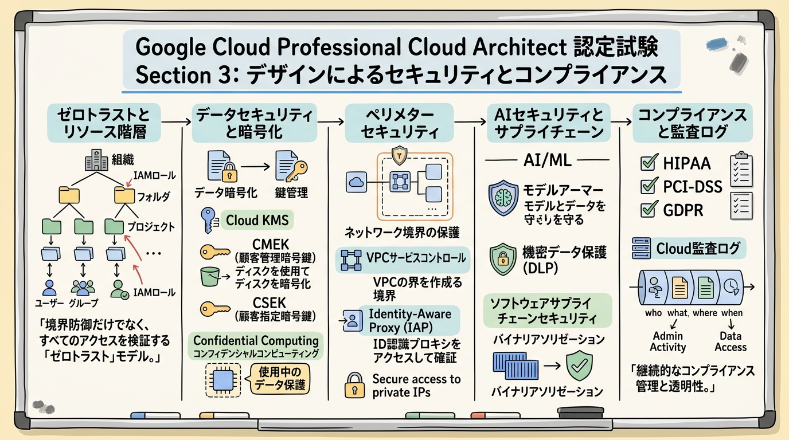
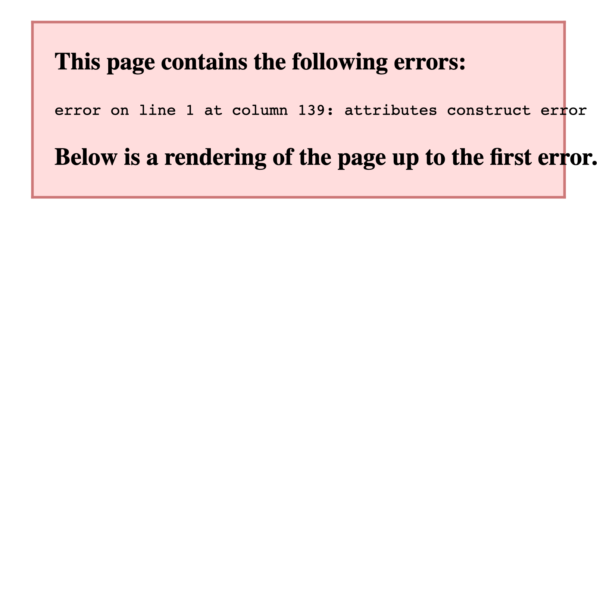

# Google Cloud Certified - Professional Cloud Architect 完全対策＆実践学習ガイド

- **対象資格**: Google Cloud Certified - Professional Cloud Architect (PCA)
- **試験コード**: PCA (Version 6.1+ 準拠)
- **公式試験ガイド**: [Professional Cloud Architect 認定試験ガイド (日本語版)](https://services.google.com/fh/files/misc/professional_cloud_architect_exam_guide_japanese.pdf?hl=ja)
- **公式試験ページ**: [Professional Cloud Architect | Google Cloud Certification](https://cloud.google.com/learn/certification/cloud-architect?hl=ja)
- **公式学習パス**: [Google Skills - Cloud Architect Learning Path](https://www.skills.google/paths/13?hl=ja)
- **最終更新日**: 2026-10-13

---

## はじめに

クラウドコンピューティングは、単なるインフラストラクチャのオンプレミスからの置き換え（Lift & Shift）の段階を完全に脱し、生成 AI（Generative AI）、分散コンピュート、リアルタイムデータパイプライン、ゼロトラストセキュリティ、および高度な FinOps が密接に統合された「ビジネスアジリティとイノベーションのエンジン」へと進化しました。

エンタープライズ企業が競争優位性を確立するためには、単に個々のクラウドサービスをプロビジョニングできるだけでなく、複雑なビジネス要件と技術的制約のトレードオフを冷徹に評価し、将来の技術革新を見据えた堅牢・安全・高可用・スケーラブルかつ費用対効果の高いアーキテクチャを構想・実現できる「クラウドアーキテクト」の存在が不可欠です。

Google Cloud Certified - Professional Cloud Architect は、Google Cloud テクノロジーを活用してエンタープライズ規模のクラウド戦略を推進し、レガシー、ハイブリッド、マルチクラウド環境を包括した分散ソリューションを設計、開発、管理できる実務能力を客観的に証明する、業界で最も権威あるプロフェッショナル認定資格です。

本ガイドは、最新の公式試験ガイド（Version 6.1+）および改訂された 4 大ケーススタディ（Altostrat Media、Cymbal Retail、EHR Healthcare、KnightMotives Automotive）に完全準拠し、全 6 セクションの設計原則、比較マトリクス、板書風グラフィックレコーディング（要約スライド挿絵）、網羅的な構造化実践シナリオ（状況・対応・結果・解説）、および厳選されたハンズオンラボをセクションごとにカプセル化して体系化した完全対策ドキュメントです。

### Professional Cloud Architect 試験とは

Professional Cloud Architect は、ビジネス目標を満たす堅牢かつスケーラブルなソリューションの設計、動的なプロビジョニングと管理、セキュリティとコンプライアンスの担保、運用プロセスの改善、および Google Cloud Well-Architected Framework に基づく運用の卓越性を検証するプロフェッショナルレベルの資格です。

- **試験時間**: 120 分（2 時間）
- **出題問題数**: 50〜60 問
- **出題形式**: 択一選択問題（4 肢中 1 つ選択）、複数選択問題（5 肢以上中 2 つ以上選択）
- **出題比率**: 全 6 セクション（設計と計画: 約 25%、インフラ管理: 約 17.5%、セキュリティ: 約 17.5%、プロセス分析改善: 約 15%、実装管理: 約 12.5%、運用の卓越性: 約 12.5%）
- **事例紹介（ケーススタディ）**: 出題の約 20〜30% を占め、試験時にランダムで 2 つのシナリオが提示されます。
- **受験料**: $200（税別）
- **合否判定**: 合格 / 不合格（スケールドスコアや正答率は非開示）
- **前提知識**: クラウドアーキテクチャに関する 3 年以上の実務経験、および Google Cloud 上での設計・管理に関する 1 年以上の実務経験が推奨されます。

### 難易度と求められる思考力

当試験の難易度は **プロフェッショナル最上位（広範なサービス知識、トレードオフの意思決定、ケーススタディ読解力、および生成 AI 統合を含む先進設計能力重視）** に位置づけられます。

単なる製品仕様やコマンドの暗記では合格は不可能です。試験では以下のような多層的な思考軸が問われます：
1. **ビジネス制約と技術要件の調和**: コスト削減（CapEx から OpEx への移行、TCO 最小化）、市場投入速度（TTM）、事業継続性（BCP / DR）、法規制（HIPAA、PCI-DSS、GDPR）のバランスをとる意思決定
2. **Google Cloud Well-Architected Framework の実践的適用**: オペレーショナル エクセレンス、セキュリティ、信頼性、パフォーマンス最適化、コスト最適化、サステナビリティの 6 本の柱に基づく判断基準の確立
3. **ハイブリッド & マルチクラウドの接続性と境界防御**: Dedicated Interconnect、Partner Interconnect、Cross-Cloud Interconnect、Network Connectivity Center、VPC Service Controls、Identity-Aware Proxy（IAP）を組み合わせたゼロトラストアーキテクチャの構築
4. **最新の生成 AI & MLOps パイプライン統合**: Gemini Enterprise Agent Platform、Agent Builder、AI Hypercomputer（TPU/GPU クラスタ）、Model Garden、Model Armor を取り入れたエンタープライズソリューションの設計
5. **事例紹介（ケーススタディ）の深層読解**: 与えられた架空企業の既存資産、ビジネス目標、および技術的課題から、問題文で問われている要件に最も合致する解決策を論理的に選定する能力

### 推奨の勉強法

1. **公式試験ガイドと Google Cloud Well-Architected Framework の精読**
   公式ドキュメントのアーキテクチャセンターを読み込み、Google Cloud が提唱する設計思想（疎結合、ステートレス、自動修復、イミュータブルインフラ）を体得します。
2. **公式 4 大ケーススタディの事前徹底分析**
   試験当日に初見でケーススタディを読む時間を省くため、Altostrat Media、Cymbal Retail、EHR Healthcare、KnightMotives Automotive のビジネス目標と既存インフラのギャップを事前に完全に把握しておきます。
3. **実機ハンズオンラボ（Google Skills）によるアーキテクチャ構築体験**
   共有 VPC、Cloud Armor、GKE Autopilot、Cloud Spanner、Cloud Run、Vertex AI などのリソースを実際にプロビジョニングし、ネットワーク接続性やアクセス制御の肌感覚を掴みます。
4. **実践シナリオの「解説（代替案の棄却理由）」の精読による意思決定トレーニング**
   本ガイドに収録された実践シナリオを通じ、正解となる選択肢だけでなく「なぜ他の有力候補では要件を満たせないのか」という棄却理由を論理的に理解します。

---

## 目次

1. [はじめに](#はじめに)
2. [学習カリキュラム・出題範囲ロードマップ](#学習カリキュラム出題範囲ロードマップ)
3. [Section 1: クラウド ソリューション アーキテクチャの設計と計画 (約 25%)](#section-1-クラウド-ソリューション-アーキテクチャの設計と計画-約-25)
4. [Section 2: クラウド ソリューション インフラストラクチャの管理とプロビジョニング (約 17.5%)](#section-2-クラウド-ソリューション-インフラストラクチャの管理とプロビジョニング-約-175)
5. [Section 3: セキュリティとコンプライアンスを考慮した設計 (約 17.5%)](#section-3-セキュリティとコンプライアンスを考慮した設計-約-175)
6. [Section 4: 技術プロセスやビジネス プロセスの分析と改善 (約 15%)](#section-4-技術プロセスやビジネス-プロセスの分析と改善-約-15)
7. [Section 5: 実装の管理 (約 12.5%)](#section-5-実装の管理-約-125)
8. [Section 6: ソリューションとオペレーション エクセレンスの確保 (約 12.5%)](#section-6-ソリューションとオペレーション-エクセレンスの確保-約-125)
9. [公式 4 大ケーススタディ（事例紹介）の概要と学習の手引き](#公式-4-大ケーススタディ事例紹介の概要と学習の手引き)
10. [まとめと推奨学習ステップ](#まとめと推奨学習ステップ)

---

## 学習カリキュラム・出題範囲ロードマップ

### セクション一覧と出題比率

| セクション番号 | セクション名 / 出題分野 | 出題比率 | 主要対象サービス・ツール |
| :--- | :--- | :--- | :--- |
| **Section 1** | クラウド ソリューション アーキテクチャの設計と計画 | 約 25.0% | Well-Architected Framework, 要件分析 (機能/非機能/BCP/コスト), 移行戦略 (Migration Center), AI/ML ソリューション (Gemini, Agent Builder, Model Garden) |
| **Section 2** | クラウド ソリューション インフラストラクチャの管理とプロビジョニング | 約 17.5% | ハイブリッド接続 (Interconnect, VPN, NCC), 共有 VPC, ロードバランサ, ストレージ (Cloud Storage, Spanner, Bigtable, Cloud SQL), コンピュート (GKE, Cloud Run, GCE), AI Hypercomputer (TPU/GPU) |
| **Section 3** | セキュリティとコンプライアンスを考慮した設計 | 約 17.5% | リソース階層, IAM, 職掌分散, Cloud KMS / CMEK, 機密 VM, VPC SC, IAP, Binary Authorization, Model Armor, Sensitive Data Protection, 法規制 (HIPAA, PCI-DSS, GDPR) |
| **Section 4** | 技術プロセスやビジネス プロセスの分析と改善 | 約 15.0% | SDLC, CI/CD (Cloud Build, Cloud Deploy), DR 戦略 (RTO/RPO), トラブルシューティング, ポストモーテム, FinOps (CapEx → OpEx, CUD), チェンジマネジメント, BCP |
| **Section 5** | 実装の管理 | 約 12.5% | デプロイ支援, Apigee API 管理, クラウドエミュレータ, Gemini Cloud Assist, プログラマティック操作 (gcloud, Terraform, Config Connector, クライアントライブラリ) |
| **Section 6** | ソリューションとオペレーション エクセレンスの確保 | 約 12.5% | Well-Architected 運用原則, Google Cloud Observability (Monitoring, Logging, Trace, Profiler), SLO/SLI/SLA, エラーバジェット, リリース管理 (Canary), カオス工学 |

---

---

## Section 1: クラウド ソリューション アーキテクチャの設計と計画 (約 25%)

本セクションは、ビジネス要件（KPI、ROI、TCO、事業継続性、規制コンプライアンス）および技術要件（高可用性、パフォーマンス、レイテンシ、スケーラビリティ）を包括的に分析し、Google Cloud Well-Architected Framework に基づく堅牢で将来性のある多層分散アーキテクチャを構想・計画する能力を検証します。また、オンプレミスや他社クラウドからの移行戦略（Google Cloud Migration Center の活用）や、Gemini モデル、Vertex AI Agent Builder を含む生成 AI ソリューションの統合計画が重要な焦点となります。



---

### 1. セクション概要

クラウドアーキテクチャの設計において最も重視されるのは、「ビジネス目標を技術的成果へ確実に変換すること」です。アーキテクトは、単に機能を満たすだけでなく、非機能要件（可用性 99.99%、RTO 1時間以内、ミリ秒未満のレイテンシなど）やコスト制約、組織の運用成熟度を踏まえたトレードオフ判断を下す必要があります。

#### 重要キーワード

- **Google Cloud Well-Architected Framework**: 信頼性、運用上の卓越性、セキュリティ、パフォーマンス、コスト最適化、サステナビリティの 6 本の柱からなる設計規範。
- **Google Cloud Migration Center**: 既存のオンプレミスおよび他社クラウドのインフラ資産（VM、サーバー、DB）を検出し、TCO（総所有コスト）予測や移行計画を統合管理するプラットフォーム。
- **7 Rs of Cloud Migration**: 移行アプローチの分類（Retain, Retire, Rehost, Replatform, Refactor, Repurchase, Relocate）。
- **非機能要件 (Non-Functional Requirements)**: 可用性 (Availability)、復元力 (Resilience)、レイテンシ、スループット、RTO (目標復旧時間)、RPO (目標復旧時点)。
- **Vertex AI Agent Builder**: 企業のプライベートデータや API と Gemini モデルを接続し、自律的な AI エージェントや検索アプリケーションをノーコード/ローコードで構築する基盤。
- **Dual-Region / Multi-Region Cloud Storage**: リージョン障害に耐えるジオ冗長ストレージとターボレプリケーション機能。

---

### 2. 重要トピック

#### 1. Google Cloud Well-Architected Framework の 6 本の柱

| 柱 (Pillar) | 設計目標 | 主要な考慮事項・実践アプローチ |
| :--- | :--- | :--- |
| **信頼性 (Reliability)** | 障害の自動検出・自己修復・継続稼働 | 単一障害点 (SPOF) の排除、マルチゾーン/マルチリージョン冗長、カオス工学による検証 |
| **運用上の卓越性 (Operational Excellence)** | 自動化と効率的なデプロイ・監視 | Infrastructure as Code (Terraform)、CI/CD 自動化、SLO/SLI 運用、非難のないポストモーテム |
| **セキュリティ、プライバシー、コンプライアンス** | ゼロトラスト防御とデータ保護 | 最小権限の原則、ID 認識プロキシ (IAP)、CMEK 暗号化、VPC Service Controls |
| **パフォーマンスの最適化 (Performance)** | リソース効率と低レイテンシの最大化 | 適切なコンピュート/ストレージ選定、キャッシュ層の導入、グローバルロードバランサ |
| **コストの最適化 (Cost Optimization)** | 継続的な TCO 削減とリソース効率化 | 確約利用割引 (CUD)、Spot VM、自動スケーリング、アイドルリソースの特定 |
| **サステナビリティ (Sustainability)** | 環境負荷の低減と炭素排出削減 | 低炭素フットプリントリージョンの選択、サーバーレス/高集約コンピュートの採用 |

#### 2. クラウド移行戦略（Migration Center と 7 Rs）

オンプレミスから Google Cloud への移行では、移行対象のシステム特性に応じて適切な戦略を選定します。

| 移行アプローチ | 概要 | Google Cloud での代表例 | 主なトレードオフ |
| :--- | :--- | :--- | :--- |
| **Rehost (Lift & Shift)** | アプリケーションを変更せずそのまま移行 | Migrate to Virtual Machines (GCE) | 最も移行が速いが、クラウドネイティブな自動スケールや運用効率化の恩恵は限定的 |
| **Replatform (Lift & Reshape)** | コア設計を維持しつつ一部マネージド化 | Migrate to Containers (GKE), Cloud SQL への移行 | 最小限のコード修正で DB 管理や OS パッチ運用の負担を削減可能 |
| **Refactor (クラウドネイティブ再設計)** | マイクロサービス化やサーバーレス化を実施 | モノリスから Cloud Run / GKE + Pub/Sub へ刷新 | 開発工数と初期コストは高いが、長期的なアジリティ・拡張性・コスト効率が最大化 |
| **Retain / Retire** | オンプレミスに維持、またはシステム廃止 | 減価償却残存資産の維持、不要システムの廃棄 | 移行スコープの最適化 |

#### 3. アーキテクトの選定基準: コンピュート & ストレージ

- **コンピュート選定基準**:
  - ステートレスな HTTP / イベント駆動コンテナ、自動ゼロスケール、運用負荷最小化: **Cloud Run**
  - 高度なクラスタ制御、大規模マイクロサービス、ステートフルワークロード、GPU 連携: **GKE (Autopilot 推奨)**
  - レガシー OS、特殊カーネル、固定 IP 要件、既存ライセンス持ち込み (BYOL): **Compute Engine**
  - VMware 資産の無修正リロケーション: **Google Cloud VMware Engine (GCVE)**
- **ストレージ選定基準**:
  - 非構造化データ（動画、画像、バックアップ、静的ウェブコンテンツ）: **Cloud Storage**
  - グローバル強整合性、水平スケール、99.999% SLA の RDBMS: **Cloud Spanner**
  - 超大規模時系列・IoT テレメトリ、ミリ秒未満レイテンシ、ペタバイト級 NoSQL: **Cloud Bigtable**
  - エンタープライズ PostgreSQL 互換、高速トランザクション + 分析（HTAP）: **AlloyDB for PostgreSQL**

---

### 3. 実践シナリオ

#### シナリオ 1-1: Altostrat Media の大容量動画アーカイブ移行とトランスコーディング基盤の設計

- **状況**: グローバルデジタルメディア企業である Altostrat Media が、オンプレミスに蓄積された数ペタバイトの動画アーカイブを Google Cloud へ移行し、新規アップロード動画を自動トランスコーディングして全世界に低遅延配信するアーキテクチャを設計する場合
- **対応**: オンプレミスデータセンターと Google Cloud 間を Dedicated Interconnect で接続し、Transfer Appliance および Storage Transfer Service を用いて動画資産を Cloud Storage（Dual-Region）へ一括移行する。新規アップロードは Cloud Storage のイベントを Eventarc 経由でトリガーし、Cloud Run 上のコンテナで動画トランスコーディングおよび Vertex AI Gemini API によるメタデータ自動抽出を実行する。
- **結果**: オンプレミスのストレージ枯渇と処理能力不足を解消し、イベント駆動による自動スケーリングトランスコーディングと高品質なメディアカタログメタデータの自動生成が実現される。
- **解説**: Dedicated Interconnect により大容量データを安全かつ安定した専用帯域で転送できるためです。また、Dual-Region Cloud Storage はリージョン障害時でも無停止でデータアクセスを継続でき、Cloud Run はトランスコーディング処理の負荷に応じてゼロから数千インスタンスまで即座にオートスケールするため最適です。代替案として Compute Engine インスタンスを常時稼働させる構成は、アイドル時の無駄なコンピュート費用が発生するため不適格です。また、パブリックインターネット経由の VPN を使用する構成は、ペタバイト級のデータ転送に必要な帯域幅と SLA を満たせないため不適格です。
- **参考ドキュメント**:
  - [Cloud Storage デュアルリージョン](https://cloud.google.com/storage/docs/locations#location-dr): 地理的冗長性とフェイルオーバーの仕組み
  - [Cloud Run イベント駆動処理](https://cloud.google.com/run/docs/tutorials/eventarc): Eventarc と Cloud Run の連携

#### シナリオ 1-2: EHR Healthcare の厳格な医療規制を満たす高可用性カルテ基盤の移行設計

- **状況**: 大手医療プロバイダーである EHR Healthcare が、HIPAA コンプライアンスおよび 99.999% の稼働率 SLA を満たしつつ、老朽化したオンプレミス電子カルテシステムを Google Cloud へ移行する場合
- **対応**: Google Cloud Migration Center で既存インフラの依存関係とサイジングを詳細評価した上で、電子カルテのトランザクションデータベースにマルチリージョン構成の Cloud Spanner を採用する。医療業界標準データ（FHIR / HL7v2）の相互運用には Cloud Healthcare API を配置し、機密データ保護のため顧客管理の暗号鍵（Cloud KMS CMEK）および機密 VM（Confidential VM）を適用する。
- **結果**: 計画外停止時でもダウンタイムゼロで自動フェイルオーバーが完了し、厳格な法規制要件に準拠した医療データ連携基盤が確立される。
- **解説**: Cloud Spanner のマルチリージョン構成は、同期レプリケーションと Paxos コンセンサスにより、ゾーンやリージョンの全損時でも RPO=0、RTO=0（トランザクション損失なし・自動透過的フェイルオーバー）で 99.999% の可用性 SLA を提供するためです。また、Cloud Healthcare API は HIPAA 適合のフルマネージド FHIR ストアを提供し、Confidential VM はメモリ上の機密データをハードウェアレベルで暗号化するため要件を完全に満たします。代替案として Cloud SQL の高可用性（HA）構成を採用する案は、リージョン内フェイルオーバー時に数十秒〜数分のダウンタイムが発生し、99.999% SLA を満たせないため不適格です。また、セルフマネージドのオープンソース DB を Compute Engine 上に構築する案は、パッチ適用やフェイルオーバーの運用負荷が極めて高大となり、コンプライアンス監査の負担も増大するため不適格です。
- **参考ドキュメント**:
  - [Cloud Spanner 高可用性とレプリケーション](https://cloud.google.com/spanner/docs/replication): マルチリージョン構成と Paxos の仕組み
  - [Cloud Healthcare API の概要](https://cloud.google.com/healthcare-api/docs): FHIR / HL7v2 / DICOM の標準規格対応

#### シナリオ 1-3: Cymbal Retail の商品カタログ自動エンリッチメントと生成 AI 検索基盤の設計

- **状況**: 急成長中の EC サイト Cymbal Retail が、サプライヤーから送られてくる不揃いな商品テキスト・画像データを自動解析して詳細な商品説明・属性タグを生成し、ユーザー向けにセマンティック検索を提供したい場合
- **対応**: サプライヤーからアップロードされた未構造化データを Cloud Storage に格納し、Pub/Sub と Dataflow を経由して Vertex AI Gemini 1.5 Pro / Flash モデルを呼び出すことで、マルチモーダル属性抽出と商品説明文の自動生成を実行する。生成された構造化カタログデータおよび埋め込みベクトルを Vertex AI Search and Conversation（Discovery AI）にインデックス化し、EC サイトの検索窓および AI ショッピングアシスタントと統合する。
- **結果**: 手動でのカタログ登録工数を 90% 削減し、ユーザーの曖昧な自然言語クエリに対して適合率の高い商品検索と対話型レコメンデーションが実現される。
- **解説**: Gemini のマルチモーダル処理能力により、画像とテキストを同時に理解して高精度な商品属性タグや魅力的な紹介文を自動生成できるためです。また、Vertex AI Search はフルマネージドで高度な検索エンジン（ベクトル検索とキーワード検索のハイブリッド）を提供し、自前での検索クラスタ運用が不要となるため最適です。代替案として Elasticsearch クラスタをセルフマネージドで GCE 上に構築する案は、インフラのパッチ当てやスケーリング運用負荷が非常に高く、最新の生成 AI モデルとの統合も複雑化するため不適格です。また、ルールベースの正規表現スクリプトでテキスト抽出を行う案は、サプライヤーごとの非構造化フォーマットの多様性に追従できず精度が著しく低下するため不適格です。
- **参考ドキュメント**:
  - [Vertex AI Search and Conversation の概要](https://cloud.google.com/generative-ai-app-builder/docs): エンタープライズ検索とエージェント基盤
  - [Vertex AI Gemini モデルの機能](https://cloud.google.com/vertex-ai/generative-ai/docs/multimodal-overview): マルチモーダルプロンプティング

---

### 4. 参考ドキュメント & 推奨ハンズオン

#### 公式一次ドキュメント
- [Google Cloud Well-Architected Framework](https://cloud.google.com/architecture/framework): クラウドアーキテクチャ設計の原則とベストプラクティス
- [Google Cloud Migration Center](https://cloud.google.com/migration-center/docs): オンプレミス資産の検出・アセスメント・TCO 予測
- [Vertex AI アーキテクチャガイド](https://cloud.google.com/vertex-ai/docs): 機械学習および生成 AI システムの設計標準

#### 推奨ハンズオン・ラボ（実機検証）
- [Google Skills: Google Cloud Fundamentals - Core Infrastructure](https://www.skills.google/focuses/2794?hl=ja):
  - **学習目標**: VPC、Compute Engine、Cloud Storage、Cloud SQL、GKE のコアコンポーネントを構築し、多層アーキテクチャの基本疎通を体感する。
- [Google Skills: Build a Resilient, Scalable Architecture](https://www.skills.google/focuses/43519?hl=ja):
  - **学習目標**: グローバル外部 HTTP(S) ロードバランサとマネージドインスタンスグループ（MIG）を組み合わせ、自動修復・オートスケーリング動作を検証する。

---

## Section 2: クラウド ソリューション インフラストラクチャの管理とプロビジョニング (約 17.5%)

本セクションは、ハイブリッドおよびマルチクラウドにまたがるネットワークトポロジ、ストレージおよびデータベースシステム、コンピュートリソース（GCE、GKE、Cloud Run）、そしてエンドツーエンドの ML / 生成 AI ワークフローを支える AI Hypercomputer を動的にプロビジョニングし、高効率に管理・運用する能力を検証します。



---

### 1. セクション概要

エンタープライズインフラのプロビジョニングでは、「スケーラビリティ」「ネットワーク分離」「レイテンシの極小化」「コスト効率」の最適バランスを確立することが求められます。共有 VPC による一元管理、Private Service Connect（PSC）によるセキュアなサービス公開、Cloud Load Balancing によるグローバルトラフィック制御、そして近年の大規模言語モデル（LLM）トレーニングや推論を支える AI Hypercomputer（TPU / GPU クラスタ）の構成が中核をなします。

#### 重要キーワード

- **共有 VPC (Shared VPC)**: 単一のホストプロジェクトでサブネット・ルート・ファイアウォールを一元管理し、複数のサービスプロジェクトから利用可能にするエンタープライズネットワーク基盤。
- **Cloud Interconnect**: オンプレミスと Google Cloud をプライベート専用線で直接接続するソリューション（Dedicated: 10/100/200 Gbps、Partner: 50 Mbps〜50 Gbps）。
- **Cross-Cloud Interconnect**: AWS、Azure、OCI 等の他社クラウドと Google Cloud 間を高帯域・高信頼性（99.99% SLA）で直接相互接続するマネージドサービス。
- **Private Service Connect (PSC)**: 異なる VPC や外部サービス（Google API、サードパーティ SaaS）とプライベートエンドポイントを介して IP 重複なしで直接通信するプライベート接続技術。
- **Cloud Load Balancing**: 単一のグローバルエニーキャスト IP アドレスで世界中のユーザーからのトラフィックを最も近い健全なリージョンへルーティングするフルマネージドロードバランサ。
- **AI Hypercomputer**: TPU（v4, v5e, v5p）や NVIDIA GPU（H100, B200）などのアクセラレータ、超高速ネットワーキング（RoCE / Jupiter）、および最適化されたストレージ・ソフトウェアスタックを統合した AI 特化型インフラ基盤。
- **Gemini Enterprise Agent Platform / Pipelines**: Vertex AI Pipelines（Kubeflow 互換）による ML ライフサイクルの自動オーケストレーションとエンタープライズ AI エージェントの実行基盤。

---

### 2. 重要トピック

#### 1. ハイブリッド & マルチクラウド ネットワーキング比較マトリクス

| 接続方式 | 接続帯域 | 可用性 SLA | 暗号化 / 特徴 | 主な用途・選定基準 |
| :--- | :--- | :--- | :--- | :--- |
| **Dedicated Interconnect** | 10 Gbps / 100 Gbps / 200 Gbps 回線 | 99.9% (2拠点) / 99.99% (4拠点) | MACsec（オプション）による L2 暗号化 | 大容量データ移行、ミッションクリティカルな常時大帯域ハイブリッド通信 |
| **Partner Interconnect** | 50 Mbps 〜 50 Gbps | 99.9% / 99.99% | サービスプロバイダー経由の専用接続 | Google コロケーション施設に直接接続できない拠点からの接続 |
| **HA VPN (Cloud VPN)** | 最大 3 Gbps / トンネル（複数束ねて拡張可能） | 99.99% (BGP 冗長トンネル構成) | IPsec (IKEv2) によるインターネット暗号化トンネル | 中小規模のトラフィック、短期間の接続、Interconnect のバックアップ回線 |
| **Cross-Cloud Interconnect** | 10 Gbps / 100 Gbps | 99.99% | クラウド間直接プライベート接続 | AWS / Azure と Google Cloud 間の大容量マルチクラウドデータ転送 |

#### 2. Cloud Load Balancing 選定マトリクス

| ロードバランサ種別 | スコープ | レイヤ | プロトコル | 主な機能・特徴 |
| :--- | :--- | :--- | :--- | :--- |
| **グローバル外部アプリケーション LB** | グローバル | L7 | HTTP, HTTPS, HTTP/2, gRPC | 単一エニーキャスト IP、Cloud Armor / Cloud CDN 連携、URL マップルーティング |
| **リージョン外部アプリケーション LB** | リージョン | L7 | HTTP, HTTPS | データ主権要件（EU 域内完結等）、リージョン内プロキシ |
| **内部アプリケーション LB** | リージョン / クロスリージョン | L7 | HTTP, HTTPS | VPC 内部マイクロサービス間通信、プライベートトラフィック制御 |
| **外部パススルー ネットワーク LB** | リージョン | L4 | TCP, UDP, ESP, GRE | パケットそのまま透過、クライアント IP 保持、高スループット |
| **内部パススルー ネットワーク LB** | リージョン | L4 | TCP, UDP | VPC 内部の高パフォーマンス L4 負荷分散、バックエンドヘルスチェック |

#### 3. AI Hypercomputer とアクセラレータ構成

- **TPU (Tensor Processing Unit)**:
  - TPU v5e: コスト効率と推論・小中規模トレーニングに最適化
  - TPU v5p: 最大規模の LLM トレーニング向け（超高 FLOPS、大容量 HBM）
- **NVIDIA GPU (A100 / H100 / B200)**:
  - 汎用 CUDA エコシステム、カスタム PyTorch ライブラリ、オープンソース LLM の微調整および高速推論
- **Dynamic Workload Scheduler (DWS)**:
  - スポット VM やカレンダーベースのバッチ予約を活用し、高価な GPU/TPU リソースを効率的に確保・コスト削減

---

### 3. 実践シナリオ

#### シナリオ 2-1: KnightMotives Automotive の世界数十万台のコネクテッドカーテレメトリ処理基盤の構成

- **状況**: グローバル自動車メーカー KnightMotives Automotive が、世界中で走行する数十万台の車両から毎秒送信される膨大な時系列センサーデータ（毎秒数十万件のメッセージ）を取り込み、ミリ秒未満のレイテンシで書き込み・リアルタイム異常検知を実施したい場合
- **対応**: 車両からの取り込みゲートウェイとしてグローバル外部パススルー ネットワーク ロードバランサ（または Cloud Pub/Sub）を配置し、メッセージバッファとして Cloud Pub/Sub を利用する。ストリーミング変換パイプラインには Cloud Dataflow（Exactly-Once セマンティクス、オートスケーリング）を構成し、高スループット時系列ストレージとしてマルチクラスタ構成の Cloud Bigtable（SSD、行キーに逆順タイムスタンプと車両 ID を複合設計）へデータを並列書き込みする。
- **結果**: 突発的なトラフィック急増時でもパケットロスなくリアルタイムにデータを取り込み、ミリ秒未満の読み書きレイテンシと 99.999% のデータ可用性を維持する。
- **解説**: Cloud Pub/Sub はグローバル規模で毎秒数百万件のメッセージを自動スケールで吸収でき、Cloud Dataflow はサーバーレスでストリーミングウィンドウ集約を処理できるためです。また、Cloud Bigtable はペタバイト規模の時系列データに対して一貫したミリ秒未満の低遅延書き込みを提供し、マルチクラスタ構成によりゾーン障害時の自動レプリケーションと高可用性を担保するため最適です。代替案として Cloud SQL (MySQL / PostgreSQL) を使用する構成は、毎秒数十万件の連続書き込みスループットを単一インスタンスで処理しきれず、ディスク IOPS と接続数が即座に枯渇するため不適格です。また、Cloud Storage に毎秒小さなファイルを直接書き込む構成は、オブジェクト作成の API レート制限に抵触し、リアルタイム検索が不可能なため不適格です。
- **参考ドキュメント**:
  - [Cloud Bigtable スキーマ設計のベストプラクティス](https://cloud.google.com/bigtable/docs/schema-design): 時系列データの行キー設計
  - [Cloud Pub/Sub ストリーミングアーキテクチャ](https://cloud.google.com/pubsub/docs/overview): 大規模メッセージング

#### シナリオ 2-2: Altostrat Media の大規模 AI モデル学習と AI Hypercomputer のインフラ最適化

- **状況**: Altostrat Media が、独自のマルチモーダルメディア分析モデル（音声・映像の統合理解 LLM）を数兆トークン規模で分散トレーニングするにあたり、数千基のアクセラレータクラスタを最小のコストと最短の学習時間でプロビジョニングしたい場合
- **対応**: GKE 上で AI Hypercomputer アーキテクチャを構成し、TPU v5p ポッドスライス（または NVIDIA H100 GPU クラスタ）をプロビジョニングする。クラスタ間接続には 3.2 Tbps の高速 Jupiter ネットワークファブリック（RoCE 対応）を使用し、大規模モデル学習のジョブ管理には Kueue および Dynamic Workload Scheduler（Flex 予約モデル）を導入する。トレーニングチェックポイントの保存には Cloud Storage Any-Point / Dual-Region と GCS FUSE キャッシュを連携させる。
- **結果**: 分散学習時のノード間通信ボトルネックを解消し、GPU/TPU の稼働率（MFU: Model FLOPs Utilization）を最大化しつつ、コミットメント割引およびスケジューリング最適化によりインフラコストを 35% 削減する。
- **解説**: TPU v5p および AI Hypercomputer は、超大規模 LLM トレーニングに特化した光サーキットスイッチング（OCS）と高速インターコネクトを提供し、分散並列学習の通信オーバーヘッドを極小化するためです。また、Dynamic Workload Scheduler によりジョブが必要な全リソースが揃った時点で一括割り当て（All-or-Nothing）されるため、一部ノードのアイドル待機による無駄な課金を防止できます。代替案として標準の Compute Engine N1/N2 インスタンスに仮想 GPU をアタッチして手動構成する案は、ノード間ネットワーク帯域が不足して分散学習の勾配同期で著しい遅延が発生するため不適格です。また、リソース予約なしに単一のオンデマンドインスタンスを順次起動する案は、大規模学習に必要なアクセラレータ枠を同時に確保できずジョブが失敗するため不適格です。
- **参考ドキュメント**:
  - [Google Cloud AI Hypercomputer の概要](https://cloud.google.com/ai-hypercomputer/docs): AI 向けスーパーコンピューティング基盤
  - [GKE での機械学習ワークロードのオーケストレーション](https://cloud.google.com/kubernetes-engine/docs/concepts/machine-learning-on-gke): Kueue とアクセラレータ管理

#### シナリオ 2-3: 複数事業部プロジェクト間における共有 VPC と Private Service Connect の統制トポロジ

- **状況**: グローバル企業において、ネットワーク管理チームが IP アドレス設計、サブネット分割、外部ルーティングを一元管理しつつ、各事業部（開発チーム）が独自のプロジェクト内で GKE や Cloud Run などのコンピュートリソースを自律的にプロビジョニングし、社内共有 API と安全に通信させたい場合
- **対応**: セントラルネットワーク管理プロジェクトを「共有 VPC ホストプロジェクト」として指定し、各事業部プロジェクトを「サービスプロジェクト」としてアタッチする。ホストプロジェクト内でサブネットと階層型ファイアウォールポリシーを一元定義し、事業部間や共有サービスとの通信には Private Service Connect（PSC）エンドポイントをデプロイしてプライベート IP で疎通させる。
- **結果**: IP アドレスの枯渇や重複を防止し、ネットワーク管理権限とアプリケーション開発権限の完全な分離（最小権限の原則）を維持しつつ、事業部間のセキュアな内部 API 連携が実現される。
- **解説**: 共有 VPC を使用することで、中央のインフラチームがネットワークトポロジとルーティングを統制し、サービスプロジェクトの管理者はサブネット作成権限を持たずにコンピュートリソースを安全にデプロイできるためです。さらに、Private Service Connect により VPC ピアリングの制限（推移的ルーティング不可、IP 重複不可、ピアリング上限数）を回避し、サービスプロデューサーとコンシューマーを疎結合に保護できるため最適です。代替案として各プロジェクトごとに VPC を作成してフルメッシュで VPC ネットワークピアリングを結ぶ構成は、IP レンジの重複管理が困難であり、推移的ルーティングがサポートされないため構成が破綻し不適格です。また、外部 IP アドレスを付与してパブリックインターネット経由で通信させる構成は、セキュリティ侵害リスクとネットワークエグレス課金が増大するため不適格です。
- **参考ドキュメント**:
  - [共有 VPC の概要](https://cloud.google.com/vpc/docs/shared-vpc): ホストプロジェクトとサービスプロジェクトの分離
  - [Private Service Connect の概要](https://cloud.google.com/vpc/docs/private-service-connect): プライベートなサービス接続

---

### 4. 参考ドキュメント & 推奨ハンズオン

#### 公式一次ドキュメント
- [ハイブリッドおよびマルチクラウド接続ガイド](https://cloud.google.com/architecture/hybrid-and-multi-cloud-architecture-patterns): ネットワークアーキテクチャパターン
- [Cloud Load Balancing ドキュメント](https://cloud.google.com/load-balancing/docs): ロードバランサの機能比較と設定
- [GKE Autopilot の概要](https://cloud.google.com/kubernetes-engine/docs/concepts/autopilot-overview): フルマネージド Kubernetes クラスタ

#### 推奨ハンズオン・ラボ（実機検証）
- [Google Skills: Networking in Google Cloud](https://www.skills.google/courses/1066?hl=ja):
  - **学習目標**: 共有 VPC、VPC ピアリング、ファイアウォールルール、Cloud NAT、Cloud VPN トンネルを構築し、ルーティング動作を検証する。
- [Google Skills: Deploying to Google Kubernetes Engine](https://www.skills.google/focuses/2798?hl=ja):
  - **学習目標**: GKE クラスタを作成し、マルチゾーンデプロイ、水平ポッドオートスケーラー（HPA）、クラスタオートスケーラーを構成して負荷分散を体感する。

---

## Section 3: セキュリティとコンプライアンスを考慮した設計 (約 17.5%)

本セクションは、ゼロトラスト（Zero Trust）モデルに基づき、リソース階層、Identity and Access Management（IAM）、暗号化と鍵管理、境界セキュリティ（VPC Service Controls）、安全なリモートアクセス、ソフトウェアサプライチェーンの保護、生成 AI のセキュリティ（Model Armor）、およびグローバルな法規制コンプライアンス（HIPAA、PCI-DSS、GDPR）を包括的に設計・実装する能力を検証します。



---

### 1. セクション概要

エンタープライズにおけるセキュリティ設計は、「境界防御への依存からの脱却」と「多層防御（Defense in Depth）」が基本原則です。ユーザーやデバイスのコンテキストを検証する Identity-Aware Proxy（IAP）、データ流出を物理的・論理的に封じ込める VPC Service Controls（サービス境界）、暗号鍵の完全な主権を確保する顧客管理の暗号鍵（Cloud KMS CMEK）、そして生成 AI 固有のリスク（プロンプトインジェクション、データ抽出、有害コンテンツ）を防ぐ Model Armor を有機的に結合します。

#### 重要キーワード

- **リソース階層 (Resource Hierarchy)**: 組織（Organization）→ フォルダ（Folder）→ プロジェクト（Project）→ リソース（Resource）というツリー構造により、IAM ポリシーおよび組織ポリシーの継承と一元統制を実現する仕組み。
- **職掌分散 (Separation of Duties - SoD)**: 単一のユーザーやサービスアカウントに過剰な特権を集中させず、業務ごとに権限（ネットワーク管理、セキュリティ監査、鍵管理、アプリ運用）を分離する原則。
- **Cloud KMS (Key Management Service)**: 対称鍵・非対称鍵のライフサイクルを管理するサービス。Google マネージド暗号化（デフォルト）、顧客管理の暗号鍵（CMEK）、顧客指定の暗号鍵（CSEK）、Cloud HSM（FIPS 140-2 Level 3 準拠）、Cloud EKM（外部鍵管理）を提供。
- **VPC Service Controls (VPC SC)**: Google マネージドサービス（Cloud Storage、BigQuery 等）の周囲にセキュリティ境界（Perimeter）を定義し、境界外からの不正アクセスや認可外プロジェクトへのデータコピー（データ流出・持ち出し）を遮断する機能。
- **Identity-Aware Proxy (IAP)**: パブリック IP アドレスや踏み台サーバー（Bastion Host）を排除し、ユーザー ID とコンテキスト（デバイス状態、アクセス元 IP）を検証して内部 VM や Web アプリケーションへ HTTPS / SSH / RDP 接続させるゼロトラストプロキシ。
- **Workload Identity 連携 (Workload Identity Federation)**: AWS、Azure、GitHub Actions 等の外部 ID プロバイダーのトークンを Google Cloud 短期アクセストークンへ交換し、長期有効なサービスアカウントキー（JSON）の発行と漏洩リスクを完全に排除する認証方式。
- **Binary Authorization**: コンテナイメージが CI/CD パイプライン内で正しくビルド・テスト・脆弱性スキャンされ、信頼できる署名（証明書）が付与されていることを GKE / Cloud Run デプロイ時に強制検証するサプライチェーン保護。
- **Model Armor & Sensitive Data Protection**: LLM に対するプロンプトインジェクション攻撃や機密情報の混入をリアルタイム検知・遮断し、個人情報（PII）を自動検出・マスキングする AI ガードレール基盤。

---

### 2. 重要トピック

#### 1. データ暗号化モデルの比較マトリクス

| 暗号化方式 | 鍵の保管場所 | 鍵の管理責任 | ローテーション | 主な選定基準・適合要件 |
| :--- | :--- | :--- | :--- | :--- |
| **デフォルト暗号化 (Google-owned)** | Google 内部キーストア | Google | 自動（定期的） | 追加設定不要、追加コストなし、標準的なデータ保管 |
| **CMEK (Cloud KMS)** | Google Cloud KMS / Cloud HSM | ユーザー（組織） | 自動または手動設定 | 鍵のアクセス権限分離、コンプライアンス（HIPAA, PCI-DSS）、暗号化破棄 |
| **CSEK (顧客指定暗号鍵)** | オンプレミス（API 経由で都度提供） | ユーザー | ユーザー責任 | 鍵データを Google Cloud 上に一切永続化させない極限要件（API リクエストごとに鍵指定） |
| **Cloud EKM (外部鍵管理)** | 外部パートナーの KMS (Thales, Fortanix 等) | 外部システム | 外部システム | 厳格な主権要件、暗号鍵の物理的管轄を国外・オンプレミスに限定 |

#### 2. ゼロトラスト & リモートアクセス設計

```text
┌─────────────────────────────────────────────────────────────┐
│                 従来の境界防御（レガシー方式）               │
│  [インターネット] ──> [VPN / 踏み台 (Bastion)] ──> [社内 LAN]│
│  ※ 一度 VPN 境界を突破されると社内全域をラテラルムーブ可能   │
└─────────────────────────────────────────────────────────────┘
                               ▼ ゼロトラストへの転換
┌─────────────────────────────────────────────────────────────┐
│                 Google Cloud ゼロトラスト設計               │
│  [開発者 / 運用者]                                           │
│         │ (HTTPS / SSH)                                     │
│         ▼                                                   │
│  [Identity-Aware Proxy (IAP)] ── Context-Aware Access 検証  │
│         │ (ID・MFA・デバイス状態・IP 判定)                  │
│         ▼ (プライベート IP で直接接続)                      │
│  [内部 Compute Engine / GKE] (外部 IP なし)                  │
│         │                                                   │
│  [VPC Service Controls サービス境界]                        │
│         └──> 許可された境界外へのデータ流出・持ち出しを遮断 │
└─────────────────────────────────────────────────────────────┘
```

#### 3. AI セキュリティ & ソフトウェアサプライチェーン

- **Model Armor の 3 大防御機能**:
  1. プロンプトインジェクション・ジェイルブレイク検知（LLM の指示上書き攻撃のブロック）
  2. 不適切コンテンツ・有害性フィルタリング（CSAM、ヘイトスピーチ、暴力表現の阻止）
  3. 機密データ保護（Sensitive Data Protection 連携による PII / 認証情報のイン/アウト遮断）
- **ソフトウェアサプライチェーン保護 (SLSA レベル向上)**:
  - Artifact Registry（脆弱性自動スキャン）
  - Cloud Build（ビルド証明の生成、改ざん防止パイプライン）
  - Binary Authorization（承認されたアテステーションがないコンテナの本番クラスタへのデプロイ拒否）

---

### 3. 実践シナリオ

#### シナリオ 3-1: EHR Healthcare の患者医療情報（PHI）漏洩防止と VPC Service Controls 境界設計

- **状況**: 大手医療プロバイダー EHR Healthcare が、数百万件の患者健康記録（PHI）を Cloud Storage および BigQuery で管理しており、悪意ある内部関係者や不正なサービスアカウントによる未承認の個人 Google Cloud プロジェクトへのデータエクスポートやインターネットへの持ち出しを物理的・論理的に完全に防ぎたい場合
- **対応**: 医療データプロジェクトおよび関連する GKE クラスタを「VPC Service Controls サービス境界（Service Perimeter）」内に包含し、Cloud Storage、BigQuery、Cloud Healthcare API を保護対象サービスとして設定する。境界外の社内分析端末からの安全なアクセスにはアクセスレベル（Access Levels: 送信元 IP、クライアント証明書、デバイス暗号化状態）を定義したコンテキストアウェアアクセスを適用し、他組織とのデータ共有にはプライベートかつ明示的な「境界ブリッジ（Perimeter Bridge）」または「入力・出力（Ingress/Egress）ポリリシールール」を定義する。
- **結果**: 認証情報（クレデンシャル）が盗難された場合でも、境界外のプロジェクトへのデータコピーやパブリックネットワークへのダウンロードが GCP バックエンド側で確実にブロックされ、HIPAA 監査要件を完全に充足する。
- **解説**: VPC Service Controls は、IAM による ID 認証が成功した場合であっても、リクエストが許可されたサービス境界内または正当なアクセスレベルから発行されているかを検証し、認可外プロジェクトへのデータ移動をネットワーク・API レベルで強制遮断するためです。代替案として IAM 権限のみで制限する案は、権限を持つサービスアカウントの鍵が漏洩した場合や悪意のある内部者が自身の個人バケットへデータをコピーすることを防げないため不適格です。また、VPC ファイアウォールルールのみで制御する案は、Google API（ストレージや BigQuery のパブリックエンドポイント）への通信には関与できず、API 経由のデータ流出を阻止できないため不適格です。
- **参考ドキュメント**:
  - [VPC Service Controls のアーキテクチャ](https://cloud.google.com/vpc-service-controls/docs/overview): サービス境界とデータ損失防止
  - [コンテキストアウェア アクセスの概要](https://cloud.google.com/context-aware-access/docs/overview): 条件付きアクセスポリシー

#### シナリオ 3-2: KnightMotives Automotive の GDPR 準拠データ主権と Cloud KMS 暗号化設計

- **状況**: グローバル自動車メーカー KnightMotives Automotive が、欧州連合（EU）加盟国内を走行する車両から収集されたテレメトリデータおよびドライバー個人情報について、欧州一般データ保護規則（GDPR）のデータ主権要件を遵守し、EU 域外へのデータ転送を禁止しつつ、必要に応じて即座に「忘れられる権利（暗号化消去）」を行使できるようにしたい場合
- **対応**: 欧州リージョン（`europe-west3` 等）に限定したリソース配置を組織ポリシー制約（`constraints/gcp.resourceLocations`）で強制する。テレメトリデータが格納される Cloud Bigtable、BigQuery、および Cloud Storage に対して、欧州リージョン内で生成・保管される Cloud KMS の顧客管理暗号鍵（CMEK）を適用する。特定ユーザーからデータ削除要求（忘れられる権利）を受領した際は、該当暗号鍵を無効化（Destroy）することで暗号化破棄（Crypto-shredding）を実行する。
- **結果**: 誤って EU 域外のリージョンにリソースが作成される人的ミスを組織ポリシーで根本防止し、鍵破棄による確実なデータ読み取り不能化により GDPR 監査基準を達成する。
- **解説**: 組織ポリシーのロケーション制約により、開発者が誤って他の大陸リージョン（米国内等）にストレージを作成することを組織全体で強制遮断できるためです。また、CMEK を用いた暗号化破棄（Crypto-shredding）は、分散ストレージ上に書き込まれた膨大なブロックを個別に完全消去する処理を待たずに、暗号鍵の破棄によって瞬時に復号を不可能にし、法的なデータ削除要件を満たせるため最適です。代替案として Google マネージドのデフォルト暗号化に依存する案は、顧客自身で鍵の破棄権限を行使できず、暗号化破棄の証明が不可能なため不適格です。また、手動で SQL の DELETE クエリやオブジェクト削除コマンドを実行する案は、バックアップやスナップショット内部に残存するデータの消去を即座に証明できず、GDPR 違反のリスクを負うため不適格です。
- **参考ドキュメント**:
  - [リソースのロケーションの制限 (組織ポリシー)](https://cloud.google.com/resource-manager/docs/organization-policy/defining-locations): データ主権の統制
  - [顧客管理の暗号鍵 (CMEK) の概要](https://cloud.google.com/kms/docs/cmek): 暗号鍵ライフサイクル管理

#### シナリオ 3-3: 外部 CI/CD パイプライン連携におけるサービスアカウントキー全廃と Workload Identity 連携

- **状況**: 開発部門が GitHub Actions を用いて Google Cloud（GKE および Cloud Run）へのコンテナ自動デプロイを行っているが、セキュリティ監査部門から「長期間有効なサービスアカウントキー（JSON ファイル）をリポジトリの Secrets に保存することは漏洩リスクが高く禁止」と勧告された場合
- **対応**: 既存のサービスアカウント JSON キーをすべて破棄する。Google Cloud 上で「Workload Identity プール」および「Workload Identity プロバイダ（OIDC）」を構成し、GitHub Actions の OpenID Connect（OIDC）トークンを受け入れる設定を行う。デプロイ用サービスアカウントに対して `roles/iam.workloadIdentityUser` ロールを付与し、特定の GitHub リポジトリ（`repo:my-org/my-app:ref:refs/heads/main`）からのみ短期有効な Google Cloud 認証トークンを借用（Impersonate）できるように制限する。
- **結果**: 静的な認証情報ファイルの作成・保存・ローテーション運用が完全に不要となり、クレデンシャル漏洩による重大なセキュリティインシデントのリスクが根絶される。
- **解説**: Workload Identity 連携は、外部プロバイダーの短期間有効な OIDC トークンを Google Cloud STS（Security Token Service）経由でフェデレーション認証し、有効期限が数十分の安全な短期アクセストークンをオンデマンドで発行するためです。代替案としてサービスアカウントの JSON キーを定期的に自動ローテーションするスクリプトを運用する案は、キーが存在する限りローテーションの合間にキーが流出する窓（脆弱性ウィンドウ）が残り続け、運用コストも高いため不適格です。また、Compute Engine 上に常時稼働のプライベート GitHub Runner を構築してサービスアカウントを直付けする案は、インフラの維持管理コストとパッチ運用が発生し、サーバーレスな GitHub Actions のアジリティを損なうため不適格です。
- **参考ドキュメント**:
  - [Workload Identity 連携の概要](https://cloud.google.com/iam/docs/workload-identity-federation): 外部 ID プロバイダーとの連携
  - [サービス アカウント キーの管理のベスト プラクティス](https://cloud.google.com/iam/docs/best-practices-for-managing-service-account-keys): キーの安全な運用

---

### 4. 参考ドキュメント & 推奨ハンズオン

#### 公式一次ドキュメント
- [Google Cloud ゼロトラストセキュリティ](https://cloud.google.com/security/zero-trust): BeyondCorp とアクセス制御
- [Cloud KMS ドキュメント](https://cloud.google.com/kms/docs): 暗号鍵管理と CMEK の統合
- [Binary Authorization ガイド](https://cloud.google.com/binary-authorization/docs): コンテナデプロイ時のセキュリティ強制

#### 推奨ハンズオン・ラボ（実機検証）
- [Google Skills: Security in Google Cloud](https://www.skills.google/courses/1068?hl=ja):
  - **学習目標**: IAM 条件、Cloud KMS キーの作成とバケットへの適用、VPC Service Controls 境界の作成と違反ログの分析を検証する。
- [Google Skills: Implement Cloud Security Fundamentals](https://www.skills.google/focuses/43521?hl=ja):
  - **学習目標**: サービスアカウントの権限借用（Impersonation）と Identity-Aware Proxy を用いたセキュアな内部インスタンスアクセスを実践する。

---

## Section 4: 技術プロセスやビジネス プロセスの分析と改善 (約 15%)

本セクションは、ソフトウェア開発ライフサイクル（SDLC）、CI/CD パイプライン、テスト自動化、障害復旧（DR）計画、および根本原因分析（RCA / ポストモーテム）などの技術プロセスと、ステークホルダー管理、チェンジマネジメント、FinOps / コスト最適化（CapEx から OpEx への移行）、および事業継続計画（BCP）などのビジネスプロセスを分析・定義・改善する能力を検証します。



---

### 1. セクション概要

クラウドへの移行は単なるテクノロジーの刷新ではなく、組織のプロセスと開発・運用文化の変革です。クラウドアーキテクトは、俊敏なリリースサイクル（CI/CD）と確固たる品質ゲートの確立、障害発生時の非難のない学習文化（Google SRE の Blameless Postmortem）、そしてクラウドリソースの従量課金特性を最大限に活かした FinOps ガバナンス（CapEx から OpEx への移行）を主導する必要があります。

#### 重要キーワード

- **SDLC & CI/CD**: 継続的インテグレーション（Cloud Build）と継続的デリバリー（Cloud Deploy）によるリリースパイプラインの自動化、短納期化、人的エラー排除。
- **ディザスタリカバリ (Disaster Recovery - DR)**: 大規模障害や自然災害に備える復旧計画。RTO（目標復旧時間: 許容される停止時間）と RPO（目標復旧時点: 許容されるデータ損失量）によって定義。
- **非難のないポストモーテム (Blameless Postmortem)**: インシデント発生時に個人を責任追及するのではなく、システムの脆弱性やプロセスの欠陥を特定し、組織全体で再発防止策を講じる Google SRE の核心的プラクティス。
- **FinOps (Cloud Financial Operations)**: クラウド支出の可視化（Inform）、リソース・価格の最適化（Optimize）、継続的な組織ガバナンスと自動化（Operate）を通じて、ビジネス価値を最大化する財務規律。
- **CapEx vs OpEx**: 設備投資（事前のハードウェア一括購入と減価償却）から運用費用（実際の利用量に応じた従量課金）への財務構造の転換。
- **確約利用割引 (Committed Use Discounts - CUD)**: 1年または3年の継続利用をコミットすることで、Compute Engine、Cloud SQL、Cloud Spanner 等の基本リソースに対して最大 70% 以上の割引を受ける制度（リソースベース CUD およびフレキシブル CUD）。

---

### 2. 重要トピック

#### 1. 4 大ディザスタリカバリ（DR）パターンとトレードオフ

| DR パターン | 待機系の状態 | RTO (復旧時間) | RPO (データ損失) | コスト水準 | 代表的な実装アーキテクチャ |
| :--- | :--- | :--- | :--- | :--- | :--- |
| **Cold (バックアップ & リストア)** | リソース未起動、データのみ保管 | 数時間〜数日 | 数時間〜24時間 | 最低 | Cloud Storage / スナップショットへの日次バックアップ、スクリプトによるゼロからの再構築 |
| **Warm (パイロットランプ)** | コア基盤のみ最小構成で常時起動 | 数十分〜数時間 | 数分〜数十分 | 低〜中 | 待機リージョンで最小サイズの DB レプリカのみ稼働、障害時にコンピュートをオートスケール |
| **Hot (ウォームスタンバイ)** | 本番縮小版が常時稼働 | 数分〜数十分 | ニアゼロ (数秒) | 中〜高 | 待機リージョンに縮小クラスタが常時トラフィック受付準備、DNS / LB で迅速に切替 |
| **Multi-Site Active-Active** | 全リージョンで全規模が常時並列稼働 | ゼロ (即時) | ゼロ (RPO=0) | 最高 | Cloud Spanner マルチリージョン + グローバル外部 HTTP(S) ロードバランサによる無停止配信 |

#### 2. FinOps ライフサイクルとコスト最適化の 4 本柱

```text
┌─────────────────────────────────────────────────────────────┐
│                 FinOps ライフサイクル (3 フェーズ)          │
│                                                             │
│   1. 可視化 (Inform)                                        │
│      ・課金エクスポート (Billing Export to BigQuery)        │
│      ・Looker Studio によるコストダッシュボード             │
│      ・ラベル (Labels) による部署・環境・アプリ別配賦       │
│                                                             │
│   2. 最適化 (Optimize)                                      │
│      ・確約利用割引 (CUD) による安定ベースライン割引適用    │
│      ・Recommender によるアイドル VM・未接続ディスクの削除  │
│      ・Spot VM によるバッチ・耐障害ワークロードのコスト削減 │
│                                                             │
│   3. 運用・統制 (Operate)                                   │
│      ・予算アラート (Budgets & Alerts) の設定               │
│      ・Pub/Sub + Cloud Functions による自動予算超過停止     │
│      ・異常検知 (Cost Anomaly Detection) による突発課金阻止 │
└─────────────────────────────────────────────────────────────┘
```

#### 3. チェンジマネジメントとクラウド推進組織 (CCoE)

- **クラウドセンターオブエクセレンス (CCoE)**:
  - クラウドアーキテクチャの標準テンプレート、Terraform モジュール、セキュリティガードレールを策定
  - 開発部門への移行コンサルティングとベストプラクティス提供
  - クラウド認定取得やスキル準備の社内推進

---

### 3. 実践シナリオ

#### シナリオ 4-1: Altostrat Media の RTO 15 分以内を満たすメディア配信 DR アーキテクチャの策定

- **状況**: Altostrat Media が、主リージョン（`us-central1`）の壊滅的障害発生時においても、グローバルなポッドキャスト・動画配信サービスを RTO 15 分以内、RPO 1 分以内で別リージョン（`us-east4`）へフェイルオーバーさせる DR 計画を策定する場合
- **対応**: コンテンツファイルは Dual-Region（`us-central1` + `us-east4`）の Cloud Storage バケットに配置し、ターボレプリケーション（Turbo Replication: 15分以内の 100% 複製 SLA）を有効化する。コンピュート層には GKE クラスタを両リージョンに配備し、待機リージョンは最小ノード数（パイロットランプ〜ウォームスタンバイ構成）で待機させる。入口にはグローバル外部アプリケーションロードバランサを構成し、主リージョンのバックエンドサービス障害を Cloud Monitoring ヘルスチェックで検知した際に、トラフィックを待機リージョンの GKE へ自動ルーティングさせ、同時に GKE クラスタオートスケーラーでノードを本番規模へ急拡大させる。
- **結果**: 人的な DNS 手動変更作業なしに数分以内にトラフィックが待機系へ自動切替され、RTO 15 分・RPO 1 分以内の厳格な事業継続要件が達成される。
- **解説**: グローバル外部アプリケーションロードバランサのエニーキャスト IP は、バックエンドのヘルスチェック結果に基づいて健全なリージョンへ自動的にトラフィックを誘導し、クライアント側の DNS キャッシュ影響を受けずに数秒で切替を完了できるためです。また、Cloud Storage Dual-Region とターボレプリケーションの組み合わせにより、リージョン間データ整合性と RPO 制約を確実に担保できます。代替案として Route 53 や Cloud DNS のレコードを手動で書き換える Cold スタンバイ構成は、DNS レコードの TTL 反映遅延や待機系インフラの起動・プロビジョニングに数十分以上を要し、RTO 15 分を満たせないため不適格です。また、常に全規模のインフラを両リージョンでフル稼働させる Active-Active 構成は、要件以上の過剰なインフラ費用が発生し、コスト最適化の原則に反するため不適格です。
- **参考ドキュメント**:
  - [Google Cloud ディザスタ リカバリ計画ガイド](https://cloud.google.com/architecture/disaster-recovery): DR アーキテクチャパターン
  - [Cloud Storage ターボ レプリケーション](https://cloud.google.com/storage/docs/turbo-replication): 15分以内の複製保証

#### シナリオ 4-2: Cymbal Retail のクラウドアジリティと年間インフラコスト 40% 削減の両立（FinOps 実践）

- **状況**: 急成長中の EC サイト Cymbal Retail において、クラウド利用料金が急増して経営陣からコスト最適化が厳命された。定常的な Web/API トラフィック、深夜帯のバッチ集計、およびブラックフライデー等の突発的セール需要が混在している場合
- **対応**: 課金エクスポートを BigQuery に構成し、Looker Studio でチーム別のコスト分析ダッシュボードを可視化する。過去数ヶ月の安定したベースライン負荷を分析し、1年または3年の「フレキシブル確約利用割引 (Flexible CUD)」および Cloud SQL 向け CUD を購入する。深夜の非同期データ変換バッチや機械学習の前処理パイプラインには「Spot VM（最大 91% 割引）」を適用する。さらに、Active Assist の Recommender を利用して、アイドル状態の未アタッチ永続ディスクや過剰プロビジョニングされたインスタンスを特定し、自動リサイズ・削除を実行する。
- **結果**: サービスのパフォーマンスと可用性を一切犠牲にすることなく、年間総クラウドインフラコストを 42% 削減し、健全な FinOps 運用サイクルが確立される。
- **解説**: CUD により常時稼働するベースラインリソースに対して大幅なコミットメント割引を享受しつつ、中断を許容できるバッチ処理に Spot VM を割り当てることで最大のコスト削減効果が得られるためです。また、BigQuery 課金エクスポートと Recommender の併用により、無駄なリソースを継続的に検知・排除できるため最適です。代替案としてすべてのワークロードを一律に最安のオンデマンド e2-micro インスタンスに変更する案は、ピーク時のパフォーマンス要件を満たせずサービス停止を招くため不適格です。また、すべてのリソースに対してリソースベースのゾーン固定 CUD を購入する案は、将来のアーキテクチャ刷新やマシンタイプ変更（例: ARM 移行など）に対する柔軟性を失い、柔軟性要件に反するため不適格です。
- **参考ドキュメント**:
  - [確約利用割引 (CUD) の概要](https://cloud.google.com/compute/docs/instances/signing-up-committed-use-discounts): コスト削減の基本
  - [Cloud FinOps の原則](https://cloud.google.com/blog/topics/cost-management/principles-of-cloud-finops): 財務統制と最適化

#### シナリオ 4-3: 重大障害発生後の非難のないポストモーテム（Blameless Postmortem）と再発防止プロセスの確立

- **状況**: 本番 GKE クラスタにおいて、あるエンジニアが手動で kubectl コマンドを実行した際のタイポ（入力ミス）により主要データベースへの接続構成が書き換わり、EC サービスが 45 分間全停止するインシデントが発生した場合
- **対応**: サービス復旧後、関係者を集めて「非難のないポストモーテム（Blameless Postmortem）」ミーティングを開催する。個人のミス（誰がコマンドを打ったか）を追及するのではなく、「なぜ個人の手動入力ミスが本番環境の全停止を引き起こせたのか」という根本原因（システム的欠陥・プロセスの脆弱性）を「5 Whys」手法で掘り下げる。再発防止アクションとして、本番クラスタへの直接 kubectl 変更権限を全剥奪し、Cloud Build および Cloud Deploy による GitOps 自動デプロイパイプラインとプルリクエストの必須ピアレビューを導入し、是正アクションの進捗を全社で追跡する。
- **結果**: エンジニアの心理的安全性が保たれ、手動オペレーションのリスクが根本的に排除され、同様の障害の再発確率がゼロになる。
- **解説**: Google SRE の基本理念である Blameless Postmortem は、人間は誰しもミスを犯すという前提に立ち、ミスを許容・防御できないインフラやプロセスの欠陥を修正することで、組織全体の回復力（レジリエンス）を高めるためです。代替案としてミスをした担当エンジニアを特定して懲戒処分を下す、または「今後は注意して二重チェックする」という精神論的対策にとどめる案は、ミスを隠蔽する不健全な文化を生み出し、同じ根本原因による再発を防止できないため不適格です。また、すべての本番変更を役員の紙面承認必須にする案は、開発のデリバリー速度（Time to Market）を著しく損ないアジリティを破壊するため不適格です。
- **参考ドキュメント**:
  - [Google SRE ブック: インシデントの事後検証](https://sre.google/sre-book/postmortem-culture/): 非難のない文化の実践
  - [ポストモーテムのベスト プラクティス](https://cloud.google.com/architecture/devops/devops-management-incident-postmortems): DevOps 管理手法

---

### 4. 参考ドキュメント & 推奨ハンズオン

#### 公式一次ドキュメント
- [Google Cloud での FinOps ガイド](https://cloud.google.com/architecture/framework/cost-optimization): クラウド財務運用の標準
- [ディザスタ リカバリのシナリオと実装](https://cloud.google.com/architecture/dr-scenarios-planning-guide): パターン別実践手順
- [Google SRE サイト信頼性エンジニアリング](https://sre.google/books/): SRE 原則とインシデント管理

#### 推奨ハンズオン・ラボ（実機検証）
- [Google Skills: Understanding Google Cloud Cost Optimization](https://www.skills.google/courses/4330?hl=ja):
  - **学習目標**: 課金レポートの分析、予算アラートの設定、Recommender によるリソースサイズ最適化の推奨を適用する。
- [Google Skills: Site Reliability Engineering: Measuring and Managing Reliability](https://www.skills.google/courses/1069?hl=ja):
  - **学習目標**: SLI/SLO の計測、エラーバジェットの計算、インシデント発生時のトリアージと対応フローを体験する。

---

## Section 5: 実装の管理 (約 12.5%)

本セクションは、開発チームおよび運用チームに対し、アプリケーションのデプロイ、エンタープライズ API 管理（Apigee）、テストフレームワーク、データ・システム移行ツール、プログラマティック操作（CLI / SDK / API）、Infrastructure as Code（Terraform、Config Connector）、および生成 AI による運用支援（Gemini Cloud Assist）を主導・アドバイスする能力を検証します。


---

### 1. セクション概要

クラウドアーキテクトの実装管理における責務は、「開発者の生産性（Developer Velocity）の最大化」と「運用の再現性・標準化」を両立させることです。Terraform や Config Connector を用いた宣言的インフラ管理、ローカルクラウドエミュレータによるテスト高速化、外部連携を守る Apigee のトラフィック制御、そして Google Cloud API を呼び出すクライアント側の回復力（レジリエンス）設計を確立します。

#### 重要キーワード

- **Apigee**: エンタープライズ向けの包括的な API 管理プラットフォーム。トラフィック管理（レート制限、スパイク停止）、認証・セキュリティ（OAuth 2.0、JWT）、API アナリティクス、開発者ポータル、収益化（マネタイゼーション）を提供。
- **API Gateway**: サーバーレスバックエンド（Cloud Run、Cloud Functions、App Engine）向けの軽量・フルマネージドな API ゲートウェイ。OpenAPI 仕様に基づくシンプルな認証とルーティングに最適。
- **Infrastructure as Code (IaC) & Terraform**: HashiCorp Terraform および Google Cloud Provider を用いた宣言的なインフラ定義、バージョン管理、状態（ステート）の Cloud Storage 集中管理。
- **Config Connector**: Kubernetes のカスタムリソース定義（CRD）として Google Cloud リソースを宣言し、Kubernetes ネイティブのコントローラーでプロビジョニング・管理するツール。
- **Google Cloud SDK**: コマンドラインツール群（`gcloud`、`gsutil` / `gcloud storage`、`bq`）によるプログラマティックなリソース制御とオートメーション。
- **クラウドエミュレータ (Cloud Emulators)**: Cloud Spanner、Cloud Bigtable、Cloud Pub/Sub、Cloud Firestore の動作をローカル環境で再現し、クラウド課金を発生させずに高速な単体/統合テストを実行するツール。
- **Gemini Cloud Assist**: Google Cloud コンソール内でアーキテクチャの設計レビュー、Terraform コードの生成、アラートの根本原因分析、最適化提案を自然言語で支援する AI アシスタント。
- **指数バックオフ付きトランケーテッド再試行 (Truncated Exponential Backoff with Jitter)**: API レート制限（HTTP 429）や一時的ネットワーク障害（503）に対し、再試行間隔を指数関数的に増やし、ランダムな揺らぎ（ジッター）を付加してクライアントの一斉リトライ（サンダリングハード）を防止するベストプラクティス。

---

### 2. 重要トピック

#### 1. API 管理ソリューション比較: Apigee vs API Gateway

| 比較項目 | Apigee | API Gateway |
| :--- | :--- | :--- |
| **主要ターゲット** | 全社的エンタープライズ API、パートナー連携、大規模エコシステム | サーバーレスアプリ（Cloud Run / Functions）の軽量フロントエンド |
| **トラフィック制御** | 高度なレート制限、スパイク停止 (Spike Arrest)、きめ細かいクォータ | 基本的なリクエスト制限 |
| **プロキシ機能** | メッセージ変換 (XML ⇄ JSON)、JavaScript / Java 拡張ポリシー | 基本的なパスルーティング |
| **開発者機能** | セルフサービス開発者ポータル、API ドキュメント自動公開 | なし（コンソール内管理） |
| **アナリティクス & 課金** | リアルタイムトラフィック分析、API 収益化・従量課金機能 | Cloud Monitoring の基本メトリクスのみ |
| **運用モデル** | 専用インフラ（Apigee プロビジョニング） | フルマネージド・従量課金（インフラ管理不要） |

#### 2. IaC と Google Cloud リソース管理パターン

```text
┌─────────────────────────────────────────────────────────────┐
│                 宣言的インフラ管理 (IaC) パターン           │
│                                                             │
│  [パターン A: Terraform による一元管理]                     │
│  Git リポジトリ (main) ──> Cloud Build                      │
│                               │                             │
│                               ▼ (terraform apply)           │
│  Google Cloud Provider ──> [GCE, VPC, Spanner, IAM]         │
│  State: gs://my-tf-state-bucket (オブジェクトロック)        │
│                                                             │
│  [パターン B: Config Connector (GitOps 統合)]               │
│  ArgoCD / Config Sync ──> GKE クラスタ                      │
│                               │                             │
│                               ▼ (Kubernetes CRD)            │
│  Config Connector ────────> [Pub/Sub, Cloud Storage, DB]    │
│  ※ アプリのマニフェストとインフラを同一パイプラインで管理    │
└─────────────────────────────────────────────────────────────┘
```

#### 3. API 呼び出しの回復力設計（指数バックオフとジッター）

Google Cloud API（Cloud Storage、BigQuery、Vertex AI など）と連携するアプリケーションでは、以下のアルゴリズムを実装する必要があります：
- **リトライ対象エラー**: HTTP `429 Too Many Requests`、`500 Internal Server Error`、`503 Service Unavailable`
- **バックオフ計算式**: $T = \min(M, R \times 2^n) + \text{jitter}$
  - $R$: 初期バックオフ時間（例: 1秒）
  - $n$: リトライ回数
  - $M$: 最大バックオフ時間（例: 32秒）
  - $\text{jitter}$: 衝突回避のためのランダム値（0〜1秒）
- **推奨事項**: Google Cloud Client Libraries（Python, Go, Java 等）は上記ロジックをネイティブに内蔵しているため、カスタム HTTP クライアントを自作せず公式ライブラリを採用することが強く推奨されます。

---

### 3. 実践シナリオ

#### シナリオ 5-1: KnightMotives Automotive のサードパーティ向けテレメトリ API 公開とガバナンス（Apigee）

- **状況**: グローバル自動車メーカー KnightMotives Automotive が、提携する損害保険会社や正規ディーラーに対して車両の安全性スコアや走行距離データを API 経由で公開するにあたり、パートナーごとの契約に応じたアクセス制限、スパイク停止、API 利用量に応じた課金（収益化）を安全に統制したい場合
- **対応**: 外部公開のエンドポイントに Apigee を配置する。Apigee 上で OAuth 2.0 / API キー認証を構成し、契約プラン（Tier）に応じた「クォータポリシー（Quota Policy: 例 月間 100,000 コール）」および急激なトラフィック突発からバックエンドを保護する「スパイク停止ポリシー（Spike Arrest Policy: 例 50 リクエスト/秒）」を適用する。さらに Apigee の収益化機能（Monetization）を有効化し、API 利用実績に基づく請求データを自動集計する。
- **結果**: バックエンドのマイクロサービスに一切の認証・レート制限ロジックを実装することなく、サードパーティ連携におけるセキュリティ統制と安全な API エコシステムビジネスが確立される。
- **解説**: Apigee はエンタープライズ API 管理に特化しており、クォータ、レート制限、OAuth 認証、開発者ポータル、API 収益化の各機能を標準ポリシーとして備えているためです。代替案として Cloud Load Balancing の URL マップと Cloud Armor のみを使用する案は、パートナー別のきめ細やかな月間クォータ管理や API 収益化・開発者ポータル機能を提供できないため不適格です。また、軽量な API Gateway を使用する案は、高度なトラフィックシェーピングや収益化機能を持たず要件を満たせないため不適格です。
- **参考ドキュメント**:
  - [Apigee のアーキテクチャ概要](https://cloud.google.com/apigee/docs/api-platform/get-started/what-is-apigee): API プラットフォーム
  - [Apigee のトラフィック管理ポリシー](https://cloud.google.com/apigee/docs/api-platform/reference/policies/spike-arrest-policy): スパイク停止とレート制限

#### シナリオ 5-2: CI/CD パイプラインにおけるクラウドエミュレータを用いた自動テスト高速化とコストゼロ化

- **状況**: アプリケーション開発チームが、Cloud Spanner、Cloud Pub/Sub、Cloud Firestore をバックエンドとするマイクロサービスの単体テストおよび結合テストを GitHub Actions / Cloud Build パイプライン内で毎プルリクエストごとに数百回実行しており、テスト用 Google Cloud プロジェクトの課金増大とテスト実行時間の遅延が問題となっている場合
- **対応**: CI/CD パイプラインの各テストジョブにおいて、Docker コンテナとして提供されている公式の「Cloud Spanner エミュレータ」「Cloud Pub/Sub エミュレータ」「Cloud Firestore エミュレータ」をコンテナサービス（サイドカー）として起動する。テスト対象アプリケーションの環境変数をエミュレータのエンドポイント（例: `SPANNER_EMULATOR_HOST=localhost:9010`）に切り替え、ローカルエミュレータに対してスキーマ適用、メッセージ送受信、データ読み書きテストを実行する。
- **結果**: クラウドへの本番 API コールやリソースプロビジョニング課金が完全にゼロになり、ネットワークレイテンシが排除されてテスト実行時間が 75% 短縮される。
- **解説**: 公式のクラウドエミュレータは、Google Cloud API と完全互換の動作をローカル環境で提供し、本番プロジェクトのリソース作成・削除オーバーヘッドなしにミリ秒単位でテストを反復実行できるためです。代替案としてテスト実行のたびに Terraform で本番用の実際の Cloud Spanner インスタンスを作成・破棄する案は、インスタンスの作成に数分を要しパイプラインが大幅に遅延する上、テスト頻度に応じた課金が発生するため不適格です。また、データベースやメッセージングの呼び出し部分をすべてコード内のモックオブジェクト（インメモリ辞書等）に差し替える案は、実際の SQL 構文エラーやトランザクション競合、スキーマ不整合を検出できず品質検証として不十分なため不適格です。
- **参考ドキュメント**:
  - [Cloud Spanner エミュレータを使用したローカル開発](https://cloud.google.com/spanner/docs/emulator): エミュレータの構成
  - [Pub/Sub エミュレータを使用したローカルでのテスト](https://cloud.google.com/pubsub/docs/emulator): ローカルテスト

#### シナリオ 5-3: Gemini Cloud Assist を活用したマルチリージョン Terraform コード生成と運用診断

- **状況**: インフラストラクチャエンジニアが、新規プロジェクト向けに高可用性・セキュリティベストプラクティス（CMEK 暗号化、共有 VPC 接続、自動バックアップ）に準拠した Cloud SQL インスタンスを構築する Terraform マニフェストを作成したいが、構文ミスや非推奨パラメータの指定を防ぎ、迅速にコードを標準化したい場合
- **対応**: Google Cloud コンソール内で Gemini Cloud Assist を起動し、「共有 VPC 内のプライベート IP で構成し、Cloud KMS CMEK 暗号化を有効にした高可用性（HA）Cloud SQL PostgreSQL インスタンスの Terraform コードを生成してください」と指示する。Gemini Cloud Assist が生成した Terraform マニフェストを検証し、組織ポリシー制約との適合性をレビューした上で社内 IaC リポジトリへコミットする。また、デプロイ後のリソース警告に対しても Gemini Cloud Assist のインサイトを活用して修正する。
- **結果**: 複雑な Terraform パラメータの調査・コーディング工数を 80% 削減し、組織のセキュリティ規範を満たしたインフラコードが迅速にプロビジョニングされる。
- **解説**: Gemini Cloud Assist は、最新の Google Cloud ドキュメントおよび Well-Architected Framework のベストプラクティスに基づいてトレーニングされており、組織固有のコンテキストに応じた正確な IaC テンプレート生成と設計診断を対話型で支援するためです。代替案としてインターネット上の古い個人ブログの Terraform サンプルコードを検証なしにコピー＆ペーストする案は、構文の陳腐化や非セキュアなデフォルト設定（パブリック IP の露出等）のリスクが高いため不適格です。また、すべて手動で Cloud コンソールの UI からクリックしてリソースを作成する案は、インフラのバージョン管理や環境の再現性が担保できず、IaC の運用原則に反するため不適格です。
- **参考ドキュメント**:
  - [Gemini Cloud Assist の概要](https://cloud.google.com/gemini/docs/cloud-assist/overview): AI 支援によるクラウド設計・運用
  - [Terraform を使用した Google Cloud インフラストラクチャの管理](https://cloud.google.com/docs/terraform): IaC ベストプラクティス

---

### 4. 参考ドキュメント & 推奨ハンズオン

#### 公式一次ドキュメント
- [Apigee API プラットフォーム ドキュメント](https://cloud.google.com/apigee/docs): エンタープライズ API 管理
- [Google Cloud Provider for Terraform](https://registry.terraform.io/providers/hashicorp/google/latest/docs): Terraform リソースリファレンス
- [Google Cloud API クライアント ライブラリ](https://cloud.google.com/apis/docs/client-libraries-explained): 再試行と認証の仕組み

#### 推奨ハンズオン・ラボ（実機検証）
- [Google Skills: Managing Cloud Infrastructure with Terraform](https://www.skills.google/courses/4332?hl=ja):
  - **学習目標**: Terraform の基本、モジュール化、リモートバックエンドステート管理、リソースのインポートと自動更新を体験する。
- [Google Skills: Developing APIs with Apigee API Platform](https://www.skills.google/courses/1070?hl=ja):
  - **学習目標**: Apigee API プロキシの作成、OAuth 2.0 認証、スパイク停止ポリシー、クォータポリシーを構成しテストする。

---

## Section 6: ソリューションとオペレーション エクセレンスの確保 (約 12.5%)

本セクションは、Google Cloud Well-Architected Framework のオペレーション エクセレンス（運用上の卓越性）の柱に基づき、可観測性（Google Cloud Observability）、SLO / SLI / SLA の策定とエラーバジェット運用、安全なリリース管理（Canary、Blue/Green、Cloud Deploy）、品質管理、および本番環境での信頼性検証（カオスエンジニアリング、ペネトレーションテスト、負荷テスト）を主導する能力を検証します。


---

### 1. セクション概要

運用の卓越性とは、「システムが期待通りに稼働しているかを透明に把握し、変更を安全かつ頻繁に本番へ届け、障害が発生した際にも迅速かつ自律的に復元できる状態」を意味します。Cloud Monitoring、Logging、Trace、Profiler を統合した多角的なオブザーバビリティ、Google SRE の中核概念である「エラーバジェットに基づく意思決定」、そして本番環境に疑似障害を注入して弱点をあぶり出すカオスエンジニアリングを駆使します。

#### 重要キーワード

- **Google Cloud Well-Architected オペレーション エクセレンス**: 運用のコード化、小規模で頻繁な可逆的変更、障害を前提とした設計、継続的改善を核とする運用規範。
- **Google Cloud Observability**: Cloud Monitoring（指標・アラート・ダッシュボード）、Cloud Logging（ログ集約・分析・シンク）、Cloud Trace（分散トレーシング）、Cloud Profiler（常時プロファイリング）からなる統合可観測性スイート。
- **SLI / SLO / SLA**:
  - SLI (Service Level Indicator): システムの挙動を直接測る定量指標（例: 成功リクエスト割合、95パーセンタイル応答時間）。
  - SLO (Service Level Objective): 開発・運用チームが守るべき信頼性の目標値（例: 月間可用性 99.9%、レスポンス 200ms 以内）。
  - SLA (Service Level Agreement): 顧客に対して法的に約束する品質水準と、違反時のペナルティ（返金・クレジット提供等）。
- **エラーバジェット (Error Budget)**: 100% から SLO を引いた「許容される不信頼性の猶予枠（例: SLO 99.9% なら 0.1%）」。新機能リリースと信頼性投資のバランスを定量的に判断する基準。
- **バーンレートアラート (Burn Rate Alerting)**: エラーバジェットが急激に消費されている速度（バーンレート）を検知し、短期間での完全枯渇を防ぐためにページャー通知を発報する高精度アラート手法（ページャー疲弊を根本防止）。
- **リリースエンジニアリング**: Canary デプロイ（少量のトラフィックで新バージョンを検証）、Blue/Green デプロイ（瞬時切替と即時ロールバック）、Cloud Deploy によるマルチターゲット自動昇格。
- **カオスエンジニアリング (Chaos Engineering)**: 本番またはステージング環境で意図的にインスタンス強制停止やネットワーク分断を発生させ、自動修復・フェイルオーバーが仕様通り機能するかを実験・検証する手法。

---

### 2. 重要トピック

#### 1. Google Cloud Observability 体系マトリクス

| ツール名 | 収集対象データ | 主要用途・解決できる課題 | 代表的な活用シナリオ |
| :--- | :--- | :--- | :--- |
| **Cloud Monitoring** | 時系列数値メトリクス（CPU, メモリ, QPS, レイテンシ） | リソースの健全性監視、閾値/バーンレートアラート、ダッシュボード可視化 | インスタンスの過負荷検知、SLO 達成率のトラッキング |
| **Cloud Logging** | 構造化イベントログ（アプリケーション, システム, 監査ログ） | イベントの時系列調査、Log Analytics (BigQuery) による SQL 分析 | エラーログのスタックトレース追跡、セキュリティ監査 |
| **Cloud Trace** | 分散リクエストのトレースデータ（RPC / HTTP コールチェーン） | マイクロサービス間の依存関係とレイテンシボトルネックの特定 | 「API の応答が急に 2 秒遅くなった」際の遅延サービスピンポイント特定 |
| **Cloud Profiler** | 本番環境の CPU 使用率・ヒープメモリ割り当てのコールスタック | コードレベルでの非効率なアルゴリズムやメモリリークの特定 | 常時稼働で本番オーバーヘッド 5% 未満でコードのボトルネック行を特定 |

#### 2. SRE 信頼性指標とエラーバジェットポリシー

```text
┌─────────────────────────────────────────────────────────────┐
│                 エラーバジェット運用サイクル                │
│                                                             │
│   [エラーバジェットに余裕がある場合]                        │
│   ・SLO 達成率 > 99.9% (バジェット消費 < 100%)              │
│   ・積極的な新機能リリース、アーキテクチャ実験を推進        │
│                                                             │
│   [エラーバジェットが枯渇した場合 (または急速消費中)]        │
│   ・SLO 達成率 < 99.9% (バジェット 100% 消費)               │
│   ・新機能リリースを即時凍結 (Feature Freeze)               │
│   ・全エンジニアのリソースをバグ修正・信頼性向上・          │
│     自動フェイルオーバー強化・テスト改善へ全投入            │
└─────────────────────────────────────────────────────────────┘
```

#### 3. 本番テストとカオスエンジニアリングの原則

- **カオスエンジニアリングのステップ**:
  1. 定常状態（Steady State）の定義（通常の SLO / SLI メトリクスが健全であること）
  2. 仮説の立説（「ゾーン A の VM が全停止しても、MIG が 2 分以内に別ゾーンで補充しリクエスト失敗率は 0.01% 未満に収まる」）
  3. 障害注入実験の実行（Chaos Mesh やカスタムスクリプトで意図的障害を発生）
  4. 仮説の検証と改善（想定外の停止が発生した場合はポストモーテムで根本是正）
- **ペネトレーションテスト（侵入テスト）のルール**:
  - Google Cloud では事前申請なしで顧客自身のインフラ（Compute Engine、GKE、Cloud Storage 等）に対する侵入テストが認められているが、Google インフラ自体（物理 DC、他テナント、Google マネージドコントロールプレーン）への攻撃や DoS 攻撃は禁止されている。

---

### 3. 実践シナリオ

#### シナリオ 6-1: Altostrat Media のマイクロサービス分散遅延の特定（Cloud Trace & Profiler）

- **状況**: Altostrat Media の動画配信 API において、ピーク時間帯に一部のユーザーから「動画詳細ページの読み込みに 3 秒以上かかる」という苦情が断続的に発生しているが、個々のサービスの Cloud Monitoring メトリクス（CPU やメモリ）は正常値を示しており、どのマイクロサービスが原因か特定できない場合
- **対応**: マイクロサービス群（GKE 上の Go / Java アプリケーション）に OpenTelemetry SDK を組み込み、Cloud Trace へ分散トレースデータを送信する。遅延が発生したリクエストのトレーススパンを Cloud Trace コンソールで分析し、認証サービスからカタログサービス、レコメンドエンジン、データベースへの呼び出し連鎖を可視化する。さらに、特定された遅延サービスに対して Cloud Profiler を有効化し、フレームグラフ（Flame Graph）を分析して CPU 時間を浪費している非効率な正規表現処理ルーチンを特定する。
- **結果**: 複数サービスにまたがる非同期呼び出しのボトルネックを 30 分以内に特定し、コード改修によって P99 レスポンスタイムを 3 秒から 180 ミリ秒へ短縮する。
- **解説**: Cloud Trace は、複数のマイクロサービスをまたぐ単一リクエストの実行時間（各スパンの開始と終了）を正確にタイムライン表示し、どの内部呼出でレイテンシが発生しているかを視覚的に特定できるためです。また、Cloud Profiler は本番環境で低オーバーヘッド（CPU 負荷 1% 未満）で常時動作し、コード内のどの関数が CPU やメモリを消費しているかをピンポイントで特定できるため最適です。代替案として各サービスのログを手動で時刻突き合わせ（grep）する案は、膨大なログの中から特定のリクエストの一連の流れを追跡することが極めて困難であり、不適格です。また、開発環境で単体ベンチマークを回す案は、本番環境のデータ量や同時並行トラフィック特有の競合を再現できないため不適格です。
- **参考ドキュメント**:
  - [Cloud Trace の概要](https://cloud.google.com/trace/docs/overview): 分散トレーシングの仕組み
  - [Cloud Profiler の概要](https://cloud.google.com/profiler/docs/concepts-profiling): 本番コードプロファイリング

#### シナリオ 6-2: Cymbal Retail の安全なリリース管理とエラーバジェットに基づく自動ロールバック

- **状況**: EC サイト Cymbal Retail が新機能を含む新バージョンアプリケーションを本番 GKE クラスタへデプロイするにあたり、潜在的なバグによる全ユーザーへの影響を未然に防ぎ、エラー率の上昇を検知した際には即座に旧バージョンへ自動復帰させたい場合
- **対応**: デプロイパイプラインに Cloud Deploy を採用し、Canary デプロイ戦略（初期トラフィック 10% 割当）を構成する。Cloud Monitoring 上でサービスの SLI（HTTP 5xx エラー率 < 0.1%）に基づく SLO を定義し、Canary インスタンスに対するバーンレートアラートポリシーを設定する。新バージョンのデプロイ後、10% のトラフィックを流した状態で Cloud Deploy の自動検証フェーズを実行し、SLI エラー率が閾値を超過した場合は自動的にデプロイを中止して 100% のトラフィックを既存の安定バージョン（Blue）へ瞬時にロールバックさせる。
- **結果**: バグを含むリリースによる全社的な売上損失やダウンタイムが未然に回避され、サービス信頼性（99.9% SLO）が厳格に守られる。
- **解説**: Cloud Deploy と Cloud Load Balancing のトラフィックスプリットを組み合わせた Canary デプロイは、新コードの影響範囲を限定的な割合に抑えつつ、本番トラフィックでの実測メトリクス（SLI）に基づいて客観的にデプロイの可否を自動判定できるためです。代替案として一括で全ポッドを新バージョンに置き換える RollingUpdate 方式は、全インスタンスが入れ替わるまでバグの検出が遅れ、全ユーザーに障害が波及するため不適格です。また、手動でログを目視確認してから管理者がロールバックコマンドを実行する案は、人間の判断と作業に数分〜数十分を要し、エラーバジェットが枯渇するため不適格です。
- **参考ドキュメント**:
  - [Cloud Deploy Canary デプロイの概要](https://cloud.google.com/deploy/docs/canary): トラフィックスプリットと検証
  - [アラートのベスト プラクティス](https://cloud.google.com/monitoring/alerts): バーンレートとアラート設計

#### シナリオ 6-3: カオスエンジニアリングによるゾーン障害時の自動フェイルオーバー耐性検証

- **状況**: アーキテクトチームが、ミッションクリティカルな顧客決済システムにおいて「ゾーン全損時でもダウンタイムゼロで別ゾーンへトラフィックが迂回され、自動修復される」という設計が理論通り本番同等環境で機能するかを実証したい場合
- **対応**: 準本番環境において、カオスエンジニアリングツール（Chaos Mesh や Google Cloud 障害シミュレーション API）を使用して、特定のゾーン内のすべての Compute Engine インスタンスおよび GKE ワーカーノードを強制停止（カオスイベント）させる。この状態で外部ロードバランサのヘルスチェック動作、Cloud Spanner の Paxos リーダー選出時間、および GKE クラスタのポッド再スケジュール動作を Cloud Monitoring と Cloud Trace でリアルタイム計測する。
- **結果**: ゾーン停止から 8 秒以内にヘルスチェックが異常ノードを切り離し、別ゾーンの健全なノードのみでトラフィック処理が継続され、ユーザーエラー率がゼロのまま推移することが実証される。
- **解説**: カオスエンジニアリングは、机上の設計レビューや通常のテストでは見落とされがちなタイムアウト値の不整合、フェイルオーバー時の過渡的な接続エラー、サーキットブレーカーの未動作などの潜在的欠陥を事前に洗い出すための必須プラクティスであるためです。代替案として実際の障害が発生するまでフェイルオーバー動作を検証しない運用は、本番障害時に未知の不具合で大規模停止を引き起こすリスクが極めて高いため不適格です。また、単に開発環境で単一のコンテナを手動停止させるだけの簡易テストは、ゾーン規模の同時ノード停止やリソース再配置に伴うネットワーク遅延をシミュレートできず不十分なため不適格です。
- **参考ドキュメント**:
  - [Google Cloud でのカオス エンジニアリングの実践](https://cloud.google.com/architecture/devops/devops-measurement-chaos-engineering): 復元力テストの原則
  - [Google Cloud Well-Architected 信頼性の柱](https://cloud.google.com/architecture/framework/reliability): 障害からの自動復旧

---

### 4. 参考ドキュメント & 推奨ハンズオン

#### 公式一次ドキュメント
- [Google Cloud Observability ドキュメント](https://cloud.google.com/observability): 統合可観測性プラットフォーム
- [Cloud Deploy ガイド](https://cloud.google.com/deploy/docs): 継続的デリバリーとリリース管理
- [SRE 原則: サービスレベル目標の定義](https://sre.google/workbook/slo-metrics/): SLO 実践ワークブック

#### 推奨ハンズオン・ラボ（実機検証）
- [Google Skills: Monitoring in Google Cloud](https://www.skills.google/courses/1067?hl=ja):
  - **学習目標**: カスタム指標の作成、アラートポリシーの構成、アップタイムチェック、Slack/メール通知チャネルの統合を実践する。
- [Google Skills: Deploying with Cloud Deploy](https://www.skills.google/focuses/43523?hl=ja):
  - **学習目標**: Cloud Deploy パイプラインを作成し、Dev から Prod への承認付きデプロイおよび自動ロールバックを体感する。

---

## 公式 4 大ケーススタディ（事例紹介）の概要と学習の手引き

Professional Cloud Architect 認定試験では、試験問題の約 20%〜30% において架空のエンタープライズ企業を舞台としたケーススタディ問題が出題されます。試験中には 4 つの事例紹介のうちランダムで 2 つが提示され、受験者はそのビジネス背景、技術的制約、既存資産を前提としたアーキテクチャの意思決定を求められます。

> [!IMPORTANT]
> **公式ケーススタディ案内・本文の熟読に関する推奨事項**:
> ここで紹介する内容は各企業の事業概要および主要な検討ポイントの要約（サマリー）です。本番試験では、各企業の「既存の技術環境（サーバー台数、OS、DB、ストレージ容量等）」「ビジネス目標」「技術的要件」「最高責任者（CEO / CTO / CFO 等）の発言・懸念」など、非常に細部の前提条件を踏まえたトレードオフ判断が問われます。
> 必ず受験前に、Google Cloud 公式サイトで公開されている各事例紹介の公式ドキュメント全文（PDF / Web ページ）を隅々まで精読・熟読し、企業ごとの制約条件を完全にインプットしておくことを強く推奨します。

### 1. Altostrat Media
- **事業概要**: ポッドキャスト、ニュース番組、ドキュメンタリー映像など、膨大なコンテンツライブラリをグローバルに配信するデジタルメディア企業。
- **課題と検討ポイント**:
  - オンプレミス CMS の老朽化とスケーラビリティの限界解消
  - 動画・音声トランスコーディングパイプラインの自動化とコスト最適化
  - マルチモーダル生成 AI（Gemini モデル）によるメタデータ自動抽出、文字起こし、要約、個別化レコメンデーション
  - オンプレミスアーカイブと Google Cloud 間の大容量プライベートハイブリッド接続（Dedicated Interconnect）
  - GKE Enterprise（Anthos）によるマルチクラスタ運用と Cloud Run によるイベント駆動処理
- **公式ドキュメント**: [Altostrat Media 事例紹介（公式試験案内）](https://cloud.google.com/learn/certification/guides/cloud-architect)

### 2. Cymbal Retail
- **事業概要**: 急速な成長を遂げているマルチブランド展開のオンライン小売事業者（EC プラットフォーム）。多様なサプライヤーから膨大な商品カタログを収集・販売。
- **課題と検討ポイント**:
  - サプライヤーから送られる非構造化生データ（テキスト・画像）からの商品説明・属性タグ自動生成（カタログエンリッチメント）
  - Vertex AI Search and Conversation（Discovery AI）を活用した対話型コマースとセマンティック検索
  - オンプレミスおよび複数クラウドに散在する異種データベース（MySQL, SQL Server, Redis, MongoDB）の統合
  - Datastream / Database Migration Service によるリアルタイム CDC 連携
  - Sensitive Data Protection による顧客個人情報（PII）・クレジットカード情報の自動検出とトークン化
- **公式ドキュメント**: [Cymbal Retail 事例紹介（公式試験案内）](https://cloud.google.com/learn/certification/guides/cloud-architect)

### 3. EHR Healthcare
- **事業概要**: 医療機関、クリニック、保険会社に対して電子健康記録（EHR）ソリューションを提供する大手医療ヘルスケア IT サービスプロバイダー。
- **課題と検討ポイント**:
  - 患者ポータルおよび医療情報システムの 24/365 高可用性（ダウンタイムゼロ / 99.999% SLA）の達成
  - HIPAA、HITRUST 等の厳格な規制コンプライアンスと患者保健情報（PHI）の厳格な保護
  - VPC Service Controls によるデータ持ち出し（漏洩）防止境界の確立
  - Cloud KMS（CMEK）による保管時暗号化および Confidential VM（機密コンピューティング）によるメモリ上暗号化
  - Cloud Healthcare API（FHIR ストア、DICOM ストア）による標準規格連携と相互運用性
- **公式ドキュメント**: [EHR Healthcare 事例紹介（公式試験案内）](https://cloud.google.com/learn/certification/guides/cloud-architect)

### 4. KnightMotives Automotive
- **事業概要**: 世界規模でコネクテッドカーおよびフリート管理サービスを展開するグローバル自動車メーカー。
- **課題と検討ポイント**:
  - 世界中を走行する数十万台の車両から毎秒送信される膨大なテレメトリデータ（毎秒数十万件のメッセージ）のリアルタイム取り込みと予知保全
  - Cloud Pub/Sub + Cloud Dataflow + Cloud Bigtable（時系列 NoSQL）による超低レイテンシストリーミング基盤
  - 欧州 GDPR をはじめとする各国のデータ主権・地域別規制（データ越境移転制限）の遵守
  - Vertex AI Agent Builder を用いた自然言語車両診断アシスタントおよび車載エッジ推論（TensorFlow Lite）
  - Apigee による外部パートナー（損害保険会社、正規ディーラー）向けセキュア API ガバナンス・レート制限
- **公式ドキュメント**: [KnightMotives Automotive 事例紹介（公式試験案内）](https://cloud.google.com/learn/certification/guides/cloud-architect)

---

## まとめと推奨学習ステップ

### 本認定試験対策の全体要約

Professional Cloud Architect 認定試験で最も問われるのは、「機能の暗記」ではなく「**ビジネス目標と技術的トレードオフを冷徹に見極めた意思決定能力**」です。

1. **Google Cloud Well-Architected Framework の徹底適用**:
   信頼性（マルチリージョン/ゾーン冗長）、運用の卓越性（IaC/CI/CD/SLO）、セキュリティ（ゼロトラスト/CMEK/VPC SC）、パフォーマンス（適切なコンピュート/ストレージ）、コスト最適化（FinOps/CUD/Spot VM）、サステナビリティの 6 本の柱を常に思考の拠り所とします。
2. **公式 4 大ケーススタディの制約と目標の事前把握**:
   Altostrat Media（メディア配信/Gemini/ハイブリッド）、Cymbal Retail（ECカタログ/Discovery AI/異種DB）、EHR Healthcare（医療PHI/HIPAA/VPC SC/Spanner）、KnightMotives Automotive（コネクテッドカー/IoTストリーミング/Bigtable/GDPR）の 4 つの企業プロファイルと推奨アーキテクチャを完全に頭に入れて試験に臨みます。
3. **最新の生成 AI & MLOps アーキテクチャの包含**:
   Gemini Enterprise Agent Platform、Agent Builder、AI Hypercomputer、Model Garden、Model Armor などの最新ソリューションが試験範囲に深く織り込まれていることを意識し、最新の AI 統合パターンを確実に押さえます。

### 推奨学習・復習ステップ

1. **実践シナリオの「解説（代替案の棄却理由）」に着目した意思決定トレーニング**:
   本ガイドに収録された全実践シナリオを復習し、「なぜ他の選択肢では要件を満たせないのか（コスト超過、RTO 未達、セキュリティ侵害、API 制限等）」を自分の言葉で論理的に説明できるようにします。
2. **Google Cloud アーキテクチャ図の自力スケッチ**:
   4 大ケーススタディの要件に対し、どのサービスをどの順番で配置し、ネットワーク接続（Interconnect / PSC）やセキュリティ境界（VPC SC）をどう引くかを白紙のノートに自力で描く訓練を行います。
3. **公式模擬試験（Practice Exam）での実力測定と弱点補強**:
   Google Cloud 公式模擬試験を受験し、問題文のキーワード（「最も運用負荷が低い」「最も費用対効果が高い」「ダウンタイムゼロ」「RPO 1分以内」）から正解アーキテクチャを即座に導き出せるかを最終確認します。
