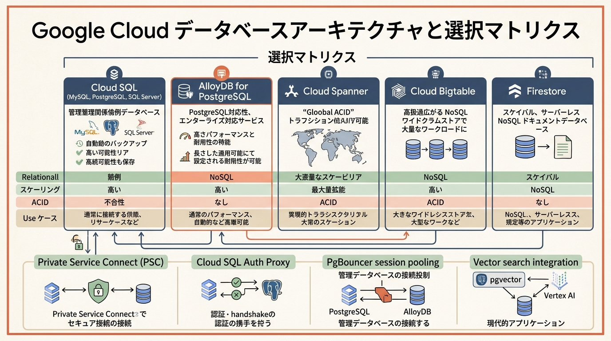
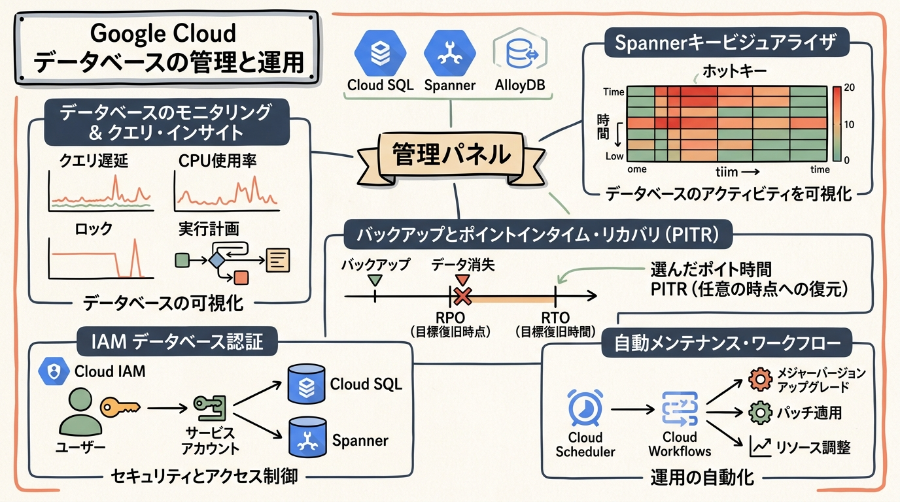
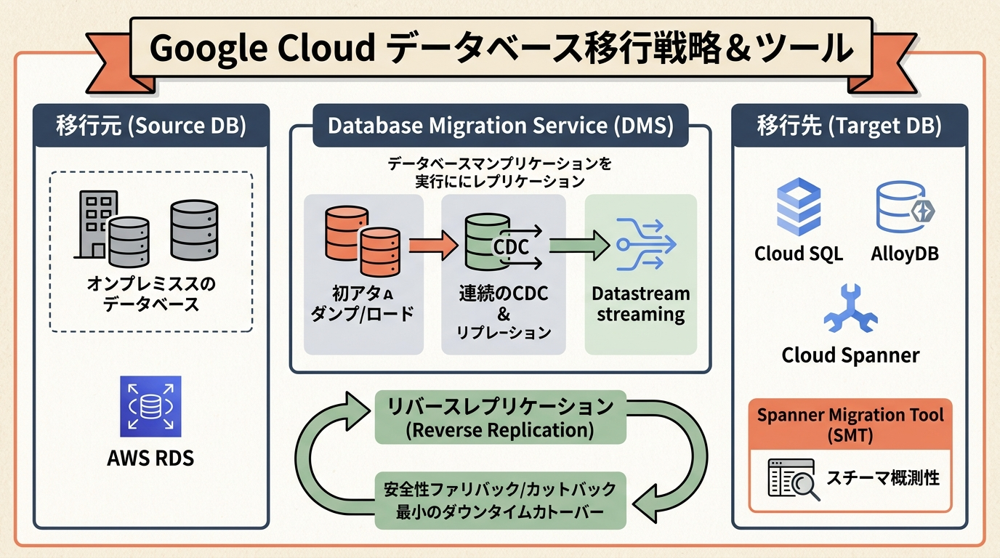
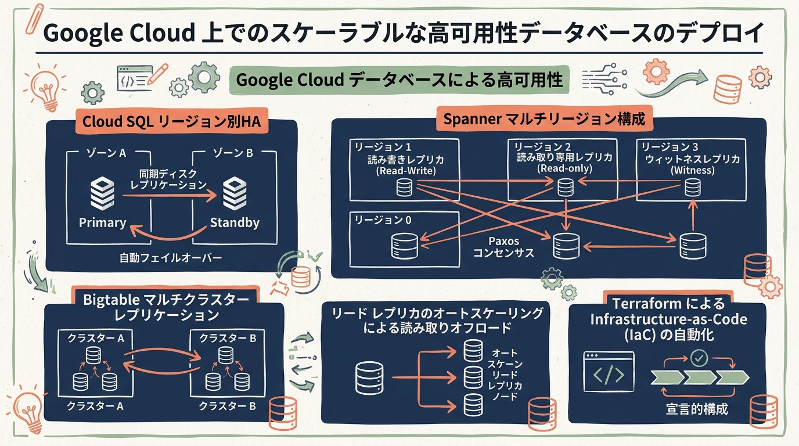

# Google Cloud Certified - Professional Cloud Database Engineer 完全対策＆実践学習ガイド

- **対象資格**: Google Cloud Certified - Professional Cloud Database Engineer (PCDBE)
- **公式試験ガイド**: [Professional Cloud Database Engineer 認定試験ガイド (日本語版)](https://services.google.com/fh/files/misc/professional_cloud_database_engineer_exam_guide_japanese.pdf?hl=ja)
- **公式試験ページ**: [Professional Cloud Database Engineer | Google Cloud Certification](https://cloud.google.com/learn/certification/cloud-database-engineer?hl=ja)
- **公式学習パス**: [Google Skills - Database Engineer Learning Path](https://www.skills.google/paths/49?hl=ja)
- **最終更新日**: 2026-10-13

---

## はじめに

現代のエンタープライズITにおいて、データは企業の最も重要な資産であり、競争力の源泉です。しかし、単にデータを保管するだけでは不十分であり、爆発的に増加するトランザクションの処理、ミリ秒未満の超低レイテンシ応答、99.999% に達する高可用性、そして生成 AI や大規模言語モデル（LLM）と連携したリアルタイム推論など、データベースインフラに求められる要件は前例のないレベルで複雑化・高度化しています。

従来のオンプレミス環境におけるモノリシックな RDBMS 運用では、ストレージの枯渇、リード・ライトのボトルネック、計画停止を伴うメンテナンス、煩雑なフェイルオーバー手順などがシステムの俊敏性を著しく阻害していました。これに対し、Google Cloud はフルマネージドのリレーショナルデータベースである Cloud SQL、エンタープライズ向け PostgreSQL 互換の AlloyDB、グローバル規模で水平スケールしながら強整合性を提供する Cloud Spanner、超高スループットを誇る NoSQL の Cloud Bigtable、サーバーレスドキュメント型の Firestore など、ワークロードの特性に最適化された強力なマネージドデータベース群を提供しています。

Google Cloud Certified - Professional Cloud Database Engineer は、これらのデータベース技術のアーキテクチャ、内部メカニズム、トレードオフを熟知し、ビジネス要件・技術要件をスケーラブルで復元力が高く、費用対効果の高いクラウドソリューションへと変換・実装・運用できる最高峰の実務エンジニアを認定する資格です。

本ガイドは、最新の公式試験ガイドに完全準拠し、全 4 セクションの核心概念、比較マトリクス、板書風グラフィックレコーディング（要約スライド挿絵）、全 28 件の構造化実践シナリオ（状況・対応・結果・解説）、および厳選されたハンズオンラボをセクションごとにカプセル化して収録した完全対策ノートです。

### Professional Cloud Database Engineer 試験とは

Professional Cloud Database Engineer は、アプリケーションでデータの保存と取得に使用される Google Cloud データベースを設計、作成、管理、移行、トラブルシューティングする能力を検証するプロフェッショナルレベルの認定資格です。

- **試験時間**: 120 分（2 時間）
- **出題問題数**: 50〜60 問
- **出題形式**: 択一選択問題（4 肢中 1 つ選択）、複数選択問題（5 肢以上中 2 つ以上選択）
- **受験料**: $200（税別）
- **合否判定**: 合格 / 不合格（スケールドスコアや正答率は非開示）
- **前提知識**: データベース管理・設計に関する 5 年以上の実務経験、および Google Cloud 上でのソリューション設計・管理に関する 2 年以上の実務経験が推奨されます。

### 難易度と求められる思考力

当試験の難易度は **プロフェッショナル最上位（詳細な内部アーキテクチャ、可用性・整合性モデル、障害復旧、トラブルシューティング思考重視）** に位置づけられます。

単なる製品名やサービス仕様の暗記では合格は不可能です。試験では「厳しい RTO / RPO 制約下でどの復旧方式を選ぶべきか」「数万 QPS の突発的バーストに対してホットスポットを回避する主キー設計は何か」「レプリケーション遅延やロック競合が発生した際にどのメトリクスを調査し、パラメータをどう調整すべきか」「ダウンタイムを最小化しつつオンプレミスから移行し、不具合時に安全に切り戻す（フォールバック）手順は何か」といった、**現場のシニアデータベースアーキテクトとしての深い洞察と意思決定能力** が問われます。

合格のために確立すべき 4 つの思考軸は以下の通りです：
1. **整合性とスケーラビリティのトレードオフ判断**: ACID 特性を維持しつつグローバルスケールが必要であれば Cloud Spanner、PostgreSQL の高度な互換性と高速トランザクション・分析処理が必要であれば AlloyDB、既存 MySQL / PostgreSQL / SQL Server 資産のリフト＆シフトであれば Cloud SQL、ペタバイト級の単一キー超高スループットであれば Bigtable を選定する基準の明確化
2. **ゼロデータロスと高可用性（HA / DR）のメカニズム理解**: リージョン内同期ディスクレプリケーションによる自動フェイルオーバー（Cloud SQL / AlloyDB）、マルチリージョンにおける Paxos コンセンサスアルゴリズムとウィットネスノードの役割（Spanner）、クロスリージョンリードレプリカを用いたディザスタリカバリ設計
3. **オブザーバビリティとクエリ最適化の診断力**: Cloud Monitoring、Cloud Logging、Query Insights、Key Visualizer を駆使し、CPU 飽和、IOPS ボトルネック、ロック競合、実行計画の非効率性（フルテーブルスキャン、ソート処理）の根本原因を特定するトラブルシューティング手順
4. **安全確実なマイグレーション＆レプリケーション戦略**: Database Migration Service（DMS）を用いた継続的 CDC レプリケーション、最小停止時間でのカットオーバー、および本番障害時に旧環境へ戻すリバースレプリケーション（切り戻し）の綿密な設計

### 推奨の勉強法

1. **公式一次ドキュメントとアーキテクチャガイドの精読**
   Cloud SQL、AlloyDB、Spanner、Bigtable の各製品ドキュメントにおける「高可用性」「バックアップと復元」「クエリのパフォーマンス」「移行」「インデックス作成のベストプラクティス」を徹底的に読み込みます。
2. **Google Skills（ハンズオンラボ）による実機検証**
   Cloud SQL インスタンスの作成、プライベート IP（PSC / プライベートサービスアクセス）構成、DMS による移行タスク、Spanner のスキーマ設計と Key Visualizer の解析などをハンズオンで実際に操作し、肌感覚を掴みます。
3. **構造化実践シナリオの「解説（代替案の棄却理由）」の精読**
   本ガイドに収録された全 28 件の実践シナリオを通じ、正解のアクションだけでなく「なぜ他の選択肢では要件を満たせないのか（コスト過多、ダウンタイム超過、データ損失リスク等）」のロジックを完全に理解します。

---

## 目次

1. [はじめに](#はじめに)
2. [学習カリキュラム・出題範囲ロードマップ](#学習カリキュラム出題範囲ロードマップ)
3. [Section 1: 革新的でスケーラブルな高可用性クラウド データベース ソリューションを設計する (約 32%)](#section-1-革新的でスケーラブルな高可用性クラウド-データベース-ソリューションを設計する-約-32)
4. [Section 2: 複数のデータベース技術にまたがるソリューションを管理する (約 25%)](#section-2-複数のデータベース技術にまたがるソリューションを管理する-約-25)
5. [Section 3: データ ソリューションを移行する (約 23%)](#section-3-データ-ソリューションを移行する-約-23)
6. [Section 4: Google Cloud にスケーラブルな高可用性データベースをデプロイする (約 20%)](#section-4-google-cloud-にスケーラブルな高可用性データベースをデプロイする-約-20)
7. [まとめと推奨学習ステップ](#まとめと推奨学習ステップ)

---

## 学習カリキュラム・出題範囲ロードマップ

### セクション一覧と出題比率

| セクション番号 | セクション名 / 出題分野 | 出題比率 | 主要対象サービス・ツール |
| :--- | :--- | :--- | :--- |
| **Section 1** | 革新的でスケーラブルな高可用性クラウド データベース ソリューションを設計する | 約 32% | Cloud SQL, AlloyDB for PostgreSQL, Cloud Spanner, Cloud Bigtable, Firestore, Memorystore, Private Service Connect (PSC), Cloud SQL Auth Proxy, PgBouncer, CMEK, pgvector |
| **Section 2** | 複数のデータベース技術にまたがるソリューションを管理する | 約 25% | IAM データベース認証, Query Insights, Key Visualizer, 自動バックアップ / オンデマンドバックアップ, PITR, EXPLAIN ANALYZE, Spanner PU / ノード, AlloyDB リードプール, Cloud Scheduler |
| **Section 3** | データ ソリューションを移行する | 約 23% | Database Migration Service (DMS), Datastream, Spanner Migration Tool (SMT), CDC レプリケーション, リバースレプリケーション, スキーマ変換, pg_dump / mysqldump |
| **Section 4** | Google Cloud にスケーラブルな高可用性データベースをデプロイする | 約 20% | Cloud SQL Regional HA, AlloyDB Regional HA, Spanner Multi-Region (Paxos), Bigtable Multi-Cluster, リードレプリカ, フェイルオーバーテスト, Terraform |

---

### セクション別出題詳細

#### Section 1: 革新的でスケーラブルな高可用性クラウド データベース ソリューションを設計する (約 32%)
- **出題の狙い**: ビジネス要件（レイテンシ、スループット、整合性モデル、コスト、規制）に基づき、最適な Google Cloud データベースを選択し、サイジング、ネットワークトポロジ、暗号化、セッション管理、および生成 AI 連携を考慮したアーキテクチャを設計する能力を評価します。
- **主要タスク**:
  - Task 1.1: 容量計画と使用計画の実行（ワークロード指標に基づくサイズ設定、コンピュート/ストレージのトレードオフ評価）
  - Task 1.2: 高可用性と障害復旧オプションの評価（ゾーン / リージョン / マルチリージョン戦略、メンテナンス時間枠）
  - Task 1.3: アプリケーション接続トポロジの決定（PSC、Auth Proxy、セッションプーラー PgBouncer、監査ポリシー）
  - Task 1.4: 最適なデータベースソリューションの評価（マネージド vs 非マネージド、SQL vs NoSQL、コスト比較、組織ポリシー、ベクトル検索統合）
- **重要キーワード**: Cloud SQL, AlloyDB, Cloud Spanner, Cloud Bigtable, Firestore, Private Service Connect (PSC), Cloud SQL Auth Proxy, PgBouncer, CMEK, pgvector, Spanner Vector Search

#### Section 2: 複数のデータベース技術にまたがるソリューションを管理する (約 25%)
- **出題の狙い**: 稼働中データベースにおける IAM アクセス制御、パフォーマンス監視、ロック・遅延クエリのボトルネック調査、バックアップと PITR、コストとスループットの最適化、定期メンテナンスタスクの自動化を遂行する実務能力を評価します。
- **主要タスク**:
  - Task 2.1: 接続とアクセス管理の決定（IAM データベース認証、ビルトイン認証管理）
  - Task 2.2: モニタリングとトラブルシューティングの構成（Query Insights, Key Visualizer, 指標調査, アラート設定）
  - Task 2.3: バックアップと復元の設計（自動バックアップ, インポート/エクスポート, RTO / RPO / PITR, データ保持）
  - Task 2.4: コストとパフォーマンスの最適化（スケールアップ vs スケールアウト, Spanner PU 調整, AlloyDB リードプール, クエリ最適化）
  - Task 2.5: 一般的なデータベースタスクの自動化（インデックス再構築, エクスポートスケジュール化, メジャーアップグレード）
- **重要キーワード**: IAM Database Authentication, Query Insights, Key Visualizer, Lock Contention, PITR, RTO / RPO, Spanner PU, AlloyDB Read Pool, EXPLAIN ANALYZE, Cloud Scheduler

#### Section 3: データ ソリューションを移行する (約 23%)
- **出題の狙い**: オンプレミスや他社クラウドから Google Cloud マネージドデータベースへ、ダウンタイムを最小化しつつ安全に移行するための戦略策定、CDC 継続レプリケーション、スキーマ変換、および切り戻し（リバースレプリケーション）を設計・実行する能力を評価します。
- **主要タスク**:
  - Task 3.1: データの移行とレプリケーションの設計・実装（最小ダウンタイム移行戦略, リバースレプリケーション, スキーマ/DDL変換, DMS / Datastream / SMT 選定）
- **重要キーワード**: Database Migration Service (DMS), Datastream, Change Data Capture (CDC), Reverse Replication, Fallback Strategy, Spanner Migration Tool (SMT), Homogeneous vs Heterogeneous Migration

#### Section 4: Google Cloud にスケーラブルな高可用性データベースをデプロイする (約 20%)
- **出題の狙い**: エンタープライズ SLA（99.99%〜99.999%）を担保するため、リージョン内・マルチリージョンの高可用性構成を構築し、フェイルオーバーテスト、リードレプリカ拡張、IaC（Terraform）プロビジョニング自動化、および可用性監視を実装する能力を評価します。
- **主要タスク**:
  - Task 4.1: 高可用性データベースの実装（Cloud SQL / AlloyDB Regional HA, Spanner Multi-Region, フェイルオーバーテスト, リードレプリカデプロイ, Terraform 自動化）
- **重要キーワード**: Regional HA (Primary & Standby), Multi-Region Spanner (Paxos), Bigtable Multi-Cluster, Failover Testing, Read Replicas, Terraform Provisioning

---

## Section 1: 革新的でスケーラブルな高可用性クラウド データベース ソリューションを設計する (約 32%)

本セクションでは、Google Cloud が提供する多様なデータベースサービス（Cloud SQL, AlloyDB, Cloud Spanner, Cloud Bigtable, Firestore, Memorystore）の基本特性とアーキテクチャを理解し、要件に応じた最適な選定基準を確立します。また、安全なネットワーク接続トポロジ、暗号化、セッションプーリング、および生成 AI 向けのベクトル検索統合について学習します。



---

### 1. セクション概要

データベース設計の成否は、アプリケーションのデータアクセスパターン（トランザクション処理 OLTP、分析処理 OLAP、ハイブリッド HTAP）、スケーラビリティ要件（垂直スケール限界と水平シャーディングの要否）、整合性要件（厳格な ACID 特性、外部一貫性、結果整合性）、およびレイテンシ要件を正しく分類することから始まります。

#### 重要キーワード

- **Cloud SQL**: MySQL、PostgreSQL、SQL Server をサポートするフルマネージドリレーショナルデータベース。リージョン内同期レプリケーションによる高可用性、自動バックアップ、リードレプリカを提供。
- **AlloyDB for PostgreSQL**: コンピュートとストレージを分離した次世代のエンタープライズ向け PostgreSQL 互換データベース。標準 PostgreSQL の 4 倍以上のトランザクション処理性能と、カラム型エンジンによる高速分析処理を実現。
- **Cloud Spanner**: グローバル規模で無制限に水平スケールしながら、リレーショナルデータモデルと厳格な外部一貫性（ACID）を提供するミッションクリティカル向け分散データベース。TrueTime API と Paxos コンセンサスを採用。
- **Cloud Bigtable**: ペタバイト規模のデータをミリ秒未満のレイテンシで処理する、広範にスケール可能な NoSQL ワイドカラム型データベース。IoT、時系列データ、広告配信、高頻度金融取引に最適。
- **Firestore**: ドキュメント指向のサーバーレス NoSQL データベース。クライアント SDK との直接通信、リアルタイムリスナー、強力なオフライン同期機能を備え、ウェブ・モバイルアプリに最適。
- **Private Service Connect (PSC)**: サービスコンシューマの VPC から、プライベート IP アドレス（エンドポイント）を介して Google マネージドデータベースへ一方向かつ安全に接続する推奨ネットワーキング方式。IP アドレスの競合を防止。
- **Cloud SQL Auth Proxy**: 公開 IP やプライベート IP への接続時に、SSL/TLS 証明書の自己管理不要で IAM 認証に基づいたエンドツーエンドのセキュアな暗号化トンネルを提供するローカルプロキシ。
- **PgBouncer**: PostgreSQL 向けの軽量コネクションプーラー。サーバーレスアーキテクチャ（Cloud Run 等）からの急激な同時接続バーストによる DB 接続数枯渇やメモリオーバーヘッドを防止。
- **pgvector & Spanner Vector Search**: リレーショナルデータベース内にテキストや画像のベクトル埋め込みを格納し、k-NN / ANN 類似検索を実行可能にする機能。Vertex AI 連携により RAG（検索拡張生成）基盤を単一 DB で完結。

---

### 2. 重要トピック

#### 1. Google Cloud データベース選定マトリクス

| 比較項目 / サービス | Cloud SQL | AlloyDB for PostgreSQL | Cloud Spanner | Cloud Bigtable | Firestore |
| :--- | :--- | :--- | :--- | :--- | :--- |
| **データモデル** | リレーショナル (MySQL, PG, SQL Server) | リレーショナル (PostgreSQL 完全互換) | リレーショナル (ANSI SQL, PG 方言) | NoSQL (ワイドカラム型) | NoSQL (ドキュメント型) |
| **トランザクション整合性** | ACID (単一インスタンス) | ACID (単一クラスタ) | 厳格な外部一貫性 (グローバル ACID) | 単一行 ACID (複数行は非サポート) | ドキュメント単位 / 複数ドキュメント ACID |
| **スケーラビリティ** | 主に垂直スケール (リードレプリカで読込分散) | 垂直スケール + 読込プール (最大20ノード) | 無制限の水平スケール (コンピュート/ストレージ分離) | 無制限の水平スケール (ノード増減で即時拡張) | 完全サーバーレス自動スケール |
| **可用性 (SLA)** | 99.95% (Regional HA) | 99.99% (Regional HA) | 99.99% (Regional) / 99.999% (Multi-Region) | 99.9% (Single) / 99.999% (Multi-Cluster) | 99.99% (Regional) / 99.999% (Multi-Region) |
| **主な用途** | 既存アプリのリフト＆シフト、中規模 Web / ERP | 高負荷 OLTP、HTAP (ハイブリッド分析)、大規模 PG 移行 | 金融決済、在庫管理、世界規模のミッションクリティカル | IoT、時系列データ、広告ログ、大規模分析の事前集計 | モバイル・Web アプリ、ユーザープロファイル、ゲームステート |

- **アーキテクトの選定基準**:
  - **グローバル規模でデータ更新が発生し、一切のダウンタイムや不整合が許されない場合**: 迷わず **Cloud Spanner** を選定します。シャーディングの手間なくテラバイト〜ペタバイトへ無停止で拡張可能です。
  - **既存 PostgreSQL 資産を活用しつつ、商用 RDBMS 並みの高性能・高可用性と分析クエリの高速化を両立したい場合**: **AlloyDB for PostgreSQL** を選定します。カラム型エンジンにより集計クエリが最大 100 倍高速化されます。
  - **一般的な Web アプリや企業基幹システムで、標準的な MySQL / PostgreSQL / SQL Server を利用する場合**: 最も費用対効果の高い **Cloud SQL** を選定します。
  - **書き込みスループットが数万〜数百万 QPS に達し、単一キーによる低レイテンシアクセスが求められる場合**: **Cloud Bigtable** を選定します。

#### 2. セキュアな接続トポロジとセッション管理

Google Cloud マネージドデータベースへの接続には、セキュリティと運用性に応じた明確な設計パターンが存在します。

```text
[ クライアント環境 ]
 Cloud Run / GKE / Compute Engine
         │
         ▼ (IAM 認証 / 自動 TLS)
[ Cloud SQL Auth Proxy / PgBouncer ]
         │
         ▼ (Private IP 通信)
┌────────────────────────────────────────────────────────┐
│ VPC ネットワーク                                       │
│   ・Private Service Connect (PSC) エンドポイント       │
│     または プライベート サービス アクセス (PSA)         │
└────────────────────────┬───────────────────────────────┘
                         │ (Google 内部バックボーン)
                         ▼
┌────────────────────────────────────────────────────────┐
│ マネージド データベース VPC                             │
│   Cloud SQL / AlloyDB / Spanner                        │
└────────────────────────────────────────────────────────┘
```

1. **Private Service Connect (PSC)**:
   コンシューマ VPC 内に転送ルール（フォワーディングルール）とプライベート IP エンドポイントを作成し、プロデューサ VPC（Google マネージド DB）へ接続します。従来の VPC ピアリング（プライベートサービスアクセス）と異なり、CIDR ブロックの重複を気にする必要がなく、最小限の IP（/32）で接続できるため、エンタープライズのマルチ VPC 環境におけるベストプラクティスです。
2. **コネクションプーラー（PgBouncer）の必要性**:
   PostgreSQL は接続ごとにプロセスをフォークするため、アクティブ接続数が増加するとメモリを大量消費し、コンテキストスイッチのオーバーヘッドでスループットが急落します。Cloud Run や Cloud Functions などのサーバーレス環境から直接接続すると、インスタンスの急激なスケールアウトに伴い DB の `max_connections` が即座に枯渇します。PgBouncer を間に配置し、トランザクションプーリングを実施することで、物理接続数を数十本程度に抑えつつ数千クライアントからのリクエストを処理できます。

---

### 3. 実践シナリオ

#### シナリオ 1-1: グローバル展開における水平スケーラビリティと厳格な外部一貫性の確保

- **状況**: 世界中のユーザーから毎秒数万件の金融取引・残高更新リクエストが発生し、データの不整合（二重引き落とし等）が絶対に許されず、リージョン障害時でもダウンタイムなしで稼働し続ける必要がある場合
- **対応**: Cloud Spanner のマルチリージョン構成を採用し、テーブルの主キーに自然キーやハッシュ化された UUID を用いて負荷を均等分散させるアーキテクチャを設計する
- **結果**: 複数リージョンにまたがるトランザクションにおいて厳格な外部一貫性（ACID）が維持され、計画外のリージョン停止時でも 99.999% の可用性を実現する
- **解説**: Cloud Spanner は、Google の TrueTime API（原子時計と GPS を用いた精密同期）と Paxos コンセンサスアルゴリズムを統合することで、グローバル分散環境でありながら直列化可能（Serializable）なトランザクションと外部一貫性を保証できる唯一のデータベースであるためです。Cloud SQL では単一リージョン内の垂直スケールに制約され、複数リージョンへの書き込みスケールが不可能なため要件を満たせません。また、Cloud Bigtable や Datastore / Firestore ではクロスリージョンにおける強力なトランザクション保証やリレーショナル結合が提供されないため不適格です。
- **参考ドキュメント**:
  - [Cloud Spanner の概要とアーキテクチャ](https://cloud.google.com/spanner/docs/overview?hl=ja): グローバル分散トランザクションと可用性 SLA の詳細

#### シナリオ 1-2: 高負荷トランザクションとリアルタイム分析が混在する PostgreSQL システムの刷新

- **状況**: 既存のオンプレミス PostgreSQL で運用している基幹 ERP システムにおいて、日常の受発注トランザクション（OLTP）の処理性能が限界に達していると同時に、経営陣からのリアルタイム集計クエリ（OLAP）によって本番 DB の CPU が枯渇している場合
- **対応**: AlloyDB for PostgreSQL を採用し、プライマリインスタンスに加えて分析用のリードプール（Read Pool）をデプロイし、カラム型エンジン（Columnar Engine）を有効化する
- **結果**: トランザクション処理性能が標準 PostgreSQL の 4 倍以上に向上し、分析集計クエリがインメモリ・カラム型キャッシュにより最大 100 倍高速化され、OLTP ワークロードへの影響が完全に排除される
- **解説**: AlloyDB はストレージレイヤとコンピュートレイヤを分離したクラウドネイティブアーキテクチャを採用しており、分析ワークロードに対して透過的なカラム型エンジンをリードプールに適用できるためです。標準の Cloud SQL for PostgreSQL では、分析クエリがプライマリと同じ行指向ストレージから読み出すため I/O 競合が発生し、リードレプリカを追加してもカラム型最適化の恩恵は得られないため不適格です。また、BigQuery への ETL 転送では数分から数時間のバッチ遅延が発生し、リアルタイム性が失われるため要件を満たせません。
- **参考ドキュメント**:
  - [AlloyDB カラム型エンジンの概要](https://cloud.google.com/alloydb/docs/columnar-engine/overview?hl=ja): HTAP ワークロードを加速するカラム型キャッシュの仕組み

#### シナリオ 1-3: IoT デバイスからの超高スループット時系列データの取り込みとミリ秒未満応答

- **状況**: 数百万台のスマートメーターから毎秒数ミリ秒間隔でテレメトリデータ（センサー値・タイムスタンプ）が送信され、書き込みスループットが毎秒 50 万 QPS を超え、最新データの参照がミリ秒未満のレイテンシで要求される場合
- **対応**: Cloud Bigtable をプロビジョニングし、行キーの先頭にデバイス ID のソルト値またはハッシュを付与し、タイムスタンプを逆順（リバースタイムスタンプ）で付与するスキーマを設計する
- **結果**: 書き込み負荷が全クラスタノードに均等に分散され、ホットスポットを発生させることなく線形にスケールし、ミリ秒未満の超低レイテンシで書き込みと最新値の取得が完了する
- **解説**: Cloud Bigtable は大規模な単一キーアクセスに最適化された NoSQL ワイドカラムストアであり、ノード数に比例して線形にスループットを拡張できるためです。行キー設計においてタイムスタンプを先頭に配置すると最新データが単一ノードに集中するホットスポットが発生しますが、デバイス ID などの高カーディナリティな値をプレフィックスにすることで負荷が分散されます。Cloud SQL や AlloyDB では 50 万 QPS の連続書き込みに対して単一書き込みノードがボトルネックとなり破綻するため不適格です。
- **参考ドキュメント**:
  - [Cloud Bigtable スキーマ設計のベストプラクティス](https://cloud.google.com/bigtable/docs/schema-design?hl=ja): 時系列データにおける行キー設計原則

#### シナリオ 1-4: モバイルアプリケーション向けのリアルタイム同期とオフライン機能の実装

- **状況**: フィールドエンジニア向けの点検報告モバイルアプリにおいて、電波の届かない地下施設での作業中もデータ入力と閲覧が可能であり、通信復帰時に自動でクラウドとデータが同期され、他ユーザーの変更がリアルタイムに画面へ反映される必要がある場合
- **対応**: Firestore（ネイティブモード）を採用し、モバイルクライアント SDK を用いてローカルオフライン永続化とリアルタイムリスナー（スナップショットリスナー）を実装する
- **結果**: ネットワーク切断時でもローカルキャッシュに対してシームレスに読み書きが行われ、オンライン復帰時に競合解決を伴って自動同期が完了する
- **解説**: Firestore（ネイティブモード）は、モバイルおよびウェブクライアント向けに強力なオフラインデータ永続化とリアルタイム双方向同期プロトコルを標準で備えているためです。Cloud SQL や AlloyDB ではモバイル端末から直接安全に接続することができず、API サーバーを介した複雑なオフラインキャッシュと同期エンジンの自作が必要となり開発・運用コストが膨大化するため不適格です。また、Firestore Datastore モードはバックエンドサーバー向けであり、クライアント SDK やリアルタイムリスナーに対応していないため要件を満たせません。
- **参考ドキュメント**:
  - [Firestore データベース モードの選択](https://cloud.google.com/firestore/docs/firestore-or-datastore?hl=ja): ネイティブ モードと Datastore モードの比較

#### シナリオ 1-5: サーバーレス環境からの急激な同時接続バーストによる DB 接続数枯渇の防止

- **状況**: Cloud Run 上でマイクロサービスを運用しており、突発的なアクセス急増に伴いコンテナインスタンスが数百台へオートスケールした結果、バックエンドの Cloud SQL for PostgreSQL で `FATAL: remaining connection slots are reserved for non-replication superuser connections` エラーが頻発している場合
- **対応**: Compute Engine または GKE 上にステートレスな PgBouncer をデプロイ（またはマネージドなコネクションプーラーを構成）し、トランザクションプーリングモードで接続を集約する
- **結果**: Cloud Run からの数千の同時接続が数十本の物理接続へと多重化され、DB の接続上限エラーが解消しメモリ消費が安定する
- **解説**: PostgreSQL は接続ごとに専用のバックエンドプロセスをフォークするため、メモリオーバーヘッドが大きく `max_connections` の上限に達しやすい仕様であるためです。PgBouncer をトランザクションモードで挟むことで、クライアントがトランザクションを実行している間のみ物理接続を割り当て、完了直後に解放して再利用できるため、接続リソースを劇的に節約できます。Cloud SQL インスタンスのマシンタイプをスケールアップして接続上限を引き上げる手法は、不要な高額コストが発生する上にプロセスのコンテキストスイッチ負荷を根本解決できないため不適格です。
- **参考ドキュメント**:
  - [Cloud SQL での接続の管理と PgBouncer の使用](https://cloud.google.com/sql/docs/postgres/connect-overview?hl=ja): コネクションプーリングのベストプラクティス

#### シナリオ 1-6: 共有 VPC 環境における IP 枯渇回避と最小権限のセキュア接続

- **状況**: 大規模エンタープライズにおいて、社内ネットワークのプライベート IPv4 アドレス空間が極めて逼迫しており、異なるプロジェクトで稼働する Cloud SQL インスタンス群に対して、大規模な CIDR ブロック（/24 等）を割り当てることなく安全に接続したい場合
- **対応**: Cloud SQL インスタンスで Private Service Connect（PSC）を有効化し、接続元 VPC 側で単一のプライベート IP アドレス（転送ルール）を割り当てて通信を確立する
- **結果**: 大規模なサブネット予約を必要とせず、単一のホスト IP（/32）のみでデータベースへのプライベート接続が実現し、VPC ピアリングによるルーティング制限も回避される
- **解説**: Private Service Connect（PSC）は、サービスプロデューサとコンシューマをエンドポイント（転送ルール）経由で一方向に疎結合接続するため、コンシューマ VPC 側の IP アドレス消費を最小限（接続ごとに 1 つの内部 IP）に抑えられるためです。従来のプライベートサービスアクセス（PSA / VPC ピアリング）では、事前に /24 などの広範な連続 IP 空間を予約する必要があり、IP 枯渇環境では要件を満たせません。また、公開 IP を付与して認証プロキシ経由でアクセスする構成は、セキュリティ統制上プライベート IP 接続が義務付けられているエンタープライズ基準に反するため不適格です。
- **参考ドキュメント**:
  - [Cloud SQL の Private Service Connect の概要](https://cloud.google.com/sql/docs/mysql/configure-private-service-connect?hl=ja): PSC を使用したセキュア接続

#### シナリオ 1-7: 生成 AI アプリケーション向けのベクトル類似検索とリレーショナルデータの単一トランザクション管理

- **状況**: Eコマースサイトにおいて、商品のメタデータ（価格、在庫、カテゴリ）と商品の画像・説明文から生成されたベクトル埋め込み（Embedding）を管理し、商品更新と埋め込み更新をアトミックに実行しつつ、類似商品検索を高速に提供したい場合
- **対応**: AlloyDB for PostgreSQL で `pgvector` 拡張機能と ScaNN（Google 開発の高速近似最近傍探索インデックス）を有効化し、単一の SQL クエリでリレーショナルフィルタとベクトル検索を同時に実行する
- **結果**: 外部の専用ベクトルデータベースを導入することなく、同一トランザクション内で商品情報と埋め込みの一貫性が保証され、標準 pgvector よりも数倍高速な ANN 検索が実現する
- **解説**: AlloyDB は Google 独自の高度なベクトル検索アクセラレーション（ScaNN 統合）を提供しており、リレーショナルデータと埋め込みデータを同一の ACID トランザクション内でアトミックに管理できるためです。外部のスタンドアロンなベクトル検索 DB（Pinecone や Milvus 等）を併用するアプローチは、2相コミットに対応しておらず、在庫更新と埋め込み更新の間に不整合が発生するリスクや二重運用のオーバーヘッドが生じるため不適格です。また、Cloud Bigtable ではベクトルインデックスやコサイン類似度計算をネイティブにサポートしていないため要件を満たせません。
- **参考ドキュメント**:
  - [AlloyDB におけるベクトル埋め込みの操作と ScaNN インデックス](https://cloud.google.com/alloydb/docs/ai/work-with-embeddings?hl=ja): 生成 AI ワークロードの統合

---

### 4. 参考ドキュメント & 推奨ハンズオン

#### 公式一次ドキュメント
- [データベースの選択ガイド - Google Cloud](https://cloud.google.com/products/databases?hl=ja): ユースケース別のデータベース製品選定フロー
- [Cloud SQL ネットワーク接続オプションの概要](https://cloud.google.com/sql/docs/mysql/connect-overview?hl=ja): PSC、PSA、パブリック IP の比較
- [Cloud Spanner スキーマ設計のベストプラクティス](https://cloud.google.com/spanner/docs/schema-and-data-model?hl=ja): ホットスポット防止とインターリーブ設計

#### 推奨ハンズオン・ラボ（実機検証）
- [Create and Manage Cloud Spanner Instances (Google Skills)](https://www.skills.google/focuses/1162?parent=catalog):
  - **学習目標**: Cloud Spanner インスタンスの作成、ノード数のスケーリング、インターリーブテーブルの作成、DDL 変更、および SQL クエリ実行による動作検証
- [AlloyDB for PostgreSQL: Qwik Start (Google Skills)](https://www.skills.google/focuses/47093?parent=catalog):
  - **学習目標**: AlloyDB クラスタおよびプライマリインスタンスのプロビジョニング、リードプールの作成、PostgreSQL クライアントからの接続とカラム型エンジンの有効化検証

---

## Section 2: 複数のデータベース技術にまたがるソリューションを管理する (約 25%)

本セクションでは、稼働中のデータベースシステムに対するセキュアな認証、詳細なパフォーマンス監視、クエリプロファイリング、バックアップ・復元（PITR）、コストとスループットの最適化、およびルーチン保守の自動化について学習します。



---

### 1. セクション概要

データベース管理者の責務は、安定稼働とデータ保護にとどまらず、プロアクティブなパフォーマンス改善と運用コストの適正化です。静的パスワードから短時間トークンによる IAM 認証への移行、Query Insights や Key Visualizer を用いたボトルネックの即時特定、厳格な RTO / RPO 要件を満たす PITR 設計、および Cloud Scheduler を活用したルーチンタスクの完全自動化が中核となります。

#### 重要キーワード

- **IAM データベース認証**: データベース固有のユーザー名・パスワードを管理する代わりに、Cloud IAM の ID（ユーザーまたはサービスアカウント）と OAuth2 アクセストークンを用いてデータベースへログインするセキュアな認証方式。クレデンシャルの漏洩リスクを排除。
- **Query Insights**: Cloud SQL の高度なクエリ監視・診断ダッシュボード。クエリの実行時間、CPU 負荷、ロック待機時間、実行計画を視覚化し、タグ付け（Sqlcommenter）によってアプリケーションコードとクエリの紐付けを可能にする。
- **Key Visualizer**: Cloud Spanner および Cloud Bigtable において、キースペース全体のアクティビティ（読み取り / 書き込みスループット、CPU 使用率）をヒートマップで時系列可視化し、アクセス集中（ホットスポット）を特定する診断ツール。
- **ポイントインタイム リカバリ (PITR)**: ベースバックアップと連続的に保存された先行書き込みログ（WAL）またはバイナリログ（binlog）を組み合わせることで、過去の任意の特定時点（秒単位）にデータベースを復元する機能。
- **RTO (Recovery Time Objective) & RPO (Recovery Point Objective)**: RTO は障害発生からサービス復旧までに許容される最大停止時間。RPO は復旧時に許容される最大データ損失時間。
- **Spanner Processing Units (PU)**: Cloud Spanner のコンピュート容量の最小単位。1 ノード = 1,000 PU であり、小規模ワークロード向けに 100 PU 単位でのきめ細かなプロビジョニングが可能。
- **EXPLAIN ANALYZE**: クエリの実行計画を表示するだけでなく、実際にクエリを実行して各処理ステップの実測所要時間、読み取り行数、ループ回数を出力する SQL コマンド。

---

### 2. 重要トピック

#### 1. パフォーマンス診断ツールとトラブルシューティングの比較

| ツール / 機能 | Query Insights (Cloud SQL) | Key Visualizer (Spanner / Bigtable) | Cloud Monitoring & Logging |
| :--- | :--- | :--- | :--- |
| **対象データベース** | Cloud SQL (PostgreSQL, MySQL) | Cloud Spanner, Cloud Bigtable | すべての Google Cloud DB サービス |
| **診断対象** | クエリごとのレイテンシ、CPU 負荷、ロック待機、実行計画 | キースペース（行キー）ごとのアクセス分布、ホットスポット | システム全体のリソース（CPU、RAM、ディスク IOPS、接続数） |
| **可視化表現** | 負荷グラフ、クエリ一覧テーブル、実行計画ツリー | 2D ヒートマップ（横軸: 時間、縦軸: キースペース、色: 負荷） | 時系列折れ線グラフ、ログエクスプローラ |
| **主な用途** | スロークエリの特定、インデックス欠落の検出、ロック競合解消 | シーケンシャル主キーによる単一ノード負荷偏りの特定 | リソース枯渇アラート、フェイルオーバーログ検知 |

- **アーキテクトの診断アプローチ**:
  - **Cloud SQL で CPU が 100% に達している場合**: まず Cloud Monitoring で全体リソースを確認し、即座に **Query Insights** を開いて負荷の大部分を占めるトップクエリを特定します。実行計画（EXPLAIN）を確認し、シーケンシャルスキャン（Seq Scan）が発生している場合は適切なインデックスを作成します。
  - **Spanner でノードを追加してもレイテンシが改善しない場合**: **Key Visualizer** を開き、ヒートマップ上で特定の水平線（特定のキー範囲）が濃い赤色（高負荷）になっていないか確認します。単調増加キーによる書き込みホットスポットが原因であるため、主キーの UUID 化やビット反転、ハッシュソルトを適用します。

#### 2. バックアップ方式と復元戦略の比較

| 方式 | 自動バックアップ | オンデマンド バックアップ | ポイントインタイム リカバリ (PITR) | 論理エクスポート (mysqldump / pg_dump) |
| :--- | :--- | :--- | :--- | :--- |
| **実行契機** | 毎日設定された時間枠で自動実行 | ユーザーが任意のタイミングで手動実行 | 継続的なトランザクションログ記録 | スケジュールスクリプトによる論理出力 |
| **保存先** | Google 管理のバックアップストレージ | Google 管理のバックアップストレージ | WAL / binlog 専用ストレージ | 指定した Cloud Storage バケット |
| **RPO** | 最大 24 時間 | バックアップ実行時点 | 数秒〜数分（ほぼゼロ） | エクスポート実行時点 |
| **復元先** | 新規インスタンスまたは既存インスタンスの上書き | 新規インスタンスまたは既存インスタンスの上書き | 新規インスタンスへの復元 | 既存または新規 DB へのインポート |
| **主な用途** | 日次の基本リカバリ基盤 | 大規模リリースや DDL 変更前の保険 | 誤った DROP / DELETE からのピンポイント復元 | 長期アーカイブ、別環境（開発/検証）への複製 |

---

### 3. 実践シナリオ

#### シナリオ 2-1: 突発的な CPU 飽和時におけるボトルネッククエリの特定と実行計画改善

- **状況**: Cloud SQL for PostgreSQL 本番インスタンスの CPU 使用率が 95% に張り付き、アプリケーションのレスポンスタイムが著しく悪化しているが、どのエンドポイントのどの SQL が原因か判明していない場合
- **対応**: Cloud SQL コンソールで Query Insights を開き、正規化されたクエリ一覧から CPU 負荷と待機時間の最も高いクエリを特定し、EXPLAIN ANALYZE を実行してフルテーブルスキャンを検出した上で適切な複合インデックスを追加する
- **結果**: 該当クエリの実行計画が Index Scan に変化して実行時間が数ミリ秒に短縮され、インスタンスの CPU 使用率が平時の 20% 以下に低下する
- **解説**: Query Insights は、データベースにかかっている負荷（Load by query）を視覚化し、CPU 時間やロック待機を消費している問題のクエリを瞬時に特定できるためです。さらに Sqlcommenter を用いることで ORM やアプリケーションコントローラまでトレースできます。単にインスタンスの CPU コア数を増強する（スケールアップする）対応は、根本的な非効率クエリ（フルスキャン）を放置するため一時しのぎに過ぎず、無駄なコストを恒常化させるため不適格です。また、インスタンスを再起動する対応は、キャッシュクリアにより一時的にさらにパフォーマンスが悪化するリスクがあるため不適格です。
- **参考ドキュメント**:
  - [Cloud SQL Query Insights によるクエリ パフォーマンスの分析](https://cloud.google.com/sql/docs/postgres/using-query-insights?hl=ja): ボトルネッククエリの特定手法

#### シナリオ 2-2: Cloud Spanner における書き込み集中によるパフォーマンス劣化とホットスポット解消

- **状況**: Cloud Spanner で大規模な新規ユーザー登録イベントを実施した際、CPU 使用率が特定のサーバに偏り、書き込み遅延のアラートが発生している場合
- **対応**: Key Visualizer を起動してヒートマップを確認し、主キーの先頭に `AUTO_INCREMENT` や現在日時（TIMESTAMP）を使用しているテーブルを特定し、主キー設計を UUID v4 またはハッシュ化プレフィックスに変更する
- **結果**: 書き込みトランザクションが全スプリットおよび全ノードへ均等に分散され、局所的なホットスポットが解消して低レイテンシが回復する
- **解説**: Spanner はデータを主キーの昇順（辞書順）でソートしてスプリット（データ分割単位）に配置するため、シーケンシャルな値（連番やタイムスタンプ）を主キーの先頭にすると、最新の書き込みがすべて単一のスプリットを管理する単一ノードに集中し、他のノードが遊休状態でもスループットが頭打ちになるためです。UUID やハッシュなどランダム性の高い値を主キーの先頭にすることで、書き込みが全スプリットへ均等に分散されます。Spanner ノード数を一時的に追加する対応は、ホットスポットとなっている単一スプリットの負荷を分散できないため効果がなく不適格です。
- **参考ドキュメント**:
  - [Cloud Spanner Key Visualizer の使用](https://cloud.google.com/spanner/docs/key-visualizer?hl=ja): ホットスポットパターンの分析

#### シナリオ 2-3: 誤った本番 DML 実行によるデータ損失からの最小 RPO 復旧

- **状況**: オペレーターの操作ミスにより、本番 Cloud SQL インスタンスで 14:32:10 に誤った `DELETE FROM orders` が実行され、直近の自動バックアップは前日深夜 02:00 である場合
- **対応**: ポイントインタイム リカバリ（PITR）を使用し、誤操作直前のタイムスタンプ（例: 14:32:00）を指定して新規インスタンスへ復元を実行し、復元データから対象テーブルをエクスポートして本番へリカバリする
- **結果**: 前夜のバックアップ以降に登録された当日のすべての正常なトランザクションが保持され、データ損失（RPO）を数秒以内に抑えて復旧が完了する
- **解説**: Cloud SQL の PITR は、ベースバックアップに加えてトランザクションログ（先行書き込みログ / バイナリログ）を保持しているため、過去 7 日以内の任意の秒単位の時点へインスタンスを復元できるためです。前日深夜の自動バックアップから復元する手法では、当日 02:00 から 14:32 までの 12 時間分以上の正規注文データが永久に消失するため不適格です。また、スタンバイインスタンスへフェイルオーバーさせる手法は、スタンバイにも削除トランザクションが即座に同期されているためデータ消失を解決できず不適格です。
- **参考ドキュメント**:
  - [Cloud SQL でのポイントインタイム リカバリ (PITR)](https://cloud.google.com/sql/docs/postgres/backup-recovery/pitr?hl=ja): トランザクションログによる復元

#### シナリオ 2-4: 法令遵守に伴う長期間の論理バックアップとストレージコストの最適化

- **状況**: 金融コンプライアンス要件により、四半期末のデータベース完全スナップショットデータを 7 年間改ざん不能な状態で保管する必要があるが、Cloud SQL インスタンスストレージや高頻度アクセスストレージのコストを最小限に抑えたい場合
- **対応**: Cloud Scheduler と Cloud Run functions を利用して論理ダンプ（pg_dump / mysqldump）を自動実行し、Cloud Storage の Archive ストレージクラスのバケットへ直接保存し、Object Retention（Bucket Lock）ポリシーを 7 年間に設定する
- **結果**: データベースの論理整合性を保ったダンプが安全にアーカイブされ、テラバイトあたりの月額コストが数分の一に削減され、法的要件が完全に遵守される
- **解説**: Cloud Storage Archive クラスは、年 1 回未満のアクセス頻度のデータに対して最も安価なストレージ単価を提供し、Bucket Lock 機能により法令で義務付けられた保持期間中の削除・上書きを防止できるためです。Cloud SQL の標準自動バックアップは最大保持日数が 365 日（またはデフォルト数日〜数週間）に制限されており、7 年間の長期保持要件を満たせないため不適格です。また、インスタンスを停止した状態で 7 年間維持する手法は、インスタンス予約費用やディスク費用が極めて高額になるため不適格です。
- **参考ドキュメント**:
  - [Cloud Storage のストレージ クラス](https://cloud.google.com/storage/docs/storage-classes?hl=ja): Archive クラスの選定

#### シナリオ 2-5: 日中ピーク時の読み取りスループット不足に対するコスト効率の良い解決

- **状況**: Cloud SQL for MySQL を利用する EC サイトで、ブラックフライデー期間中に商品詳細ページの閲覧リクエストが平時の 10 倍に達し、CPU とディスク読み取り IOPS が枯渇しているが、書き込みリクエスト数は平時と変わらない場合
- **対応**: 同一リージョン内に 2 台のリードレプリカを追加プロビジョニングし、アプリケーションのデータソース設定で参照系クエリの接続先をリードレプリカのエンドポイントにルーティングする
- **結果**: プライマリインスタンスの読み取り負荷が完全にオフロードされ、CPU 使用率が安定し、セール期間終了後はレプリカを削除してコストを平時に戻す
- **解説**: 読み取り専用の負荷急増に対しては、リードレプリカをスケールアウトして参照クエリを分散させることが最も費用対効果が高く、プライマリの更新性能に影響を与えないベストプラクティスであるためです。プライマリインスタンスを大規模なマシンタイプへスケールアップする対応は、インスタンス変更に伴うフェイルオーバー・停止時間が発生する上、書き込み能力が過剰プロビジョニングとなりコスト効率が悪いため不適格です。また、Spanner への全面移行を即座に行うアプローチは、アプリケーションコードの全面改修が必要となり直前のセール対策としては非現実的であるため不適格です。
- **参考ドキュメント**:
  - [Cloud SQL リードレプリカの概要](https://cloud.google.com/sql/docs/mysql/replication/replication-overview?hl=ja): 読み取りトラフィックの分散

#### シナリオ 2-6: PostgreSQL のテーブルブロート防止とトランザクション ID 周回障害の回避

- **状況**: Cloud SQL for PostgreSQL で大量の UPDATE および DELETE を頻繁に実行するバッチ処理を稼働させている環境で、ディスク容量の消費が急増し、将来的なトランザクション ID（XID）周回（wraparound）の警告が発生している場合
- **対応**: データベースフラグで `autovacuum` が有効化されていることを確認した上で、更新頻度の高いテーブルに対して `autovacuum_vacuum_scale_factor` を小さく調整し、Cloud Scheduler を用いて閑散期に `VACUUM ANALYZE` を定期実行する
- **結果**: 不要なデッドタプルが速やかに回収されてテーブルブロートが解消し、ディスク容量の浪費が抑えられ、XID 周回障害のリスクが完全に排除される
- **解説**: PostgreSQL は追記型アーキテクチャ（MVCC）を採用しているため、UPDATE や DELETE された古い行（デッドタプル）は VACUUM 処理によって回収されるまでディスク上に残り続け、放置するとテーブルが肥大化して XID 周回停止を引き起こすためです。テーブル単位で VACUUM の起動閾値を下げ、積極的にタプルを回収することが重要です。`VACUUM FULL` を日中に手動実行する対応は、対象テーブルに排他ロック（ACCESS EXCLUSIVE）がかかり、全トランザクションが完全にブロックされるため本番環境では不適格です。
- **参考ドキュメント**:
  - [Cloud SQL for PostgreSQL での VACUUM の管理](https://cloud.google.com/sql/docs/postgres/flags?hl=ja): パフォーマンスフラグの設定

#### シナリオ 2-7: Cloud SQL のメジャーバージョンアップグレードにおけるダウンタイムと互換性リスクの極小化

- **状況**: PostgreSQL 11 で稼働している Cloud SQL インスタンスをサポート終了に伴い PostgreSQL 15 へアップグレードする必要があるが、本番停止時間を最小限に抑え、アプリケーションの非互換性による障害を確実に防ぎたい場合
- **対応**: 本番インスタンスからクローンインスタンスを作成して PostgreSQL 15 へのインプレースアップグレードおよびアプリケーションの結合テストを事前検証し、問題がないことを確認した上で、メンテナンスウィンドウ中に本番インスタンスのインプレースアップグレードを実行する
- **結果**: 稼働中データに影響を与えることなくアップグレードの成否と所要時間を事前に把握でき、本番作業時は数分程度のダウンタイムで安全にバージョン移行が完了する
- **解説**: Cloud SQL のクローン機能はストレージのスナップショットを利用して同一データを持つ独立環境を瞬時に作成できるため、バージョンアップ手順とアプリ互換性をノーリスクで事前検証できるためです。事前テストを行わずに本番で直接インプレースアップグレードを実行する手法は、万一 SQL 構文や拡張機能の非互換性があった場合に即座に切り戻せずサービス停止が長期化するため不適格です。また、mysqldump / pg_dump によるエクスポート・インポートで新インスタンスを構築する手法は、データ量に比例して数時間の長大なダウンタイムを要するため不適格です。
- **参考ドキュメント**:
  - [Cloud SQL インスタンスのメジャー バージョンのアップグレード](https://cloud.google.com/sql/docs/postgres/upgrade-major-db-version?hl=ja): インプレースアップグレード手順

---

### 4. 参考ドキュメント & 推奨ハンズオン

#### 公式一次ドキュメント
- [Cloud SQL バックアップと復元の概要](https://cloud.google.com/sql/docs/postgres/backup-recovery/backups?hl=ja): 自動バックアップとオンデマンドバックアップの仕様
- [Cloud SQL IAM データベース認証の構成](https://cloud.google.com/sql/docs/postgres/authentication?hl=ja): サービスアカウントを用いたキーレス接続
- [Spanner の CPU 使用率とアラートのベストプラクティス](https://cloud.google.com/spanner/docs/cpu-utilization?hl=ja): 推奨 CPU 閾値（高優先度タスク 65%）

#### 推奨ハンズオン・ラボ（実機検証）
- [Manage PostgreSQL Databases on Cloud SQL (Google Skills)](https://www.skills.google/focuses/16084?parent=catalog):
  - **学習目標**: Cloud SQL for PostgreSQL インスタンスの作成、ユーザー管理、IAM データベース認証の構成、Query Insights によるスロークエリの特定と分析
- [Cloud Spanner - Key Visualizer (Google Skills)](https://www.skills.google/focuses/1162?parent=catalog):
  - **学習目標**: Spanner インスタンスへの大規模トラフィック負荷生成、Key Visualizer によるヒートマップ診断、ホットスポットの視覚的特定と主キー設計の改善

---

## Section 3: データ ソリューションを移行する (約 23%)

本セクションでは、オンプレミス環境や他社クラウド（AWS RDS 等）で稼働するデータベースから、Google Cloud のマネージドデータベースへデータを安全かつ最小限のダウンタイムで移行するための戦略、ツール選定、CDC レプリケーション、および切り戻し（フォールバック）設計について学習します。



---

### 1. セクション概要

エンタープライズのデータベース移行において最大の課題は、ビジネス停止時間（ダウンタイム）の許容量と、カットオーバー後に予期せぬ不具合が発生した際の「切り戻し（フォールバック）」の確実性です。オフライン一括移行、メンテナンスウィンドウ移行、および Database Migration Service（DMS）を活用したニアゼロダウンタイム（継続的 CDC）移行の特性を比較し、要件に合致する最適なマイグレーションパイプラインを設計します。

#### 重要キーワード

- **Database Migration Service (DMS)**: サーバーレスで運用負荷の低い Google Cloud 公式のデータベース移行サービス。MySQL、PostgreSQL、SQL Server、Oracle から Cloud SQL、AlloyDB、Spanner への同種・異種移行をサポート。
- **Change Data Capture (CDC)**: データベースのトランザクションログ（binlog、WAL）をリアルタイムに読み取り、挿入・更新・削除の変更イベントをキャプチャして移行先へ継続的に反映する仕組み。
- **リバース レプリケーション (Reverse Replication)**: 移行先（Google Cloud）へのカットオーバー完了後、今度は Google Cloud 側で発生した新規トランザクションを旧環境（オンプレミス等）へ逆方向にレプリケーションする構成。切り戻し時のデータ損失を防ぐための安全弁。
- **Spanner Migration Tool (SMT)**: オープンソースの移行ツール。MySQL、PostgreSQL、SQL Server、DynamoDB 等のスキーマを Cloud Spanner のスキーマ（インターリーブ、型変換）へと評価・変換し、データ移行を支援。
- **Datastream**: サーバーレスのリアルタイム CDC およびレプリケーションサービス。Oracle、MySQL、PostgreSQL、SQL Server から BigQuery、Cloud Storage、Spanner 等へデータを低レイテンシでストリーミング。
- **同種移行 (Homogeneous) vs 異種移行 (Heterogeneous)**: 同種移行はエンジンが同一（例: MySQL to Cloud SQL MySQL）であり、スキーマ変換が不要。異種移行はエンジンが異なる（例: Oracle to PostgreSQL / Spanner）ため、DDL、データ型、ストアドプロシージャの変換・書き換えが必須。

---

### 2. 重要トピック

#### 1. 移行戦略の比較マトリクス

| 移行方式 | オフライン一括移行 | メンテナンスウィンドウ移行 | 継続的 CDC レプリケーション (DMS) |
| :--- | :--- | :--- | :--- |
| **仕組み** | ソース DB を停止し、全量ダンプを取得してターゲットへリストア | 週末等の計画停止枠を確保し、初期ダンプ + 差分適用 | 初期スナップショット取得後、CDC で継続同期し、瞬時に切り替え |
| **ダウンタイム** | 長時間（数時間〜数日、データ量に依存） | 中程度（数時間のメンテナンス枠内） | 最小限（数秒〜数分、DNS / コネクション切り替え時間のみ） |
| **ネットワーク要件** | 一時的な大容量転送帯域 | 一時的な大容量転送帯域 | ソースとターゲット間の常時安定したプライベート通信 |
| **運用・設計の複雑度** | 極めてシンプル | 比較的シンプル | 高い（CDC 設定、ラグ監視、リバースレプリケーション設計） |
| **適したユースケース** | 開発・検証環境、停止が許容される社内システム | 夜間・休日に停止可能な業務バッチシステム | 24時間365日稼働のミッションクリティカル、EC、金融 |

- **アーキテクトの移行選定基準**:
  - **SLA が厳格で、数分以上の停止が許されない本番システム**: **Database Migration Service (DMS)** を用いた継続的レプリケーションを採用します。
  - **移行失敗時に旧環境へ戻す要件がある場合**: 必ず **リバースレプリケーション** を事前にプロビジョニングし、切り戻し判断のリミット時間を定めたカットオーバー手順書を策定します。
  - **Oracle や SQL Server から Spanner / PostgreSQL への異種移行**: **Spanner Migration Tool (SMT)** やスキーマ変換ツールを用いて、事前に型マッピングや未サポート機能（トリガー、プロシージャ）の互換性をアセスメントします。

#### 2. DMS によるニアゼロダウンタイム移行とカットオーバーフロー

```text
[ 移行元: オンプレミス / AWS RDS ]
           │
           │ 1. 初期ダンプ（Full Load）
           ▼
[ 移行先: Cloud SQL / AlloyDB ] ◀──────┐
           │                           │
           │ 2. 継続的 CDC 同期         │ 4. 不具合時の
           │    (binlog / WAL 読み取り) │    フォールバック
           ▼                           │    (Reverse Replication)
[ レプリケーション遅延がゼロに収束 ]    │
           │                           │
           │ 3. アプリの接続先切り替え  │
           ▼ (カットオーバー)          │
[ 本番トラフィックを Google Cloud へ ] ─┘
```

---

### 3. 実践シナリオ

#### シナリオ 3-1: 24時間稼働のミッションクリティカル MySQL の Cloud SQL への最小停止移行

- **状況**: オンプレミスデータセンターの MySQL データベース（データ量 3TB）を Cloud SQL for MySQL へ移行する必要があるが、ビジネス要件として許容されるダウンタイムが最大 10 分間である場合
- **対応**: Database Migration Service（DMS）を採用し、Cloud VPN / Interconnect 経由でプライベート接続を構成し、初期データロード後に binlog に基づく継続的レプリケーションを実行し、レプリケーション遅延がゼロになったタイミングでアプリの接続先を切り替える
- **結果**: データベースの停止時間はアプリケーションの接続先切り替えと DNS 反映の数分間のみに抑えられ、データ損失なしで移行が完了する
- **解説**: DMS は移行元データベースを稼働させたまま初期スナップショットを取得し、その間に発生した差分をトランザクションログ（CDC）経由で継続的に同期するため、最終的な切り替え（カットオーバー）時のダウンタイムを最小化できるためです。mysqldump によるオフライン移行は、3TB のデータ転送とインポートに半日以上を要し、許容ダウンタイム（10分）を大幅に超過するため不適格です。また、Storage Transfer Service はオブジェクトストレージ間の転送ツールであり、稼働中 RDBMS のトランザクション整合性を保った移行には適用できないため不適格です。
- **参考ドキュメント**:
  - [Database Migration Service による MySQL から Cloud SQL への移行](https://cloud.google.com/database-migration-service/docs/mysql?hl=ja): 継続的レプリケーションの構成

#### シナリオ 3-2: カットオーバー直後の致命的不具合に備えた安全な切り戻し（フォールバック）の実現

- **状況**: AWS RDS PostgreSQL から Cloud SQL for PostgreSQL への大規模移行プロジェクトにおいて、本番トラフィック切り替え後に重大なアプリケーション障害が発覚した場合、直ちに旧 AWS RDS 側へ業務を切り戻し、その間に Google Cloud 側で書き込まれた新規データを一切失わないようにしたい場合
- **対応**: カットオーバーの直前に、Cloud SQL をレプリケーションマスター、AWS RDS をスタンバイとする「リバースレプリケーション（逆方向レプリケーション）」の設定を確立し、切り替え完了と同時に逆方向同期を開始する
- **結果**: 万一の障害発生時でも、旧環境に最新データが反映されているため、アプリケーションの接続先を AWS RDS へ差し戻すだけでデータ損失ゼロの切り戻しが完了する
- **解説**: リバースレプリケーションは、新環境で発生した差分更新を旧環境へストリーミングすることで、新旧両環境のデータ整合性を維持し、安全なフォールバックを可能にするエンタープライズ移行の標準原則であるためです。切り替え後に問題が発生してから mysqldump でデータを旧環境へ書き戻す手法は、エクスポート・インポートに数時間を要して長時間の二次障害を引き起こすため不適格です。また、切り戻しを諦めて新環境上で緊急パッチを適用する対応は、原因究明に時間がかかる場合のリスクが極めて高いため不適格です。
- **参考ドキュメント**:
  - [Database Migration Service の移行完了とフォールバック戦略](https://cloud.google.com/database-migration-service/docs/postgres/promote-migration?hl=ja): カットオーバーと切り戻しのベストプラクティス

#### シナリオ 3-3: AWS RDS PostgreSQL から AlloyDB への安全なプライベートネットワーク移行

- **状況**: AWS 上で稼働する RDS PostgreSQL インスタンスから Google Cloud の AlloyDB for PostgreSQL への移行において、セキュリティポリシーによりパブリックインターネットを経由したデータ転送が固く禁じられている場合
- **対応**: AWS VPC と Google Cloud VPC の間に HA VPN（IPsec VPN）または Cloud Interconnect を構築し、DMS の接続プロファイルで VPC ピアリング / プライベート IP 接続を選択して移行ジョブを実行する
- **結果**: すべてのデータベース初期データおよび CDC トランザクションログが暗号化された閉域網内を転送され、セキュリティ監査基準を満たして移行が完了する
- **解説**: DMS はプライベート IP（内部 IP）接続プロファイルをサポートしており、Cloud VPN や Cloud Interconnect などのハイブリッド接続を経由して閉域網内で安全に通信できるためです。RDS にパブリック IP を付与して SSL で保護する手法は、インターネット経由の通信を禁止する厳格な社内セキュリティポリシーに抵触するため不適格です。また、Cloud Storage への CSV エクスポートを経由するオフライン手法は、CDC 継続同期が行えずダウンタイムが長大化するため不適格です。
- **参考ドキュメント**:
  - [DMS におけるプライベート IP 接続の構成](https://cloud.google.com/database-migration-service/docs/postgres/configure-connectivity?hl=ja): ハイブリッドネットワークの構成

#### シナリオ 3-4: 商用リレーショナル DB から Cloud Spanner への異種移行におけるスキーマ変換

- **状況**: オンプレミス Oracle データベースで運用している大規模トランザクションテーブル群を Cloud Spanner へ移行するにあたり、主キー設計の妥当性、データ型の非互換性、外部キー制約の影響を事前に評価したい場合
- **対応**: Spanner Migration Tool（SMT）を実行して既存スキーマの DDL を解析し、自動生成される評価レポートを確認して、シーケンシャルキーの排除やインターリーブ（交差）テーブル構造への最適化を適用した上で Spanner スキーマを生成する
- **結果**: Spanner の分散アーキテクチャに適したスキーマ定義が確立され、移行後のホットスポット発生リスクや型変換エラーが事前に排除される
- **解説**: Spanner Migration Tool（SMT）は、異種 RDBMS のスキーマ定義を解析し、Spanner 固有の制約（ホットスポットを避ける主キー、親子関係を持つテーブルのインターリーブ設計）に合わせたスキーマ変換の推奨事項を提示する専用ツールであるためです。Oracle の DDL をそのまま Spanner に手動で流し込む手法は、未サポートのデータ型やシーケンスによるホットスポットが発生し、運用破綻を招くため不適格です。また、BigQuery 用のデータ転送サービス（DTS）はデータウェアハウス向けのツールであり、Spanner への OLTP スキーマ変換には対応していないため不適格です。
- **参考ドキュメント**:
  - [Spanner Migration Tool によるスキーマとデータの移行](https://cloud.google.com/spanner/docs/migration-tool-overview?hl=ja): 異種移行の評価手順

#### シナリオ 3-5: 大規模テラバイト級データベースの初期データ移行遅延の解消

- **状況**: オンプレミス PostgreSQL から Cloud SQL へ 10TB のデータを移行する計画において、ネットワーク帯域の制約により DMS の初期フルダンプ転送がタイムアウトまたは数日以上かかり、移行が失敗する場合
- **対応**: オンプレミス側で物理バックアップを取得し、Storage Transfer Service や並列アップロードを用いて Cloud Storage バケットへ事前にシードデータを転送・インポートした上で、DMS の CDC（継続的レプリケーション）を開始する
- **結果**: 大容量データの転送が高速かつ確実に完了し、追いついた CDC ストリームによって数分以内のレプリケーション遅延で同期状態が確立される
- **解説**: 非常に大規模なデータベース移行では、ネットワーク経由のオンライン初期スキャンに過度な時間をかけるのではなく、ダンプファイルを分割・圧縮して Cloud Storage を経由する事前シード（プレローディング）手法を組み合わせることで、移行の安定性を劇的に高められるためです。単に DMS のタイムアウト値を延長して再試行を繰り返す対応は、長時間のトランザクションログ蓄積によりソース DB のディスクを枯渇させる危険があるため不適格です。また、Transfer Appliance を用いて物理アプライアンスを郵送する手法は、数週間のリードタイムを要し、CDC ログ保持期間の限界を超えるため不適格です。
- **参考ドキュメント**:
  - [Cloud SQL への大容量データのインポートのベストプラクティス](https://cloud.google.com/sql/docs/postgres/import-export/importing?hl=ja): 高速インポート手法

#### シナリオ 3-6: 移行カットオーバー前におけるデータ整合性とチェックサムの検証

- **状況**: 基幹決済データベースを Cloud SQL へ移行するにあたり、本番切り替えを実行する前に、移行元と移行先の間でデータの欠損や不整合が一切ないことを監査証跡として客観的に証明したい場合
- **対応**: DMS のデータ検証（Data Validation）機能を有効化し、テーブルごとの行数比較および主キーに基づく行レベルのハッシュチェックサム照合をバックグラウンドで実行する
- **結果**: 100% のデータ整合性が確認され、不整合行が存在しないことがレポートとして出力された状態で安全にカットオーバーが承認される
- **解説**: 厳格なコンプライアンスや金融システム移行では、単にレプリケーション遅延がゼロであることの確認だけでなく、データ検証機能によって行レベル・カラムレベルでの完全な一致を数学的チェックサムで検証することがベストプラクティスであるためです。手動で `SELECT COUNT(*)` のみを実行して比較する手法は、行内のカラム値の化けや型変換エラーを検知できないため不適格です。また、本番環境を長時間停止して全件 `EXCEPT` クエリを実行する手法は、システム停止時間が長大化しソース DB に過大な負荷をかけるため不適格です。
- **参考ドキュメント**:
  - [Database Migration Service におけるデータ検証](https://cloud.google.com/database-migration-service/docs/data-validation?hl=ja): 整合性チェックの実行

#### シナリオ 3-7: オンプレミス Oracle から Cloud SQL for PostgreSQL への異種移行における段階的移行

- **状況**: 複雑なストアドプロシージャを多数含むオンプレミス Oracle システムを Cloud SQL for PostgreSQL へ移行したいが、一括移行はリスクが高すぎるため、機能単位・マイクロサービス単位で数か月かけて段階的に移行したい場合
- **対応**: Datastream を使用して Oracle から PostgreSQL への継続的 CDC パイプラインを構築し、移行が完了した機能から順次 PostgreSQL 側を参照・更新させ、デュアルライトまたはイベント駆動アーキテクチャで両環境の同期を維持する
- **結果**: ビッグバン移行（一括切り替え）に伴う巨大なリスクを回避し、段階的な機能リリースと検証を行いながら安全にクラウド移行が完了する
- **解説**: 異種データベース間の大規模移行では、一度に全システムを切り替えるのではなく、Datastream によるストリーミング CDC を活用して異種データストア間のレプリケーションを行い、段階的にワークロードを移行するアプローチが最も安全であるためです。ストアドプロシージャをすべて手動で書き換えてから一括移行するビッグバン手法は、潜在的なバグが本番リリース時に一斉に噴出し、ビジネス破綻を招くリスクが極めて高いため不適格です。
- **参考ドキュメント**:
  - [Datastream によるリアルタイム レプリケーション](https://cloud.google.com/datastream/docs/overview?hl=ja): 異種 DB 間のストリーミング

---

### 4. 参考ドキュメント & 推奨ハンズオン

#### 公式一次ドキュメント
- [Database Migration Service の概要](https://cloud.google.com/database-migration-service/docs/overview?hl=ja): サポートされる移行元と移行先、前提条件
- [Spanner Migration Tool のドキュメント](https://cloud.google.com/spanner/docs/migration-tool-overview?hl=ja): スキーマ評価とマイグレーションの実行
- [MySQL から Cloud SQL への移行のベストプラクティス](https://cloud.google.com/sql/docs/mysql/migrate-data?hl=ja): ダウンタイム最小化のチェックリスト

#### 推奨ハンズオン・ラボ（実機検証）
- [Migrate MySQL Data to Cloud SQL using Database Migration Service (Google Skills)](https://www.skills.google/focuses/17650?parent=catalog):
  - **学習目標**: 移行元 MySQL インスタンスの binlog 設定、DMS 接続プロファイルの作成、移行ジョブの開始、CDC 継続同期の確認、およびカットオーバーの実行

---

## Section 4: Google Cloud にスケーラブルな高可用性データベースをデプロイする (約 20%)

本セクションでは、Google Cloud 上でエンタープライズ基準（SLA 99.99%〜99.999%）を満たす高可用性（HA）およびディザスタリカバリ（DR）アーキテクチャを設計・デプロイし、フェイルオーバーテスト、リードレプリカ拡張、IaC（Terraform）プロビジョニング自動化を実装する実践手法を学習します。



---

### 1. セクション概要

クラウドにおける高可用性とは、単一障害点（SPOF）を排除し、ゾーン障害やリージョン障害が発生した際にも、データ損失（RPO=0）を起こさず自動的かつ迅速にサービスを継続（最小 RTO）できる能力を指します。Cloud SQL のゾーン間同期ディスクレプリケーション、AlloyDB の高速フェイルオーバー、Spanner のマルチリージョン Paxos トポロジ、および Terraform による再現可能なインフラストラクチャコード化を体系的に習得します。

#### 重要キーワード

- **Cloud SQL 高可用性 (Regional HA)**: 同一リージョン内のプライマリゾーンとスタンバイゾーンにインスタンスを配置し、同期ディスクレプリケーションを行う構成。プライマリ障害時に約 60 秒以内に自動フェイルオーバーが完了。
- **AlloyDB 高可用性 (Regional HA)**: プライマリノードとスタンバイノードが分散ストレージレイヤを共有。ストレージレベルでゾーン間同期が行われるため、スタンバイノードへのフェイルオーバーが数秒〜数十秒で完了。
- **Spanner マルチリージョン構成**: 複数のリージョンにまたがって読み書きレプリカ、読み取り専用レプリカ、およびウィットネス（Witness）レプリカを配置。単一リージョンの完全停止時でも RPO=0、99.999% の可用性を維持。
- **ウィットネスレプリカ (Witness Replica)**: データのコピーは保持せず、Paxos クォーラム（合意形成）の投票にのみ参加する軽量レプリカ。ストレージコストを抑えつつマルチリージョンの過半数合意を維持。
- **クロスリージョン リードレプリカ**: 異なるリージョンに非同期レプリケーションを行うレプリカ。近隣リージョンユーザーへの読み取り低レイテンシ提供と、広域災害時のディザスタリカバリ（DR 昇格ターゲット）として機能。
- **レプリカの昇格 (Promote Replica)**: リードレプリカを独立したスタンドアロンの書き込み可能プライマリインスタンスへと切り替える操作。DR 発動時に使用。
- **Terraform によるプロビジョニング**: `google_sql_database_instance` 等のリソースを用い、HA 設定、バックアップ、ネットワーク、フラグを宣言的コードとして定義・管理するプラクティス。

---

### 2. 重要トピック

#### 1. 高可用性 (HA) アーキテクチャの比較マトリクス

| 比較項目 | Cloud SQL Regional HA | AlloyDB Regional HA | Cloud Spanner Multi-Region | Bigtable Multi-Cluster |
| :--- | :--- | :--- | :--- | :--- |
| **可用性 (SLA)** | 99.95% | 99.99% | 99.999% | 99.999% |
| **レプリケーション方式** | ゾーン間 同期ディスクレプリケーション | 分散ストレージ層でのゾーン間同期 | Paxos コンセンサス 同期レプリケーション | クラスタ間 非同期レプリケーション |
| **フェイルオーバー動作** | 自動 (通常 60 秒以内) | 自動 (通常 60 秒以内、高速) | 完全自動・瞬時 (クライアント側で透過的) | 自動ルーティング (マルチクラスタルーティング) |
| **RPO (ゾーン障害時)** | 0 (データ損失なし) | 0 (データ損失なし) | 0 (データ損失なし) | 0 (最終的に整合) |
| **スコープ** | リージョン内 (ゾーン障害対応) | リージョン内 (ゾーン障害対応) | マルチリージョン (広域リージョン障害対応) | マルチリージョン (クラスタ障害対応) |

- **アーキテクトの HA / DR 設計基準**:
  - **SLA 99.999% およびリージョン全損時の完全自動継続が必要な場合**: **Cloud Spanner マルチリージョン構成** を選定します。
  - **標準的なリレーショナル DB でゾーン障害に備える場合**: **Cloud SQL Regional HA** または **AlloyDB Regional HA** を有効化します。プライマリとスタンバイは別々のゾーンに配置されます。
  - **広域災害（DR）への備え**: Cloud SQL では別リージョンに **クロスリージョン リードレプリカ** を作成しておき、メインリージョン被災時に gcloud コマンドまたは Terraform でレプリカをスタンドアロンに「昇格（Promote）」させるランブックを整備します。

#### 2. Cloud SQL Regional HA のフェイルオーバーメカニズム

```text
[ ゾーン A: プライマリ ]              [ ゾーン B: スタンバイ ]
 ┌──────────────────────┐             ┌──────────────────────┐
 │ プライマリ インスタンス │             │ スタンバイ インスタンス │
 └──────────┬───────────┘             └──────────┬───────────┘
            │                                    │
            ▼                                    ▼
 ┌──────────────────────┐  同期レプリケーション ┌──────────────────────┐
 │ リージョナル永続ディスク │ ═════════════════▶ │ リージョナル永続ディスク │
 └──────────────────────┘                     └──────────────────────┘
            │                                    ▲
            └────────────────────────────────────┘
                  ゾーン A 障害発生時:
                  自動フェイルオーバー発動
                  IP アドレスがゾーン B へ自動引き継ぎ
```

---

### 3. 実践シナリオ

#### シナリオ 4-1: ゾーン障害時におけるデータ損失ゼロ（RPO=0）と自動フェイルオーバーの実現

- **状況**: 基幹業務システムで稼働する Cloud SQL for PostgreSQL において、データセンター（ゾーン）レベルのハードウェア障害が発生した場合でも、コミット済みトランザクションの消失（RPO>0）を絶対に許さず、人間の介在なしに数分以内に業務を再開したい場合
- **対応**: Cloud SQL インスタンスの作成時に「高可用性（リージョン）」構成を選択し、プライマリゾーンとセカンダリ（スタンバイ）ゾーンを指定する
- **結果**: ゾーン A の障害発生時にヘルスチェックが異常を検知し、同一 IP アドレスを維持したまま約 60 秒以内にゾーン B のスタンバイインスタンスへ自動フェイルオーバーし、データ損失ゼロ（RPO=0）で稼働が継続する
- **解説**: Cloud SQL の高可用性（Regional HA）構成は、リージョナル永続ディスク（Regional Persistent Disk）による同期ディスクレプリケーションを採用しているため、プライマリがダウンしてもスタンバイ側のディスクにすべてのコミット済みデータが既に書き込まれており RPO=0 が保証されるためです。シングルゾーンインスタンスにリードレプリカを配置する構成は、非同期レプリケーションであるためフェイルオーバー時にデータ損失が発生するリスクがあり、自動フェイルオーバーも行われないため不適格です。また、手動でバックアップから別ゾーンへリストアする手順は、数十分以上の長大な停止時間（RTO）を要するため不適格です。
- **参考ドキュメント**:
  - [Cloud SQL 高可用性 (HA) の概要](https://cloud.google.com/sql/docs/postgres/high-availability?hl=ja): アーキテクチャとフェイルオーバープロセス

#### シナリオ 4-2: リージョン全損の広域災害に備えた目標復旧時間（RTO）最小化

- **状況**: 大規模自然災害により東京リージョン（asia-northeast1）全体が機能停止した場合でも、大阪リージョン（asia-northeast2）で迅速にデータベースを再開し、RTO 15 分以内を達成するディザスタリカバリ（DR）計画を策定したい場合
- **対応**: 東京リージョンの Cloud SQL インスタンスに対して、大阪リージョンにクロスリージョン リードレプリカをプロビジョニングし、DR 発動時に該当レプリカをスタンドアロンインスタンスへ昇格（Promote）させる自動化スクリプトを準備する
- **結果**: リージョン障害発生時、オペレーターが昇格コマンドを実行（または Cloud Functions で自動トリガー）することで、数分以内に大阪側で書き込み可能な独立インスタンスが立ち上がり、業務が再開する
- **解説**: クロスリージョンリードレプリカは平時から非同期でトランザクションを受信しているため、障害時に「昇格（Promote）」を実行するだけで即座に書き込み可能なプライマリインスタンスへと変貌し、RTO を最小限に抑えられるためです。別リージョンにバックアップをエクスポートしておき災害時に新規作成する手法は、テラバイト級データのダウンロードとリストアに数時間を要し RTO 15 分を満たせないため不適格です。また、東京リージョン内での HA 構成はリージョン全体の障害には無力であるため不適格です。
- **参考ドキュメント**:
  - [Cloud SQL クロスリージョン レプリケーションと DR](https://cloud.google.com/sql/docs/mysql/replication/cross-region-replicas?hl=ja): レプリカの昇格手順

#### シナリオ 4-3: Cloud Spanner における SLA 99.999% を達成するためのマルチリージョン トポロジ設計

- **状況**: グローバル決済ネットワークにおいて、年間停止時間を数分以内（SLA 99.999%）に抑え、任意の 1 つのリージョンが完全に停止した場合でも、データの読み取りおよび書き込みの両方を一切停止させない要件がある場合
- **対応**: Cloud Spanner のマルチリージョン インスタンス構成（例: 2 つの読み書きリージョンと 1 つのウィットネスリージョンを含む構成）を採用する
- **結果**: 1 つのリージョンが全損した場合でも、残りの 2 つのリージョンで Paxos クォーラム（過半数の合意）が維持され、ダウンタイムゼロ・データ損失ゼロで読み書きトランザクションが継続する
- **解説**: Spanner のマルチリージョン構成は、奇数個の投票レプリカ（読み書きレプリカおよびウィットネスレプリカ）を複数の地理的リージョンに分散配置し、Paxos アルゴリズムによって単一リージョンの完全停止時でも過半数を確保できるため、99.999% の業界最高水準の可用性 SLA を提供できるためです。Spanner のシングルリージョン構成では、リージョン障害時に書き込みが停止し可用性 SLA が 99.99% に低下するため要件を満たせません。また、Cloud SQL ではマルチリージョンにまたがる同期書き込みを提供できないため不適格です。
- **参考ドキュメント**:
  - [Cloud Spanner リージョン構成とマルチリージョン構成](https://cloud.google.com/spanner/docs/instance-configurations?hl=ja): クォーラムと可用性の仕組み

#### シナリオ 4-4: 本番運用前のフェイルオーバー動作検証とアプリケーション回復力テスト

- **状況**: 新規システムのサービスインに先立ち、Cloud SQL インスタンスで障害が発生した際に、クライアントアプリケーションが自動的にコネクションを再試行し、正常にスタンバイ側へ再接続できるかを実機でシミュレーションしたい場合
- **対応**: Google Cloud コンソールまたは gcloud CLI（`gcloud sql instances failover`）を使用して手動フェイルオーバーをトリガーし、アプリケーションのログ、エラーハンドリング、および復旧所要時間を検証する
- **結果**: プライマリインスタンスがスタンバイゾーンへ安全に切り替わり、アプリケーション側で設定した指数バックオフ付きリトライ処理が意図通り動作することが証明される
- **解説**: Cloud SQL は公式に手動フェイルオーバー機能を提供しており、本番環境の安全性を担保するためのカオステストや DR 訓練をいつでも安全に実行できるためです。インスタンスをコンソールから突然「削除」または「停止」する手法は、設定やデータが失われるリスクがある上、HA フェイルオーバーのシミュレーションにはならないため不適格です。また、スタンバイインスタンスの VM を直接 Compute Engine 画面から停止させる手法は、Cloud SQL のマネージドプレーンが管理する内部リソースであり直接操作できないため不適格です。
- **参考ドキュメント**:
  - [Cloud SQL インスタンスの手動フェイルオーバーの開始](https://cloud.google.com/sql/docs/postgres/high-availability#testing): フェイルオーバーテストの手順

#### シナリオ 4-5: Terraform を用いた高可用性データベース環境の宣言的自動プロビジョニング

- **状況**: 複数の開発・検証・本番環境に対して、人為的ミスを排除し、監査可能なコード（IaC）として同一の Cloud SQL 高可用性構成、プライベート接続、バックアップ設定を迅速に展開したい場合
- **対応**: Terraform を使用し、`google_sql_database_instance` リソース内で `availability_type = "REGIONAL"`、`backup_configuration.enabled = true`、`backup_configuration.point_in_time_recovery_enabled = true`、および `ip_configuration.psc_enabled = true` を宣言してデプロイする
- **結果**: バージョン管理されたコードから環境ごとの差異なく数分で高可用性データベースが自動構築され、構成ドリフトが防止される
- **解説**: Terraform（IaC）を活用することで、高可用性（REGIONAL）、PITR、プライベート接続などのクリティカルな設定漏れを防ぎ、再現性とコンプライアンスを完全に自動化できるためです。コンソールから手動で GUI 操作を行って作成する手法は、設定漏れが発生しやすく、複数環境への展開時に人的ミスを誘発するため不適格です。また、シェルスクリプトで gcloud コマンドを羅列する手法は、リソースの更新・削除や依存関係の解決（状態管理）が困難であるため不適格です。
- **参考ドキュメント**:
  - [Terraform Google Provider - google_sql_database_instance](https://registry.terraform.io/providers/hashicorp/google/latest/docs/resources/sql_database_instance): HA 構成の記述方法

#### シナリオ 4-6: リードレプリカのレプリケーション遅延増大に対するプロアクティブな監視と対策

- **状況**: 大量のバッチ更新処理を実行した際に、Cloud SQL リードレプリカのレプリケーション遅延（Replication Lag）が数分以上に拡大し、Web ユーザーに古いデータが表示される苦情が発生している場合
- **対応**: Cloud Monitoring で `database/replication/replica_lag` メトリクスに対するアラートポリシーを設定し、遅延が閾値を超えた際に通知を発行するとともに、バッチ処理のトランザクションを小さく分割して実行する
- **結果**: レプリケーション遅延の発生が即座に運用チームに通知され、バッチの小分けコミットによりレプリカの反映キュー滞留が解消される
- **解説**: 非同期レプリケーションでは、プライマリで実行された巨大な単一トランザクションがレプリカ側で単一スレッドで適用される際に遅延が急増するため、メトリクス監視とバッチトランザクションの分割（マイクロバッチ化）が根本的な解決策であるためです。レプリカインスタンスのストレージを増設するだけの対応は、I/O 帯域が若干改善する可能性はあるものの、シングルスレッド適用による根本的な遅延原因を解消できないため不適格です。また、レプリケーションを一時停止する対応は、遅延をさらに悪化させるため不適格です。
- **参考ドキュメント**:
  - [Cloud SQL レプリケーション遅延のモニタリング](https://cloud.google.com/sql/docs/mysql/replication/replication-overview?hl=ja#replication-lag): 指標の確認と対策

#### シナリオ 4-7: AlloyDB における複数リードプールを活用した高スループット読み取り基盤の構築

- **状況**: AlloyDB for PostgreSQL で運用する大規模ソーシャルメディアにおいて、一般ユーザーからのタイムライン閲覧リクエスト（高頻度・低レイテンシ）と、バックオフィスのデータアナリストによる重いレポート集計クエリが同一の参照インスタンスで競合している場合
- **対応**: AlloyDB クラスタ内に 2 つの独立したリードプール（Read Pool A: Web 参照用、Read Pool B: レポート集計用）を作成し、Web トラフィック用プールはノード数を自動スケールさせ、分析用プールにはカラム型エンジンを割り当てる
- **結果**: ワークロードごとにコンピュートリソースが完全に分離され、重い集計クエリが実行されても一般ユーザーの画面表示レイテンシに一切影響を与えなくなる
- **解説**: AlloyDB はストレージレイヤが共有されているため、同一クラスタ内に特性やサイズの異なる複数のリードプールを自由に追加でき、ワークロード（OLTP 参照 vs OLAP 分析）ごとにコンピュートを完全分離できるためです。単一の巨大なリードプールですべてのリクエストを処理する構成は、重い分析クエリが CPU やメモリキャッシュを独占し一般ユーザーのリクエストを巻き込んで遅延させるため不適格です。また、プライマリインスタンスで分析クエリを実行する手法は、書き込み処理を直接阻害するため最も避けるべきアンチパターンです。
- **参考ドキュメント**:
  - [AlloyDB リードプールの概要と作成](https://cloud.google.com/alloydb/docs/create-read-pool?hl=ja): 読み取りトラフィックの分離

---

### 4. 参考ドキュメント & 推奨ハンズオン

#### 公式一次ドキュメント
- [Cloud SQL 高可用性 (HA) の構成](https://cloud.google.com/sql/docs/postgres/high-availability?hl=ja): リージョナル構成のデプロイ
- [AlloyDB 高可用性と障害復旧](https://cloud.google.com/alloydb/docs/overview?hl=ja): クロスゾーン冗長性とストレージ分離
- [Terraform を使用した Cloud SQL インスタンスの管理](https://cloud.google.com/sql/docs/postgres/terraform?hl=ja): IaC ベストプラクティス

#### 推奨ハンズオン・ラボ（実機検証）
- [Configuring High Availability and Read Replicas on Cloud SQL (Google Skills)](https://www.skills.google/focuses/16084?parent=catalog):
  - **学習目標**: Cloud SQL インスタンスの Regional HA 構成の有効化、手動フェイルオーバーのシミュレーションと復旧時間の測定、リードレプリカのプロビジョニングと昇格の検証

---

## まとめと推奨学習ステップ

### 本認定試験対策の全体要約

Professional Cloud Database Engineer 認定試験は、単なるカタログスペックの丸暗記を排し、「ビジネス要件や技術制約を、最もクラウドらしくスケーラブルで復元力の高いデータベース設計へと変換できるか」というアーキテクトとしての意思決定能力を厳格に問う試験です。

1. **適材適所のデータベース選定**:
   Cloud SQL（標準 RDBMS / リフト＆シフト）、AlloyDB（超高性能 PostgreSQL / HTAP）、Cloud Spanner（グローバル ACID / 無制限スケール）、Cloud Bigtable（超高スループット NoSQL / 時系列）、Firestore（モバイル・サーバーレス）の各特性とトレードオフを完璧に理解してください。
2. **高可用性（HA）と障害復旧（DR）の徹底**:
   ゾーン障害（Regional HA / 同期ディスクレプリケーション）、リージョン障害（クロスリージョンレプリカの昇格 / マルチリージョン Spanner）、論理破壊（PITR による秒単位復元）の 3 重の防壁を論理的に説明できるようにしてください。
3. **ダウンタイム最小のマイグレーション**:
   Database Migration Service（DMS）を用いた初期ロード＋継続的 CDC 同期、および万一の不具合に備える「リバースレプリケーション（切り戻し）」の設計パターンを確実にマスターしてください。
4. **オブザーバビリティとクエリ最適化**:
   Query Insights や Key Visualizer を用いてボトルネックを診断し、インデックス追加、スキーマ設計（ホットスポット回避）、パラメータ調整（VACUUM / コネクションプーリング）へと繋げるトラブルシューティング力を身につけてください。

### 推奨学習・復習ステップ

1. **実践シナリオの「解説」に着目した思考プロセスの復習**
   本ガイドに収録した全 28 件の実践シナリオを読み返し、「なぜこの構成を選ぶのか」「なぜ他の代替案ではダメなのか（コスト過多、ダウンタイム超過、データ損失リスク等）」を自問自答してください。
2. **実機コンソールおよび Cloud Shell でのハンズオン検証**
   Cloud SQL の HA 構成や手動フェイルオーバーテスト、DMS の移行ジョブ作成、Spanner インスタンスのプロビジョニングと Key Visualizer の確認など、実際に手を動かして挙動を体感してください。
3. **公式模擬試験による実力確認と時間配分トレーニング**
   公式サンプル問題に取り組み、120 分で 50〜60 問（1 問あたり約 2 分）のペース配分を身体に馴染ませてください。シチュエーション問題の長文から「制約条件（コスト、ダウンタイム、RTO/RPO、最小管理負荷）」を素早く抽出する読解力を鍛えてください。
