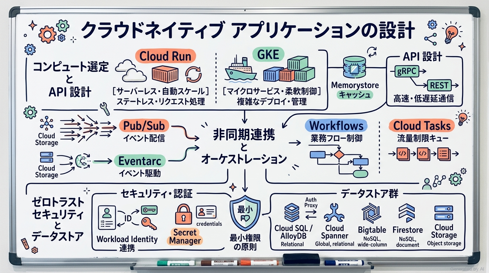
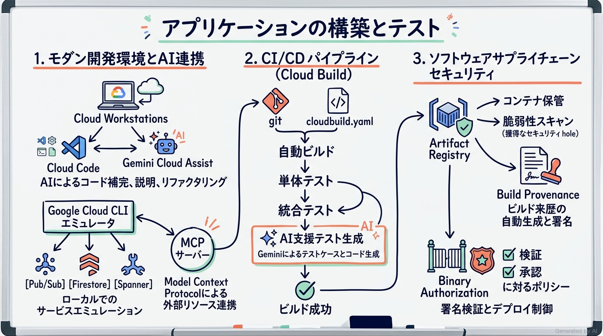
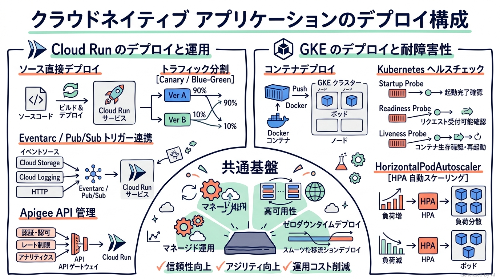
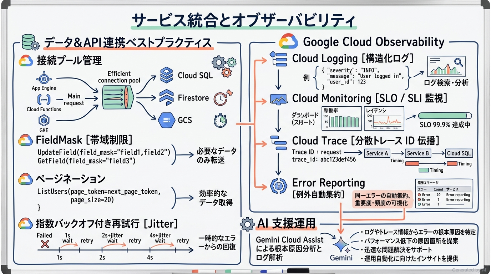

# Google Cloud Certified - Professional Cloud Developer 完全対策＆実践学習ガイド

- **対象資格**: Google Cloud Certified - Professional Cloud Developer (PCD)
- **試験コード**: PCD
- **公式試験ガイド**: [Professional Cloud Developer 認定試験ガイド (日本語版)](https://services.google.com/fh/files/misc/professional_cloud_developer_exam_guide_japanese.pdf?hl=ja)
- **公式試験ページ**: [Professional Cloud Developer | Google Cloud Certification](https://cloud.google.com/learn/certification/cloud-developer?hl=ja)
- **公式学習パス**: [Google Skills - Cloud Developer Learning Path](https://www.skills.google/paths/19?hl=ja)
- **最終更新日**: 2026-10-13

---

## はじめに

クラウドネイティブ アプリケーション開発の現場は、単なる仮想マシン上のモノリス運用から、高度に自動化されたコンテナランタイム、サーバーレス、イベント駆動型マイクロサービス、そして生成 AI ツールを統合した次世代のデリバリーモデルへと決定的な進化を遂げました。

Google Cloud が提供するマネージドサービス群（Cloud Run、Google Kubernetes Engine [GKE]、Cloud Build、Artifact Registry、Eventarc、Pub/Sub、Spanner、AlloyDB、Google Cloud Observability など）は、開発者がインフラ運用の低レイヤな関心事から解放され、俊敏かつセキュアにビジネス価値を創出するための最高峰のプラットフォームです。

本ガイドは、Google Cloud Certified - Professional Cloud Developer 認定試験の最新試験要目を完全に網羅し、単なる用語暗記を超えて「本番環境で最適な技術選定とトレードオフ判断ができるエンジニア」へとステップアップするための実践的知識を体系化した完全対策ノートです。

### Professional Cloud Developer 試験とは

Professional Cloud Developer 認定資格は、Google が推奨するツール、ランタイム、およびベストプラクティスを活用して、スケーラビリティ、堅牢性、セキュリティ、高可用性を備えたクラウドネイティブ アプリケーションを設計、開発、テスト、デプロイ、監視・トラブルシューティングする実務開発能力を客観的に評価・認定するプロフェッショナル資格です。

- **試験時間**: 120 分（2 時間）
- **出題問題数**: 50〜60 問
- **出題形式**: 択一選択問題（4 肢中 1 つ選択）、複数選択問題（5 肢以上中 2 つ以上選択）
- **合否判定**: 合格 / 不合格（正答率・スコアは非開示）
- **受験料**: $200（税別）
- **推奨実務経験**: クラウド アーキテクチャおよびクラウドネイティブ アプリケーション開発に関する 3 年以上の実務経験、および Google Cloud を使用したソリューションの構築・管理に関する 1 年以上の実務経験

### 難易度と求められる思考力

本試験は、Google Cloud のアソシエイト資格（Associate Cloud Engineer）と比較して、格段に高い「アプリケーション層の設計力」と「分散システムにおける意思決定力」が問われます。

試験問題では、単純なコマンド構文やサービス仕様の暗記ではなく、「特定のビジネス制約（急激なスパイクアクセス、ミリ秒未満のレイテンシ要件、厳格なデータ整合性、ゼロダウンタイムデプロイ、最小権限アクセス）において、どのアーキテクチャパターンとマネージドサービスを組み合わせるべきか」というトレードオフ判断が多角的に問われます。

特に以下の観点での深い思考プロセスが不可欠です。
1. **コンピュートとランタイムの選定**: Cloud Run（サーバーレス、リクエスト駆動、ステートレス）と GKE（ポッド単位のきめ細かい制御、複雑なステートフル運用、サービスメッシュ連携）の明確な境界線の判断。
2. **データストアの整合性モデル**: Cloud SQL、AlloyDB、Spanner、Bigtable、Firestore におけるトランザクション要件、強整合性（Strong Consistency）と結果整合性（Eventual Consistency）のトレードオフ。
3. **セキュアなサービス間通信と認証**: 静的な認証情報（サービスアカウントキー）を完全に排除し、Workload Identity 連携、Cloud SQL / AlloyDB Auth Proxy、Direct VPC 外向き、IAM 最小権限を適用するゼロトラスト設計。
4. **ソフトウェアサプライチェーンと CI/CD**: Cloud Build による自動化、Build Provenance（ビルド来歴）の生成、Artifact Registry の脆弱性スキャン、および Binary Authorization による未承認コンテナの遮断。

### 推奨の勉強法

1. **公式一次ドキュメントとベストプラクティスの精読**:
   各サービスの概要にとどまらず、「How-to ガイド」や「アーキテクチャのベストプラクティス（Cloud Run のトラフィック分割、Pub/Sub の重複排除と順序保証、Cloud SQL 接続プール管理、指数バックオフ）」を徹底的に読み込みます。
2. **実機ハンズオンによる手触り感の獲得**:
   Google Cloud CLI（`gcloud`）、ローカルエミュレータ（Pub/Sub、Firestore、Spanner）、Cloud Workstations、Cloud Shell、Cloud Code を活用し、ローカルでのテストから Cloud Build パイプライン、Cloud Run / GKE へのデプロイまでを一気通貫で体験します。
3. **実践シナリオ（状況・対応・結果・解説）による思考プロセスの追体験**:
   本ガイドに収録された全出題分野の構造化実践シナリオを通じて、「なぜ他の魅力的に見える代替案では不適格なのか（棄却理由）」を論理的に理解し、試験本番の長文シチュエーション問題に即座に対応できる判断軸を確立します。

### 出題傾向と意思決定アプローチ

本試験の選択肢を検討する際は、常に以下の「Google Cloud 開発者の設計哲学（クラウドらしさ）」を判断基準に据えてください。

- **マネージド・サーバーレス優先の原則**: 独自の仮想マシン（Compute Engine）や自作のCron/ポーリングデーモンを立ち上げるのではなく、Cloud Run、Eventarc、Cloud Tasks、Workflows などのフルマネージドサービスを優先します。
- **疎結合と非同期イベント駆動**: サービス間を同期的な HTTP 呼び出しで密結合させず、Pub/Sub や Eventarc を介した耐障害性の高いイベント駆動アーキテクチャを設計します。
- **キーレス・ゼロトラストの徹底**: 秘密鍵（JSON キー）をダウンロードしてコンテナ内に埋め込む選択肢は例外なく誤答です。常に Workload Identity 連携やメタデータサーバー、ADC（Application Default Credentials）を採用します。
- **クライアントライブラリと再試行の標準化**: 生の REST API コールを手動でループするのではなく、指数バックオフ（Jitter 付き）が組み込まれた公式 Cloud クライアントライブラリや gRPC を選択します。

---

## 目次

1. [はじめに](#はじめに)
2. [学習カリキュラム・出題範囲ロードマップ](#学習カリキュラム出題範囲ロードマップ)
3. [Section 1: スケーラビリティ、安全性、信頼性に優れたクラウド ネイティブなアプリケーションの設計 (約 32%)](#section-1-スケーラビリティ安全性信頼性に優れたクラウド-ネイティブなアプリケーションの設計-約-32)
4. [Section 2: アプリケーションの構築とテスト (約 23%)](#section-2-アプリケーションの構築とテスト-約-23)
5. [Section 3: デプロイのためのクラウドネイティブ アプリケーションの構成 (約 24%)](#section-3-デプロイのためのクラウドネイティブ-アプリケーションの構成-約-24)
6. [Section 4: アプリケーションと Google Cloud サービスの統合 (約 21%)](#section-4-アプリケーションと-google-cloud-サービスの統合-約-21)
7. [まとめと推奨学習ステップ](#まとめと推奨学習ステップ)

---

## 学習カリキュラム・出題範囲ロードマップ

### セクション一覧と出題比率

| セクション番号 | セクション名 / 出題分野 | 出題比率 | 主要対象サービス・ツール |
| :--- | :--- | :--- | :--- |
| **Section 1** | スケーラビリティ、安全性、信頼性に優れたクラウド ネイティブなアプリケーションの設計 | 約 32% | Cloud Run, GKE, Memorystore, gRPC / REST, Pub/Sub, Eventarc, Workflows, Cloud Tasks, Cloud Scheduler, IAM, Secret Manager, Cloud KMS, Workload Identity 連携, Auth Proxy, Cloud Storage, Cloud SQL, AlloyDB, Spanner, Bigtable, Firestore, BigQuery |
| **Section 2** | アプリケーションの構築とテスト | 約 23% | Google Cloud CLI エミュレータ, Cloud Workstations, Cloud Code, Cloud Shell, Gemini Cloud Assist, MCP サーバー, Cloud Build, Artifact Registry, Build Provenance (SLSA), Binary Authorization, 単体テスト / 統合テスト |
| **Section 3** | デプロイのためのクラウドネイティブ アプリケーションの構成 | 約 24% | Cloud Run (ソースデプロイ, トラフィック分割, Eventarc / Pub/Sub トリガー), Apigee API 管理, GKE (コンテナデプロイ, Startup / Liveness / Readiness Probe, HorizontalPodAutoscaler [HPA]) |
| **Section 4** | アプリケーションと Google Cloud サービスの統合 | 約 21% | データストア接続プール管理, Pub/Sub パブリッシュ/サブスクライブ, Cloud クライアントライブラリ, FieldMask, ページネーション, 指数バックオフ, Google Cloud Observability (Logging, Monitoring, Trace), Error Reporting, AI 支援分析 |

---

### セクション別出題詳細

#### Section 1: スケーラビリティ、安全性、信頼性に優れたクラウド ネイティブなアプリケーションの設計 (約 32%)
- **出題の狙い**: 要件（スループット、レイテンシ、ステートレス/ステートフル、整合性、コンプライアンス）に合致する最適なコンピュート・ストレージ・メッセージング基盤を選定し、疎結合かつ耐障害性の高い多層分散アーキテクチャを安全に設計する能力を検証します。
- **主要タスク**:
  - Task 1.1: 高パフォーマンスのアプリケーションと API を設計する
  - Task 1.2: 安全なアプリケーションを設計する
  - Task 1.3: データを保存してアクセスする
- **重要キーワード**: Cloud Run, GKE, Memorystore, gRPC vs REST, Workflows, Cloud Tasks, Eventarc, Pub/Sub, Workload Identity 連携, Cloud SQL Auth Proxy, AlloyDB Auth Proxy, Direct VPC egress, Binary Authorization, Spanner, Bigtable, Firestore, Strong Consistency vs Eventual Consistency, Signed URLs

#### Section 2: アプリケーションの構築とテスト (約 23%)
- **出題の狙い**: ローカル開発環境の最適化から、エミュレータを活用したテスト、AI 支援ツールや MCP サーバーの統合、Cloud Build を活用したセキュアなコンテナビルド・来歴管理・自動テストまでの効率的な開発ライフサイクルを確立する能力を検証します。
- **主要タスク**:
  - Task 2.1: 開発環境を設定する
  - Task 2.2: 構築する
  - Task 2.3: テストする
- **重要キーワード**: Google Cloud CLI Emulators, Cloud Workstations, Cloud Code, Gemini Cloud Assist, Model Context Protocol (MCP), Cloud Build, Artifact Registry, Build Provenance (SLSA), Binary Authorization Attestation, Integration Testing

#### Section 3: デプロイのためのクラウドネイティブ アプリケーションの構成 (約 24%)
- **出題の狙い**: コンテナ化されたワークロードを Cloud Run および GKE に最適にデプロイし、イベントトリガー、API 公開・セキュリティ、ヘルスチェック、自動スケーリングメカニズムを適切に構成・運用する能力を検証します。
- **主要タスク**:
  - Task 3.1: アプリケーションを Cloud Run にデプロイする
  - Task 3.2: コンテナを GKE にデプロイする
- **重要キーワード**: Cloud Run, Google Cloud Buildpacks, Eventarc Triggers, Push Subscription, Apigee API Management, GKE Autopilot / Standard, Liveness Probe, Readiness Probe, Startup Probe, HorizontalPodAutoscaler (HPA), Metrics Server

#### Section 4: アプリケーションと Google Cloud サービスの統合 (約 21%)
- **出題の狙い**: Google Cloud データストアやメッセージングサービスとの効率的な連携コードを実装し、Google Cloud API のベストプラクティス（リトライ、ページング、帯域最適化）を適用するとともに、Cloud Observability による分散トレースや障害解析を遂行する能力を検証します。
- **主要タスク**:
  - Task 4.1: アプリケーションにデータサービスとストレージサービスを統合する
  - Task 4.2: Google Cloud API を使用する
  - Task 4.3: トラブルシューティングとオブザーバビリティ
- **重要キーワード**: Google Cloud Client Libraries, Connection Pooling, FieldMask, Pagination (pageToken), Exponential Backoff with Jitter, Cloud Logging, Cloud Monitoring, Cloud Trace, Trace Context (traceparent), Error Reporting, OpenTelemetry, Gemini Cloud Assist for Observability

---

## Section 1: スケーラビリティ、安全性、信頼性に優れたクラウド ネイティブなアプリケーションの設計 (約 32%)

本セクションは、Google Cloud におけるシステムアーキテクチャの骨格を定義する最重要領域です。アプリケーションの特性（リクエスト駆動、ステートレス、バッチ、イベント駆動）に応じた最適なコンピュートプラットフォームの選定、サービス間通信プロトコルの最適化、疎結合なオーケストレーション、ゼロトラストに基づくセキュリティ保護、およびデータ整合性要件に応じたストレージ設計を包括的に学習します。



---

### 1. セクション概要

現代のクラウドネイティブ アプリケーション開発では、「いかにインフラの管理負担を排除し、アプリケーションの弾力性（Elasticity）とセキュリティを最大化するか」が設計の中心課題です。

読者の皆様は、以下の問いに対して自分の言葉で明確に答えられるでしょうか。
- 「Cloud Run と GKE はどちらもコンテナを実行できますが、どのような要件差があれば GKE を選択すべきでしょうか？」
- 「マイクロサービス間の通信において、REST/JSON ではなく gRPC を採用すべき決定的な理由は何か説明できますか？」
- 「外部サービスとの非同期連携において、Pub/Sub、Cloud Tasks、Workflows はそれぞれどのようなユースケースで使い分けるべきでしょうか？」
- 「リレーショナルデータベースにおいて、Cloud SQL、AlloyDB、Cloud Spanner のスケーラビリティと整合性の本質的な違いは何でしょうか？」

#### 重要キーワード

- **Cloud Run**: HTTP リクエストやイベントに応じてコンテナを秒単位でゼロから数千インスタンスまで自動スケーリングするフルマネージド サーバーレス コンピュート。
- **Google Kubernetes Engine (GKE)**: 高度なクラスタ構成、カスタム ネットワーク ポリシー、GPU ワークロード、複雑なステートフル アプリケーションに対応するエンタープライズ Kubernetes 実行基盤。
- **gRPC**: HTTP/2 上で動作し、Protocol Buffers（Protobuf）をシリアライゼーション形式として用いる、超低遅延かつ高スループットなバイナリ RPC フレームワーク。
- **Cloud Memorystore**: Redis および Memcached 互換のフルマネージド インメモリ データストア。ミリ秒未満のデータアクセスを提供。
- **Pub/Sub**: 高スループットかつグローバルに分散された多対多の非同期メッセージング サービス。
- **Eventarc**: Google Cloud サービスやカスタムソースから発生したイベントを CloudEvents 形式でルーティングし、Cloud Run 等を呼び出すイベントドリブン基盤。
- **Cloud Tasks**: レート制限、ディレイ（遅延実行）、重複排除、きめ細かいリトライ制御を備えた完全マネージドな非同期タスクキュー。
- **Workflows**: 複数の Google Cloud API やマイクロサービスを YAML/JSON でステートフルに連携・自動化するサーバーレス オーケストレーション。
- **Workload Identity 連携**: GKE の Kubernetes サービスアカウントや外部 ID プロバイダに対し、静的キーを発行せずに Google Cloud サービスアカウントの権限を安全に借用させる仕組み。
- **Cloud SQL / AlloyDB Auth Proxy**: ローカルクライアントやアプリケーションからデータベースへの安全な相互 TLS（mTLS）暗号化トンネルを自動確立し、IAM 認証を統合するコネクタ。
- **Direct VPC egress (ダイレクト VPC 外向き)**: サーバーレス VPC アクセスコネクタのインスタンス管理を不要とし、Cloud Run から VPC 内部リソースへ直接高速に通信するネイティブ機能。
- **Cloud Spanner**: グローバル規模で無制限のスケーラビリティと外部整合性（強整合性）を両立するフルマネージド リレーショナル データベース。
- **Cloud Bigtable**: ペタバイト規模の超高スループット・低遅延書き込み/読み取りを誇る NoSQL ワイドカラム型データベース。
- **Cloud Firestore**: モバイル・Web およびサーバーサイド向けの自動スケーリング ドキュメント型 NoSQL データベース。

---

### 2. 重要トピック

#### 1. コンピュート プラットフォーム選定マトリクス

| 比較項目 / 方式 | Cloud Run | GKE (Autopilot / Standard) | Compute Engine |
| :--- | :--- | :--- | :--- |
| **主要用途** | ステートレス Web API、イベント処理、マイクロサービス | 複雑なマイクロサービス群、常時稼働バッチ、サービスメッシュ、GPU | レガシー OS 要件、特殊カーネル、非コンテナ モノリス |
| **スケーリング特性** | 0 へのスケール可能、秒単位で急激なトラフィックに追従 | ノードおよびポッド自動スケーリング（HPA/VPA）、数分単位 | インスタンス グループ（MIG）によるスケール、分単位 |
| **運用管理負荷** | サーバーレス（OS、ノード、クラスタ管理が完全不要） | Autopilot はノード管理不要、Standard はクラスタ管理が必要 | OS パッチ、ディスク、ネットワークの完全な自己管理が必要 |
| **コスト構造** | リクエスト処理時間・CPU/メモリ割り当てに応じた秒課金 | クラスタ管理費 ＋ ポッド使用リソース課金 | インスタンス稼働時間に応じた従量課金（割引適用可能） |
| **主な制約** | リクエスト最長タイムアウト（60分）、ローカルディスク非永続 | クラスタ設計、Kubernetes マニフェスト管理の知識が必要 | 自動フェイルオーバーやスケーリングの自作・設計が必要 |

- **アーキテクトの選定基準**:
  - ステートレスでリクエストやイベントに応じて急激に負荷が変動する Web アプリや API には **Cloud Run** を最優先で選定します。
  - マイクロサービス間のきめ細かいネットワーク ポリシー、DaemonSet、特殊なプロトコル、マルチコンテナ協調、常時高負荷ワークロードには **GKE** を選定します。
  - コンテナ化できないレガシーバイナリやカスタムカーネルモジュールが必要な場合にのみ **Compute Engine** を選定します。

#### 2. 非同期・イベント連携サービスの比較マトリクス

| サービス名 | 通信モデル | 順序保証・レート制御 | 主な用途・選定基準 |
| :--- | :--- | :--- | :--- |
| **Cloud Pub/Sub** | 多対多（Pub/Sub）、疎結合イベントストリーム | Ordering Key によりキー単位で保証可能。流量制限機能はなし | 大規模イベントのファンアウト、ログ/テレメトリ収集、システム間デカップリング |
| **Cloud Tasks** | 1対1、明示的なタスクディスパッチ | キューごとに秒あたり最大ディスパッチ数（レート制限）を厳格に制御可能 | バックエンドの過負荷防止（流量調整）、指定日時実行（ディレイ）、重い個別ジョブの委任 |
| **Eventarc** | イベントドリブン（CloudEvents 準拠） | イベント駆動（フィルタリングとルーティング） | Cloud Storage や Cloud Audit Logs 等の 130 以上の Google Cloud イベントをトリガーに Cloud Run を起動 |
| **Workflows** | ワークフロー オーケストレーション | ステートマシンによる分岐、リトライ、長時間の待機 | 複数のマイクロサービスや外部 API を順番に呼び出す決済処理、エラーハンドリング |

#### 3. データストア選定と整合性モデル

| データストア | データモデル | トランザクション / 整合性 | スケーラビリティ / 特性 |
| :--- | :--- | :--- | :--- |
| **Cloud SQL** | リレーショナル (MySQL, PostgreSQL, SQL Server) | ACID 対応 / 単一インスタンス強整合性、リードレプリカは結果整合性 | 垂直スケール主体（最大数十 TB）、既存 SQL アプリの移行に最適 |
| **AlloyDB** | PostgreSQL 互換エンタープライズ RDBMS | ACID 対応 / 高度なトランザクション処理と分析クエリの高速化 | 分析アクセラレータ、自動スケール、高可用性（99.99% SLA） |
| **Cloud Spanner** | リレーショナル (ANSI SQL) | グローバル外部整合性 (TrueTime)、完全な ACID 分散トランザクション | 水平スケール無制限、ダウンタイムなしのスキーマ変更、ミッションクリティカル |
| **Cloud Bigtable** | NoSQL ワイドカラム型 | 行単位の強整合性、複数行トランザクションは非対応 | ペタバイト級、ミリ秒未満のレイテンシ、IoT、時系列データ、広告ログ |
| **Cloud Firestore** | NoSQL ドキュメント型 | ドキュメント単位の強整合性、マルチドキュメント ACID トランザクション対応 | 自動水平スケール、リアルタイムリスナー、Web/モバイル同期 |
| **Cloud Storage** | 非構造化オブジェクトストレージ | 強整合性（新規作成・上書き・メタデータ更新直後の読み取りで即時反映） | エクサバイト級、大容量静的ファイル、バックアップ、データレイク |

---

### 3. 実践シナリオ

> [!IMPORTANT]
> 単なる製品知識の暗記ではなく、「なぜ他の選択肢では要件を満たせないのか」という深層論理を通じてアーキテクチャの意思決定力を養います。

#### シナリオ 1-1: 急激なスパイクアクセスに対応するステートレス Web API のコンピュート選定

- **状況**: E コマース企業のセール期間中に通常の 50 倍以上の HTTP トラフィックが突発的に発生し、インフラ運用の手動介入を一切行わずにインフラコストを最小限に抑制したい場合
- **対応**: アプリケーションをコンテナ化し、自動スケーリング機能（最小インスタンス数 0、最大インスタンス数を必要数に設定）を備えた Cloud Run にデプロイする
- **結果**: トラフィックの急増に合わせて数秒でコンテナインスタンスが自動的にスケールアウトし、トラフィック減少時にはゼロにスケールインしてアイドルコストがゼロになる
- **解説**: Cloud Run はリクエスト駆動で高速にコールドスタートし、リクエスト数に応じて自動でコンテナ数を増減させるサーバーレス基盤であるためです。Compute Engine の マネージド インスタンス グループ（MIG）では VM の起動・プロビジョニングに数分を要し急激なスパイクに追従できないため要件を満たせません。また、GKE Standard ではノードのキャパシティ計画やクラスタ管理の運用オーバーヘッドが発生し、最小コスト維持の観点で不適格です。
- **参考ドキュメント**:
  - [Cloud Run ドキュメント](https://cloud.google.com/run/docs): Cloud Run のアーキテクチャと自動スケーリング仕様

#### シナリオ 1-2: マイクロサービス間の超低遅延・高スループット内部通信のプロトコル選定

- **状況**: 大規模分散システムにおいて、数十のバックエンド マイクロサービス間で毎秒数十万件の内部データ交換を行い、ネットワーク帯域の消費とペイロードのシリアライズ負荷を極小化したい場合
- **対応**: サービス間通信のインターフェース定義に Protocol Buffers を採用し、トランスポート層に HTTP/2 多重化通信を活用する gRPC を実装する
- **結果**: JSON テキスト通信と比較してペイロードサイズが大幅に削減され、単一 TCP 接続内での多重ストリーミングにより通信レイテンシが劇的に低下する
- **解説**: gRPC はバイナリ形式のシリアライゼーションと HTTP/2 のストリーム多重化をネイティブサポートしており、高スループットかつ低レイテンシな内部通信に最適化されているためです。従来の REST API（HTTP/1.1 + JSON）ではテキスト形式のパース負荷と接続確立オーバーヘッドが大きく、要件を満たせません。SOAP / XML はメッセージ肥大化と処理コストがさらに高いため不適格です。
- **参考ドキュメント**:
  - [gRPC 公式ガイド](https://cloud.google.com/run/docs/triggering/grpc): Google Cloud における gRPC サービスの構成とベストプラクティス

#### シナリオ 1-3: セッション状態の外部化と急激な読み取り負荷を軽減するインメモリキャッシュ設計

- **状況**: ユーザー認証セッションおよび頻繁に参照される製品カタログデータをリレーショナル データベースから直接読み取っており、データベースの CPU 使用率が高止まりしている場合
- **対応**: Cloud Memorystore for Redis をプロビジョニングし、アプリケーション層でセッション情報とカタログ検索結果をキャッシュする Cache-Aside（Lazy Loading）パターンを実装する
- **結果**: データベースへの直接クエリ数が 90% 以上削減され、サブミリ秒単位のレスポンスタイムが実現される
- **解説**: Memorystore for Redis はフルマネージドなインメモリデータストアであり、ミリ秒未満の超高速アクセスを提供してバックエンド RDBMS の負荷を直接オフロードできるためです。ローカルメモリ（インスタンス内メモリ）にキャッシュを保持すると、Cloud Run や GKE のような自動スケーリング環境ではインスタンス間でセッションが共有できず不整合が発生するため不適格です。Cloud Storage をキャッシュ用途に使用するとレイテンシが要件を満たせません。
- **参考ドキュメント**:
  - [Cloud Memorystore for Redis ドキュメント](https://cloud.google.com/memorystore/docs/redis): インメモリキャッシュの構成と高可用性

#### シナリオ 1-4: 大規模バッチ処理のレート制限と流量制御を伴うタスクキューイング設計

- **状況**: ユーザーがアップロードした大量のドキュメントを外部のサードパーティ OCR API に送信して処理する必要があるが、外部 API に毎秒 20 リクエストという厳格なレート制限が存在し、これを超過するとエラーになる場合
- **対応**: Cloud Tasks を採用し、ディスパッチレート（`max_dispatches_per_second: 20`）を設定した専用キューを作成して、ドキュメント処理リクエストをキューに投入する
- **結果**: 突発的に数万件のリクエストが到着しても、Cloud Tasks が厳格に毎秒 20 件のペースでバックエンド ワーカーにタスクを配信し、外部 API のレート制限違反を完全に防止する
- **解説**: Cloud Tasks はキューごとに最大ディスパッチレートや最大同時実行数を厳格に制御し、バックエンドや外部サービスの過負荷を防ぐ流量制限機能（Rate Limiting）を標準で備えているためです。Cloud Pub/Sub は高スループットなメッセージ配信に最適化されていますが、消費者に対する厳格な秒あたりディスパッチレート制御機能を持たないため要件を満たせません。Cloud Scheduler は定期実行ツールであり、動的な個別タスクのキューイングには適していないため不適格です。
- **参考ドキュメント**:
  - [Cloud Tasks ドキュメント](https://cloud.google.com/tasks/docs): レート制限とタスクキューの構成

#### シナリオ 1-5: GKE 上のアプリケーションから Cloud SQL へのセキュアかつキーレスな接続

- **状況**: GKE クラスタ上で稼働する複数のマイクロサービスから Cloud SQL (PostgreSQL) にアクセスするにあたり、静的なデータベース認証情報やサービスアカウントの JSON 秘密鍵をポッド内に配置せず、通信経路をエンドツーエンドで暗号化したい場合
- **対応**: GKE の Workload Identity 連携を有効化して Kubernetes サービスアカウントと Google Cloud サービスアカウントを紐付け、ポッドのサイドカーコンテナとして Cloud SQL Auth Proxy をデプロイして IAM データベース認証を使用する
- **結果**: 静的なシークレットキーやパスワードの管理が不要となり、短命の OAuth 2.0 アクセストークンと mTLS トンネルによりセキュアに接続が確立される
- **解説**: Cloud SQL Auth Proxy と Workload Identity 連携の組み合わせにより、静的キーの漏洩リスクを完全に排除しつつ、自動的な mTLS 暗号化と短命トークンによる認証を実現できるためです。コンテナ内にサービスアカウントの JSON キーファイルを Secret としてマウントする方式は、キーのローテーション負荷と漏洩リスクが残るため推奨されません。Cloud SQL にパブリック IP を付与して許可ネットワーク（Authorized Networks）のみでアクセス制限する構成は、セキュリティ統制が不十分であり不適格です。
- **参考ドキュメント**:
  - [Cloud SQL Auth Proxy ドキュメント](https://cloud.google.com/sql/docs/mysql/connect-auth-proxy): 安全なプロキシ接続のベストプラクティス

#### シナリオ 1-6: 外部クライアントへの安全な一時的ファイルアップロード許可

- **状況**: モバイルアプリから数 GB 規模の動画ファイルを Cloud Storage にアップロードさせたいが、アプリケーション サーバーの帯域幅を消費させず、かつ Google Cloud の IAM 権限を直接モバイルクライアントに付与したくない場合
- **対応**: バックエンド サーバーで特定のオブジェクトに対する制限時間付き（例: 15分間有効）の Cloud Storage 署名付き URL（Signed URL）を生成し、モバイルクライアントへ返却して直接 PUT アップロードさせる
- **結果**: モバイル端末から Cloud Storage バケットへ直接高速にアップロードが実行され、アプリケーション サーバーのメモリ・ネットワークリソースが一切消費されない
- **解説**: 署名付き URL は、適切な権限を持つサービスアカウントの秘密鍵またはメタデータ署名を用いて、特定のリソースに対する一時的な読み取り/書き込み権限を安全に委譲できるためです。モバイルアプリから一度バックエンド サーバーにファイルを送信し、サーバーがバケットへ転送するアーキテクチャでは、サーバーのリソース枯渇とボトルネックが発生し要件を満たせません。Cloud Storage バケット全体を全公開（`allUsers` に書込権限付与）する設計は、重大なセキュリティ侵害となるため論外です。
- **参考ドキュメント**:
  - [Cloud Storage 署名付き URL](https://cloud.google.com/storage/docs/access-control/signed-urls): 一時的アクセス委譲のメカニズム

#### シナリオ 1-7: 大規模グローバル トランザクション データベースの選定と結果整合性/強整合性のトレードオフ

- **状況**: 金融決済プラットフォームにおいて、東京、ロンドン、ニューヨークの複数大陸にまたがる拠点で同時に口座引き落としと残高更新が発生し、いかなる場合も二重引き落としを許容せず、グローバルで完全な ACID トランザクションを保証したい場合
- **対応**: マルチリージョン構成の Cloud Spanner を選定し、主キー設計において単調増加するタイムスタンプを避け、UUID v4 などのハッシュ化されたキーを用いてデータを分散配置する
- **結果**: グローバル規模で強整合性（外部整合性）が完全に維持され、ホットスポットを発生させることなく高スループットな並行トランザクションが処理される
- **解説**: Cloud Spanner は Google の独自ハードウェア（原子時計と GPS を備えた TrueTime API）により、グローバル分散環境において最高水準の外部整合性と ACID トランザクションを達成できる唯一のフルマネージド RDBMS であるためです。Cloud SQL のリードレプリカ構成は非同期レプリケーションであり、レプリカからの読み取りは結果整合性（データの遅延反映）となるため金融決済には不適格です。Bigtable は行単位のトランザクションに限定され、複数テーブル間の整合性を担保できないため要件を満たせません。
- **参考ドキュメント**:
  - [Cloud Spanner ドキュメント](https://cloud.google.com/spanner/docs): スキーマ設計と TrueTime による整合性モデル

---

### 4. 参考ドキュメント & 推奨ハンズオン

#### 公式一次ドキュメント
- [Cloud Run の概要とアーキテクチャ](https://cloud.google.com/run/docs): コンテナ実行のライフサイクルとスケーリング挙動
- [Google Kubernetes Engine (GKE) ドキュメント](https://cloud.google.com/kubernetes-engine/docs): クラスタアーキテクチャとワークロード運用
- [Cloud Pub/Sub ドキュメント](https://cloud.google.com/pubsub/docs): メッセージングモデルと信頼性設計
- [Workflows ドキュメント](https://cloud.google.com/workflows/docs): サーバーレス オーケストレーションの構成
- [Cloud Tasks ドキュメント](https://cloud.google.com/tasks/docs): タスクキューによる流量制限とリトライ設計
- [Cloud Spanner ドキュメント](https://cloud.google.com/spanner/docs): グローバル強整合性とスキーマ設計のベストプラクティス

#### 推奨ハンズオン・ラボ（実機検証）
- [Develop Serverless Applications on Cloud Run (Course Template 741)](https://www.skills.google/course_templates/741):
  - **学習目標**: Cloud Run へのコンテナデプロイ、Pub/Sub や Cloud Storage との非同期連携、REST API ゲートウェイ構築を実機で体験します。
- [Service Orchestration and Choreography on Google Cloud (Course Template 465)](https://www.skills.google/course_templates/465):
  - **学習目標**: Workflows、Eventarc、Cloud Tasks、Cloud Scheduler を連携させたイベント駆動型マイクロサービスの構築フローを体感します。

---

## Section 2: アプリケーションの構築とテスト (約 23%)

本セクションは、開発者のローカル環境から継続的インテグレーション（CI）パイプライン、そしてセキュアな成果物管理に至る開発ライフサイクル全般を扱います。Google Cloud CLI エミュレータを活用した迅速なローカル検証、Gemini Cloud Assist や MCP（Model Context Protocol）サーバーによる次世代の AI 支援開発、Cloud Build によるコンテナビルド・テスト自動化、およびソフトウェアサプライチェーンの安全性を担保するビルド来歴（Build Provenance）と Binary Authorization の連携メカニズムを深く掘り下げます。



---

### 1. セクション概要

モダンなクラウド開発においては、「いかに高速なフィードバックループを回しながら、本番環境への不正コード混入をゼロにするか」が鍵となります。クラウド環境に毎回デプロイして動作確認するスタイルは、デバッグサイクルの長期化と無駄なクラウド課金を招きます。一方で、開発者のローカルマシンで作成されたコンテナをそのまま本番へデプロイすることは、重大なセキュリティリスクを孕みます。

読者の皆様は、以下の問いに明快に答えられるでしょうか。
- 「ローカル端末で Pub/Sub や Firestore の結合テストを行う際、実プロジェクトのリソースを使わずに完全隔離環境を作るにはどうすればよいでしょうか？」
- 「Cloud Build でビルドされたコンテナが改ざんされていないことを、デプロイ時に客観的に検証する仕組み（SLSA レベル3 / Build Provenance）はどのように機能するでしょうか？」
- 「Binary Authorization における『アテスター（Attestor）』とは何であり、なぜ CI パイプラインとの連携が不可欠なのでしょうか？」
- 「IDE において Gemini Cloud Assist や MCP サーバーを統合することで、開発者の生産性とセキュリティ統制をどのように両立できるでしょうか？」

#### 重要キーワード

- **Google Cloud CLI エミュレータ**: Pub/Sub、Firestore、Spanner、Bigtable などの Google Cloud サービスをローカル環境でエミュレートする開発用ツール。ネットワーク接続不要で高速な単体/統合テストが可能。
- **Cloud Workstations**: ブラウザまたはローカル IDE からアクセス可能な、フルマネージドでセキュアなクラウド開発環境。企業のセキュリティ境界内で一元管理された開発基盤を提供。
- **Cloud Code**: VS Code や IntelliJ などの IDE で Google Cloud サービス（Cloud Run、GKE など）の作成、デプロイ、デバッグを支援する拡張機能。
- **Gemini Cloud Assist**: Google Cloud コンソールや IDE 内で、コード補完、アーキテクチャ設計支援、トラブルシューティングを対話形式で行う AI アシスタント。
- **Model Context Protocol (MCP)**: AI アシスタントがローカルやクラウドの開発ツール、ドキュメント、データベース等の外部コンテキストと安全に相互運用するためのオープン標準プロトコル。
- **Cloud Build**: ソースコードからコンテナイメージやアーティファクトを高速にビルド、テスト、パッケージ化する完全マネージドな CI/CD 実行基盤。
- **Artifact Registry**: Docker コンテナイメージ、言語パッケージ（Maven、npm、Python 等）を一元管理し、脆弱性スキャンやアクセス制御を提供する次世代リポジトリ。
- **Build Provenance (ビルド来歴)**: ビルドに使用されたソースコード、ビルド手順、環境変数を暗号学的に証明する改ざん不能なメタデータ（SLSA レベル3 準拠）。
- **Binary Authorization**: デプロイ対象のコンテナイメージが、信頼できる CI/CD パイプラインによって署名・承認（Attestation）されていることを GKE や Cloud Run のデプロイ時に強制検証するセキュリティ統制サービス。

---

### 2. 重要トピック

#### 1. 開発環境の最適化とエミュレータ活用

| 開発手法 | メリット | デメリット / 制約 | 推奨ユースケース |
| :--- | :--- | :--- | :--- |
| **ローカル エミュレータ** (`gcloud beta emulators`) | 課金ゼロ、ネットワーク不要、ミリ秒単位の高速テスト実行、完全な分離 | 一部サービス（Cloud SQL や AlloyDB など）は独自コンテナ等で代替が必要 | 単体テスト、ローカルでのPub/Subメッセージフロー検証、Firestore スキーマ検証 |
| **Cloud Workstations** | 企業セキュリティ統制（VPC SC 適用可能）、端末性能に非依存、開発環境の標準化 | コンピュートリソースの常時稼働コスト、ネットワーク接続が必須 | 厳格なコンプライアンス要件を持つエンタープライズ、大規模チーム開発 |
| **実クラウド開発プロジェクト** | 本番と完全に同一の挙動、全 API の直接利用が可能 | リソース課金の発生、IAM 権限管理の負荷、ネットワーク遅延 | ステージング環境での結合テスト、外部連携の最終検証 |

- **開発者の環境選定基準**:
  - 日常のコード変更や TDD（テスト駆動開発）における高速なフィードバックには、`gcloud beta emulators pubsub start` などの **ローカル エミュレータ** を優先的に活用します。
  - セキュリティポリシーによりソースコードのローカル端末保存が禁止されている組織では、**Cloud Workstations** を採用します。

#### 2. セキュア ビルドパイプラインのフロー

```text
[ソースコード (Git)] 
       │ 
       ▼ (トリガー)
[Cloud Build] ─── (AI 支援生成の単体テスト & 統合テスト実行)
       │
       ├─ (1) コンテナイメージのビルド
       ├─ (2) ビルド来歴 (Build Provenance) の生成 (SLSA Level 3)
       ├─ (3) 自動脆弱性スキャンのトリガー (Artifact Analysis)
       │
       ▼ (プッシュ)
[Artifact Registry] ─── (脆弱性検証・ポリシー適合)
       │
       ▼ (承認者の署名付与: Attestation)
[Binary Authorization] ─── (デプロイ時に署名を強制検証)
       │
       ▼ (合格時のみデプロイ承認)
[GKE / Cloud Run]
```

---

### 3. 実践シナリオ

#### シナリオ 2-1: クラウド費用と外部依存を排したローカル環境でのイベント連携単体テスト

- **状況**: 開発チームが Pub/Sub と Firestore を利用したイベント駆動マイクロサービスの単体テストを CI および開発者のローカル PC で頻繁に実行したいが、クラウドの利用コストを抑え、ネットワーク接続が不安定な環境でも高速にテストを完了させたい場合
- **対応**: Google Cloud CLI のエミュレータコンポーネント（`gcloud beta emulators pubsub` および `gcloud beta emulators firestore`）をローカルで起動し、環境変数（`PUBSUB_EMULATOR_HOST`、`FIRESTORE_EMULATOR_HOST`）を設定してテストを実行する
- **結果**: 実際の Google Cloud プロジェクトに接続することなく、完全にローカルかつミリ秒単位で Pub/Sub トピックへの発行と Firestore ドキュメントの読み書きテストが高速に実行され、テストに伴う課金がゼロになる
- **解説**: Google Cloud CLI エミュレータは、主要なデータ/メッセージングサービスの動作をローカル環境で忠実に再現し、環境変数の切り替えのみでクライアントライブラリからの接続先をエミュレータに変更できるためです。開発者ごとに個別の Google Cloud プロジェクトを割り当てて実リソースに接続させる方式は、リソース作成のクォータ上限やコスト増大、テストデータのクリーンアップ漏れが発生するため不適格です。外部のモックライブラリを手動で自作する方式は、Google Cloud API の仕様変更への追従やエッジケースの再現に多大な工数がかかるため推奨されません。
- **参考ドキュメント**:
  - [Google Cloud エミュレータの概要](https://cloud.google.com/sdk/gcloud/reference/beta/emulators): ローカルテスト用エミュレータの起動と構成

#### シナリオ 2-2: ソースコード変更をトリガーとした安全なコンテナビルドとビルド来歴の自動生成

- **状況**: Git リポジトリのメインブランチへのマージを契機として、改ざんのリスクを排除したコンテナイメージを自動ビルドし、サプライチェーンの安全基準である SLSA レベル 3 に準拠した検証可能なビルド来歴を記録したい場合
- **対応**: Cloud Build トリガーを設定してマネージドワーカープールでビルドを実行し、生成されたコンテナイメージを Artifact Registry に保存するとともに、Cloud Build の Build Provenance 生成機能を有効化する
- **結果**: ビルドがセキュアな隔離環境で完全に自動実行され、ビルド元のコミットハッシュ、ビルド環境、および成果物ダイジェストを含む暗号学的に検証可能なビルド来歴が Artifact Analysis に自動記録される
- **解説**: Cloud Build はマネージドな CI サービスとして SLSA レベル 3 準拠のビルド来歴（Build Provenance）を自動生成し、Artifact Registry と密連携して改ざん防止を実現できるためです。開発者のローカル PC 上で `docker build` を行い、手動で Artifact Registry にプッシュする方式は、開発者端末のマルウェア感染やビルド手順の改ざんを検証できないため重大なセキュリティ違反となります。Compute Engine 上に自作の Jenkins サーバーを構築して運用する方式は、ホスト OS やパッチの管理負担が大きく、ビルド来歴の完全性保証を独自に実装する必要があるため不適格です。
- **参考ドキュメント**:
  - [Cloud Build ドキュメント](https://cloud.google.com/build/docs): ビルドパイプラインの自動化と Build Provenance の活用

#### シナリオ 2-3: CI パイプライン内での自動統合テストとコンテナの協調

- **状況**: 複数のマイクロサービスが相互に通信するバックエンドシステムにおいて、コード変更時に単体テストだけでなく、データベースやメッセージブローカーを含む結合テストを CI パイプライン内で自動実行し、失敗時はビルドを即座に中断させたい場合
- **対応**: `cloudbuild.yaml` 内で複数のビルドステップを定義し、ローカルエミュレータやテスト用コンテナを同一のローカルネットワーク（Cloud Build のデフォルトネットワーク）上で起動させ、テストランナーステップからこれらに接続して統合テストを実行する
- **結果**: コードのコミットごとに、エミュレータを介したリアルな API 統合テストが自動で走り、テストが 1 件でも失敗した場合は後続のコンテナプッシュやデプロイステップが確実に遮断される
- **解説**: Cloud Build は単一のビルド実行内で複数のステップコンテナを連携させることができ、各ステップの終了ステータス（非ゼロ終了コード）に基づいてパイプラインを自動中断する堅牢な実行制御を備えているためです。テストを実行せずにコンテナをプッシュし、ステージング環境にデプロイした後に外部モニタリングツールで手動確認するアプローチは、不良コードの検出遅延を招き CI/CD の原則に反するため不適格です。テストコードをコンテナイメージのプロダクションビルドに埋め込む方式は、イメージサイズの肥大化と本番環境での脆弱性リスクを生むため推奨されません。
- **参考ドキュメント**:
  - [Cloud Build 構成ファイルの作成](https://cloud.google.com/build/docs/configuring-builds/create-basic-configuration): `cloudbuild.yaml` のステップ設計

#### シナリオ 2-4: 承認されていない改ざんコンテナの GKE / Cloud Run デプロイ遮断

- **状況**: 本番環境の GKE クラスタおよび Cloud Run サービスに対し、正式な CI パイプラインによるテストとセキュリティスキャン（脆弱性スキャン）を通過していない未承認のコンテナイメージがデプロイされる事故を防止したい場合
- **対応**: Binary Authorization を有効化し、信頼できる Cloud Build パイプラインによって署名されたアテステーション（Attestation）を持つイメージのみを許可するデプロイポリシーを設定する
- **結果**: 開発者が個人的にビルドしたイメージや改ざんされたイメージのデプロイリクエストがアドミッションコントローラーによって拒否され、正式な承認署名を持つイメージのみが本番で稼働する
- **解説**: Binary Authorization は Google Cloud のネイティブなデプロイ時セキュリティ統制機能であり、暗号署名されたアテステーションの有無を検証して未検証コンテナの実行を強制的に阻止できるためです。デプロイ用のスクリプト内で `if` 文を用いてイメージタグ（例: `latest` やコミットハッシュ）を文字列比較する方式は、バイパスが容易であり改ざん耐性がないため要件を満たせません。コンテナイメージの脆弱性スキャン（Artifact Analysis）のみを実施してデプロイを制御しない構成は、重大な脆弱性を含むイメージの実行を能動的に阻止できないため不適格です。
- **参考ドキュメント**:
  - [Binary Authorization ドキュメント](https://cloud.google.com/binary-authorization/docs): デプロイ時ポリシーの構成とアテステーション検証

#### シナリオ 2-5: AI コーディングアシスタントと MCP サーバーを活用した安全なコンテキスト統合開発

- **状況**: 開発者が IDE 内で Gemini Cloud Assist 等の AI アシスタントを利用してコード補完やリファクタリング、Google Cloud API の利用コード生成を行いたいが、社外のパブリック AI サービスに社内コードや認証情報が漏洩することを防ぎつつ、最新の社内ドキュメントやスキーマ定義を AI に安全に参照させたい場合
- **対応**: 企業の Google Cloud 組織ポリシー配下で Gemini Cloud Assist を有効化した Cloud Workstations / Cloud Code を使用し、社内リソースへのアクセスインターフェースとして Model Context Protocol (MCP) サーバーを構成して IDE と統合する
- **結果**: 開発者は厳格なデータ保護ポリシー（コードがモデルの再学習に使用されない保証）のもとで、社内スキーマや API 仕様に即した高精度なコード補完・単体テスト生成を安全に享受できる
- **解説**: Gemini Cloud Assist は Google Cloud のエンタープライズセキュリティ境界内で動作し、顧客データやコードを学習データとして流用しないプライバシー保護が保証されており、MCP を通じて必要なコンテキストのみをセキュアに仲介できるためです。開発者が個人の Web ブラウザからパブリックな AI チャットサービスに社内コードを直接コピー＆ペーストする運用は、機密情報漏洩の重大なリスクを招くため厳禁です。すべての AI 開発ツールの利用を一律に禁止するアプローチは、チーム全体の生産性とデリバリー速度を著しく低下させるため不適格です。
- **参考ドキュメント**:
  - [Cloud Workstations ドキュメント](https://cloud.google.com/workstations/docs): エンタープライズ開発環境のセキュリティ

---

### 4. 参考ドキュメント & 推奨ハンズオン

#### 公式一次ドキュメント
- [Cloud Build の概要](https://cloud.google.com/build/docs): 自動ビルドとパイプライン設計
- [Artifact Registry ドキュメント](https://cloud.google.com/artifact-registry/docs): コンテナとパッケージの安全な管理
- [Binary Authorization の概要](https://cloud.google.com/binary-authorization/docs): ソフトウェアサプライチェーンのデプロイ時保護
- [Google Cloud CLI エミュレータのドキュメント](https://cloud.google.com/sdk/gcloud/reference/beta/emulators): ローカルサービスエミュレータ一覧
- [Cloud Workstations のアーキテクチャ](https://cloud.google.com/workstations/docs): セキュアなマネージド開発環境

#### 推奨ハンズオン・ラボ（実機検証）
- [Developing Containerized Applications on Google Cloud (Course Template 530)](https://www.skills.google/course_templates/530):
  - **学習目標**: Dockerfile の作成、Cloud Build によるコンテナイメージのビルド、Artifact Registry へのプッシュ、およびセキュリティベストプラクティスを実機で習得します。

---

## Section 3: デプロイのためのクラウドネイティブ アプリケーションの構成 (約 24%)

本セクションは、コンテナ化されたワークロードを本番環境（Cloud Run および GKE）に確実かつ安全にデプロイし、高可用性と柔軟なリリース制御を維持するための運用構成を扱います。ソースコードからの直接デプロイ（Google Cloud Buildpacks）、ゼロダウンタイムを実現するトラフィック分割（Canary / Blue-Green デプロイ）、Eventarc や Pub/Sub をトリガーとするイベントレシーバ構成、エンタープライズ API 管理プラットフォームである Apigee による API の保護とバージョニング、そして GKE における Kubernetes ヘルスチェック（Probes）および HorizontalPodAutoscaler（HPA）の最適設計を詳細に解説します。



---

### 1. セクション概要

本番環境へのアプリケーション デプロイにおいて最も恐れるべき事態は、「デプロイに伴うサービスの全面停止（ダウンタイム）」と「初期化中の過負荷によるクラッシュループの連鎖」です。クラウドネイティブな環境では、トラフィックの段階的移行機能やプラットフォーム標準の自己修復ヘルスチェックを正しく設定することが開発者の責務となります。

読者の皆様は、以下の問いに即座に答えられるでしょうか。
- 「Cloud Run で新リビジョンを公開する際、全トラフィックを一気に切り替えるのではなく、10% のユーザーのみに新機能を先行提供して問題があれば瞬時にロールバックするにはどのようなコマンド・設定を行うべきでしょうか？」
- 「起動時に大規模な機械学習モデルのロードやキャッシュのウォームアップで 60 秒以上かかるコンテナにおいて、Liveness Probe だけでヘルスチェックを行うとどのような致命的な問題が発生するでしょうか？」
- 「GKE の HorizontalPodAutoscaler (HPA) は、ポッドの CPU 使用率以外にどのような指標（Pub/Sub の未処理メッセージ数など）に基づいてスケールアウトさせることができるでしょうか？」
- 「Cloud Run サービスを外部に公開する際、バックエンドコードを変更することなく API のバージョニング、OAuth 2.0 認証、スパイクアクセスに対するクォータ制限を適用するにはどのサービスを組み合わせるべきでしょうか？」

#### 重要キーワード

- **Cloud Run ソースデプロイ**: `gcloud run deploy --source .` を実行することで、Dockerfile を手動作成することなく Google Cloud Buildpacks が言語環境を自動判別してコンテナ化・デプロイを行う機能。
- **トラフィック分割 (Traffic Splitting)**: Cloud Run サービスにおいて、特定のリビジョンに対してトラフィックのパーセンテージ（例: 90% と 10%）を割り当て、カナリアリリースや A/B テスト、安全なロールバックを可能にする機能。
- **Eventarc トリガー**: Cloud Storage、Pub/Sub、Cloud Audit Logs などで発生したイベントを CloudEvents 形式で捕捉し、Cloud Run サービスにセキュアに POST リクエストとして転送するルーティングメカニズム。
- **Apigee**: API プロキシ、API キー検証、OAuth 2.0 / JWT 認可、レート制限、トラフィック スパイク防止、アナリティクスを提供するフルマネージド API 管理プラットフォーム。
- **Startup Probe (起動プローブ)**: コンテナアプリケーションが完全に起動・初期化を完了したかを判定するプローブ。成功するまで Liveness / Readiness プローブの評価を保留し、起動が遅いコンテナの不必要な強制終了（Kill）を防止。
- **Readiness Probe (準備完了プローブ)**: コンテナがトラフィックを受信できる準備が整っているかを監視するプローブ。失敗した場合、そのポッドは Service のエンドポイントから一時的に除外され、リクエストのルーティングが停止。
- **Liveness Probe (存続プローブ)**: コンテナがデッドロックやハングアップを起こさず正常に動作し続けているかを監視するプローブ。失敗した場合、コンテナは自動的に再起動（Restart）。
- **HorizontalPodAutoscaler (HPA)**: ポッドの CPU 使用率、メモリ使用率、またはカスタム指標（Cloud Monitoring 指標）に基づいて、Deployment のレプリカ数を自動的に増減させる Kubernetes コントローラー。

---

### 2. 重要トピック

#### 1. Kubernetes 3 大ヘルスチェック（Probes）の役割分担

| プローブ種別 | 判定対象 | 失敗時の動作 | 最適なユースケース |
| :--- | :--- | :--- | :--- |
| **Startup Probe** | アプリケーションの初期化処理が完了したか | コンテナを再起動（閾値超過時）。成功するまで他プローブを休止 | モデルの読み込みや DB マイグレーションなど、初回起動に数分を要する処理 |
| **Readiness Probe** | ポッドがクライアントからのトラフィックを処理可能か | Service のルーティング対象からポッドを除外（再起動はしない） | 一時的な過負荷、外部 DB への接続確立待ち、キャッシュのウォームアップ |
| **Liveness Probe** | プロセスが生きており、デッドロックに陥っていないか | コンテナを強制終了（Kill）して再起動 | アプリケーション内部のデッドロック、メモリリークによる復旧不能なハング |

- **アーキテクトの設計基準**:
  - 起動に時間のかかるアプリケーションでは、必ず **Startup Probe** を設定し、`initialDelaySeconds` や `failureThreshold` を十分な値に調整します。Startup Probe がない状態で Liveness Probe を短周期で設定すると、起動処理中に Liveness Probe が失敗してコンテナが永久に再起動を繰り返す「クラッシュループ（CrashLoopBackOff）」に陥ります。
  - バックエンドの一時的な遅延でポッドを再起動させたくない場合は、Liveness Probe ではなく **Readiness Probe** でトラフィックのみを切り離す設計にします。

#### 2. Cloud Run トラフィック分割とカナリアリリース戦略

```text
[クライアント リクエスト]
            │
            ▼
[Cloud Run サービス エンドポイント (URL)]
            │
            ├── 90% トラフィック ──► [リビジョン A (現行安定版: v1.0)]
            │
            └── 10% トラフィック ──► [リビジョン B (カナリア版: v1.1)]
                                        │
                                        ▼ (Cloud Monitoring でエラー率監視)
                     [正常] ──► 段階的に 25% → 50% → 100% へ昇格
                     [異常] ──► 即座に 0% に戻してロールバック (即時完了)
```

---

### 3. 実践シナリオ

#### シナリオ 3-1: ゼロダウンタイムでの新バージョンリリースと段階的トラフィック移行

- **状況**: 本番環境で稼働中の Cloud Run サービスに対して新バージョンのコンテナをデプロイするにあたり、全ユーザーに一斉公開する前に 10% の実トラフィックを割り当ててエラー率を検証し、重大な不具合が検知された場合は即座に旧バージョンへ巻き戻したい場合
- **対応**: 新しいリビジョンを `no-traffic` オプションでデプロイした後、`gcloud run services update-traffic` コマンドを使用して、現行リビジョンに 90%、新リビジョンに 10% のトラフィックを分割割り当てする
- **結果**: サービスを一切停止させることなく新機能のカナリアリリースが実施され、問題検知時はトラフィック比率を 100% 対 0% に書き換えるだけでミリ秒単位のロールバックが完了する
- **解説**: Cloud Run のリビジョン管理とトラフィック分割（Traffic Splitting）機能は、DNS 切り替えやインフラの再プロビジョニングを伴わずに、リクエスト単位で柔軟かつ即時にルーティング比率を調整できるためです。既存の単一インスタンスを直接上書き更新する方式は、起動までのダウンタイムが発生しロールバックにも時間がかかるため不適格です。ステージング環境でのみテストを実施して本番環境には一括で 100% トラフィックを投入する運用は、本番特有の負荷や予期せぬエッジケースによる全面障害リスクを回避できないため推奨されません。
- **参考ドキュメント**:
  - [Cloud Run のトラフィック分割](https://cloud.google.com/run/docs/rollouts-rollbacks-traffic-split): カナリア展開とロールバックの実行

#### シナリオ 3-2: Cloud Storage へのファイル配置を契機とするサーバーレス非同期画像処理

- **状況**: ユーザーが Cloud Storage バケットに画像ファイルをアップロードした際、即座にサムネイル生成とメタデータ抽出を行うコンテナをサーバーレスで起動したいが、バケットのポーリングによる無駄なコンピュート課金を排除したい場合
- **対応**: Eventarc トリガーを作成し、Cloud Storage の `google.cloud.storage.object.v1.finalized` イベントを購読して、画像処理コンテナが稼働する Cloud Run サービスの特定パスへイベントを HTTP POST で配信させる
- **結果**: 画像がアップロードされた瞬間にミリ秒単位で Cloud Run サービスがトリガーされ、ファイル処理が完了するとコンテナインスタンスが自動的にゼロにスケールして余計な維持費がゼロになる
- **解説**: Eventarc は Google Cloud サービスから発生する標準的なイベント（CloudEvents 準拠）を低レイテンシかつサーバーレスで Cloud Run にルーティングするネイティブな基盤であるためです。Compute Engine VM 上で常時 Python スクリプトを稼働させ、数秒ごとに Cloud Storage API を呼び出してバケットをリスト（ポーリング）する設計は、API クォータの浪費とアイドル状態での不要なコンピュート課金が発生するため極めて非効率であり不適格です。Cloud Functions（第1世代）の古いバックグラウンドトリガーに依存する構成は、コンテナランタイムの柔軟性や最新のイベント標準の観点で推奨されません。
- **参考ドキュメント**:
  - [Eventarc ドキュメント](https://cloud.google.com/eventarc/docs): イベントドリブン アーキテクチャの構築

#### シナリオ 3-3: エンタープライズ API のバージョニング、レート制限、および OAuth 2.0 認可の統合

- **状況**: Cloud Run 上で複数のバックエンド マイクロサービスを公開しているが、外部パートナー企業ごとに利用可能な API バージョン（v1、v2）を管理し、API キー検証、OAuth 2.0 アクセストークンの検証、およびクライアントごとのレート制限（クォータ制限）を一元的に適用したい場合
- **対応**: バックエンドの前面に Apigee API Management を配置し、API プロキシを構成して OAuth 2.0 ポリシー、Spike Arrest ポリシー、および Quota ポリシーを適用する
- **結果**: バックエンド アプリケーションのコードに認証や流量制限のロジックを実装することなく、エンタープライズ水準の API セキュリティ統制とバージョニング、詳細な利用アナリティクスが実現される
- **解説**: Apigee はエンタープライズ向けの包括的な API 管理ソリューションであり、プロキシ層で認証・認可・流量制御・バージョニングポリシーをコードレスかつ高パフォーマンスに適用できるためです。各マイクロサービスの内部コードに個別にレート制限カウンターや OAuth トークン検証ロジックを実装する方式は、コードの重複と保守性の低下を招き、クライアントごとのポリシー変更に再デプロイが必要となるため不適格です。単純な Cloud Load Balancing のみの構成では、OAuth 2.0 トークンの検証やパートナー別の高度なクォータ管理機能が不足しているため要件を満たせません。
- **参考ドキュメント**:
  - [Apigee ドキュメント](https://cloud.google.com/apigee/docs): API プロキシとセキュリティポリシーの設計

#### シナリオ 3-4: 初期化に時間がかかるコンテナの起動時クラッシュループ防止

- **状況**: GKE 上で動作する機械学習推論サービスコンテナが、起動時に大容量モデルファイルのダウンロードとメモリ展開を行うため、初期化完了までに約 90 秒を要し、デプロイ直後にコンテナが強制再起動を繰り返して正常に稼働しない場合
- **対応**: ポッドのマニフェストに `startupProbe` を追加し、十分な許容時間（例: `failureThreshold: 30`, `periodSeconds: 5` で計 150 秒許容）を設定した上で、通常の運用監視用に `livenessProbe` と `readinessProbe` を併用設定する
- **結果**: モデルの読み込みが完了するまでの間、Startup Probe が Liveness Probe の評価を安全にブロックし、コンテナが途中で強制終了されることなく初期化を完了して正常にリクエスト受付を開始する
- **解説**: Startup Probe は低速起動コンテナのために設計されたプローブであり、Startup Probe が成功するまで Liveness Probe によるプロセスキル判定を保留するためです。Liveness Probe の `initialDelaySeconds` だけを極端に長く（例: 180 秒）設定する方式は、初期化処理が何らかのエラーで即座にハングした場合でも長時間のタイムアウトを待つことになり、迅速な自己修復が行われないため不適格です。ヘルスチェックを完全に無効化する対応は、本番運用におけるデッドロック検知能力を放棄することになり厳禁です。
- **参考ドキュメント**:
  - [Kubernetes ヘルスチェックの構成](https://cloud.google.com/kubernetes-engine/docs/concepts/pod-lifecycle): GKE におけるプローブ設計

#### シナリオ 3-5: 急激なリクエスト増に対応する GKE ポッドの動的自動スケーリング

- **状況**: GKE クラスタ上で動作する Web アプリケーションにおいて、昼休みの時間帯にアクセスが急増し、既存のポッドの CPU 使用率が 80% を超過してリクエスト遅延が発生するため、需要に応じてポッド数を自動で動的にスケールアウトさせたい場合
- **対応**: クラスタ内に Metrics Server がデプロイされていることを確認し、ターゲット CPU 使用率を 60% に設定した HorizontalPodAutoscaler (HPA) リソースを定義して Deployment に関連付ける
- **結果**: トラフィックの増加に伴って CPU 負荷が 60% を超えると HPA が即座にレプリカ数を自動で増やし、トラフィックが落ち着くと自動的に最小レプリカ数までスケールインして安定したレスポンスタイムを維持する
- **解説**: HorizontalPodAutoscaler (HPA) は Metrics Server から収集された CPU やメモリのリアルタイムメトリクスに基づいて、ポッドのレプリカ数を自動的に伸縮させる Kubernetes ネイティブの標準コントローラーであるためです。手動で `kubectl scale` コマンドを実行してレプリカ数を変更する運用は、急激なアクセス増に人間が即応できず深夜や休日の障害対応が不可能なため不適格です。Node pools の Cluster Autoscaler（ノードの自動追加）のみを設定して HPA を設定しない構成は、既存ノード上のポッドレプリカ数が増えないため負荷分散が図れず要件を満たせません。
- **参考ドキュメント**:
  - [GKE 水平ポッド自動スケーリング](https://cloud.google.com/kubernetes-engine/docs/concepts/horizontalpodautoscaler): HPA の構成とベストプラクティス

---

### 4. 参考ドキュメント & 推奨ハンズオン

#### 公式一次ドキュメント
- [Cloud Run のトラフィック分割ガイド](https://cloud.google.com/run/docs/rollouts-rollbacks-traffic-split): カナリアリリースとロールバック
- [Eventarc のアーキテクチャ](https://cloud.google.com/eventarc/docs): イベントドリブン アーキテクチャの設計
- [Apigee API Management ガイド](https://cloud.google.com/apigee/docs): API プロキシとポリシーの適用
- [GKE Pod ライフサイクルとプローブ](https://cloud.google.com/kubernetes-engine/docs/concepts/pod-lifecycle): ヘルスチェックの構成
- [GKE HorizontalPodAutoscaler の概要](https://cloud.google.com/kubernetes-engine/docs/concepts/horizontalpodautoscaler): 自動スケーリングの最適化

#### 推奨ハンズオン・ラボ（実機検証）
- [Deploy Kubernetes Applications on Google Cloud (Course Template 663)](https://www.skills.google/course_templates/663):
  - **学習目標**: GKE クラスタの構築、Deployment と Service の構成、ヘルスチェック（Probes）の実装、および HPA による自動スケーリングを実機で検証します。
- [Develop and Secure APIs with Apigee X (Course Template 714)](https://www.skills.google/course_templates/714):
  - **学習目標**: Apigee API プロキシの作成、OAuth 認証ポリシーの適用、スパイク対策、レート制限の構成を実践します。

---

## Section 4: アプリケーションと Google Cloud サービスの統合 (約 21%)

本セクションは、アプリケーションコードから Google Cloud の各種データストア、メッセージング基盤、およびマネージド API を高効率かつ堅牢に利用するための実装ベストプラクティスと、本番運用に不可欠なオブザーバビリティ（可観測性）を扱います。接続プールの最適管理、Pub/Sub メッセージの冪等性設計、API 呼び出しにおける指数バックオフ（Jitter 付き）や帯域最適化（FieldMask、ページネーション）、OpenTelemetry と Cloud Trace によるマイクロサービス間の分散トレーシング、Error Reporting による例外集約、そして AI を活用した障害分析手法を深く学習します。



---

### 1. セクション概要

どれほど優れたインフラやコンテナを構成しても、アプリケーションコード内の Google Cloud API 呼び出しやデータベース接続の実装が杜撰であれば、システムは容易に破綻します。「サーバーレス環境におけるデータベース接続数の爆発」「外部 API の一時的な障害に対する過剰な同期再試行によるカスケード障害」「分散システムにおけるボトルネック特定の困難さ」は、多くの開発者が直面する典型的な課題です。

読者の皆様は、以下の問いに自分の言葉で答えられるでしょうか。
- 「Cloud Run などのサーバーレス環境から Cloud SQL にアクセスする際、なぜリクエストごとにデータベース接続をオープン/クローズしてはならず、コネクションプールの上限設定が不可欠なのでしょうか？」
- 「Google Cloud API を呼び出してデータを更新する際、ペイロードサイズを極小化し不要なフィールドの書き換えを防ぐために `FieldMask` をどのように利用すべきでしょうか？」
- 「API 呼び出しが一時的な 503 エラーとなった際、単純な固定間隔（例: 1秒ごと）での再試行ではなく、なぜ『ジッター（ゆらぎ）を付与した指数バックオフ』が必須とされるのでしょうか？」
- 「マイクロサービス A から B、C へと連鎖するリクエストにおいて、Cloud Trace でエンドツーエンドの分散トレースを関連付けるために、HTTP ヘッダーとして何を伝播させる必要があるでしょうか？」

#### 重要キーワード

- **Google Cloud Client Libraries**: 各種プログラミング言語向けに提供される公式 SDK。認証（ADC）、HTTP/2 や gRPC トランスポート、自動ページネーション、指数バックオフ付き再試行があらかじめ組み込まれている。
- **コネクションプーリング (Connection Pooling)**: データベースへの高コストな TCP 接続確立オーバーヘッドを削減し、同時に確立可能な最大接続数を制御することでデータベース側のリソース枯渇を防ぐ仕組み。
- **FieldMask (フィールドマスク)**: Protobuf および Google API において、API リクエストまたはレスポンスで処理対象とする特定のフィールドのみを明示的に指定するフィルター機構。
- **ページネーション (Pagination)**: 大規模なデータコレクションを取得する際、`pageSize` と `pageToken`（レスポンスの `nextPageToken`）を用いてデータを分割取得し、メモリ消費とネットワーク帯域を最適化する手法。
- **Exponential Backoff with Jitter (指数バックオフとジッター)**: 一時的な障害（レート制限やネットワーク瞬断）に対して、再試行間隔を指数関数的に増加させ（例: 1s, 2s, 4s, 8s...）、さらにランダムなゆらぎ（Jitter）を加えることで、複数クライアントからの同時の再試行集中（サンダーリングハード問題）を防止する再試行アルゴリズム。
- **Google Cloud Observability**: Cloud Logging（構造化ログ収集・クエリ）、Cloud Monitoring（SLI/SLO メトリクス監視・アラート）、Cloud Trace（分散トレーシング）、Cloud Profiler（CPU/メモリプロファイリング）を包含する運用スイート。
- **Trace Context (`traceparent` ヘッダー)**: W3C Trace Context 標準に準拠した分散トレーシング用 HTTP ヘッダー。トレース ID（Trace ID）、親スパン ID（Parent Span ID）、トレースフラグをサービス間で引き継ぐ。
- **Error Reporting**: アプリケーションから出力されたスタックトレースや例外ログを自動的に解析・グループ化し、エラー発生頻度や影響度を可視化して開発者へアラート通知するサービス。
- **OpenTelemetry**: メトリクス、ログ、トレースの収集と計装をベンダーニュートラルに標準化するオープンソース フレームワーク。Google Cloud Trace や Monitoring への直接エクスポートが可能。

---

### 2. 重要トピック

#### 1. データストア接続管理とコネクションプーリング

| 実行環境 | 接続上の課題 | 推奨される解決策 |
| :--- | :--- | :--- |
| **Cloud Run (サーバーレス)** | インスタンスが急増すると、各コンテナが開く接続数の合計が RDBMS の最大接続数上限（`max_connections`）を超過し枯渇する | 各コンテナ内の最大接続プールサイズを小さく抑える（例: 1〜2接続）。さらに大規模環境では Cloud SQL Auth Proxy やデータベースプロキシ（PgBouncer 等）を活用 |
| **GKE (コンテナクラスタ)** | 多数のポッドレプリカが常時稼働し、接続の再確立オーバーヘッドが無視できない | アプリケーションプロセス内でコネクションプール（HikariCP 等）を初期化し、接続を再利用。Workload Identity 連携と Cloud SQL Auth Proxy を併用 |

#### 2. Google Cloud API 呼び出しのベストプラクティス

```text
[アプリケーション] 
       │
       ▼ (1) フィールドマスクの指定: FieldMask.fromString("name,status,updateTime")
[API リクエスト] ──► 必要なフィールドのみ取得・更新（帯域幅とメモリを極小化）
       │
       ▼ (2) ページネーション: pageSize=100, pageToken=nextPageToken
[分割取得ループ] ──► メモリの OOM (Out Of Memory) を防止
       │
       ▼ (3) 一時的エラー (429 / 503) 発生時
[再試行判定] ──► 指数バックオフ + ジッター (Exponential Backoff with Jitter)
       │         間隔: t = (2^attempt + random_jitter)
       ▼
[再試行リクエスト] ──► サーバー負荷のピークを分散させて安全に回復
```

#### 3. 分散トレーシングとコンテキスト伝播のメカニズム

```text
[クライアント]
      │
      ▼ HTTP Request (traceparent: 00-4bf92f3577b34da6a3ce929d0e0e4736-00f067aa0ba902b7-01)
[フロントエンド サービス A]
      │ (Span 1: Frontend Processing)
      │
      ▼ HTTP Request (同一 Trace ID を traceparent ヘッダーに付与して下流へ転送)
[注文処理 サービス B]
      │ (Span 2: Order Validation)
      │
      ▼ gRPC Call (Trace Context 伝播)
[決済 サービス C]
      │ (Span 3: Payment Gateway Call)
      ▼
[Cloud Trace コンソール] ──► 全スパンが単一の Trace ID で紐付き、レイテンシの内訳とボトルネックが一目で判明
```

---

### 3. 実践シナリオ

#### シナリオ 4-1: サーバーレス環境から Cloud SQL への接続数枯渇防止と効率的アクセス

- **状況**: Cloud Run 上で稼働するマイクロサービスがスパイクアクセス時に 200 インスタンスまで自動スケールした際、Cloud SQL (MySQL) への接続数が上限（`max_connections`）に達し、「Too many connections」エラーでリクエストが大量に失敗する場合
- **対応**: アプリケーション内のコネクションプールライブラリで最大接続数を小さな値（例: インスタンスあたり 2 接続）に制限し、グローバル接続スコープでプールを再利用するとともに、Cloud SQL Go/Java/Python コネクタを活用して接続を管理する
- **結果**: 200 インスタンスが同時起動しても総接続数が Cloud SQL の許容範囲内に収まり、接続確立オーバーヘッドが削減されて安定したレスポンスタイムが維持される
- **解説**: Cloud Run では各インスタンスが独立したコンテナとして動作するため、インスタンス単位の最大プールサイズを小さく設計し、リクエスト間で接続を再利用するライフサイクル管理が必須であるためです。リクエストが到着するたびに新規に TCP 接続をオープンしレスポンス返却時にクローズするナイーブな実装は、接続ハンドシェイクの遅延を招きデータベースの CPU を浪費するため不適格です。Cloud SQL のインスタンススペックのみを最大まで引き上げて接続数上限を増やすアプローチは、過大なコストが発生する割に根本的な接続管理の破綻を防げないため推奨されません。
- **参考ドキュメント**:
  - [Cloud SQL 接続の管理](https://cloud.google.com/sql/docs/mysql/manage-connections): コネクションプーリングのベストプラクティス

#### シナリオ 4-2: Pub/Sub サブスクライバーにおける大量メッセージの重複処理防止と順序制御

- **状況**: 銀行口座の残高更新イベントを Cloud Pub/Sub 経由で非同期に受信するコンテナアプリケーションにおいて、ネットワークの再送によって同一メッセージが複数回到着した場合でも、二重更新（重複課金）を確実に防止し、同一口座 ID に関しては更新順序を維持したい場合
- **対応**: パブリッシャー側でメッセージに口座 ID を `OrderingKey` として設定して順序付き配信を有効化し、サブスクライバー側ではメッセージの一意な ID をデータベースのユニーク制約やトランザクション内でチェックする冪等性（Idempotency）ロジックを実装する
- **結果**: 同一メッセージが再送されても 2 回目以降の処理が安全にスキップされ、同一口座に対するイベントがパブリッシュされた順序通りに矛盾なく適用される
- **解説**: Cloud Pub/Sub の配信保証モデルは「少なくとも 1 回（At-least-once）」であるため、順序キー（Ordering Key）の利用に加えて、アプリケーション側での冪等性担保（重複排除チェック）が不可欠であるためです。Pub/Sub は厳密に 1 回のみの配信（Exactly-once）をすべての障害シナリオで保証するわけではないため、冪等性チェックを省略する設計は重大なデータ不整合を招き不適格です。順序保証のためにすべてのメッセージを単一スレッド・単一サブスクライバーで同期処理する構成は、システム全体のスループットが極端に低下しボトルネックとなるため推奨されません。
- **参考ドキュメント**:
  - [Cloud Pub/Sub メッセージの順序付け](https://cloud.google.com/pubsub/docs/ordering): 順序キーと冪等性設計

#### シナリオ 4-3: Google Cloud API 呼び出しにおける一時的エラー耐性とネットワークトラフィック最適化

- **状況**: アプリケーションが Google Cloud API（例: Compute Engine API や Cloud Storage API）を大量に呼び出す際、API のレート制限や一時的なネットワークの揺らぎ（HTTP 429 / 503）によって一部のリクエストが失敗し、さらに不要なフィールドを含む大容量 JSON レスポンスによってネットワーク帯域が圧迫されている場合
- **対応**: API 呼び出しに公式 Cloud クライアントライブラリを使用し、ジッター付き指数バックオフ（Exponential Backoff with Jitter）による再試行ポリシーを設定するとともに、リクエストパラメータに `FieldMask`（`fields` パラメータ）を指定して必要な属性のみを取得する
- **結果**: 一時的なエラーが自動的に安全な時間間隔で再試行されて成功率が向上し、転送ペイロードサイズが 70% 以上削減されて API レスポンスの処理速度が向上する
- **解説**: 公式クライアントライブラリはジッター付き指数バックオフを標準で実装しており、FieldMask を用いることで必要なデータのみを転送して帯域とメモリを最小化できるためです。エラー発生時に固定のミリ秒間隔ですぐにループ再試行を繰り返す実装は、API サーバーにさらなる負荷を集中させる「再試行ストーム（Thundering Herd）」を引き起こし事態を悪化させるため厳禁です。全フィールドを含む巨大なレスポンスを毎回取得してアプリケーションメモリ上でフィルタリングする方式は、ネットワーク転送量と GC（ガベージコレクション）負荷を著しく増大させるため不適格です。
- **参考ドキュメント**:
  - [指数バックオフの実装](https://cloud.google.com/storage/docs/exponential-backoff): リトライアルゴリズムのベストプラクティス

#### シナリオ 4-4: 大規模データ取得 API におけるメモリ枯渇回避とページネーション実装

- **状況**: 何十万件ものクラウドリソース情報や監査ログをバッチ取得して分析基盤に連携するバッチアプリケーションにおいて、一度に全件を取得しようとしてコンテナプロセスのヒープメモリが枯渇（Out of Memory）してクラッシュする場合
- **対応**: API リクエストに `pageSize`（例: 1,000 件）を指定し、レスポンスに含まれる `nextPageToken` を次期リクエストの `pageToken` に設定して、データをストリームまたはページ単位で順次処理・解放するループを実装する
- **結果**: メモリ消費量が常に一定の小さなフットプリントに抑えられ、数十万件規模の大規模データセットであってもコンテナがクラッシュすることなく安定して処理が完了する
- **解説**: Google Cloud API の標準ページネーションプロトコル（`pageSize` と `pageToken`）に従って反復処理を行うことで、メモリフットプリントを最適化し、長大な単一リクエストによるタイムアウトを回避できるためです。すべてのページの結果をメモリ内の単一リストに結合してから処理を開始する実装は、データ量の増大に伴って容易に OOM を引き起こすため不適格です。`pageSize` を極端に小さな値（例: 1 件）に設定して数十万回の HTTP 呼び出しを行う方式は、ネットワークラウンドトリップのオーバーヘッドが膨大となり要件を満たせません。
- **参考ドキュメント**:
  - [Google Cloud API ページネーションの仕組み](https://cloud.google.com/apis/docs/client-libraries-explained): クライアントライブラリの反復処理

#### シナリオ 4-5: 分散マイクロサービス間を横断するリクエスト遅延の根本原因特定

- **状況**: クライアントからの API リクエストが複数のマイクロサービス（サービス A → B → C）を経由して処理されるアーキテクチャにおいて、特定のリクエストでレスポンスタイムが数秒遅延しているが、どのサービスのどの処理（SQL クエリ、外部 API 呼び出し）が原因なのか特定できない場合
- **対応**: 各マイクロサービスに OpenTelemetry SDK を導入して Cloud Trace エクスポーターを構成し、サービス間の HTTP リクエストヘッダーに W3C Trace Context（`traceparent` ヘッダー）を伝播させて処理スパンを記録する
- **結果**: Cloud Trace コンソール上で単一のリクエストに関するエンドツーエンドのウォーターフォール図（各サービスおよび下流処理の所要時間内訳）が可視化され、サービス C のデータベースロック待ちがボトルネックであると即座に特定される
- **解説**: Cloud Trace と OpenTelemetry を組み合わせ、HTTP/gRPC ヘッダー経由で Trace ID を正しく下流サービスへ伝播させることで、分散環境全体を横断するリクエストの因果関係と遅延内訳を単一のトレースとして一元把握できるためです。各マイクロサービスの標準出力に個別にタイムスタンプをログ出力し、手動でログを時刻順に突き合わせる手法は、並行リクエストが多数存在する環境では因果関係の特定が極めて困難であり不適格です。ネットワーク層のパケットキャプチャのみを解析するアプローチは、アプリケーション内部の処理遅延（メソッド実行や DB クエリ）を可視化できないため要件を満たせません。
- **参考ドキュメント**:
  - [Cloud Trace ドキュメント](https://cloud.google.com/trace/docs): 分散トレーシングの計装と分析

#### シナリオ 4-6: 本番環境で未処理の例外を一元的に集約・通知し迅速に対処する仕組み

- **状況**: GKE および Cloud Run 上で動作する複数のコンテナアプリケーションで本番稼働中に未処理の例外（Unhandled Exception）やクラッシュが発生しているが、大量の通常ログに埋もれて検知が遅れ、開発チームへのエスカレーションが滞っている場合
- **対応**: アプリケーションのロギング設定でスタックトレースを Google Cloud の構造化ログ形式で Cloud Logging に出力し、Cloud Error Reporting と連携させて未解決の例外グループに対して開発チームへのアラート通知（Slack やメール）を設定する
- **結果**: 新たに発生した例外や頻発するエラーが自動的にグループ化され、スタックトレース、発生回数、初回・最終発生時刻、影響を受けたユーザー数がダッシュボードに即座に表示され、未対応エラーがリアルタイムに通知される
- **解説**: Cloud Error Reporting はアプリケーションログからスタックトレースを自動的にパースし、エラーのシグネチャに基づいて重複を排除・グループ化して優先順位付けと通知を行う特化サービスであるためです。独自のローカルログファイルにスタックトレースを書き出してサーバー内に保持する設計は、コンテナが再起動・破棄された際にログが消失し、一元的な監視ができないため不適格です。通常のエラーログに対して単純な文字列マッチング（例: `ERROR` を含むログ）で個別の Monitoring アラートを設定する方式は、同一エラーの大量発生時にアラートが乱発（アラートストーム）し、運用チームが疲弊するため推奨されません。
- **参考ドキュメント**:
  - [Cloud Error Reporting ドキュメント](https://cloud.google.com/error-reporting/docs): エラーの集約とアラートの管理

---

### 4. 参考ドキュメント & 推奨ハンズオン

#### 公式一次ドキュメント
- [Google Cloud クライアントライブラリの説明](https://cloud.google.com/apis/docs/client-libraries-explained): SDK の機能とベストプラクティス
- [指数バックオフの概要](https://cloud.google.com/storage/docs/exponential-backoff): 再試行アルゴリズムの実装
- [Google Cloud Observability の概要](https://cloud.google.com/stackdriver/docs/solutions/gcp): フルスタックのモニタリングとロギング
- [Cloud Trace ドキュメント](https://cloud.google.com/trace/docs): 分散トレーシングの概念と計装
- [Error Reporting ドキュメント](https://cloud.google.com/error-reporting/docs): 例外の自動検出と通知設定

#### 推奨ハンズオン・ラボ（実機検証）
- [Logging and Monitoring in Google Cloud (Course Template 99)](https://www.skills.google/course_templates/99):
  - **学習目標**: Cloud Logging でのログルーティングとログベースの指標作成、Cloud Monitoring でのアラートポリシー設定、およびダッシュボード構築を実機で体験します。
- [Integrate Applications with Gemini on Google Cloud (Course Template 980)](https://www.skills.google/course_templates/980):
  - **学習目標**: アプリケーションコードから Gemini API を呼び出し、インテリジェントな AI 機能と最新の SDK 統合パターンを体感します。

---

## まとめと推奨学習ステップ

### 本認定試験対策の全体要約

Professional Cloud Developer 認定試験の核心は、「マネージドサービスの特性を深く理解し、アプリケーションコードとクラウドインフラを安全かつ高効率に調和させる能力」にあります。

単にサービス名や CLI コマンドを暗記するのではなく、以下の 4 大原則を常に意識してください。
1. **クラウドらしさ（マネージド・サーバーレス優先）**: インフラの自己管理を避け、Cloud Run、Eventarc、Cloud Tasks、Workflows などのフルマネージド基盤を最大限に活用すること。
2. **ゼロトラストとキーレス設計**: 秘密鍵ファイルの永続配置を一切排除し、Workload Identity 連携、Auth Proxy、Secret Manager、Binary Authorization を組み合わせた多層防御を確立すること。
3. **回復力（Resilience）のある通信**: gRPC、コネクションプーリング、指数バックオフ付き再試行（Jitter）、FieldMask、ページネーションにより、ネットワークの揺らぎや過負荷に耐えうる堅牢な API 通信を設計すること。
4. **可観測性（Observability）の組み込み**: アプリケーションの開発段階から OpenTelemetry、Cloud Trace、Error Reporting を織り込み、本番環境のボトルネックや障害を即座に特定・修復できる体制を整えること。

### 推奨学習・復習ステップ

1. **実践シナリオの「解説」に着目した思考トレーニング**:
   各セクションの実践シナリオに掲載されている「解説（なぜこの構成を採用し、なぜ他の代替案では不適格なのか）」を熟読し、模擬問題に出題される長文の状況設定に対して瞬時に最適なアーキテクチャを導き出す思考回路を鍛えてください。
2. **公式ハンズオンラボ（Google Skills）での実機検証**:
   Cloud Run へのデプロイ（Course 741）、GKE のヘルスチェックと HPA（Course 663）、Apigee の API 保護（Course 714）、Cloud Build と Artifact Registry（Course 530）、および Cloud Observability（Course 99）を実際に手を動かして検証し、コンソールや CLI の手触り感を習得してください。
3. **公式模擬試験による時間配分と出題傾向の最終確認**:
   公式の模擬試験を受験し、120 分で 50〜60 問を解くペース配分（1問あたり約 2 分）を確認するとともに、苦手な領域があれば本ガイドの該当セクションへ立ち戻って復習を徹底してください。
