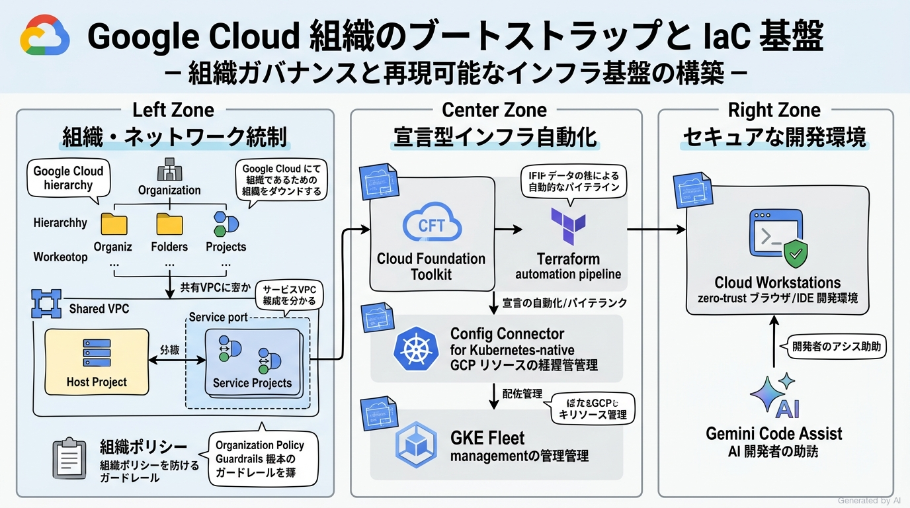
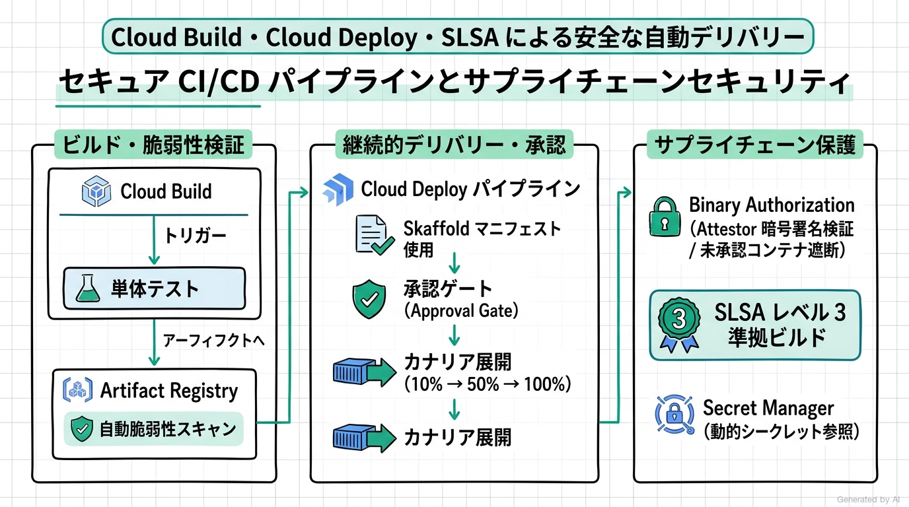
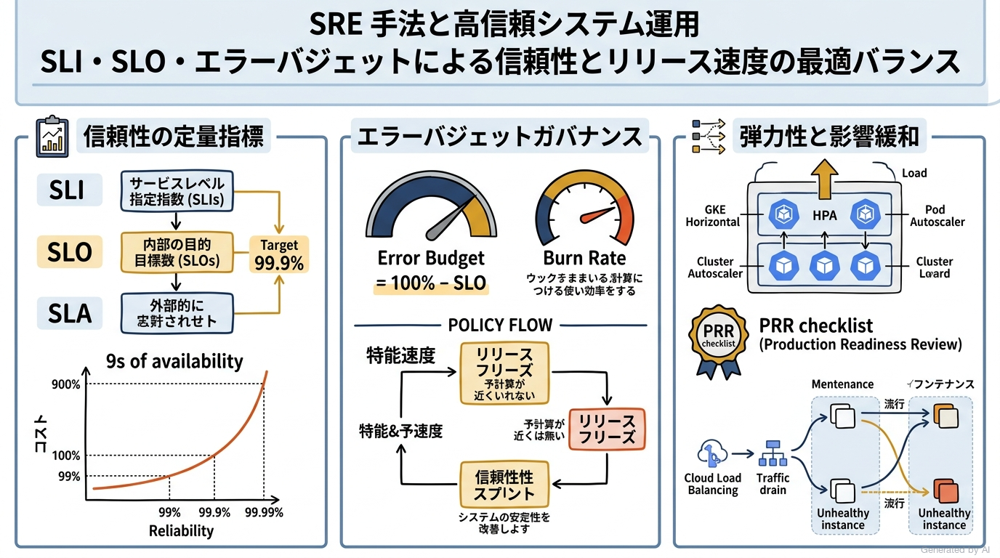
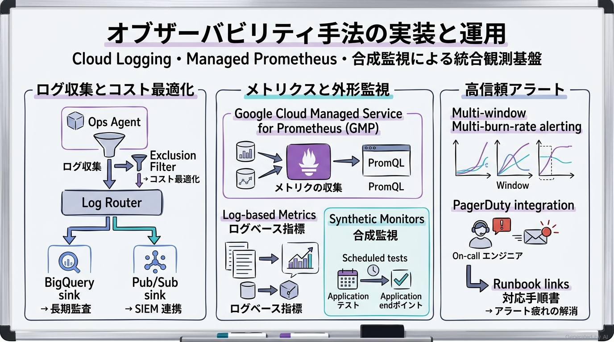
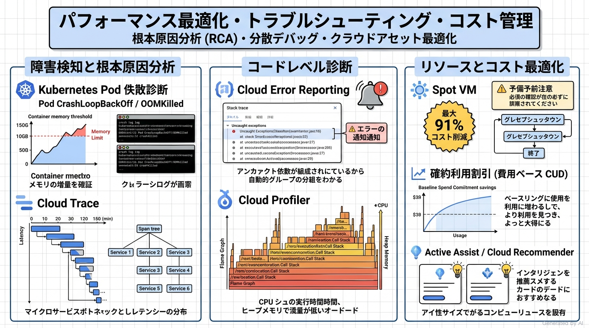

# Google Cloud Certified - Professional Cloud DevOps Engineer 完全対策＆実践学習ガイド

- **対象資格**: Google Cloud Certified - Professional Cloud DevOps Engineer
- **試験コード**: Professional Cloud DevOps Engineer
- **公式試験ガイド**: [Professional Cloud DevOps Engineer 認定試験ガイド (日本語版)](https://services.google.com/fh/files/misc/professional_cloud_devops_engineer_exam_guide_japanese.pdf)
- **公式試験ページ**: [Professional Cloud DevOps Engineer 認定資格 | Google Cloud](https://cloud.google.com/learn/certification/cloud-devops-engineer?hl=ja)
- **公式学習パス**: [Google Skills - Professional Cloud DevOps Engineer Certification Learning Path](https://www.skills.google/paths/)
- **最終更新日**: 2026-10-14

---

## はじめに

現代のソフトウェアエンジニアリングおよびインフラストラクチャ運用において、ビジネスの成長を支える最大の推進力は「高速なリリース速度（Velocity）」と「揺るぎないシステムの信頼性（Reliability）」の両立にあります。この二律背反に見える命題を、組織文化、プロセス、およびクラウドネイティブな自動化テクノロジーによって解決する体系こそが DevOps であり、Google が提唱・実践してきた Site Reliability Engineering（SRE: サイト信頼性エンジニアリング）です。

Google Cloud の DevOps スタック（Cloud Build, Cloud Deploy, Artifact Registry, Config Connector, Cloud Operations Suite, Cloud Workstations 等）は、開発者がインフラの制約から解放され、安全にコードを本番環境へデリバリーできるモダンなプラットフォームを提供します。

本ガイドは、単なる機能名称やコマンド構文の暗記にとどまらず、エンタープライズ規模のインフラストラクチャをコードとして管理（IaC）し、ゼロトラストに基づくセキュアなサプライチェーン（SLSA）を確立し、SLI / SLO / エラーバジェットを基準とした合理的な運用判断を下せる「真の DevOps / SRE エンジニア」の育成を目的としています。

### Professional Cloud DevOps Engineer 試験とは

Professional Cloud DevOps Engineer 認定試験は、Google Cloud 上でシステム開発ライフサイクル（SDLC）全体にプロセスを実装し、信頼性と配信速度の最適なバランスを維持しながら、ソフトウェアとインフラストラクチャの効率的な配信・運用・保守を実現する高度な実務能力を客観的に評価・認定するプロフェッショナル資格です。

- **試験時間**: 120 分（2 時間）
- **出題問題数**: 50〜60 問
- **出題形式**: 択一選択問題（4 肢中 1 つ選択）、複数選択問題（5 肢以上中 2 つ以上選択）
- **合否基準点**: スケールドスコア方式（合格 / 不合格のみ判定。正答率は非開示）
- **受験料**: $200（税別）
- **言語**: 日本語、英語
- **前提知識**: 3 年以上の IT 実務経験、および Google Cloud 上での本番環境ソリューションの設計・構築・運用管理に関する 1 年以上の実務経験が推奨されます。

### 難易度と求められる思考力

Professional Cloud DevOps Engineer 試験は、Google Cloud 認定資格の中でも最も「実践的な運用判断」と「エンジニアリング思想」が問われる難関試験の一つです。出題の多くは、特定の技術的・組織的制約の下で最適なリリース戦略やインシデント対策を選択させる長文シチュエーション問題です。

合格に必要なのは、単一サービスの知識ではなく、以下の「DevOps / SRE トレードオフ判断力」です。

1. **信頼性と速度のトレードオフ管理**: 99.9% と 99.99% の可用性目標（SLO）の違いがもたらす開発速度やインフラコストへの影響を理解し、エラーバジェットの消費速度（バーンレート）に応じてリリース凍結やカナリア展開の判断を下せるか。
2. **ソフトウェアサプライチェーンセキュリティの確立**: ソースコードのコミットからコンテナレジストリへの保管、本番環境へのデプロイに至る全行程において、未承認のアーティファクト混入を Binary Authorization や SLSA フレームワークで根本防御できるか。
3. **インフラストラクチャとパイプラインのコード化・自動化**: Terraform、Cloud Foundation Toolkit、Config Connector を適材適所で使い分け、マルチ環境・マルチクラスタに対する整合性のとれた構成管理を実現できるか。
4. **オブザーバビリティの戦略的設計**: ログ、メトリクス、分散トレースを体系的に収集・分析し、単なるノイズアラートを排除してユーザー体験の劣化を最小ウィンドウで検知・局所化できるか。
5. **クラウドコストとパフォーマンスの最適化**: ログ除外フィルタ、Spot VM、確約利用割引（CUD）、Cloud Recommender を活用し、運用の持続可能性を担保できるか。

### 推奨の勉強法

1. **公式一次ドキュメントおよび SRE 書籍の精読**:
   Google Cloud 公式ドキュメントの「ベストプラクティス」「アーキテクチャガイド」に加え、Google SRE チームが公開している『Site Reliability Engineering: How Google Runs Production Systems』の核心概念（SLI/SLO/SLA、エラーバジェット、トイルの削減、障害の根本原因分析）を体系的に学習します。
2. **実機ハンズオンによる手触り感の獲得**:
   Google Skills（Cloud Skills Boost）の DevOps / SRE 関連学習パス（「Implement DevOps Workflows in Google Cloud」等）を活用し、Cloud Build トリガー、Cloud Deploy パイプライン、Artifact Registry 脆弱性スキャン、Cloud Monitoring によるアラートポリシー策定を実機で検証します。
3. **構造化実践シナリオ（状況・対応・結果・解説）による意思決定プロセスの追体験**:
   本ガイドに網羅された各セクションの実践シナリオを読み込み、「なぜその手法が最適なのか」「なぜ類似の他手法では不適格なのか」という全代替案の棄却理由を論理的に説明できるレベルまで思考を深めます。

---

## 目次

1. [はじめに](#はじめに)
2. [学習カリキュラム・出題範囲ロードマップ](#学習カリキュラム出題範囲ロードマップ)
3. [Section 1: Google Cloud 組織のブートストラップと保守 (15%)](#section-1-google-cloud-組織のブートストラップと保守-15)
   - [1. セクション概要](#1-セクション概要)
   - [2. 重要トピック](#2-重要トピック)
   - [3. 実践シナリオ](#3-実践シナリオ)
   - [4. 参考ドキュメント & 推奨ハンズオン](#4-参考ドキュメント--推奨ハンズオン)
4. [Section 2: アプリケーションとインフラストラクチャの CI / CD パイプラインの構築および実装 (27%)](#section-2-アプリケーションとインフラストラクチャの-ci--cd-パイプラインの構築および実装-27)
   - [1. セクション概要](#1-セクション概要-1)
   - [2. 重要トピック](#2-重要トピック-1)
   - [3. 実践シナリオ](#3-実践シナリオ-1)
   - [4. 参考ドキュメント & 推奨ハンズオン](#4-参考ドキュメント--推奨ハンズオン-1)
5. [Section 3: サイト信頼性エンジニアリング手法のアプリケーションへの適用 (23%)](#section-3-サイト信頼性エンジニアリング手法のアプリケーションへの適用-23)
   - [1. セクション概要](#1-セクション概要-2)
   - [2. 重要トピック](#2-重要トピック-2)
   - [3. 実践シナリオ](#3-実践シナリオ-2)
   - [4. 参考ドキュメント & 推奨ハンズオン](#4-参考ドキュメント--推奨ハンズオン-2)
6. [Section 4: オブザーバビリティ手法の実装 (20%)](#section-4-オブザーバビリティ手法の実装-20)
   - [1. セクション概要](#1-セクション概要-3)
   - [2. 重要トピック](#2-重要トピック-3)
   - [3. 実践シナリオ](#3-実践シナリオ-3)
   - [4. 参考ドキュメント & 推奨ハンズオン](#4-参考ドキュメント--推奨ハンズオン-3)
7. [Section 5: パフォーマンスの最適化とトラブルシューティング (15%)](#section-5-パフォーマンスの最適化とトラブルシューティング-15)
   - [1. セクション概要](#1-セクション概要-4)
   - [2. 重要トピック](#2-重要トピック-4)
   - [3. 実践シナリオ](#3-実践シナリオ-4)
   - [4. 参考ドキュメント & 推奨ハンズオン](#4-参考ドキュメント--推奨ハンズオン-4)
8. [まとめと推奨学習ステップ](#まとめと推奨学習ステップ)

---

## 学習カリキュラム・出題範囲ロードマップ

### セクション一覧と出題比率

| セクション番号 | セクション名 / 出題分野 | 出題比率 | 主要対象サービス・ツール |
| :--- | :--- | :--- | :--- |
| **Section 1** | Google Cloud 組織のブートストラップと保守 | 15% | リソース階層, 共有 VPC, IAM, 組織ポリシー, App Hub, CFT, Config Connector, Terraform, Helm, GKE フリート, Cloud Workstations |
| **Section 2** | アプリケーションとインフラストラクチャの CI / CD パイプラインの構築および実装 | 27% | Artifact Registry, Cloud Build, Cloud Deploy, Skaffold, Kustomize, デプロイ戦略 (カナリア, Blue/Green), Secret Manager, Cloud KMS, Binary Authorization, SLSA |
| **Section 3** | サイト信頼性エンジニアリング手法のアプリケーションへの適用 | 23% | SLI / SLO / SLA, エラーバジェット, バーンレート, PRR, キャパシティプランニング, オートスケーリング (MIG, GKE, Cloud Run), トラフィックドレイン |
| **Section 4** | オブザーバビリティ手法の実装 | 20% | Cloud Logging, Ops Agent, ログルーター, ログ除外, BigQuery / Pub/Sub エクスポート, Cloud Monitoring, Managed Service for Prometheus, 合成モニター, アラートポリシー |
| **Section 5** | パフォーマンスの最適化とトラブルシューティング | 15% | RCA (根本原因分析), Cloud Trace, Error Reporting, Cloud Profiler, OpenTelemetry, Spot VM, CUD / SUD, ネットワークティア, Active Assist / Recommender |

---

## Section 1: Google Cloud 組織のブートストラップと保守 (15%)

本セクションでは、エンタープライズ規模の Google Cloud 環境をゼロから立ち上げ、安全かつ再現性のある形で運用・保守するための基盤アーキテクチャが問われます。組織・フォルダ・プロジェクトからなるリソース階層の設計、共有 VPC による中央集権的なネットワーク統制、IAM ロールと組織ポリシー制約によるガードレール設定、Infrastructure as Code（IaC）による自動プロビジョニング、そして Cloud Workstations を用いたセキュアな開発環境の標準化が主眼となります。

---

### 1. セクション概要

エンタープライズのクラウドアドプションにおいて、初期の基盤設計（ブートストラップ）の成否は将来のスケーラビリティ、セキュリティ、運用コストに決定的な影響を与えます。Google Cloud では「リソース階層によるアクセス権とポリシーの継承」「ネットワークとコンピュートの職掌分散（共有 VPC）」「宣言的インフラストラクチャ（IaC）による構成ドリフト防止」を三位一体で実現することが推奨されます。

#### 重要キーワード

- **リソース階層（Resource Hierarchy）**: 組織（Organization）、フォルダ（Folder）、プロジェクト（Project）、リソース（Resource）からなる木構造。IAM 権限と組織ポリシーは上位から下位へ継承（Inheritance）されます。
- **共有 VPC（Shared VPC）**: ホストプロジェクトで VPC ネットワークとサブネットを一元管理し、複数のサービスプロジェクトにサブネット単位で利用権限を委任するエンタープライズネットワーク構成。
- **組織ポリシー（Organization Policy Service）**: プラットフォーム全体または特定フォルダ配下のリソース設定（デフォルト VPC の無効化、パブリック IP の禁止、利用可能リージョンの制限など）を強制する中央集権型ガードレール。
- **Cloud Foundation Toolkit (CFT)**: Google 推奨のベストプラクティスを組み込んだ、再利用可能なオープンソースの Terraform モジュール群。
- **Config Connector**: Kubernetes のカスタムリソース（CRD）として Google Cloud リソースを宣言・管理できる Kubernetes アドオン。GitOps ツール（Argo CD, Config Sync）との親和性に優れます。
- **App Hub**: プロジェクトや境界を越えて散在するワークロードを、ビジネスアプリケーションおよびサービスの単位で論理的に整理・カタログ化する集中管理機能。
- **Cloud Workstations**: VPC 内部で完全に分離され、ブラウザまたはローカル IDE からアクセス可能なフルマネージドのマネージド開発環境。

---

### 2. 重要トピック

#### 1. インフラストラクチャ管理手法の比較マトリクス

クラウドインフラストラクチャの自動化においては、ツールの特性、適用領域、運用オーバーヘッドに応じた適切な技術選定が不可欠です。

| ツール / 手法 | 主な管理対象 | 制御モデル | 得意とするユースケース | 主なトレードオフ・考慮事項 |
| :--- | :--- | :--- | :--- | :--- |
| **Terraform (CFT)** | プロジェクト、共有 VPC、IAM、KMS 等の基盤全般 | 外部 CLI / CI/CD による宣言型プロビジョニング | 組織全体のブートストラップ、マルチクラウド基盤 | 状態ファイル（tfstate）の安全な集中管理とロック排他制御が必要。 |
| **Config Connector** | GCS バケット、Pub/Sub、Cloud SQL 等の個別リソース | Kubernetes オペレータによる宣言型（Reconciliation Loop） | GKE を中核とするアプリケーション基盤、GitOps 連携 | 制御プレーンとして Kubernetes クラスタの維持管理が必要。 |
| **Helm** | Kubernetes マニフェスト（Deployment, Service 等） | パッケージマネージャ | クラスタ内ワークロードのバージョン管理・配布 | インフラ基盤（GCP プロジェクトや VPC 自体）の作成には不適。 |
| **Python / Go SDK** | 動的なリソースプロビジョニング、カスタム運用自動化 | 手続き型スクリプト | 複雑なビジネスロジックやイベント駆動のリカバリ処理 | 冪等性（Idempotency）とロールバック処理を自前で実装する必要がある。 |

- **アーキテクトの選定基準**:
  - **組織全体の基盤ブートストラップ**: 組織階層、IAM、共有 VPC、ログシンクの一括構成には、Google 推奨の **Terraform (Cloud Foundation Toolkit)** を採用します。
  - **GKE 中心のエコシステムと GitOps 運用**: クラスタ内アプリケーションが必要とする Cloud Storage バケットや Secret Manager 等のリソースを、Pod マニフェストと同一の Git リポジトリで統一管理する場合は **Config Connector** を選定します。

---

### 3. 実践シナリオ

#### シナリオ 1-1: エンタープライズマルチプロジェクトにおける共有 VPC と集中モニタリング設計

- **状況**: 大規模エンタープライズにおいて、数十の開発チームが個別の Google Cloud プロジェクトを利用しているが、ネットワーク管理をインフラ専門チームに一元化し、かつ全プロジェクトの監査ログとメトリクスを一箇所で監視する必要がある場合
- **対応**: ネットワーク専用のホストプロジェクトを作成して共有 VPC を構成し、各開発チームのプロジェクトをサービスプロジェクトとして紐付け、さらに専用の集中モニタリングプロジェクトを作成して全プロジェクトを含むモニタリングスコープ（Monitoring Scope）を設定する。
- **結果**: ネットワークセキュリティポリシーと IP アドレス設計の中央集権化が達成され、開発プロジェクト間の不要なピアリングが不要になるとともに、単一のダッシュボードから全環境の横断的な監視が可能となる。
- **解説**: 共有 VPC を使用することで、ネットワーク管理の職掌分散（Separation of Duties）を実現し、ホストプロジェクト管理者のみがサブネットの払い出しやファイアウォール規則を制御できるためです。各プロジェクトで個別に VPC を作成し VPC ネットワークピアリングで相互接続する構成は、プロジェクト数の増加に伴いピアリング数の上限に達し、ルーティング管理が破綻するため不適格です。また、プロジェクトごとに個別のモニタリングダッシュボードを運用するアプローチは、組織横断的な障害の早期相関分析が不可能となり要件を満たせません。
- **参考ドキュメント**:
  - [共有 VPC の概要](https://cloud.google.com/vpc/docs/shared-vpc?hl=ja): ホストプロジェクトとサービスプロジェクトの設計原則。
  - [複数プロジェクトの指標の表示](https://cloud.google.com/monitoring/settings/multiple-projects?hl=ja): スコーププロジェクトの設定とモニタリング統制。

#### シナリオ 1-2: Config Connector による Kubernetes ネイティブなクラウドリソース宣言

- **状況**: GKE 上で多数のマイクロサービスを運用している開発組織において、各サービスが利用する Cloud Storage バケットや Pub/Sub トピックを、アプリケーションの Kubernetes マニフェストと同一の Git リポジトリで管理し、自動同期させたい場合
- **対応**: GKE クラスタに Config Connector アドオンをインストールし、Workload Identity を構成した上で、Kubernetes カスタムリソースとして `StorageBucket` や `PubSubTopic` をマニフェスト定義する。
- **結果**: Git リポジトリへのマージをトリガーとして Kubernetes コントローラが Google Cloud リソースを自動生成・調整（Reconcile）し、インフラとアプリのマニフェストが一元管理される。
- **解説**: Config Connector は Kubernetes の宣言的 API 思想を Google Cloud リソース全体に拡張し、Kubernetes 側の構成同期ツール（Config Sync や Argo CD）とシームレスに GitOps を実現できるためです。開発者ごとに Terraform 実行権限をローカル付与するアプローチは、tfstate の不整合やクレデンシャル漏洩のリスクが高まるため不適格です。また、Pod の起動スクリプト（Init Container）内で gcloud CLI を使ってリソースを作成する手法は、クラスタ再起動時の多重作成やエラーハンドリングが極めて困難であり要件を満たせません。
- **参考ドキュメント**:
  - [Config Connector の概要](https://cloud.google.com/config-connector/docs/overview?hl=ja): Kubernetes ネイティブなクラウドリソース管理。

#### シナリオ 1-3: プライベートワーカープールを用いたセキュアなハイブリッド CI/CD スタック

- **状況**: 金融系システムにおいて、ソースコードおよびビルド成果物の外部流出を防ぐため、CI/CD 実行環境をインターネットから完全隔離し、オンプレミス環境の内部リポジトリやプライベートアーティファクトリポジトリにのみ閉域網経由でアクセスさせたい場合
- **対応**: Cloud Build でプライベートワーカープール（Private Worker Pool）を構成し、共有 VPC とピアリング接続を行って、Cloud Interconnect 経由でオンプレミス内部ネットワークに通信をルーティングする。
- **結果**: ビルド環境が VPC 内部のプライベート IP のみで稼働し、パブリック IP を介さない安全なビルドパイプラインが確立される。
- **解説**: Cloud Build のプライベートプールは、マネージドの実行環境でありながら VPC ピアリングを通じて特定の内部 IP 空間へのみ安全にアクセスできるためです。デフォルトの Cloud Build パブリックワーカープールを使用する構成は、ビルド環境にパブリック IP が割り当てられ、閉域ネットワークへのセキュアな到達性が担保できないため不適格です。また、Compute Engine VM 上に自前で Jenkins を構築して完全管理するアプローチは、パッチ適用やスケーリングの運用負荷（トイル）が著しく増大するため推奨されません。
- **参考ドキュメント**:
  - [プライベート プールでのビルドの実行](https://cloud.google.com/build/docs/private-pools/run-builds-in-private-pools?hl=ja): 閉域ネットワーク接続構成。

#### シナリオ 1-4: GKE フリートと Config Sync によるマルチクラスタポリシーの一元統制

- **状況**: 本番環境、ステージング環境、開発環境など複数のリージョンに跨る 10 以上の GKE クラスタを運用しているが、各クラスタのセキュリティポリシー（RBAC、NetworkPolicy）に構成ドリフトが発生し、手動同期が破綻している場合
- **対応**: すべての GKE クラスタを単一の GKE フリート（Fleet）に登録し、Config Sync を有効化して単一の Git リポジトリからポリシーマニフェストを自動同期させる。
- **結果**: クラスタの追加やポリシー更新時に、Git へのコミットのみで全クラスタへの均一なポリシー適用とドリフト自動修復が実現する。
- **解説**: GKE フリートと Config Sync は、マルチクラスタ環境における構成管理の Single Source of Truth を Git に集約し、継続的な同期とコンプライアンス検証を自動実行するためです。クラスタごとに `kubectl apply` を手動実行する、あるいは単純なシェルスクリプトでループ実行するアプローチは、実行失敗時のリトライやクラスタ間での設定差分（ドリフト）を検知・修復できないため不適格です。また、Terraform 単体で全クラスタの Kubernetes リソースを直接流し込む構成は、クラスタ数の増加に伴いプロビジョニング時間が極度に肥大化し要件を満たせません。
- **参考ドキュメント**:
  - [フリート管理の概要](https://cloud.google.com/kubernetes-engine/docs/concepts/fleets-overview?hl=ja): 複数クラスタの論理的グループ化。
  - [Config Sync の概要](https://cloud.google.com/kubernetes-engine/docs/add-ons/config-sync/overview?hl=ja): GitOps による構成同期。

#### シナリオ 1-5: Cloud Workstations によるリモート開発環境のゼロトラスト化

- **状況**: 社外パートナーやリモート勤務の開発者が開発を行うにあたり、ソースコードや機密データをローカル端末に一切ダウンロードさせず、かつ社内 VPC リソースへのセキュアなアクセスを保証したい場合
- **対応**: 組織の VPC 内部に Cloud Workstations をプロビジョニングし、カスタムコンテナイメージで必要な SDK やツールチェーンをプリインストールした上で、VPC Service Controls の境界内に配置する。
- **結果**: 開発者はブラウザ経由でセキュアな IDE にアクセスでき、ローカル端末へのデータ保存を禁止しつつ、開発環境のセットアップ時間をゼロに短縮できる。
- **解説**: Cloud Workstations は企業管理の VPC 内にワークステーションをホストし、プライベートクラスタ構成や IAM 制御を組み合わせることで強固な情報漏洩防止を実現できるためです。各開発者のローカル PC に VPN クライアントを配布して直接 VPC に接続させる手法は、端末からのデータ持ち出しやマルウェア感染のリスクを排除できないため不適格です。また、単なる Compute Engine VM を作成して SSH ポートを開放するアプローチは、ポート管理やセッション制御、一括イメージ管理の面でガバナンス要件を満たせません。
- **参考ドキュメント**:
  - [Cloud Workstations の概要](https://cloud.google.com/workstations/docs/overview?hl=ja): セキュアなマネージド開発環境。

---

### 4. 参考ドキュメント & 推奨ハンズオン

#### 公式一次ドキュメント
- [エンタープライズ組織の設計ガイド](https://cloud.google.com/architecture/enterprise-landing-zone?hl=ja): リソース階層とネットワークのベストプラクティス。
- [Google Cloud 組織ポリシー サービス](https://cloud.google.com/resource-manager/docs/organization-policy/overview?hl=ja): ガードレール設計。

#### 推奨ハンズオン・ラボ（実機検証）
- **Build Infrastructure with Terraform on Google Cloud (Skill Badge)**:
  - **学習目標**: Terraform によるリソースプロビジョニング、tfstate の GCS バックエンド管理、モジュール設計を習得。
- **Config Connector による Google Cloud リソースの管理**:
  - **学習目標**: GKE クラスタ内から Kubernetes マニフェストを用いて Cloud Storage や Cloud SQL をプロビジョニングする GitOps フローを検証。

---

## Section 2: アプリケーションとインフラストラクチャの CI / CD パイプラインの構築および実装 (27%)

本セクションは本試験の最大配点（約 27%）を占める最重要分野です。Artifact Registry によるアーティファクトの集中管理、Cloud Build によるスケーラブルな継続的インテグレーション（CI）、Cloud Deploy と Skaffold を組み合わせた継続的デリバリー（CD）、カナリアやブルー/グリーンなどの高度なデプロイ戦略、Secret Manager によるシークレット管理、そして Binary Authorization と SLSA によるサプライチェーンセキュリティの徹底が問われます。

---

### 1. セクション概要

モダンな CI/CD パイプラインは、単にコードを自動ビルドしてデプロイするだけでは不十分です。本番リリースの安全性を担保するデプロイ戦略、シークレット漏洩の防止、そしてビルドパイプライン自体の改ざんを防ぐサプライチェーンセキュリティ（SLSA: Supply-chain Levels for Software Artifacts）が不可欠となります。

#### 重要キーワード

- **Cloud Build**: Google Cloud のフルマネージド サーバーレス CI/CD プラットフォーム。Docker コンテナをビルドステップとして実行し、高いスケーラビリティを提供します。
- **Artifact Registry**: コンテナイメージや言語パッケージ（Maven, npm, Python）を一元管理する次世代リポジトリ。自動脆弱性スキャンやアクセス制御を統合。
- **Cloud Deploy**: GKE、Cloud Run、Google Cloud Deploy targets（Compute Engine MIG 等）への安全で意見の分かれない（Opinionated）継続的デリバリーを提供するフルマネージドサービス。
- **Skaffold**: アプリケーションのビルド、プッシュ、デプロイのワークフローをオーケストレートするオープンソースツール。Cloud Deploy の基盤エンジンとして動作します。
- **Binary Authorization**: コンテナがデプロイされる直前に、信頼できる機関（Attestor）の暗号署名を検証し、ポリシーを満たさないコンテナの起動を Kubernetes アドミッションコントローラで強制拒否するセキュリティサービス。
- **SLSA (Supply-chain Levels for Software Artifacts)**: ソフトウェアサプライチェーンの安全性を評価・担保するための業界標準セキュリティフレームワーク。ビルドの完全性やビルド元証明（Provenance）を保証します。
- **デプロイ戦略（Canary, Blue/Green, Rolling）**: 新バージョンのトラフィックを段階的に制御し、本番障害の影響半径を最小化するリリース手法。

---

### 2. 重要トピック

#### 1. デプロイ戦略の比較マトリクス

デプロイ戦略の選定は、許容ダウンタイム、必要な追加インフラリソース（コスト）、および障害発生時の切り戻し速度のトレードオフによって決定されます。

| デプロイ戦略 | 仕組み・トラフィック移行 | 必要追加リソース | ロールバック速度 | 主な利点・適用ユースケース | トレードオフ・懸念点 |
| :--- | :--- | :--- | :--- | :--- | :--- |
| **ローリングアップデート (Rolling Update)** | 既存インスタンスを新バージョンで順次置き換え | 最小（`maxSurge` 分のみ） | 緩慢（旧バージョンの再ローリングが必要） | リソース消費が少なく、ステートレス API の標準更新に最適。 | 新旧バージョンが一時的に混在するため、後方互換性の担保が必須。 |
| **ブルー/グリーン (Blue/Green)** | 新環境（Green）を完全構築後にロードバランサで一括切り替え | 最大（100% の冗長インフラが必要） | 即時（トラフィックを Blue へ戻すのみ） | 新旧混在がなく、大規模なメジャーバージョンアップに最適。 | 一時的に 2 倍のコンピュートコストが発生する。 |
| **カナリアデプロイ (Canary)** | 一部のトラフィック（例: 10%）のみを新バージョンへ流し検証 | 少量（カナリア用 Pod のみ） | 迅速（カナリアへのトラフィックをゼロにする） | 実際のユーザー本番トラフィックで潜在的なバグ・性能劣化を極小影響で検知。 | 複数バージョンの同時稼働に対応した DB スキーマ設計が必要。 |
| **トラフィック分割 (Traffic Splitting)** | Cloud Run や Cloud Service Mesh による精密な比率制御 | リクエストベース | 即時（コンソールや gcloud で 1 秒変更） | サーバーレス環境での A/B テストや段階的移行に最適。 | バックエンドのセッション維持（スティッキーセッション）に注意が必要。 |

- **アーキテクトの選定基準**:
  - **最大リスク回避と低影響検証**: 本番リリースの未知の不具合を最小限に抑えるには **カナリアデプロイ** を採用します。
  - **即時ロールバックと非互換リリース**: DB スキーマの非互換性がない状態での切り替えや、即座の全量切り戻しが必要な場合は **Blue/Green** を採用します。

#### 2. シークレット注入方式のセキュリティ比較

| 方式 | 注入タイミング | 仕組み | リスク・考慮事項 |
| :--- | :--- | :--- | :--- |
| **ビルド時注入 (Build-time)** | Docker ビルド時（ARG / ENV） | イメージレイヤー内に埋め込み | **重大なアンチパターン**。コンテナイメージを pull できる全ユーザーに秘密鍵やトークンが漏洩する。 |
| **デプロイ時マウント (Deploy-time)** | K8s Secret や環境変数として Pod 定義に記述 | マニフェストに直接記述 | マニフェストファイルや Git リポジトリへの誤コミットによる漏洩リスクが高い。 |
| **ランタイム動的参照 (Runtime)** | コンテナ起動時 / 実行時 | Secret Manager API または CSI Driver を介してメモリ上のみに展開 | **推奨ベストプラクティス**。Workload Identity を用いて Pod 単位で最小権限を制御し、ディスク永続化を防ぐ。 |

---

### 3. 実践シナリオ

#### シナリオ 2-1: Cloud Deploy によるステージングから本番への段階的承認プロモーション

- **状況**: 大規模マイクロサービスにおいて、開発環境からステージング環境へは自動デプロイするが、本番環境へのデプロイには必ず運用リードの明示的な承認を必須とし、かつ過去のリリース履歴とマニフェスト差分を監査可能にする必要がある場合
- **対応**: Cloud Deploy のデリバリーパイプライン（Delivery Pipeline）を定義し、本番ステージの定義に `requireApproval: true` を設定して、Skaffold 設定ファイルを統合する。
- **結果**: ステージングへのデプロイ完了後、パイプラインが自動的に本番昇格待ち状態で一時停止し、運用リードがコンソールまたは CLI で差分を確認して承認した時のみ本番クラスタへのロールアウトが実行される。
- **解説**: Cloud Deploy は承認ゲート（Approval Gate）および監査証跡をネイティブに提供し、GitOps の宣言的マニフェスト（Skaffold）に基づいた安全なプロモーションをフルマネージドで実現できるためです。Cloud Build のスクリプト内でシェルコマンドの `read` 入力待ちを組み込む手法は、ビルドタイムアウトの浪費やセッション切断に弱く、CI/CD の運用標準を満たせません。また、本番環境のデプロイのみ Jenkins の手動ジョブに切り替える構成は、パイプラインの断片化と成果物のトレーサビリティ喪失を招くため不適格です。
- **参考ドキュメント**:
  - [リリースの承認](https://cloud.google.com/deploy/docs/approving-release?hl=ja): 承認プロセスの構成。

#### シナリオ 2-2: Cloud Deploy カナリアリリースと自動指標評価に基づく自動ロールバック

- **状況**: GKE 本番環境への新バージョンリリースにおいて、全ユーザーに影響を与える障害を未然に防ぐため、最初に 10% の Pod にのみ新バージョンを適用し、HTTP 5xx エラー率の上昇を検知した場合は人手を介さず即座に旧バージョンへ切り戻す必要がある場合
- **対応**: Cloud Deploy でカナリアデプロイフェーズを構成し、Skaffold と連携してトラフィックの 10% をルーティングした上で、Cloud Monitoring のアラートポリシーまたはカスタム検証ジョブ（Verify step）でエラー率を監視し、しきい値超過時に自動ロールバックを発動させる。
- **結果**: 潜在的な致命的バグを含むリリースであっても、影響を受けるユーザーが最大 10% に限定され、障害検知から数分以内に自動で安全な状態に復旧する。
- **解説**: Cloud Deploy のネイティブな自動カナリア機能および検証フェーズ（Verify）を活用することで、デプロイからモニタリング、自動切り戻しまでを標準化されたワークフローとして自動実行できるためです。ローリングアップデート（RollingUpdate）を全量実行した後に、オンコールエンジニアが手動で監視ダッシュボードを確認して `kubectl rollout undo` を実行する手法は、全ユーザーへ障害が波及し、かつ人手介入による初動遅延が発生するため不適格です。
- **参考ドキュメント**:
  - [デリバリー パイプラインでのカナリア デプロイの使用](https://cloud.google.com/deploy/docs/canary?hl=ja): カナリア構成ガイド。

#### シナリオ 2-3: Cloud Run におけるトラフィック分割を活用したゼロダウンタイム移行

- **状況**: トラフィック急増が予想される新機能を含むサーバーレス Web アプリケーションにおいて、新旧リビジョン間でセッションや接続エラーを発生させることなく、徐々にトラフィックを 10% -> 50% -> 100% と段階的にシフトさせたい場合
- **対応**: Cloud Run の新リビジョンをデプロイする際にトラフィックを 0% に設定し、`gcloud run services update-traffic` コマンドを用いて段階的に新リビジョンへのトラフィック比率を増加させる。
- **結果**: アプリケーションの稼働を一切中断することなく、新リビジョンの負荷耐性とエラー率を実トラフィックで確認しながら安全に全量移行が完了する。
- **解説**: Cloud Run はマネージドな Envoy プロキシを内蔵しており、複数リビジョンに対する精密なトラフィック分割（Traffic Splitting）を API コール一つで即座に実行できるためです。新リビジョンを別名サービスとしてデプロイし、外部 DNS の A レコードや重み付け CNAME でトラフィックを分散させる手法は、クライアント側の DNS キャッシュによって切り替えに数時間から数日を要し、緊急時のロールバックも即応できないため不適格です。
- **参考ドキュメント**:
  - [トラフィックの分割](https://cloud.google.com/run/docs/rollouts-rollbacks-traffic-migration?hl=ja): Cloud Run でのリビジョン管理。

#### シナリオ 2-4: Secret Manager と Workload Identity による動的シークレット参照

- **状況**: GKE 上で稼働するバックエンドマイクロサービスが外部決済 API の API キーを必要としているが、Git リポジトリやコンテナイメージ内、Kubernetes マニフェストにシークレット情報を一切平文保存せず、かつ Pod ごとにアクセスを厳格に制限したい場合
- **対応**: Secret Manager に API キーを保存し、Secret Manager の特定シークレットに対する閲覧者ロール（`roles/secretmanager.secretAccessor`）を紐付けた Google サービスアカウントを作成し、GKE の Workload Identity を介して Pod の Kubernetes Service Account に権限をマッピングして、Secrets Store CSI Driver 経由でボリュームマウントする。
- **結果**: シークレットがストレージやコンテナレイヤーに永続化されることなく、実行中の Pod のメモリ内ファイルシステム（tmpfs）としてのみ安全に供給される。
- **解説**: Workload Identity と Secret Manager、Secrets Store CSI Driver の組み合わせは、長期的な認証キー（サービスアカウントキー JSON）の管理を不要にし、Kubernetes の Pod 単位で最小権限の動的シークレットアクセスを実現する Google Cloud の推奨ベストプラクティスであるためです。Docker ビルド時に `--build-arg` で API キーを渡してイメージ内に環境変数として焼き込む手法は、イメージを pull した第三者にシークレットが漏洩するため重大なアンチパターンです。また、サービスアカウントの JSON 秘密鍵をダウンロードして Kubernetes Secret に登録する構成は、キーの漏洩・ローテーション放置のリスクがあるため不適格です。
- **参考ドキュメント**:
  - [Secrets Store CSI ドライバの使用](https://cloud.google.com/secret-manager/docs/secret-manager-csi-driver?hl=ja): Kubernetes への安全なシークレットマウント。

#### シナリオ 2-5: Binary Authorization と SLSA レベル 3 による改ざんコンテナデプロイ遮断

- **状況**: セキュリティコンプライアンスが極めて厳しい環境において、承認された Cloud Build パイプラインで正規にビルド・テストされ、脆弱性スキャンを通過したコンテナイメージのみを GKE クラスタで実行させ、開発者や管理者が手動でビルドした未承認イメージの起動をプラットフォームレベルでブロックしたい場合
- **対応**: Cloud Build で SLSA レベル 3 準拠のビルドProvenance を生成し、脆弱性スキャン通過後に暗号署名を行う認証者（Attestor）を構成し、GKE クラスタで Binary Authorization ポリシーを有効化して当該 Attestor の署名を必須とする。
- **結果**: 承認された CI/CD パイプラインを経由していないコンテナ、およびテスト未実施のイメージのデプロイが Kubernetes アドミッションコントローラによって即座に拒否される。
- **解説**: Binary Authorization は、クラスタへのデプロイ直前にイメージの暗号署名とポリシー整合性を検証するため、悪意ある改ざんや人為的ミスによる未検証イメージの混入を根本的に遮断できるためです。IAM 権限でクラスタへのデプロイ実行権限を絞り込むだけのアプローチでは、正当な権限を持つ開発者が誤ってローカルでビルドした未検証タグをデプロイしてしまう事故を防止できないため不適格です。また、Artifact Registry の脆弱性スキャンを有効にするだけでは、警告通知は行われてもクラスタへのデプロイ自体を自動拒否できないため要件を満たせません。
- **参考ドキュメント**:
  - [Binary Authorization の概要](https://cloud.google.com/binary-authorization/docs/overview?hl=ja): デプロイ時セキュリティ検証。
  - [SLSA によるサプライ チェーンの保護](https://cloud.google.com/build/docs/securing-builds/view-build-provenance?hl=ja): ビルド元の完全性証明。

---

### 4. 参考ドキュメント & 推奨ハンズオン

#### 公式一次ドキュメント
- [Google Cloud Deploy のベスト プラクティス](https://cloud.google.com/deploy/docs/best-practices?hl=ja): 継続的デリバリーの設計。
- [ソフトウェア サプライ チェーン セキュリティの概要](https://cloud.google.com/software-supply-chain-security/docs/overview?hl=ja): SLSA と Binary Authorization。

#### 推奨ハンズオン・ラボ（実機検証）
- **Implement DevOps Workflows in Google Cloud (Skill Badge)**:
  - **学習目標**: Cloud Build によるコンテナ自動ビルド、Artifact Registry への push、GKE への自動デプロイパイプライン構築。
- **Securing Google Kubernetes Engine with Binary Authorization**:
  - **学習目標**: 暗号鍵（Cloud KMS）を用いた証明書作成、Attestor の設定、未署名コンテナのデプロイ拒否動作の確認。

---

## Section 3: サイト信頼性エンジニアリング手法のアプリケーションへの適用 (23%)

本セクションでは、Google の中核的運用哲学である Site Reliability Engineering（SRE）のプラクティスを本番システムへ適用する能力が問われます。SLI / SLO / SLA の明確な定義と計算、エラーバジェット（Error Budget）に基づく開発速度と運用のトレードオフ制御、Production Readiness Review（PRR: 本番環境準備レビュー）によるサービスライフサイクル管理、および障害発生時のトラフィックドレインやオートスケーリングによる影響緩和策を網羅します。

---

### 1. セクション概要

SRE の根本思想は「100% の信頼性は間違った目標である」という認識に基づきます。過剰な信頼性の追求は、開発コストを指数関数的に増大させ、新機能の配信速度を著しく低下させます。したがって、ユーザーの幸福度（User Happiness）を満たす適切な目標値（SLO）を合意し、残りの許容不具合枠（エラーバジェット）を新機能の投入や実験のための「投資枠」として活用します。

#### 重要キーワード

- **SLI (Service Level Indicator)**: サービスレベル指標。提供されているサービス水準を定量的に測定した値（例: レスポンスが 300ms 未満で完了した正常リクエストの割合）。
- **SLO (Service Level Objective)**: サービスレベル目標。チームが達成を目指すサービス水準の目標値（例: 過去 30 日間で SLI が 99.9% 以上）。
- **SLA (Service Level Agreement)**: サービスレベル契約。顧客との間で締結される公式な契約であり、違反した場合には違約金やサービスクレジット返還などの法的・金銭的ペナルティを伴います。一般に SLA は SLO よりも緩やかな数値に設定されます（例: SLO 99.9% に対し SLA 99.5%）。
- **エラーバジェット (Error Budget)**: `1 - SLO` で表される、許容される最大のダウンタイムまたは失敗リクエスト枠。
- **バーンレート (Burn Rate)**: エラーバジェットが消費される相対的な速度。バーンレート 1 は、計測期間全体（例: 30 日）でちょうど 100% のエラーバジェットを使い切る消費ペースを意味します。
- **Production Readiness Review (PRR)**: サービスを本番環境へ移行する前に、信頼性、オブザーバビリティ、キャパシティ、インシデント対応体制が Google の運用基準を満たしているかを点検するレビュープロセス。
- **トイル (Toil)**: サービス運用において、手動で繰り返し行われ、自動化可能であり、長期的な価値を生み出さない作業。SRE では運用工数のうちトイルを 50% 未満に抑えることが強く推奨されます。

---

### 2. 重要トピック

#### 1. 可用性の「9 の桁数（Nines）」と機会費用

可用性の目標値を一段階引き上げる（9 を一つ増やす）ごとに、許容ダウンタイムは 10 分の 1 に激減し、それを達成するためのインフラ費用および開発者の運用工数は非線形に高騰します。

| 可用性 (SLO) | 年間許容ダウンタイム | 月間許容ダウンタイム (30日) | 必要とされるアーキテクチャ水準 | 機会費用・トレードオフ |
| :--- | :--- | :--- | :--- | :--- |
| **99% (Two Nines)** | 約 3.65 日 (87.6 時間) | 約 7.2 時間 | 単一ゾーン構成、手動リカバリ、定常バックアップ | 開発速度は最大。ダウンタイムが許容される社内ツール等に最適。 |
| **99.9% (Three Nines)** | 約 8.76 時間 | 約 43.8 分 | マルチゾーン（HA）構成、自動ヘルスチェック、自動再起動 | コストと信頼性のバランスが最も優れており、多くの一般的な Web サービスに最適。 |
| **99.99% (Four Nines)** | 約 52.6 分 | 約 4.38 分 | マルチリージョン構成、アクティブ/アクティブ、ゼロダウンタイムデプロイ | 厳格な自動フェイルオーバーが必須。インフラ費用が大幅に増加。 |
| **99.999% (Five Nines)** | 約 5.26 分 | 約 26.3 秒 | 完全分散レプリケーション（Cloud Spanner 等）、人手不要の自動自己修復 | 極めて高額。人為的ミスやリリース速度の極端な低下を代償とする。 |

- **アーキテクトの選定基準**:
  - ユーザーが通信事業者のモバイル回線や ISP の障害（通常 99%〜99.9% 程度）に依存している場合、バックエンドで 99.999% を達成してもユーザー体験上の差異は認識できません。過剰な信頼性目標は「新機能開発リソースの喪失（機会費用）」をもたらすため、ユーザーの不満が発生しない最低限の閾値を SLO として設定します。

#### 2. GKE オートスケーリングの多層アーキテクチャ

GKE におけるオートスケーリングは、レイヤーごとに異なるコントローラが協調して動作します。

| コントローラ | スケーリング対象 | トリガー指標 | 主な役割と注意点 |
| :--- | :--- | :--- | :--- |
| **HPA (Horizontal Pod Autoscaler)** | Pod 数（レプリカ数） | CPU/メモリ使用率、カスタムメトリクス | 急激なトラフィック変動に対応して水平スケール。 |
| **VPA (Vertical Pod Autoscaler)** | Pod の CPU/メモリ要求値（requests） | 実測リソース消費履歴 | Pod の適正サイズを算定。HPA と同一指標（CPU/メモリ）で併用すると競合するため避ける。 |
| **Cluster Autoscaler** | GKE ノード（コンピュート VM） | スケジュール不能（Pending）な Pod の存在 | リソース不足で Pod が配置できない場合にノードプールを自動拡張。 |
| **GKE ノード自動プロビジョニング (NAP)** | ノードプール自体を動的作成 | 未割り当て Pod のリソース要件 | 最適なマシンタイプを持つノードプールを完全自動生成。 |

---

### 3. 実践シナリオ

#### シナリオ 3-1: ユーザー幸福度に基づく SLI / SLO 策定と SLA との差別化

- **状況**: E コマース決済サービスにおいて、これまで「CPU 使用率 80% 未満」を運用目標にしていたが、CPU が健全であっても決済 API のエラーによりユーザーが購入完了できないインシデントが多発しており、ユーザー体験に直結する指標へ再設計したい場合
- **対応**: SLI として「過去 30 日間における有効な決済リクエスト総数のうち、HTTP ステータスコードが 5xx 以外かつレイテンシ 500ms 以内で完了したリクエストの割合」を策定し、社内 SLO を 99.9% に設定した上で、外部顧客向け SLA は 99.5% に設定する。
- **結果**: 内部インフラリソースの消費量ではなく、ユーザーの実際の購買成功体験を客観的に計測できるようになり、障害発生の早期検知と適切な事業判断が可能となる。
- **解説**: SLI はサーバー側の負荷（CPU/メモリ）ではなく、ユーザー体験の品質（可用性、レイテンシ、スループット）を測定すべきであり、かつ SLA はペナルティが発生する防御的境界値であるため、社内 SLO より安全マージンを持たせて低く設定するのが鉄則であるためです。CPU 使用率はリソースの飽和度（Saturation）を示す補助指標に過ぎず、これ単体を SLI に設定してもアプリケーション層のエラーを検知できないため不適格です。また、SLO と SLA を同一の数値（99.9%）にする構成は、SLO 違反の瞬間に即座に金銭的ペナルティが発生し、チームの心理的プレッシャーと機会費用を不必要に高めるため避けるべきです。
- **参考ドキュメント**:
  - [サービスレベル目標の定義](https://cloud.google.com/stackdriver/docs/solutions/slo-monitoring/defining-slos?hl=ja): 適切な SLI / SLO の策定手法。

#### シナリオ 3-2: エラーバジェット枯渇に伴うデプロイ凍結と信頼性改善スプリントへの移行

- **状況**: アジリティを重視して毎日複数回の本番リリースを継続していた決済チームにおいて、今月度（30 日ローリングウィンドウ）のエラーバジェットがすでに 95% 消費され、残り数日でバジェットが完全枯渇する危機に直面している場合
- **対応**: 事前に締結した運用ポリシーに基づき、本番環境への新機能リリースを即時凍結し、すべてのエンジニアリングリソースをバグ修正、テスト自動化、および耐障害性向上（信頼性スプリント）に全量振り向ける。
- **結果**: サービスの信頼性が急速に回復して SLO 違反（および SLA 違反による違約金発生）が回避され、開発チームと運用チームの対立を防ぐ客観的ルールが機能する。
- **解説**: エラーバジェットの核心は「バジェットが残っている間は開発速度を最大化し、バジェットが枯渇した際は信頼性向上にリソースを全集中する」という組織合意（Policy）を機械的に執行することにあるためです。エラーバジェットが枯渇寸前であってもビジネス側の要望を優先して新機能デプロイを強行するアプローチは、SLA 違反を招き企業の社会的信用を失墜させるため不適格です。また、単に障害を起こしたエンジニアを追求したり承認フローを形骸化させる対応は、トイルを増やすだけで根本的なシステム耐障害性の向上に寄与しません。
- **参考ドキュメント**:
  - [Google SRE Book - エラーバジェットの採用](https://sre.google/sre-book/embracing-risk/): エラーバジェットの運用ガバナンス。

#### シナリオ 3-3: 本番環境準備レビュー（PRR）による運用トイルとリリース障害の防止

- **状況**: 新規に開発された AI レコメンデーションサービスが来週本番ローンチを予定しているが、リリース後に過去のプロジェクトで頻発した「監視設定の欠落」「Runbook の不在」「クォータ不足による障害」を確実に防止したい場合
- **対応**: SRE チーム主導で Production Readiness Review（PRR: 本番環境準備レビュー）を実施し、モニタリング・アラート、SLO 設定、Runbook、キャパシティ計画、GCP クォータ上限、バックアップ・リストア手順をチェックリストに照らして検証し、承認する。
- **結果**: 本番稼働後に発生する運用上の予期せぬトラブルやインフラ不足が事前排除され、スムーズなサービスインと運用移管が達成される。
- **解説**: PRR はサービスが本番のトラフィックを受け入れる前に、信頼性要件を満たしているかを包括的に評価・担保するための Google 標準のゲートキーピング手法であるためです。開発完了後にレビューを行わずそのまま DNS を切り替える手法は、高確率で初期インシデントを引き起こすため論外です。また、ソースコードのロジックレビューのみを実施するアプローチでは、インフラ層のクォータ上限やオブザーバビリティの不足を発見できないため不適格です。
- **参考ドキュメント**:
  - [Google SRE Book - 本番環境への導入](https://sre.google/sre-book/launching-system/): PRR の原則。

#### シナリオ 3-4: GKE における HPA と Cluster Autoscaler の協調動作と適正サイジング

- **状況**: ブラックフライデーのセールにおいて、Web サイトのトラフィックが短時間で通常の 10 倍に急増することが予想されるが、Pod のリソース枯渇による 503 エラーを防ぎつつ、不要になったノードは自動で縮退させてコストを最小化したい場合
- **対応**: GKE クラスタにおいて Horizontal Pod Autoscaler（HPA）でトラフィック増に応じた Pod の水平スケールを設定し、さらに Cluster Autoscaler を有効にして Pending 状態の Pod が発生した際に自動で Compute Engine ノードを拡張するよう構成する。
- **結果**: 急激なアクセス増に対して Pod が即座に増殖し、クラスタリソースが不足した瞬間にノードが自動追加されてリクエストを捌ききるとともに、セール終了後は自動で最小構成へ縮退する。
- **解説**: HPA（ワークロードのスケール）と Cluster Autoscaler（コンピュートインフラのスケール）を協調動作させることで、アプリケーション層とインフラ層の双方で真の弾力性（Elasticity）を実現できるためです。セール期間中、あらかじめ最大ノード数でクラスタを常時固定稼働させるアプローチは、膨大なインフラコストを浪費するため不適格です。また、CPU 指標に基づいて HPA と Vertical Pod Autoscaler（VPA）を同一の Deployment に対して同時に有効化する構成は、両コントローラが互いの変更を打ち消し合ってスケーリングループに陥るため推奨されません。
- **参考ドキュメント**:
  - [クラスタの自動スケーリング](https://cloud.google.com/kubernetes-engine/docs/concepts/cluster-autoscaler?hl=ja): Cluster Autoscaler の動作原理。

#### シナリオ 3-5: リージョン障害発生時における Cloud Load Balancing を用いたトラフィックドレイン

- **状況**: マルチリージョン（東京と大阪）で GKE を運用しているグローバルサービスにおいて、東京リージョンのデータセンター設備で広範囲のネットワーク障害が発生し、東京側のクラスタが健全にリクエストを処理できなくなった場合
- **対応**: 外部アプリケーションロードバランサ（External Application Load Balancer）のバックエンドサービス設定において、東京リージョンのバックエンドサービス容量（Capacity / Max Rate）を 0 に設定（ドレイン）し、すべての受信トラフィックを即座に正常な大阪リージョンへ迂回させる。
- **結果**: ユーザー接続の強制切断を伴わずに、東京側の既存インフライトリクエストの処理完了を待ちつつ、新規トラフィックがすべて大阪リージョンへスムーズにリダイレクトされる。
- **解説**: Google Cloud のグローバル外部アプリケーションロードバランサは、単一の Anycast IP アドレスの背後で複数リージョンのバックエンドを統合管理しており、キャパシティ調整によるトラフィックドレイン（Draining）を行うことで、DNS の伝播遅延を待たずに数秒で健全なリージョンへトラフィックを誘導できるためです。DNS レコードを手動で書き換えて東京リージョンの IP を削除する手法は、世界中のキャッシュ DNS による遅延が発生し、数十分から数時間にわたりユーザーにエラーが返り続けるため不適格です。また、東京側の GKE クラスタをいきなり即時削除する対応は、処理中のトランザクションデータが破損するため避けるべきです。
- **参考ドキュメント**:
  - [コネクション ドレインの構成](https://cloud.google.com/load-balancing/docs/enabling-connection-draining?hl=ja): グレースフルなトラフィック制御。

---

### 4. 参考ドキュメント & 推奨ハンズオン

#### 公式一次ドキュメント
- [Google SRE 公式ドキュメント・書籍](https://sre.google/books/): SRE 原則とベストプラクティス。
- [Cloud Monitoring による SLO のモニタリング](https://cloud.google.com/stackdriver/docs/solutions/slo-monitoring?hl=ja): SLI/SLO の定義と設定。

#### 推奨ハンズオン・ラボ（実機検証）
- **Managing Deployments Using Kubernetes Engine**:
  - **学習目標**: カナリアデプロイ、Blue/Green デプロイ、ローリングアップデートの実装検証。
- **Creating and Managing Cloud Monitoring SLOs**:
  - **学習目標**: Cloud Monitoring コンソール上での SLI 作成、SLO 定義、エラーバジェットアラートの設定。

---

## Section 4: オブザーバビリティ手法の実装 (20%)

本セクションでは、大規模分散システムの挙動を可視化・追跡するためのオブザーバビリティ（可観測性）アーキテクチャの実装能力が問われます。Cloud Logging、Ops Agent、Cloud Audit Logs、ログルーターによるフィルタリングと除外（コスト最適化）、BigQuery / Pub/Sub へのエクスポート、Cloud Monitoring、Managed Service for Prometheus（GMP）、ログベース指標、合成モニター（Synthetic Monitors）、および複数バーンレートアラートポリシーの策定が主眼となります。

---

### 1. セクション概要

オブザーバビリティは「ログ（Logs）」「メトリクス（Metrics）」「トレース（Traces）」の 3 本の柱で構成されます。エンタープライズ運用における最大の課題は「データ量が爆発し、ストレージ費用が高騰すること」および「不要なアラートが多発してオンコール担当者が疲弊するアラート疲れ（Alert Fatigue）」です。適切なサンプリング、除外フィルタ、および集約エクスポートを活用し、費用対効果の高い観測基盤を構築する必要があります。

#### 重要キーワード

- **Ops Agent**: Compute Engine 仮想マシン上でログ収集（Fluentbit ベース）およびメトリクス収集（OpenTelemetry ベース）を一元的に実行する統合エージェント。
- **ログルーター（Log Router）**: プロジェクト内で生成されるすべてのログを受け取り、除外フィルタ（Exclusion Filters）で不要ログを破棄し、シンク（Sinks）を通じてログバケット、BigQuery、Pub/Sub、Cloud Storage へルーティングする中核エンジン。
- **ログベース指標（Log-based Metrics）**: ログエントリのテキストパターンや JSON ペイロードから値を抽出し、Cloud Monitoring のメトリクス（カウンターまたはディストリビューション）としてリアルタイム生成する機能。
- **Google Cloud Managed Service for Prometheus (GMP)**: Prometheus 形式のメトリクスをフルマネージドで収集・保存・照会できるサーバーレス監視ソリューション。PromQL をそのまま使用可能。
- **合成モニター（Synthetic Monitors）**: 定期的に HTTP / HTTPS リクエストを送信し、エンドポイントの到達性、応答時間、SSL 証明書の有効性を外部から検証する外形監視機能。
- **マルチウィンドウ・マルチバーンレートアラート（Multi-window Multi-burn-rate Alerts）**: 短期ウィンドウ（急激な障害検知）と長期ウィンドウ（緩やかなバジェット消費検知）を論理積（AND）で組み合わせ、偽陽性（誤報）を徹底排除した Google SRE 推奨のアラート設計。

---

### 2. 重要トピック

#### 1. ログエクスポート先（シンク）の選定比較マトリクス

Cloud Logging で収集したログは、要件（リアルタイム性、分析性、保存コスト）に応じて適切なシンク先へ転送します。

| シンク送信先 | 主な用途・目的 | クエリ・分析手段 | コスト特性 | 主なトレードオフ・考慮事項 |
| :--- | :--- | :--- | :--- | :--- |
| **Cloud Logging ログバケット** | 直近のトラブルシューティング、アドホック検索 | ログ エクスプローラ (LogQL) | 月間 50GiB 無料、超過分は従量課金（保持 30 日標準） | 長期保持（数年以上）するとストレージコストが割高になる。 |
| **BigQuery** | 複雑な SQL クエリによる相関分析、セキュリティ監査 | BigQuery SQL、BI Engine | ストレージ費用＋クエリ費用（パーティション分割が推奨） | ストリーミングインサートの反映にわずかな遅延（数秒）が生じる。 |
| **Cloud Storage** | 法的コンプライアンス要件に伴う数年単位の長期保管（コールドアーカイブ） | GCS API、BigQuery 外部テーブル | 最も安価（Archive ストレージクラス等） | 即座のインタラクティブ検索には向かず、監査時の一括抽出用。 |
| **Pub/Sub** | 外部 SIEM ツール（Splunk, Datadog）や独自処理基盤へのリアルタイム連携 | サブスクリプション、Dataflow | メッセージ量に応じた従量課金 | メッセージ消費側の処理能力が追いつかない場合のバッファ設計が必要。 |

- **アーキテクトの選定基準**:
  - **日々の調査**: 直近 30 日は **ログバケット** で保持。
  - **データ分析・監査**: 過去数ヶ月の集計や SQL 分析が必要なら **BigQuery** へシンク。
  - **外部連携**: リアルタイムで外部 SOC / SIEM に流す場合は **Pub/Sub**。
  - **長期保存**: 5 年〜10 年の保管義務がある場合は **Cloud Storage (Archive)**。

---

### 3. 実践シナリオ

#### シナリオ 4-1: ログルーターの除外フィルタと BigQuery エクスポートによる費用最適化と長期監査

- **状況**: 大規模 GKE クラスタにおいて、Web サーバーの正常な HTTP 200 アクセスログが毎月数十テラバイト生成されており、Cloud Logging のログ取り込み料金が予算を逼迫しているが、セキュリティコンプライアンス上、過去 1 年分の全ログは SQL で監査検索可能にしておく必要がある場合
- **対応**: ログルーターでログバケット宛ての除外フィルタ（Exclusion Filter）を設定して HTTP 200 かつ正常終了のログを取り込み対象から除外し、同時に BigQuery 宛ての集約シンク（Aggregated Sink）を作成して全アクセスログをパーティション分割テーブルへ直接エクスポートする。
- **結果**: Cloud Logging への不要な高額取り込み料金が削減されつつ、BigQuery の安価なストレージ料金で 1 年間のログが安全に保持され、監査時には高速な SQL クエリ分析が可能となる。
- **解説**: Cloud Logging の除外フィルタを通過したログはログバケットに保存されないため課金対象外（無料）となり、一方で BigQuery 宛てシンクへのルーティングは Cloud Logging の取り込み料金とは独立して安価な BigQuery 料金体系で処理できるためです。すべてのログをそのまま Cloud Logging のデフォルトバケットに取り込み続ける構成は、毎月莫大なログ取り込み費用が発生するため不適格です。また、すべてのログ収集を完全に停止する手法は、セキュリティ監査要件を満たせないため論外です。
- **参考ドキュメント**:
  - [ログのルーティングとストレージの概要](https://cloud.google.com/logging/docs/routing/overview?hl=ja): ログルーターと除外フィルタの活用。

#### シナリオ 4-2: Sensitive Data Protection とログルーター連携による PII / PHI の自動マスキング

- **状況**: ヘルスケアサービスのアプリケーションログ内に、開発者のデバッグ出力によって患者の氏名やクレジットカード番号（PII / PHI）が誤って平文出力される事故が発生しており、ログバケットに格納される前に機密データを確実に匿名化する必要がある場合
- **対応**: Cloud Logging から Pub/Sub 経由で Dataflow パイプラインにログをストリーミング転送し、Sensitive Data Protection（旧 Cloud DLP）API を呼び出して機密パターンを動的にトークン化・マスキングした上で、サニタイズ済みのログを専用のログバケットに書き込む。
- **結果**: 機密情報がマスキングされた安全なログのみが運用担当者の閲覧するログバケットに保管され、法令順守（HIPAA 等）が徹底される。
- **解説**: Sensitive Data Protection とストリーミングデータパイプラインを組み合わせることで、ログの取り込み経路で確実にコンテンツを検査・非識別化（De-identification）できるためです。アプリケーションのソースコード修正のみに依存するアプローチは、将来の新規コード追加に伴う人為的ミスを完全に防ぐことができないため不適格です。また、ログバケット全体へのアクセス権を全員から剥奪する手法は、本番障害発生時のトラブルシューティングが一切不可能になるため要件を満たせません。
- **参考ドキュメント**:
  - [機密データの保護の概要](https://cloud.google.com/sensitive-data-protection/docs/overview?hl=ja): PII / PHI の自動検出とマスキング。

#### シナリオ 4-3: Managed Service for Prometheus (GMP) によるマルチクラスタ監視の統合

- **状況**: 複数の GKE クラスタおよびオンプレミス環境で Kubernetes を運用している組織において、各クラスタに自前構築した Prometheus サーバーのストレージ枯渇や長期メトリクス保存の運用負荷が限界に達しており、既存の PromQL クエリやアラートルールを維持したまま統合管理したい場合
- **対応**: GKE クラスタで Managed Service for Prometheus（GMP）のマネージドデータ収集を有効化し、`PodMonitoring` カスタムリソースをデプロイしてメトリクスを自動収集させ、Cloud Monitoring に統合集約する。
- **結果**: 自前の Prometheus サーバー、Thanos、ストレージバックエンドのパッチ適用や運用管理が不要となり、単一のインターフェースから PromQL を用いてマルチクラスタの横断クエリが可能となる。
- **解説**: GMP は Google Cloud が提供するフルマネージドな Prometheus 互換サービスであり、PromQL や既存のエクスポーター設定をそのまま利用しながら、ペタバイト規模のメトリクスを自動スケーラブルにグローバル集約できるためです。各クラスタ内に自前で Prometheus + Grafana + Persistent Volume を維持し続ける手法は、ストレージ障害対応やバックアップ運用のトイルが肥大化するため不適格です。また、すべてのアプリケーションコードを Google Cloud Monitoring 独自 API クライアントに書き換えるアプローチは、改修工数が膨大となりオープンソース標準を失うため推奨されません。
- **参考ドキュメント**:
  - [Managed Service for Prometheus の概要](https://cloud.google.com/stackdriver/docs/managed-prometheus?hl=ja): マネージド Prometheus 監視。

#### シナリオ 4-4: ログベース指標による特定 HTTP エラーパターンのリアルタイムメトリクス化

- **状況**: アプリケーションの出力する JSON 形式のアクセスログにおいて、特定の認証エラーコード（例: `errorCode: "AUTH_FAILED_INVALID_TOKEN"`）が急増するセキュリティインシデントを検知したいが、アプリケーション本体を修正して Prometheus メトリクスを追加する余裕がない場合
- **対応**: Cloud Logging で当該エラーコードを抽出するフィルタ条件を記述し、ディストリビューションまたはカウンター型のログベース指標（Log-based Metrics）を作成して、Cloud Monitoring で当該指標がしきい値を超えた際に発報するアラートポリシーを設定する。
- **結果**: アプリケーションのコード変更や再デプロイを一切行うことなく、ログの出現頻度に応じたリアルタイムのアラート検知とダッシュボード可視化が完了する。
- **解説**: ログベース指標は、Cloud Logging に取り込まれるログストリームから正規表現や JSON フィールド抽出によって即座に Cloud Monitoring メトリクスを生成できるため、アプリケーション改修が困難な状況下での迅速な可視化に最適であるためです。ログエクスプローラを開いてオペレータが定期的に手動クエリを実行する運用は、夜間障害や急激なインシデントを見逃すため論外です。また、BigQuery にログをエクスポートしてからスケジュールクエリでカウントするアプローチは、数分から数十分の検知遅延が発生し、リアルタイムのインシデント検知要件を満たせません。
- **参考ドキュメント**:
  - [ログベースの指標の概要](https://cloud.google.com/logging/docs/logs-based-metrics?hl=ja): ログからのメトリクス抽出。

#### シナリオ 4-5: 複数ウィンドウ・複数バーンレートアラートと Runbook 連携によるアラート疲れの撲滅

- **状況**: 従来の「過去 5 分間のエラー率 1% 超過」という単純なアラートポリシーを運用していたところ、短時間の微小なスパイクによる夜間の誤報が多発し、オンコールエンジニアがアラートを無視する事態（アラート疲れ）が発生している場合
- **対応**: 複数ウィンドウ・複数バーンレート（Multi-window Multi-burn-rate）アラートを構成し、例えば「過去 1 時間のバーンレートが 14.4 倍（短期）かつ過去 6 時間のバーンレートが 14.4 倍（長期）」のように長短両方のウィンドウで重大なバジェット消費が継続している場合のみ PagerDuty へ緊急通知（Page）し、アラート通知内に対応手順書（Runbook）の URL リンクを含める。
- **結果**: 一時的なトラフィックの揺らぎによる偽陽性（誤報）が完全に排除され、真にサービスレベル目標を脅かすインシデントのみが通知され、初動対応の迅速化が実現する。
- **解説**: Google SRE が提唱する複数ウィンドウ・複数バーンレートアラートは、リセット時間の異なる複数の時間枠を論理積（AND）条件で評価することにより、スパイクノイズに対する耐性と致命的障害に対する即応性を数学的に両立できるためです。アラートのしきい値を単純に引き上げる（例: エラー率 10% 以上にする）アプローチは、緩やかにエラーバジェットを食いつぶす深刻なバグを見逃すため不適格です。また、すべての通知を Slack チャンネルに集約して人間が目視監視する手法は、重大アラートが日常チャットに埋もれて検知遅延を招くため避けるべきです。
- **参考ドキュメント**:
  - [バーンレート アラートの構成](https://cloud.google.com/stackdriver/docs/solutions/slo-monitoring/alerting-on-budget-burn-rate?hl=ja): SRE 準拠のアラート設計。

---

### 4. 参考ドキュメント & 推奨ハンズオン

#### 公式一次ドキュメント
- [Google Cloud Observability の概要](https://cloud.google.com/stackdriver/docs?hl=ja): 統合オブザーバビリティ。
- [SRE ワークブック - アラートの設計](https://sre.google/workbook/alerting-on-slos/): バーンレートアラートの実装手法。

#### 推奨ハンズオン・ラボ（実機検証）
- **Monitor Environments with Google Cloud Managed Service for Prometheus**:
  - **学習目標**: GKE クラスタでの GMP 有効化、PromQL を用いた Cloud Monitoring ダッシュボード構築。
- **Cloud Monitoring: Qwik Start**:
  - **学習目標**: メトリクスエクスプローラによる分析、アップタイムチェック、アラート通知チャンネルの構成。

---

## Section 5: パフォーマンスの最適化とトラブルシューティング (15%)

本セクションでは、本番環境で発生する複雑なパフォーマンスボトルネックや障害の根本原因分析（RCA: Root Cause Analysis）、分散デバッグツールの実装、およびクラウドリソースとオブザーバビリティの費用最適化能力が問われます。Cloud Trace によるマイクロサービス間のレイテンシ分析、Error Reporting による未処理例外の集約、Cloud Profiler による CPU / メモリ消費コードの特定、Spot VM や確約利用割引（CUD）の戦略的活用、そして Active Assist / Cloud Recommender による自動最適化を網羅します。

---

### 1. セクション概要

本番環境のトラブルシューティングにおいて、最も避けるべきは「勘と経験に基づく無計画な再起動や設定変更」です。Google Cloud の分散診断ツール（Cloud Trace, Error Reporting, Cloud Profiler）を駆使し、証拠に基づいた根本原因分析（Root Cause Analysis）を実施する必要があります。また、持続可能なシステム運用のためには、パフォーマンス改善と並行してインフラ費用（コンピュート、ストレージ、ネットワーク、監視ログ）の継続的最適化が求められます。

#### 重要キーワード

- **Cloud Trace**: マイクロサービスアーキテクチャにおいて、リクエストが複数のサービスを通過する際のレイテンシデータを収集・可視化する分散トレーシングシステム。
- **Error Reporting**: アプリケーションの未処理例外（StackTrace）を自動で集約・グループ化し、エラー発生頻度や影響を受けたユーザー数をリアルタイム通知するサービス。
- **Cloud Profiler**: 本番環境で継続的に稼働し、コードレベルでの CPU 使用率やヒープメモリ割り当てをオーバーヘッド 1% 未満で分析する統計的プロファイラ。
- **OpenTelemetry**: メトリクス、ログ、トレースの計測を行うためのベンダーニュートラルな業界標準フレームワーク。Google Cloud Trace / Monitoring エクスポーターと連携します。
- **Spot 仮想マシン (Spot VMs)**: 余剰コンピュート容量を利用することで、通常のオンデマンド VM と比較して 60〜91% の大幅な割引が適用される低コスト VM。Google Cloud から 30 秒前の通知でプリエンプト（停止）される特性を持ちます。
- **確約利用割引 (CUD: Committed Use Discounts)**: 1 年または 3 年の継続利用をコミットすることで大幅な割引を受ける制度。リソースベース CUD（特定の vCPU / メモリ量を確約）と費用ベース CUD（特定の時間あたり金額消費を確約）が存在します。
- **Active Assist / Cloud Recommender**: 機械学習を用いて、アイドルリソースの削除、VM の適正サイジング、IAM 権限の縮小、セキュリティ設定の是正を自動提案するインテリジェントアドバイザー。

---

### 2. 重要トピック

#### 1. 診断・デバッグツールの機能比較マトリクス

| ツール名 | 主な観測対象 | 収集データ形式 | 得意とするトラブルシューティング | 主なオーバーヘッド・制約 |
| :--- | :--- | :--- | :--- | :--- |
| **Cloud Trace** | 分散リクエストの処理時間 | スパン（Span）、RPC コールツリー | マイクロサービス間通信の遅延箇所、外部 API コールの待機時間特定 | 全リクエストではなくサンプリングレート（例: 10%）の調整が必要。 |
| **Error Reporting** | 未処理の例外・クラッシュ | スタックトレース、エラーメッセージ | 本番クラッシュの根本原因、新バージョン投入後の例外急増検知 | 標準ログ形式（JSON 構造化ログ）に沿った出力が必要。 |
| **Cloud Profiler** | プログラム実行中の CPU / メモリ消費 | フレームグラフ（Flame Graph） | メモリリーク、非効率なループ処理、アルゴリズムのボトルネック特定 | 言語ランタイム（Go, Java, Node.js, Python）に対応したエージェント導入が必要。 |
| **Cloud Monitoring** | システム・インフラの集計指標 | 時系列メトリクス（Time Series） | リソース枯渇（CPU 100%、ディスク I/O 飽和）の全体傾向把握 | 個別リクエストの遅延原因やコード行レベルの特定は不可。 |

- **アーキテクトの選定基準**:
  - **「システム全体が遅い」**: まず **Cloud Monitoring** でボトルネックとなっている層（Web / App / DB）を特定。
  - **「特定のリクエストのレスポンスが極端に遅い」**: **Cloud Trace** でスパンツリーを確認し、遅延を引き起こしているサービスや SQL 呼び出しを特定。
  - **「Pod が OOMKilled（メモリ不足）で落ちる」**: **Cloud Profiler** のヒープダンプやメモリ割り当てフレームグラフでリーク箇所を特定。
  - **「ユーザーから 500 Internal Server Error が報告された」**: **Error Reporting** で例外のスタックトレースと発生ファイル行数を特定。

#### 2. コスト最適化アプローチの比較マトリクス

| 手法 / 施策 | 対象リソース | 期待削減効果 | 適用条件・前提 | 注意点・トレードオフ |
| :--- | :--- | :--- | :--- | :--- |
| **Spot VM の導入** | Compute Engine, GKE ノードプール | 60% 〜 91% 削減 | ステートレス、耐障害性があり、ジョブ再試行が可能なワークロード | いつでも 30 秒で強制停止されるため、適切なグレースフルシャットダウン（`SIGTERM` 処理）が必須。 |
| **費用ベース CUD** | Compute Engine, Cloud Run, GKE 等の総利用額 | 20% 〜 50% 削減 | 1 年または 3 年間にわたり安定したベースライン消費が存在すること | 指定金額に達しない場合でもコミット金額全額が請求される。 |
| **ログ除外フィルタ** | Cloud Logging | ログ取り込み費用の大幅削減 | デバッグログや高頻度な正常アクセスログ | 除外したログはログバケットに保存されないため、トラブル調査に必要な重要ログを除外しないよう精緻なフィルタが必要。 |
| **Recommender の適用** | 過剰スペック VM、不要ディスク、過大 IAM | 10% 〜 30% 削減 | 定期的な運用品質レビュー（PRR 等）での適用承認 | 機械学習の推奨値が一時的な負荷低下による過小サイジングでないかを人間が評価。 |

---

### 3. 実践シナリオ

#### シナリオ 5-1: GKE における Pod の CrashLoopBackOff と OOMKilled の体系的トラブルシューティング

- **状況**: GKE 本番クラスタにおいて、特定のマイクロサービス Pod が再起動を繰り返して `CrashLoopBackOff` 状態に陥り、サービスの応答率が低下している場合
- **対応**: まず `kubectl describe pod <pod-name>` を実行して `Last State: Terminated` の `Reason: OOMKilled` および終了コード `137` を確認し、次に `kubectl logs <pod-name> --previous` で直前の例外ログを調査し、Cloud Profiler でヒープメモリ割り当てを分析してメモリリークしている処理を特定した上で、Pod の `resources.limits.memory` の是正とコード修正を適用する。
- **結果**: 勘に頼ったリソースの当てずっぽうな引き上げを避け、メモリリークの根本原因となったコードバグが解消され、Pod の安定稼働が回復する。
- **解説**: `OOMKilled`（終了コード 137）は Linux カーネルの cgroup メモリ制限超過によってプロセスが強制終了されたことを明確に示しており、`describe` と `--previous` ログ確認を順序立てて行うことが Kubernetes トラブルシューティングの標準手順であるためです。原因を特定せずにノードサイズ（マシンスペック）を単純に 2 倍にする手法は、一時的に症状を先送りするだけでメモリリークにより再発し、コストを無駄に浪費するため不適格です。また、クラスタ全体を再起動する対応は、障害の証拠（ログや終了状態）を破壊し、他サービスへの二次被害を引き起こすため論外です。
- **参考ドキュメント**:
  - [Kubernetes ワークロードのトラブルシューティング](https://cloud.google.com/kubernetes-engine/docs/troubleshooting?hl=ja): Pod のクラッシュ解析。

#### シナリオ 5-2: OpenTelemetry と Cloud Trace によるマイクロサービス間遅延のボトルネック特定

- **状況**: フロントエンド、認証サービス、注文処理サービス、決済サービスが連携するマイクロサービスにおいて、ユーザーからの注文完了までの時間が突然 200ms から 3000ms に悪化したが、各サービスの単体メトリクス（CPU/メモリ）はいずれも正常値を示している場合
- **対応**: アプリケーションに OpenTelemetry SDK を組み込み、HTTP リクエストのヘッダー（`traceparent`）を通じて Trace Context を下流サービスへ伝播させ、Cloud Trace のウォーターフォール（スパン一覧）で各呼び出しの所要時間を可視化する。
- **結果**: 決済サービスから外部サードパーティ API への通信待機に 2800ms を要していることが一目で判明し、該当処理の非同期キュー化（Pub/Sub 連携）とタイムアウト短縮を実施して解決に至る。
- **解説**: Cloud Trace の分散トレーシングは、サービス境界を越えて単一トランザクションの全スパン処理時間をミリ秒単位で追跡できるため、インフラ指標に現れない外部依存先やネットワークレイテンシのボトルネックを特定できる唯一の手法であるためです。各サーバーの SSH ログインやログファイルを目視でタイムスタンプ突き合わせする手法は、マイクロサービス数が数十に達する環境では事実上不可能であり不適格です。また、フロントエンドの Pod 数を無作為に増やす対応は、背後のボトルネックが外部 API にあるため効果がなく、コストを浪費するだけです。
- **参考ドキュメント**:
  - [Cloud Trace の概要](https://cloud.google.com/trace/docs/overview?hl=ja): 分散トレーシングの実装。

#### シナリオ 5-3: Cloud Profiler と Error Reporting による本番障害のプロアクティブ解消

- **状況**: 新機能をリリースした直後、特定の条件下で CPU 使用率が 100% に張り付いてレスポンス不能になる事象が散発しているが、ログにはエラーが出力されておらず再現手順も不明な場合
- **対応**: 本番環境で Cloud Profiler を有効化して CPU 時間のフレームグラフ（Flame Graph）を分析し、特定の正規表現マッチング関数が指数関数的なバックトラッキングを引き起こしていることを特定し、併せて Error Reporting でキャッチされていない非同期タスクのタイムアウト例外を集約通知させる。
- **結果**: 開発環境で再現しなかった本番特有のコードレベルのボトルネック行が特定され、正規表現アルゴリズムの修正により CPU 負荷が即座に平時水準へ低下する。
- **解説**: Cloud Profiler は本番の実行中プロセスに対して統計的サンプリングを行うため、パフォーマンスを損なうことなく CPU を消費している厳密な関数やコード行を特定できるためです。開発環境で負荷テストを繰り返して当て推量でコードを探すアプローチは、本番固有のデータパターンに起因する問題を再現できず解決に膨大な時間を要するため不適格です。また、CPU 飽和に対してマシンタイプを無制限にスケールアップする対応は、根本原因のアルゴリズム欠陥を放置したまま莫大なクラウド利用料を支払うことになるため避けるべきです。
- **参考ドキュメント**:
  - [Cloud Profiler のコンセプト](https://cloud.google.com/profiler/docs/concepts-profiling?hl=ja): 継続的プロファイリング。

#### シナリオ 5-4: GKE バッチワークロードへの Spot VM 導入とグレースフルシャットダウン

- **状況**: 毎晩大量の画像変換や機械学習推論バッチを GKE クラスタで実行しており、コンピュートコストが莫大になっているが、処理自体は中断されても自動再試行可能であり、コストを 70% 以上削減したい場合
- **対応**: GKE クラスタに Spot VM を利用した専用ノードプールを作成し、バッチジョブ（Kubernetes Job）に当該ノードプールへの `tolerations` と `nodeSelector` を設定し、コンテナ内に `SIGTERM` シグナルを受け取った際に処理途中のステータスをチェックポイント保存して終了するグレースフルシャットダウンハンドラを実装する。
- **結果**: コンピュートコストが約 80% 削減され、ノードのプリエンプション（回収）が発生した場合でもチェックポイントからジョブが自動再開され、データ破損なく完了する。
- **解説**: Spot VM はオンデマンド VM と同等の性能を最大 91% 引きの破格で利用できるため、中断耐性のあるバッチ処理に最適であり、30 秒前の停止通知（`SIGTERM`）を適切にハンドリングすることで安全に処理を退避できるためです。ステートレスで中断可能なワークロードに対して全量オンデマンド VM をプロビジョニングし続ける構成は、予算を著しく無駄にするため不適格です。また、事前のシャットダウン処理を記述せずに Spot VM を導入する手法は、プリエンプション発生時に処理データが途中で消し飛び、再試行時に多重実行の不整合を引き起こすため推奨されません。
- **参考ドキュメント**:
  - [GKE での Spot VM の使用](https://cloud.google.com/kubernetes-engine/docs/concepts/spot-vms?hl=ja): 低コストノードの運用。

#### シナリオ 5-5: 費用ベース CUD と Active Assist / Cloud Recommender によるクラウドアセット最適化

- **状況**: 年間数十万ドル規模の Google Cloud を利用している企業において、翌年度のクラウド予算を 20% 削減することが経営陣から求められており、サービスの安定性を犠牲にすることなく確実なコスト削減を推進したい場合
- **対応**: Active Assist の Cloud Recommender API を利用して、過去 30 日間の実績に基づく「アイドル状態の VM / 静的 IP の削除」「過大スペック VM のライトサイジング（コア削減）」の推奨事項を適用し、さらに過去 1 年間常時稼働しているベースライン消費額を算出して 3 年間の費用ベース確約利用割引（Spend-based CUD）を契約する。
- **結果**: ワークロードの変更やダウンタイムを一切伴わずに、リソースの適正化で約 10%、CUD の割引適用でさらに約 30% のコスト削減が達成され、目標を大幅に上回る財務最適化が実現する。
- **解説**: Cloud Recommender は実際の使用率データに基づいて過剰プロビジョニングを是正し、費用ベース CUD は特定の VM ファミリーに縛られず柔軟に全般的なコンピュート費用に割引を適用できるため、最もリスクが低く即効性の高い最適化手法であるためです。割引率の高さだけに目を奪われて、将来縮退する予定の特定リージョン・特定マシンタイプに対して 3 年間のリソースベース CUD を過剰契約するアプローチは、将来的な構成変更時に割引枠が無駄になり費用を増大させるリスクがあるため不適格です。また、開発環境の全リソースを無差別に一律停止する手法は、開発速度（Velocity）を著しく損なうため避けるべきです。
- **参考ドキュメント**:
  - [確約利用割引の概要](https://cloud.google.com/docs/cuds?hl=ja): コスト最適化の基盤。
  - [Recommender の概要](https://cloud.google.com/recommender/docs/overview?hl=ja): インテリジェントな最適化推奨。

---

### 4. 参考ドキュメント & 推奨ハンズオン

#### 公式一次ドキュメント
- [Google Cloud のコスト最適化フレームワーク](https://cloud.google.com/architecture/framework/cost-optimization?hl=ja): 体系的コスト管理。
- [Cloud Trace のトラブルシューティングガイド](https://cloud.google.com/trace/docs/troubleshooting?hl=ja): 分散トレーシングの分析。

#### 推奨ハンズオン・ラボ（実機検証）
- **Optimize Costs for Google Kubernetes Engine**:
  - **学習目標**: Spot VM ノードプールの構成、ワークロードのライトサイジング、GKE Autopilot コスト効率の検証。
- **Application Performance Management with Cloud Trace and Cloud Profiler**:
  - **学習目標**: OpenTelemetry 計装によるトレース送信、Cloud Profiler による CPU 消費コードの特定演習。

---

## まとめと推奨学習ステップ

### 本認定試験対策の全体要約

Google Cloud Certified - Professional Cloud DevOps Engineer 試験の合格において、最も重要なのは「DevOps と SRE の哲学を、Google Cloud のマネージドサービスを用いて具現化する設計力」です。

本ガイドで解説した 5 つの領域は、独立して存在するのではなく、互いに緊密に連動しています。
1. **堅牢なブートストラップ（Section 1）** があって初めて、
2. **安全で改ざん不可能な CI/CD パイプライン（Section 2）** が機能し、
3. **客観的基準（SLI/SLO/エラーバジェット）に基づく SRE 運用（Section 3）** によって開発速度と信頼性が担保され、
4. **高精度なオブザーバビリティ（Section 4）** によって障害を早期検知・局所化し、
5. **証拠に基づくトラブルシューティングとコスト最適化（Section 5）** によって持続可能なシステムへと洗練されます。

### 合格への 4 週間アクションプラン

- **第 1 週: 組織ガバナンスと IaC、セキュア CI/CD の確立（Section 1 & 2）**
  - Terraform / CFT、Config Connector、GKE フリートの設計原則を整理する。
  - Cloud Build、Cloud Deploy、Skaffold によるカナリア展開と、Binary Authorization による SLSA レベル 3 準拠パイプラインの動作フローを完全に理解する。
- **第 2 週: SRE 文化とエラーバジェットガバナンスの実践（Section 3）**
  - 『Google SRE Book』の重要章（SLO、エラーバジェット、PRR、トイル）を精読する。
  - SLI / SLO / SLA の違い、バーンレート計算、可用性の桁数と機会費用のトレードオフを言語化できるようにする。
- **第 3 週: オブザーバビリティの完全実装と運用設計（Section 4）**
  - Cloud Logging のログルーター（除外フィルタ・シンク先選定）によるコスト最適化をマスターする。
  - Managed Service for Prometheus（GMP）と複数ウィンドウ・複数バーンレートアラートの仕組みを理解する。
- **第 4 週: 分散トラブルシューティングとコスト最適化、模擬試験（Section 5 & 総復習）**
  - Cloud Trace、Error Reporting、Cloud Profiler を組み合わせた体系的障害解析（RCA）をシミュレーションする。
  - Spot VM、CUD、Cloud Recommender の選定基準を確認し、本ガイドの実践シナリオ全 25 件の「状況・対応・結果・解説（代替案の棄却理由）」を総点検する。
