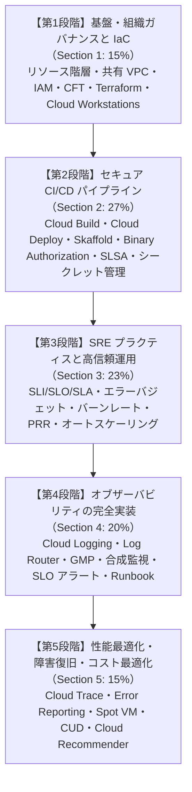

# Google Cloud Certified - Professional Cloud DevOps Engineer 学習カリキュラム＆出題範囲ロードマップ

- **対象資格**: Google Cloud Certified - Professional Cloud DevOps Engineer
- **公式試験ガイド**: [Professional Cloud DevOps Engineer 認定試験ガイド (日本語版)](https://services.google.com/fh/files/misc/professional_cloud_devops_engineer_exam_guide_japanese.pdf)
- **公式試験ページ**: [Professional Cloud DevOps Engineer | Google Cloud Certification](https://cloud.google.com/learn/certification/cloud-devops-engineer?hl=ja)
- **公式学習パス**: [Google Skills - Professional Cloud DevOps Engineer Certification Learning Path](https://www.skills.google/paths/)
- **最終更新日**: 2026-10-14

---

## 1. 試験の概要と基本スペック

Professional Cloud DevOps Engineer は、Google 推奨の手法とツール群（Cloud Build, Cloud Deploy, Artifact Registry, Config Connector, Cloud Operations Suite, Cloud Workstations 等）を駆使し、システム開発ライフサイクル（SDLC）全体にプロセスを実装するプロフェッショナル認定資格です。

本認定では、サービスの信頼性（Reliability）と配信速度・変更容易性（Velocity / Agility）の健全なトレードオフバランスを維持しながら、ソフトウェアおよびインフラストラクチャの継続的かつ安全なデリバリーを実現する能力が厳密に検証されます。さらに、Google 固有の SRE（Site Reliability Engineering: サイト信頼性エンジニアリング）プラクティスに基づき、SLI / SLO / エラーバジェットを基軸とした運用ガバナンス、障害発生時のインシデントハンドリング、オブザーバビリティ（ロギング・メトリクス・トレース・プロファイリング）の実装、そしてインフラストラクチャとオブザーバビリティの総保有コスト（TCO）最適化に至るまで、実務直結の高度な意思決定能力が問われます。

- **試験時間**: 120 分（2 時間）
- **出題問題数**: 50〜60 問
- **出題形式**: 択一選択問題（4 肢中 1 つ選択）、複数選択問題（5 肢以上中 2 つ以上選択）
- **受験料**: $200（税別）
- **合否判定**: 合格 / 不合格（スケールドスコアや正答率は非開示）
- **前提知識**: 3 年以上の IT 実務経験、および Google Cloud を使用した本番環境ソリューションの設計・構築・運用管理に関する 1 年以上の実務経験が推奨されます。

---

## 2. 出題分野（Section）と出題比率一覧

本試験は全 5 セクションで構成されています。CI / CD パイプラインの構築と実装（27%）、SRE 手法のアプリケーションへの適用（23%）、オブザーバビリティの実装（20%）が試験の約 70% を占める中核領域であり、これらを支える組織リソース階層・IaC のブートストラップ（15%）と、パフォーマンス最適化・トラブルシューティング（15%）が網羅的に評価されます。

| セクション番号 | セクション名 / 出題分野 | 出題比率 | 主要対象サービス・コンセプト |
| :--- | :--- | :--- | :--- |
| **Section 1** | Google Cloud 組織のブートストラップと保守 | 約 15.0% | リソース階層（組織・フォルダ・プロジェクト）、共有 VPC（Shared VPC）、集中ログ・モニタリング、Cloud IAM、組織ポリシー（Organization Policies）、サービスアカウント管理、App Hub、Infrastructure as Code（Cloud Foundation Toolkit, Config Connector, Terraform, Helm）、ブループリント、スクリプト自動化、Cloud Build CI / Cloud Deploy CD スタック、サードパーティ（Jenkins, Argo CD, Packer）、CI/CD セキュリティ、マルチ環境管理、一時的環境、GKE フリート管理、Cloud Workstations、Gemini Code Assist |
| **Section 2** | アプリケーションとインフラストラクチャの CI / CD パイプラインの構築および実装 | 約 27.0% | Artifact Registry、GKE Enterprise、CI/CD トリガー、自動テスト、承認ゲート、Cloud Run / Cloud Functions の CI/CD、インフラストラクチャ CI/CD（GKE, MIG, Cloud Service Mesh）、監査トラッキング（Cloud Audit Logs, Cloud Build, Cloud Deploy）、デプロイ戦略（カナリア、Blue/Green、ローリング、トラフィック分割）、デプロイ障害軽減、Cloud KMS、Secret Manager、Certificate Manager、ビルド時 vs ランタイム時のシークレット注入、脆弱性スキャン、Binary Authorization、SLSA フレームワーク |
| **Section 3** | サイト信頼性エンジニアリング手法のアプリケーションへの適用 | 約 23.0% | SRE 原則、SLI（Service Level Indicator）、SLO（Service Level Objective）、SLA（Service Level Agreement）、エラーバジェット（Error Budget）、バーンレート（Burn Rate）、可用性の「9」の桁数と機会費用、サービス前オンボーディングチェックリスト、リリース計画・デプロイ計画・サービス提供終了（Deprecation）、キャパシティプランニング（クォータ・上限）、自動スケーリング（MIG, Cloud Run, GKE HPA/VPA/Cluster Autoscaler）、トラフィックドレイン / リダイレクト、容量追加、ロールバック戦略 |
| **Section 4** | オブザーバビリティ手法の実装 | 約 20.0% | Cloud Logging、Ops Agent、Cloud Audit Logs、VPC フローログ、Cloud Service Mesh ログ、ログルーター（Log Router）、ログバケット、除外フィルタ、サンプリング、BigQuery / Pub/Sub / Cloud Storage へのログエクスポート、ログ保持期間、ログベース指標（カウンター・ディストリビューション）、センシティブデータマスキング（Sensitive Data Protection / DLP）、Cloud Monitoring、Managed Service for Prometheus、Metrics Explorer、合成モニター（Synthetic Monitors）、ダッシュボード管理、アラートポリシー・Runbook、サードパーティ連携（PagerDuty, Slack） |
| **Section 5** | パフォーマンスの最適化とトラブルシューティング | 約 15.0% | インフラ・アプリ・CI/CD・オブザーバビリティのトラブルシューティング、Cloud Trace、Error Reporting、Cloud Profiler、OpenTelemetry 計測、オブザーバビリティ費用最適化、Spot VM、確約利用割引（CUD: リソースベース / 費用ベース）、継続利用割引（SUD）、ネットワークサービスティア（Premium vs Standard）、Active Assist / Cloud Recommender（費用、セキュリティ、パフォーマンス、信頼性） |

---

## 3. セクション別詳細タスクおよび学習ロードマップ

#### Section 1: Google Cloud 組織のブートストラップと保守 (約 15%)
- **出題の狙い**: エンタープライズ規模のガバナンス、ネットワーク分離、最小権限のアクセス制御、および Infrastructure as Code（IaC）による自動プロビジョニングを確立し、安全で再現性の高いクラウド開発・本番運用基盤を立ち上げる能力を検証します。
- **主要タスク**:
  - Task 1.1: 組織の全体的なリソース階層を設計する（プロジェクト・フォルダ階層、共有 VPC、複数プロジェクトのモニタリング・ロギング構成、IAM ロールと組織ポリシーの適用、サービスアカウントのキーレス運用・権限借用、App Hub によるアプリケーション中心のリソース整理）
  - Task 1.2: インフラストラクチャを管理する（Cloud Foundation Toolkit、Config Connector による K8s ネイティブなリソース宣言、Terraform ベストプラクティス、Helm チャート、Google 推奨ブループリント、スクリプト自動化）
  - Task 1.3: Google Cloud、ハイブリッド環境、マルチクラウド環境で CI / CD アーキテクチャスタックを設計する（Cloud Build、Kustomize と Skaffold を統合した Cloud Deploy、Jenkins / Argo CD / Packer 連携、CI/CD ツールのセキュリティ保護）
  - Task 1.4: 複数の環境を管理する（環境分離戦略、エフェメラル・一時的環境のプロビジョニングと破棄、構成・ポリシー管理、GKE クラスタのフリート管理、安全なローリングアップグレードとパッチ適用）
  - Task 1.5: 安全なクラウド開発環境を実現する（Cloud Workstations のプライベート構成、Cloud Shell のカスタマイズ、開発環境のブートストラップ、Cloud Code と Gemini Code Assist による AI 支援）
- **重要キーワード**: Shared VPC, Organization Policies, Service Account Impersonation, App Hub, Cloud Foundation Toolkit (CFT), Config Connector, Terraform, Skaffold, Kustomize, Cloud Deploy, GKE Fleets, Cloud Workstations, Gemini Code Assist

#### Section 2: アプリケーションとインフラストラクチャの CI / CD パイプラインの構築および実装 (約 27%)
- **出題の狙い**: コンテナ、サーバーレス、インフラストラクチャを包括するエンドツーエンドのデプロイパイプラインを設計・実装し、高度なデプロイ戦略、シークレット管理、およびサプライチェーンセキュリティ（SLSA）を適用して迅速かつ堅牢なリリースサイクルを確立する能力を検証します。
- **主要タスク**:
  - Task 2.1: CI / CD パイプラインを設計、管理する（Artifact Registry のリポジトリ管理、GKE Enterprise ハイブリッド/マルチクラウドへのデプロイ、イベント駆動型トリガー、自動テストパイプライン、多段承認ゲート、Cloud Run / GKE / MIG / Cloud Service Mesh に対する CI/CD 適用）
  - Task 2.2: CI / CD パイプラインを実装する（監査とトレーサビリティの確保、カナリアデプロイ、Blue/Green デプロイ、ローリングアップデート、Cloud Deploy による段階的トラフィック分割、デプロイ障害の自動検知と軽減）
  - Task 2.3: CI / CD の構成とシークレットを管理する（Cloud KMS によるエンベロープ暗号化、Secret Manager による動的シークレット参照、Certificate Manager、ビルド時注入 vs ランタイム時マウントのセキュリティ比較）
  - Task 2.4: CI / CD デプロイパイプラインを保護する（Artifact Registry 継続的脆弱性スキャン、Binary Authorization による署名検証と未承認コンテナのデプロイ遮断、SLSA レベル 3 準拠ビルド、環境分離に基づく IAM 境界）
- **重要キーワード**: Artifact Registry, Cloud Build Triggers, Cloud Deploy Delivery Pipelines, Canary Deployment, Blue/Green Deployment, Traffic Splitting, Cloud KMS, Secret Manager, Binary Authorization (Attestor, Cryptographic Signatures), SLSA (Supply-chain Levels for Software Artifacts)

#### Section 3: サイト信頼性エンジニアリング手法のアプリケーションへの適用 (約 23%)
- **出題の狙い**: Google の SRE プラクティスを実務システムに適用し、定量的な信頼性目標（SLI / SLO）に基づくエンジニアリング判断、変更速度と信頼性の両立、サービスのライフサイクル管理、およびインシデントの影響局所化・自動復旧を実現する能力を検証します。
- **主要タスク**:
  - Task 3.1: サービスの変更、速度、信頼性のバランスを取る（ユーザー中心の SLI 選定、SLO 策定、SLA との明確な峻別、エラーバジェットの計算と消費速度［バーンレート］監視、エラーバジェット枯渇時のデプロイ凍結ポリシー、可用性の「9」の桁数と機会費用のトレードオフ判断）
  - Task 3.2: サービスのライフサイクルを管理する（Production Readiness Review［PRR: 本番環境準備レビュー］とサービス前オンボーディングチェックリスト、リリース計画、キャパシティプランニングとクォータ管理、MIG / Cloud Run / GKE Autoscaler による多層自動スケーリング、非推奨化とサービス提供終了プロセス）
  - Task 3.3: ユーザーに対するインシデントの影響を軽減する（Cloud Load Balancing によるトラフィックドレイン / 地理的リダイレクト、キャパシティの動的追加、自動ヘルスチェックとフェイルオーバー、即時ロールバック戦略）
- **重要キーワード**: SLI (Service Level Indicator), SLO (Service Level Objective), SLA, Error Budget, Burn Rate Alerting, Production Readiness Review (PRR), Quota Management, Capacity Planning, Cluster Autoscaler, Horizontal Pod Autoscaler (HPA), Traffic Draining, Automated Rollback

#### Section 4: オブザーバビリティ手法の実装 (約 20%)
- **出題の狙い**: 大規模分散システムの健全性、パフォーマンス、セキュリティを継続的に把握するため、ログ、メトリクス、分散トレースを包括するオブザーバビリティアーキテクチャを設計・構築・運用する能力を検証します。
- **主要タスク**:
  - Task 4.1: ログを管理する（Ops Agent によるログ収集、Cloud Audit Logs、VPC フローログ、Cloud Service Mesh アクセスログ、ログルーターによるフィルタリング・サンプリング・除外、BigQuery / Pub/Sub / Cloud Storage へのシンクエクスポート、ログ保持バケット設定、センシティブデータ［PII / PHI］のマスキング）
  - Task 4.2: 指標を管理する（Google Cloud Managed Service for Prometheus［GMP］によるハイブリッド / マルチクラウド監視、ログベース指標［カウンター / ディストリビューション］の作成、Metrics Explorer によるアドホック分析、Synthetic Monitors［合成モニター］による外形監視）
  - Task 4.3: ダッシュボードとアラートを管理する（Cloud Monitoring ダッシュボードの設計と共有、SLO ベースのアラートポリシー策定、バーンレートアラート通知、Runbook［対応手順書］のリンク埋め込み、PagerDuty / Slack / Webhook 連携）
- **重要キーワード**: Cloud Logging, Ops Agent, Cloud Audit Logs, Log Router (Exclusion Filters, Sinks), Sensitive Data Protection (Cloud DLP), Google Cloud Managed Service for Prometheus (GMP), Log-based Metrics, Synthetic Monitors, Cloud Monitoring Alert Policies, Multi-window Multi-burn-rate Alerts

#### Section 5: パフォーマンスの最適化とトラブルシューティング (約 15%)
- **出題の狙い**: 本番運用におけるインフラ・ネットワーク・アプリケーションの性能ボトルネックを特定・解消し、分散デバッグツールを活用した障害対応、およびコンピュート・ネットワーク・監視インフラのコスト最適化を推進する能力を検証します。
- **主要タスク**:
  - Task 5.1: 問題のトラブルシューティングを行う（インフラ障害、Pod クラッシュ・リソース逼迫、CI/CD ビルド・デプロイパイプラインのブロッキング、オブザーバビリティの欠落、ネットワークレイテンシ問題の系統的特定）
  - Task 5.2: Google Cloud にデバッグツールを実装する（OpenTelemetry による分散トレーシング計装、Cloud Trace によるレイテンシボトルネック分析、Error Reporting による未処理例外の集約・通知、Cloud Profiler による CPU / メモリ消費コードのプロファイリング）
  - Task 5.3: リソースの使用率と費用を最適化する（Cloud Logging / Cloud Monitoring の取り込み・保持費用最適化、ステートレスワークロードへの Spot VM 適用、確約利用割引［CUD］と継続利用割引［SUD］の計画、Network Service Tiers［Standard vs Premium］の選定、Active Assist / Google Cloud Recommender の推奨事項適用）
- **重要キーワード**: Root Cause Analysis (RCA), Cloud Trace, Error Reporting, Cloud Profiler, OpenTelemetry, Log Exclusion / Log Buckets Cost Optimization, Spot VMs, Committed Use Discounts (CUD), Network Service Tiers, Active Assist / Cloud Recommender

---

## 4. 推奨学習リソース＆公式ハンズオン・ラボ一覧

### 公式ドキュメント＆アーキテクチャフレームワーク
- [Google Cloud Architecture Framework: オペレーショナル エクセレンス](https://docs.cloud.google.com/architecture/framework/operational-excellence?hl=ja)
- [Google Cloud Architecture Framework: 信頼性](https://docs.cloud.google.com/architecture/framework/reliability?hl=ja)
- [Site Reliability Engineering (SRE) 公式書籍・資料 (Google SRE Book)](https://sre.google/books/)
- [Google Cloud Deploy 公式ドキュメント](https://docs.cloud.google.com/deploy/docs?hl=ja)
- [Binary Authorization 公式ドキュメント](https://docs.cloud.google.com/binary-authorization/docs?hl=ja)
- [Google Cloud Managed Service for Prometheus 公式ドキュメント](https://docs.cloud.google.com/stackdriver/docs/managed-prometheus?hl=ja)

### 公式ハンズオンラボ（Google Skills）
1. **Implement DevOps Workflows in Google Cloud (Skill Badge)**
   - Cloud Build を用いた自動コンテナイメージビルド、Artifact Registry への格納、GKE へのデプロイワークフローを実機演習。
2. **Deploy to Kubernetes in Google Cloud (Skill Badge)**
   - GKE クラスタのプロビジョニング、継続的デリバリーツールの統合、カナリアデプロイおよびブルー/グリーンデプロイのトラフィック制御を検証。
3. **Monitor Environments with Google Cloud Managed Service for Prometheus**
   - Prometheus 指標のエクスポート、PodMonitoring カスタムリソースの定義、Cloud Monitoring ダッシュボードでの可視化とアラート構成を習得。
4. **Build Infrastructure with Terraform on Google Cloud (Skill Badge)**
   - Terraform を用いたインフラストラクチャの宣言的管理、状態ファイル（tfstate）の Cloud Storage 管理、モジュール化の実践。
5. **Optimize Costs for Google Kubernetes Engine**
   - GKE Autopilot、マルチゾーンクラスタ、Workload Autoscaling（HPA/VPA）、および Spot VM ノードプールの活用によるコスト最適化演習。

---

## 5. 学習ロードマップ＆実践アプローチ

