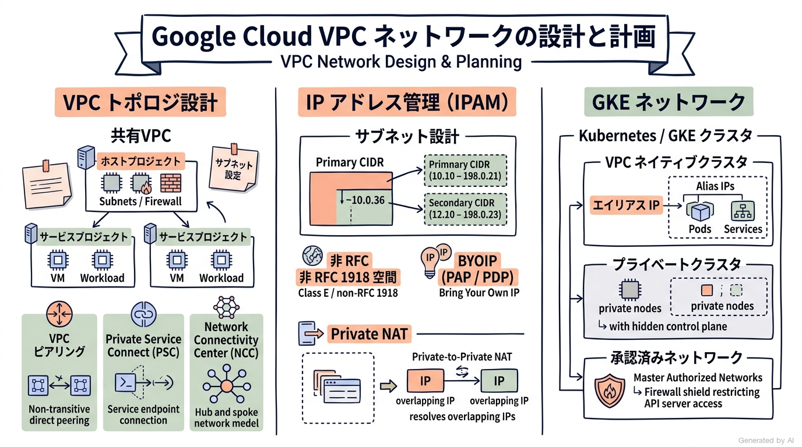
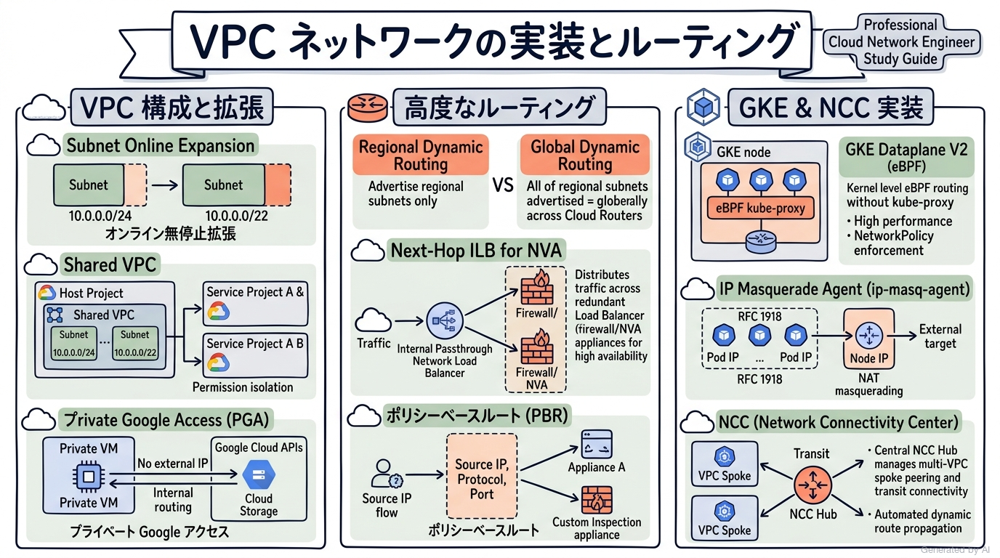
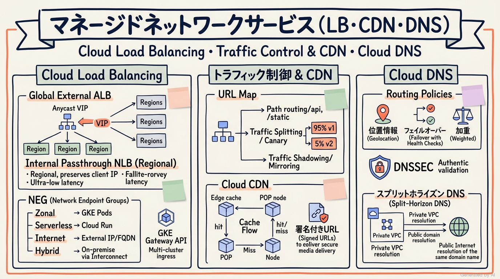
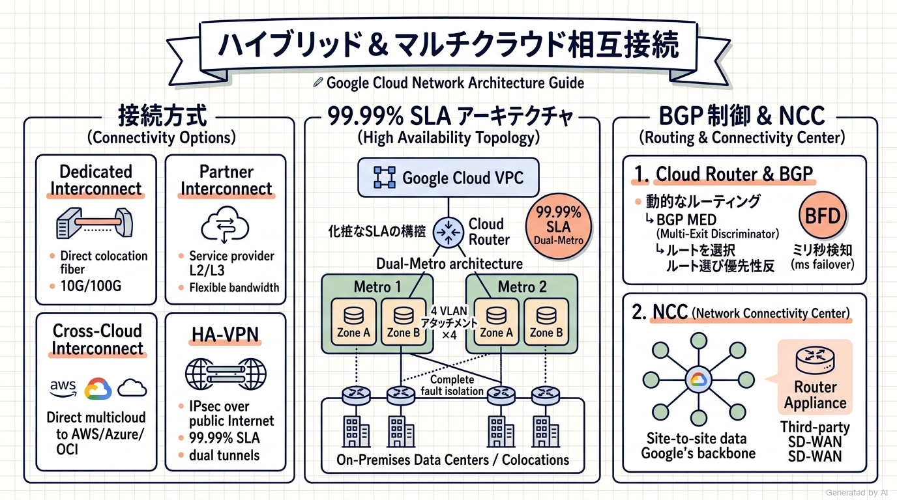
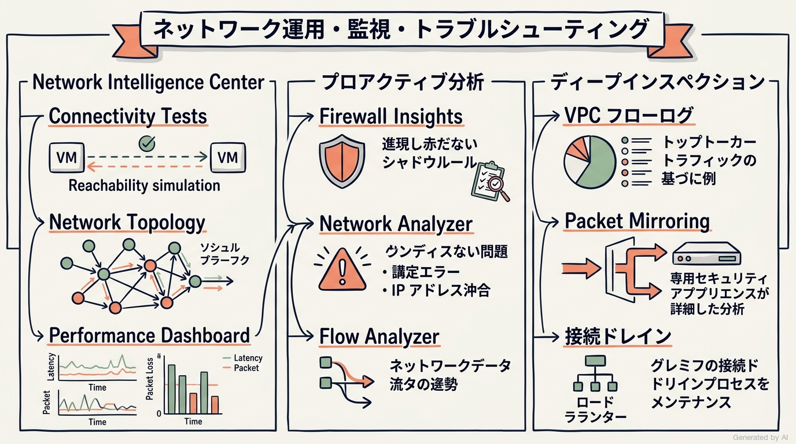
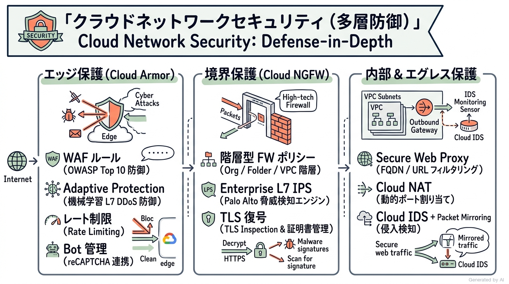

# Google Cloud Certified - Professional Cloud Network Engineer 完全対策＆実践学習ガイド

- **対象資格**: Google Cloud Certified - Professional Cloud Network Engineer
- **試験コード**: PCNE
- **公式試験ガイド**: [Professional Cloud Network Engineer 認定試験ガイド (日本語版)](https://services.google.com/fh/files/misc/professional_cloud_network_engineer_exam_guide_japanese.pdf?hl=ja)
- **公式試験ページ**: [Professional Cloud Network Engineer | Google Cloud Certification](https://cloud.google.com/learn/certification/cloud-network-engineer?hl=ja)
- **最終更新日**: 2026-10-15

---

## はじめに

現代のエンタープライズアーキテクチャにおいて、ネットワークは単なるサーバー間の配線にとどまらず、セキュリティ境界、スケーラビリティ、低遅延配信、そしてマルチクラウド・ハイブリッドクラウド統合の成否を決定づける最重要ファウンデーションです。

Google Cloud のネットワークは、Google 独自のグローバルプライベート光ファイバー網（Andromeda 仮想化ネットワーク、Jupiter データセンターファブリック、Espresso エッジピアリングファブリック）を基盤としており、一般的なオンプレミスネットワークや他社クラウドとは大きく異なる設計思想（Software-Defined Networking: SDN、グローバル VPC、エッジでの終端、一元管理プレーン）を持っています。

本ガイドは、Google Cloud Certified - Professional Cloud Network Engineer 認定試験の全出題範囲を網羅し、単なる用語や機能の暗記にとどまらず、「実務において最適なトレードオフ判断とアーキテクチャの意思決定ができるエンジニア」を育成するために策定されています。

### Professional Cloud Network Engineer 試験とは

Professional Cloud Network Engineer は、Google Cloud におけるネットワークソリューションのアーキテクチャ設計、実装、管理、運用、およびトラブルシューティングを主導できるプロフェッショナルを認定する資格です。

- **試験時間**: 120 分（2 時間）
- **出題問題数**: 50〜60 問
- **出題形式**: 択一選択問題（4 肢中 1 つ選択）、複数選択問題（5 肢以上中 2 つ以上選択）
- **合否判定**: 合格 / 不合格（スケールドスコアや正答率は非開示）
- **前提知識**: 3 年以上の業界実務経験（ネットワークエンジニアリングおよびインフラストラクチャ設計の実務経験を含む）、および Google Cloud を使用したネットワーク構築・運用管理に関する 1 年以上の実務経験が推奨されます。

### 難易度と求められる思考力

本試験は、Google Cloud のプロフェッショナル認定資格の中でも特に深い専門性と実践的判断力が要求される難関資格の 1 つです。出題される問題の大部分は、具体的な企業課題や制約条件が提示される「シチュエーション問題（ケーススタディ形式）」です。

単に「Cloud Interconnect とは何か」を問う問題は出題されず、以下のような現実のトレードオフ判断が厳しく問われます:
- 稼働中の本番 VPC において、サブネット CIDR が枯渇した際に無停止で拡張する手順は何か。
- 金融機関の厳格な要件において、99.99% の可用性 SLA を満たす Dedicated Interconnect のメトロ・ゾーン・エッジ配置構成はどうあるべきか。
- ハイブリッド環境において、オンプレミスと Google Cloud の経路重複や非対称ルーティング（Asymmetric Routing）を BGP MED やルート優先度を用いていかに防止するか。
- GKE クラスタにおける Pod や Service の IP 枯渇を防ぎ、かつオンプレミスとのプライベート通信を維持するための最適なサブネット設計（RFC 1918 以外、PUPI、IP マスカレード）はどれか。
- パケットドロップやレイテンシ急増が発生した際、Network Intelligence Center の Connectivity Tests や Flow Analyzer、VPC フローログをどう駆使して障害の根本原因を特定するか。

### 推奨の勉強法

1. **Google Cloud ネットワークの設計思想（SDN・グローバル VPC）の理解**:
   Google Cloud のネットワークは、物理ルーターのホップではなくソフトウェアによって制御されています。グローバル VPC、BGP ベースの動的ルーティング（Cloud Router）、アンドロメダ（Andromeda）によるフロー制御など、独自の基本原理を体系的に整理します。
2. **実践シナリオ（状況 / 対応 / 結果 / 解説）による思考プロセスの追体験**:
   各出題セクションに収録された実践シナリオを精読し、「なぜ特定の技術構成が最適解となるのか」「なぜ他の代替案では要件を満たせないのか（全代替案の棄却理由）」を論理的に言語化できるトレーニングを積みます。
3. **実機コンソール・gcloud CLI によるハンズオン検証**:
   Cloud Router の BGP ピアリング設定、Network Intelligence Center の Connectivity Tests、共有 VPC の作成と権限委託、Cloud Armor セキュリティポリシーの適用など、実機での挙動を手を動かして体感します。

---

## 目次

1. [はじめに](#はじめに)
2. [学習カリキュラム・出題範囲ロードマップ](#学習カリキュラム出題範囲ロードマップ)
3. [Section 1: Google Cloud Virtual Private Cloud（VPC）ネットワークの設計と計画 (約 24%)](#section-1-google-cloud-virtual-private-cloudvpcネットワークの設計と計画-約-24)
4. [Section 2: VPC ネットワークの実装 (約 19%)](#section-2-vpc-ネットワークの実装-約-19)
5. [Section 3: マネージドネットワークサービスの構成 (約 21%)](#section-3-マネージドネットワークサービスの構成-約-21)
6. [Section 4: ハイブリッドおよびマルチクラウドネットワークの相互接続の構成と実装 (約 15%)](#section-4-ハイブリッドおよびマルチクラウドネットワークの相互接続の構成と実装-約-15)
7. [Section 5: ネットワークオペレーションの管理、モニタリング、トラブルシューティング (約 13%)](#section-5-ネットワークオペレーションの管理モニタリングトラブルシューティング-約-13)
8. [Section 6: クラウドネットワークセキュリティソリューションの構成、実装、管理 (約 14%)](#section-6-クラウドネットワークセキュリティソリューションの構成実装管理-約-14)
9. [まとめと推奨学習ステップ](#まとめと推奨学習ステップ)

---

## 学習カリキュラム・出題範囲ロードマップ

### セクション一覧と出題比率

| セクション番号 | セクション名 / 出題分野 | 出題比率 | 主要対象サービス・ツール |
| :--- | :--- | :--- | :--- |
| **Section 1** | Google Cloud Virtual Private Cloud（VPC）ネットワークの設計と計画 | 約 24.0% | スタンドアロン VPC / 共有 VPC、VPC ピアリング、Private Service Connect (PSC)、ネットワーク階層（プレミアム vs スタンダード）、IPAM（BYOIP、PAP、PDP、Private NAT、IPv6）、サードパーティ NVA 挿入、ハイブリッド接続設計、GKE ネットワーク設計 |
| **Section 2** | VPC ネットワークの実装 | 約 19.0% | サブネット作成・拡張、共有 VPC 構成、プライベート Google アクセス、Vertex AI 接続、動的ルーティング（グローバル vs リージョン）、ポリシーベースルート、ネクストホップ内部ロードバランサ、Network Connectivity Center (NCC) VPC スポーク、GKE VPC ネイティブクラスタ、Dataplane V2、IP マスカレード |
| **Section 3** | マネージドネットワークサービスの構成 | 約 21.0% | 外部/内部 アプリケーションロードバランサ、ネットワークロードバランサ、NEG (Serverless / Internet / Hybrid / Zonal)、トラフィック管理（URL マップ、加重ルーティング、ミラーリング）、GKE Gateway API / Ingress、Cloud CDN（オリジン、キャッシュ無効化、署名付き URL）、Cloud DNS（ルーティングポリシー、DNSSEC、スプリットホライズン、DNS ピアリング） |
| **Section 4** | ハイブリッドおよびマルチクラウドネットワークの相互接続の構成と実装 | 約 15.0% | Dedicated Interconnect、Partner Interconnect (L2/L3)、Cross-Cloud Interconnect、Interconnect 経由 HA-VPN、高可用性トポロジ (99.9% / 99.99% SLA)、HA-VPN、Classic VPN、Cloud Router (BGP、MED、BFD、カスタムアドバタイズ)、NCC ハイブリッドスポーク、Router Appliance |
| **Section 5** | ネットワークオペレーションの管理、モニタリング、トラブルシューティング | 約 13.0% | Cloud Monitoring / Cloud Logging、接続ドレインとフェイルオーバー、BGP ピアリングトラブルシューティング、VPC フローログ、Packet Mirroring、Network Intelligence Center (Network Topology、Connectivity Tests、Performance Dashboard、Firewall Insights、Network Analyzer、Flow Analyzer) |
| **Section 6** | クラウドネットワークセキュリティソリューションの構成、実装、管理 | 約 14.0% | Google Cloud Armor (WAF ルール、DDoS 対策、Adaptive Protection、レート制限、Bot 管理、Threat Intelligence)、Cloud NGFW (Essentials / Standard / Enterprise、L7 検査、階層型ポリシー、タグ/サービスアカウント)、Cloud NAT、Secure Web Proxy、Multi-NIC NVA、Cloud IDS、Packet Mirroring |

---

### セクション別出題詳細

#### Section 1: Google Cloud Virtual Private Cloud（VPC）ネットワークの設計と計画 (約 24%)
- **出題の狙い**: エンタープライズ規模のワークロード要件に基づき、高可用性・拡張性・回復力・分離性を備えた VPC ネットワークアーキテクチャ、IP アドレス設計、ハイブリッド接続戦略、GKE ネットワークトポロジを包括的に設計する能力を検証します。
- **主要タスク**:
  - Task 1.1: 全体的なネットワークアーキテクチャを設計する
  - Task 1.2: VPC ネットワークを設計する
  - Task 1.3: 復元力とパフォーマンスに優れたハイブリッドおよびマルチクラウドネットワークを設計する
  - Task 1.4: Google Kubernetes Engine（GKE）を設計する
- **重要キーワード**: Shared VPC, VPC Network Peering, Private Service Connect (PSC), Network Connectivity Center (NCC), Premium Tier / Standard Tier, BYOIP (PAP/PDP), Private NAT, GKE VPC-native, IP Masquerade, Cloud Router Dynamic Routing

#### Section 2: VPC ネットワークの実装 (約 19%)
- **出題の狙い**: 設計されたアーキテクチャに基づき、VPC、サブネット、高度なルーティングポリシー、NCC トポロジ、および GKE クラスタネットワークを正確にプロビジョニング・実装する実務能力を検証します。
- **主要タスク**:
  - Task 2.1: VPC を構成する
  - Task 2.2: VPC ルーティングを構成する
  - Task 2.3: Network Connectivity Center を構成する
  - Task 2.4: Google Kubernetes Engine クラスタの構成と保守を行う
- **重要キーワード**: Subnet Expansion, Shared VPC Service Projects, Private Google Access, Global Dynamic Routing, Policy-Based Routes (PBR), Next-Hop Internal Load Balancer, NCC VPC Spokes, Dataplane V2, GKE Authorized Networks, IP Masquerade Agent

#### Section 3: マネージドネットワークサービスの構成 (約 21%)
- **出題の狙い**: グローバルおよびリージョンの各種ロードバランサ、Cloud CDN、Cloud DNS を適切に構成し、トラフィックの最適化、高可用性配信、低レイテンシキャッシュ、および名前解決を実装する能力を検証します。
- **主要タスク**:
  - Task 3.1: ロードバランシングを構成する
  - Task 3.2: Cloud CDN を構成する
  - Task 3.3: Cloud DNS を構成する
- **重要キーワード**: Application Load Balancer (Global/Regional), Network Load Balancer (Proxy/Passthrough), Network Endpoint Groups (NEGs), GKE Gateway API, Cloud CDN, Cache Invalidation, Signed URLs, Cloud DNS Routing Policies, DNSSEC, Split-Horizon DNS, DNS Peering

#### Section 4: ハイブリッドおよびマルチクラウドネットワークの相互接続の構成と実装 (約 15%)
- **出題の狙い**: オンプレミスデータセンターおよび他社クラウド（AWS、Azure 等）と Google Cloud を低遅延・高スループットかつ堅牢に相互接続し、BGP 動的ルーティングや NCC を用いて安定したエンタープライズ通信網を構築する能力を検証します。
- **主要タスク**:
  - Task 4.1: Cloud Interconnect を構成する
  - Task 4.2: サイト間 IPsec VPN を構成する
  - Task 4.3: Cloud Router を構成する
  - Task 4.4: Network Connectivity Center を構成する
- **重要キーワード**: Dedicated Interconnect, Partner Interconnect, Cross-Cloud Interconnect, HA-VPN, 99.99% Availability Architecture, Cloud Router, BGP MED, BFD, Router Appliance (RA), NCC Site-to-Site Data Transfer

#### Section 5: ネットワークオペレーションの管理、モニタリング、トラブルシューティング (約 13%)
- **出題の狙い**: Google Cloud Observability および Network Intelligence Center を駆使して、ネットワーク性能・遅延・パケットロス・構成ミスを迅速に特定・可視化し、接続障害を根本原因から解決する運用能力を検証します。
- **主要タスク**:
  - Task 5.1: ロギングとモニタリングに Google Cloud Observability を使用する
  - Task 5.2: 接続の維持管理とその問題のトラブルシューティングを行う
  - Task 5.3: Network Intelligence Center を使用した、ネットワークに関する一般的な問題のモニタリングとトラブルシューティングを行う
- **重要キーワード**: Network Intelligence Center, Connectivity Tests, Network Topology, Performance Dashboard, Firewall Insights, Network Analyzer, Flow Analyzer, VPC Flow Logs, Packet Mirroring, Connection Draining

#### Section 6: クラウドネットワークセキュリティソリューションの構成、実装、管理 (約 14%)
- **出題の狙い**: 多層防御の観点から、エッジ（Cloud Armor）、境界（Cloud NGFW / Secure Web Proxy）、内部（Micro-segmentation / IDS / Packet Mirroring）の各層で強固なセキュリティ制御を構成・管理する能力を検証します。
- **主要タスク**:
  - Task 6.1: Google Cloud Armor ポリシーを構成する
  - Task 6.2: Cloud Next Generation Firewall（NGFW）ポリシーと VPC ファイアウォールルールを構成、管理する
  - Task 6.3: パブリック Cloud NAT と Secure Web Proxy を使用してインターネット下り（外向き）トラフィックを構成して保護する
  - Task 6.4: セルフマネージドのネットワークパケットインスペクション、IDS、Packet Mirroring を構成する
- **重要キーワード**: Google Cloud Armor, WAF (OWASP), Cloud NGFW Enterprise, Layer 7 Packet Inspection, Hierarchical Firewall Policies, Secure Web Proxy, Cloud NAT Dynamic Port Allocation, Multi-NIC NVA, Next-Hop ILB, Cloud IDS, Packet Mirroring

---

## Section 1: Google Cloud Virtual Private Cloud（VPC）ネットワークの設計と計画 (約 24%)

本セクションでは、Google Cloud における基幹ネットワークアーキテクチャの設計思想と計画プロセスを扱います。Google Cloud の VPC は、リージョンに縛られないグローバルな仮想リソースであり、単一の VPC 内で世界各地のリージョンにサブネットを配置して Google のバックボーン経由でプライベート通信を行うことができます。

エンタープライズ規模のシステム設計においては、共有 VPC（Shared VPC）によるネットワークの一元管理とプロジェクトの分離、VPC ピアリングや Private Service Connect（PSC）によるマイクロサービス間連携、IP アドレス空間（RFC 1918、BYOIP、IPv6）の枯渇防止設計、および GKE ワークロード向けネットワークトポロジの選定が核心となります。

---

### 1. セクション概要

#### 核心概念と設計原則

1. **グローバル VPC アーキテクチャの特性**:
   Google Cloud の VPC ネットワークはグローバルスコープを持ちます。サブネットはリージョナルスコープであるため、同一 VPC 内の東京リージョン（asia-northeast1）とアイオワリージョン（us-central1）の仮想マシンは、外部 IP や VPN を介すことなく Google のプライベートバックボーン経由で暗号化通信を行えます。
2. **共有 VPC（Shared VPC）と職掌分散（Separation of Duties）**:
   大規模組織では、ホストプロジェクト（Host Project）でネットワークリソース（VPC、サブネット、ルート、ファイアウォール）を一元管理し、サービスプロジェクト（Service Project）の各開発チームに対して特定のサブネットの利用権限のみを IAM（`roles/compute.networkUser`）で委託する集中管理モデルがベストプラクティスです。
3. **ネットワーク相互接続方式の選定基準**:
   プロジェクト間や企業間でのプライベート接続には、主に「VPC ネットワークピアリング」「Network Connectivity Center (NCC)」「Private Service Connect (PSC)」の 3 つのアプローチがあります。推移的ルーティングの可否、IP アドレス重複の許容度、管理境界に応じて適切な技術を選定する必要があります。
4. **IP アドレス空間管理（IPAM）とスケーラビリティ**:
   RFC 1918 プライベート IP アドレス空間の枯渇に対応するため、非 RFC 1918 空間（Class E や CGNAT / 100.64.0.0/10）の活用、プライベートで使用されるパブリック IP（PUPI）、持込 IP（BYOIP: PAP / PDP）、およびプライベート NAT（Private NAT）の活用を計画します。

#### 重要キーワード

- **Shared VPC (共有 VPC)**: ホストプロジェクトの VPC ネットワーク内のサブネットを、組織内の複数のサービスプロジェクトに属するインスタンスから共有利用可能にするエンタープライズ向けネットワーク構成。
- **VPC Network Peering**: 2 つの VPC ネットワークを直接プライベート接続し、内部 IP アドレスで低遅延通信を可能にする機能。推移的ルーティング（Transitive Routing）はサポートされず、CIDR の重複は不可。
- **Private Service Connect (PSC)**: プロデューサー VPC 上のマネージドサービスや Google API を、コンシューマー VPC 内のプライベート IP エンドポイント（フォワーディングルール）として安全に公開・利用する機能。CIDR 重複環境でも接続可能。
- **Network Connectivity Center (NCC)**: 複数の VPC スポークやハイブリッド接続スポーク（VPN、Interconnect）を一元管理するハブアンドスポーク型オーケストレーター。NCC VPC スポークにより推移的ルーティングや大規模フルメッシュ接続が可能。
- **Network Service Tiers**: プレミアムティア（Google の高品質プライベートバックボーンを最寄りの PoP から利用）とスタンダードティア（宛先リージョン近傍までパブリックインターネットを経由してコストを抑制）の選択。
- **BYOIP (Bring Your Own IP)**: 企業が所有するパブリック IPv4/IPv6 アドレスプレフィックスを Google Cloud に持ち込み、Google のバックボーンからアドバタイズする機能。PAP（Publicly Advertised Prefix）と PDP（Publicly Delegated Prefix）の 2 形態がある。
- **GKE VPC-native Cluster**: エイリアス IP（Alias IP）を使用して Pod ごとに VPC サブネットのセカンダリ IP 範囲から固有の内部 IP を直接割り当てる GKE クラスタアーキテクチャ。

---

### 2. 重要トピック

#### 1. ネットワーク相互接続方式の比較マトリクス

| 比較項目 / 方式 | VPC ネットワークピアリング | Private Service Connect (PSC) | Network Connectivity Center (NCC) |
| :--- | :--- | :--- | :--- |
| **通信トポロジ** | 1 対 1 の直接接続（ピア） | プロデューサー・コンシューマー型（エンドポイント / バックエンド） | ハブ＆スポーク型（VPC スポーク / ハイブリッドスポーク） |
| **推移的ルーティング** | 不可（A - B - C 間で A から C への通信は不可） | 該当なし（L4 リバースプロキシ / カプセル化による単一エンドポイント通信） | 可能（ハブを介した VPC スポーク間でのルーティングが可能） |
| **IP アドレス重複** | 厳禁（CIDR が重複している VPC 同士はピアリング不可） | 許容（NAT およびプロキシを介するため、CIDR が重複していても接続可能） | 厳禁（重複する CIDR を持つスポークは同一ハブにアタッチ不可） |
| **管理モデル** | 両 VPC の管理者が明示的にピアリングを確立 | プロデューサーがサービスアタッチメントを公開、コンシューマーが接続 | ハブ管理者が一元的にスポークを管理・オーケストレーション |
| **主な用途** | 同一組織内の密結合な VPC 間通信 | SaaS / マネージドサービスの安全な利用、マルチテナント分離 | 大規模エンタープライズのマルチ VPC 統合、ハイブリッドトランジット |

- **アーキテクトの選定基準**:
  - IP アドレス体系が完全に分離されており、全プロトコル（TCP/UDP/ICMP）で広範なサブネット間通信が必要な場合は「VPC ネットワークピアリング」を選定します。
  - プロデューサーとコンシューマー間で IP アドレス空間が重複している場合や、特定のサービスのみを最小権限で公開・消費したい場合は「Private Service Connect (PSC)」を選定します。
  - 3 つ以上の多数の VPC を推移的に相互接続したい場合や、オンプレミスと複数の VPC をハブアンドスポークで統合管理したい場合は「Network Connectivity Center (NCC)」を選定します。

#### 2. GKE ネットワーク設計アーキテクチャ（VPC-native vs ルートベース）

GKE クラスタのネットワーク設計においては、VPC ネイティブクラスタの採用が現在の絶対的標準です。ルートベースクラスタでは、各ノードに割り当てられた Pod 範囲への通信を VPC ルーティングテーブル（静的ルート）で管理するため、クラスタあたりのノード数上限（静的ルート数の上限）に直面し、かつエイリアス IP が使えないため外部 LB やハイブリッド接続からの直接 Pod ルーティングが困難になります。

VPC ネイティブクラスタでは、サブネットのプライマリ IP 範囲がノードに割り当てられ、セカンダリ IP 範囲が Pod および Service に割り当てられます。これにより、Pod の IP アドレスが VPC 内のファーストクラス市民として扱われ、以下の恩恵を受けられます:
1. VPC 内の他の VM やオンプレミスから Pod への直接アクセスが可能。
2. コンテナネイティブロードバランシング（NEG 経由で Pod へ直接トラフィックを転送）によるレイテンシ削減と kube-proxy のオーバーヘッド排除。
3. VPC フローログやファイアウォールルールによる Pod 単位のトラフィック可視化と制御。

---

### 3. 実践シナリオ

#### シナリオ 1-1: マルチプロジェクト組織における共有 VPC と IAM 職掌分散の設計

- **状況**: 大規模エンタープライズにおいて、複数の開発チームが個別のプロジェクトでアプリケーションを開発・運用しているが、各プロジェクトで個別に VPC やインターネットゲートウェイを構築した結果、IP アドレス体系の断片化とファイアウォール管理の形骸化が発生している場合
- **対応**: ネットワーク管理専用のホストプロジェクトを作成して共有 VPC を構築し、各開発チームのプロジェクトをサービスプロジェクトとしてアタッチした上で、中央のネットワーク管理者のみに `roles/compute.networkAdmin` を付与し、各開発チームには自チーム専用サブネットに対する `roles/compute.networkUser` のみを付与する。
- **結果**: ネットワークインフラの集中管理とセキュリティポリシーの一元適用を実現しつつ、開発チームは自律的にインスタンスをデプロイできるようになり、職掌分散（Separation of Duties）が確立される。
- **解説**: 共有 VPC を採用することで、IP アドレスの割り当て、ルーティング、ファイアウォールルール、ハイブリッド接続を一元化できるためです。サービスプロジェクトのチームにプロジェクトレベルのネットワーク管理権限を渡さず、サブネット単位で `roles/compute.networkUser` を付与することにより、他チームのサブネットやネットワーク基盤全体への不正な改変を確実に防止できるためです。各プロジェクトで VPC ピアリングを構築する代替案は、プロジェクト数の増加に伴いメッシュ接続の管理負荷が指数関数的に増大し、推移的ルーティングができない制約からエンタープライズの統合基盤としては不適格です。
- **参考ドキュメント**:
  - [共有 VPC の概要](https://docs.cloud.google.com/vpc/docs/shared-vpc?hl=ja): ホストプロジェクトとサービスプロジェクトの概念および IAM 設計ベストプラクティス。

#### シナリオ 1-2: IP アドレス枯渇対策としての非 RFC 1918 空間と Private NAT の適用

- **状況**: 社内のオンプレミスデータセンターと Google Cloud を大規模に接続しているが、社内ですでに RFC 1918 プライベート IP アドレス（10.0.0.0/8、172.16.0.0/12、192.168.0.0/16）が完全に枯渇しており、Google Cloud 上に新規展開する大規模な GKE クラスタ用の IP アドレスを確保できない場合
- **対応**: VPC 内のサブネットおよび GKE の Pod 用セカンダリ範囲として非 RFC 1918 空間（例: 240.0.0.0/4 の Class E や 100.64.0.0/10 の CGNAT 空間）を割り当て、オンプレミスと通信を行う境界に Private NAT（非公開 NAT）を構成して、承認された少数のプライベート IP にアドレス変換して通信を行う。
- **結果**: 既存のオンプレミス IP アドレス空間と一切衝突することなく、数千台規模のコンテナワークロードを Google Cloud 上に展開し、オンプレミスとの双方向通信を確立できる。
- **解説**: Google Cloud の VPC は RFC 1918 以外の IP アドレス範囲をプライベートサブネットとして柔軟に定義できるためです。オンプレミス側のルーティングテーブルやファイアウォールが非 RFC 1918 空間との直接通信を許可しない場合でも、Private NAT（プライベート NAT）を介してオンプレミスが認識可能な正規プライベート IP 範囲に送信元変換（SNAT）することで、既存インフラに影響を与えずに通信を成立させることができるためです。パブリック IP を各コンテナに付与する代替案は、IP 調達コストの肥大化およびセキュリティリスクの観点から要件を満たせません。
- **参考ドキュメント**:
  - [サブネットの概要と IPv4 範囲](https://docs.cloud.google.com/vpc/docs/subnets?hl=ja): 非 RFC 1918 空間および使用可能なサブネット範囲の仕様。
  - [Private NAT の概要](https://docs.cloud.google.com/nat/docs/overview?hl=ja): VPC 間やハイブリッド接続におけるプライベート IP 変換の構成。

#### シナリオ 1-3: グローバルエンタープライズにおけるプレミアムティアとスタンダードティアのトラフィック最適化設計

- **状況**: グローバル規模で展開する動画配信および Web アプリケーションにおいて、動的な API トラフィックには極限の低遅延と耐障害性が求められる一方、大容量の静的メディアファイルのダウンロード配信ではネットワーク転送コストを大幅に削減したい場合
- **対応**: API サーバーをホストする外部ロードバランサには「プレミアムティア（Premium Tier）」を適用し、大容量静的コンテンツを配信するストレージ配信エンドポイントには「スタンダードティア（Standard Tier）」を選択してネットワーク階層を分離設計する。
- **結果**: API トラフィックはユーザーの最寄りエッジ PoP から Google の高速グローバルバックボーンを通って低遅延・高品質で処理され、静的ファイル配信はインターネット経由で配信されて大幅なエグレスコスト削減が達成される。
- **解説**: プレミアムティアはユーザーに最も近い Google エッジ PoP でトラフィックを Google の専用光ファイバー網に取り込み、宛先リージョンまで混雑のないプライベートバックボーンを経由させることでジッターとパケットロスを最小化するためです。これに対しスタンダードティアは、宛先リージョン近傍のエッジからパブリックインターネットを経由してトラフィックをルーティングするため、低コストで大容量の送信を行う用途に最適であるためです。すべてをプレミアムティアにする構成はコスト要件を満たせず、すべてをスタンダードティアにする構成は動的 API の SLA 要件を満たせないため不適格です。
- **参考ドキュメント**:
  - [ネットワーク サービス層（Network Service Tiers）の概要](https://docs.cloud.google.com/network-tiers/docs/overview?hl=ja): プレミアムティアとスタンダードティアのルーティング差異とコスト比較。

#### シナリオ 1-4: 大規模ハイブリッド接続における IP 重複回避と Private Service Connect (PSC) 移行

- **状況**: M&A（企業買収）により統合された子会社の VPC ネットワークにおいて、親会社の VPC と全く同一のサブネット CIDR（10.100.0.0/16）が使用されており、子会社が提供する勘定系 API サービスに親会社から安全にプライベート接続する必要がある場合
- **対応**: 子会社の VPC 側で勘定系 API の内部ロードバランサの前面に「サービスアタッチメント（Service Attachment）」を構成し、親会社の VPC 側で重複しない IP アドレスを指定して「Private Service Connect (PSC) エンドポイント」をプロビジョニングして接続する。
- **結果**: 両社の VPC 間で IP アドレスの再割り当て（リナンバリング）を行うことなく、親会社側からは単一のプライベート IP エンドポイントとして子会社の API をセキュアに呼び出すことができる。
- **解説**: Private Service Connect はプロデューサーとコンシューマーの VPC 間を独立したカプセル化レイヤ（L4 プロキシ）で中継するため、両者の VPC 内でサブネット CIDR が完全に重複していても一切ルーティングの衝突が発生しないためです。コンシューマー側は自 VPC の空き IP を 1 つ割り当てるだけでエンドポイントを作成でき、プロデューサー側も NAT サブネット経由で安全に通信を受け取れるためです。VPC ネットワークピアリングを利用する代替案は、CIDR 重複時にピアリングの確立自体が Google Cloud の仕様上拒否されるため不適格です。
- **参考ドキュメント**:
  - [Private Service Connect の概要](https://docs.cloud.google.com/vpc/docs/private-service-connect?hl=ja): サービスアタッチメントとエンドポイントの動作仕様および IP 重複解決メカニズム。

#### シナリオ 1-5: GKE プライベートクラスタにおけるセカンダリ CIDR 計画とコントロールプレーン保護

- **状況**: 金融コンプライアンス要件に基づき、GKE クラスタのノードおよび Pod にパブリック IP を一切付与せず、かつ Kubernetes コントロールプレーン（API サーバー）への外部インターネットからのアクセスを遮断する必要がある場合
- **対応**: VPC ネイティブクラスタを作成し、ノード用のプライマリサブネット範囲と Pod 用および Service 用のセカンダリサブネット範囲を割り当てた上で、「プライベートクラスタ（Private Cluster）」および「プライベートエンドポイント（Private Endpoint）」を有効化し、社内管理ネットワークの CIDR を「承認済みネットワーク（Authorized Networks）」に登録する。
- **結果**: クラスタの全コンポーネントがプライベート IP のみで構成され、インターネットからの攻撃面が完全に排除されるとともに、承認された社内ネットワークからのみ kubectl 操作が可能になる。
- **解説**: GKE プライベートクラスタでプライベートエンドポイントを有効にすると、Google が管理する VPC 内のコントロールプレーン VM に対しても外部パブリック IP が割り当てられず、クラスタと Google 管理 VPC 間を結ぶピアリング接続経由の内部 IP のみが提供されるためです。承認済みネットワークを併用することで、社内の踏み台サーバーや社内 LAN の CIDR からのアクセスのみをきめ細かく制限できるためです。パブリックエンドポイントを維持したままファイアウォールルールのみで制御しようとする代替案は、コントロールプレーンが Google 管理 VPC に配置されているため顧客側 VPC のファイアウォールルールが適用されず、セキュリティ要件を満たせません。
- **参考ドキュメント**:
  - [プライベート クラスタの作成](https://docs.cloud.google.com/kubernetes-engine/docs/how-to/latest/network-isolation?hl=ja): プライベートエンドポイントおよび承認済みネットワークの構成ガイド。

---

### 4. 参考ドキュメント & 推奨ハンズオン

#### 公式一次ドキュメント
- [Google Cloud Architecture Framework: ネットワーキング](https://docs.cloud.google.com/architecture/landing-zones/decide-network-design?hl=ja): システム設計におけるネットワーク原則とベストプラクティス。
- [VPC ネットワークの仕様とクォータ](https://docs.cloud.google.com/vpc/docs/vpc?hl=ja): グローバル VPC、サブネット、ルートの制約事項。
- [GKE ネットワーキングの概要](https://docs.cloud.google.com/kubernetes-engine/docs/concepts/network-overview?hl=ja): VPC ネイティブ、エイリアス IP、IPAM の設計ガイド。

#### 推奨ハンズオン・ラボ（実機検証）
- [Build and Secure Networks in Google Cloud (Skill Badge)](https://www.skills.google/course_templates/641):
  - **学習目標**: 共有 VPC のプロビジョニング、サブネットの構成、IAM 権限の委託、および内部 DNS による名前解決をコンソールと CLI で実機検証。

---

## Section 2: VPC ネットワークの実装 (約 19%)

本セクションでは、設計されたネットワークアーキテクチャを Google Cloud 上で確実にプロビジョニングし、高度なルーティングポリシーや接続トポロジを実装・運用する実務技術を扱います。

稼働中の本番環境におけるサブネットの無停止拡張、動的ルーティング（Cloud Router によるグローバル vs リージョン動的ルーティングモード）の切り替え、内部ロードバランサ（ILB）をネクストホップとする NVA（ネットワーク仮想アプライアンス）の冗長ルーティング、ポリシーベースルート（PBR）、Network Connectivity Center (NCC) の VPC スポーク構成、および GKE Dataplane V2 と IP マスカレードの実装が主要なテーマです。

---

### 1. セクション概要

#### 核心概念と設計原則

1. **サブネットの拡張と IP アドレスの無停止変更**:
   Google Cloud の VPC サブネットは、作成後に CIDR プレフィックスを縮小（例: /24 から /23 への拡大は可能、/23 から /24 への縮小は不可）することはできませんが、既存のワークロードを停止することなく IP アドレス範囲を安全に拡大することができます。
2. **動的ルーティングモード（Dynamic Routing Mode）**:
   Cloud Router は VPC 内で動的ルート（BGP）を処理します。動的ルーティングモードには「リージョン（Regional）」と「グローバル（Global）」があります。
   - **リージョン動的ルーティング**: Cloud Router は自身と同一リージョン内のサブネットのルートのみをアドバタイズし、学習したルートもそのリージョン内でのみ有効となります。
   - **グローバル動的ルーティング**: Cloud Router は世界中の全リージョンのサブネットルートを BGP ピアにアドバタイズし、外部から学習したルートも VPC 全体の全リージョンに伝播させます。
3. **ネクストホップとしての内部ロードバランサ（Next-Hop ILB）**:
   従来のクラウド環境では、仮想アプライアンス（ファイアウォールやルーター）の冗長化に Keepalived やアクティブ/スタンバイのフェイルオーバースクリプトが必要でした。Google Cloud では、カスタム静的ルートのネクストホップとして「内部パススルーネットワークロードバランサ（ILB）」を指定できるため、複数台のアプライアンスにトラフィックを負荷分散し、ヘルスチェックによる自動フェイルオーバーを完全マネージドで実現できます。
4. **ポリシーベースルーティング（PBR: Policy-Based Routing）**:
   通常の宛先 IP アドレスのみに基づくルーティングとは異なり、送信元 IP、プロトコル、送信元/宛先ポート番号などの属性に基づいてパケットのネクストホップを決定するルーティング技術です。特定のトラフィックのみを検査用 NVA に転送する際に活用されます。

#### 重要キーワード

- **Subnet CIDR Expansion**: 稼働中のサブネットの IP 範囲を、既存の VM を再起動することなくプレフィックス長を短くして拡張する操作（例: 10.0.1.0/24 -> 10.0.0.0/23）。
- **Global Dynamic Routing**: 単一のリージョンに配置された Cloud Router を介して、VPC 内の全リージョンのサブネットおよび外部 BGP ルートをグローバルに伝播・共有するルーティングモード。
- **Next-Hop ILB**: 静的ルートのネクストホップに内部パススルーネットワークロードバランサを指定し、NVA のアクティブ/アクティブ冗長構成を実現する機能。
- **Policy-Based Routing (PBR)**: プロトコルや送信元 IP アドレス等のポリシールールに基づき、通常のルーティングテーブルに優先してパケットを特定ネクストホップへ転送する機能。
- **NCC VPC Spokes**: Network Connectivity Center のハブに対して複数の VPC をスポークとしてアタッチし、VPC 間の推移的ルーティングや大規模マルチ VPC 接続を実現する機能。
- **GKE Dataplane V2**: eBPF をベースとした GKE の次世代データプレーン。Linux カーネルレベルでパケットを高速ルーティングし、NetworkPolicy の高速評価や kube-proxy の排除を実現。
- **IP Masquerade Agent**: GKE ノードからクラスタ外部（オンプレミスや別 VPC）へ送信される Pod トラフィックに対し、送信元 IP をノードの IP アドレスに変換（SNAT）するかどうかを宛先 CIDR に応じて細かく制御するデーモンセット。

---

### 2. 重要トピック

#### 1. ルーティング制御方式の比較マトリクス

| 比較項目 / 方式 | システム生成ルート (デフォルト) | カスタム静的ルート | 動的ルート (Cloud Router / BGP) | ポリシーベースルート (PBR) |
| :--- | :--- | :--- | :--- | :--- |
| **ルーティング決定基準** | 宛先 IP アドレス | 宛先 IP アドレス（+ 優先度） | 宛先 IP アドレス（+ MED / 優先度） | 送信元 IP、宛先 IP、プロトコル、ポート |
| **ネクストホップ種別** | デフォルトゲートウェイ、ピアリング | インスタンス、VPN トンネル、ILB | Cloud Router がピアから学習したパス | 内部パススルー NLB、インスタンス |
| **優先度評価順序** | 最長プレフィックス一致（LPM） | 最長プレフィックス一致（LPM） | 最長プレフィックス一致（LPM） | **静的・動的ルートより優先して評価** |
| **フェイルオーバー動作** | なし（静的） | ヘルスチェック不可（手動/自動化必要） | BFD / BGP キープアライブによる自動即時切替 | ネクストホップ ILB のヘルスチェックと連動 |
| **主なユースケース** | VPC 内通信、インターネット接続 | サードパーティ NVA へのルーティング | Interconnect、HA-VPN、ハイブリッド動的通信 | 特定プロトコル/送信元のみの通信検査・迂回 |

- **アーキテクトの選定基準**:
  - オンプレミスや他社クラウドとの接続では、手動更新が不要で回線障害時に即座に代替経路に切り替わる「動的ルート（Cloud Router）」が原則です。
  - ファイアウォールアプライアンス（NVA）のプールにトラフィックを分散させたい場合は、「Next-Hop ILB を指定したカスタム静的ルート」を採用します。
  - 「すべての Web トラフィック（TCP 80/443）のみをプロキシ NVA に送り、その他の管理トラフィック（SSH 22 等）は直接疎通させたい」というプロトコル別の制御には「ポリシーベースルート（PBR）」を選定します。

---

### 3. 実践シナリオ

#### シナリオ 2-1: 稼働中サブネットの無停止 CIDR 拡張とサービスプロジェクト共有

- **状況**: 本番環境の共有 VPC において、サービスプロジェクト内の GKE ノード数急増に伴いサブネット（10.10.0.0/24）の利用可能プライベート IP アドレスが残り 3 個となり、早急にアドレス空間を 4 倍（/22）に拡張する必要がある場合
- **対応**: 既存のサブネットと連続する空きアドレス空間を確認した上で、Google Cloud コンソールまたは gcloud CLI から当該サブネットのプライマリ IP 範囲を `10.10.0.0/22` に直接更新し、サービスプロジェクト側の設定変更なしで稼働を継続させる。
- **結果**: 稼働中の仮想マシンや GKE ノードを一切再起動・停止させることなく、サブネットの収容可能ホスト数を即座に 250 台から 1,020 台へと拡張できる。
- **解説**: Google Cloud VPC のサブネットは、プレフィックス長を短くする（マスクを広げる）方向の拡張であれば、既存リソースの通信を中断することなくオンラインで即座に実行できる仕様となっているためです。新規サブネットを作成して VM を移行する代替案は、IP アドレスの変更に伴うダウンタイムやサービスプロジェクト側の再設定が発生するため不適格です。また、サブネットを一旦削除して再作成するアプローチは既存リソースが存在する限り削除が拒否されるため実行不可能です。
- **参考ドキュメント**:
  - [サブネットの変更と拡張](https://docs.cloud.google.com/vpc/docs/subnets?hl=ja): サブネット IP 範囲のオンライン拡張手順と制約事項。

#### シナリオ 2-2: マルチ NIC NVA クラスタへのトラフィック誘導とポリシーベースルート（PBR）の実装

- **状況**: エンタープライズの VPC 内において、一般的なデータベース通信や内部 API 通信は直接ルーティングさせつつ、インターネット向けのアウトバウンド HTTP/HTTPS トラフィック（TCP 80/443）のみをサードパーティ製プロキシ検査 NVA クラスタへ強制転送したい場合
- **対応**: 検査対象のサブネットをスコープとして、プロトコルを `TCP`、宛先ポートを `80, 443`、宛先 IP を `0.0.0.0/0` と指定したポリシーベースルート（PBR）を作成し、ネクストホップとして NVA の前面に配置した内部パススルーロードバランサ（ILB）を指定する。
- **結果**: 通常のデフォルトルート（0.0.0.0/0 -> デフォルトインターネットゲートウェイ）を維持したまま、Web トラフィックのみが確実に NVA へ迂回・検査され、不要な通信の NVA 負荷集中を防止できる。
- **解説**: ポリシーベースルート（PBR）は、通常の宛先 IP に基づくルーティングテーブルの評価よりも優先され、L4 属性（送信元 IP、プロトコル、宛先ポート）に基づいてネクストホップをオーバーライドできるためです。ネクストホップに ILB を指定することで、複数台の NVA 間での負荷分散とヘルスチェックによる自動フェイルオーバーが両立できるためです。通常の静的ルートで 0.0.0.0/0 を NVA に向ける代替案では、SSH や内部通信など検査不要な全トラフィックまで NVA に吸い込まれてしまい、アプライアンスの帯域枯渇や不要な障害リスクを招くため不適格です。
- **参考ドキュメント**:
  - [ポリシーベース ルートの概要](https://docs.cloud.google.com/vpc/docs/policy-based-routes?hl=ja): PBR のマッチング条件とネクストホップ ILB の構成。

#### シナリオ 2-3: ネクストホップ内部ロードバランサ（ILB）を用いた高可用性アウトバウンドトラフィック検査

- **状況**: 複数のゾーンにまたがる複数台の Palo Alto や Fortinet などのファイアウォール NVA インスタンスを冗長配置しているが、アクティブ機が障害を起こした際にセッションの中断を最小限に抑え、ダウンタイムなしでトラフィックをスタンバイ機に切り替えたい場合
- **対応**: NVA インスタンスのグループをバックエンドとする内部パススルーネットワークロードバランサを作成し、VPC のカスタム静的ルートのネクストホップとしてこの内部ロードバランサ（`--next-hop-ilb`）を指定する。
- **結果**: ロードバランサが各 NVA の健全性を常時ヘルスチェックし、障害発生時には異常なインスタンスへのパケット転送をミリ秒単位で停止して正常な NVA に自動フェイルオーバーできる。
- **解説**: Google Cloud の内部ロードバランサは SDN コントロールプレーンによって完全に仮想化されており、ロードバランサ自身が単一障害点（SPOF）にならないためです。ルートのネクストホップに ILB を指定する機能（Next-Hop ILB）により、従来のオンプレミスのような VRRP や Keepalived、ルーティングテーブル書き換えスクリプトが一切不要となり、完全なアクティブ/アクティブまたはアクティブ/スタンバイの高可用性ルーティングが実現できるためです。個別 VM インスタンスを直接ネクストホップに指定する代替案は、その VM がダウンした際にルートが無効化されず通信がブラックホール化するため不適格です。
- **参考ドキュメント**:
  - [内部パススルー ロードバランサをネクストホップとして使用する](https://docs.cloud.google.com/load-balancing/docs/internal/ilb-next-hop-overview?hl=ja): 高可用性 NVA デプロイメントの標準アーキテクチャ。

#### シナリオ 2-4: Network Connectivity Center (NCC) VPC スポークによるフルメッシュ VPC 接続

- **状況**: 社内で事業部ごとに分離された 15 個の VPC ネットワークが存在し、すべての VPC 間で相互にプライベート通信を行う必要があるが、VPC ピアリングではピアリング上限数や推移的ルーティング不可の制約によりメッシュ構成の維持が限界に達している場合
- **対応**: Network Connectivity Center（NCC）ハブを作成し、各 VPC を「VPC スポーク（VPC Spoke）」としてハブにアタッチし、必要に応じて CIDR 範囲フィルタを構成してルート交換を確立する。
- **結果**: 各 VPC 間で 1 対 1 のピアリングを個別に結ぶことなく、NCC ハブを介してすべての VPC 間で透過的なフルメッシュのルーティングと推移的通信が確立される。
- **解説**: NCC VPC スポーク機能により、ハブに登録された VPC 同士の間で自動的にサブネットルートが伝播され、従来の VPC ピアリングの最大の制約であった「推移的ルーティングの不可」を解消して大規模なメッシュネットワークを一元管理できるためです。スポークごとに CIDR フィルタを適用することで、意図しないサブネットの公開も防ぐことができます。VPC ピアリングを総当たりで作成する代替案は、接続数が N*(N-1)/2 で爆発的に増加し、管理負荷とクォータ制限の観点から破綻するため不適格です。
- **参考ドキュメント**:
  - [Network Connectivity Center の VPC スポークの概要](https://docs.cloud.google.com/network-connectivity/docs/network-connectivity-center/concepts/vpc-spokes-overview?hl=ja): NCC によるマルチ VPC 相互接続のアーキテクチャ。

#### シナリオ 2-5: GKE Dataplane V2 と IP マスカレードエージェントによるオンプレミス通信の最適化

- **状況**: オンプレミスデータセンターと接続された VPC 上で GKE クラスタを運用しているが、オンプレミスのファイアウォールは Pod のセカンダリ IP 範囲を認識できず、パケットが拒否されてしまうため、オンプレミス宛ての通信のみ送信元を GKE ノードのプライマリ IP に変換（SNAT）したい場合
- **対応**: GKE クラスタで Dataplane V2 を有効化した上で、IP マスカレードエージェント（`ip-masq-agent`）の ConfigMap を編集し、オンプレミス宛てのサブネット CIDR をマスカレード除外リスト（`nonMasqueradeCIDRs`）から削除（＝マスカレード対象に設定）する。
- **結果**: 同一 VPC 内の通信では Pod の固有 IP が維持されてエンドツーエンドの可視性が保たれ、オンプレミス宛ての通信のみノードの IP アドレスに自動マスカレード（SNAT）されてファイアウォールを正常に通過する。
- **解説**: デフォルトの GKE では RFC 1918 空間宛てのトラフィックはマスカレード（SNAT）されず Pod IP のまま送信されますが、IP マスカレードエージェントの `nonMasqueradeCIDRs` をカスタマイズすることで、特定の宛先 CIDR に対してのみ SNAT を強制できるためです。Dataplane V2 の環境では eBPF によってカーネルレベルで高速に NAT 処理が行われるため、高スループットを維持できます。クラスタ全体に NAT ゲートウェイを設置する代替案は、不要なホップとコストが発生し、同一 VPC 内の Pod 単位ロギングまで損なわれるため不適格です。
- **参考ドキュメント**:
  - [IP マスカレード エージェントの構成](https://docs.cloud.google.com/kubernetes-engine/docs/how-to/ip-masquerade-agent?hl=ja): GKE における SNAT 動作の制御と ConfigMap 設定。

---

### 4. 参考ドキュメント & 推奨ハンズオン

#### 公式一次ドキュメント
- [VPC ルーティングのドキュメント](https://docs.cloud.google.com/vpc/docs/routes?hl=ja): 静的ルート、動的ルート、ルーティング優先度の計算ロジック。
- [Cloud Router の概要](https://docs.cloud.google.com/network-connectivity/docs/router?hl=ja): BGP 動作、ルートアドバタイズ、ルーティングモード。
- [GKE Dataplane V2 の概要](https://docs.cloud.google.com/kubernetes-engine/docs/concepts/dataplane-v2?hl=ja): eBPF によるネットワーク仮想化とセキュリティ。

#### 推奨ハンズオン・ラボ（実機検証）
- [Network Performance and Optimization (Skill Badge)](https://www.skills.google/paths/13):
  - **学習目標**: 内部ロードバランサをネクストホップとする静的ルーティング、マルチ VPC 環境でのルーティング制御、およびスループット最適化の実機検証。

---

## Section 3: マネージドネットワークサービスの構成 (約 21%)

本セクションでは、Google Cloud のスケーラブルなフルマネージドネットワークサービス群（Cloud Load Balancing、Cloud CDN、Cloud DNS）の構成と高度なトラフィック管理技術を扱います。

Google Cloud のロードバランサは、Maglev（分散パケットディスパッチャ）および Envoy プロキシを基盤としており、ハードウェアアプライアンスやインスタンスの事前プロビジョニングを必要とせず、単一の Anycast IP アドレスで世界中からの数百万 RPS のトラフィックを瞬時に処理できます。外部/内部、グローバル/リージョン、L7/L4 のロードバランサ選定、NEG（ネットワークエンドポイントグループ）、GKE Gateway API、Cloud CDN のキャッシュ最適化、および Cloud DNS の高度なルーティングポリシー（位置情報、フェイルオーバー）の実装が核心です。

---

### 1. セクション概要

#### 核心概念と設計原則

1. **Cloud Load Balancing のアーキテクチャ分類**:
   - **外部 vs 内部**: インターネットからのアクセスを受けるか、VPC 内部（またはハイブリッド接続経由）からのみアクセスを受けるか。
   - **グローバル vs リージョン**: 複数リージョンにまたがる単一 Anycast IP でエッジ終端するか、データ主権や低レイテンシのために特定リージョン内で終端するか。
   - **アプリケーション（L7） vs ネットワーク（L4）**: HTTP(S) ヘッダー、URL パス、Cookie に基づくリクエストルーティングを行うか、TCP/UDP パケットの高速パススルー/プロキシを行うか。
2. **ネットワークエンドポイントグループ（NEG: Network Endpoint Groups）**:
   従来のインスタンスグループ（VM 単位）に代わる柔軟なバックエンド抽象化です。
   - **Zonal NEG**: GKE Pod やコンテナの IP/Port を直接バックエンドとして指定（コンテナネイティブロードバランシング）。
   - **Serverless NEG**: Cloud Run、Cloud Functions、App Engine をロードバランサのバックエンドとして統合。
   - **Internet NEG**: Google Cloud 外部のオンプレミスや他社クラウドのパブリックエンドポイントを統合。
   - **Hybrid Connectivity NEG**: Cloud Interconnect や VPN を介したオンプレミスのプライベート IP/Port を統合。
3. **Cloud CDN のキャッシュ戦略とセキュリティ**:
   グローバル外部アプリケーションロードバランサとシームレスに統合され、世界 100 か所以上のエッジ PoP でキャッシュを配信します。署名付き URL（Signed URLs）や署名付き Cookie による認可配信、Cache-Key ポリシーによるヒット率最大化、および Cache Invalidation による即時パージを制御します。
4. **Cloud DNS のルーティングポリシーと耐障害性**:
   100% の可用性 SLA を誇る Anycast DNS 基盤です。パブリック/プライベートゾーンの管理に加え、地理位置情報ポリシー（Geolocation）、加重ラウンドロビン（Weighted Round Robin）、ヘルスチェック連動型フェイルオーバーポリシーを組み合わせることで、高度なトラフィックステアリングを実現します。

#### 重要キーワード

- **Global External Application Load Balancer**: 単一のグローバル Anycast IPv4/IPv6 アドレスで世界中のエッジ PoP でリクエストを終端し、最適なリージョンのバックエンドへルーティングする L7 ロードバランサ。
- **Regional External Application Load Balancer**: 単一リージョン内で Envoy プロキシを実行し、厳格なデータレジデンシー要件や特定リージョンの規制に準拠する L7 ロードバランサ。
- **Internal Passthrough Network Load Balancer**: Maglev 上で動作し、パケットをプロキシすることなくクライアントの送信元 IP を保持したままバックエンドへ転送する超低遅延・高スループットな L4 ロードバランサ。
- **Network Endpoint Group (NEG)**: IP アドレスとポートの組み合わせの集合としてバックエンドを定義するオブジェクト。Pod への直接ルーティングやサーバーレス統合に不可欠。
- **GKE Gateway API**: Kubernetes の次世代イングレス仕様。ロールに応じた関心の分離（インフラ管理者 vs アプリ開発者）、高度なトラフィック分割、マルチクラスタロードバランシングをネイティブサポート。
- **Cloud CDN Invalidation**: キャッシュされたオブジェクトを Google のエッジキャッシュから即時に無効化する処理。パスワイルドカード指定が可能。
- **Signed URLs / Signed Cookies**: Cloud CDN において、認可されたユーザーに対してのみ一定時間有効な暗号鍵付き URL や Cookie を発行し、プライベートコンテンツの安全な配信を行う仕組み。
- **Cloud DNS Routing Policies**: DNS クエリに対して、クライアントの位置情報（Geolocation）や加重比率、バックエンドのヘルスチェック状態に応じて動的に異なる IP アドレスを返却するポリシー。

---

### 2. 重要トピック

#### 1. ロードバランサ選定マトリクス

| ロードバランサ種別 | プロトコル / レイヤ | スコープ / IP | プロキシ方式 | 主な用途・特徴 |
| :--- | :--- | :--- | :--- | :--- |
| **グローバル外部アプリ LB** | HTTP, HTTPS, HTTP/2 (L7) | グローバル (Anycast) | Envoy プロキシ (Google エッジ終端) | グローバル Web サービス、Cloud CDN / Armor 連携、高度な URL ルーティング |
| **リージョン外部アプリ LB** | HTTP, HTTPS (L7) | リージョン | Envoy プロキシ (リージョン内終端) | 欧州 GDPR 等のデータ主権要件、特定リージョン限定の外部向け Web サービス |
| **内部アプリ LB** | HTTP, HTTPS (L7) | リージョン / クロスリージョン | Envoy プロキシ (VPC 内終端) | マイクロサービス間通信、プライベート Web アプリ、URL パスベース振り分け |
| **外部プロキシ ネットワーク LB** | TCP, SSL, TLS (L4) | グローバル / リージョン | Google エッジ / リージョン プロキシ | 非 HTTP のグローバル配信（ゲームサーバー、IoT）、mTLS エッジ終端 |
| **外部パススルー ネットワーク LB** | TCP, UDP, ESP, GRE (L4) | リージョン | **パススルー (プロキシなし)** | 最高のスループット、クライアント IP 保持、WebRTC、VoIP、非プロキシ通信 |
| **内部パススルー ネットワーク LB** | TCP, UDP (L4) | リージョン | **パススルー (プロキシなし)** | DB クラスター、内部 RPC、サードパーティ NVA のネクストホップ冗長化 |

- **アーキテクトの選定基準**:
  - Web/API サービスでグローバルな低遅延、Cloud CDN によるキャッシュ、Cloud Armor による WAF 防御が必要な場合は「グローバル外部アプリケーションロードバランサ」を選定します。
  - クライアントの送信元 IP アドレスを完全に保持する必要がある場合や、UDP / 非 HTTP プロトコルを扱い、極限のパケットスループットが求められる場合は「パススルーネットワークロードバランサ」を選定します。
  - マイクロサービス間のプライベートな通信で、ヘッダーベースのルーティングやカナリアリリースを行いたい場合は「内部アプリケーションロードバランサ」を選定します。

---

### 3. 実践シナリオ

#### シナリオ 3-1: グローバル外部 ALB とクロスリージョンバックエンドフェイルオーバー・重み付けカナリアリリース

- **状況**: グローバル規模で稼働する E コマース Web アプリケーションにおいて、新バージョンのバックエンドサービスを本番投入する際、東京リージョンの全ユーザーのうち 5% のみに新バージョンをルーティングし、重大なエラーが発生した場合は即座にアイオワリージョンの旧バージョンへ自動フェイルオーバーさせたい場合
- **対応**: グローバル外部アプリケーションロードバランサの URL マップにおいて、トラフィック分割（Traffic Splitting）ルールを設定して新旧サービスに 5:95 の重み付け（Weight）を指定し、バックエンドサービスの容量設定（Capacity Scaler）とヘルスチェックを組み合わせてリージョン障害時の自動フェイルオーバーを構成する。
- **結果**: DNS の切り替えを伴うことなく、ロードバランサ層で安全なカナリアリリースが実行され、リージョン規模の過負荷や障害時には別リージョンへミリ秒単位でトラフィックが自動迂回される。
- **解説**: グローバル外部アプリケーションロードバランサの URL マップは、高度なトラフィック管理機能（加重ルーティング、URL リライト、リダイレクト、耐障害性フェイルオーバー）を Envoy プロキシ層で直接実行できるためです。クライアントの最寄りの PoP でトラフィックをハンドリングするため、DNS キャッシュの有効期限（TTL）に依存することなく、設定変更が世界中のエッジで即時に反映されるためです。DNS レコードの重み付けでカナリアリリースを行う代替案は、クライアント側の DNS キャッシュによって切り替えに数分〜数時間の遅延が生じ、障害時の即時ロールバックが不可能なため不適格です。
- **参考ドキュメント**:
  - [高度なトラフィック管理の概要](https://docs.cloud.google.com/load-balancing/docs/features?hl=ja): URL マップによるトラフィック分割とカナリアリリースの設定。

#### シナリオ 3-2: GKE Gateway API を用いたマルチクラスタロードバランシングとパスベースルーティング

- **状況**: 複数の GKE クラスタ（東京リージョンと大阪リージョン）にまたがってマイクロサービスがデプロイされており、インフラ管理者が一元的にロードバランサのグローバル IP と SSL 証明書を管理しつつ、各アプリ開発チームが自律的に URL パス（`/cart/*`, `/payment/*`）のルーティングルールを更新できるようにしたい場合
- **対応**: GKE Gateway Controller を有効化し、インフラ管理者が単一の `Gateway` リソース（クラス: `gke-l7-gxlb-mc`）を作成して共有 IP と証明書を定義し、各開発チームにはそれぞれのネームスペース内で `HTTPRoute` リソースを作成させてパスベースのルーティングを定義させる。
- **結果**: クラスタを横断したマルチクラスタロードバランシングが実現し、インフラ管理者とアプリ開発者の関心の分離（Separation of Concerns）が Kubernetes ネイティブなマニフェストで完全に確立される。
- **解説**: GKE Gateway API は従来の Ingress の単一管理モデルの制約を克服し、Gateway（インフラ所有者）と HTTPRoute（アプリケーション所有者）を分離して異なる RBAC 権限で管理できるように設計された Kubernetes の次世代標準であるためです。マルチクラスタ Gateway コントローラ（`gke-l7-gxlb-mc`）を使用することで、複数クラスタの Pod に対してコンテナネイティブな負荷分散が自動構成されるためです。従来の Ingress を各クラスタで個別にデプロイする代替案は、クラスタごとに個別の外部 IP が払い出され、外部での統合 DNS 制御が必要となり管理が著しく複雑化するため不適格です。
- **参考ドキュメント**:
  - [GKE Gateway コントローラの概要](https://docs.cloud.google.com/kubernetes-engine/docs/concepts/gateway-api?hl=ja): Gateway API リソースモデルとマルチクラスタ構成。

#### シナリオ 3-3: 外部インターネット NEG をバックエンドとする Cloud CDN キャッシュ高速化と署名付き URL 認可配信

- **状況**: オンプレミスデータセンターで稼働するオブジェクトストレージ上に有料会員向けの動画コンテンツが保存されており、オンプレミスの回線帯域を圧迫することなく世界中の会員へ高速配信しつつ、非会員による不正アクセスを防止したい場合
- **対応**: グローバル外部アプリケーションロードバランサのバックエンドとして「インターネット NEG（Internet NEG）」を構成してオンプレミスの FQDN を登録し、Cloud CDN を有効化した上で、バックエンドサービスに署名キー（Cache Key）を登録して「署名付き URL（Signed URLs）」によるアクセス制限を適用する。
- **結果**: 動画データは Google のグローバルエッジキャッシュから高速配信されてオンプレミス回線の負荷が 90% 以上削減され、有効な暗号署名を持つリクエストのみがキャッシュヒットまたはオリジンへ転送される。
- **解説**: インターネット NEG を使用することで、Google Cloud 外部のオンプレミスや他社クラウドのエンドポイントをロードバランサおよび Cloud CDN のバックエンドとして透過的に統合できるためです。Cloud CDN の署名付き URL 機能を有効にすることで、アプリケーションサーバーが生成した期限付き署名トークンをエッジ PoP が直接検証し、未認可リクエストをオリジンに到達させることなくエッジで即座に遮断（403 Forbidden）できるためです。オンプレミスの Web サーバーで全リクエストの認証と配信を行う代替案は、回線帯域の枯渇とサーバー負荷の増大を招くため要件を満たせません。
- **参考ドキュメント**:
  - [インターネット ネットワーク エンドポイント グループの概要](https://docs.cloud.google.com/load-balancing/docs/negs/internet-neg-concepts?hl=ja): 外部オリジンの Cloud CDN 統合。
  - [署名付き URL の使用](https://docs.cloud.google.com/cdn/docs/using-signed-urls?hl=ja): Cloud CDN での署名付き URL 生成と検証。

#### シナリオ 3-4: ハイブリッド DNS 解決のためのスプリットホライズン DNS とインバウンド/アウトバウンド転送ポリシー

- **状況**: 企業が自社のプライベートドメイン（`corp.example.com`）をオンプレミスの Active Directory / BIND サーバーで運用しており、Google Cloud 上の VPC 内インスタンスからオンプレミスの社内ホストを名前解決できるようにし、同時にオンプレミス側からも Google Cloud の内部プライベート DNS ゾーン（`gcp.example.com`）を相互に名前解決できるようにしたい場合
- **対応**: Cloud DNS で受信サーバーポリシー（Inbound Server Policy）を作成して VPC のサブネットから受信用 IP アドレスを確保し、オンプレミス DNS 側に `gcp.example.com` の条件付きフォワーダーを設定する。さらに Cloud DNS 側で `corp.example.com` に対する「転送ゾーン（Forwarding Zone）」を作成し、ネクストホップにオンプレミス DNS サーバーのプライベート IP を指定する。
- **結果**: オンプレミスと Google Cloud の双方向でプライベートな名前解決が完全に透過的に機能し、社内システム間のシームレスな通信が確立される。
- **解説**: Cloud DNS のインバウンドサーバーポリシーにより、VPC 内に専用のフォワーダー IP アドレスが払い出され、オンプレミスからの DNS クエリをプライベート接続（VPN / Interconnect）経由で直接受け取ることができるためです。また、転送ゾーンを使用することで、特定ドメイン宛てのクエリのみをオンプレミス DNS サーバーへ条件付き転送できるためです。Compute Engine 上に BIND や Dnsmasq の DNS プロキシ VM を自前で冗長構築する代替案は、運用のオーバーヘッドが大きく、パッチ適用や高可用性管理の負担が増大するため不適格です。
- **参考ドキュメント**:
  - [DNS サーバー ポリシーの適用](https://docs.cloud.google.com/dns/docs/server-policies-overview?hl=ja): インバウンドおよびアウトバウンド転送ポリシーの構成。

#### シナリオ 3-5: Cloud DNS 地理位置情報（Geolocation）ルーティングとヘルスチェック連動フェイルオーバー

- **状況**: グローバルに展開するマルチリージョン Web サービスにおいて、アジアのユーザーには東京リージョンのエンドポイントを、欧州のユーザーにはフランクフルトリージョンのエンドポイントを DNS レベルで返却し、かつ特定リージョンの全エンドポイントがダウンした際には他方の健全なリージョンへ自動で DNS フェイルオーバーさせたい場合
- **対応**: Cloud DNS のパブリックゾーンにおいて、ルーティングポリシーとして「地理位置情報ルーティングポリシー（Geolocation Policy）」を構成し、各大陸・国コードに対してターゲット IP を紐付けるとともに、各エンドポイントに Cloud Monitoring ヘルスチェックをバインドしてヘルスチェック連動フェイルオーバーを有効化する。
- **結果**: ユーザーは常に地理的に最も近いリージョンに誘導されてレイテンシが最小化され、特定リージョンで障害が発生した場合はヘルスチェックが異常を検知して健全なリージョンの IP のみが動的に DNS 応答される。
- **解説**: Cloud DNS のルーティングポリシー機能は、従来の静的 A レコードとは異なり、クエリの送信元 IP の GeoIP 情報に基づいて最適な IP を動的に返却できるためです。さらにヘルスチェックと統合することで、エンドポイントの死活監視結果を DNS 応答にリアルタイムに反映し、トラフィックを自動的に健全なバックエンドへ誘導できるためです。外部のサードパーティ DNS サービスを併用する代替案は、Google Cloud 内のリソースヘルスチェックとのネイティブ統合ができず、管理の一元性を損なうため不適格です。
- **参考ドキュメント**:
  - [DNS ルーティング ポリシーの管理](https://docs.cloud.google.com/dns/docs/routing-policies-overview?hl=ja): 位置情報ポリシーとヘルスチェック連動フェイルオーバーの構成。

---

### 4. 参考ドキュメント & 推奨ハンズオン

#### 公式一次ドキュメント
- [Cloud Load Balancing の概要](https://docs.cloud.google.com/load-balancing/docs?hl=ja): 各種ロードバランサの機能比較とアーキテクチャ。
- [Cloud CDN の概要](https://docs.cloud.google.com/cdn/docs/overview?hl=ja): キャッシュ動作、オリジン設定、セキュリティ機能。
- [Cloud DNS の概要](https://docs.cloud.google.com/dns/docs/overview?hl=ja): プライベート/パブリックゾーン、ルーティングポリシー、DNSSEC。

#### 推奨ハンズオン・ラボ（実機検証）
- [Network Performance and Optimization (Skill Badge)](https://www.skills.google/paths/13):
  - **学習目標**: グローバル外部アプリケーションロードバランサの作成、URL マップによるパスベースルーティング、および Cloud CDN の有効化とキャッシュ動作検証。

---

## Section 4: ハイブリッドおよびマルチクラウドネットワークの相互接続の構成と実装 (約 15%)

本セクションでは、エンタープライズのオンプレミスデータセンター、オフィス拠点、および他社パブリッククラウド（AWS、Azure 等）と Google Cloud を堅牢・低遅延・広帯域に相互接続するハイブリッド接続技術を扱います。

Cloud Interconnect（Dedicated、Partner、Cross-Cloud）、HA-VPN（高可用性 VPN）、BGP 動的ルーティングを司る Cloud Router の詳細設定（MED、BFD、カスタムルートアドバタイズ）、99.9% および 99.99% SLA を達成するトポロジ設計、ならびに Network Connectivity Center（NCC）の Router Appliance やサイト間データ転送（Site-to-Site Data Transfer）の実装が核心です。

---

### 1. セクション概要

#### 核心概念と設計原則

1. **ハイブリッド接続方式の分類と選定**:
   - **Dedicated Interconnect**: 顧客のオンプレミスネットワークと Google のコロケーション施設（Colocation Facility）を専用の物理光ファイバー（10 Gbps または 100 Gbps 回線）で直接接続。最高のスループットと最低のレイテンシを提供。
   - **Partner Interconnect**: サポートされているサービスプロバイダー（キャリア網）を介して Google Cloud に接続。50 Mbps から 50 Gbps までの柔軟な帯域幅を選択可能で、Google のコロケーション施設に直接機器を配置できない場合に最適。
   - **Cross-Cloud Interconnect**: AWS、Azure、OCI 等の他社クラウドのデータセンターと Google Cloud 間をプロバイダーを介さずに Google が物理配線で直接相互接続する専用サービス。
   - **HA-VPN (Cloud HA-VPN)**: パブリックインターネットを介して IPsec トンネルを確立。99.99% のサービス可用性 SLA を誇り、迅速なプロビジョニングと暗号化通信を提供。
2. **高可用性トポロジと SLA 要件**:
   - **99.9% SLA (高可用性)**: 単一のメトロポリタンエリア（都市）において、2 つの異なるゾーンまたはエッジルーターに 2 つの独立した接続（VLAN アタッチメント）を構成。単一機器のメンテナンスや障害に耐える設計。
   - **99.99% SLA (ミッションクリティカル)**: **2 つの異なるメトロポリタンエリア（異なる都市のコロケーション施設）**において、それぞれ 2 つずつ、合計 4 つの接続（VLAN アタッチメント）を構成。都市規模の災害や光ファイバー切断に耐える完全二重化設計。
3. **Cloud Router と BGP 属性による動的経路制御**:
   Cloud Router は、ハイブリッド接続を介してオンプレミスルーターと BGP（Border Gateway Protocol）ピアリングを確立します。
   - **MED (Multi-Exit Discriminator)**: Google Cloud からオンプレミスへ複数のパスが存在する場合に、オンプレミス側からのインバウンド経路の優先度を制御する属性（値が小さいほど高優先）。
   - **ルート優先度（Route Priority）**: オンプレミスから Google Cloud へのアドバタイズにおいて、Google Cloud 側がどのパスを優先して送信に使用するかを制御。
   - **BFD (Bidirectional Forwarding Detection)**: BGP キープアライブ（通常数十秒）を待たずに、サブ秒（ミリ秒単位）でリンク障害を検知して高速フェイルオーバーをトリガーするプロトコル。
4. **Network Connectivity Center (NCC) によるトランジット接続**:
   NCC を使用することで、Google のグローバル光ファイバーバックボーンをトランジットネットワークとして活用し、オンプレミス拠点間（Site-to-Site）やマルチクラウド間のデータ転送を確立できます。また、Router Appliance を介してサードパーティ製 SD-WAN ルーターと BGP 経路を動的に交換できます。

#### 重要キーワード

- **Dedicated Interconnect**: Google のピアリング施設で直接物理接続を行う 10G/100G 専用線サービス。
- **Partner Interconnect**: キャリアパートナーの L2 / L3 ネットワークを経由して接続する Interconnect サービス。
- **Cross-Cloud Interconnect**: AWS / Azure などの他社クラウドと Google Cloud 間を事前プロビジョニングされた物理回線で直接接続するサービス。
- **HA-VPN**: 2 つの独立したインターフェースを持ち、動的ルーティング（BGP）を必須として 99.99% の SLA を保証する IPsec VPN ゲートウェイ。
- **HA-VPN over Cloud Interconnect**: Dedicated / Partner Interconnect の広帯域回線上で HA-VPN トンネルを構築し、Interconnect の高速通信に IPsec 暗号化を重畳するエンタープライズ構成。
- **Cloud Router BGP MED**: 自ルーターが複数の出口を持つ場合に、対向 BGP ピアに対して優先出口を指示する BGP 属性。
- **Bidirectional Forwarding Detection (BFD)**: パケット転送パスの障害をミリ秒単位で超高速検出する軽量プロトコル。
- **NCC Site-to-Site Data Transfer**: Google のグローバルバックボーンを介して、オフィス・支店・オンプレミス DC 間のトラフィックを転送する機能。
- **Router Appliance (RA)**: Compute Engine 上で動作するサードパーティ製仮想ルーター（Cisco, Fortinet 等）と Cloud Router 間で BGP ピアリングを結び、ルーティングを連携させる NCC のコアコンポーネント。

---

### 2. 重要トピック

#### 1. ハイブリッド接続方式の比較マトリクス

| 比較項目 / 方式 | Dedicated Interconnect | Partner Interconnect | Cross-Cloud Interconnect | HA-VPN |
| :--- | :--- | :--- | :--- | :--- |
| **物理接続形態** | Google 施設での直接構内配線 (クロスコネクト) | 通信事業者の回線網経由 | クラウド間直結の Google 配線 | パブリックインターネット経由 |
| **提供帯域幅** | 10 Gbps / 100 Gbps 単位 | 50 Mbps 〜 50 Gbps | 10 Gbps / 100 Gbps 単位 | トンネルあたり最大 3 Gbps |
| **暗号化** | デフォルトなし (MACsec / HA-VPN オプション) | デフォルトなし (HA-VPN オプション) | デフォルトなし (MACsec オプション) | **デフォルトで IPsec 暗号化** |
| **プロビジョニング期間** | 数週間〜数か月 (構内配線工事必要) | 数日〜数週間 (キャリア手続き) | 数日 (コンソール上で完結) | **数分〜数十分 (即時プロビジョニング)** |
| **可用性 SLA** | 99.9% または 99.99% (4 ポート) | 99.9% または 99.99% (4 接続) | 99.9% または 99.99% (4 ポート) | 99.99% (デュアルトンネル構成) |
| **主な用途** | 大規模データ移行、基幹システム連携 | 中小規模帯域、キャリア網統合 | AWS / Azure とのマルチクラウド直接連携 | 暗号化必須要件、バックアップ回線、短納期 |

- **アーキテクトの選定基準**:
  - 10 Gbps 以上の大容量トラフィックがあり、極限の低遅延と予測可能な通信品質が必要な場合は「Dedicated Interconnect」を選定します。
  - AWS や Azure 上のワークロードと大容量かつ低遅延で通信したい場合は、サードパーティのコロケーション施設を契約することなくコンソールから即座に開通できる「Cross-Cloud Interconnect」を選定します。
  - 帯域幅が 1 Gbps 未満で十分であり、公衆網経由の即時導入とエンドツーエンドの IPsec 暗号化が必須である場合は「HA-VPN」を選定します。
  - 金融機関等で「Interconnect の広帯域」と「規制による転送中データの IPsec 暗号化」を同時に満たす必要がある場合は「HA-VPN over Cloud Interconnect」を選定します。

---

### 3. 実践シナリオ

#### シナリオ 4-1: 金融機関向け 99.99% 高可用性 Dedicated Interconnect の設計と BGP 優先度制御

- **状況**: 大手金融機関において、オンプレミスのプライマリデータセンター（東京）およびディザスタリカバリデータセンター（大阪）と Google Cloud 間を Dedicated Interconnect で接続し、いかなる単一障害や計画メンテナンスでも通信が途絶しない 99.99% SLA を達成するアーキテクチャを構築したい場合
- **対応**: 東京と大阪の 2 つの異なるメトロ（都市）のコロケーション施設において、それぞれ 2 つのエッジルーター（ゾーン）から合計 4 つの Dedicated Interconnect 接続と VLAN アタッチメントをプロビジョニングし、2 つの Cloud Router との間で BGP ピアリングを構成した上で、BGP MED とルート優先度を用いて東京側をアクティブ、大阪側をスタンバイとする経路優先度を設定する。
- **結果**: Google Cloud の 99.99% 可用性 SLA 基準を完全に満たすインフラが構築され、東京メトロ全体が被災した場合でも大阪側の回線へ無停止で自動フェイルオーバーされる。
- **解説**: Google Cloud が 99.99% の SLA を保証するためには、**2 つの異なるメトロ（都市）**に配置された機器を利用し、各メトロ内で 2 つの独立したドメイン（計 4 本の接続）を冗長化することが必須要件として定められているためです。単一メトロ内で 4 本の接続を引いても 99.9% SLA しか得られません。また、BGP MED を適切に設定することで、通常時は低遅延な東京回線にトラフィックを集中させ、障害時のみ大阪回線へ自動迂回させることができるためです。
- **参考ドキュメント**:
  - [Dedicated Interconnect の 99.99% 可用性の確立](https://docs.cloud.google.com/network-connectivity/docs/interconnect/concepts/overview?hl=ja): 4 本構成のトポロジ要件と Cloud Router 設計。

#### シナリオ 4-2: Interconnect 上の IPsec 暗号化要件を満たす HA-VPN over Cloud Interconnect の構築

- **状況**: 医療関連の規制（HIPAA 等）により、クラウドとオンプレミス間のすべての通信データに対してネットワーク層での IPsec 暗号化が義務付けられているが、同時に 5 Gbps 以上のスループットが必要であり、パブリックインターネット経由の VPN では帯域幅と品質が不足する場合
- **対応**: 専用線である Dedicated Interconnect（または Partner Interconnect）回線をプロビジョニングし、その回線上に暗号化されていない通常のトラフィックを流すのではなく、Interconnect のプライベート接続をアンダーレイとして「HA-VPN over Cloud Interconnect」を構成して IPsec 暗号化トンネルを確立する。
- **結果**: パブリックインターネットの輻輳や遅延の影響を一切受けない安定した Interconnect 上で、規制要件に完全に合致するエンドツーエンドの IPsec 暗号化通信が実現される。
- **解説**: 通常の Dedicated Interconnect は専用線であるものの、ワイヤ上でパケットが平文（暗号化なし）で流れるため、暗号化が必須の規制業界ではそのままでは利用できないためです。HA-VPN over Cloud Interconnect を採用することで、Interconnect の安定した高帯域・低遅延というメリットを享受しながら、パケットを IPsec で完全にカプセル化して伝送できるためです。MACsec（L2 暗号化）を利用する代替案もありますが、ルーター機器のハードウェア対応要件が厳しく、オンプレミス側の終端装置が対応していない場合は HA-VPN over Interconnect が唯一の適合解となります。
- **参考ドキュメント**:
  - [Cloud Interconnect での HA VPN のデプロイ](https://docs.cloud.google.com/network-connectivity/docs/vpn/concepts/overview?hl=ja): プライベート IP を使用した HA-VPN トンネルの構成。

#### シナリオ 4-3: AWS と Google Cloud を接続する Cross-Cloud Interconnect と BFD による高速障害検知

- **状況**: AWS 上のビッグデータ基盤と Google Cloud 上の AI/ML ワークロードをマルチクラウド連携しているが、両クラウド間の VPN 接続では帯域が不足し、かつ障害発生時の BGP 切り替えに数十秒を要してデータパイプラインがタイムアウトエラーを起こしている場合
- **対応**: Google Cloud コンソールから AWS の Direct Connect ロケーションへ直接接続する「Cross-Cloud Interconnect」をプロビジョニングし、Cloud Router と AWS 仮想プライベートゲートウェイ間の BGP ピアリングにおいて「BFD（Bidirectional Forwarding Detection）」を有効化する。
- **結果**: サードパーティのコロケーション事業者と個別に回線契約を結ぶことなく 10 Gbps 以上の広帯域直結回線が開通し、回線障害時には BFD によって 1 秒未満（ミリ秒単位）で障害が検出されてバックアップパスへ即時切り替わる。
- **解説**: Cross-Cloud Interconnect は Google が他社クラウドのデータセンター間と物理的に事前配線している専用回線であり、迅速かつ安価にマルチクラウド直結環境を構築できるためです。また、標準の BGP キープアライブではリンク障害の検知に通常 30〜90 秒を要しますが、BFD を有効化することでミリ秒単位のパケット送信間隔でリンク健全性を監視し、障害発生時に即座に BGP セッションを切断して代替ルートへトラフィックを転送できるためです。標準 BGP のままキープアライブタイマーを短縮する代替案は、CPU 負荷が高まる割にミリ秒単位の検知はできず要件を満たせません。
- **参考ドキュメント**:
  - [Cross-Cloud Interconnect の概要](https://docs.cloud.google.com/network-connectivity/docs/interconnect/concepts/cci-overview?hl=ja): AWS / Azure との直接相互接続。
  - [BFD の構成](https://docs.cloud.google.com/network-connectivity/docs/router/how-to/configuring-bfd?hl=ja): Cloud Router での BFD パラメータ設定。

#### シナリオ 4-4: Cloud Router BGP MED とカスタムルートアドバタイズによるアクティブ/スタンバイ非対称ルーティングの解消

- **状況**: オンプレミスと Google Cloud 間を 2 本の VPN 回線で接続しているが、Google Cloud からオンプレミスへの送信は回線 A を通るのに対し、オンプレミスから Google Cloud への戻りパケットが回線 B を通る「非対称ルーティング（Asymmetric Routing）」が発生し、オンプレミス側のステートフルファイアウォールでパケットが不正通信として破棄されている場合
- **対応**: Cloud Router のカスタムルートアドバタイズ設定において、回線 A の BGP ピアには MED 値 `100` を、回線 B の BGP ピアには MED 値 `200` を設定してルートをアドバタイズし、同時にオンプレミス側ルーターからも回線 A の BGP パスに高い優先度（Local Preference / AS Path Prepends）を設定する。
- **結果**: 往復のパケットが常に回線 A（アクティブ）を通過する対称ルーティングが確立され、ファイアウォールによるパケットドロップが解消されるとともに、回線 A 障害時のみ回線 B へ安全に切り替わる。
- **解説**: BGP MED（Multi-Exit Discriminator）は、対向ルーターに対して「自ネットワークへ入ってくる際の優先出口」を指示する属性であり、MED 値が小さいパスが優先されるためです。Cloud Router 側で回線 A に低い MED 値をアドバタイズすることで、オンプレミスルーターは Google Cloud 宛てのパケットを必ず回線 A 経由で送信するようになり、往復のパスが完全に一致するためです。静的ルートで固定化する代替案は、回線 A がダウンした際の自動フェイルオーバーが不可能になるため不適格です。
- **参考ドキュメント**:
  - [BGP ルートの優先度と MED の構成](https://docs.cloud.google.com/network-connectivity/docs/router/concepts/overview?hl=ja): Cloud Router による BGP 属性制御。

#### シナリオ 4-5: Network Connectivity Center (NCC) と Router Appliance による支店間およびマルチクラウドのサイト間データ転送

- **状況**: 世界各地に 20 以上の拠点（工場・支店）と複数のクラウド環境を持つグローバル企業において、高額な国際専用線（MPLS）のコストを削減しつつ、各拠点間およびクラウド間の通信を Google の高品質なグローバル光ファイバー網を経由させて相互通信させたい場合
- **対応**: Network Connectivity Center（NCC）ハブを作成し、各拠点と接続する HA-VPN や Interconnect を「ハイブリッドスポーク」として登録した上で、「サイト間データ転送（Site-to-Site Data Transfer）」機能を有効化し、サードパーティ SD-WAN ルーターとは Router Appliance を介して BGP ピアリングを確立する。
- **結果**: 既存の MPLS 網を解約して Google のバックボーンをプライベートトランジット WAN として活用できるようになり、通信コストを大幅に削減しながら拠点間のセキュアなフルメッシュ通信が確立される。
- **解説**: NCC のサイト間データ転送機能により、Google Cloud を単なるワークロードの実行場所としてだけでなく、オンプレミス拠点同士の通信を中継するグローバルトランジットネットワークとして公式に利用できるためです。さらに Router Appliance を利用することで、自前の Cisco や Fortinet 等の仮想ルーターと Cloud Router が動的に経路情報を同期できるためです。各拠点間に個別のメッシュ VPN を構築する代替案は、拠点数の増加に伴い運用管理が破綻するため不適格です。
- **参考ドキュメント**:
  - [Network Connectivity Center によるサイト間データ転送の概要](https://docs.cloud.google.com/network-connectivity/docs/network-connectivity-center/concepts/overview?hl=ja): グローバルトランジットネットワークの構築。

---

### 4. 参考ドキュメント & 推奨ハンズオン

#### 公式一次ドキュメント
- [Cloud Interconnect の概要](https://docs.cloud.google.com/network-connectivity/docs/interconnect/concepts/overview?hl=ja): Dedicated、Partner、Cross-Cloud の技術詳細。
- [Cloud HA-VPN の概要](https://docs.cloud.google.com/network-connectivity/docs/vpn/concepts/overview?hl=ja): 高可用性 VPN の設計原則とトポロジ。
- [Network Connectivity Center の概要](https://docs.cloud.google.com/network-connectivity/docs/network-connectivity-center/concepts/overview?hl=ja): ハブ＆スポークアーキテクチャ。

#### 推奨ハンズオン・ラボ（実機検証）
- [Networking Fundamentals in Google Cloud (Course / Lab)](https://www.skills.google/paths/13):
  - **学習目標**: Cloud Router の構成、HA-VPN ゲートウェイの作成、BGP ピアリングの確立、およびフェイルオーバー動作の検証。

---

## Section 5: ネットワークオペレーションの管理、モニタリング、トラブルシューティング (約 13%)

本セクションでは、Google Cloud 上で稼働するネットワークシステムの健全性を維持し、通信障害やパフォーマンス低下が発生した際に迅速に原因を特定・解消するための運用・監視・診断技術を扱います。

Google Cloud Observability（Cloud Monitoring、Cloud Logging）による指標収集とアラート運用、トラフィックドレインやフェイルオーバーの運用、VPC フローログ、Packet Mirroring、そして最も強力なネットワーク診断スイートである **Network Intelligence Center（Network Topology、Connectivity Tests、Performance Dashboard、Firewall Insights、Network Analyzer、Flow Analyzer）** の実践的活用が核心です。

---

### 1. セクション概要

#### 核心概念と設計原則

1. **Network Intelligence Center の 6 大モジュール**:
   - **Connectivity Tests (接続テスト)**: パケットを実際に送信することなく、VPC 内のルーティングテーブル、ファイアウォールルール、階層型ポリシー、Cloud NAT、ロードバランサ等の構成モデルを静的解析し、2 つのエンドポイント間の到達性をシミュレーション・診断。パケットがドロップされる具体的な原因（拒否ルールやルート不整合）を即座に特定。
   - **Network Topology (ネットワークトポロジ)**: VPC 内の全リソース間、ゾーン間、リージョン間、および外部インターネットとのトラフィックフローとスループットをグラフ構造でリアルタイム可視化。
   - **Performance Dashboard (パフォーマンスダッシュボード)**: Google のグローバルネットワーク全体のパケットロス率やレイテンシ、およびプロジェクト固有のパケットロス・遅延メトリクスを可視化し、問題が Google 網起因か自社構成起因かを迅速に切り分け。
   - **Firewall Insights (ファイアウォールインサイト)**: ファイアウォールルールのヒット数（使用状況）を追跡し、未使用のルール、過剰に広い許可ルール、および他の上位ルールによって遮られて効果を持たない「シャドウルール（Shadow Rules）」を自動検出。
   - **Network Analyzer (ネットワークアナライザ)**: ネットワーク構成の不整合、サブネット IP の枯渇、ロードバランサのヘルスチェック失敗、ルートの重複などを自律的に監視し、障害に至る前にプロアクティブな警告を発行。
   - **Flow Analyzer (フローアナライザ)**: VPC フローログを直感的な UI で集計・分析し、トップトーカー（最も帯域を消費している IP やサービス）や不審な通信パターンを特定。
2. **パケットキャプチャと深いトラフィック検査**:
   ログレベル（メタデータ）の分析では不十分な場合、**Packet Mirroring（パケットミラーリング）** を使用して、特定のサブネットやインスタンスの生のパケットトラフィック（ペイロードを含む）を複製し、検査用 VM やサードパーティ製 IDS（侵入検知システム）コレクタに転送して詳細なプロトコル解析を実施します。
3. **接続ドレイン（Connection Draining）とメンテナンス運用**:
   ロードバランサのバックエンド VM のローテーションやスケールダウン時、既存のアクティブな TCP 接続を強制切断することなく、指定したタイムアウト時間（ドレイン時間）が経過するまで維持し、新規リクエストのみを別インスタンスへ転送することで、ゼロダウンタイム運用を担保します。

#### 重要キーワード

- **Network Intelligence Center (NIC)**: Google Cloud の包括的ネットワーク監視・可視化・プロアクティブ診断プラットフォーム。
- **Connectivity Tests**: 構成状態の静的解析に基づき、送信元から宛先へのパケット到達性を検証し、ドロップ要因をピンポイントで特定する診断ツール。
- **Firewall Insights**: シャドウルール、過剰許可ルール、ヒット数のない不要ルールを検出し、ファイアウォール最適化を支援するツール。
- **Network Analyzer**: IP アドレス枯渇、無効なネクストホップ、ロードバランサの構成エラーを自動検出してアラートを出す機能。
- **VPC Flow Logs**: VPC 内で送受信される IP トラフィックのメタデータ（送信元/宛先 IP、ポート、プロトコル、パケット数、バイト数、RTT、レイテンシ）を記録するサンプリングログ。
- **Packet Mirroring**: Compute Engine インスタンスのネットワークインターフェースを流れる全パケットを、パフォーマンスへの影響なしにコピーして検査コレクタへ転送する機能。
- **Connection Draining**: バックエンドインスタンスの削除やメンテナンス時に、進行中の接続が完了するまで待機する猶予機能。

---

### 2. 重要トピック

#### 1. トラブルシューティングツールの選定マトリクス

| トラブルシューティングの目的 | 最適なツール | 収集されるデータ / アプローチ | 主なユースケース |
| :--- | :--- | :--- | :--- |
| **通信が届かない原因の特定** | **Connectivity Tests** | 構成モデルの静的シミュレーション（即時解析） | 「VM A から VM B へ通信できない」際のファイアウォール拒否やルート欠落の特定 |
| **遅延増加やパケットロスの調査** | **Performance Dashboard** | Google 網およびプロジェクト網のリアルタイム指標 | 「東京-アイオワ間で通信が遅い」際、Google 網全体の障害か自社環境の問題かの切り分け |
| **不要・危険なファイアウォールの是正** | **Firewall Insights** | ファイアウォールログの統計機械学習分析 | 長年放置された「シャドウルール」の特定、過剰な `0.0.0.0/0:all` 許可の絞り込み |
| **帯域消費の激しい通信元の特定** | **Flow Analyzer / VPC フローログ** | 送信元/宛先 IP/Port、バイト数の集計分析 | 「エグレス転送費用が急増した」際の原因インスタンスや不正な大量通信の特定 |
| **不正パケットやプロトコル異常の解析** | **Packet Mirroring + Wireshark/IDS** | 生パケット（L2〜L7 ペイロード全体）の複製転送 | マルウェア感染の疑いがある VM の通信ペイロード解析、暗号化ハンドシェイク失敗のデバッグ |
| **構成ミスや IP 枯渇の事前予防** | **Network Analyzer** | リソース設定とクォータの自動常時バックグラウンド検査 | サブネットのアドレス枯渇警告、ロードバランサのヘルスチェック宛先不整合の警告 |

- **アーキテクトの選定基準**:
  - 通信障害が発生した際、まず最初に実行すべきは「Connectivity Tests」です。テストパケットを実際に飛ばさずとも、コンソールから数秒で設定上のブロッカー（ファイアウォールやルート）が可視化されます。
  - 「どの IP が帯域を食い潰しているのか」を突き止めるには「VPC フローログと Flow Analyzer」を使用します。
  - セキュリティ侵害調査や L7 プロトコルの深いパケットヘッダー不整合の調査には「Packet Mirroring」を選定します。

---

### 3. 実践シナリオ

#### シナリオ 5-1: Network Intelligence Center Connectivity Tests によるファイアウォール誤設定・ルーティング不整合の即時診断

- **状況**: マイクロサービスアーキテクチャにおいて、サービスプロジェクト A の VM から共有 VPC 内のサービスプロジェクト B のデータベース VM への通信が突然タイムアウトするようになったが、数千件のファイアウォールルールと複雑なルートが存在するため、どこで通信が遮断されているか原因が特定できない場合
- **対応**: Network Intelligence Center の「Connectivity Tests（接続テスト）」を開き、送信元 VM と宛先 VM のプライベート IP およびポート番号（TCP 5432）を指定してテストを実行する。
- **結果**: わずか数秒でネットワークホップの解析結果が出力され、途中の階層型ファイアウォールポリシーによって送信トラフィックがブロックされていること、およびその該当ルール番号がピンポイントで特定され、迅速に修正が完了する。
- **解説**: Connectivity Tests は、パケット転送の静的構成モデルを瞬時にシミュレーションし、VPC ルーティング、ファイアウォールルール、階層型ポリシー、Cloud NAT、VPC Service Controls のすべての評価順序をトレースして「どのルールによってパケットが破棄されたか」を明確に可視化できるためです。実機で traceroute や tcpdump を実行する従来の手法は、ファイアウォールで ICMP が拒否されていると途中で止まり、根本原因の特定に多大な時間を要するため不適格です。
- **参考ドキュメント**:
  - [Connectivity Tests の概要](https://docs.cloud.google.com/network-intelligence-center/docs/connectivity-tests/concepts/overview?hl=ja): 構成解析の仕組みとトラブルシューティング手順。

#### シナリオ 5-2: VPC フローログと Flow Analyzer を用いた特定サブネット間の高レイテンシおよび帯域逼迫の根本原因特定

- **状況**: 月末のバッチ処理中に特定のサブネットにおいてネットワーク遅延が急増し、データベースクエリがタイムアウトしているが、どのインスタンスが帯域を過剰に占有しているのかが分からない場合
- **対応**: 該当サブネットで「VPC フローログ」のサンプリングレートを一時的に引き上げ、Network Intelligence Center の「Flow Analyzer」を使用して、該当時間帯のトラフィックを「送信元 IP」「宛先 IP」「送信バイト数」でグループ化してトップトーカー（Top Talkers）を特定する。
- **結果**: 開発者が誤って本番サブネット内で大容量バックアップファイルを別リージョンへ同時転送していた VM インスタンスが即座に特定され、そのプロセスの帯域制限を実施して遅延が正常値に復帰する。
- **解説**: VPC フローログは仮想マシンのネットワークインターフェースを通過する全パケットのフローメタデータを高精度に記録しており、Flow Analyzer を用いることで SQL ライクな集計や視覚的グラフによって大量のログから帯域消費トップの通信を瞬時に抽出できるためです。Cloud Monitoring のインスタンス単位のネットワークスループットグラフを見るだけでは、「どの宛先に対して」「どのポートで」トラフィックが流れているかという通信の内訳を特定できないため不適格です。
- **参考ドキュメント**:
  - [Flow Analyzer の概要](https://docs.cloud.google.com/network-intelligence-center/docs/flow-analyzer/overview?hl=ja): VPC フローログの可視化と帯域分析。

#### シナリオ 5-3: Cloud Interconnect / BGP セッションフラッピング時の Cloud Monitoring アラート検知と自動切り替え検証

- **状況**: オンプレミスと接続された Dedicated Interconnect において、物理回線の微小な光減衰により BGP ピアリングが数分おきに切断・再接続を繰り返す「フラッピング（Flapping）」が発生し、VPC 全体のルーティングテーブルが不安定になっている場合
- **対応**: Cloud Monitoring において `interconnect.googleapis.com/network/router/bgp/session_state` メトリクスを監視するアラートルールを作成し、BGP セッションのステータス変化を即時検知するとともに、Cloud Router のログを解析してエラー要因を特定し、保守作業中は該当ピアのルート優先度（MED）を引き上げてバックアップ回線へ手動ドレインさせる。
- **結果**: ルーティングフラッピングの発生が運用チームに即座に通知され、障害回線が速やかに切り離されてネットワーク全体の安定性が維持される。
- **解説**: BGP セッションフラッピングは、ルートの再計算が頻発してパケットロスや CPU 高負荷を引き起こす最も深刻な障害の 1 つであり、セッション状態メトリクス（BGP state != 1 / Established）をリアルタイムに監視してアラートを発報することが運用上のベストプラクティスであるためです。障害回線を完全に切り離すために Cloud Router のアドバタイズを調整することで、オンプレミス側のトラフィックを安全に健全なセカンダリ回線へ誘導できるためです。
- **参考ドキュメント**:
  - [Cloud Router のロギングとモニタリング](https://docs.cloud.google.com/network-connectivity/docs/router/how-to/viewing-logs-metrics?hl=ja): BGP セッション状態の監視とトラブルシューティング。

#### シナリオ 5-4: Firewall Insights を用いた過剰許可ルールおよびシャドウルールの特定と安全なルール整理

- **状況**: 数年間にわたるシステムの改修により、VPC 内に 500 件以上のファイアウォールルールが蓄積しており、新しいルールを追加しても上位のルールに遮られて機能しない「シャドウルール」や、過去 1 年間一度もヒットしていない放置ルールが多数存在し、セキュリティ監査で是正を求められた場合
- **対応**: Network Intelligence Center の「Firewall Insights」ダッシュボードを有効化し、機械学習によって自動抽出された「シャドウルール（Shadowed Rules）」「ヒット数ゼロのルール（Unused Rules）」「過剰に広い許可範囲を持つルール」の一覧をエクスポートして段階的に無効化・削除する。
- **結果**: 本番の業務通信に一切影響を与えることなく、150 件の不要なルールを安全に削除してファイアウォール構成をスリム化し、セキュリティ監査基準をクリアする。
- **解説**: Firewall Insights は、VPC フローログおよびファイアウォールログの実際のトラフィック履歴と、ファイアウォールルールの優先度・条件モデルを突き合わせ、数学的・論理的に「絶対にヒットしないルール（上位ルールと重複または包含関係にあるルール）」を自動判定できるためです。人間が手作業で 500 件のルールマトリクスを精査してシャドウルールを特定することは極めて困難であり、誤って必要なルールを削除するヒューマンエラーのリスクが極めて高いため、Firewall Insights の活用が唯一の安全な解決策となります。
- **参考ドキュメント**:
  - [Firewall Insights の概要](https://docs.cloud.google.com/network-intelligence-center/docs/firewall-insights/concepts/overview?hl=ja): シャドウルールと未使用ルールの検出。

#### シナリオ 5-5: Packet Mirroring と IDS コレクタを用いた特定 VM インスタンスの不審な送信トラフィック詳細パケット解析

- **状況**: セキュリティ監視チームから、特定の Web サーバー VM が外部の未知の IP アドレスに対して不審な暗号化通信を行っているというアラートが上がったが、VPC フローログのメタデータだけでは通信の具体的な内容（マルウェアの C2 通信か正規通信か）を判断できない場合
- **対応**: VPC 内で「Packet Mirroring（パケットミラーリング）」ポリシーを作成し、対象 VM のネットワークインターフェースをミラーリングソースに指定し、コレクタとして内部パススルーロードバランサ配下の Zeek / Suricata などのオープンソース IDS アプライアンスを指定してトラフィックを複製転送する。
- **結果**: 対象 VM の本番通信パフォーマンスやレイテンシに一切影響を与えることなく、生パケットの完全なコピーをキャプチャし、IDS による詳細なシグネチャ照合とペイロード解析を実行して脅威の有無を判定できる。
- **解説**: Packet Mirroring は仮想化レイヤ（Andromeda SDN）でパケットを複製するため、対象の VM インスタンスにエージェントをインストールする必要がなく、インスタンスの CPU やネットワーク帯域を消費しないためです。また、TCP ダンプのような生パケット（L2〜L7）をそのまま収集できるため、フローログでは不可能なペイロードの詳細検査が可能となるためです。対象 VM に SSH でログインして tcpdump を直接実行する代替案は、侵入者によって改ざんされるリスクがあり、本番環境の負荷を高めるためセキュリティ調査としては不適格です。
- **参考ドキュメント**:
  - [Packet Mirroring の概要](https://docs.cloud.google.com/vpc/docs/packet-mirroring?hl=ja): 生パケットキャプチャのアーキテクチャとコレクタ設定。

---

### 4. 参考ドキュメント & 推奨ハンズオン

#### 公式一次ドキュメント
- [Network Intelligence Center のドキュメント](https://docs.cloud.google.com/network-intelligence-center/docs?hl=ja): NIC の各モジュールの詳細ガイド。
- [VPC フローログの使用](https://docs.cloud.google.com/vpc/docs/using-flow-logs?hl=ja): ログの有効化、集約、サンプリング設定。
- [Packet Mirroring の構成](https://docs.cloud.google.com/vpc/docs/using-packet-mirroring?hl=ja): ミラーリングポリシーと内部ロードバランサ構成。

#### 推奨ハンズオン・ラボ（実機検証）
- [Network Performance and Optimization (Skill Badge)](https://www.skills.google/paths/13):
  - **学習目標**: Network Intelligence Center の Connectivity Tests によるルーティング診断、および VPC フローログを用いたトラフィック分析の実機演習。

---

## Section 6: クラウドネットワークセキュリティソリューションの構成、実装、管理 (約 14%)

本セクションでは、多層防御（Defense-in-Depth）の思想に基づき、外部エッジから内部ワークロードに至る包括的なネットワークセキュリティソリューションの設計・実装・運用を扱います。

Google のエッジで DDoS 攻撃や Web アプリケーションの脅威を遮断する **Google Cloud Armor**、組織レベルで一元的にルールを強制する **Cloud Next Generation Firewall（Cloud NGFW）**（Essentials / Standard / Enterprise ティア、L7 侵入防止システム）、インターネット向けアウトバウンド通信を保護する **Cloud NAT** および **Secure Web Proxy**、そしてマルチ NIC NVA や **Cloud IDS** によるパケット検査の実装が核心です。

---

### 1. セクション概要

#### 核心概念と設計原則

1. **Google Cloud Armor によるエッジ多層防御**:
   グローバル外部アプリケーションロードバランサと統合され、Google のエッジ PoP で攻撃を遮断します。
   - **WAF ルール**: OWASP Top 10（SQL インジェクション、XSS、LFI/RFI 等）に対応した事前設定ルールセット。
   - **Adaptive Protection**: 機械学習を用いて通常のトラフィックパターンを常時学習し、レイヤ 7 の異常な DDoS 攻撃を自動検知して推奨遮断ルールをワンクリックで提示・適用。
   - **Rate Limiting (レート制限)**: クライアント IP や HTTP ヘッダーごとにリクエストレートの上限を設定し、ブルートフォース攻撃や Web スクレイピングを防御。
   - **Bot Management (Bot 管理)**: reCAPTCHA Enterprise と統合し、ブラウザの正当性をスコアリングして悪意ある自動化スクリプトを排除。
   - **Google Threat Intelligence**: Google が保有する最新の脅威インテリジェンス（Tor 出口ノード、悪意ある IP、VPN プロキシ）に基づくアクセス制御。
2. **Cloud Next Generation Firewall (NGFW) の階層型アーキテクチャ**:
   従来の VPC ファイアウォールルールを進化させた次世代ファイアウォールサービスです。
   - **階層型ファイアウォールポリシー (Hierarchical Firewall Policies)**: 組織（Organization）やフォルダ（Folder）レベルで定義され、配下の全プロジェクトおよび全 VPC に対して最優先でセキュリティルールを一括強制。プロジェクト管理者が個別にルールを変更・無効化することを防止。
   - **Cloud NGFW の 3 つのティア**:
     - **Essentials**: 状態監視ファイアウォール、階層型ポリシー、ネットワークタグ。
     - **Standard**: Google Cloud Threat Intelligence、FQDN オブジェクト、ジオロケーションオブジェクトのサポート。
     - **Enterprise**: Palo Alto Networks テクノロジーをネイティブ統合した **レイヤ 7 パケットインスペクション（IPS: 侵入防止システム）** および TLS 復号インスペクションをフルマネージドで提供。サードパーティ製アプライアンスのデプロイなしに L7 脅威防御を実現。
3. **安全なインターネットエグレス（送信トラフィック）制御**:
   - **Public Cloud NAT**: プライベート VM や GKE Pod に対してパブリック IP を付与することなく、安全にインターネットへのアウトバウンド通信を確立。動的ポート割り当て（Dynamic Port Allocation）によりポート枯渇を防止。
   - **Secure Web Proxy**: フルマネージドなフォワードプロキシサービス。URL パス、FQDN、HTTP メソッドに基づくきめ細かなアウトバウンド通信ポリシーを適用し、内部リソースからの不正な C2 サーバー接続やデータ持ち出し（Data Exfiltration）を遮断。

#### 重要キーワード

- **Google Cloud Armor**: エッジで動作するマネージド WAF および DDoS 防御サービス。
- **Adaptive Protection**: L7 DDoS 攻撃のシグネチャを機械学習で自動生成・防御する Cloud Armor の機能。
- **Cloud NGFW Enterprise**: フルマネージドで L7 侵入防止システム（IPS / IDS）を提供する次世代ファイアウォール。
- **Hierarchical Firewall Policy**: 組織やフォルダレベルで一括適用される最高優先度のファイアウォールポリシー。
- **Secure Web Proxy**: インフラのデプロイや保守が不要な、クラウドネイティブの送信トラフィック検査・フィルタリングプロキシ。
- **Cloud NAT Dynamic Port Allocation**: VM のトラフィック需要に応じて、割り当てる送信元ポート数を動的に増減させ、ポート枯渇とリソース無駄を排除する機能。
- **Secure Tags (セキュアタグ) / IAM Tags**: IAM によって保護され、プロジェクト管理者であっても不正に変更できない、ファイアウォール適用対象のセキュアな識別子。
- **Cloud IDS (Intrusion Detection System)**: Palo Alto Networks の脅威エンジンを搭載したマネージド型のクラウド侵入検知サービス。

---

### 2. 重要トピック

#### 1. ファイアウォールソリューションの比較マトリクス

| 比較項目 / 方式 | 従来の VPC ファイアウォールルール | Cloud NGFW Essentials / Standard | Cloud NGFW Enterprise | サードパーティ NVA (Palo Alto / Fortinet VM) |
| :--- | :--- | :--- | :--- | :--- |
| **管理スコープ** | 単一 VPC 単位 | 組織、フォルダ、VPC（グローバル/リージョン） | 組織、フォルダ、VPC（グローバル/リージョン） | VM が接続された各 VPC 単位 |
| **検査レイヤ** | L3 / L4 (IP、ポート、プロトコル) | L3 / L4 + FQDN、地理情報、脅威インテル | **L7 侵入防止 (IPS) + TLS 復号** | **L7 侵入防止 (IPS) + TLS 復号** |
| **インフラ管理** | 不要 (完全マネージド SDN) | 不要 (完全マネージド SDN) | 不要 (完全マネージド SDN) | **必要 (VM スケーリング、パッチ、冗長化)** |
| **帯域幅とスケーラビリティ** | インスタンス帯域に依存 (ボトルネックなし) | インスタンス帯域に依存 (ボトルネックなし) | 自動スケール (ボトルネックなし) | VM のスペック・台数に依存 (ボトルネック要因) |
| **高度な脅威防御** | なし | 既知の悪意ある IP 遮断 | マルウェア、スパイウェア、脆弱性攻撃遮断 | 高度な独自セキュリティ機能、既存ポリシー流用 |

- **アーキテクトの選定基準**:
  - 全社的なコンプライアンスとして「全プロジェクトで SSH (Port 22) の外部公開を禁止する」といった一律のガードレールを設ける場合は、「階層型ファイアウォールポリシー（Cloud NGFW）」を採用します。
  - レイヤ 7 の侵入防止（IPS）やマルウェア検知が必要だが、VM の運用管理やロードバランサによる冗長化のオーバーヘッドを避けたい場合は「Cloud NGFW Enterprise」を選定します。
  - 既存のオンプレミス環境で長年運用してきた複雑なファイアウォールポリシー定義をそのままクラウドに移行したい場合のみ、「サードパーティ NVA」を選定します。

---

### 3. 実践シナリオ

#### シナリオ 6-1: Google Cloud Armor WAF ルールと Adaptive Protection によるレイヤ 7 DDoS 攻撃および SQLi 遮断

- **状況**: 一般公開されている Web アプリケーションに対して、海外のボットネットから毎秒数十万件の巧妙な HTTP GET リクエスト（L7 DDoS）が集中し、バックエンドのデータベースが枯渇して全面ダウンする危機に直面しており、同時に SQL インジェクション攻撃の兆候も検知された場合
- **対応**: 当該アプリケーションをホストする外部ロードバランサに Google Cloud Armor セキュリティポリシーをアタッチし、OWASP Top 10 の事前構成済みルール（`sqli-v33-stable`）を拒否アクションで有効化するとともに、「Adaptive Protection」を有効化して検知された DDoS 攻撃シグネチャの推奨ルールを適用する。
- **結果**: SQL インジェクションを試みる攻撃パケットが Google のエッジ PoP で即座に遮断（403 Forbidden）され、巧妙な L7 DDoS トラフィックも Adaptive Protection が特定した属性に基づきバックエンドに到達することなくエッジで確実にドロップされる。
- **解説**: Google Cloud Armor は、Google のエッジインフラストラクチャ上で動作するため、大量の攻撃トラフィックが Google の内部ネットワークやバックエンド VM に到達する前にエッジで分散処理・破棄できるためです。Adaptive Protection は、機械学習モデルによって攻撃トラフィックと正規トラフィックの微妙な違いをリアルタイムにプロファイリングし、正規ユーザーを巻き込まずに攻撃者のみをピンポイントで遮断する防御ルールを提示できるためです。Compute Engine 上の Web サーバー（Apache/Nginx）のモジュールで対処する代替案は、サーバーの CPU とネットワーク帯域が攻撃トラフィックによって圧迫され、正規トラフィックが巻き添えでダウンするため不適格です。
- **参考ドキュメント**:
  - [Google Cloud Armor の概要](https://docs.cloud.google.com/armor/docs/cloud-armor-overview?hl=ja): エッジ WAF および Adaptive Protection の機能詳細。

#### シナリオ 6-2: Cloud NGFW Enterprise を用いた TLS 復号とレイヤ 7 侵入防止システム（IPS）のインライン適用

- **状況**: 金融決済システムにおいて、暗号化された通信（HTTPS）の中に隠蔽された未知のマルウェアやゼロデイ脆弱性攻撃（Log4j 等）をリアルタイムに検知・遮断することが監査要件として義務付けられているが、サードパーティ NVA アプライアンスの運用・パッチ管理コストを削減したい場合
- **対応**: 該当の VPC ネットワークにおいて「Cloud NGFW Enterprise」を有効化し、エンドポイントセキュリティポリシーを作成して Palo Alto Networks の脅威防御シグネチャを組み込んだレイヤ 7 検査（IPS）ルールを適用するとともに、プライベート認証局（CAS）と連携して TLS インスペクションを構成する。
- **結果**: サードパーティ製のファイアウォール VM やネクストホップ ILB などの複雑なルーティングインフラを一切プロビジョニングすることなく、VPC 全体の暗号化トラフィックに対してインラインでの L7 脅威検知・自動遮断が完全マネージドで実現される。
- **解説**: Cloud NGFW Enterprise は、業界標準である Palo Alto Networks の高度な脅威インスペクションエンジンを Google Cloud のインフラにネイティブ統合しており、仮想マシンのデプロイや手動スケールを一切行うことなく、ペタバイト規模のトラフィックを L7 レベルでインライン検査できるためです。TLS 復号を有効化することで、暗号化セッション内部に潜むエクスプロイトコードを確実に検知・ドロップできます。サードパーティ NVA を並列配置する代替案は、VM のライセンス費用、ヘルスチェックやルーティングの複雑化、および帯域ボトルネックの課題が常につきまとうため不適格です。
- **参考ドキュメント**:
  - [Cloud NGFW Enterprise の概要](https://docs.cloud.google.com/firewall/docs/firewall-policies-overview?hl=ja): マネージド L7 IPS と TLS インスペクションの構成。

#### シナリオ 6-3: Secure Web Proxy を用いた特定ドメインへのアウトバウンド通信制御と URL フィルタリング

- **状況**: 社内の開発環境 VM から外部のオープンソースリポジトリ（GitHub や PyPI 等）への接続は許可したいが、未承認の Web サイトへのアクセスや、悪意ある外部 C2（Command & Control）サーバーへのデータ持ち出しを厳格に遮断したい場合
- **対応**: 対象の VPC リージョン内に「Secure Web Proxy」インスタンスをデプロイし、アウトバウンドセキュリティポリシーを作成して、許可する宛先 FQDN（例: `*.github.com`, `pypi.org`）と HTTP メソッド（GET/POST）を明示的にホワイトリスト登録し、その他のアウトバウンド通信を暗黙的に拒否する。
- **結果**: 内部 VM からのインターネットアクセスがプロキシ経由で厳格に監査・制限され、許可された正規リポジトリ以外の外部通信やデータ持ち出しが確実に遮断される。
- **解説**: 従来の Cloud NAT やファイアウォールルールは L3/L4 レベル（IP アドレスとポート番号）でしか制御できず、動的に IP が変動するクラウドサービス（GitHub 等）に対して IP ベースで許可を与えると不要な広範囲の通信まで許可してしまう欠点がありました。Secure Web Proxy を使用することで、TLS ハンドシェイクの SNI（Server Name Indication）や HTTP ヘッダーを評価し、FQDN や URL パス単位でのきめ細かなアウトバウンド通信制御が可能になるためです。Squid プロキシ VM を自前で運用する代替案は、可用性の維持やパッチ適用、オートスケーリングの運用負荷が過大となるため不適格です。
- **参考ドキュメント**:
  - [Secure Web Proxy の概要](https://docs.cloud.google.com/secure-web-proxy/docs/overview?hl=ja): クラウドネイティブな送信プロキシのアーキテクチャ。

#### シナリオ 6-4: Cloud NAT のポート枯渇（Port Exhaustion）防止に向けた動的ポート割り当てと複数 IP 設定

- **状況**: マイクロサービス群が外部のサードパーティ REST API に対して毎秒数万件の短命な外向き HTTP リクエストを送信しているが、ピーク時に「接続タイムアウト」が頻発し、Cloud NAT のログに `DROPPED`（理由: `OUT_OF_RESOURCES`）が記録されている場合
- **対応**: Cloud NAT ゲートウェイの設定において、IP アドレスの割り当てを手動にして複数の静的外部 IP アドレスを追加登録し、ポート割り当て方式を「静的ポート割り当て」から「動的ポート割り当て（Dynamic Port Allocation）」に変更して最小ポート数と最大ポート数を設定する。
- **結果**: トラフィックが急増した VM に対して動的に追加の送信元ポートが割り当てられ、NAT IP のポート枯渇が完全に解消されて接続エラーがゼロになる。
- **解説**: Cloud NAT の静的ポート割り当てでは、各 VM に固定数のポート（デフォルト 64 ポート等）が均等に割り当てられるため、一部の通信量の多い VM がポートを使い果たすと、他の VM に空きポートがあっても `OUT_OF_RESOURCES` でパケットがドロップされるためです。動的ポート割り当てを有効にすることで、トラフィックの多い VM に対して必要な分だけポートを動的に追加配分できるためです。また、外部 IP アドレスを複数登録することで、利用可能な送信元ポートプール全体（IP あたり約 64,000 ポート）をスケールアウトできるためです。
- **参考ドキュメント**:
  - [Cloud NAT のポート割り当て](https://docs.cloud.google.com/nat/docs/ports-and-addresses?hl=ja): 静的 vs 動的ポート割り当てとポート枯渇の解消。

#### シナリオ 6-5: Cloud IDS と Packet Mirroring を組み合わせた内部 VPC トラフィックの脅威検出と Event Threat Detection 連携

- **状況**: 境界セキュリティ（ファイアウォール）を突破して内部 VPC に侵入した攻撃者が、ネットワーク内部で横展開（ラテラルムーブメント）や内部スキャンを試みる挙動を早期に検知し、Security Command Center（SCC）に通知したい場合
- **対応**: 該当 VPC ネットワーク内に「Cloud IDS」エンドポイントをプロビジョニングし、検査対象サブネットの全トラフィックを Cloud IDS にミラーリングするパケットミラーリングポリシーを構成した上で、Cloud IDS のアラートを Security Command Center（SCC）の Event Threat Detection と連携させる。
- **結果**: 内部ネットワークを流れる East-West トラフィックのパケットが透過的に検査され、ポートスキャン、不審な RPC 呼び出し、ラテラルムーブメントの試行がリアルタイムに検知されて SCC ダッシュボードに重大インシデントとして通知される。
- **解説**: Cloud IDS は、Google Cloud のマネージドサービスとして Palo Alto Networks の高度な脅威エンジンを実行し、パケットミラーリング経由で内部通信を複製・検査するため、本番のワークロードに一切の遅延や障害影響を与えることなく脅威を検知できるためです。検知結果を Security Command Center に自動集約することで、SOC チームがインシデントに即座に対応できるようになります。各 VM に IDS エージェントをインストールする代替案は、管理対象インスタンスの増加に伴い運用コストが跳ね上がり、コンテナ等のエージェントレス環境には適用できないため不適格です。
- **参考ドキュメント**:
  - [Cloud IDS の概要](https://docs.cloud.google.com/intrusion-detection-system/docs/overview?hl=ja): マネージド侵入検知システムの構成と脅威検出。

---

### 4. 参考ドキュメント & 推奨ハンズオン

#### 公式一次ドキュメント
- [Google Cloud Armor のドキュメント](https://docs.cloud.google.com/armor/docs?hl=ja): WAF ルール、DDoS 対策、Adaptive Protection。
- [Cloud NGFW のドキュメント](https://docs.cloud.google.com/firewall/docs?hl=ja): 階層型ポリシー、NGFW ティア、L7 検査。
- [Secure Web Proxy のドキュメント](https://docs.cloud.google.com/secure-web-proxy/docs?hl=ja): 送信プロキシポリシーと URL フィルタリング。
- [Cloud NAT の概要](https://docs.cloud.google.com/nat/docs/overview?hl=ja): NAT IP 割り当てと動的ポート割り当て。

#### 推奨ハンズオン・ラボ（実機検証）
- [Build and Secure Networks in Google Cloud (Skill Badge)](https://www.skills.google/course_templates/641):
  - **学習目標**: Google Cloud Armor セキュリティポリシーの作成、IP 拒否ルールおよび WAF ルールの適用、Cloud NAT の構成検証。

---

## まとめと推奨学習ステップ

### 本認定試験対策の全体要約

Google Cloud Certified - Professional Cloud Network Engineer 認定試験に合格し、実務で卓越したネットワークアーキテクトとして活躍するための最重要テーマは、以下の 4 つの柱に集約されます:

1. **Google Cloud のグローバル SDN アーキテクチャの真価を引き出す**:
   従来のオンプレミスネットワークの常識（物理ルーター、VLAN、ハードウェアロードバランサ）にとらわれず、グローバル VPC、Anycast ロードバランシング、分散フロー制御（Andromeda）というクラウドネイティブな設計思想を徹底的に理解すること。
2. **適切なネットワーク相互接続と動的ルーティングの確立**:
   要件（SLA、帯域幅、暗号化、IP アドレス重複）に応じて、Dedicated / Partner / Cross-Cloud Interconnect、HA-VPN、Private Service Connect、Network Connectivity Center を的確に選定し、Cloud Router による BGP 制御（MED、BFD、ルート優先度）を正確に実装できること。
3. **エッジから内部に至る多層防御セキュリティの実装**:
   Google Cloud Armor による L7 DDoS / WAF 防御、Cloud NGFW（階層型ポリシー、Enterprise L7 IPS）による境界防御、Secure Web Proxy によるアウトバウンド通信制御、そしてマイクロセグメンテーションによるラテラルムーブメント防止を体系的に組み合わせること。
4. **Network Intelligence Center を駆使した運用とトラブルシューティング**:
   問題が発生した際に勘や手作業に頼らず、Connectivity Tests による静的モデル診断、Performance Dashboard による遅延切り分け、Flow Analyzer / VPC フローログによるトップトーカー特定をプロフェッショナルとして実践できること。

### 推奨学習・復習ステップ

1. **実践シナリオの「解説」に着目した意思決定トレーニング**:
   各セクションに掲載された計 30 件の実践シナリオを復習し、単に「正解の対応」を覚えるのではなく、「なぜ代替案 A や B では不適格なのか（棄却理由）」を自分の言葉で論理的に説明できるまで反復学習します。
2. **公式模擬試験・問題集での実力測定と弱点補強**:
   公式のサンプル問題および認定模擬試験を受験し、制限時間（120分で50〜60問＝1問あたり約2分）に対するペース配分を体得します。特に「最も運用負荷が低い」「最も高可用性」「コスト効率が高い」といった問題文の修飾語・制約条件に注意を払う訓練を行います。
3. **Google Cloud コンソールおよび gcloud CLI での重点検証**:
   Cloud Router の BGP 設定、Network Intelligence Center の Connectivity Tests、共有 VPC の作成、Cloud Armor セキュリティポリシーの適用など、本ガイドに登場した主要サービスを実機でプロビジョニングし、パラメータの手触り感と挙動を確認します。
