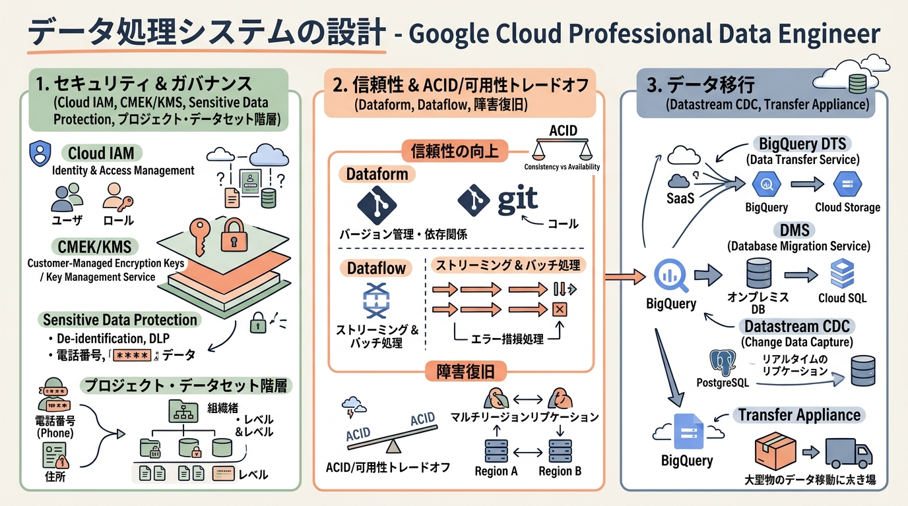
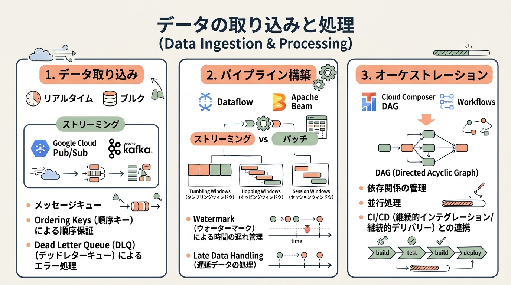
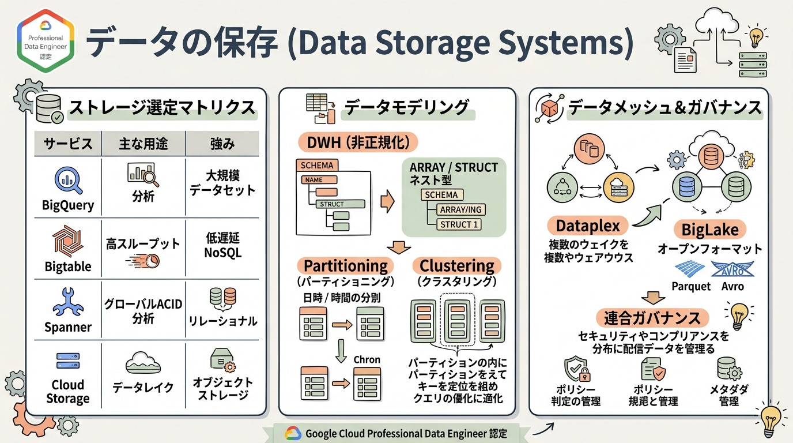
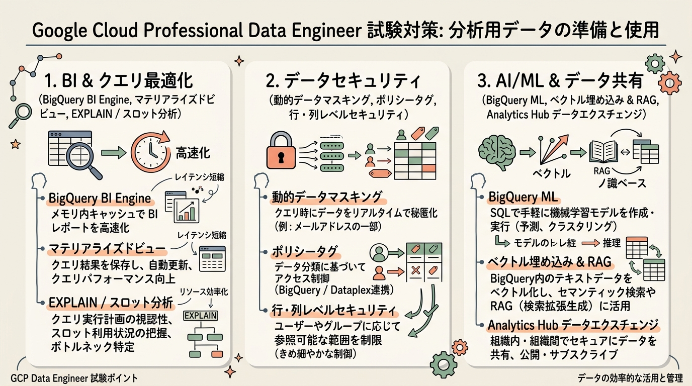
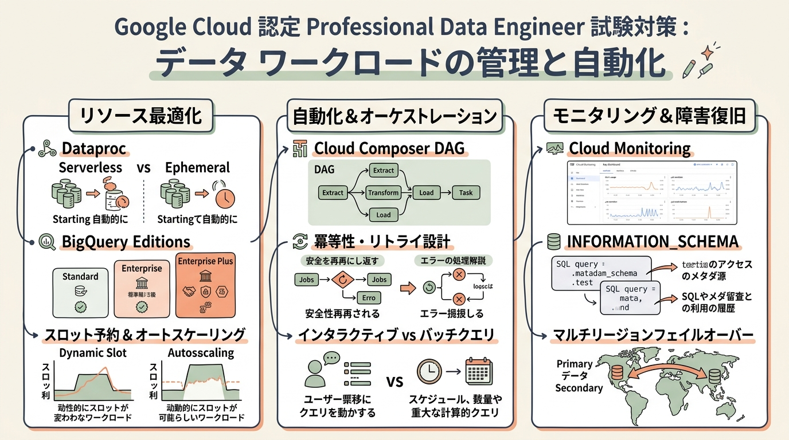

# Google Cloud Certified - Professional Data Engineer 完全対策＆実践学習ガイド

- **対象資格**: Google Cloud Certified - Professional Data Engineer (PDE)
- **試験コード**: Professional Data Engineer
- **公式試験ガイド**: [Professional Data Engineer 認定試験ガイド (日本語版)](https://services.google.com/fh/files/misc/professional_data_engineer_exam_guide_japanese.pdf?hl=ja)
- **公式試験ページ**: [Professional Data Engineer 認定資格 | Google Cloud](https://cloud.google.com/learn/certification/data-engineer?hl=ja)
- **最終更新日**: 2026-10-14

---

## はじめに

企業の競争力は、社内外に散在する膨大なデータをいかに迅速、安全、かつ効率的に価値へ変換できるかに直結しています。昨今、データエンジニアリングの領域は従来の「大規模バッチ処理によるデータ集約」から、「ストリーミング処理によるリアルタイム意思決定」「レイクハウスによるオープンで連合的なデータガバナンス」「生成 AI（LLM）と検索拡張生成（RAG）を支えるベクトルデータ基盤の構築」へと劇的に進化しました。

Google Cloud のデータスタック（BigQuery, Dataflow, Dataproc, Pub/Sub, Dataplex, Cloud Composer など）は、このモダンデータスタックの潮流を牽引し続けています。本ガイドは、単なる試験用語や機能暗記にとどまらず、実務において最適なアーキテクチャトレードオフ（スループット vs レイテンシ、ACID vs 可用性、サーバーレス vs 専用コンピュート）を的確に判断できる実践的データエンジニアの育成を目的としています。

### Professional Data Engineer 試験とは

Professional Data Engineer 認定試験は、Google Cloud 上でスケーラブル、高信頼、安全、かつ費用対効果の高いデータ処理システムを設計、構築、運用、最適化する高度な専門能力を客観的に評価する認定資格です。

- **試験時間**: 120 分（2 時間）
- **出題問題数**: 50〜60 問
- **出題形式**: 択一選択問題（4 肢中 1 つ選択）、複数選択問題（5 肢以上中 2 つ以上選択）
- **合否基準点**: スケールドスコア方式（合格 / 不合格のみ判定。正答率は非開示）
- **推奨される前提知識**: データエンジニアリングに関する 3 年以上の実務経験、および Google Cloud 上でのデータソリューション設計・管理に関する 1 年以上の実務経験。

### 難易度と求められる思考力

Professional Data Engineer 試験は、Google Cloud のプロフェッショナル認定群の中でも屈指の技術的深度を誇ります。出題の多くは「特定の要件（低レイテンシ、厳格なセキュリティ、コスト最小化、ゼロダウンタイム移行など）を満たす最も適切なアーキテクチャはどれか」を問う長文シチュエーション問題です。

合格に必要なのは、個々のサービスの仕様暗記ではなく、以下の「アーキテクチャのトレードオフ判断力」です。
1. **データ処理パラダイムの選定**: ストリーミング（Dataflow / Pub/Sub）とバッチ（Dataflow / Dataproc / BigQuery）の境界線と、イベント時間・処理時間・ウォーターマーク・遅延データ処理の正確な理解。
2. **ストレージ・データベースの適材適所**: NoSQL（Bigtable, Firestore）とリレーショナル（Cloud Spanner, Cloud SQL, AlloyDB）、分析用 DWH（BigQuery, BigLake）の特性比較とスキーマ設計（非正規化 vs 正規化）。
3. **コストとパフォーマンスの最適化**: BigQuery エディション（Standard, Enterprise, Enterprise Plus）とスロット予約、コンピュートの分離、クエリ実行計画（EXPLAIN）のボトルネック特定。
4. **エンタープライズ統制と AI 連携**: Dataplex によるデータメッシュ・連合ガバナンス、動的データマスキング、BigQuery ML やベクトル埋め込みによる生成 AI パイプライン連携。

### 推奨の勉強法

1. **公式一次ドキュメントとアーキテクチャベストプラクティスの精読**:
   各サービスの概要だけでなく、「割り当てと上限（Quotas & Limits）」「ベストプラクティス」「トラブルシューティングガイド」を重点的に読み込みます。
2. **実機ハンズオンによる手触り感の獲得**:
   Google Skills のスキルバッジを活用し、Dataflow パイプラインの作成、BigQuery のパーティショニング・クラスタリング・マテリアライズドビューの構築、Cloud Composer による DAG オーケストレーションを実際にコマンドおよびコンソールで検証します。
3. **構造化実践シナリオ（状況・対応・結果・解説）による意思決定の追体験**:
   本ガイドに収録された網羅的な実践シナリオを通じ、「なぜその構成が選ばれるのか」「なぜ他の類似選択肢では不適格なのか」という全代替案の棄却理由を論理的に言語化できるレベルまで思考を深めます。

---

## 目次

1. [はじめに](#はじめに)
2. [学習カリキュラム・出題範囲ロードマップ](#学習カリキュラム出題範囲ロードマップ)
3. [Section 1: データ処理システムの設計 (22%)](#section-1-データ処理システムの設計-22)
4. [Section 2: データの取り込みと処理 (25%)](#section-2-データの取り込みと処理-25)
5. [Section 3: データの保存 (20%)](#section-3-データの保存-20)
6. [Section 4: 分析用データの準備と使用 (15%)](#section-4-分析用データの準備と使用-15)
7. [Section 5: データ ワークロードの管理と自動化 (18%)](#section-5-データ-ワークロードの管理と自動化-18)
8. [まとめと推奨学習ステップ](#まとめと推奨学習ステップ)

---

## 学習カリキュラム・出題範囲ロードマップ

### セクション一覧と出題比率

| セクション番号 | セクション名 / 出題分野 | 出題比率 | 主要対象サービス・ツール |
| :--- | :--- | :--- | :--- |
| **Section 1** | データ処理システムの設計 | 22% | Cloud IAM, Cloud KMS (CMEK), Sensitive Data Protection, Dataform, Dataflow, Cloud Data Fusion, ACID/可用性, 移行ツール (BigQuery DTS, DMS, Datastream, Transfer Appliance) |
| **Section 2** | データの取り込みと処理 | 25% | Pub/Sub, Kafka, Dataflow (Apache Beam, ウィンドウ・ウォーターマーク・遅延データ), Dataproc, Cloud Composer, Workflows |
| **Section 3** | データの保存 | 20% | BigQuery, BigLake, Bigtable, Cloud Spanner, AlloyDB, Cloud Storage, Dataplex, Dataplex Catalog, データメッシュ |
| **Section 4** | 分析用データの準備と使用 | 15% | BigQuery BI Engine, マテリアライズドビュー, 動的データマスキング, 行/列レベルセキュリティ, BigQuery ML, ベクトル検索/RAG, Analytics Hub |
| **Section 5** | データ ワークロードの管理と自動化 | 18% | Dataproc サーバーレス/一時クラスタ, Cloud Composer DAG, BigQuery エディション & スロット予約, オブザーバビリティ (Monitoring/Logging), 障害復旧 (HA/DR) |

---

### セクション別出題詳細

#### Section 1: データ処理システムの設計 (22%)
- **出題の狙い**: ビジネス要件、セキュリティ統制、コンプライアンス、信頼性、および将来の拡張性を担保したデータ基盤全体のアーキテクチャ設計能力を検証します。
- **主要タスク**:
  - Task 1.1: セキュリティとコンプライアンスを考慮した設計（Cloud IAM, 最小権限, CMEK/Cloud KMS, 機密データ保護, データ主権, マルチ環境分離, プロジェクト・データセット階層）
  - Task 1.2: 信頼性と確実性を考慮した設計（Dataform, Dataflow, Cloud Data Fusion, プロンプト設計, 障害復旧, ACID と可用性のトレードオフ判断）
  - Task 1.3: 柔軟性とポータビリティを考慮した設計（ビジネス要件マッピング, マルチクラウド・データ所在地, ステージング, データカタログ化）
  - Task 1.4: データ移行の設計（要件分析, 移行計画・検証, BigQuery DTS, DMS, Datastream, Transfer Appliance）
- **重要キーワード**: Cloud IAM, Cloud KMS, CMEK, Sensitive Data Protection, Data Sovereignty, Dataform, Cloud Data Fusion, ACID, CAP Theorem, BigQuery DTS, DMS, Datastream, Transfer Appliance

#### Section 2: データの取り込みと処理 (25%)
- **出題の狙い**: バッチおよびストリーミングの双方において、多種多様なデータソースから安全かつスケーラブルにデータを収集・変換・拡充するパイプラインの構築・運用能力を検証します。
- **主要タスク**:
  - Task 2.1: データ パイプラインの計画（ソース・シンク定義, 変換・オーケストレーションロジック, ネットワーキング, 暗号化）
  - Task 2.2: パイプラインの構築（Dataflow, Apache Beam, Dataproc, Spark, Hadoop, Cloud Data Fusion, BigQuery, Pub/Sub, ウィンドウ処理, 遅延データ処理, AI データ拡充）
  - Task 2.3: パイプラインのデプロイと運用化（Cloud Composer, Workflows, CI/CD 自動化）
- **重要キーワード**: Dataflow, Apache Beam, PCollection, ParDo, Tumbling/Hopping/Session Windows, Watermark, Allowed Lateness, Pub/Sub Ordering Keys, Dead Letter Queue, Cloud Composer, Workflows

#### Section 3: データの保存 (20%)
- **出題の狙い**: クエリ頻度、レイテンシ要件、トランザクション特性、コストに基づいて適切なストレージを選択し、DWH、データレイク、連合プラットフォームを設計する能力を検証します。
- **主要タスク**:
  - Task 3.1: ストレージ システムの選択（BigQuery, BigLake, AlloyDB, Bigtable, Spanner, Cloud SQL, Cloud Storage, Firestore, Memorystore, ライフサイクル）
  - Task 3.2: データ ウェアハウスを使用するための計画（データモデル設計, 非正規化, ネスト＆反復フィールド, パーティショニング/クラスタリング）
  - Task 3.3: データレイクの使用（Cloud Storage, オープンフォーマット Parquet/ORC/Iceberg, レイク管理）
  - Task 3.4: データ プラットフォームを考慮した設計（Dataplex, Dataplex Catalog, データメッシュ, 連合ガバナンス）
- **重要キーワード**: BigQuery, BigLake, Bigtable (Row Key Design), Cloud Spanner, AlloyDB, Partitioning & Clustering, Dataplex, Dataplex Catalog, Data Mesh

#### Section 4: 分析用データの準備と使用 (15%)
- **出題の狙い**: BI、データ探索、機械学習・生成 AI モデル向けに、安全かつ高パフォーマンスにデータを加工・最適化・共有する能力を検証します。
- **主要タスク**:
  - Task 4.1: 可視化用データの準備（Looker 連携, 事前計算, BigQuery BI Engine, マテリアライズドビュー, EXPLAIN 分析, 動的データマスキング, 行・列レベルセキュリティ）
  - Task 4.2: AI と ML のためのデータの準備（BigQuery ML, ベクトル埋め込み `ML.GENERATE_EMBEDDING`, 非構造化データ準備, RAG パイプライン）
  - Task 4.3: データの共有（Analytics Hub, データエクスチェンジ, ゼロコピー共有）
- **重要キーワード**: BigQuery BI Engine, Materialized Views, Query Plan EXPLAIN, Dynamic Data Masking, Policy Tags, BigQuery ML, `ML.GENERATE_EMBEDDING`, Analytics Hub

#### Section 5: データ ワークロードの管理と自動化 (18%)
- **出題の狙い**: リソースの最適化、スロット予約管理、オーケストレーション、オブザーバビリティ、および障害復旧を包括的に管理・最適化する能力を検証します。
- **主要タスク**:
  - Task 5.1: リソースの最適化（費用最小化, Dataproc 一時クラスタ vs サーバーレス）
  - Task 5.2: 自動化と反復性の設計（Cloud Composer DAG, 冪等性, スケジューリング）
  - Task 5.3: ビジネス要件に基づくワークロードの最適化（BigQuery エディション, スロット予約, オートスケーリング, インタラクティブ vs バッチ）
  - Task 5.4: プロセスのモニタリングとトラブルシューティング（Cloud Monitoring, Cloud Logging, INFORMATION_SCHEMA 分析, 割り当て管理）
  - Task 5.5: 障害への意識の持続と影響の軽減（フォールトトレランス, マルチリージョン復旧, データベースレプリケーション）
- **重要キーワード**: Dataproc Serverless, Cloud Composer, Idempotency, BigQuery Editions (Standard/Enterprise/Enterprise Plus), Slot Reservations, INFORMATION_SCHEMA, High Availability & Disaster Recovery

---

## Section 1: データ処理システムの設計 (22%)

本セクションでは、エンタープライズ規模のデータ基盤を構築するにあたり、セキュリティ、法令遵守（コンプライアンス）、耐障害性、および将来の拡張性・ポータビリティを担保したアーキテクチャ設計能力が問われます。単にサービスを配置するだけでなく、暗号化鍵のライフサイクル、機密データ（PII）の保護戦略、環境分離、ACID 特性と可用性のトレードオフ、そしてオンプレミスや他クラウドからのデータ移行計画を体系的に策定する思考が求められます。



---

### 1. セクション概要

エンタープライズデータシステムの成否は、基盤となる「信頼境界」と「データガバナンス」の設計で決まります。Google Cloud では、リソース階層（組織・フォルダ・プロジェクト）と Cloud IAM を連携させ、開発・検証・本番環境の厳格な分離を実現します。さらに、データ暗号化においてはデフォルトの Google マネージド暗号化鍵に加え、規制要件に応じた顧客管理暗号化鍵（CMEK: Customer-Managed Encryption Keys）を Cloud KMS で一元制御します。

また、データパイプラインの品質を担保するため、現代のデータエンジニアリングでは Dataform による SQL ワークフローのバージョン管理（Git 統合）、データテスト、依存関係解決が標準採用されています。さらに、オンプレミスや他クラウドからのデータ移行では、ネットワーク帯域、データ容量、ダウンタイム許容度に応じた最適な移行ツール（BigQuery DTS, DMS, Datastream, Transfer Appliance）の選定が必須となります。

#### 重要キーワード

- **Customer-Managed Encryption Keys (CMEK)**: Cloud KMS（Key Management Service）を用いてユーザー自身が暗号化鍵の作成・ローテーション・失効を管理する仕組み。法令遵守や金融業界の鍵管理要件に適合。
- **Sensitive Data Protection (Cloud DLP)**: 個人を特定できる情報（PII: Personally Identifiable Information）を自動検出、分類、マスキング（トークン化、暗号化、ハッシュ化）するフルマネージドサービス。
- **Dataform**: BigQuery 内で ELT パイプラインを開発、テスト、バージョン管理、オーケストレーションするサーバレスサービス。SQLX を用いてテーブル間の依存関係をグラフ化して実行。
- **ACID と CAP 定理**: 厳格なトランザクション整合性（ACID: Atomicity, Consistency, Isolation, Durability）と高スループット・高可用性（BASE: Basically Available, Soft state, Eventual consistency）のトレードオフ判断指標。
- **Datastream**: サーバーレスの Change Data Capture (CDC) サービス。Oracle, MySQL, PostgreSQL, SQL Server などのデータベースの変更差分をリアルタイムに検知し、BigQuery や Cloud Storage へ低レイテンシでストリーミング配信。
- **Transfer Appliance**: ネットワーク帯域が不足している場合に、ペタバイト規模のデータを安全に物理転送する Google 提供の高セキュリティ大容量ハードウェアアプライアンス。

---

### 2. 重要トピック

#### 1. データガバナンスと環境分離アーキテクチャ

大規模なデータ処理基盤では、データの機密性、開発速度、監査要件のバランスを取るために、プロジェクトとデータセットを階層的に分離します。

```text
┌─────────────────────────────────────────────────────────────┐
│ 組織 (Organization) / フォルダ (Data Platform)             │
├──────────────────────────────┬──────────────────────────────┤
│ [開発環境 Project: dev-data] │ [本番環境 Project: prd-data] │
│ ・開発者フルアクセス (IAM)   │ ・パイプライン SA のみ書込   │
│ ・マスキング済みサンプルデータ│ ・厳格な CMEK / 監査ログ     │
└──────────────┬───────────────┴──────────────┬───────────────┘
               │                              │
               ▼                              ▼
      [Raw Stage データセット]      [Curated 分析データセット]
      ・外部取込データ              ・業務別マート
      ・短期間ライフサイクル        ・列/行アクセス制御
```

- **最小権限の原則 (PoLP)**:
  - 開発者には本番環境の閲覧権限（`roles/bigquery.dataViewer`）を直接付与せず、Cloud Data Loss Prevention (Sensitive Data Protection) で匿名化された開発環境データセットのみを操作させます。
  - パイプライン実行は、明示的に権限を絞り込んだサービスアカウント（Service Account）を介して実行します。
- **データ主権 (Data Sovereignty)**:
  - 欧州連合（GDPR）や各国の規制により、データ保存場所の法的制約がある場合、BigQuery データセットおよび Cloud Storage バケットのロケーションを厳格に指定します（例: `europe-west3`）。
  - 組織ポリシー制約（`constraints/gcp.resourceLocations`）を設定し、許可されたリージョン以外へのリソースプロビジョニングを組織全体でブロックします。

#### 2. データ移行ツールの選定比較マトリクス

オンプレミスや他社クラウドから Google Cloud へのデータ移行は、データソースの種類、移行規模、および許容ダウンタイムによって最適な手法が異なります。

| 移行ツール / サービス | 主要対象ソース | データ連携方式 | 許容ダウンタイム | 主なユースケース・強み |
| :--- | :--- | :--- | :--- | :--- |
| **Datastream** | Oracle, PostgreSQL, MySQL, SQL Server | サーバーレス CDC (Change Data Capture) | 最小（リアルタイム継続同期） | 業務 DB の稼働を停止させず、変更差分をリアルタイムに BigQuery や Cloud Storage にレプリケーションする場合。 |
| **Database Migration Service (DMS)** | MySQL, PostgreSQL, SQL Server, Oracle | CDC ベースのフルマネージド移行 | 最小（切り替え時のみ） | 同種データベース（例: オンプレミス PostgreSQL から Cloud SQL / AlloyDB for PostgreSQL）への均質移行。 |
| **BigQuery Data Transfer Service (DTS)** | Google Ads, YouTube, S3, Redshift, Teradata | スケジュールバッチ移行 | バッチ間隔に依存 | SaaS アプリケーションや Teradata / Redshift から BigQuery への定期データウェアハウス移行。 |
| **Storage Transfer Service** | S3, Azure Blob, オンプレミス POSIX, HTTP/S | 大規模並列オブジェクト転送 | 非同期バックグラウンド | クラウド間（S3 から GCS）またはオンプレミスストレージから GCS へのテラバイト〜ペタバイト級ファイル転送。 |
| **Transfer Appliance** | オンプレミス NAS / SAN / 物理ストレージ | 物理アプライアンス輸送 (暗号化) | 配送日数（数日〜1週間） | ネットワーク帯域が狭小（1Gbps 未満）かつ移行データが 100TB〜数PB に達するバルク初期移行。 |

- **アーキテクトの選定基準**:
  - **トランザクション DB の無停止同期**: リアルタイム CDC が必要なら **Datastream**（BigQuery 宛て）または **DMS**（Cloud SQL / AlloyDB 宛て）。
  - **他社 DWH からの移行**: Redshift や Teradata のスキーマ・SQL 変換を含む移行なら **BigQuery DTS**。
  - **大容量オブジェクト転送**: 帯域が十分（10Gbps+ Dedicated Interconnect など）なら **Storage Transfer Service**、帯域がボトルネックなら物理的な **Transfer Appliance**。

---

### 3. 実践シナリオ

#### シナリオ 1-1: 金融トランザクションデータの機密保護と暗号化キー統制

- **状況**: 金融機関において、決済トランザクションデータを BigQuery に集約して分析する際、業界規制（PCI-DSS 等）により、暗号化鍵の生成・ローテーション・アクセス権限を組織側で完全に制御し、かつ万一の際には鍵を即時失効させてデータアクセスを遮断する必要がある場合
- **対応**: Cloud KMS で顧客管理暗号化鍵（CMEK）を作成し、BigQuery データセットの作成時に当該 CMEK を適用する。
- **結果**: データベースの静止データ（Data-at-rest）が指定した KMS 鍵で暗号化され、鍵のローテーション管理や暗号化操作の Cloud Audit Logs 記録が実現し、鍵の無効化による即時アクセス遮断が可能となる。
- **解説**: CMEK を採用することで、Google が管理するデフォルトの暗号化鍵とは異なり、組織のセキュリティ管理者が鍵のライフサイクルを完全に掌握できるためです。暗号化操作を自前でアプリケーション実装するクライアントサイド暗号化（CSEK）は、BigQuery の分析機能（集計・フィルタリング）が失われるため不適格です。また、Google 管理の暗号化鍵では、自社ポリシーに基づく即時失効や定期ローテーションの統制要件を満たせません。
- **参考ドキュメント**:
  - [BigQuery 顧客管理の暗号鍵](https://docs.cloud.google.com/bigquery/docs/customer-managed-encryption?hl=ja): CMEK の設定方法と暗号化の仕組み。

#### シナリオ 1-2: グローバル分散環境におけるデータ主権規制（GDPR）とプロジェクト分離

- **状況**: 多国籍企業において、欧州居住者のユーザーデータを収集・分析するにあたり、GDPR（EU 一般データ保護規則）を遵守するため、データが欧州経済領域（EEA）外へ転送・保存されることを厳格に防止する必要がある場合
- **対応**: 組織ポリシー制約 `constraints/gcp.resourceLocations` を設定して作成可能なリソースのロケーションを欧州リージョン（例: `europe-west3`）に制限し、欧州リージョン専用の Google Cloud プロジェクト内に BigQuery データセットを作成する。
- **結果**: 開発者や運用担当者の人為的ミスによる欧州外リージョンへのリソースプロビジョニングが根本的に遮断され、完全なデータ主権が担保される。
- **解説**: 組織ポリシー制約は、個々のプロジェクト作成やデータセット構成におけるリージョン違反をプラットフォームレベルで強制拒否できるためです。Cloud IAM 権限のみで運用規程を設けるアプローチでは、権限を持つ管理者の誤操作や設定ミスによる越境保存を防止できないため不適格です。また、マルチリージョン `EU` を選択した場合は欧州内の複数データセンターに分散されるため、特定国（ドイツ国内など）のデータ所在地規制がある場合は単一リージョン（`europe-west3`）の指定が必須となり、マルチリージョン構成では要件を満たせません。
- **参考ドキュメント**:
  - [リソース ロケーションの制限 (組織ポリシー)](https://docs.cloud.google.com/organization-policy/restrict-locations?hl=ja): データ所在地とコンプライアンスの統制。

#### シナリオ 1-3: ELT パイプラインにおける SQL 変換の自動テストと依存関係管理

- **状況**: アナリティクスエンジニアチームが BigQuery 上で複雑なデータマート構築を行っているが、数百に及ぶ SQL クエリ間の依存関係が手動管理されており、上流テーブルのスキーマ変更に伴うデータ破損やテスト漏れが頻発している場合
- **対応**: Dataform を導入し、SQLX でテーブル定義・アサーション（データ品質テスト）・依存関係（`ref` 関数）をコード化し、Git リポジトリと統合して CI/CD パイプラインで実行する。
- **結果**: テーブルの更新順序が DAG（有向非巡回グラフ）として自動解決され、主キー重複や NULL 検証アサーションがパスした場合のみ本番テーブルに公開される信頼性の高い ELT が実現する。
- **解説**: Dataform は BigQuery にネイティブ統合された宣言型 ELT オーケストレーションツールであり、SQL 開発者が追加インフラを構築・管理することなくデータ変換のバージョン管理と品質検証（アサーション）を自動化できるためです。Cloud Composer（Airflow）単体で BashOperator や PythonOperator を用いて生の SQL スクリプトを逐次実行する構成は、SQL 間の細かなカラムレベル依存関係やアサーションの記述負荷が著しく増大するため不適格です。また、Linux cron でスケジューリングするアプローチは、依存関係の制御や障害時のロールバックが困難であり要件を満たせません。
- **参考ドキュメント**:
  - [Dataform の概要](https://docs.cloud.google.com/dataform/docs/overview?hl=ja): BigQuery における宣言型データ変換のベストプラクティス。

#### シナリオ 1-4: 大規模オンプレミス RDBMS から Google Cloud への無停止移行

- **状況**: オンプレミスデータセンターで稼働する基幹系 Oracle データベースのデータを、24 時間 365 日の業務を停止することなく、リアルタイム分析基盤として BigQuery へ継続的にレプリケーションする必要がある場合
- **対応**: 閉域網接続（Cloud Interconnect）を介して Datastream を構成し、Oracle のトランザクションログから Change Data Capture (CDC) を行い、BigQuery のターゲットデータセットへ直接ストリーミング同期する。
- **結果**: 業務データベースへの負荷を最小限に抑えつつ、数秒のレイテンシでトランザクション変更が BigQuery に自動反映されるリアルタイム分析環境が稼働する。
- **解説**: Datastream はサーバーレスのマネージド CDC サービスであり、データベースのトランザクションログ（REDO ログ）を直接読み取って差分イベントのみをストリーミング転送するため、本番 DB に重いクエリ負荷をかけることなく無停止同期を実現できるためです。定期的なバッチ抽出（JDBC クエリによる全件/差分取得）は、大量の SELECT 文発行により本番 DB のトランザクション処理を阻害するため不適格です。また、BigQuery Data Transfer Service はスケジュールベースのバッチ転送であり、ミリ秒〜数秒の低レイテンシ継続同期要件を満たせません。
- **参考ドキュメント**:
  - [Datastream の概要](https://docs.cloud.google.com/datastream/docs/overview?hl=ja): サーバーレス CDC によるリアルタイムレプリケーション。

#### シナリオ 1-5: 100TB を超えるペタバイト級オンプレミスアーカイブの閉域網移行

- **状況**: オンプレミスストレージに保管されている 300TB の過去履歴ログデータを Cloud Storage へ移行したいが、既存のインターネット回線帯域が 100Mbps と狭小であり、業務通信への影響を避けるためネットワーク経由での転送が不可能な場合
- **対応**: Transfer Appliance を注文してオンプレミスのデータセンターに設置し、ローカルネットワーク経由でデータを暗号化コピーした上で Google へ返送し、Cloud Storage バケットにアップロードする。
- **結果**: ネットワーク帯域を一切圧迫することなく、高セキュリティかつ数日間のスケジュールで 300TB のデータ移行が完了する。
- **解説**: 100Mbps の回線で 300TB を転送する場合、理論上でも約 300 日以上を要するため物理的な転送アプライアンス（Transfer Appliance）の利用が最も現実的かつ経済的であるためです。Cloud Storage Transfer Service や `gsutil -m cp` を低速回線上で実行するアプローチは、転送が完了するまでに数ヶ月以上を要し、業務帯域を枯渇させるため不適格です。また、一時的な移行のためだけに専用線（Dedicated Interconnect）を新規敷設することは、リードタイム（数ヶ月）とコストの観点から要件を満たせません。
- **参考ドキュメント**:
  - [Transfer Appliance の概要](https://docs.cloud.google.com/transfer-appliance/docs/4.0/overview?hl=ja): 大容量データの安全な物理転送。

#### シナリオ 1-6: 生成 AI を活用した自然言語からのセキュアな SQL クエリ自動生成

- **状況**: ビジネスアナリストが自然言語でデータウェアハウスに問い合わせを行えるよう、大規模言語モデル（LLM）を用いて BigQuery テーブルに対する SQL クエリを自動生成するシステムを設計するにあたり、スキーマ情報のみをモデルに渡し、実データへのアクセスを遮断して情報漏洩を防止する必要がある場合
- **対応**: BigQuery Studio 内の Gemini データアシスタント機能を活用するか、Vertex AI の Gemini API に対し、INFORMATION_SCHEMA から抽出したテーブルスキーマとカラム定義のみをプロンプトとして渡し、生成された SQL のみを実行権限を持つバックエンドで検証・実行する。
- **結果**: 実際の行データや個人情報（PII）が LLM の外部プロンプトに露出することなく、高精度な SQL クエリが自動生成され、最小権限での実行が担保される。
- **解説**: LLM による SQL 生成に必要な情報はテーブルのメタデータ（スキーマ定義、列名、型、テーブル説明）のみであり、実データをプロンプトに含めないことがセキュリティおよびトークン消費最適化のベストプラクティスであるためです。実データを含むクエリ結果セットをプロンプトに埋め込んで推論させる構成は、重大な PII 漏洩リスクを招き、コンテキストウィンドウの上限に達するため不適格です。また、モデルに直接 BigQuery のフル管理者権限（`roles/bigquery.admin`）を委譲する構成は、悪意あるプロンプト注入によるデータ改ざんや破壊のリスクがあるため要件を満たせません。
- **参考ドキュメント**:
  - [BigQuery での Gemini によるコード支援](https://docs.cloud.google.com/bigquery/docs/write-sql-gemini?hl=ja): 生成 AI を用いた安全な SQL 生成と分析支援。

---

### 4. 参考ドキュメント & 推奨ハンズオン

#### 公式一次ドキュメント
- [データ ガバナンスの原則とアプローチ](https://docs.cloud.google.com/architecture/framework?hl=ja): クラウドデータ基盤のセキュリティとガバナンス設計。
- [BigQuery 顧客管理の暗号鍵 (CMEK)](https://docs.cloud.google.com/bigquery/docs/customer-managed-encryption?hl=ja): 鍵管理とコンプライアンスのベストプラクティス。
- [データ移行のガイダンス](https://docs.cloud.google.com/architecture/migration-to-gcp-getting-started?hl=ja): ワークロードに応じた移行手法の選択。

#### 推奨ハンズオン・ラボ（実機検証）
- [Create and Manage BigQuery Datasets and Tables (Google Skills)](https://www.skills.google/course_templates/624?hl=ja):
  - **学習目標**: BigQuery における IAM ロール適用、データセット作成、CMEK 暗号化の設定手順を実機で体感する。
- [Transform Data with Dataform (Google Skills)](https://www.skills.google/course_templates/626?hl=ja):
  - **学習目標**: Dataform で SQLX を作成し、アサーションによるデータ品質検証と Git 連携ワークフローを検証する。

---

## Section 2: データの取り込みと処理 (25%)

本セクションは、Professional Data Engineer 試験において最大の配点比率（25%）を占める最重要領域です。バッチ処理とリアルタイムストリーミング処理の双方を網羅し、高スループットなメッセージング（Pub/Sub）、分散並列ストリーム処理（Dataflow / Apache Beam）、オープンソースエコシステム（Dataproc）、およびワークフローオーケストレーション（Cloud Composer, Workflows）の設計・実装・運用能力が厳密に評価されます。



---

### 1. セクション概要

現代のデータエンジニアリングでは、データが発生した瞬間に価値を引き出す「ストリーミングファースト」のアーキテクチャが求められます。Google Cloud では、グローバル規模のメッセージ取り込み基盤である **Cloud Pub/Sub** と、Apache Beam をバックエンドとするフルマネージド処理基盤 **Cloud Dataflow** がその中核を担います。

Dataflow は、ストリーミングデータにおける時間概念（イベント時間 vs 処理時間）、ウィンドウ処理（タンブリング、ホッピング、セッション）、遅延データ（Late Data）の救済（Allowed Lateness）、およびウォーターマーク（Watermark）の進展を自動制御し、Exactly-Once（正確に1回）の処理セマンティクスを保証します。

一方、既存の Hadoop/Spark 資産を活用する場合には **Cloud Dataproc** が適しており、ジョブ実行時のみコンピュートを起動する一時的（エフェメラル）クラスタや Dataproc サーバーレスにより、コストを劇的に削減できます。これら多様なパイプラインは、Apache Airflow をマネージド提供する **Cloud Composer** によって DAG（有向非巡回グラフ）としてオーケストレーションされ、強固なエンタープライズ運用を実現します。

#### 重要キーワード

- **Cloud Dataflow**: Apache Beam パイプラインを実行するフルマネージド、サーバーレスの分散並列データ処理サービス。オートスケーリングと動的作業再調整（Dynamic Work Rebalancing）をサポート。
- **Apache Beam プリミティブ**:
  - `PCollection`: パイプライン内を流れる分散データセット（バッチは有界、ストリーミングは無界）。
  - `PTransform`: データに適用される処理ステップ（`ParDo`, `GroupByKey`, `Combine` など）。
  - `DoFn`: `ParDo` 内で個々の要素を処理するユーザー定義関数。
- **ウィンドウ処理 (Windowing)**:
  - **固定時間 (Tumbling / Fixed Window)**: 重複のない等間隔の窓（例: 5分ごと）。
  - **スライディング時間 (Hopping / Sliding Window)**: 重複のある定期的な窓（例: 5分間の平均を1分ごとに計算）。
  - **セッション (Session Window)**: データが存在しないギャップ期間によって区切られる可変長の窓（例: ユーザーのアクティビティ分析）。
- **ウォーターマーク (Watermark)**: イベント時間において「この時刻以前のデータはすべて到着した」とシステムが見なす推計時刻。
- **遅延データと許容遅延 (Allowed Lateness)**: ウォーターマーク通過後に到着した遅延データを破棄せず、追加更新（Accumulating / Retracting）として処理するための許容時間枠。
- **Pub/Sub 順序キー (Ordering Keys)**: 特定のキー（例: ユーザーID）を持つメッセージ群に対して、パブリッシュされた順序と同一の順序でサブスクライバーに配信することを保証する機能。
- **デッドレターキュー (Dead Letter Queue: DLQ)**: 解析エラーや不整合によって処理を完了できない異常メッセージを、パイプラインをブロックすることなく退避させる専用のトピック・キュー。
- **Cloud Composer**: Apache Airflow をベースとしたフルマネージドのワークフローオーケストレーションサービス。複雑なマルチクラウド・ハイブリッドパイプラインの依存関係を Python コード（DAG）で定義・管理。

---

### 2. 重要トピック

#### 1. Apache Beam / Dataflow ストリーミング処理の深層メカニズム

ストリーミング処理では、「ネットワーク遅延」や「デバイスオフライン」によって、データが実際に発生した時刻（イベント時間）と、システムに到着した時刻（処理時間）に必ずズレが生じます。

```text
イベント時間 (Event Time):  [12:00] -- [12:01] ----------- [12:03] (データ発生)
                                \          \                  /
処理時間 (Processing Time):     [12:01] -- [12:05 (到着)] -- [12:06] (システム処理)
                                                 ▲
                                         (4分の遅延発生！)
```

- **ウォーターマークの役割**:
  - Dataflow はイベント時間の進展を監視し、入力ソースの未処理データに基づいてウォーターマークを算出します。
  - ウィンドウの終了時刻をウォーターマークが越えた時点で、デフォルトではそのウィンドウの結果が出力（トリガー）されます。
- **遅延データ（Late Data）のハンドリング**:
  - ウォーターマーク通過後に到着したデータは、`withAllowedLateness(Duration)` を指定していない場合、自動的に破棄されます。
  - `accumulatingFiredPanes()` を設定することで、遅延データ到着時にウィンドウの再計算結果を増分更新としてダウンストリーム（BigQuery 等）へ再出力できます。

#### 2. データ処理基盤の選定比較マトリクス

| サービス / 基盤 | プログラミングモデル | インフラ管理モデル | 処理形態 | 主なユースケース・強み |
| :--- | :--- | :--- | :--- | :--- |
| **Cloud Dataflow** | Apache Beam (Java, Python, Go) | サーバーレス (完全自動スケール) | バッチ & ストリーミング統合 | 新規構築のリアルタイムストリーミング、複雑なウィンドウ集計、オートスケールによる運用レス化。 |
| **Cloud Dataproc** | Apache Spark, PySpark, Hadoop, Hive, Flink | サーバーレス または GCE クラスタ | 主にバッチ (Spark Streaming 可) | 既存のオンプレミス Spark / Hadoop 資産のリフト＆シフト、大規模機械学習データ前処理。 |
| **BigQuery (SQL)** | GoogleSQL (ELT) | サーバーレス (スロット管理) | バッチ (ストリーミング挿入可) | SQL のみで完結するデータウェアハウス内データ変換、マテリアライズドビューによる継続集計。 |
| **Cloud Data Fusion** | GUI / ノーコード (CDAP ベース) | マネージドクラスタ (裏で Dataproc 実行) | バッチ & ストリーミング | アナリスト向けのドラッグ＆ドロップ ETL パイプライン構築、多種多様なオンプレ/SaaS コネクタ連携。 |

- **アーキテクトの選定基準**:
  - **新規開発かつリアルタイム性重視**: イベント時間ウィンドウ処理と Exactly-Once が必須なら **Dataflow** 一択。
  - **既存コードの互換性**: 既存の Spark コードや Hadoop エコシステム資産があるなら **Dataproc**（または Dataproc サーバーレス）。
  - **SQL 中心**: 構造化データの変換であり、インフラを持たずに SQL のみで集約したいなら **BigQuery + Dataform**。

---

### 3. 実践シナリオ

#### シナリオ 2-1: IoT センサーからの高頻度ストリーミングデータにおける順序保証と遅延データ救済

- **状況**: 全国の工場に設置された数万台の IoT センサーからミリ秒単位で温度・振動データが送信され、センサーごとの状態変化を時系列順に正確に集計する必要があるが、通信障害により一部のセンサーデータが最大 30 分遅延して到着する場合
- **対応**: センサー ID を Ordering Key として Cloud Pub/Sub にメッセージを発行し、Dataflow パイプラインでセッションウィンドウまたは固定時間ウィンドウを適用し、`.withAllowedLateness(Duration.standardMinutes(30))` を設定して遅延データを処理する。
- **結果**: センサーごとの時系列順序が担保された状態で取り込まれ、30 分以内の遅延データは破棄されることなく既存ウィンドウの集計結果が自動更新される。
- **解説**: Pub/Sub の Ordering Key は同一キーを持つメッセージの配信順序を厳格に保証し、Dataflow の `withAllowedLateness` はウォーターマーク通過後の遅延データを安全に再計算して正確な集計値を反映できるためです。順序キーを指定しない標準 Pub/Sub ではメッセージの到着順序が保証されないため、ステートマシンの順序不整合が発生し不適格です。また、遅延許容時間を設定しない場合、ウォーターマークを過ぎた遅延データは黙示的に破棄され、工場の異常検知に欠損が生じるため要件を満たせません。
- **参考ドキュメント**:
  - [Pub/Sub メッセージの順序付け](https://docs.cloud.google.com/pubsub/docs/ordering?hl=ja): 順序キーによる正確な順序保証の仕組み。
  - [Dataflow の遅延データの処理](https://docs.cloud.google.com/dataflow/docs/concepts/streaming-pipelines): ウォーターマークと許容遅延の設定。

#### シナリオ 2-2: 不正フォーマットメッセージの自動分離とパイプライン停止防止

- **状況**: クライアントアプリから Pub/Sub 経由で JSON メッセージを取り込むストリーミングパイプラインにおいて、一部の端末から仕様違反の破損 JSON や不正スキーマのデータが混入し、Dataflow のパース処理で例外が発生してパイプライン全体が停滞するリスクを回避したい場合
- **対応**: Pub/Sub サブスクリプションにデッドレターキュー（Dead Letter Queue: DLQ）を設定して配信不能メッセージを自動分離するとともに、Dataflow 内部の `DoFn` で例外を捕捉（try-catch）して未処理レコードをエラー専用の出力（Side Output / Dead-letter PCollection）へルーティングし、Cloud Storage へ退避する。
- **結果**: 不正なメッセージが混入しても正常なメッセージの処理が一切ブロックされることなく継続し、エラーデータのみが隔離されて後から原因調査や再処理が可能となる。
- **解説**: DLQ および Side Output によるエラーレコードの隔離は、ストリーミングデータ処理におけるフォールトトレランスの標準パターンであり、不正データによるパイプラインの無限再試行ループやレイテンシ急増を完全に防止できるためです。例外発生時にパイプラインをクラッシュさせる設計は、後続の全正常トランザクションを道連れにしてサービス停止を引き起こすため不適格です。また、例外を単にログに出力して破棄（Drop）する構成は、データ欠損の監査や再送処理ができなくなるため要件を満たせません。
- **参考ドキュメント**:
  - [Pub/Sub デッドレター トピックの使用](https://docs.cloud.google.com/pubsub/docs/dead-letter-topics?hl=ja): 配信不能メッセージの安全な隔離。

#### シナリオ 2-3: オンプレミス Hadoop/Spark ジョブの Google Cloud 移行とコスト最適化

- **状況**: オンプレミスの常時稼働型 Hadoop クラスタ上で毎晩 2 時間だけ実行されている大規模 Spark バッチ処理を Google Cloud へ移行するにあたり、運用管理工数とアイドル時のマシンコストを最小化したい場合
- **対応**: 処理対象データを Cloud Storage に配置し、Dataproc サーバーレス（またはジョブ実行時のみ起動して終了後に自動削除されるエフェメラル Dataproc クラスタ）を採用して Spark バッチジョブを実行する。
- **結果**: 常時稼働する仮想マシンの待機コストがゼロになり、Spark ジョブの実行時間分（2時間）のコンピュートリソース課金のみで運用負荷のないバッチ処理が実現する。
- **解説**: Dataproc サーバーレスはクラスタのプロビジョニングや構成管理を不要にし、ジョブ実行時のみ動的にスケーリングして完了時にリソースを解放するため、運用コストとインフラ費用の双方を極小化できるためです。Compute Engine 上に常時稼働（24/7）の固定 Dataproc クラスタを構築するアプローチは、1日22時間のアイドル時間に対しても課金が発生し莫大な無駄が生じるため不適格です。また、コードを Dataflow（Apache Beam）に全面書き直すアプローチは、Spark 資産の再開発コストと検証期間が膨大となるため不適格です。
- **参考ドキュメント**:
  - [Dataproc Serverless の概要](https://docs.cloud.google.com/managed-spark/docs/serverless-overview?hl=ja): クラスタ管理不要のサーバーレス Spark 実行環境。

#### シナリオ 2-4: プライベート VPC 環境でのセキュアな外部 SaaS データ取り込み

- **状況**: エンタープライズの厳格なセキュリティポリシーに基づき、インターネットへ直接出入りするルート（パブリック IP や NAT）が禁止されているプライベート VPC 内のデータパイプラインから、外部パートナーの SaaS API やマネージドサービスへ安全にアクセスしてデータを取り込む必要がある場合
- **対応**: Private Service Connect (PSC) エンドポイントを VPC 内に構成し、外部サービスへの通信を Google の内部バックボーン経由でルーティングしてパイプライン（Dataflow / Data Fusion）からプライベート接続する。
- **結果**: パイプラインワーカーにパブリック IP を一切付与することなく、インターネットへの露出を完全に防いだプライベートなデータ取り込みが実現する。
- **解説**: Private Service Connect を使用すると、外部または別プロジェクトのサービスに対して VPC 内のプライベート IP アドレス経由で安全に通信でき、インターネットゲートウェイを介さないセキュアな閉域接続が確立できるためです。パイプラインにパブリック IP を割り当ててファイアウォールで制限する構成は、セキュリティポリシー（インターネット非接続）に違反するため不適格です。また、Cloud NAT を経由させるアプローチはパブリックなインターネットを経由するため、厳格な閉域要件を満たせません。
- **参考ドキュメント**:
  - [Private Service Connect の概要](https://docs.cloud.google.com/vpc/docs/private-service-connect?hl=ja): プライベート IP による安全な外部・内部サービス連携。

#### シナリオ 2-5: 機械学習推論を用いたリアルタイムストリーミングデータ拡充

- **状況**: E コマースサイトのリアルタイムユーザー行動ログを取り込み、不正検知モデルを用いてミリ秒単位でスコアリングを行い、不正と判定されたイベントを即時にアラート通知基盤へ送信する必要がある場合
- **対応**: Pub/Sub からデータを受信する Dataflow パイプラインを構築し、Apache Beam の `RunInference` API（または Vertex AI エンドポイントへの非同期バッチ呼び出し）をパイプライン内に組み込んでリアルタイム推論を実行し、スコアに応じてルーティングする。
- **結果**: 外部推論 API の過負荷やボトルネックを防ぎながら、高スループットなストリーミングデータに対してミリ秒単位のモデル推論と不正イベント検出が実現する。
- **解説**: Apache Beam の `RunInference` はパイプラインのワーカープロセス内で直接モデルを効率的にロード・共有・バッチ推論する最適化機構を備えており、ストリーミングデータに対する低遅延・高スループットな ML エンリッチメントに最適化されているためです。イベントごとに個別の HTTP リクエストを同期的に外部エンドポイントへ送信する構成は、ネットワーク遅延の蓄積と API レートリミット超過によりパイプライン全体の致命的な詰まりを引き起こすため不適格です。また、BigQuery に一度データを保存してから BigQuery ML で定期バッチ推論するアプローチは、ミリ秒〜数秒単位での即時アラート通知要件を満たせません。
- **参考ドキュメント**:
  - [Dataflow での ML モデル推論 (RunInference)](https://docs.cloud.google.com/dataflow/docs/overview?hl=ja): 高性能なストリーミング推論パイプライン。

#### シナリオ 2-6: 複雑なデータパイプラインの依存関係制御と自動リトライ

- **状況**: 複数のデータソース（Cloud Storage, On-prem DB, SaaS）からデータを取り込み、Dataflow で変換し、BigQuery の複数マートテーブルを更新した後に最終レポートを生成する複雑な依存関係を持つ夜間バッチにおいて、一部のタスクがネットワーク瞬断等で失敗しても安全に再試行し、依存先タスクを正しく制御したい場合
- **対応**: Cloud Composer（Apache Airflow）を採用し、各処理をモジュール化されたオペレータ（`BeamRunPythonPipelineOperator`, `BigQueryInsertJobOperator` 等）として DAG に定義し、指数関数的バックオフを伴うリトライポリシー（`retries`, `retry_delay`）とアラート通知（`email_on_failure`）を設定する。
- **結果**: タスク間の依存関係が DAG に沿って自動解決され、一時的障害に対する自動復旧と、致命的エラー発生時の運用担当者への即時通知が統合管理される。
- **解説**: Cloud Composer はエンタープライズ向けの堅牢なワークフローエンジンであり、タスク間の厳密な順序制御、動的パラメータ渡し、ステート管理、および自動再試行メカニズムをコード（Python）として一元管理できるためです。Linux の cron スクリプトを組み合わせて時刻ベースで各処理を逐次起動する構成は、先行ジョブの遅延や失敗を検知できず、不整合なデータマートが作成されるリスクが極めて高いため不適格です。また、Workflows は軽量なマイクロサービス連携には適していますが、大規模なビッグデータ ETL パイプラインの複雑な依存関係監視や Airflow エコシステムの豊富な BigData オペレータ要件を満たせないため不適格です。
- **参考ドキュメント**:
  - [Cloud Composer の概要](https://docs.cloud.google.com/composer/docs/composer-3/composer-overview?hl=ja): マネージド Apache Airflow によるデータオーケストレーション。

---

### 4. 参考ドキュメント & 推奨ハンズオン

#### 公式一次ドキュメント
- [Dataflow ストリーミング パイプラインの設計](https://docs.cloud.google.com/dataflow/docs/concepts/streaming-pipelines?hl=ja): ウィンドウ、ウォーターマーク、トリガーのベストプラクティス。
- [Cloud Pub/Sub のアーキテクチャ](https://docs.cloud.google.com/pubsub/docs/overview?hl=ja): グローバルメッセージングと順序保証。
- [Dataproc サーバーレス ガイド](https://docs.cloud.google.com/managed-spark/docs?hl=ja): サーバーレス Spark ワークロードの構成。

#### 推奨ハンズオン・ラボ（実機検証）
- [Engineer Data in Google Cloud (Skill Badge)](https://www.skills.google/course_templates/626?hl=ja):
  - **学習目標**: Pub/Sub と Dataflow を連携させたリアルタイムストリーミング集計、および BigQuery への書き込みを実装する。
- [Build and Manage Cloud Data Pipelines with Cloud Data Fusion and Dataflow](https://www.skills.google/course_templates/627?hl=ja):
  - **学習目標**: GUI を用いたパイプライン開発と、Dataflow によるウィンドウ処理の挙動を実機で確認する。

---

## Section 3: データの保存 (20%)

本セクションでは、アクセスパターン、トランザクション特性（ACID vs 結果整合性）、クエリ頻度、レイテンシ要件、およびコスト構造に基づいて最適なストレージ・データベースサービスを選定し、スケーラブルなデータウェアハウス、データレイク、およびエンタープライズ連合データプラットフォーム（データメッシュ）を設計する能力が問われます。



---

### 1. セクション概要

Google Cloud のデータストレージ群は、分析ワークロードに特化したペタバイト規模のサーバーレス DWH である **BigQuery**、ミリ秒未満の極低レイテンシでテラバイト〜ペタバイト規模のキーバリュースループットを提供する NoSQL の **Cloud Bigtable**、グローバルな水平スケーラビリティと厳格な ACID 外部整合性を両立するリレーショナル DB である **Cloud Spanner**、高パフォーマンスな PostgreSQL 互換マネージド DB である **AlloyDB**、そして非構造化・半構造化データを収容するオブジェクトストレージの **Cloud Storage** など、多様な要件に対応するポートフォリオで構成されています。

データウェアハウス設計においては、リレーショナル DB で標準的な正規化手法ではなく、BigQuery のカラム型アーキテクチャ（Capacitor）とスロット並列処理を最大限に活かす「非正規化（Denormalization）」と「ネスト＆反復フィールド（`STRUCT` / `ARRAY`）」の活用が最重要の設計原則となります。さらに、マルチクラウドやオブジェクトストレージ上のオープンデータフォーマット（Parquet, ORC, Iceberg）に対して BigQuery のコンピューティングとセキュリティを適用する **BigLake**、および分散したデータアセットの一元検出と分散ガバナンスを実現する **Dataplex** により、現代のデータメッシュアーキテクチャを確立します。

#### 重要キーワード

- **BigQuery**: カラム型ストレージと分散 SQL 実行エンジンを分離したフルマネージド・サーバーレスのエンタープライズデータウェアハウス。
- **Cloud Bigtable**: 1桁ミリ秒の読み取り・書き込みレイテンシと大規模スループットを誇る、疎結合な分散 NoSQL ワイドカラムストア。IoT、時系列データ、広告配信に最適。
- **Cloud Spanner**: Google 独自の TrueTime API を活用し、グローバル規模でのマルチリージョン高可用性（99.999% SLA）と強いトランザクション整合性（ACID）を兼ね備えた分散型リレーショナルデータベース。
- **AlloyDB for PostgreSQL**: 標準 PostgreSQL と 100% の互換性を保ちながら、Google Cloud の分離ストレージアーキテクチャを活用してトランザクション処理で最大 4 倍、分析クエリで最大 100 倍の高速化を実現したマネージド DB。
- **ネストおよび反復フィールド (`STRUCT` / `ARRAY`)**: BigQuery において 1 対多のリレーションを 1 行の中に構造体配列として保持する設計。重いテーブル JOIN 操作を物理的に排除し、クエリパフォーマンスを最大化。
- **パーティショニングとクラスタリング**: テーブルデータを特定の日時カラム（または整数範囲）で物理分割し、さらに頻繁にフィルタや GROUP BY で使用されるキーでソート配置する最適化手法。スキャンデータ量とコストを最小化。
- **BigLake**: Cloud Storage、AWS S3、Azure Blob Storage 上のオープンフォーマットデータ（Parquet, Avro, Iceberg）に対し、データを移動することなく BigQuery と同等のきめ細やかなアクセス制御（行・列レベル）を提供するストレージエンジン。
- **Dataplex**: 分散配置されたデータレイク、データウェアハウス、データマートを「レイク」「ゾーン」「アセット」の論理構造で一元管理し、自動メタデータ検出、データ品質監視、統合セキュリティポリシーを適用するデータプラットフォーム。

---

### 2. 重要トピック

#### 1. ストレージ・データベース選定マトリクス

Google Cloud の主要ストレージサービスは、データの構造、アクセス頻度、書き込み/読み取りレイテンシ要件によって明確に選定が分かれます。

| サービス | データモデル | トランザクション / 整合性 | レイテンシ | 主なユースケース・強み |
| :--- | :--- | :--- | :--- | :--- |
| **BigQuery** | リレーショナル (分析用カラム型) | 単一テーブル ACID (マルチステートメント対応) | 数秒〜数分 (OLAP) | ペタバイト級の大規模データ分析、BI、SQL による機械学習 (BigQuery ML)。 |
| **Cloud Bigtable** | NoSQL ワイドカラムストア | 単一行 ACID (結果整合性) | 1桁ミリ秒 (OLTP/時系列) | IoT センサーデータ、アクセスログ、ミリ秒応答が必須のリアルタイムレコメンド。 |
| **Cloud Spanner** | リレーショナル (水平分散) | グローバル強い外部整合性 (ACID) | 数ミリ秒 (OLTP) | グローバル金融決済、大規模在庫管理、ダウンタイムが許されない基幹系。 |
| **Cloud SQL / AlloyDB** | リレーショナル (MySQL / PG / SQL Server) | 厳格な ACID (標準 RDBMS) | 数ミリ秒 (OLTP) | 既存のオンプレミス RDBMS のクラウド移行、一般的な Web/業務システム。 |
| **Cloud Storage** | オブジェクト (Blob) | 強整合性 (Read-after-write) | 数十ミリ秒〜秒 | データレイク生データ、バックアップ、非構造化ファイル、Parquet 形式の分析保管。 |
| **Firestore** | NoSQL ドキュメント指向 | 強整合性 / ACID (コレクション) | 数ミリ秒 (OLTP) | モバイル・Web アプリのリアルタイム同期、ユーザープロファイル、製品カタログ。 |

- **アーキテクトの選定基準**:
  - **超低レイテンシ（<10ms）かつ高書き込みスループット（10万QPS+）**: **Cloud Bigtable**。
  - **リレーショナルで水平スケーリング＋グローバル強整合性**: **Cloud Spanner**。
  - **ペタバイト級 SQL 集計・分析・BI**: **BigQuery**。
  - **未加工のファイルやオープン形式レイク**: **Cloud Storage**（BigLake 経由で照会）。

#### 2. BigQuery データモデリング：非正規化とパーティショニング・クラスタリング

BigQuery のパフォーマンスとコスト効率を最大化するためには、従来の OLTP データベースの正規化理論（第 3 正規形）から脱却し、カラム型 DWH に適した設計を採用する必要があります。

```text
[従来の RDBMS: 正規化 (JOIN 必須)]
Orders テーブル (Order_ID, Customer_ID, Date)
       │ JOIN (重いネットワークシャッフルが発生)
Order_Items テーブル (Item_ID, Order_ID, Product_Name, Price)

[BigQuery: 非正規化 (ネスト＆反復フィールド)]
Orders テーブル:
┌──────────┬─────────────┬────────────────────────────────────────────┐
│ order_id │ customer_id │ items (ARRAY<STRUCT<product, price>>)      │
├──────────┼─────────────┼────────────────────────────────────────────┤
│ 1001     │ cust_A      │ [ {apple, 100}, {banana, 150}, {orange, 80}│
│ 1002     │ cust_B      │ [ {melon, 500} ]                           │
└──────────┴─────────────┴────────────────────────────────────────────┘
※ 1 行内にすべて完結。JOIN なしで UNNEST 展開して超高速集計可能。
```

- **パーティショニングの選定**:
  - 1日あたりのデータ量が 1GB 以上ある場合、日付カラム（Ingestion-time または特定の `DATE` / `TIMESTAMP` カラム）でパーティショニングを設定します。
  - クエリ実行時に `WHERE order_date BETWEEN '2026-10-01' AND '2026-10-07'` のようにフィルタを指定することで、対象パーティションのみがスキャンされ、スキャンコストと実行時間を削減します。
- **クラスタリングの選定**:
  - パーティション内のデータを特定カラム（最大 4 カラム）の順序でソート配置します。
  - 高カーディナリティ（値の種類が多い）のカラム（`customer_id`, `product_category` など）を頻繁に等価・範囲条件で検索する場合に劇的な刈り込み（Pruning）効果を発揮します。

---

### 3. 実践シナリオ

#### シナリオ 3-1: ミリ秒未満の応答が求められるリアルタイムレコメンデーション基盤

- **状況**: 動画配信サービスにおいて、数千万人のアクティブユーザーに対し、直近の視聴履歴と類似ユーザー行動に基づいたレコメンデーション結果を 10 ミリ秒未満のレイテンシで毎秒 50 万リクエスト処理する必要がある場合
- **対応**: Cloud Bigtable を採用し、ユーザー ID をプレフィックスとし、タイムスタンプを降順（`Long.MAX_VALUE - timestamp`）で連結した行キー（Row Key）を設計してデータを格納する。
- **結果**: 特定ユーザーの最新履歴に対する単一行読み取りおよび連続スキャンが数ミリ秒以内で完了し、ホットスポットを回避しながら 50 万 QPS のトラフィックを安定処理できる。
- **解説**: Cloud Bigtable は大規模なキーバリューストレージであり、適切な行キー設計によって読み取り・書き込み負荷がクラスタ内の複数ノードに均等分散され、1桁ミリ秒のレスポンスを維持できるためです。連番 ID や連続する生の日時を行キーの先頭に配置すると、特定の単一ノードに書き込みが集中するホットスポット（Hotspotting）が発生し、システム全体の遅延が跳ね上がるため不適格です。また、BigQuery は分析クエリには最適ですが、数秒単位のクエリ遅延が発生するためミリ秒応答の OLTP 要件を満たせません。
- **参考ドキュメント**:
  - [Bigtable スキーマ設計のベスト プラクティス](https://docs.cloud.google.com/bigtable/docs/schema-design?hl=ja): 行キーの設計原則とホットスポットの防止。

#### シナリオ 3-2: グローバル金融取引における外部整合性とマルチリージョン高可用性の担保

- **状況**: 国際送金プラットフォームにおいて、東京、ロンドン、ニューヨークの拠点から同時に行われる口座残高の更新と送金トランザクションに対し、99.999% のサービス稼働率を維持しつつ、残高の二重引き落としを決して発生させない厳格な強整合性（ACID）が求められる場合
- **対応**: Cloud Spanner のマルチリージョン構成（Multi-Region Instance）をデプロイし、リレーショナルスキーマとインターリーブ（Interleaved Tables）を活用して親子の口座・明細データを局所化配置する。
- **結果**: 拠点間をまたぐ分散トランザクションにおいて、TrueTime API による厳格な外部整合性が担保され、ゾーンやリージョン全体の障害発生時にもダウンタイムなしで自動フェイルオーバーが完了する。
- **解説**: Cloud Spanner は原子時計と GPS を用いた TrueTime 技術により、グローバル規模での分散合意（Paxos）と外部整合性を両立させた唯一のフルマネージド RDBMS であり、99.999%（マルチリージョン時）の可用性 SLA を提供するためです。Cloud SQL は単一リージョンでの高可用性（HA）にとどまり、マルチリージョン間での強い同期トランザクション整合性を保証できないため不適格です。また、Cassandra や Firestore などの NoSQL では、複数アカウントにまたがる複雑な分散 ACID トランザクションと外部整合性を保証することが困難であり要件を満たせません。
- **参考ドキュメント**:
  - [Cloud Spanner の概要](https://cloud.google.com/spanner?hl=ja): グローバル分散 ACID データベース。

#### シナリオ 3-3: 1日数十億件のイベントログに対するクエリコストとスキャン量最小化

- **状況**: E コマース企業において、1日に数十億件発生するクリックストリームデータを BigQuery に蓄積しているが、アナリストが過去 1 週間の特定デバイスタイプや特定商品カテゴリに絞ってアドホック分析を行うたびにテーブル全体のフルスキャンが発生し、巨額のスロット消費とコストが発生している場合
- **対応**: テーブルをイベント発生日時（`event_timestamp`）のカラムで日時パーティショニングし、さらに `device_type` と `product_category` のカラムでクラスタリングを設定する。
- **結果**: クエリ実行時に該当する日付範囲以外のパーティションが完全に除外（Pruning）され、対象パーティション内でもクラスタキーによって該当ブロックのみが読み込まれるため、データスキャン量が 95% 以上削減される。
- **解説**: パーティショニングによって日付範囲による物理スキャン境界が作られ、クラスタリングによって特定キーのソート済みブロックのみを効率的に刈り込めるため、クエリ費用とスロット占有時間を劇的に圧縮できるためです。シャーディング（日付ごとに `click_log_20261014` のようにテーブルを分割する手法）は、テーブル数が肥大化してメタデータ管理が逼迫し、複数日にまたがるクエリでワイルドカード指定が必要となりパフォーマンスが劣化するため非推奨・不適格です。また、クラスタリングを行わずにパーティショニングのみを適用した場合は、パーティション内の全データをスキャンするため要件を満たせません。
- **参考ドキュメント**:
  - [BigQuery パーティション分割テーブルの概要](https://docs.cloud.google.com/bigquery/docs/partitioned-tables?hl=ja): パーティショニングによるコスト最適化。
  - [BigQuery クラスタ化テーブルの概要](https://docs.cloud.google.com/bigquery/docs/clustered-tables?hl=ja): クラスタリングによる高速化。

#### シナリオ 3-4: 1対多のリレーショナル構造における JOIN 排除と高速集計

- **状況**: 顧客テーブルと、顧客ごとに数百件紐づく購買履歴テーブルを BigQuery で集計分析するにあたり、大規模な JOIN 処理によってワーカーノード間でデータが再配布（シャッフル）され、クエリの実行時間が著しく増大している場合
- **対応**: 購買履歴を `STRUCT` 型の要素を持つ `ARRAY`（反復レコード: `ARRAY<STRUCT<item_id STRING, price INT64, purchase_date DATE>>`）として親テーブルにネストさせたスキーマに再設計する。
- **結果**: 顧客データと購買履歴データが物理的に同一の行（ブロック）に局所化して保存され、テーブル間の大規模 JOIN が完全に不要となり、シャッフルオーバーヘッドが解消して集計クエリが数倍高速化する。
- **解説**: BigQuery はカラム型分散ストレージであり、ネストおよび反復レコード（ARRAY / STRUCT）を用いることでリレーショナルの正規化による結合コスト（ネットワークシャッフル）を物理的に排除できるためです。従来の RDBMS と同様に第 3 正規形を維持したまま別テーブルとして管理し、実行時に毎回 INNER JOIN / LEFT JOIN を行う設計は、ペタバイト級データにおいて膨大なシャッフル通信を引き起こしスロット枯渇を招くため不適格です。また、購買履歴を単純なカンマ区切り文字列や非構造化 JSON 文字列として 1 カラムに押し込めるアプローチは、型安全性が失われ、SQL 集計関数の適用に高コストなパース処理を伴うため要件を満たせません。
- **参考ドキュメント**:
  - [BigQuery ネストされたフィールドと繰り返しフィールドの指定](https://docs.cloud.google.com/bigquery/docs/nested-repeated?hl=ja): 非正規化設計のベストプラクティス。

#### シナリオ 3-5: マルチクラウド・ハイブリッド環境におけるオープンフォーマットデータの一元ガバナンス

- **状況**: Cloud Storage 上に蓄積されたペタバイト規模の Parquet ファイル群およびオープンソースの Apache Iceberg テーブルに対し、データを BigQuery のネイティブストレージへ複製・移動させることなく、BigQuery から直接 SQL クエリを実行し、かつ列レベルのアクセス制御を統一的に適用したい場合
- **対応**: BigLake テーブルを作成し、Cloud Storage 上のデータファイルにアソシエイトさせ、Dataplex を用いてデータレイクのゾーン管理とポリシータグによる列レベルアクセスポリシーを設定する。
- **結果**: 外部オブジェクトストレージ上のオープンフォーマットデータに対し、複製コストとネットワーク転送を発生させることなく高速な SQL 分析が可能となり、BigQuery ネイティブテーブルと同等のきめ細やかなセキュリティ統制が実現する。
- **解説**: BigLake はストレージエンジンとコンピュートを疎結合に保ちながら、Cloud Storage やマルチクラウド（S3/Azure）上の Parquet/Iceberg などのファイルに対して BigQuery のセキュリティレイヤー（行・列レベル制御）とパフォーマンス最適化（メタデータキャッシュ）を適用できるためです。すべてのデータを BigQuery の内部ストレージに `bq load` で複製・取り込むアプローチは、二重のストレージ課金と継続的な同期パイプラインの運用負荷が発生するため不適格です。また、従来の BigQuery 外部テーブル（External Table）は列レベルのマスキングや高度なキャッシュ最適化に対応しておらず、セキュリティおよびパフォーマンス要件を満たせません。
- **参考ドキュメント**:
  - [BigLake の概要](https://cloud.google.com/lakehouse/docs/introduction?hl=ja): レイクハウス向けオープンストレージエンジン。

#### シナリオ 3-6: 規制アーカイブデータの長期保持とアクセス頻度に応じた自動階層化

- **状況**: 医療データ分析基盤において、法律により 10 年間の監査ログおよび検査結果ファイルを保持する義務があるが、直近 30 日を過ぎたデータへのアクセス頻度は極めて低く、保管コストを最小限に抑えつつ、監査要求時には数秒以内にデータを取得できるようにしたい場合
- **対応**: Cloud Storage バケットで Autoclass 機能を有効化（またはオブジェクトの作成経過日数に応じた Standard → Nearline → Coldline → Archive へのライフサイクル遷移ルール）を設定する。
- **結果**: データのアクセスパターンに応じてストレージクラスが自動的により安価な階層へダウングレードされ、長期間アクセスのないデータは最も安価な Archive クラスに移行し、ストレージコストが最大 80% 以上削減される。
- **解説**: Cloud Storage の Autoclass（およびオブジェクトライフサイクル管理）は、人手による管理介入なしにアクセス頻度に基づいて最適なストレージ階層へオブジェクトを自動配置し、かつどのクラスにあってもミリ秒〜数秒単位での即時データアクセスを提供できるためです。すべてのデータを常時 Standard ストレージに保管し続ける構成は、長期間にわたり巨額の不要コストが発生するため不適格です。また、テープバックアップなどの外部オフライン媒体にエクスポートする構成は、監査要求時の復元に数日〜数週間のリードタイムを要し、迅速なデータ取得要件を満たせません。
- **参考ドキュメント**:
  - [Cloud Storage Autoclass の概要](https://docs.cloud.google.com/storage/docs/autoclass?hl=ja): コスト自動最適化ストレージ管理。

---

### 4. 参考ドキュメント & 推奨ハンズオン

#### 公式一次ドキュメント
- [BigQuery ストレージの概要](https://docs.cloud.google.com/bigquery/docs/storage_overview?hl=ja): カラム型ストレージアーキテクチャ。
- [Bigtable 行キーの設計](https://docs.cloud.google.com/bigtable/docs/schema-design?hl=ja): 高スループットとホットスポット回避。
- [Dataplex の概要](https://docs.cloud.google.com/knowledge-catalog/docs/introduction?hl=ja): データメッシュと分散ガバナンス。

#### 推奨ハンズオン・ラボ（実機検証）
- [Build a Data Warehouse with BigQuery (Skill Badge)](https://www.skills.google/course_templates/624?hl=ja):
  - **学習目標**: パーティショニング、クラスタリング、ネスト型スキーマの作成とクエリパフォーマンスを実機検証する。
- [Data Catalog and Dataplex Fundamentals](https://www.skills.google/course_templates/630?hl=ja):
  - **学習目標**: Dataplex でレイクとゾーンを構成し、Cloud Storage バケットをアセット登録してメタデータ検出を行う。

---

## Section 4: 分析用データの準備と使用 (15%)

本セクションでは、データアナリスト、BI ツール（Looker, Looker Studio）、および機械学習・生成 AI モデルが安全かつ高速にデータを活用できるよう、データ加工・最適化・セキュリティ制御・共有基盤を設計する能力が問われます。クエリ実行プラン（EXPLAIN）のボトルネック解消、BigQuery BI Engine、動的データマスキング、BigQuery ML によるデータベース内 AI 開発、および Analytics Hub による安全なデータエクスチェンジが中心となります。



---

### 1. セクション概要

データ基盤の最終的なゴールは、利用者がストレスなく安全にデータを探索し、ビジネス上の意思決定や AI アプリケーションに繋げることです。BI レポーティングにおいては、ダッシュボードの表示遅延がユーザー体験を大きく損ねるため、インメモリ分析アクセラレータである **BigQuery BI Engine** や、更新頻度の高い集計結果を事前計算して自動リライトする **マテリアライズドビュー** の適用が極めて有効です。

また、エンタープライズ環境では、同一のテーブルであっても役職や所属部署に応じて閲覧可能なカラムや行を制御する必要があります。Google Cloud では、Dataplex の分類と連携した **ポリシータグ（Policy Tags）** による **動的データマスキング（Dynamic Data Masking）** および **行レベルセキュリティ（Row-Level Security）** を適用することで、データセットを物理的に複製することなくきめ細やかなセキュリティ統制を実現します。

さらに、近年重要性が高まっている AI ワークロードに対しては、SQL 構文のみで機械学習モデルの訓練・評価・推論を実行できる **BigQuery ML**、およびテキストやマルチメディアデータをベクトル化する `ML.GENERATE_EMBEDDING` と **Vector Search** により、検索拡張生成（RAG）のための強固な基盤を提供します。社内外へのデータ提供には **Analytics Hub** を用い、ゼロコピーでの安全なデータ公開・サブスクリプションを確立します。

#### 重要キーワード

- **BigQuery BI Engine**: BigQuery に組み込まれた高速インメモリ分析サービス。Looker や Looker Studio などの BI ツールとシームレスに統合し、頻繁にアクセスされるクエリやダッシュボードの応答速度をサブ秒（数百ミリ秒）に高速化。
- **マテリアライズドビュー (Materialized Views)**: クエリ結果を物理的にキャッシュし、元テーブルの変更差分をバックグラウンドで自動同期するビュー。ユーザーが元テーブルにクエリを発行した際にも、オプティマイザが自動的にマテリアライズドビューを再利用（スマートチューニング）。
- **EXPLAIN (クエリ実行計画)**: クエリが複数の実行ステージ（S00, S01...）に分解され、各ステージで処理された入力行数、出力行数、スロット消費時間、シャッフル書き込み量を確認するためのプロファイリングツール。
- **動的データマスキング (Dynamic Data Masking)**: ポリシータグをカラムに割り当て、権限のないユーザーに対してデータをリアルタイムにマスキング（NULL 化、デフォルト値、ハッシュ化、部分マスキング）して表示する機能。
- **行レベルセキュリティ (Row-Level Security: RLS)**: テーブル内の特定の行に対してフィルタ条件を定義し、ユーザーやグループの IAM 属性に応じて閲覧可能なレコードを制限する機能。
- **BigQuery ML (BQML)**: 標準 SQL 構文を用いて、線形回帰、ロジスティック回帰、k-means、XGBoost、さらには Vertex AI の基底モデル（Gemini など）を呼び出し、モデル構築から推論までをデータウェアハウス内で完結させる機能。
- **`ML.GENERATE_EMBEDDING`**: BigQuery 内のテキストやマルチモーダルデータからベクトル埋め込み（Embedding）を直接生成する SQL 関数。
- **Analytics Hub**: 組織内外でデータや分析アセット（データセット、ML モデル）を安全かつ効率的に共有・交換するためのフルマネージドデータエクスチェンジ。基盤データのコピー（複製）を不要とするゼロコピー共有を実現。

---

### 2. 重要トピック

#### 1. BI・クエリ最適化テクニックの比較

BI ダッシュボードのレスポンス改善およびクエリコスト削減には、複数の手段が存在し、要件に応じて適切に使い分ける必要があります。

| 手法 | 動作メカニズム | コスト影響 | データの鮮度 | 主な適用先 |
| :--- | :--- | :--- | :--- | :--- |
| **BigQuery BI Engine** | メモリ内にクエリ結果・列データを自動キャッシュ | メモリ予約容量に応じた定額課金 | リアルタイム (元テーブル更新を自動検知) | Looker / Looker Studio のインタラクティブダッシュボード、高頻度の集計クエリ。 |
| **マテリアライズドビュー** | 定義された集計結果を事前計算・物理保存 | ビューのストレージ費＋自動更新メンテ費 | 準リアルタイム (元テーブル変更を自動反映) | 大規模ファクトテーブルに対する `SUM`, `COUNT`, `AVG` などの定型集計。 |
| **通常のビュー (Logical View)** | クエリ実行時に内部の SQL を展開して都度実行 | 毎回元テーブルのスキャン課金が発生 | 完全リアルタイム | クエリの共通化、複雑な結合ロジックのカプセル化。パフォーマンス向上効果はない。 |
| **クエリ結果キャッシュ** | 同一クエリに対して過去 24 時間以内の結果を返却 | 無料 (スキャン費用 0 円) | キャッシュ作成時点の静止データ | 全く同一の SQL クエリが繰り返し実行されるケース。テーブル更新で即時無効化。 |

- **アーキテクトの選定基準**:
  - **多数のユーザーがダッシュボードをフィルタ操作**: **BI Engine** を予約して数百ミリ秒応答を実現。
  - **大規模ログのグループ化集計**: **マテリアライズドビュー** を作成し、オプティマイザの自動リライト（クエリ書き換え）を活用。

#### 2. ポリシータグによる動的データマスキングとセキュリティ階層

```text
[Dataplex タクソノミー: 機密情報分類]
      │
      ├── High_Confidential (完全秘匿) ─── マスクルール: Hash / Null
      │        └── クレジットカード番号
      └── Medium_Confidential (部分秘匿) ── マスクルール: Partial (末尾4桁のみ表示)
               └── 電話番号, メールアドレス

[BigQuery テーブル照会時の挙動]
・セキュリティ管理者 (Masked Reader 権限なし) → 平文で閲覧可能
・一般アナリスト     (Masked Reader 権限あり) → 自動的に '****-****-****-1234' と表示
```

- **メリット**:
  - 本番用、マスキング用、開発用と物理テーブルを複製する必要がなく、単一のマスターテーブルで全権限に対応できます。
  - ETL パイプラインの多重管理が解消され、ストレージ容量とデータパイプライン運用コストが半減します。

---

### 3. 実践シナリオ

#### シナリオ 4-1: 経営ダッシュボードの秒速レスポンス実現と BigQuery スキャンコスト削減

- **状況**: Looker Studio で構築された経営役員向けダッシュボードにおいて、数百人の管理職が朝の会議で同時にフィルタ操作を行うため、クエリの実行に 10 秒以上を要し、かつ大量のスロット消費とオンデマンドスキャン課金が発生している場合
- **対応**: BigQuery の管理コンソールで BI Engine の容量（例: 10GB〜50GB）を予約し、ダッシュボードが参照するテーブルに対して集計を事前計算するマテリアライズドビューを作成する。
- **結果**: ダッシュボードの主要な集計クエリが BI Engine のインメモリキャッシュから数百ミリ秒以内で返却され、スロット競合が解消し、クエリスキャン費用が劇的に削減される。
- **解説**: BI Engine はメモリ内でクエリを直接評価し、マテリアライズドビューは元テーブルの更新差分を自動追跡しながら集計済みデータを保持するため、ダッシュボードの高速化とコスト削減を同時に達成できるためです。ダッシュボードの更新頻度を落として静的 PDF として配信するアプローチは、役員が求める対話的なドリルダウン分析が不可能となるため不適格です。また、通常の論理ビュー（View）を作成するアプローチは、実行時に元テーブルの全スキャンが毎回走るため要件を満たせません。
- **参考ドキュメント**:
  - [BigQuery BI Engine の概要](https://docs.cloud.google.com/bigquery/docs/bi-engine-intro?hl=ja): 高速インメモリ分析。
  - [マテリアライズド ビューの使用](https://docs.cloud.google.com/bigquery/docs/materialized-views-intro?hl=ja): 自動クエリリライトと事前計算。

#### シナリオ 4-2: 同一テーブル内における役職別の閲覧権限統制と個人情報秘匿

- **状況**: 人事・給与データベースを BigQuery で一元管理するにあたり、人事部長には全従業員の給与・個人情報（PII）を閲覧させたいが、各部門のマネージャーには自部門の従業員情報のみを閲覧させ、かつマイナンバーや銀行口座情報は末尾以外マスクして表示させたい場合
- **対応**: 自部門フィルタの条件を持つ行レベルセキュリティ（Row-Level Security）ポリシーを定義し、さらにマイナンバーや口座番号のカラムに対して Dataplex でポリシータグを割り当て、動的データマスキング（Dynamic Data Masking）ルールを適用する。
- **結果**: 役職や所属部署に応じた適切な行のみが表示され、機密カラムはリアルタイムに自動マスキングされ、単一テーブルで完全な職掌分離が実現する。
- **解説**: 行レベルセキュリティと動的データマスキングを組み合わせることで、テーブルを物理的に複製・分割することなく、IAM プリンシパルのコンテキストに応じたきめ細やかなアクセス制御を集中管理できるためです。部門ごと、役職ごとに別々のテーブルやデータセットをバッチパイプラインで生成・同期する構成は、データパイプラインの二重三重の運用管理負荷とストレージ費用の増大を招き、同期遅延や不整合のリスクが極めて高いため不適格です。また、認可ビュー（Authorized View）のみで行制御を行う構成は、カラム数が多くマスキングルールが複雑な場合に多数のビュー作成が必要となり管理が破綻するため要件を満たせません。
- **参考ドキュメント**:
  - [動的データ マスキングの概要](https://docs.cloud.google.com/bigquery/docs/column-data-masking-intro?hl=ja): ポリシータグによる動的秘匿。
  - [行レベルのセキュリティの概要](https://docs.cloud.google.com/bigquery/docs/row-level-security-intro?hl=ja): プリンシパルに応じた行フィルタリング。

#### シナリオ 4-3: 外部パートナー企業への大規模分析データセットの安全かつ複製なし共有

- **状況**: 小売チェーン企業が、数千社に及ぶサプライヤー企業に対し、各社の商品販売実績データをリアルタイムに共有したいが、ストレージのデータ複製（Copy）を発生させず、かつサプライヤー間で他社データが漏洩しないように共有したい場合
- **対応**: Analytics Hub を活用してプライベートデータエクスチェンジを作成し、各サプライヤー企業をサブスクライバーとして登録した上で、行レベルセキュリティを適用したデータセットをリスティングとして共有する。
- **結果**: サプライヤー企業は自社の Google Cloud プロジェクトから直接リンクされたデータセットを参照（ゼロコピー共有）でき、自社製品の売上データのみをリアルタイムにクエリ可能となる。
- **解説**: Analytics Hub はデータ複製を伴わない「ゼロコピー共有」を実現し、データプロバイダー側で適用された行レベルセキュリティやポリシータグがサブスクライバー側のクエリ実行時にも強制適用されるため、極めて安全かつ低コストに大規模共有が可能なためです。Cloud Storage に毎晩サプライヤーごとの CSV ファイルをエクスポートして SFTP で転送するアプローチは、大量のデータ複製、転送遅延、およびファイル誤送信による深刻なセキュリティ漏洩リスクを招くため不適格です。また、外部企業のサービスアカウントに直接 BigQuery のデータセット読み取り権限を付与する方式は、アクセス監査や共有ガバナンスの一元管理が困難であり推奨されません。
- **参考ドキュメント**:
  - [Analytics Hub の概要](https://docs.cloud.google.com/bigquery/docs/analytics-hub-introduction?hl=ja): 安全なデータエクスチェンジとゼロコピー共有。

#### シナリオ 4-4: データウェアハウス内での SQL による直接顧客離反予測モデル構築とバッチ推論

- **状況**: アナリティクスチームが、BigQuery に蓄積された数百万行のユーザー属性・購買履歴データを用いて解約（離反）リスクを予測する機械学習モデルを構築したいが、チームに Python / TensorFlow の専門家がおらず、データを外部環境へエクスポートせずに数日以内に本番展開したい場合
- **対応**: BigQuery ML を使用し、標準 SQL の `CREATE OR REPLACE MODEL ... OPTIONS(model_type='LOGISTIC_REG')` 構文でモデルをトレーニングし、`ML.PREDICT` 関数を用いて定期バッチ予測を実行する。
- **結果**: データを BigQuery 外部に一切エクスポートすることなく、SQL のみでモデルのトレーニング、評価、推論パイプラインが即座に構築・稼働する。
- **解説**: BigQuery ML は SQL 構文のみで機械学習モデルのライフサイクル全体をデータウェアハウス内で完結させることができ、データ移動のオーバーヘッドや外部 ML インフラの運用負荷を完全に排除できるためです。すべてのデータを Cloud Storage に抽出し、Compute Engine 上で Python スクリプトを実行して Scikit-learn でモデルを訓練する構成は、データ転送コスト、追加インフラ管理、および ML エンジニアのリソース不足により迅速な開発要件を満たせないため不適格です。また、単純なルールベースの SQL 条件分岐（CASE WHEN）で離反を判定する構成は、機械学習による高精度な予測精度が得られないため不適格です。
- **参考ドキュメント**:
  - [BigQuery ML の概要](https://docs.cloud.google.com/bigquery/docs/bqml-introduction?hl=ja): SQL による機械学習モデルの構築と推論。

#### シナリオ 4-5: 社内ドキュメント・問い合わせ履歴を活用した検索拡張生成（RAG）用ベクトル検索基盤

- **状況**: カスタマーサポート部門において、数十万件に及ぶ過去の対応履歴（テキストデータ）から、ユーザーからの新しい問い合わせに対して類似度の高い過去事例を抽出し、生成 AI（LLM）のプロンプトにコンテキストとして注入する RAG システムを BigQuery 上で構築したい場合
- **対応**: Vertex AI のテキスト埋め込みモデルに接続するリモートモデルを BigQuery 上に定義し、`ML.GENERATE_EMBEDDING` 関数で対応履歴のベクトル埋め込み（Embedding）を事前生成してテーブルに格納し、`VECTOR_SEARCH` 関数を用いてクエリテキストとのコサイン類似度検索を実行する。
- **結果**: 外部のベクトルデータベースを新規導入することなく、BigQuery 単体で高パフォーマンスなベクトルインデックス検索と類似ドキュメント抽出が実現する。
- **解説**: BigQuery は `ML.GENERATE_EMBEDDING` および `VECTOR_SEARCH`（ベクトル検索インデックス）をネイティブサポートしており、既存の構造化メタデータとベクトル埋め込みを単一の SQL クエリ内で高速に結合・フィルタリングできるためです。オープンソースのベクトル DB（Chroma, Milvus 等）を Compute Engine や GKE 上に自前構築するアプローチは、クラスタの冗長化、バックアップ、同期パイプラインの構築など莫大な運用保守工数を要するため不適格です。また、ベクトル埋め込みを行わず、通常の `LIKE '%キーワード%'` 検索で過去事例を検索する構成は、同義語や文脈の揺らぎを捉えられず、RAG の検索精度が著しく低下するため要件を満たせません。
- **参考ドキュメント**:
  - [BigQuery でのベクトル検索の概要](https://docs.cloud.google.com/bigquery/docs/vector-search?hl=ja): SQL によるセマンティック検索と RAG 基盤。

#### シナリオ 4-6: スロット枯渇によるクエリ遅延のボトルネック特定とチューニング

- **状況**: 夜間の定常バッチで実行されている集計 SQL クエリが突然タイムアウト（エラーまたは著しい遅延）を起こすようになり、実行プランを確認したところ、ある特定の結合処理でスロット使用時間が異常に突出していることが判明した場合
- **対応**: クエリ実行プラン（EXPLAIN）を確認し、ステージ間の入力行数とシャッフル書き込み量（Shuffle output bytes）を分析し、高カーディナリティの非均等キーによるデータスキュー（特定のワーカーへの偏り）を解消するため、結合順序の変更やクラスタリングキーの見直しを行う。
- **結果**: ワーカーノード間でのデータシャッフル量が大幅に削減され、特定スロットへの負荷集中（ロングテール）が解消してクエリ実行時間が正常な範囲に短縮される。
- **解説**: BigQuery の EXPLAIN 出力における各ステージの `Slot-ms`、`Shuffle output bytes`、および最大ワーカー実行時間と平均ワーカー実行時間の乖離を確認することで、データスキューや非効率な結合アルゴリズム（Hash Join の偏り等）を正確に特定し、根本的な SQL チューニングを実施できるためです。単にクエリを複数回再実行するだけのアプローチは、根本原因の解決にならずスロット浪費を続けるため不適格です。また、問題の原因を分析せずに予約スロット数のみを倍増させる対応は、不要なインフラ費用の高騰を招くだけであり、エンジニアリングとしてのトラブルシューティング規範に反し根本解決とならないため不適格です。
- **参考ドキュメント**:
  - [クエリプランとタイムラインについて](https://docs.cloud.google.com/bigquery/docs/query-plan-explanation?hl=ja): EXPLAIN による実行ボトルネックの特定。

---

### 4. 参考ドキュメント & 推奨ハンズオン

#### 公式一次ドキュメント
- [BigQuery BI Engine の使用](https://docs.cloud.google.com/bigquery/docs/bi-engine-intro?hl=ja): メモリ予約と Looker 最適化。
- [BigQuery ML ガイド](https://docs.cloud.google.com/bigquery/docs/bqml-introduction?hl=ja): SQL による機械学習の実装。
- [BigQuery ベクトル検索](https://docs.cloud.google.com/bigquery/docs/vector-search?hl=ja): RAG とセマンティック検索。

#### 推奨ハンズオン・ラボ（実機検証）
- [Build a Data Warehouse with BigQuery (Skill Badge)](https://www.skills.google/course_templates/624?hl=ja):
  - **学習目標**: BI Engine の設定、マテリアライズドビューの作成、および動的データマスキングの適用を検証する。
- [Engineer Data in Google Cloud (Skill Badge)](https://www.skills.google/course_templates/626?hl=ja):
  - **学習目標**: BigQuery ML を用いた分類モデルのトレーニングと評価をハンズオンで実施する。

---

## Section 5: データ ワークロードの管理と自動化 (18%)

本セクションでは、データプラットフォームの運用効率、費用対効果、信頼性、およびビジネス継続性を最大化するために、コンピュートリソースのサイジング、スロット予約管理、オーケストレーション、オブザーバビリティ、および障害復旧を包括的に管理・最適化する能力が問われます。



---

### 1. セクション概要

エンタープライズ規模のデータワークロードでは、業務の SLA（サービスレベル目標）を守りつつ、クラウドコストを最適化する「FinOps」の思想が不可欠です。Google Cloud では、BigQuery の料金体系として従来のオンデマンドモデルに加え、企業の規模やセキュリティ要件に応じた **BigQuery エディション（Standard, Enterprise, Enterprise Plus）** が提供されています。スロットのベースライン予約とオートスケーリングを組み合わせることで、突発的なスパイクにも耐えうる予測可能なコスト管理が可能になります。

また、データ処理パイプラインの運用においては、障害発生時の自動再試行に耐えうる「冪等性（Idempotency）」の設計が極めて重要です。ネットワークの瞬断や一時的な外部 API エラーでパイプラインが再実行された際にも、データの重複登録（二重計上）が発生しない仕組みを構築します。

システムの健全性を維持するためには、**Cloud Monitoring**、**Cloud Logging**、および BigQuery のメタデータ分析基盤である **INFORMATION_SCHEMA** を活用したプロアクティブな監視が求められます。さらに、リージョン全体の災害やデータ破損に備え、マルチリージョンレプリケーションと目標復旧時間（RTO）・目標復旧時点（RPO）を考慮したディザスタリカバリ（DR）計画を策定します。

#### 重要キーワード

- **BigQuery Editions**:
  - **Standard**: 基本的な分析ワークロード向け（オンデマンドまたはエディション。スロット予約なし）。
  - **Enterprise**: エンタープライズ機能（予約スロット、オートスケーリング、BI Engine、CMEK、データマスキング）。
  - **Enterprise Plus**: ミッションクリティカル向け（最大 99.99% 可用性 SLA、高度なコンプライアンス要件、リージョン間フェイルオーバー）。
- **スロット予約 (Reservations)**: プロジェクトや部署ごとに専用のコンピュート容量（スロット）を割り当てる機能。決算処理などの重要ワークロードを日常のアドホッククエリによるリソース枯渇から隔離。
- **ベースライン スロットとオートスケーリング スロット**: 常時確保する最小スロット数（ベースライン）を設定し、需要のピーク時には設定した上限値まで動的にスロットをオートスケールさせるハイブリッド構成。
- **インタラクティブ クエリ vs バッチ クエリ**: 即時実行が求められるユーザー対話型クエリ（Interactive）に対し、リソースの空き状況に応じて最大 24 時間以内に実行されるバッチクエリ（Batch Query）。バッチクエリはスロットの枯渇を招かない。
- **冪等性 (Idempotency)**: ある操作を何度実行しても、同一の結果が得られる性質。データパイプラインにおいて再試行時に重複行を発生させないために必須。
- **INFORMATION_SCHEMA**: BigQuery のプロジェクト、データセット、ジョブ履歴、スロット使用量、ストリーミング取り込みログなどを標準 SQL で照会・分析できるシステムメタデータビュー群。
- **目標復旧時間 (RTO) と 目標復旧時点 (RPO)**:
  - RTO (Recovery Time Objective): 障害発生からシステムを復旧させるまでの目標時間。
  - RPO (Recovery Point Objective): 障害発生時に失われても許容されるデータ損失の目標時間枠。

---

### 2. 重要トピック

#### 1. BigQuery キャパシティ管理とエディション選定戦略

ワークロードの特性や組織規模に応じて、最適なエディションとスロット構成を選択します。

```text
[BigQuery エディション構造]
┌─────────────────────────────────────────────────────────────┐
│ 予約 (Reservation: prod-analytics)                         │
│ ・エディション: Enterprise                                   │
│ ・ベースライン: 100 スロット (常時稼働)                      │
│ ・オートスケール上限: 400 スロット (ピーク時に動的拡張)       │
├──────────────────────────────┬──────────────────────────────┤
│ 割当: Project-A (夜間バッチ)  │ 割当: Project-B (BI レポート)│
│ ・優先度: High               │ ・優先度: Normal             │
└──────────────────────────────┴──────────────────────────────┘
```

- **スロット競合の防止**:
  - 全社共通のオンデマンドプールを使用していると、ある部署が超巨大な非効率クエリを実行した際に、全社のスロット（デフォルト 2,000 スロット共有）が占有され、基幹ダッシュボードが停止します。
  - プロジェクトごとに予約（Reservation）を作成し、スロットを分離（Isolate）することで、リソース競合を完全に防ぎます。

#### 2. パイプライン運用のための冪等性設計（Idempotent Pipeline）

パイプラインの再試行時にデータが重複して挿入される事態を防ぐため、以下の設計パターンを徹底します。

| パターン | 実装メカニズム | メリット | 注意点 |
| :--- | :--- | :--- | :--- |
| **パーティション単位の上書き (Write Truncate)** | `WRITE_TRUNCATE` を使用し、対象日付パーティションを丸ごと置換 | 完全に冪等。重複が一切発生しない。 | 日付単位のバッチ処理に限定される。 |
| **ステージングテーブル＋MERGE** | 一時テーブルに全件ロード後、主キーに基づいて `MERGE` 文（Upsert）を実行 | 既存レコードの更新と新規レコードの追加を同時に制御。 | MERGE クエリの実行スロット負荷が発生。 |
| **Pub/Sub メッセージの重複排除** | メッセージ ID またはビジネスキーを用いたステートフル重複排除（Dataflow / Redis） | ストリーミング処理での重複取り込みを防止。 | メモリ状態（State）の保持期間（TTL）設計が必要。 |

- **アンチパターン**:
  - 単純な `INSERT INTO` を再試行する設計は、一時的なタイムアウト時にワーカーが二重実行し、売上データやトランザクションが二重計上されるため厳禁です。

---

### 3. 実践シナリオ

#### シナリオ 5-1: 月次決算バッチ処理と通常 BI クエリのスロット競合防止

- **状況**: 毎月末の夜間に実行される財務決算バッチ処理が、マーケティング部門や営業部門の日常的なアドホッククエリとリソースを取り合い、スロット枯渇によって決算処理が翌朝の業務開始時刻までに完了しないリスクがある場合
- **対応**: BigQuery Enterprise エディションにおいて専用のスロット予約（Reservation: `finance-batch`）を作成して十分なスロット（例: 500 スロット）を排他的に割り当て、財務決算を実行する Google Cloud プロジェクトを当該予約に割り当てる。
- **結果**: 他部門のアドホッククエリがどれほど大量に実行されても財務決算専用のスロットが確保され、決算処理が目標時間内に確実に完了する。
- **解説**: スロット予約を作成してプロジェクトに割り当てることで、ワークロード間の完全なリソース分離が実現し、他プロジェクトの予期せぬ負荷から重要ワークロードを保護できるためです。オンデマンド課金プールで全クエリを実行し続ける構成は、プロジェクト全体で 2,000 スロットの上限を共有するため、クエリの急増によるスロット枯渇を回避できず不適格です。また、決算バッチの実行時刻を深夜 2 時にずらすだけのアプローチは、海外拠点のアクセスや突発的な深夜分析と競合する可能性を排除できないため不適格です。
- **参考ドキュメント**:
  - [BigQuery ワークロード管理の概要](https://docs.cloud.google.com/bigquery/docs/reservations-intro?hl=ja): スロット予約とキャパシティ管理。

#### シナリオ 5-2: 夜間大規模 ELT 処理のコスト最適化とクラスタ運用ゼロ化

- **状況**: 毎晩 1 回、Cloud Storage 上の 10TB の生ログを加工して集計テーブルを作成する Spark バッチジョブを運用しているが、インフラ管理の手間を排除し、かつ常時稼働クラスタの無駄なコストを完全に無くしたい場合
- **対応**: Dataproc サーバーレス（Dataproc Serverless for Spark）を採用し、ジョブ定義を送信してバッチ処理を実行する。
- **結果**: 仮想マシンのサイジング、OS パッチ適用、クラスタ起動・停止の自動化スクリプト作成などの運用工数が一切不要となり、ジョブ実行時間（コンピュート使用分）のみの課金でコストが最小化される。
- **解説**: Dataproc サーバーレスは、ユーザーがクラスタインフラを意識することなく Spark コードを実行できる完全マネージド環境を提供し、ジョブ完了とともにリソースが自動解放されるためです。Compute Engine インスタンスを用いた常時稼働の Dataproc クラスタを運用する構成は、1日のうち 20 時間以上アイドル状態であるにもかかわらずインフラ費用が発生し、ノードの管理負担が重いため不適格です。また、Cloud Functions で 10TB のデータを分散処理しようとする構成は、タイムアウト上限（最大 60 分）およびメモリ制限に抵触するため要件を満たせません。
- **参考ドキュメント**:
  - [Dataproc Serverless の概要](https://docs.cloud.google.com/managed-spark/docs/serverless-overview?hl=ja): インフラ管理不要の Spark 実行環境。

#### シナリオ 5-3: ネットワーク断や一時的 API エラーによるパイプライン重複実行・二重計上防止

- **状況**: Cloud Composer（Airflow）で日次売上を集計して BigQuery の財務テーブルへ追加挿入するタスクにおいて、タスク実行完了直前のネットワーク瞬断で Airflow が失敗と判定して自動再試行（Retry）を行った結果、売上データが重複して挿入され財務諸表に狂いが生じるリスクがある場合
- **対応**: データを直接本番テーブルに `INSERT` するのではなく、一時ステージングテーブルにロードした上で、一意キーに基づいた `MERGE` 文（または対象日パーティションを丸ごと置き換える `WRITE_TRUNCATE` ディスポジション）を用いて本番テーブルへ書き込む冪等なタスクとして設計する。
- **結果**: ネットワーク断によってタスクが何度再実行されても、同一日の売上データが重複することなく正確に 1 回分のみ更新・反映される。
- **解説**: `WRITE_TRUNCATE` や `MERGE` による冪等（Idempotent）な書き込み設計は、リトライが発生してもデータの一貫性と正確性を完全に保証できるためです。単純な `INSERT INTO` を実行する構成は、リトライのたびに行が多重追加される致命的なデータ不整合を引き起こすため不適格です。また、Airflow のリトライ設定を無効化（`retries=0`）するアプローチは、一時的な通信エラーでも夜間バッチ全体が異常停止し、手動復旧工数が爆発するため不適格です。
- **参考ドキュメント**:
  - [BigQuery MERGE ステートメント](https://docs.cloud.google.com/bigquery/docs/reference/standard-sql/dml-syntax): 冪等なデータ更新と Upsert。

#### シナリオ 5-4: 高額クエリの早期検知とスロット消費異常の特定

- **状況**: オンデマンド料金モデルを採用している BigQuery 環境において、ある開発者が誤って非パーティションテーブルに対して数テラバイトをスキャンする非効率な結合クエリを連続実行した結果、請求額が急騰するトラブルを防止・検知したい場合
- **対応**: ユーザーおよびプロジェクトレベルで「1 日あたりの最大クエリ課金バイト数（Maximum bytes billed）」の制限を設定し、さらに `INFORMATION_SCHEMA.JOBS_BY_PROJECT` を定期クエリして大量のバイト数をスキャンしたジョブを特定し、Cloud Monitoring でアラート通知を設定する。
- **結果**: 制限を超過した暴走クエリは実行前に即時エラーとして遮断され、突発的な高額課金が完全に防止されるとともに、異常クエリを発行したユーザーやジョブが即時特定される。
- **解説**: クエリの課金バイト数制限（`maximum_bytes_billed`）は、非効率なクエリの実行を未然に防ぐ最も確実な安全弁であり、`INFORMATION_SCHEMA` と Cloud Monitoring を組み合わせることで組織全体のクエリ利用傾向を可視化・監査できるためです。月次の請求書が届くまで待ってから確認する運用は、すでに巨額の費用が発生した後の対応となり損害を防げないため不適格です。また、全ユーザーのクエリ実行権限を剥奪して承認制にする運用は、分析業務の生産性を著しく阻害するため不適格です。
- **参考ドキュメント**:
  - [クエリ費用の管理](https://docs.cloud.google.com/bigquery/docs/best-practices-costs): 課金上限の設定とコスト制御。
  - [INFORMATION_SCHEMA.JOBS によるジョブ分析](https://docs.cloud.google.com/bigquery/docs/information-schema-jobs?hl=ja): 実行クエリの監査。

#### シナリオ 5-5: リージョン障害時における RPO ゼロ・数秒以内 RTO のデータベース継続性確保

- **状況**: 金融決済サービスにおいて、大規模自然災害等によりプライマリリージョン全体が完全に通信不能になった場合でも、データの損失を一切許容せず（RPO = 0）、かつ数秒以内にセカンダリリージョンで業務を継続（RTO < 数秒）できる高可用性アーキテクチャを設計する必要がある場合
- **対応**: Cloud Spanner のマルチリージョン構成（Multi-Region Instance）を採用し、複数のリージョンにリードライトレプリカおよびウィットネス（Witness）ノードを配置する。
- **結果**: リージョン全体の壊滅的な障害が発生した場合でも、データ損失ゼロ（RPO = 0）を維持したまま Paxos クオラムが自動維持され、手動介入なしに数秒以内でフェイルオーバーが完了する。
- **解説**: Cloud Spanner のマルチリージョン構成は、地理的に離れた複数リージョン間で Paxos 合意プロトコルを実行し、同期レプリケーションを常時維持するため、リージョン喪失時にもデータ損失ゼロ（RPO = 0）と自動フェイルオーバー（RTO < 数秒）を同時に達成できるためです。Cloud SQL の非同期クロスリージョンリードレプリカを用いる構成は、レプリケーション遅延により最新データの損失（RPO > 0）が発生し、フェイルオーバーに手動昇格手順が必要となるため要件を満たせません。また、定期的なバックアップファイルを別リージョンへコピーする構成は、復旧に数時間〜数十時間を要し要件を満たせません。
- **参考ドキュメント**:
  - [Cloud Spanner レプリケーションの概要](https://docs.cloud.google.com/spanner/docs/replication?hl=ja): マルチリージョン高可用性とゼロデータロス。

#### シナリオ 5-6: 大規模データロードにおける API クォータ制限の回避と回復

- **状況**: 外部システムから BigQuery へ大量のログファイルをロードするスクリプトにおいて、バッチロードジョブ（Load Job）を 1 日に数十万回頻繁に発行した結果、BigQuery の「1 日あたりのテーブルごとの読み込みジョブ数制限（Rate Limit Exceeded）」エラーが発生してパイプラインが停止した場合
- **対応**: クエリやロードのリトライ処理にジッター（ランダムな揺らぎ）を伴う指数関数的バックオフ（Exponential Backoff）を実装するとともに、多数の小さなロードジョブをバッチ化して一度に大量のファイルをロードする構成（または BigQuery Storage Write API による直接ストリーミング）へ改修する。
- **結果**: API のレート制限超過エラーが解消され、一時的なスロットリングが発生しても自動復旧し、安定したデータ取り込みが継続する。
- **解説**: BigQuery のロードジョブにはプロジェクトおよびテーブル単位での 1 日あたりの実行回数クォータ（上限）が存在するため、マイクロバッチでの頻繁なロードジョブ発行を避け、 Storage Write API やバルクロードジョブに集約することが推奨されるためです。制限エラーが発生した際に即時（Sleep なし）に同一の API をループで呼び出し続けるアプローチは、API サーバーに負荷を集中させスロットリングをさらに長期化させるため不適格です。また、Google Cloud サポートに上限緩和申請を出すだけのアプローチは、根本的なパイプライン設計の欠陥（マイクロバッチの濫用）を解決できず再発するため不適格です。
- **参考ドキュメント**:
  - [BigQuery の割り当てと上限](https://docs.cloud.google.com/bigquery/quotas?hl=ja): ロードジョブとクエリの制限事項。
  - [切断された接続のエラー処理 (指数バックオフ)](https://docs.cloud.google.com/storage/docs/retry-strategy?hl=ja): 回復力のある API 連携設計。

---

### 4. 参考ドキュメント & 推奨ハンズオン

#### 公式一次ドキュメント
- [BigQuery ワークロード管理のベストプラクティス](https://docs.cloud.google.com/bigquery/docs/reservations-intro?hl=ja): エディションとスロット予約。
- [BigQuery の監視とトラブルシューティング](https://docs.cloud.google.com/bigquery/docs/monitoring?hl=ja): INFORMATION_SCHEMA と Cloud Monitoring。
- [Cloud Composer DAG の作成とトラブルシューティング](https://docs.cloud.google.com/composer/docs/composer-3/write-dags?hl=ja): 堅牢なワークフロー設計。

#### 推奨ハンズオン・ラボ（実機検証）
- [Optimize BigQuery Costs and Performance](https://www.skills.google/course_templates/624?hl=ja):
  - **学習目標**: スロット予約の構成、INFORMATION_SCHEMA による高負荷クエリの抽出、およびアラート設定を検証する。
- [Engineer Data in Google Cloud (Skill Badge)](https://www.skills.google/course_templates/626?hl=ja):
  - **学習目標**: Dataproc サーバーレスでのジョブ実行と、Cloud Composer による DAG 実行ログの監視手順を体感する。

---

## まとめと推奨学習ステップ

### 本認定試験対策の全体要約

Google Cloud Certified - Professional Data Engineer 認定試験の根底に流れる哲学は、**「要件に応じた最適なアーキテクチャのトレードオフを言語化できるか」** に尽きます。

1. **取り込み・処理**: なぜバッチではなくストリーミング（Dataflow）なのか？ なぜ Spark（Dataproc）ではなく SQL（BigQuery + Dataform）なのか？ ウィンドウ処理や遅延データ（Allowed Lateness）の制御はどう設計すべきか？
2. **ストレージ**: なぜ Bigtable なのか（低遅延・高 QPS）？ なぜ Spanner なのか（水平分散・グローバル強整合性）？ なぜ BigLake / Dataplex なのか（オープンフォーマット・分散ガバナンス）？
3. **分析・AI**: どのようにしてインメモリキャッシュ（BI Engine）やマテリアライズドビューでダッシュボードを高速化するか？ 動的データマスキングで行・列をどう秘匿するか？ BigQuery ML やベクトル検索でどう RAG を構築するか？
4. **管理・自動化**: BigQuery エディションとスロット予約でどうリソース競合を防ぐか？ パイプラインの再試行に耐えうる「冪等性」をどう担保するか？

### 推奨学習・復習ステップ

1. **実践シナリオの「解説」に着目した意思決定トレーニング**:
   本ガイドに収録された全 30 件の実践シナリオを読み込み、「なぜ代替案 A / B / C では不適格なのか」を自分の言葉で説明できるかセルフチェックを行ってください。
2. **公式模擬試験・サンプル問題での実力測定**:
   公式の Professional Data Engineer 模擬試験を受験し、長文問題の読解スピードと、問題文中の制約条件（コスト最小化、RTO/RPO、レイテンシ、最小運用負荷）を見落とさずに選択肢を絞り込む練習を重ねます。
3. **実機コンソール・CLI での検証**:
   推奨ハンズオンラボ（Build a Data Warehouse with BigQuery、Engineer Data in Google Cloud 等）を活用し、BigQuery の実行計画（EXPLAIN）や Dataflow の実行グラフ、Cloud Composer の DAG 画面を実際に触って確認してください。
