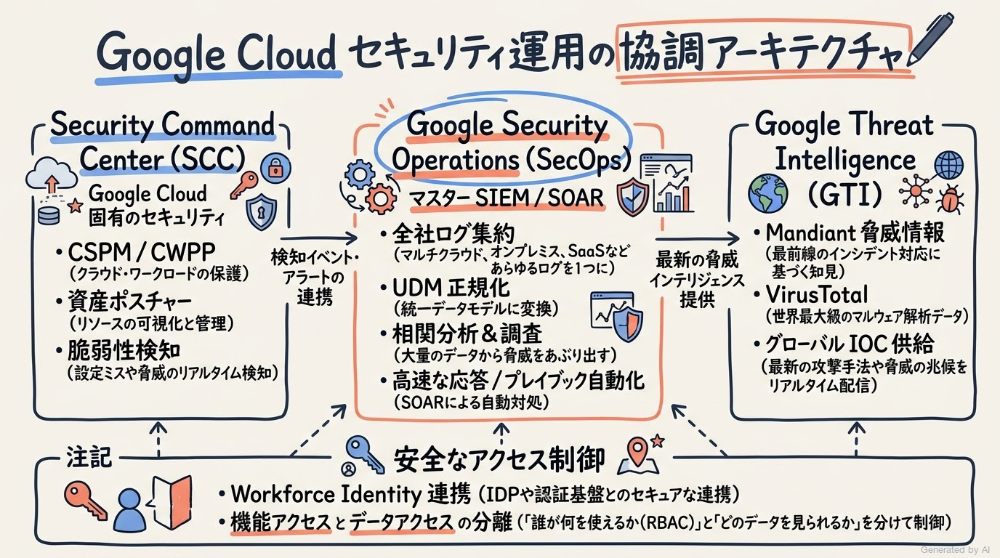
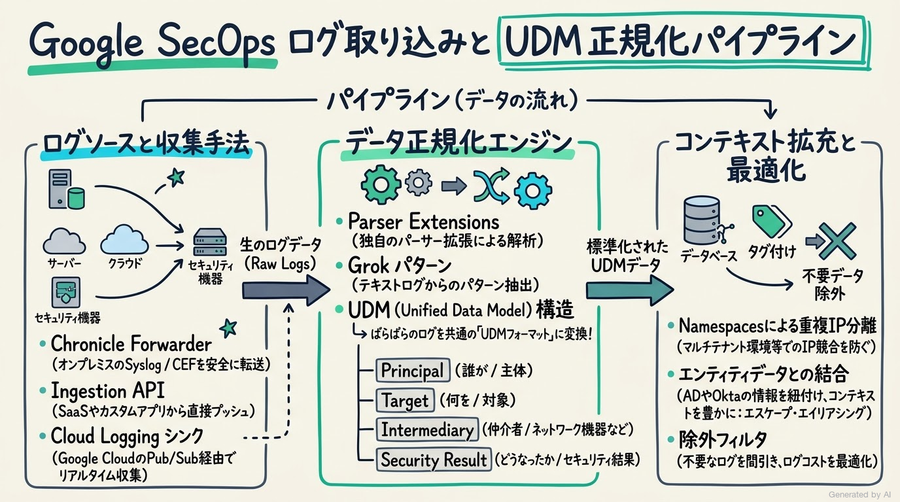
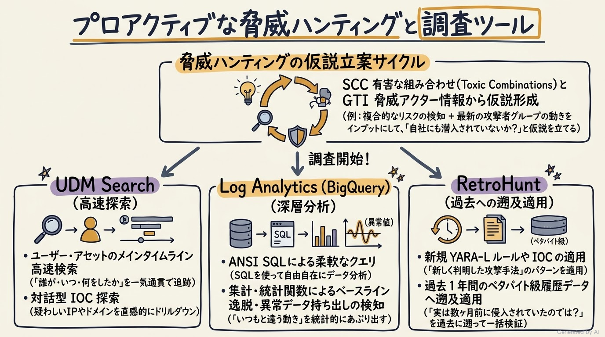
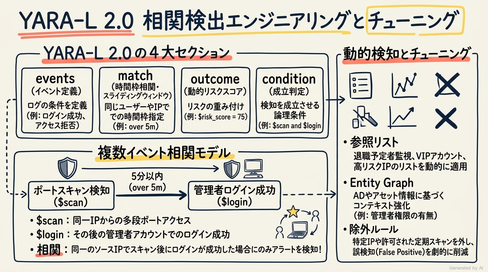
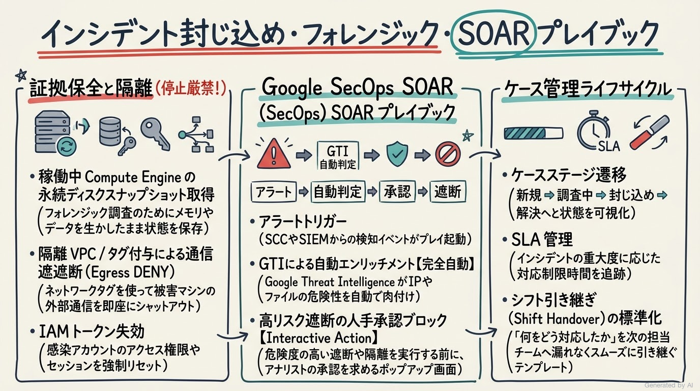
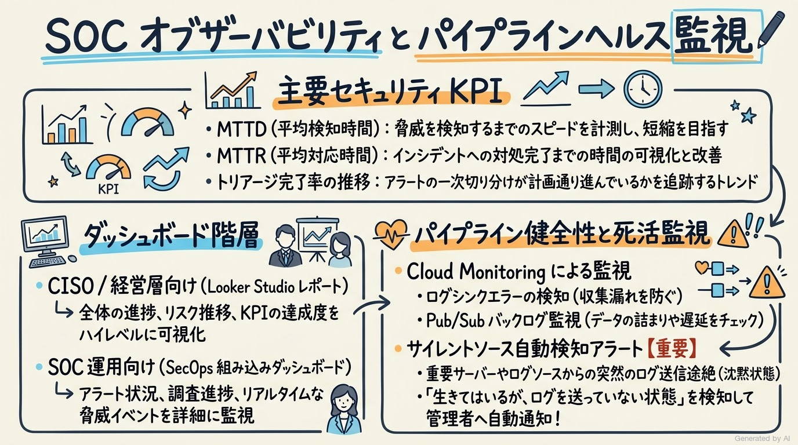

# Google Cloud Certified - Professional Security Operations Engineer 完全対策＆実践学習ガイド

- **対象資格**: Google Cloud Certified - Professional Security Operations Engineer
- **試験コード**: PSOE
- **公式試験ガイド**: [Professional Security Operations Engineer 認定試験ガイド (日本語版)](https://services.google.com/fh/files/misc/professional_security_operations_engineer_exam_guide_japanese.pdf?hl=ja)
- **公式試験ページ**: [Professional Security Operations Engineer | Google Cloud Certification](https://cloud.google.com/learn/certification/security-operations-engineer?hl=ja)
- **最終更新日**: 2026-10-17

---

## はじめに

クラウドネイティブな環境への移行とハイブリッド・マルチクラウドの普及に伴い、企業のセキュリティ運用（SOC: Security Operations Center）は前例のないデータ量と高度なサイバー攻撃の脅威に直面しています。従来の境界防御や単一システム内の静的なシグネチャ検知では、高度持続的脅威（APT）、サプライチェーン攻撃、クラウド特有のクレデンシャル侵害やラテラルムーブメントに迅速に対処することが困難になっています。

Google Cloud が提供するセキュリティ運用エコシステムは、ペタバイト規模のログをミリ秒単位で検索・分析可能な「Google Security Operations（旧 Chronicle SIEM / Siemplify SOAR）」、Google Cloud 環境のリスク・ポスチャー・脅威を一元可視化する「Security Command Center（SCC Enterprise / Premium）」、そして世界有数のサイバー脅威インテリジェンス機関である Mandiant の知見を融合した「Google Threat Intelligence（GTI）」を中核として構成されています。

本試験は、これらの最先端セキュリティ運用基盤を活用し、マルチクラウド・オンプレミスを含む企業全体のワークロード、エンドポイント、インフラを保護するための包括的な実務能力を問うものです。

---

### Professional Security Operations Engineer 試験とは

本試験は、Google Cloud におけるセキュリティ運用、脅威検知・分析、プロアクティブな脅威ハンティング、インシデント封じ込め、および SOAR による対応プロセスの自動化を主導する SOC エンジニア、セキュリティアナリスト、インシデントレスポンダーのスキルを客観的に認定する上級プロフェッショナル試験です。

- **試験時間**: 120 分（2 時間）
- **出題問題数**: 50〜60 問
- **出題形式**: 択一選択問題（4 肢中 1 つ選択）、複数選択問題（5 肢以上中 2 つ以上選択）
- **合格基準点**: 合否のみ開示（非開示、推定 70% 以上の正答率）
- **受験料**: $200（税別）
- **提供言語**: 日本語、英語
- **推奨される前提知識**: セキュリティ業界での 3 年以上の実務経験（Google Cloud セキュリティツールの設計・運用実務 1 年以上を含む）

---

### 難易度と求められる思考力

本試験は、単なる Google Cloud プロダクトの機能名称やコンソール操作の暗記では合格できません。エンタープライズの SOC 現場で直面する極めて実践的なユースケースに基づき、以下のような高度な技術的判断力とトレードオフの評価が求められます。

1. **アーキテクチャの役割分担とツール正当化**:
   - Security Command Center（SCC）と Google Security Operations（SecOps）の機能重複と得意領域を理解し、環境内のテレメトリーをどちらに優先集約・ルーティングすべきかを論理的に判断する力。
2. **ログパイプライン設計と UDM 正規化**:
   - Syslog、JSON、CEF などの非構造化ログを UDM（Unified Data Model）の正しいフィールド（Principal, Target, Intermediary, Observer, Security Result 等）へマッピングし、Grok 構文や Parser Extension を用いて拡張するデータエンジニアリング力。
3. **YARA-L 2.0 による緻密な検出ロジック構築**:
   - 単一イベントの検知にとどまらず、スライディングウィンドウ（時間枠）を用いた複数イベントの相関条件、プレースホルダー変数によるエンティティ結合、参照リスト（Reference Lists）の活用、および誤検知（False Positive）を抑止する除外ロジックの組み立て能力。
4. **RetroHunt とプロアクティブな脅威ハンティング**:
   - 新たに公開された IOC（セキュリティ侵害インジケータ）やゼロデイ攻撃手法に対し、過去のペタバイト級ログへ遡及クエリを実行（RetroHunt）し、過去に遡って侵害の痕跡を発見する実務能力。
5. **SOAR プレイブックによる自動化とケースライフサイクル管理**:
   - アラートのトリアージ、外部インテリジェンスによるエンリッチメント（データ拡充）、ネットワーク隔離やアカウント失効などの封じ込めアクションにおいて、完全自動化すべきタスクと人手承認（Interactive Action）を挟むべきタスクの適切な切り分け。

---

### 推奨の勉強法

1. **公式一次ドキュメントと構文仕様の精読**:
   - Google SecOps の UDM フィールド仕様、YARA-L 2.0 言語リファレンス、および SCC Enterprise / Premium のアーキテクチャガイドを熟読し、仕様の背景にある設計哲学を理解します。
2. **実機ハンズオンによる手触り感の獲得**:
   - Google Skills 等のハンズオンラボを通じ、SecOps コンソールでの UDM Search、ルールエディタでの YARA-L 記述、および SOAR プレイブックのビジュアルエディタ操作を実体験します。
3. **実践シナリオ（状況・対応・結果・解説）による意思決定プロセスの追体験**:
   - 本ガイドに収録された網羅的な実践シナリオを読み込み、「なぜこの対応策がベストなのか」だけでなく「なぜ他の選択肢では要件を満たせないのか（棄却理由）」を論理的に説明できるレベルまで思考を深めます。

---

## 目次

1. [はじめに](#はじめに)
2. [学習カリキュラム・出題範囲ロードマップ](#学習カリキュラム出題範囲ロードマップ)
3. [Section 1: プラットフォーム運用 (約 14%)](#section-1-プラットフォーム運用-約-14)
4. [Section 2: データマネジメント (約 14%)](#section-2-データマネジメント-約-14)
5. [Section 3: 脅威ハンティング (約 19%)](#section-3-脅威ハンティング-約-19)
6. [Section 4: 検出エンジニアリング (約 22%)](#section-4-検出エンジニアリング-約-22)
7. [Section 5: インシデント対応 (約 21%)](#section-5-インシデント対応-約-21)
8. [Section 6: オブザーバビリティ (約 10%)](#section-6-オブザーバビリティ-約-10)
9. [まとめと推奨学習ステップ](#まとめと推奨学習ステップ)

---

## 学習カリキュラム・出題範囲ロードマップ

### セクション一覧と出題比率

| セクション番号 | セクション名 / 出題分野 | 出題比率 | 主要対象サービス・ツール |
| :--- | :--- | :--- | :--- |
| **Section 1** | プラットフォーム運用 | 約 14% | Google Security Operations (SecOps), Security Command Center (SCC), Google Threat Intelligence (GTI), Cloud IDS, Cloud IAM, Workforce Identity 連携, Cloud Audit Logs |
| **Section 2** | データマネジメント | 約 14% | Chronicle Forwarder, Ingestion API, Cloud Logging シンク, UDM (Unified Data Model), デフォルト / カスタムパーサー, Parser Extension, ログ正規化, Namespaces, ログコスト最適化 |
| **Section 3** | 脅威ハンティング | 約 19% | UDM Search, ログ分析 (Log Analytics / BigQuery), ログエクスプローラ, UEBA, GTI IOC 検索, SCC Toxic Combinations, エンティティリスクスコア, RetroHunt |
| **Section 4** | 検出エンジニアリング | 約 22% | YARA-L 2.0 (events, match, condition), スライディングウィンドウ相関, 参照リスト, Curated Detections, SCC SHA, SCC ETD カスタムモジュール, Entity Graph, 誤検知チューニング |
| **Section 5** | インシデント対応 | 約 21% | フォレンジック証拠収集, ネットワーク隔離, IAM トークン失効, GTI アーティファクト分析, Google SecOps SOAR プレイブック, ケースライフサイクル, エスカレーション |
| **Section 6** | オブザーバビリティ | 約 10% | セキュリティ KPI (MTTD, MTTR), SecOps SIEM/SOAR ダッシュボード, Looker Studio 連携, Cloud Monitoring / Logging, パイプライン健全性監視, サイレントソース検知 |

---

### セクション別出題詳細

#### Section 1: プラットフォーム運用 (約 14%)
- **出題の狙い**: SOC 運用における基盤セキュリティプラットフォーム（Google SecOps, SCC, GTI）の役割分担、相互連携、および最小権限の原則に基づく安全なアクセス制御を設計・実装する能力を検証します。
- **主要タスク**:
  - Task 1.1: 検出と対応の強化（テレメトリーソースの優先順位付け、セキュリティツールの統合、重複機能の正当化、カバレッジギャップの特定と軽減、自動化ツールの評価）
  - Task 1.2: アクセスの構成（セキュリティツールへのユーザー・サービスアカウント認証、機能アクセスとデータアクセスの分離、Cloud Audit Logs の構成と分析、API アクセス構成、Workforce Identity 連携）
- **重要キーワード**: Google Security Operations, Security Command Center, Google Threat Intelligence, Functional Access vs Data Access, Workforce Identity Federation, Service Account Impersonation, Cloud Audit Logs

#### Section 2: データマネジメント (約 14%)
- **出題の狙い**: マルチクラウド・オンプレミスの膨大なセキュリティテレメトリーを Google SecOps に効率的かつ低コストで取り込み、UDM スキーマへの正規化、パーサーの拡張、エンティティデータの拡充を行うデータパイプラインを構築する能力を検証します。
- **主要タスク**:
  - Task 2.1: セキュリティツールへのログの取り込み（ログ取り込み手法の選定、取り込みツールの構成、検出に必要なログの評価、パーサーの評価と Parser Extension、UDM 正規化、Log Types / Namespaces の評価、取り込み費用の最適化）
  - Task 2.2: ユーザー、アセット、エンティティのコンテキストにおけるベースラインの特定（イベントログとエンティティデータの分離、エイリアシングフィールドによるデータ結合、エンティティコンテキストの拡充）
- **重要キーワード**: Unified Data Model (UDM), Chronicle Forwarder, Ingestion API, Parser Extensions, Grok, Log Types, Namespaces, Event Data vs Entity Data, Aliasing Fields, Ingestion Cost Management

#### Section 3: 脅威ハンティング (約 19%)
- **出題の狙い**: 単なるアラート待ちの運用を脱却し、最新の脅威インテリジェンスや行動仮説に基づき、環境全体の膨大なログデータを横断検索して潜伏する脅威を能動的にあぶり出す能力を検証します。
- **主要タスク**:
  - Task 3.1: 環境全体での脅威ハンティングの実行（UDM Search クエリの開発、UEBA によるユーザー異常行動分析、ログ分析 / BigQuery / ログエクスプローラを活用した調査、インシデント対応チームとの連携、脅威仮説の立案）
  - Task 3.2: 脅威ハンティングへの脅威インテリジェンスの活用（履歴ログでの IOC 検索、GTI と SCC 有害な組み合わせ [Toxic Combinations] の活用、エンティティリスクスコア分析、RetroHunt による遡及調査）
- **重要キーワード**: UDM Search, Threat Hunting Hypothesis, Log Analytics (BigQuery SQL), User and Entity Behavior Analytics (UEBA), Indicators of Compromise (IOC), RetroHunt, Toxic Combinations, Google Threat Intelligence (GTI)

#### Section 4: 検出エンジニアリング (約 22%)
- **出題の狙い**: 組織固有のリスクシナリオに対応する高精度なカスタム検出ルールを YARA-L 2.0 で作成し、時間枠を伴う複数イベント相関、参照リスト連携、キュレーテッドルールの調整、および誤検知を最小限に抑えるチューニングを行う能力を検証します。
- **主要タスク**:
  - Task 4.1: リスクを検出して脅威を特定するメカニズムの開発と実装（脅威インテリジェンスの調整、YARA-L 2.0 検出ルールの設計・実装、複数イベントの時間窓相関、参照リストの活用、アセット・ユーザーのリスクスコア付与、SCC SHA / ポスチャー管理との連携、外れ値・低頻度プロセスの特定、Entity Graph の活用、SCC ETD カスタム検出モジュール）
  - Task 4.2: 検出に必要な脅威インテリジェンスの活用（IOC リスクレベルに基づくアラートスコアリング、最新 IOC のテレメトリー自動照合、誤検知の特定と除外ルール作成）
- **重要キーワード**: YARA-L 2.0, Sliding Window, Match Section, Reference Lists, Curated Detections, Event Threat Detection (ETD) Custom Modules, Entity Graph, False Positive Tuning, Alert Scoring

#### Section 5: インシデント対応 (約 21%)
- **出題の狙い**: インシデント発生時の迅速な封じ込め、フォレンジック証拠保全、根本原因究明を実行し、Google SecOps SOAR を駆使した自動プレイブックおよびケースライフサイクル管理を統括する能力を検証します。
- **主要タスク**:
  - Task 5.1: セキュリティインシデントの封じ込めと調査（フォレンジック証拠収集、アラート分析、ログ分析による被害範囲特定、ネットワーク隔離・IAM 失効による封じ込め、GTI アーティファクト分析、根本原因分析 [RCA]）
  - Task 5.2: 対応ハンドブックの構築、実装、使用（自動化適性の判断、高付加価値なデータ拡充の優先順位付け、SecOps SOAR プレイブックの構築、新規攻撃パターンへの対応プロセス設計、通知・連携実装）
  - Task 5.3: ケース管理ライフサイクルの実装（ケースステージの適切な割り当て、エスカレーションワークフローの実装、ケース引き継ぎ [Shift Handover] の有効性評価）
- **重要キーワード**: Incident Containment, Forensic Snapshots, Network Quarantine, Token Revocation, Root Cause Analysis, Google SecOps SOAR Playbooks, Playbook Blocks & Connectors, Automated Enrichment, Case Lifecycle Management, Shift Handover

#### Section 6: オブザーバビリティ (約 10%)
- **出題の狙い**: SOC 運用の成熟度・脅威傾向を可視化するダッシュボードとレポーティング基盤を構築し、ログ収集パイプライン自体の死活・障害やサイレントソース（ログ欠落）をプロアクティブに監視する能力を検証します。
- **主要タスク**:
  - Task 6.1: 分析情報を提供するダッシュボードとレポートの構築と保守（主要セキュリティ KPI [MTTD, MTTR] の特定、SecOps SIEM/SOAR ダッシュボードおよび Looker Studio 連携、カスタムレポート生成）
  - Task 6.2: ヘルスモニタリングとアラートの構成（パイプライン健全性指標の特定、Cloud Monitoring / Cloud Logging 連携、しきい値アラート設定、サイレントソース検知の構成）
- **重要キーワード**: MTTD / MTTR, SecOps Dashboards, Looker Studio, Pipeline Health Monitoring, Cloud Monitoring Alerts, Silent Sources Detection, Ingestion Quota Alerts

---

## Section 1: プラットフォーム運用 (約 14%)

モダンエンタープライズの SOC において、セキュリティツールは単体で機能するのではなく、組織全体のテレメトリーを集約・分析し、迅速な意思決定と自動アクションへ繋げる統括プラットフォームとして設計されなければなりません。



---

### 1. セクション概要

本セクションでは、Google Cloud におけるセキュリティ基盤の柱である「Security Command Center（SCC）」、「Google Security Operations（SecOps）」、「Google Threat Intelligence（GTI）」の役割分担と協調動作モデルを理解し、最小権限の原則に基づくアクセス制御と監査基盤を確立します。

- **クラウドネイティブ CSPM / CWPP とハイブリッド SIEM / SOAR の棲み分け**:
  - **Security Command Center（SCC）**: Google Cloud 環境に特化した CSPM（クラウドセキュリティポスチャー管理）、CWPP（クラウドワークロード保護）、およびクラウドインフラの脆弱性・構成ミス・脅威検知を担当します。
  - **Google Security Operations（SecOps）**: Google Cloud のみならず、AWS、Azure、オンプレミス、SaaS、エンドポイント（EDR）、ID 基盤（IdP）など、企業全体のすべてのテレメトリーを UDM に正規化して統合分析するペタバイト級の SIEM / SOAR プラットフォームです。
  - **Google Threat Intelligence（GTI）**: Mandiant の最先端サイバー脅威インテリジェンス、VirusTotal、Google 独自の可視性を統合し、攻撃者の動機・TTPs・IOC をリアルタイムに両プラットフォームへ供給します。

#### 重要キーワード

- **Google Security Operations (SecOps)**: 旧 Chronicle SIEM および Siemplify SOAR を統合したセキュリティ運用スイート。無制限に近いスケールでのログ保存・高速検索・相関分析・自動対応を提供。
- **Security Command Center (SCC) Enterprise**: クラウドポスチャー管理（SHA）、イベント脅威検出（ETD）、仮想マシン・コンテナの脆弱性管理、および Mandiant 脅威インテリジェンスが統合された Google Cloud の中核セキュリティサービス。
- **Google Threat Intelligence (GTI)**: Mandiant、VirusTotal、Google のテレメトリーを統合した脅威インテリジェンス基盤。攻撃グループのプロファイル、マルウェア解析、IOC 判定を即座に提供。
- **Workforce Identity 連携 (Workforce Identity Federation)**: 外部 ID プロバイダ（Okta、Microsoft Entra ID 等）と Google Cloud IAM を直接連携させ、ユーザーのライフサイクル管理とセキュリティツールへのシングルサインオン（SSO）を一元化する機能。
- **機能アクセスとデータアクセスの分離 (Functional vs Data Access)**: SOC アナリストに対してツールの運用管理権限（ルール作成、プレイブック編集）と、実際の顧客生ログや機密データへの閲覧権限を分離して割り当てるガバナンスモデル。

---

### 2. 重要トピック

#### 1. SCC と Google SecOps の統合アーキテクチャ

Google Cloud のセキュリティ運用では、SCC を Google Cloud 固有のセンサー兼ポスチャー管理者とし、Google SecOps を企業全体のセキュリティ統括司令塔（マスター SIEM / SOAR）とする階層アーキテクチャが推奨されます。

```text
[Google Cloud 環境] ───────────────┐
  ・VPC Flow Logs / Cloud Audit Logs │
  ・SCC (SHA / ETD / コンテナ脆弱性)   │
                                     ├──> [Google SecOps SIEM]
[マルチクラウド & オンプレミス]       │      ・UDM へのデータ正規化
  ・AWS GuardDuty / CloudTrail       │      ・YARA-L 2.0 複数ログ相関分析
  ・EDR (CrowdStrike / Defender)     │      ・RetroHunt (遡及脅威検索)
  ・Active Directory / Okta Logs     │            │
                                     │            ▼
[Google Threat Intelligence (GTI)] ──┘    [Google SecOps SOAR]
  ・Mandiant 脅威情報 / VirusTotal           ・自動トリアージ & 拡充
                                            ・自動封じ込めプレイブック
```

#### 2. セキュリティプラットフォームの役割比較マトリクス

| 比較項目 | Security Command Center (SCC) | Google Security Operations (SecOps) | Google Threat Intelligence (GTI) |
| :--- | :--- | :--- | :--- |
| **主たる役割** | Google Cloud の CSPM / CWPP / 脆弱性検知 | エンタープライズ全体の SIEM / SOAR | 脅威インテリジェンス供給・攻撃者プロファイル |
| **カバー範囲** | Google Cloud リソースおよび設定 | クラウド、オンプレミス、EDR、ネットワーク、SaaS | グローバルの攻撃動向、マルウェア、IOC、脅威アクター |
| **データ保持と検索** | 最大 13 か月のアラート/検出結果管理 | 年単位の生ログ・ペタバイト級 UDM 高速検索 | 過去のマルウェア解析データ、攻撃インフラ履歴 |
| **対応自動化 (SOAR)** | Cloud Functions / Pub/Sub による個別修復 | ビジュアルプレイブックによるマルチシステム自動化 | IOC スコアリング、コンテキスト自動拡充 |
| **主な利用者** | クラウドセキュリティ管理者、インフラ担当 | SOC アナリスト、脅威ハンター、インシデント対応者 | 脅威アナリスト、CISO、セキュリティアーキテクト |

- **アーキテクトの選定・統合基準**:
  - **Google Cloud 内の構成不備・ポスチャー管理**: SCC の Security Health Analytics（SHA）を直接利用し、修復ポリシーを適用する。
  - **マルチベンダー環境の横断分析・SIEM**: SCC の Finding（検出結果）を Google SecOps へ自動エクスポートし、EDR やオンプレミスファイアウォールのログと相関させてトリアージする。
  - **重複ツールの正当化**: SCC の Event Threat Detection と SecOps の相関ルールが類似の検知を行う場合でも、SCC は Google Cloud 内部のファブリックレベルで低遅延検知を行い、SecOps は全社的な侵害活動（ラテラルムーブメント）の全体像を捉えるため、両者の併用が不可欠である。

---

### 3. 実践シナリオ

#### シナリオ 1-1: マルチクラウド環境における統合セキュリティ監視アーキテクチャの確立

- **状況**: オンプレミス、AWS、Google Cloud の 3 環境で本番サービスを運用しており、各クラウドのセキュリティアラートが個別のコンソールにサイロ化され、重大インシデント発生時のトリアージと横断的調査に多大な時間を要している場合
- **対応**: Google Cloud 環境には SCC をデプロイして Google Cloud 固有の資産ポスチャーと構成ミスを継続的に評価させつつ、SCC の検出結果、AWS CloudTrail / GuardDuty ログ、およびオンプレミスのファイアウォール・Active Directory ログをすべて Google SecOps へ集約し、UDM スキーマに正規化して一元監視を行うアーキテクチャを導入する。
- **結果**: すべてのアラートと生ログが単一の SecOps コンソール上でタイムライン相関され、環境を跨いだ攻撃者のラテラルムーブメントを数秒で可視化できるようになり、MTTD（平均検知時間）が大幅に短縮される。
- **解説**: Google SecOps はマルチクラウドおよびオンプレミス環境のあらゆるテレメトリーをネイティブに正規化・相関分析できるペタバイト級 SIEM であり、SCC の検出結果を取り込むことでクラウド固有のインサイトと全社的なログを一元的に突き合わせられるためです。SCC 単体ではオンプレミスや他社クラウドの生ログ相関を行えず、またサードパーティ SIEM では Google Cloud 内部の深いテレメトリーとの親和性やペタバイト規模での固定価格検索性に劣るため要件を満たせません。
- **参考ドキュメント**:
  - [Google Security Operations と Security Command Center の統合ガイド](https://cloud.google.com/security-operations/docs/ingest/ingest-scc-findings): SCC 検出結果の SecOps 自動取り込み手法。

#### シナリオ 1-2: SOC アナリストに対する最小権限アクセス制御と機密データ保護

- **状況**: 金融機関の SOC において、外部委託のアナリストチームに Google SecOps でのルール作成やアラート調査を担当させるにあたり、コンプライアンス要件により生ログ内に含まれる機密顧客データ（PII）の閲覧を厳密に制限しつつ、管理機能のみを利用させたい場合
- **対応**: Google Cloud IAM および SecOps のロールベースアクセス制御（RBAC）を活用し、アナリストにはルールの作成・検証やアラートのトリアージに必要な機能権限（Functional Access）のみを付与し、機密ログの生データや特定のセンシティブ Namespace に対するデータアクセス権限（Data Access）を剥奪する。
- **結果**: 外部アナリストは脅威検知・ルール作成業務を支障なく遂行しながら、個人のクレジットカード番号や氏名などの機密生データにはアクセスできない状態が確立され、内部不正および情報漏洩リスクを完全に排除できる。
- **解説**: Google SecOps では機能権限（ルール編集、ダッシュボード操作等の UI 機能）とデータアクセス権限（特定のログタイプや顧客識別子を含む UDM フィールドへのクエリ実行権限）が明確に分離されており、最小権限の原則（PoLP）を厳格に適用できるためです。全体管理者権限を一括付与する構成や、Cloud Logging のビューレベルでのみ制限するアプローチでは、SecOps 内部での分析効率を維持しながら機密フィールドの閲覧を防止することができないため不適格です。
- **参考ドキュメント**:
  - [Google SecOps におけるロールと権限の管理](https://cloud.google.com/security-operations/docs/admin/manage-roles): 機能アクセスとデータアクセスの設定手順。

#### シナリオ 1-3: Workforce Identity 連携による外部 IdP からのセキュアな SOC ログイン

- **状況**: 全社で ID プロバイダとして Okta を標準採用しており、セキュリティ運用チームのエンジニアが Google Cloud に個別の Google アカウント（Cloud Identity）を作成することなく、既存の社内 Okta クレデンシャルと MFA（多要素認証）を用いて Google SecOps および SCC へシングルサインオン（SSO）したい場合
- **対応**: Google Cloud の Workforce Identity 連携（Workforce Identity Federation）を構成し、Okta を SAML 2.0 / OIDC IdP として設定した上で、Okta のセキュリティグループ属性を Google Cloud IAM の適切な SecOps / SCC 運用ロールにマッピングする。
- **結果**: アナリストは Okta の社内アカウントでそのままセキュアにログイン可能となり、社内での退職や異動に伴うアカウント無効化が即座に Google Cloud 側にも反映され、特権アクセスの棚卸しが自動化される。
- **解説**: Workforce Identity 連携は、企業が所有する外部 IdP の ID を Google Cloud リソースに直接認証させることができるクラウドネイティブな連携機能であり、Google アカウントの個別管理や GCDS（Google Cloud Directory Sync）によるアカウント同期の運用負担を排して一元的なライフサイクル管理を実現できるためです。サービスアカウントキーを共有したり、個人用の Google アカウントを作成して招待する運用は、セキュリティ監査およびアイデンティティガバナンスの観点から許容されないため不適格です。
- **参考ドキュメント**:
  - [Workforce Identity 連携の概要](https://docs.cloud.google.com/iam/docs/workforce-identity-federation): 外部 IdP による Google Cloud コンソール・ツールのアクセス構成。

---

### 4. 参考ドキュメント & 推奨ハンズオン

#### 公式一次ドキュメント
- [Google Security Operations のアーキテクチャと概念](https://cloud.google.com/security-operations/docs/concepts/architecture): SecOps の全体アーキテクチャ。
- [Security Command Center の概要](https://docs.cloud.google.com/security-command-center/docs): CSPM / CWPP と脅威検出の基本概念。
- [Google Threat Intelligence の概要](https://cloud.google.com/threat-intelligence/docs/overview): Mandiant / VirusTotal 統合の仕組み。

#### 推奨ハンズオン・ラボ（実機検証）
- [Mitigate Threats and Vulnerabilities with Security Command Center (Google Skills)](https://www.skills.google/?locale=ja):
  - **学習目標**: SCC Enterprise / Premium の有効化、IAM ロールの割り当て、および検出結果の確認とフィルタリングを実機で検証。
- [Identity and Access Management in Google Cloud (Google Skills)](https://www.skills.google/?locale=ja):
  - **学習目標**: IAM 条件、機能権限とデータアクセスの分離、およびサービスアカウントのセキュアな運用を検証。

---

## Section 2: データマネジメント (約 14%)

セキュリティ運用の成否は、取り込むデータの「品質」と「網羅性」に依存します。異機種のログを標準データモデルに正規化し、検索と相関分析を高速化するデータマネジメント基盤の構築が不可欠です。



---

### 1. セクション概要

本セクションでは、Google SecOps におけるログ収集アーキテクチャ、UDM（Unified Data Model）へのデータ正規化、パーサーのカスタマイズ（Parser Extensions / Grok）、およびログ取り込みコストの最適化戦略を習得します。

- **UDM（Unified Data Model）の思想**:
  - 従来の SIEM はログの生テキストをそのままインデックス化するか、ベンダー独自のカラムに格納していたため、異なる製品間での検索クエリや相関ルールの共通化が極めて困難でした。
  - UDM は、あらゆるセキュリティイベントを「名詞（Entity）」と「動詞（Event）」の構造化スキーマ（Principal: 主体、Target: 対象、Intermediary: 中継点、Observer: 観測者）に標準化します。これにより、ファイアウォール、プロキシ、EDR、クラウド監査ログがすべて同一のフィールド構造で相関可能になります。
- **イベントデータとエンティティデータの分離**:
  - **イベントデータ（Event Data）**: 「誰が、いつ、どこで、何をしたか」という時系列の活動ログ（Cloud Audit Logs、VPC Flow Logs、EDR プロセス起動ログ等）。
  - **エンティティデータ（Entity Data）**: 「そのホストやユーザーは誰か、どの組織に所属し、どんな属性を持つか」という静的・文脈情報（Active Directory / Okta のユーザーメタデータ、CMDB のアセット情報、IP とホスト名のマッピング情報）。

#### 重要キーワード

- **Unified Data Model (UDM)**: Google SecOps の共通データスキーマ。すべてのテレメトリーを構造化された Protobuf ベースのスキーマに変換。
- **Chronicle Forwarder**: オンプレミスやプライベートネットワーク内の Syslog、CEF、ファイルログをセキュアに収集し、Google SecOps の Ingestion API へ転送する軽量エージェント。
- **Parser Extension**: Google SecOps が提供する標準パーサーのロジックを上書きまたは拡張し、カスタムフィールドの抽出や独自ログ形式に対応する仕組み。
- **Grok**: 正規表現をベースに、ログテキストから構造化フィールド（IP アドレス、ユーザー名、タイムスタンプ等）を抽出するためのパターン定義言語。
- **Namespaces**: ネットワークセグメントや企業買収などで重複する IP アドレス空間（例: 複数の 10.0.0.0/8 空間）を分離して管理するための識別ラベル。
- **エイリアシング（Aliasing）**: 同一のユーザーやマシンが異なるログソースで異なる識別子（MAC アドレス、プライベート IP、ホスト名、メールアドレス）で記録されていても、同一のエンティティとして紐付ける自動結合メカニズム。

---

### 2. 重要トピック

#### 1. UDM（Unified Data Model）の主要構造

UDM イベントは、以下の 5 大要素で論理的に構成されます。

```text
┌─────────────────────────────────────────────────────────────┐
│                       UDM Event                             │
├─────────────────────────────────────────────────────────────┤
│ metadata: イベントタイプ (NETWORK_CONNECTION, USER_LOGIN等), │
│           イベント発生日時, ログタイプ, 製品名              │
├─────────────────────────────────────────────────────────────┤
│ principal: 攻撃やアクションを開始した主体                    │
│            (IP, ユーザー名, プロセス, MAC アドレス等)       │
├─────────────────────────────────────────────────────────────┤
│ target: アクションの対象となったリソース                     │
│         (接続先 IP, 宛先 URL, 対象ファイル, クラウド VM 等) │
├─────────────────────────────────────────────────────────────┤
│ intermediary: 通信を中継した機器 (プロキシ, NAT ゲートウェイ)│
├─────────────────────────────────────────────────────────────┤
│ observer: イベントを検知・記録した機器 (ファイアウォール,IDS)│
├─────────────────────────────────────────────────────────────┤
│ security_result: 判定結果 (ALLOW, BLOCK, 重大度, カテゴリ)   │
└─────────────────────────────────────────────────────────────┘
```

#### 2. ログ収集・取り込み手法の比較マトリクス

| 取り込み手法 | 対象ログソース | 特徴とメリット | 主な考慮事項・トレードオフ |
| :--- | :--- | :--- | :--- |
| **Chronicle Forwarder** | オンプレミス Syslog、ファイルログ、ネットワーク機器 | Syslog 受信、バッファリング、TLS 暗号化送信、高信頼性 | 転送用 VM の構築・パッチ管理・冗長化設計が必要 |
| **Ingestion API** | サードパーティ SaaS、自作スクリプト、カスタムアプリ | RESTful API 経由でダイレクトにログを Push 送信 | 送信側のスクリプト作成、API 認証、レートリミット管理 |
| **Cloud Logging シンク** | Google Cloud 全リソースのログ (監査、VPC、ファイアウォール) | コンソールから数クリックで設定可能。Pub/Sub 経由で SecOps へ自動配信 | 取り込み対象フィルタを適切に設定しないと無駄なログコストが発生 |
| **クラウドストレージ連携** | AWS S3、GCS バケットに蓄積された大容量バッチログ | オブジェクトの PUT イベントをトリガーに定期自動フェッチ | リアルタイム性（レイテンシ）がストリーミング方式よりやや劣る |

- **アーキテクトの選定基準**:
  - **Google Cloud 内のログ**: Cloud Logging の集約シンク（Aggregated Sink）を作成し、Pub/Sub トピック経由で SecOps に連携する。
  - **オンプレミスデータセンター**: 冗長化された Linux VM 上に Chronicle Forwarder をデプロイし、ネットワーク機器から Syslog を集約して送信する。
  - **ログコストの最適化**: ノイズとなる高頻度ログ（ヘルスチェック成功ログ、開発環境の冗長なデバッグログ）は、Cloud Logging シンクの除外フィルタ、または Forwarder 側のフィルタリング設定で事前破棄する。

---

### 3. 実践シナリオ

#### シナリオ 2-1: 独自ファイアウォールログの UDM 正規化と Parser Extension 開発

- **状況**: 社内で開発・運用しているカスタムプロキシサーバーの独自ログ（JSON 形式）を Google SecOps に取り込んだが、デフォルトパーサーが存在せず、未パースの生テキストログとして保存されてしまい、YARA-L ルールでの相関分析が実行できない場合
- **対応**: Google SecOps の Parser Extension 機能を利用してカスタムパーサーを作成し、Grok 構文および JSON 抽出ロジックを記述して、送信元 IP を `principal.ip`、宛先ドメインを `target.hostname`、HTTP ステータスコードを `security_result.action` に明示的にマッピングする。
- **結果**: 独自プロキシの通信ログが UDM に完全に正規化され、既存の脅威インテリジェンス（GTI）照合や、他の EDR ログとのクロス相関ルールが即座に機能するようになる。
- **解説**: Google SecOps の検出エンジンおよび検索エンジンは UDM フィールドを基準に動作するため、未パースのログは UDM Search や YARA-L 検出ルールでフィールド指定の評価ができず、相関分析の恩恵を受けられないためです。ログの生テキスト検索に頼るアプローチでは、ペタバイト規模での高速な相関処理が破綻し、またサードパーティの変換ツールを中継させる構成はアーキテクチャの複雑性と運用コストを不要に増大させるため不適格です。
- **参考ドキュメント**:
  - [Google SecOps カスタムパーサーの作成と拡張](https://cloud.google.com/security-operations/docs/ingest/parser-extensions): Parser Extensions の構文とデバッグ手順。

#### シナリオ 2-2: 重複するプライベート IP 空間における Namespaces の設計

- **状況**: 企業買収により、買収先企業のオンプレミスネットワークと自社の VPC ネットワークが同じプライベート IP レンジ（`10.100.0.0/16`）を使用しており、両方のファイアウォールログを Google SecOps に統合した結果、同一 IP で異なるホストの通信が混同され誤検知が多発している場合
- **対応**: Chronicle Forwarder の設定において、自社ネットワークからのログには `corp-net`、買収先企業のログには `subsidiary-net` という個別の Namespace を割り当ててログを取り込む。
- **結果**: Google SecOps 内で IP アドレスが Namespace ごとに完全に分離されてアセット解決が行われ、IP の重複による誤った相関やアラートの誤検知が完全に解消される。
- **解説**: Google SecOps の Namespaces 機能は、同一の IP アドレス空間を持つ異なるネットワークセグメントを論理的に分離し、アセット解決やタイムライン構築において別々の実体として識別するために設計されたネイティブ機能であるためです。NAT（ネットワークアドレス変換）で IP を無理に書き換える方法は既存システムの再設計やパケット追跡の困難を招き、またテナントを物理的に別々の SecOps インスタンスに分離する方法は SOC の一元監視ポリシーに反するため採用できません。
- **参考ドキュメント**:
  - [Google SecOps における Namespaces の利用](https://cloud.google.com/security-operations/docs/ingest/namespaces): ネットワーク重複環境でのアセット識別設定。

#### シナリオ 2-3: ログインジェストコストの抑制とログ価値の最適化

- **状況**: Google Cloud の VPC Flow Logs と Cloud Audit Logs をすべて SecOps に取り込む設計を行ったところ、内部マイクロサービス間のロードバランサヘルスチェック通信ログが全体の 60% を占め、取り込み帯域およびストレージリソースを無駄に圧迫している場合
- **対応**: Cloud Logging のエクスポートシンクにおいて包含・除外フィルタ（Inclusion/Exclusion Filter）を設定し、ヘルスチェックエージェントの User-Agent およびポート番号に一致する VPC フローログを SecOps への転送対象から除外し、セキュリティ上価値の高い外部向け Egress 通信および管理アクティビティログのみを取り込む。
- **結果**: SecOps への取り込みログ量が 60% 削減され、ネットワーク帯域とコストが最適化されるとともに、SOC アナリストの検索ノイズが排除されて調査効率が向上する。
- **解説**: セキュリティ監視において、内部の正常な定期ヘルスチェック通信は侵害検知への寄与度が極めて低く、取り込み元（ソース側）のフィルタで事前に除外することがログパイプライン設計のベストプラクティスであるためです。SecOps 側に取り込んだ後にパーサーで破棄する方法では、ネットワーク転送量および API コストが無駄に発生し、また VPC フローログ自体の生成を完全に停止する手法はインフラのネットワークトラブルシューティング能力を喪失させるため不適格です。
- **参考ドキュメント**:
  - [Google Cloud Logging シンクのフィルタリング設定](https://docs.cloud.google.com/logging/docs/export/configure_export_v2): ログルーティングにおける除外フィルタ設計。

---

### 4. 参考ドキュメント & 推奨ハンズオン

#### 公式一次ドキュメント
- [Unified Data Model (UDM) 概要](https://cloud.google.com/security-operations/docs/concepts/udm-overview): UDM のスキーマ構造とフィールド定義。
- [Chronicle Forwarder のインストールと設定](https://cloud.google.com/security-operations/docs/ingest/forwarder-overview): Forwarder のデプロイガイド。
- [Supported Log Formats and Ingestion Methods](https://cloud.google.com/security-operations/docs/ingest/ingestion-overview): サポートされるログタイプ一覧。

#### 推奨ハンズオン・ラボ（実機検証）
- [Ingest and Normalize Security Data in Google SecOps (Google Skills)](https://www.skills.google/?locale=ja):
  - **学習目標**: Chronicle Forwarder の設定、Cloud Logging シンクからの連携、および Parser Extension による UDM フィールド抽出のテスト。
- [Managing Cloud Logging and Log Sinks (Google Skills)](https://www.skills.google/?locale=ja):
  - **学習目標**: 包含・除外フィルタを用いた高度なログルーティングの構築。

---

## Section 3: 脅威ハンティング (約 19%)

受動的なアラート待ちの運用だけでは、正規の認証情報を悪用した「環境寄生型攻撃（Living off the Land）」やゼロデイ攻撃を防ぐことはできません。膨大な履歴データを横断探索する能動的な脅威ハンティングが求められます。



---

### 1. セクション概要

本セクションでは、仮説立案に基づく脅威ハンティングの手法、Google SecOps の UDM Search、BigQuery と連携した Log Analytics、UEBA（ユーザー・エンティティ行動分析）、および過去のログへ遡及適用する RetroHunt の実務手法を習得します。

- **脅威ハンティングの仮説立案サイクル**:
  1. **インテリジェンス・ポスチャーの分析**: GTI から提供される最新の攻撃手法（TTPs）や、SCC が検知したリスクの高いポスチャー（例: 外部公開された GCS バケットと過剰なサービスアカウント権限の組み合わせ）から出発する。
  2. **仮説の形成**: 「攻撃者は既に社内 VM に侵入し、メタデータサーバーからアクセストークンを窃取して別プロジェクトへアクセスしているのではないか？」という検証可能な仮説を立てる。
  3. **クエリと探索の実行**: UDM Search や Log Analytics（BigQuery SQL）を用いて環境全体のログを横断検索する。
  4. **パターンの発見とルール化**: 潜伏する不審行動を特定した場合、インシデント対応へエスカレーションするとともに、検出エンジニアリングチームへフィードバックして恒常的な YARA-L 検出ルールとして実装する。

#### 重要キーワード

- **UDM Search**: Google SecOps 内の正規化された UDM データを、フィールド指定および論理演算子を用いて高速にクエリするインタラクティブ検索機能。
- **RetroHunt (レトロハント)**: 新たに作成した YARA-L ルールや最新の IOC リストを、過去（最大 1 年間）に蓄積されたペタバイト級の履歴データに対して遡及適用し、過去に遡って未検知の侵害が発生していなかったかを検証する機能。
- **Log Analytics (Cloud Logging ログ分析)**: BigQuery のフルマネージド SQL エンジンを活用し、Cloud Logging に蓄積されたログに対して集計、JOIN、ウインドウ関数を用いた高度なクエリを実行する機能。
- **UEBA (User and Entity Behavior Analytics)**: ユーザーやマシンの平常時の行動プロファイル（ログイン時間、アクセス元 IP、アクセス先リソース）を機械学習で学習し、平常値からの統計的逸脱（アノマリー）を検知する技術。
- **Toxic Combinations (有害な組み合わせ)**: SCC Enterprise が提供する機能。単一の脆弱性や設定ミス単体では低リスクに見えても、「外部公開」×「既知の脆弱性」×「過剰な IAM 権限」が重なることで実質的な侵入経路（アタックパス）となる状態を自動特定する分析。

---

### 2. 重要トピック

#### 1. 調査ツールの特性と使い分け

脅威ハンターは、調査の目的と対象データの性質に応じて最適な検索ツールを選択する必要があります。

```text
┌─────────────────────────────────────────────────────────────┐
│                    脅威ハンティングツール選定               │
├──────────────────────────────┬──────────────────────────────┤
│ Google SecOps UDM Search     │ ・マルチクラウド・全社横断ログ│
│                              │ ・秒単位の対話的インデックス検索│
│                              │ ・アセットとユーザーのタイムライン│
├──────────────────────────────┼──────────────────────────────┤
│ Cloud Logging Log Analytics  │ ・Google Cloud リソースログ  │
│ (BigQuery SQL)               │ ・GROUP BY, JOIN 等の複雑な集計│
│                              │ ・特定期間の統計的ベースライン分析│
├──────────────────────────────┼──────────────────────────────┤
│ Google SecOps RetroHunt      │ ・新規 IOC / YARA-L ルールの │
│                              │   過去 1 年間にわたる遡及適用│
│                              │ ・過去の潜伏インシデントのあぶり出し│
└──────────────────────────────┴──────────────────────────────┘
```

#### 2. 脅威ハンティング手法・ツールの比較マトリクス

| ツール / 手法 | 主な活用シナリオ | 検索言語 / 構文 | 対象期間 |
| :--- | :--- | :--- | :--- |
| **UDM Search** | 特定の不審な IP / ドメイン / ユーザーの活動履歴追跡 | UDM フィールド式 (`principal.user.userid = "..."`) | 数か月〜1 年以上の全データ（即時） |
| **Log Analytics (BigQuery)** | 全プロジェクトの通信データ量集計、統計的外れ値分析 | ANSI SQL (`SELECT, COUNT, AVG, GROUP BY, HAVING`) | ログバケットの保持期間（最大数年） |
| **RetroHunt** | 新規脅威インテリジェンス公開時の過去侵害有無の確認 | YARA-L 2.0 ルール構文 | 過去のアーカイブデータ（数か月〜1 年） |
| **GTI IOC 探索** | 最新の攻撃キャンペーンに関連するマルウェアハッシュ調査 | GTI ポータル / API クエリ | グローバルインテリジェンス全履歴 |

- **アーキテクトの選定基準**:
  - **特定エンティティのリアルタイム追跡**: UDM Search を使用し、対象アセットのメインタイムラインビューで前後関係を可視化する。
  - **未知のデータ持ち出しの探索**: Log Analytics を使用し、VPC フローログから「過去 30 日間で深夜帯に外部 IP へ送信された通信データ量の平均値＋3σ を超える異常ホスト」を SQL で集計する。
  - **ゼロデイ脆弱性の過去侵害調査**: 公開された脆弱性悪用パケットのパターンを YARA-L ルール化し、RetroHunt を実行して過去ログをスキャンする。

---

### 3. 実践シナリオ

#### シナリオ 3-1: RetroHunt による最新ゼロデイ侵害の遡及調査

- **状況**: Mandiant（GTI）から新たなランサムウェア攻撃グループが使用する特定の C2 ドメインおよび難読化された PowerShell コマンドラインの IOC が公開されたが、自社のリアルタイム検出ルールが作成される前に過去数週間にわたって侵入されていた懸念がある場合
- **対応**: 公開された IOC とコマンドライン特徴を反映した YARA-L 2.0 検出ルールを作成し、Google SecOps の RetroHunt（レトロハント）機能を実行して、過去 6 か月間に取り込まれた全エンドポイントおよびプロキシログに対して遡及スキャンをかける。
- **結果**: 3 週間前に社内の 1 台の開発用端末が該当 C2 ドメインへアクセスしていたログが即座にヒットし、潜伏していた侵害の痕跡と水平展開の起点を特定できる。
- **解説**: Google SecOps の RetroHunt は、新しく定義した検知ロジックを過去のペタバイト規模の蓄積ログに対してバックグラウンドで高速に再適用できるため、インテリジェンス公開以前に発生していた未知の侵入を確実に掘り起こすことができるためです。通常のリアルタイム監視ルールは作成以降のイベントしか検知できず、また手動で膨大な生ログを正規表現検索するアプローチはクエリがタイムアウトして過去全期間を網羅できないため不適格です。
- **参考ドキュメント**:
  - [Google SecOps RetroHunt の実行ガイド](https://cloud.google.com/security-operations/docs/investigate/retrohunt): 過去ログに対するルール遡及適用の手順。

#### シナリオ 3-2: Log Analytics (BigQuery) を用いた異常データ持ち出しの統計的ハンティング

- **状況**: 正規の Google Cloud サービスアカウントが侵害され、BigQuery または Cloud Storage から大量の機密データが外部の不審な IP アドレス宛に少しずつ持ち出されている（Low and Slow 型データ流出）疑いがある場合
- **対応**: Cloud Logging の Log Analytics（BigQuery リンク）を活用し、VPC フローログおよびデータアクセス監査ログに対して SQL クエリを実行し、過去 60 日間のプロジェクト別・日別の外部送信データ量を集計して、通常の移動平均から著しく乖離しているアノマリー通信を抽出する。
- **結果**: 通常は 1 日あたり数 MB しか外部通信を行わないバックオフィス用バッチジョブのサービスアカウントが、毎夜 2 時に数十 GB 単位で未知の外部 IP へデータを送信している事実をあぶり出すことができる。
- **解説**: Log Analytics は BigQuery の高度な SQL 分析エンジン（ウインドウ関数、統計関数、集計処理）をセキュリティログに直接適用できるため、単一のアラートには引っかからない長期的なベースラインからの統計的偏差を特定する脅威ハンティングに最適であるためです。単一イベントのみを監視するファイアウォールアラートや、単純なキーワード検索では、正規の認証情報を用いた低速なデータ持ち出しを検知できないため要件を満たせません。
- **参考ドキュメント**:
  - [Cloud Logging のログ分析を使用したクエリと分析](https://docs.cloud.google.com/logging/docs/analyze/query-and-view): SQL を用いたログ分析手法。

#### シナリオ 3-3: SCC 有害な組み合わせ (Toxic Combinations) に基づく侵入経路仮説の検証

- **状況**: SCC Enterprise のダッシュボードにおいて、ある公開 Web アプリケーション VM に対し「パブリックインターネットからの直接インバウンド許可」「既知の RCE 脆弱性（CVE）が存在」「過剰な Cloud Storage 編集者権限を持つサービスアカウントの紐付け」が重なった『有害な組み合わせ（Toxic Combination）』が警告されている場合
- **対応**: この Toxic Combination を起点として「攻撃者が既に RCE を悪用して VM 上でシェルを取得し、メタデータ API 経由でバケット内の機密データを閲覧したのではないか」という仮説を立て、Google SecOps の UDM Search で該当 VM のホスト名をターゲットとする過去 7 日間の Web リクエストログと、該当サービスアカウントの GCS 監査ログを突合して調査する。
- **結果**: 攻撃者による脆弱性スキャンおよびディレクトリトラバーサル試行の痕跡が発見されるが、実際の GCS オブジェクトダウンロードには至っていないことが判明し、被害が発生する前にファイアウォール閉鎖と権限剥奪の是正措置を講じることができる。
- **解説**: SCC の Toxic Combinations は複数の脆弱性・構成ミスが連鎖して生まれる現実的な攻撃経路（アタックパス）を特定する機能であり、これを脅威ハンティングの仮説立案に直結させることで、膨大なログの中から調査すべきアセットと時間軸をピンポイントに絞り込めるためです。ポスチャー警告を単なるインフラのパッチ当てタスクとして放置したり、ログ調査を行わずに VM を再起動するだけの対応では、既に侵入されていた場合の潜在的被害を見逃す危険があるため不適格です。
- **参考ドキュメント**:
  - [Security Command Center の攻撃経路と有害な組み合わせの分析](https://docs.cloud.google.com/security-command-center/docs): アタックパスシミュレーションの活用。

---

### 4. 参考ドキュメント & 推奨ハンズオン

#### 公式一次ドキュメント
- [Google SecOps UDM Search 構文リファレンス](https://cloud.google.com/security-operations/docs/investigate/udm-search): UDM 検索の構文と演算子。
- [Google Threat Intelligence を活用したハンティング](https://cloud.google.com/threat-intelligence/docs/hunting): GTI の IOC と脅威アクター追跡。
- [BigQuery を使用したセキュリティログ分析](https://docs.cloud.google.com/logging/docs/analyze/query-and-view): 大規模ログ分析アーキテクチャ。

#### 推奨ハンズオン・ラボ（実機検証）
- [Threat Hunting with Google Security Operations (Google Skills)](https://www.skills.google/?locale=ja):
  - **学習目標**: UDM Search による IOC 検索、アセットタイムラインの分析、および RetroHunt の実行検証。
- [Investigate Threats with Log Analytics (Google Skills)](https://www.skills.google/?locale=ja):
  - **学習目標**: BigQuery リンクされたログバケットに対する SQL クエリの作成と異常値検出の実践。

---

## Section 4: 検出エンジニアリング (約 22%)

検出エンジニアリングは、脅威インテリジェンスと自社の業務実態を融合させ、誤検知に埋もれることのない「高精度かつ実用的な検知ルール」を継続的に開発・保守する規律です。



---

### 1. セクション概要

本セクションでは、Google SecOps のシグネチャ言語である「YARA-L 2.0」をマスターし、複数イベントの時間窓相関、参照リスト（Reference Lists）の活用、キュレーテッド検出（Curated Detections）のチューニング、および SCC Event Threat Detection（ETD）のカスタムモジュール設計を習得します。

- **YARA-L 2.0 の構造と設計思想**:
  - YARA-L 2.0 は、ログイベントを UDM フィールド単位で評価し、高度な相関ルールを記述するために Google が設計した専用言語です。
  - ルールは主に以下の 4 つのセクションから構成されます。
    - **events**: 判定対象となるイベントの条件を記述。複数イベント（`$e1`, `$e2`）を定義可能。
    - **match**: 複数イベントを相関させる共通キー（プレースホルダー `$user`, `$ip` 等）と、スライディングウィンドウ（時間枠、例: `over 10m`）を定義。
    - **condition**: ルールがアラートを発火するための最終成立条件（例: `$e1 and #e2 > 5`）。
    - **options / outcome**: アラートの重大度スコアや、アナリストへのコンテキスト情報（カスタムメタデータ）を動的に生成。

#### 重要キーワード

- **YARA-L 2.0**: Google SecOps のルールエンジンで動作する強力な脅威検出言語。
- **スライディングウィンドウ (Sliding Window)**: `match` セクションで指定する時間枠（例: `over 5m`）。一定時間内に発生した一連の振る舞いを追跡。
- **参照リスト (Reference Lists)**: ルールコード内にハードコードすることなく、外部から動的に更新可能な値のリスト（悪意のある IP リスト、退職予定者リスト、管理対象ドメイン等）。文字列、CIDR、正規表現をサポート。
- **Curated Detections (キュレーテッド検出)**: Google のセキュリティエンジニアおよび Mandiant チームが作成・保守する事前構築済み検出ルールセット。ワンクリックで有効化可能。
- **SCC Event Threat Detection (ETD) カスタムモジュール**: SCC のストリーミング脅威検知エンジンに対し、組織固有のカスタム検知ロジック（特定の機密 GCS バケットへの異常アクセス検知等）を追加定義する機能。
- **Entity Graph (エンティティグラフ)**: ユーザーやアセットの関連性、権限、所属組織の文脈データをグラフ構造で保持し、検出ルール内でコンテキストを強化する機能。
- **誤検知チューニング (False Positive Tuning)**: 除外ルール（Rule Exclusions）やコンテキスト条件を追加し、正常な業務通信（バックアップ、CI/CD テスト等）によるアラート発火を抑制する作業。

---

### 2. 重要トピック

#### 1. YARA-L 2.0 ルール構造の完全解剖

以下は、典型的な「ブルートフォース攻撃後のログイン成功（パスワードスプレー/クレデンシャルスタッフィング）」を検知する YARA-L 2.0 ルールの設計パターンです。

```yara
rule brute_force_login_success {
  meta:
    author = "SOC Detection Team"
    description = "同一ユーザーに対する 10 分以内の 5 回以上のログイン失敗と、その後のログイン成功を検知"
    severity = "High"
    priority = "High"

  events:
    // イベント 1: ログイン失敗
    $fail.metadata.event_type = "USER_LOGIN"
    $fail.security_result.action = "BLOCK"
    $fail.target.user.userid = $user
    $fail.principal.ip = $src_ip

    // イベント 2: ログイン成功
    $success.metadata.event_type = "USER_LOGIN"
    $success.security_result.action = "ALLOW"
    $success.target.user.userid = $user
    $success.principal.ip = $src_ip

    // 成功イベントが失敗イベントの後に発生していることを担保
    $fail.metadata.event_timestamp.seconds < $success.metadata.event_timestamp.seconds

  match:
    // 同一ユーザーかつ同一送信元 IP ごとに 10 分間の時間枠で集約
    $user, $src_ip over 10m

  outcome:
    // リスクスコアの動的算出とコンテキストの付与
    $risk_score = max(85)
    $failed_login_count = count($fail.metadata.id)

  condition:
    // ログイン失敗が 5 回以上発生し、かつ 1 回以上のログイン成功が存在すること
    #fail >= 5 and #success >= 1
}
```

#### 2. 検出アプローチの比較マトリクス

| 検出アプローチ | 適用シナリオ | 開発・保守の負荷 | 誤検知の傾向と対策 |
| :--- | :--- | :--- | :--- |
| **YARA-L 2.0 カスタムルール** | 組織固有の業務要件、特権昇格、社内機密リソースへのアクセス監視 | 高（自社エンジニアによるルール設計・テストが必要） | 設計次第。テストモードで過去ログをシミュレーション検証して調整 |
| **Curated Detections** | 一般的な攻撃手法（MITRE ATT&CK 手法、マルウェア、APT 活動）の網羅 | 極めて低（Google が自動更新・メンテナンス） | デフォルトのままでは社内スキャナ等で誤検知。除外フィルタでチューニング |
| **SCC ETD カスタムモジュール** | Google Cloud 内部のファブリックレベルのイベント（GCS, BigQuery, IAM）監視 | 中（Cloud Console または API から JSON/YAML で定義） | Cloud Audit Logs の特定のサービスやメソッドに絞り込んで抑制 |
| **参照リスト連携ルール** | 退職予定者、VIP アカウント、高リスク資産の動的監視 | 低〜中（ルール本文は変更せず、リストのみを API で更新） | リストの陳腐化に注意。IdP や HR システムと API で同期連携する |

---

### 3. 実践シナリオ

#### シナリオ 4-1: 参照リストを活用した退職予定者による機密データダウンロードの検知

- **状況**: 人事部（HR）が把握している退職予定者リストに掲載された従業員が、退職直前に機密 Cloud Storage バケットから大量のファイルをダウンロードする持ち出しインシデントをリアルタイム検知したいが、ルール内にユーザー名を直接書き込むとメンテナンスが破綻する場合
- **対応**: Google SecOps 内に `departing_employees` という文字列参照リスト（Reference List）を作成し、人事システムの API から自動更新するパイプラインを構築した上で、YARA-L 2.0 ルール内で `$e.target.user.userid in %departing_employees` かつ `$e.metadata.event_type = "STORAGE_DOWNLOAD"` という条件を指定してルールを作成する。
- **結果**: ルール本体のコードを変更することなく、退職予定者が更新されるたびに即座に検知対象へ反映され、該当者によるファイルアクセス発生時に高重大度アラートが発火する。
- **解説**: 参照リスト（Reference Lists）を使用することで、検知ロジック（コード）と動的に変化するメタデータ（データ）を疎結合に分離でき、ルールエンジンの再コンパイルや人手による修正なしに脅威インテリジェンスや人事情報を即時反映できるためです。ルールコードにユーザー名をハードコードする運用はヒューマンエラーを誘発し、またバケットの IAM ログを毎日手動監査する方法はリアルタイム性に欠け持ち出しを阻止できないため不適格です。
- **参考ドキュメント**:
  - [Google SecOps 参照リストの作成と構文](https://cloud.google.com/security-operations/docs/detect/use-reference-lists-in-rules): Reference Lists の活用手順。

#### シナリオ 4-2: YARA-L 2.0 による複数イベント相関とタイムウィンドウの設計

- **状況**: 単一の失敗アラートではノイズが多すぎるため、「外部からのポートスキャン（短時間に 50 種類以上のポートへの SYN 送信）」が発生した直後（5 分以内）に、同一の外部 IP から「社内 Web サーバーへの管理者ログイン成功」が成立した一連の侵入シーケンスのみを高重大度インシデントとして検知したい場合
- **対応**: YARA-L 2.0 で 2 つのイベント変数（`$scan` と `$login`）を定義し、`$scan.target.port` の個別カウントが 50 を超え、かつ `$login.security_result.action = "ALLOW"` である条件を記述した上で、`match: $attacker_ip over 5m` でスライディングウィンドウ相関を設定する。
- **結果**: 単なるポートスキャンや社内からの正常ログインによるノイズが完全にフィルタリングされ、侵入成功を伴う真のクリティカルインシデントのみが SOC のトリアージキューに上がってくるようになる。
- **解説**: YARA-L 2.0 の `match` セクションとプレースホルダー変数（`$attacker_ip`）を用いることで、異なる種類のログ（ネットワークフローログと認証ログ）を特定の時間枠（`over 5m`）内で結びつけ、攻撃の文脈（Context）を捉えた高精度な相関アラートを生成できるためです。個別のログに対して単純な閾値アラートを設定する手法では、大量のアラート疲弊（Alert Fatigue）を引き起こし、アナリストが重要な侵入を見落とす原因となるため不適格です。
- **参考ドキュメント**:
  - [YARA-L 2.0 複数イベント相関ルールの作成](https://cloud.google.com/security-operations/docs/detect/yara-l-2-0-overview): match セクションと集計関数の解説。

#### シナリオ 4-3: キュレーテッド検出ルールの誤検知チューニングと除外設定

- **状況**: Google SecOps のキュレーテッド検出（Curated Detections）に含まれる「不審な PowerShell コマンド実行」ルールを有効化したところ、毎晩深夜に実行される正規の社内 IT バックアップスクリプトが誤検知（False Positive）として大量にアラートを発生させている場合
- **対応**: ルール自体を無効化するのではなく、Google SecOps の「ルール除外（Rule Exclusion）」機能を構成し、バックアップスクリプトが動作する特定のホスト名および署名されたスクリプトパスに合致するコンテキストを除外条件として登録する。
- **結果**: 正規のバックアップ処理による誤検知アラートが完全に抑制され、キュレーテッド検出が持つ他の悪意ある PowerShell 攻撃に対する検知能力を損なうことなく維持できる。
- **解説**: キュレーテッド検出の運用において、誤検知が発生した際にルール全体を無効化することは、攻撃者に対する検知カバレッジに重大なブラインドスポット（死角）を生み出すため厳禁であり、正規業務の属性（ホスト、ユーザー、ハッシュ等）をピンポイントで除外設定するのが標準プラクティスであるためです。また、バックアップスクリプト側の実装を書き換える対応は業務影響が大きく、恒久的な解決策にならないため不適格です。
- **参考ドキュメント**:
  - [Google SecOps キュレーテッド検出の除外設定](https://cloud.google.com/security-operations/docs/detect/curated-detections-overview): ルール除外（Exclusions）の設定方法。

---

### 4. 参考ドキュメント & 推奨ハンズオン

#### 公式一次ドキュメント
- [YARA-L 2.0 言語仕様完全リファレンス](https://cloud.google.com/security-operations/docs/detect/yara-l-2-0-overview): 全構文・関数の解説。
- [Security Command Center Event Threat Detection の概要](https://docs.cloud.google.com/security-command-center/docs/concepts-event-threat-detection-overview): ETD の仕組みとカスタムモジュール。
- [Best Practices for Detection Engineering in Google SecOps](https://cloud.google.com/security-operations/docs/detect/rule-writing-best-practices): ルール作成のベストプラクティス。

#### 推奨ハンズオン・ラボ（実機検証）
- [Writing YARA-L Rules in Google Security Operations (Google Skills)](https://www.skills.google/?locale=ja):
  - **学習目標**: ルールエディタでの YARA-L 2.0 作成、テスト実行、および match セクションを用いた複数イベント相関の検証。
- [Configure Custom Modules for SCC Event Threat Detection (Google Skills)](https://www.skills.google/?locale=ja):
  - **学習目標**: Event Threat Detection におけるカスタム検知ルールの定義とテスト。

---

## Section 5: インシデント対応 (約 21%)

脅威が検知された瞬間から、被害の局所化・証拠の完全保全・迅速な封じ込めをミスなく実行できるかが、企業のレジリエンスを決定づけます。



---

### 1. セクション概要

本セクションでは、Google Cloud におけるインシデント封じ込め、フォレンジック証拠保全、GTI を活用した根本原因分析（RCA）、および Google SecOps SOAR による自動プレイブックの設計とケース管理ライフサイクルを習得します。

- **フォレンジック証拠保全の原則**:
  - 侵害が疑われる Compute Engine インスタンスを直ちに再起動・削除してはなりません。メモリ上のマルウェアコードや volatile な接続情報が消失するためです。
  - **証拠保全ステップ**:
    1. **ディスクスナップショットの取得**: VM の永続ディスクから整合性のあるスナップショットを取得し、読み取り専用の別プロジェクトへコピーして保管する。
    2. **メモリダンプの採取**: 仮想マシンを一時停止（Suspend）するか、専用のフォレンジックエージェントにより RAM のダンプイメージを収集する。
    3. **ネットワーク隔離**: 防火壁ルールまたは隔離用 VPC へ移行し、C2 通信を遮断しつつフォレンジック用トンネルのみを確保する。
- **Google SecOps SOAR プレイブックの役割**:
  - アラートのトリアージからエンリッチメント（GTI や VirusTotal による IP/ハッシュ照合）、チケット起票（ServiceNow/Jira）、そして封じ込めアクション（IAM セッション無効化、ファイアウォール遮断）までを一連のワークフローとして自動実行します。

#### 重要キーワード

- **Google SecOps SOAR**: 旧 Siemplify を統合したセキュリティ自動化・オーケストレーション・レスポンス基盤。
- **Playbook (プレイブック)**: トリガー、アクション、ロジックブロック、コネクタで構成される自動化ワークフロー。
- **Enrichment (データ拡充)**: アラートに含まれる IP、ドメイン、ハッシュに対して、GTI、WHOIS、DNS、SCC の文脈情報を自動付与し、アナリストの調査を補助するプロセス。
- **ネットワーク隔離 (Network Isolation)**: 侵害された VM のタグを変更し、最も優先度の高い拒否（DENY）ファイアウォールルールを適用して外部通信および社内通信を即座に遮断する手法。
- **認証情報失効 (Revoke Tokens / Sessions)**: 侵害されたユーザーまたはサービスアカウントの OAuth トークンを失効させ、サービスアカウントキーを無効化する IAM アクション。
- **ケース管理ライフサイクル (Case Management Lifecycle)**: アラートの集約、重要度評価、担当アナリストの割り当て、SLA 監視、エスカレーション、およびシフト引き継ぎ（Shift Handover）までを管理するプロセス。

---

### 2. 重要トピック

#### 1. SOAR プレイブックの自動化判断マトリクス

インシデント対応において、「何を完全自動化し、どこに人手承認（Interactive Action）を挟むべきか」の切り分けは極めて重要です。

| アクション分類 | 具体的なアクション例 | 自動化レベル | 選定基準とリスク管理 |
| :--- | :--- | :--- | :--- |
| **自動エンリッチメント** | GTI での IP レピュテーション取得、VirusTotal ハッシュ照合、CMDB 所有者検索 | **完全自動化 (No Approval)** | システムへの副作用がゼロであり、アナリストの初動トリアージ時間を 80% 以上削減可能 |
| **低リスク封じ込め** | 疑わしいフィッシングメールの隔離、一時的な低リスク端末の検疫 | **完全自動化 (No Approval)** | 業務停止リスクが低く、感染拡大防止の緊急性が勝る場合 |
| **高リスク封じ込め** | 本番データベース VM の隔離、全社共有サービスアカウントの鍵無効化 | **人手承認必須 (Interactive Block)** | 誤遮断による大規模な業務停止（Self-DoS）を防ぐため、アナリストの確認ボタン押下を必須とする |
| **通知・チケット起票** | Slack / Teams への SOC チャンネル通知、ServiceNow / Jira インシデント作成 | **完全自動化 (No Approval)** | インシデント発生の迅速な情報共有と追跡性の担保 |

#### 2. フォレンジックと封じ込めのワークフロー

```text
[重大アラート検知 (SecOps / SCC)]
              │
              ▼
[自動 SOAR プレイブック起動]
  ・GTI で IP / ハッシュの脅威度判定 (Enrichment)
  ・影響を受ける VM および IAM アカウントの特定
              │
              ▼
[証拠保全 (最優先)]
  ・Compute Engine 永続ディスクのスナップショット取得
  ・フォレンジック用読み取り専用プロジェクトへ隔離保存
              │
              ▼
[封じ込めアクション]
  ・ネットワークタグ変更によるファイアウォール隔離 (Egress/Ingress DENY)
  ・侵害された IAM サービスアカウントの無効化・トークン失効
              │
              ▼
[詳細調査 & RCA (根本原因分析)]
  ・スナップショットをフォレンジック VM にアタッチしてログ・バイナリ解析
  ・GTI で攻撃アクターと侵入経路を特定
              │
              ▼
[ケース完了 & 再発防止策の反映]
```

---

### 3. 実践シナリオ

#### シナリオ 5-1: 本番 VM 侵害時における無停止証拠保全とネットワーク隔離

- **状況**: 本番環境で稼働中の EC サイト用 Compute Engine インスタンスがマルウェアに感染し、外部の未知の C2 サーバーと暗号化通信を行っていることを SCC Event Threat Detection が検知した場合
- **対応**: 対象 VM を即座に停止・再起動することなく、Compute Engine API を通じて稼働状態のまま永続ディスクのスナップショットを取得してフォレンジック専用の隔離プロジェクトへ保管し、その後ネットワークタグを付け替えて外部通信を全面遮断する隔離ファイアウォールルール（Priority 1 の Egress DENY）を適用する。
- **結果**: 揮発性のフォレンジック証拠（ディスク状態）が確実に保全され、C2 サーバーへのデータ持ち出しが即座に食い止められるとともに、後の法廷フォレンジックや根本原因分析に耐えうる証拠チェーンが確保される。
- **解説**: インスタンスを停止または削除してしまうと、RAM 内に展開されていたマルウェアバイナリや通信コネクションなどの最重要フォレンジック情報が不可逆的に破壊されるためです。稼働したままスナップショットを取得した上で、ネットワークレベルで隔離することがセキュリティ運用の鉄則であり、インスタンスを放置して様子を見たり、OS 内部に入って手動でファイルを消去しようとする対応は証拠隠滅や被害拡大を招くため不適格です。
- **参考ドキュメント**:
  - [Google Cloud におけるインシデント対応とフォレンジック](https://docs.cloud.google.com/docs/security/incident-response): 証拠保全の公式ガイドライン。

#### シナリオ 5-2: SecOps SOAR によるフィッシングアラートの自動エンリッチメントとトリアージ

- **状況**: 社員のメールボックスに届いた不審メールに関するアラートが 1 日に数百件発生しており、アナリストが手動でメール内のリンク先 URL や添付ファイルのハッシュ値を VirusTotal や GTI で検索して調査することに忙殺され、重大インシデントへの対応が遅延している場合
- **対応**: Google SecOps SOAR 上にフィッシング自動トリアージプレイブックを構築し、アラートから URL・ドメイン・ハッシュ値を自動抽出し、GTI コネクタおよび VirusTotal コネクタを呼び出してレピュテーションスコアを自動付与させた上で、悪意が確認された場合のみ重大度を High に引き上げてアナリストのキューに割り当てる。
- **結果**: アナリストによる手動の調査工数が 90% 削減され、高リスクなフィッシング攻撃のみに集中できるようになり、トリアージ時間が数時間から数秒へと劇的に短縮される。
- **解説**: 脅威インテリジェンスの問い合わせやドメインレピュテーションの確認などのエンリッチメント（データ拡充）は、業務への副作用がなく完全に定型化可能なため、SOAR プレイブックで無条件に自動化すべき最も効果的な領域であるためです。人手による調査を継続することはアラート見落としのリスクを高め、また自動化ルールを組まずに単にメールを一括削除する対応は正当な業務メールの誤検知トラブルを引き起こすため採用できません。
- **参考ドキュメント**:
  - [Google SecOps SOAR プレイブックの構築](https://cloud.google.com/security-operations/docs/soar/playbooks/overview): プレイブック設計の基本原則。

#### シナリオ 5-3: ケース管理ライフサイクルとシフト引き継ぎ (Shift Handover) の標準化

- **状況**: 24時間365日体制のグローバル SOC において、東京拠点の昼シフトからロンドン拠点の夜シフトへのインシデント引き継ぎ時に、対応中のインシデントのステータス、未完了タスク、顧客連絡履歴が口頭やチャットツールで非公式に共有されていたため、調査の重複やエスカレーションの遅延が発生している場合
- **対応**: Google SecOps SOAR のケース管理機能を標準プロセスとして義務付け、各ケースのステージ（Investigation, Containment, Remediation）を厳格に管理するとともに、プレイブック内の引き継ぎタスク完了とケースサマリーレポートの自動生成を条件とする「Shift Handover ワークフロー」を実装する。
- **結果**: シフト交代時に引き継ぎ対象のケース、残存タスク、およびエビデンスが単一画面で構造化されて可視化され、インシデント対応の空白時間や調査の重複がゼロになる。
- **解説**: エンタープライズ SOC の成熟度において、ケース管理ライフサイクルの標準化とシステム化された引き継ぎプロセスは、グローバルチーム間での SLA 遵守とガバナンス担保に不可欠であるためです。チャットツールやスプレッドシートによる引き継ぎは情報の欠落や監査証跡の不備を招き、またケースを完了させずに放置することは重大なインシデント対応の遅延に繋がるため不適格です。
- **参考ドキュメント**:
  - [Google SecOps SOAR ケース管理のベストプラクティス](https://cloud.google.com/security-operations/docs/soar/cases/manage-cases): ケースステージとワークフロー管理。

---

### 4. 参考ドキュメント & 推奨ハンズオン

#### 公式一次ドキュメント
- [Google SecOps SOAR ドキュメント](https://cloud.google.com/security-operations/docs/soar/overview): SOAR の機能と運用。
- [Security Command Center を使用した脅威の調査と修復](https://docs.cloud.google.com/security-command-center/docs): クラウド脅威の修復手順。
- [Google Cloud アーキテクチャフレームワーク: セキュリティインシデントへの対応](https://docs.cloud.google.com/architecture/framework/security): 公式インシデント対応フレームワーク。

#### 推奨ハンズオン・ラボ（実機検証）
- [Automate Security Operations with Google SecOps SOAR (Google Skills)](https://www.skills.google/?locale=ja):
  - **学習目標**: SOAR プレイブックの作成、GTI コネクタの統合、および人手承認ブロックを含む自動レスポンスの構築。
- [Incident Response and Digital Forensics in Google Cloud (Google Skills)](https://www.skills.google/?locale=ja):
  - **学習目標**: 永続ディスクのスナップショット保全、隔離 VPC へのネットワーク遮断、および IAM トークン失効の実機演習。

---

## Section 6: オブザーバビリティ (約 10%)

「監視システムそのものが正常に動いているか」を監視できなければ、セキュリティ運用は砂上の楼閣となります。メトリクスの可視化とパイプラインの健全性監視が不可欠です。



---

### 1. セクション概要

本セクションでは、SOC の運用効率・脅威トレンドを可視化するエグゼクティブおよびオペレーションダッシュボードの構築（SecOps 組み込みダッシュボード、Looker Studio）、主要セキュリティ KPI の定義、およびログパイプライン自体のヘルスモニタリングと「サイレントソース（Silent Sources）」の早期検知を習得します。

- **主要なセキュリティ運用 KPI**:
  - **MTTD (Mean Time to Detect)**: 脅威が発生してから SOC が検知するまでの平均時間。検出エンジニアリングの精度を評価。
  - **MTTR (Mean Time to Respond / Remediate)**: 検知から封じ込め・修復が完了するまでの平均時間。SOAR プレイブックの自動化度合いを評価。
  - **インジェストレートと取り込み遅延**: 秒あたりの取り込みログ数（EPS）と、イベント発生時刻から SecOps に到達するまでの遅延時間。
- **サイレントソース（Silent Sources）の脅威**:
  - 攻撃者は侵入後、自らの痕跡を隠蔽するために Syslog デーモンを停止したり、EDR エージェントを無効化したり、ファイアウォール設定を変更してログ転送を妨害します。
  - 通常は大量のログを送信してくるはずの重要サーバー（Active Directory ドメインコントローラ、決済サーバー等）から突然ログが途絶えた状態（サイレントソース）を検知することは、重大な侵害の兆候を捉える上で死活的に重要です。

#### 重要キーワード

- **MTTD / MTTR**: セキュリティ運用の効率と成熟度を測る代表的指標。
- **Looker Studio 連携**: Google SecOps SIEM / SOAR のデータをエクスポートし、経営層や監査人向けの美麗でインタラクティブなレポートを作成する BI ツール。
- **Silent Sources (サイレントソース)**: 一定時間ログの送信が停止した重要ログソースやエージェント。障害または攻撃者による妨害の疑い。
- **Cloud Monitoring / Cloud Logging**: ログシンクのエラー率、Pub/Sub トピックの未処理メッセージ数、Forwarder のリソース使用率を監視するインフラ監視基盤。
- **取り込みクォータ監視**: API のレートリミットや Google Cloud 組織全体のログクォータ枯渇を事前に予兆検知するアラート設計。

---

### 2. 重要トピック

#### 1. SOC ダッシュボードの階層設計

オブザーバビリティ基盤は、利用者のペルソナに合わせて表示内容と更新頻度を分離して設計します。

```text
┌─────────────────────────────────────────────────────────────┐
│                    SOC オブザーバビリティ階層               │
├─────────────────────────────────────────────────────────────┤
│ エグゼクティブ・CISO 向け (Looker Studio)                   │
│   ・月次/週次の脅威トレンド, 規制遵守状況                   │
│   ・MTTD / MTTR の推移, 攻撃カテゴリ別インシデント数        │
├─────────────────────────────────────────────────────────────┤
│ SOC 運用・アナリスト向け (SecOps 組み込みダッシュボード)     │
│   ・リアルタイムの取り込みログ量 (EPS), 未トリアージ件数    │
│   ・高重大度アラート一覧, トップ狙われたアセット/ユーザー   │
├─────────────────────────────────────────────────────────────┤
│ パイプライン・インフラ監視 (Cloud Monitoring)               │
│   ・Chronicle Forwarder CPU/メモリ使用率, ネットワーク遅延  │
│   ・Pub/Sub バックログ, ログシンクのエクスポートエラー率    │
│   ・サイレントソース (ログ送信途絶アセット) の即時検知      │
└─────────────────────────────────────────────────────────────┘
```

#### 2. オブザーバビリティ手法の比較マトリクス

| 監視対象 / 手法 | 利用ツール | 主な監視メトリクス / 検出対象 | アラート連携先 |
| :--- | :--- | :--- | :--- |
| **SOC 運用成熟度・KPI** | Looker Studio / SecOps BI | MTTD, MTTR, アナリストごとの対応件数, SLA 違反率 | 月次レポーティング, 定例ミーティング |
| **リアルタイム脅威状況** | SecOps SIEM / SOAR Dashboard | 現在進行中のアラート数, 頻出 IOC, 影響を受けるホスト | SOC 大画面ディスプレイ, 当番アナリスト |
| **ログパイプライン死活** | Cloud Monitoring | `logging.googleapis.com/exports/error_count`, Forwarder CPU | PagerDuty, インフラ運用チーム |
| **サイレントソース検知** | SecOps ヘルスモニタリング / YARA-L | 特定ログタイプが直近 2 時間送信されていないホスト | SOC トリアージキュー, Slack アラート |

---

### 3. 実践シナリオ

#### シナリオ 6-1: 攻撃者によるログ妨害をあぶり出すサイレントソース自動検知

- **状況**: 高度な攻撃者が社内の Active Directory（AD）サーバーに侵入し、痕跡を残さないように Windows Event Log サービスを強制停止させた結果、SecOps への認証ログ送信が途絶えているが、エラーログ自体が出ないため誰も気づいていない場合
- **対応**: Google SecOps のヘルスモニタリング機能および取り込みルールを構成し、主要なエンティティ（重要 AD サーバー）からの `WINEVTLOG` の取り込み間隔を監視させ、過去 2 時間以上にわたってログが 1 件も受信されない状態（サイレントソース）を検知した際に即座に優先度 High のアラートを発火させる。
- **結果**: ログの送信停止から短時間で SOC アナリストへ通知が届き、インフラのハードウェア障害ではなく攻撃者によるログサービス停止の工作であることを突き止めて即座に封じ込めを実施できる。
- **解説**: セキュリティ監視における「沈黙（ログの欠落）」は、システム障害のみならず攻撃者による積極的な防衛線突破工作の重大なシグナルであり、サイレントソース監視を能動的に構成することがパイプライン設計の必須要件であるためです。通常のログ内容を監視するルールでは、ログが送られてこない状態を検知できず、また週次や月次の手動確認では手遅れになるため不適格です。
- **参考ドキュメント**:
  - [Google SecOps におけるログ取り込みヘルスモニタリング](https://cloud.google.com/security-operations/docs/monitor/ingestion-health): サイレントソース監視の設定方法。

#### シナリオ 6-2: Cloud Monitoring によるログシンク障害とバッファ枯渇の早期警戒

- **状況**: Google Cloud の Cloud Logging から Google SecOps への Pub/Sub 経由のログエクスポートにおいて、ネットワークの一時的な瞬断やクォータ超過によりエクスポートエラーが急増し、Pub/Sub トピックに未配信メッセージが滞留してリアルタイム検知が遅延する危機にある場合
- **対応**: Cloud Monitoring において `logging.googleapis.com/exports/error_count` および Pub/Sub の `pubsub.googleapis.com/subscription/num_undelivered_messages`（未配信メッセージ数）を監視するアラートポリシーを作成し、しきい値超過時に SOC インフラチームの PagerDuty へ緊急通知を送信する。
- **結果**: ログパイプラインの目詰まりが重大な検知遅延を引き起こす前にインフラ担当者が検知し、Pub/Sub クォータの引き上げとルーティング設定の是正を即座に完了できる。
- **解説**: セキュリティテレメトリーのストリーミングパイプラインにおいて、Pub/Sub のバックログ急増は取り込み遅延の直接の予兆であり、Cloud Monitoring のネイティブメトリクスを用いて早期警戒アラートを構築することがパイプラインの SLA 担保に不可欠であるためです。SecOps 側のダッシュボードのみを見ている状態では、手前の Google Cloud 側でログがスタックしている事態を検知できず、結果としてインシデントの検知遅れを招くため不適格です。
- **参考ドキュメント**:
  - [Cloud Logging のログルーティング監視](https://docs.cloud.google.com/logging/docs/routing/overview): ログシンクのエラー監視とアラート。

---

### 4. 参考ドキュメント & 推奨ハンズオン

#### 公式一次ドキュメント
- [Google SecOps レポーティングとダッシュボード](https://cloud.google.com/security-operations/docs/monitor/dashboards): ダッシュボード機能の概要。
- [Looker Studio と Google Cloud の統合](https://cloud.google.com/data-studio): セキュリティ BI レポートの作成。
- [Cloud Monitoring によるログルーターと Pub/Sub の監視](https://docs.cloud.google.com/monitoring/alerts): パイプライン監視のベストプラクティス。

#### 推奨ハンズオン・ラボ（実機検証）
- [Monitor and Visualize Security Telemetry in Google SecOps (Google Skills)](https://www.skills.google/?locale=ja):
  - **学習目標**: SecOps ダッシュボードのカスタマイズ、主要セキュリティ KPI の可視化、および Looker Studio 連携の構築。
- [Monitoring Cloud Infrastructure with Google Cloud Monitoring (Google Skills)](https://www.skills.google/?locale=ja):
  - **学習目標**: Pub/Sub トピックとログシンクのメトリクスに基づくアラートポリシーの構成。

---

## まとめと推奨学習ステップ

### 本認定試験対策の全体要約

Professional Security Operations Engineer 認定試験で問われる本質は、単一のセキュリティツールを単体で操作する技術ではありません。

1. **Google SecOps (SIEM/SOAR) と SCC (CSPM/CWPP) の協調**:
   - クラウド固有の深いポスチャー管理（SCC）と、全社・マルチクラウドのペタバイト級相関分析（SecOps）を統合するアーキテクチャ思考。
2. **UDM と YARA-L 2.0 によるデータドリブンな脅威検知**:
   - 異機種ログを UDM に正規化し、スライディングウィンドウ相関や参照リストを駆使して、誤検知のない研ぎ澄まされた検出ルールを作成するエンジニアリング力。
3. **プロアクティブな追跡と証拠を破壊しないインシデントレスポンス**:
   - RetroHunt や Log Analytics を用いた能動的な脅威ハンティングと、証拠保全を最優先した迅速な封じ込め・SOAR 自動化の実践力。

---

### 推奨学習・復習ステップ

1. **実践シナリオの「解説」に着目した思考プロセスの反復**:
   - 本ガイドに掲載された全シナリオを読み返し、「なぜ他の代替選択肢（単なる VM 停止、ルール無効化、ハードコード等）では要件を満たせないのか」を自分の言葉で論理的に説明できるようにします。
2. **YARA-L 2.0 の構文とスライディングウィンドウの記述訓練**:
   - `events`, `match`, `condition`, `outcome` の 4 つのセクションの役割を完全に把握し、複数イベント相関ルールを白紙から構築できるレベルまで習熟します。
3. **公式推奨ハンズオンラボでの実機検証**:
   - Google Skills のハンズオンラボ（SecOps、SCC、Log Analytics）を実施し、実際のコンソール画面と API 操作の手触り感を確実に身につけて試験に臨んでください。
